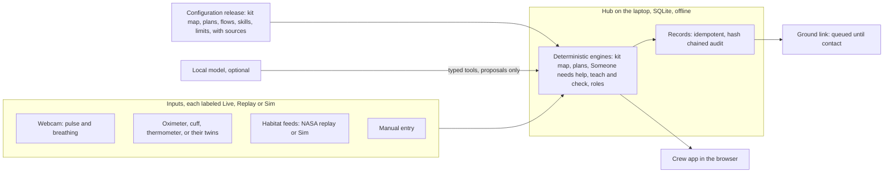

# Crew Health Check

**Measures what it can. Shows what it can't. Teaches the crew the rest.**

On Mars, a message to mission control takes 4 to 24 minutes each way
([N09](https://www.nasa.gov/missions/tech-demonstration/space-communications-7-things-you-need-to-know)), and NASA's
exploration medicine team plans for "No evacuations possible"
([N13](https://ntrs.nasa.gov/api/citations/20230007863/downloads/EIMO.AsMA2023.Lemery.final.pdf), slide 5). Today's
crew medical officer trains about 15 hours, "knowing that ground specialists will provide real-time guidance"
([N15](https://ntrs.nasa.gov/citations/20205008925)). Crew Health Check is health software for a crew that Earth cannot help in time. It checks each
of the 119 conditions NASA models for exploration missions against the kit actually on board, draws what this ship cannot
test on the crew member's body, holds a plan aboard for every condition, computes how much of each medicine is still potent, and teaches a crewmate to take a pulse by hand,
accepting it only when two independent readings agree. It runs on one laptop with no network, and its plans and its emergency flow run with the
AI switched off.

NASA Space Apps Challenge 2026 · "Create Health Monitoring Software for Astronauts on Space Missions"


## What sets it apart

**1. It shows what this ship cannot test.** The kit map ([config/kit-map.json](config/kit-map.json)) has one row for
each of the 119 conditions on NASA's exploration condition list
([S01](https://ntrs.nasa.gov/api/citations/20240004774/downloads/HRP-48036%20RevB_ExMC%20Evidence%20Library%20Methods.pdf)),
and each row links to that condition's NASA Clinical Findings Form
([S13](https://www.nasa.gov/integrated-medical-model-documentation/); 119 of 119). The hub evaluates the rows against the kit aboard. With the station kit (camera, pulse
oximeter, blood pressure cuff, thermometer, wrist band), 9 conditions get a measurement, 82 rest on what the person
reports, and 28 need a confirming test that is not aboard. The Mars kit adds an ultrasound and moves that to 16, 81
and 22. NASA's Integrated Medical Model "assumes that all medical conditions are correctly diagnosed by the crew"
([N06](https://www.nasa.gov/nasa-integrated-medical-model-imm-overview/)); this answers, condition by condition,
whether this crew can.

**2. Every condition has a plan aboard, so there are no dead ends.** [config/onboard-plans.json](config/onboard-plans.json)
holds a plan for all 119 conditions (7 written for the condition, 112 from its condition family) plus 20 responder
flows. Each plan runs in stages, ends in a stated mode (resolve here, talk a crewmate through it, stabilize and watch)
and puts the log for the ground last (139 of 139 plans). In 115 plans, a step stands in for a test the ship lacks
and says what it cannot replace: "It cannot replace an ECG".

**3. It computes how much medicine is left in each lot.** A Mars kit has to outlast its shelf life, and NASA has
measured the potency of medicines stored for more than 550 days on the ISS
([MDS58](https://pmc.ncbi.nlm.nih.gov/articles/PMC4706284/)). The potency engine ([pharmacy/](pharmacy/), contract in
[docs/ENGINE-SPEC.md](docs/ENGINE-SPEC.md)) follows each lot through its recorded storage history (temperature,
humidity, light, the microclimate inside its package and the radiation dose) and returns the active drug remaining
with a coverage interval, the degradants that formed, a decision (in specification, adjust, do not use), when the lot
is forecast to leave specification and which lot to use first. Its chemistry layer reads each molecule with RDKit and
finds the reactive sites for hydrolysis, autoxidation, photolysis, racemization and radiolysis. Where no measured rate
exists, it computes one: bond dissociation energies from GFN2-xTB quantum chemistry (tblite) feed an Evans-Polanyi
relation, next to Hammett substituent effects. Monte Carlo draws carry the uncertainty, and an assay result updates
the estimate through a Bayesian step. An independent oracle written from the contract alone agrees with it to 1e-9 on
the checked quantities ([docs/VALIDATION-REPORT.md](docs/VALIDATION-REPORT.md)). It never answers a dosing question.

**4. The crew teaches crew, and two independent readings must agree.** When the medical officer is the patient or outside on a
surface walk, a crewmate without medical training is walked through the pulse check one step at a time and taps each
beat. The hub compares that count with an independent reading from the camera and records agree, disagree or incomplete as an observation
with its source. A skills roster with practice recency proposes who helps, and every proposal states its reason.

**5. Nothing waits for Earth.** The ground link is computed from NASA's lunar and Mars communications
documents. Messages for the ground queue until the next contact. The ground link test suite stores the proof in [eval/results/E29/independence.json](eval/results/E29/independence.json): the help
session's bytes are identical with the link up, delayed and down.

**6. It runs offline on one laptop and its webcam.** The camera worker reads pulse and breathing from the face
(remote photoplethysmography), refuses a reading when the signal is poor and says why, and never guesses. The
oximeter, cuff, thermometer and the habitat's Bluetooth environmental sensor are optional; each has a simulated twin
that emits the real device's protocol bytes, so the same adapter code runs with or without hardware.

**7. The AI is optional and fenced.** A local medical model (HuatuoGPT-3-9B on llama.cpp) explains plans and asks the
next question. Its runtime is pinned to a verified build, it listens on loopback only, its tools have closed schemas
and its output is schema checked. The rule that it never changes safety state is enforced in the domain layer and
never in a prompt. Someone needs help refuses every command from the assistant, and the warnings engine holds it to
the same rule: the assistant can raise only info or watch, never "Act now" or "Emergency", and never lowers a warning
that a rule or a sensor raised. A hub started with no model reports `"assistant_state": "unavailable"` and keeps
serving.

**8. The model on the laptop passes a medical licensing exam benchmark.** On 400 questions from MedQA, the US Medical
Licensing Examination benchmark (4 options, [Jin et al. 2020](https://arxiv.org/abs/2009.13081)), the exact build that
ships (HuatuoGPT-3-9B, 4-bit, on llama.cpp, offline on the M3 laptop) answered **317 correctly: 79.3%** (95% interval
75.0% to 82.9%), with no unparseable answers and no timeouts. The run is reproducible byte for byte: the dataset
revision, the weights, the runtime binary and the chat template are pinned by SHA-256, the 400 questions are a seeded
sample fixed before the first answer was generated, and the command refuses to start if any pin differs. Method,
pins and per-question results: [docs/build/E18/MEDQA-PROXY.md](docs/build/E18/MEDQA-PROXY.md).

**9. Every reading says where it came from.** Live, Replay or Sim travels with each value from the adapter to the
screen, with its UCUM unit. Missing data stays missing: no interpolation, no default values, no fallback to sample
data.

**10. It replays NASA telemetry with known outcomes.** The repository ships 12 NASA data files (ISS cabin CO2,
radiation, air and water quality, acoustics, Inspiration4 blood panels) and 7 documented cases with their published
outcomes. In the replay of the September 2017 solar particle event, the test's onset detector fires at 04:18:40 UTC on 11
September, inside the ISS pass under way at the documented arrival of about 04:30
([N40](https://doi.org/10.1029/2018SW001920)). That is model validation of the input path, never a diagnosis.

## How it works



The hub is Python (FastAPI, SQLite). Content lives in configuration documents with provenance, loaded the way
NASA's core Flight System loads parameter tables: validated before activation, with the last good release kept when a
new one fails. The crew app is Vue and TypeScript. Architecture: [docs/SYSTEM.md](docs/SYSTEM.md). Model harness:
[docs/product/LLM-ARCHITECTURE.md](docs/product/LLM-ARCHITECTURE.md).

## What runs today

Built during the event, 14 and 15 November 2026. On `main` on 15 November: 4,650 hub and end-to-end tests, 23
configuration documents in `config/`, and CI that runs every test on Ubuntu, macOS and Windows.

| Area | On `main` |
|---|---|
| Hub | Platform and composition (`crew-health serve`), identity and consent, records with a hash-chained audit, configuration releases with provenance, a demo mode with simulated inputs (`crew-health demo`) |
| Measurement | Camera pulse and breathing with a camera twin, clinical device adapters with twins, habitat sensor twins and NASA replay feeds, trends with habitat context |
| Care | Kit map and guidance eligibility, onboard plans with printed cards, Someone needs help, teach and check, who helps, episodes, the warnings engine, the routine scheduler, mission and environment state |
| Supplies and medicines | Supplies and stock, medicines and treatments on top of the potency engine |
| Ground | Ground link schedule, queued messages and the ground log |
| Assistant | Pinned model runtime, conversations, retrieval and the typed tool gateway; the MedQA benchmark above |
| Crew app | Station screen, sign in, Today, pulse, kit, plans, teach, Someone needs help, profile |
| Potency engine (`pharmacy/`) | An independent oracle agrees with it to 1e-9 on the checked quantities; [docs/VALIDATION-REPORT.md](docs/VALIDATION-REPORT.md) tracks each validation study |

The clinical content (kit map rows and plans) was drafted from NASA's forms by one model and checked against them by
another; each row carries its check record for clinician sign-off.

## Run it

| Need | Required | Notes |
|---|---|---|
| A laptop | Yes | Reference machine: Apple M3, 16 GB. macOS, Linux or Windows |
| A browser | Yes | The hub listens on `127.0.0.1:8080` |
| A webcam | No | Camera checks; manual entry when there is none |
| Model server | No | llama.cpp `llama-server` with HuatuoGPT-3-9B weights (GGUF, fetched by script, never committed); about 7.5 GB of memory while loaded |
| Medical devices, habitat feeds, more hubs, a ground link | No | Tiers T1 to T7 in [docs/DEPLOYMENT.md](docs/DEPLOYMENT.md) section 3 |

No cloud account, internet connection or container runtime is needed to run it. To develop: Python 3.14 with
[uv](https://docs.astral.sh/uv/), pnpm (it fetches the pinned Node.js itself) and git.

```sh
# Tests: hub and end-to-end scenarios
uv run --project hub pytest -c hub/pyproject.toml --rootdir . hub/tests eval/scenarios

# Serve the hub. It needs a hub settings document; this writes one at each registered bound.
mkdir -p state
uv run --project hub python - > state/hub-settings.json <<'EOF'
import json
from crew_health.app import cli
print(json.dumps({"settings": [{
    "key": s.key, "kind": s.kind, "unit": s.unit.code if s.unit else None,
    "minimum": None if s.minimum is None else str(s.minimum),
    "maximum": None if s.maximum is None else str(s.maximum),
    "basis": "local run at each registered bound",
    "value": 50 if s.key == "supervisor.poll_ms" else {"integer": int(s.maximum or 0), "boolean": False, "text": ""}[s.kind],
} for s in cli.registered_settings()]}))
EOF
uv run --project hub crew-health serve --database state/hub.sqlite --settings state/hub-settings.json \
  --confirm-time-uncertainty-ms 500

# In another shell: the hub answers with the active configuration release and no model loaded
curl http://127.0.0.1:8080/v1/health

# Crew app, proxied to the hub
pnpm install
pnpm -C ui/crew dev
```

Demo mode runs the same hub with simulated crew, habitat feeds and a camera twin, each reading labeled Sim or Replay:

```sh
cd hub
uv run crew-health demo reset --dir ../state/demo --camera-port 8853 --twin-port 8854
uv run crew-health demo serve --dir ../state/demo --port 8080
# Cues: environment-lunar-surface, ground-link-down, eva-ilya, drill-tomas-pulse, model-start, model-stop
uv run crew-health demo cue ground-link-down --dir ../state/demo --hub http://127.0.0.1:8080
```

## Built on NASA sources

NASA data decides what the product says. The catalog in
[docs/product/NASA-SOURCES.md](docs/product/NASA-SOURCES.md) gives every source an ID; its section 1 lists 102 IDs the
product draws on, and its full catalog holds 580 NASA documents the research found. The core:

| ID | NASA source | What it does here |
|---|---|---|
| S01 | [ExMC Evidence Library Methods, HRP-48036 Rev B](https://ntrs.nasa.gov/api/citations/20240004774/downloads/HRP-48036%20RevB_ExMC%20Evidence%20Library%20Methods.pdf) | The 119 conditions: the rows of the kit map and the plans |
| S13 | [Integrated Medical Model documentation](https://www.nasa.gov/integrated-medical-model-documentation/) and its Clinical Findings Forms | The confirming test and body region of each row, linked from the row |
| N06 | [NASA Integrated Medical Model overview](https://www.nasa.gov/nasa-integrated-medical-model-imm-overview/) | The "Clinical Optimism" assumption the kit map answers |
| N01 | [NASA-STD-3001 Volume 2, Rev F](https://standards.nasa.gov/system/files/tmp/NASA-STD-3001%20Vol%202%20Rev%20F.pdf) | Habitat limits: CO2, oxygen, lunar and Martian dust, noise |
| N07, N08 | [Lunar Communications and Navigation Architecture](https://www.nasa.gov/wp-content/uploads/2024/01/lunar-communications-and-navigation-architecture.pdf), [LCRNS, SpaceOps 2025](https://ntrs.nasa.gov/api/citations/20250003321/downloads/LCRNS_Esper_257.pdf) | The Moon base contact schedule: Earth in view about half of each month at the South Pole |
| N09, N10 | [Space Communications: 7 Things](https://www.nasa.gov/missions/tech-demonstration/space-communications-7-things-you-need-to-know), [Crewed Mars communication delays, NASA Langley 2022](https://ntrs.nasa.gov/api/citations/20220013418/downloads/ASCEND-Communication%20Delays%2C%20Disruptions%2C%20and%20Blackouts%20for%20Crewed%20Mars%20Missions.pdf) | The Mars delay and the solar conjunction gap |
| N02 | [OSDR Environmental Data Application](https://osdr-tutorials.readthedocs.io/en/latest/pages/guides/environmental_data_application.html) | ISS cabin CO2, temperature and humidity replayed from Rodent Research 1 and 5 |
| N20, N30 | [OSDR RadLab](https://visualization.osdr.nasa.gov/radlab/), [CDAWeb ISS TEPC](https://cdaweb.gsfc.nasa.gov/misc/NotesI.html#ISS_DOSANL_TEPC) | ISS and Mars surface dose rates, including the September 2017 solar particle event |
| N31 | [ISS Air and Water Quality, Increment 71](https://www.nasa.gov/wp-content/uploads/2025/12/increment-71-report-including-ng-21-ingress-final.pdf) | Air contaminant and water quality golden cases |
| N34 | [OSDR Inspiration4](https://osdr.nasa.gov/bio/repo/data/missions/SpaceX%20Inspiration4) | Blood panels for personal baselines |
| N36, N37, N42 | [Biomedical Results of Apollo](https://ntrs.nasa.gov/citations/19760005580), [VIIP evidence report 2012](https://humanresearchroadmap.nasa.gov/evidence/reports/VIIP.pdf), [Venous thrombosis during spaceflight](https://www.nejm.org/doi/full/10.1056/NEJMc1905875) | Known-outcome cases: Apollo 13 and 15, vision changes on the ISS, a thrombosis treated aboard |

Every data file in [docs/product/nasa-data/](docs/product/nasa-data/) has a provenance file beside it with its URL,
sha256, units per column and the label Replay. NASA's own [Crew Medical Officer Digital
Assistant](https://ntrs.nasa.gov/api/citations/20250004306/downloads/DocInABox_AsMA%202025_Final.pdf) (listed in
section 3 of the catalog, without an ID) works on diagnostic accuracy. This project builds what sits around any such
assistant: what the kit can test, the plans packed before launch, and a crewmate's hands checked by the camera.

## Engineering discipline

[AGENTS.md](AGENTS.md) binds every person and agent in this repository. What it requires:

- **Single-fault tolerance with dissimilar backups**, after NASA-STD-8719.29 section 4.3.1
  ([AGENTS.md section 2](AGENTS.md#2-redundancy-every-critical-path-has-a-second-way)). Every critical path names
  a primary, an independent backup and a fail-safe state, and a test removes the primary. A model judgment is backed
  by a deterministic rule, a sensor by a manual reading, a screen flow by a printed card from the same configuration.
- **JPL's Power of Ten rules, adapted to Python and TypeScript**: bounded loops, queues and retries, a timeout on
  every external call, functions that fit on one screen, typed errors, `mypy --strict`, zero warnings.
- **Units on every value.** No bare float crosses a module boundary; Mars Climate Orbiter was lost to a unit mismatch.
- **Configuration as flight tables**, as in NASA's core Flight System: schema, validator, atomic activation.
- **A simulated twin for every device**, emitting the real protocol bytes with faults included (motion, low signal,
  disconnect, drift, out of range), so hardware never blocks a test.
- **Known NASA outcomes as model validation**: a case the product misses is a finding to fix, never a test to delete.
- **Durable records**: idempotent commands and an append-only, hash-chained audit trail.

Every build gets an independent review before merge. Reviews of the first 16 designs produced 313 findings, 102
of them blockers; each recurring one became a rule in AGENTS.md section 6. Every AI run that produced work is logged in
[AI-USE-LOG.md](AI-USE-LOG.md).

## Team

- Joaquin Castellano ([joaquingit1](https://github.com/joaquingit1))
- Federico Gutman ([fedegutman](https://github.com/fedegutman))
- Pedro Santiago Gentil ([pgentil](https://github.com/pgentil))

## Disclaimer

Crew Health Check is decision support and record keeping software, used under the direction of the
crew medical officer. It is not a medical device, it is not certified, and it has not been clinically validated. Four
statuses stay separate: numerical verification (the code computes what the spec says) and model validation (the spec
matches measured data) are what this project can earn; clinical validation and mission acceptance are not claimed.
Its clinical content awaits clinician review. The Replay channels are other missions' data, never anyone's exposure.
