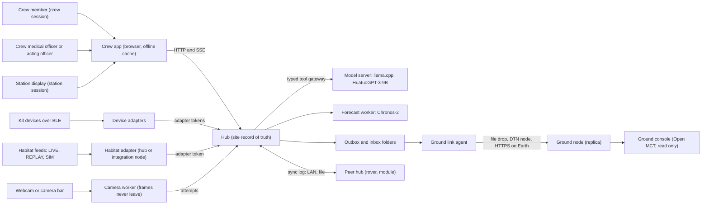

# System architecture

The architecture every builder follows. The planning package wins on product behavior and shared shapes (PRD.md,
CONTRACTS.md, `api/openapi.yaml`); `docs/BUILD-CHARTER.md` wins on how we build; this document fixes the processes, the
module map, the shared kernel, the repository layout, the data lifecycle, the cross-cutting rules and the build order.
`docs/DEPLOYMENT.md` says where each process runs. Contract changes this document needs are requests in section 13;
until each is approved, the interim stated with it applies.

## 1. Principles

1. One hub per site owns the records; everything else is a client, a worker or a replica (DEPLOYMENT.md 4.1).
2. The minimum setup is complete: every safety function runs on one laptop with the model stopped, devices absent and
   the link down. Optional parts are separate processes with health checks, timeouts and restart policies.
3. Modules talk through application ports and events only; the composition root wires them; import-linter enforces it.
4. One command is one SQLite transaction: state change, audit entry, outbox event, command identity (CONTRACTS 20).
5. Valid input is never lost because something downstream failed (section 8.6).
6. Clinical content is never merged automatically and never authorized by competence alone (sections 8.4, DEPLOYMENT
   4.4).

## 2. Context



The ground node and every peer hub are replicas reachable only through bundles or sync; the crew never waits on them.

## 3. Runtime processes

Ports are deployment settings (`crew-health.toml`) with these defaults; every worker listens on loopback only. Budgets
are for the reference laptop (Apple M3, 16 GB, PRD section 10) and are verified by the reference deployment (8.7).

| Process | Owner | Port | Budget (RSS, CPU) | Health check | Restart policy | When it is down |
|---|---|---|---|---|---|---|
| Supervisor `crew-health run` | E20 | none | 64 MB | OS service manager | OS restarts it | OS restarts it; children keep running until it returns |
| Hub (uvicorn, FastAPI) | E01 assembly | 127.0.0.1:8080; LAN 8443 when enabled | 768 MB, 2 cores | `GET /v1/health` every 2 s, 3 misses | Always; backoff 1 s doubling to 30 s; never gives up | Clients serve cached help and plan steps and queue commands; station shows the fault and the printed card fallback |
| Crew app | E03 shell, E20 offline | Served by the hub; Vite 5173 in development only | Browser | Service worker state | Browser reload | n/a |
| Ground console | E16 | Served by the ground node at `/ground/` (ground node 127.0.0.1:8180 in the single laptop demo) | Browser | n/a | n/a | Ground reads nothing new; nothing on board changes |
| Camera worker | E06 | 127.0.0.1:8091 | 1 GB, 2 cores | Own `/health` every 5 s | Backoff to 60 s; after 5 crashes in 10 min, unavailable until restarted | Camera checks show "Not measured" with the reason; manual entry |
| Device adapters (one per family) | E07, E08, E23 | 127.0.0.1:8101 to 8109 | 256 MB total | Own `/health`; hub sees heartbeats | Backoff to 60 s, then unavailable | Manual entry; kit map counts change |
| Model server (`llama-server`) | E12 and E17 (settings), E20 (process) | 127.0.0.1:8092 | 7.5 GB, GPU or 6 cores; loaded on demand | `/health` of llama-server | Started on demand; unloaded after the configured idle time; crash leaves the assistant off | Assistant says it is off; everything else unchanged |
| Embedding server (`llama-server --embedding`) | E10 (use), E17 (model), E20 (process) | 127.0.0.1:8093 | 768 MB | `/health` | On demand | Lexical retrieval only, labeled |
| Forecast worker | E14 | 127.0.0.1:8094 | 1.5 GB, 2 cores; paused while the model serves a turn | Own `/health` | Backoff, then unavailable | Deterministic baselines; the second view is absent and labeled |
| Ground link agent | E29 | 127.0.0.1:8095 | 256 MB | Own `/health` | Backoff to 60 s, never gives up | Bundles wait in the outbox; queue shown |
| DTN daemon (µD3TN or dtn7-rs), optional | E29 | Its own configured sockets | 128 MB | Agent probes it | Restarted by the agent | File drop transport |
| Research worker | E19 | 127.0.0.1:8096, ground or editor hosts only | 1 GB | Own `/health` | Backoff, then unavailable | Workbench shows unavailable; nothing on board affected |

Every call into a worker has a timeout from the hub settings document (5.11). The hub never blocks a request on a
worker: model turns, assessments, forecasts and extraction run as Jobs (CONTRACTS 20).

## 4. Module map

### 4.1 Layout of a module

`hub/src/crew_health/<module>/` with `domain/` (pure types and rules), `application/` (use cases and the module's port
protocols in `ports.py`), `adapters/` (SQLite repositories under `adapters/migrations/NNNN_<module>.sql`, device and
transport clients) and `api/` (FastAPI routers). Each module exposes `module.py` with `register(registry: ModuleRegistry)`
for the composition root (5.12). Tests in `hub/tests/<module>/`. Tables carry the module name as prefix
(`rules_warning`, `help_session`). A module owns its tables; no other module reads them.

### 4.2 Bounded contexts of CONTRACTS section 20

| CONTRACTS 20 context | Module (`crew_health.`) | Epic | Tables | Provides (ports) | Consumes (ports) | Publishes (CONTRACTS 18) | Consumes (events) |
|---|---|---|---|---|---|---|---|
| Configuration loader | `config` | E01 | `config_release`, `config_document`, `config_activation` | `ConfigReleaseReader`, `ConfigReader`, `LoaderCheckRegistry`, `TemplateRenderer` | Checks registered by modules; `SourceRegistryPort`, `ConditionRegistryPort` (E10) | `config.release_activated` | none |
| Clock | `clock` | E01 | `clock_correction` | `Clock`, `MissionClock`, `HlcClock`; domain events `ClockCorrected`, `ClockRegressed` | `ConfigReader` | none | none |
| Identity | `identity` | E02 | `identity_person`, `identity_credential`, `identity_session`, `identity_adapter_token`, `identity_device` | `SessionContext`, `require_roles`, `RosterPort`, `SessionRevocation` | `Clock`, settings | none | none |
| Identity (consent) | `consent` | E02 | `consent_grant` | `ConsentQueries.allows` | `RosterPort` | none | none |
| Event log | `events` | E01 | `events_outbox`, `events_cursor` | `OutboxSubscriptions`, SSE and `GET /v1/events` | `SessionContext`, `Visibility` (8.3) | (carries all) | none |
| Mission and environment | `mission` | E23 | `mission_environment`, `mission_overlay`, `mission_event`, `mission_state_fact`, `mission_location` | `MissionStatePort`, `OverlayPort`, `EnvironmentFacts` (8.2), `LocationPort` (8.5) | `ConfigReader`, `Clock` | `environment.*`, `overlay.changed`, `mission.event_recorded` | `config.release_activated` |
| Ground link and comms queue | `groundlink` | E29 | `groundlink_status`, `groundlink_bundle`, `groundlink_ack` | `GroundLinkQuery` (three readers only), `BundleOutbox`, `BundleInbox` | `MissionStatePort`, `ConfigReader` | `ground_link.changed` | `environment.activated` |
| Sensor ingest and monitor | `sensors` | E23 | `sensors_channel`, `sensors_reading`, `sensors_evaluation`, `sensors_status` | `SensorStateQuery`, `SensorSeriesReader`; domain events `SensorEvaluated`, `ChannelFreshnessChanged` | `ConfigReader`, `Clock` | `sensor.status_changed`, `sensor.quiet`, `sensor.resumed` | none |
| Rule engine | `rules` | E24 | `rules_warning`, `rules_dwell`, `rules_trigger`, `rules_note` | `WarningQueries`, `WarningCommands`, `InsightWarningPort`, `AssistantWarningGuard` | `SensorStateQuery`, `MissionStatePort`, `RecordFactsPort`, `AnswerQuery`, `GroundLinkQuery`, `SupplyCoverFacts`, `InsightQuery` | `warning.raised`, `warning.updated`, `warning.cleared` | Domain events `SensorEvaluated`, `ChannelFreshnessChanged`, `AnswerAccepted`, `SupplyCoverChanged`, mission domain events |
| Routine scheduler | `routine` | E25 | `routine_occurrence`, `routine_override`, `routine_deadline` | `RoutineQueries`, `RoutineCommands` | `MissionStatePort`, `OverlayPort`, `Scheduler`, `WarningQueries` | `routine.occurrence_changed`, `routine.override_changed` | `DailyCheckSubmitted`, `WarningRaised`, `WarningCleared`, drill and guided check completions |
| Records (core) | `records` | E01 | `records_observation`, `records_answer` | `ObservationReader`, `AnswerQuery`, `RecordFactsPort`, `ObservationCommands`; domain event `AnswerAccepted` | `SessionContext`, `ConsentQueries` | none (no observation event in CONTRACTS 18) | none |
| Records (daily checks, journal, profile) | `checks` | E03 | `checks_daily_check`, `checks_profile`; `private_journal_entry` in the private store | `DailyCheckQueries`, `ProfileFactsPort`, `JournalPort`; domain events `DailyCheckSubmitted`, `DailyCheckAbandoned`, `CheckCompletionRecorded` | `ObservationCommands`, `AnswerQuery`, `MissionClock` | none | none |
| Records (intake) | `intake` | E04 | `intake_concern`, `intake_chain` | `IntakeQueries` | `AnswerQuery`, `EpisodePort` (implemented by E15), `ConditionRegistryPort` | none | `AnswerAccepted` |
| Records (measurement requests, attempts, capabilities, gaps) | `measurement` | E05 | `measurement_request`, `measurement_attempt`, `measurement_gap` | `CapabilityQueries`, `MeasurementCommands`, `GapProposalPort` | `KitGate` (E27), `RequestGatePort` (E11), `ConsentQueries` | `measurement_request.changed` | none |
| Records (reports) | `reports` | E09 | `reports_report`, `reports_confirmation` | `ReportQueries` | `ObservationReader`, `ConsentQueries` | none | none |
| Records (episodes, follow-up, reviews) | `episodes` | E15 | `episodes_episode`, `episodes_followup`, `episodes_review` | `EpisodeFacts`, `EpisodePort`, `EpisodeReader`; `RecordsView` | `UrgencyQueries` (E11), `ObservationReader`, `ClinicalAuthorityQuery` | none (R-E11-3 asks for `episode.changed`) | `AnswerAccepted` |
| Records (urgency, pathways) | `pathways` | E11 | `pathways_urgency`, `pathways_signal`, `pathways_effect` | `UrgencyQueries`, `UrgencyCommands`, `InferenceGate`, `RequestGatePort`, `PathwayQueries` | `EpisodeFacts`, `HelpEntryPort` (E26), `AssistantTurnControl` (E13), `ClinicalAuthorityQuery` (E31), `EvidenceQueryPort` (E10), `KitGate` | none | `AnswerAccepted` (in transaction); `help.session_changed`, `warning.raised` (durable subscription) |
| Records (handoffs) | `handoff` | E16 | `handoff_handoff`, `handoff_receipt` | `HandoffQueries`, `GroundInboxView` | `EpisodeReader`, `ReportQueries`, `BundleOutbox` | `handoff.changed` | none |
| Kit map | `kitmap` | E27 | `kitmap_check`, `kitmap_whatif` | `KitGate`, `KitMapQueries`, `EquipmentFacts` | `CapabilityQueries`, `MissionStatePort`, `CoverPlanningPort` (E32), `RosterPort` | none | `config.release_activated` |
| Guidance eligibility (new, 8.2) | `guidance` | E27 | none | `GuidanceEligibility.evaluate`, pure `decide` | `ApprovalFacts` (E10), `EnvironmentFacts` (E23), `EquipmentFacts` (E27), `SkillFacts` (E31), `StockFacts` (E32) | none | none |
| Plan engine | `plans` | E28 | `plans_run`, `plans_step_state`, `plans_escalation` | `PlanQueries`, `PlanRunReader`, `PlanAvailability` | `GuidanceEligibility`, `SupplyLedgerPort`, `StockReader`, `HelpEntryPort`, `RoleQueryPort` | `plan_run.changed`, `plan_run.step_done`, `plan_run.escalated` | `GuidedCheckCompleted` (in transaction) |
| Plan engine (return readiness) | `readiness` | E33 | `readiness_run` | `ReadinessQueries` | `PlanQueries`, `MissionStatePort`, `GuidanceEligibility` | none | `environment.activated` |
| Teach and check | `teach` | E30 | `teach_guided_check`, `teach_beat`, `teach_sample` | `GuidedCheckQueries`; domain event `GuidedCheckCompleted` | `ObservationCommands`, `PlanRunReader`, `HelpSessionReader`, `GuidanceEligibility` | `guided_check.beat`, `guided_check.checked`, `coaching.sample` | none |
| Role engine, skills and drills | `roles` | E31 | `roles_assignment`, `roles_skill_record`, `roles_drill`, `roles_patch` | `RoleQueryPort`, `ClinicalAuthorityQuery` (8.4), `SkillFacts` | `RosterPort`, `OverlayPort`, `LocationPort`, `HelpSessionReader`, `PlanRunReader` | `role.proposed`, `role.changed`, `skill.practiced`, `drill.changed` | `help.session_changed`, `GuidedCheckCompleted` |
| Supplies ledger | `supplies` | E32 | `supplies_stock`, `supplies_use`, `supplies_custody` | `SupplyLedgerPort`, `StockReader`, `SupplyCoverFacts`, `CoverPlanningPort`, `StockFacts`; domain event `SupplyCoverChanged` | `MissionStatePort`, `LocationPort`, `PlanRunReader`, `HelpSessionReader` | `supply.used` | none |
| Supplies (medicines) | `medicines` | E32 | `medicines_assessment`, `medicines_proposal`, `medicines_administration` | `MedicineQueries` | `pharmacy` package (only from `medicines/adapters`), `ClinicalAuthorityQuery`, `ProfileFactsPort`, `ObservationReader` | none | none |
| Catch-up composer | `catchup` | E29 | `catchup_message`, `catchup_line` | `GroundLogComposer`, `GroundLogView` | `HelpLogSnapshot` reads (E26), `GroundLinkQuery`, `ConfigReader` | none | `help.session_changed`, `plan_run.*`, `supply.used` |
| Help | `help` | E26 | `help_session`, `help_action`, `help_broadcast`, `help_ground_message`, `help_log_snapshot` | `HelpEntryPort`, `HelpSessionReader`, `HelpLogSnapshots` | `SessionContext`, `MissionStatePort`, `LocationPort`; optional `BroadcastRolesSource` (E31), `HelpAssistantPort` (E13), `GroundLogComposer` (E29), `WarningQueries` (E24) | `help.session_changed`, `help.broadcast_changed`, `ground_message.changed` | none required |
| Assistant controller | `assistant` | E13 | `assistant_conversation`, `assistant_turn`, `assistant_insight`, `assistant_job` | `AssistantTurnControl`, `InsightQuery`, `HelpAssistantPort` | `ToolGateway` (E12), `InferenceGate` (E11), `AssistantWarningGuard` (E24), `GuidanceEligibility` | `assistant.status_changed`, `insight.changed`, `job.progress` | `warning.*` |
| Participation | `participation` | E22 | `participation_completion`, `participation_award` | `CompletionRecorder` | `MissionStatePort`, `MissionClock`, `RosterPort` | `participation.streak_changed`, `participation.crew_goal_changed` | `CheckCompletionRecorded` and other completion domain events |
| Views | `views` (Today, How you are) | E03 | none | `TodayView`, `HowYouAreView` | Query ports of the modules above; `IndicatorSummaryPort` (E14) | none | none |
| Views (Habitat, Records, Ground inbox) | built in `mission` (E23), `episodes` (E15), `handoff` (E16) | as listed | none | `HabitatView`, `RecordsView`, `GroundInboxView` | Query ports | none | none |
| HTTP API | `app` (assembly, middleware, error envelope) | E01 | none | `create_app(settings) -> FastAPI` | Every module's `register` | none | none |

### 4.3 Modules outside CONTRACTS section 20

| Module or path | Epic | Purpose |
|---|---|---|
| `crew_health.kernel` | E01 | Pure shared types and port protocols (section 5); no I/O |
| `crew_health.platform` | E01 | Storage kernel, unit of work, migrations, backup, audit chain, idempotency and command ledger, scheduler, health, settings, replication log |
| `crew_health.knowledge`, top level `knowledge/` (except `knowledge/workbench/`) | E10 | Registry, evidence releases, passage reads, condition registry |
| `crew_health.workbench`, `knowledge/workbench/`, `docs/research/` | E19 | Research and content workbench (section 8.1, E10 and E19) |
| `crew_health.tools`, `model/` | E12 (gateway), E17 (model settings, prompts, quantization) | Typed tool gateway; retrieval fusion and reranking over E10 primitives |
| `crew_health.trends`, `workers/forecast/` | E14 | Baselines, `IndicatorSummaryPort`, Chronos-2 worker |
| `crew_health.export` | E29 | FHIR R4 export (section 7.3) |
| `crew_health.supervisor`, `crew_health.cli` | E20 | Process supervision and the CLI shell; each epic adds its own subcommand module |
| `workers/camera/` | E06 | Camera worker (`crew_health_camera`) |
| `adapters/oximeter/`, `adapters/cuff/`, `adapters/thermometer/` | E07 | BLE adapters |
| `adapters/band/` | E08 | Band adapter and sleep pipeline (hub side scoring, if its design needs one, in `crew_health.sleep`) |
| `adapters/habitat/` | E23 | LIVE, REPLAY and SIM habitat adapters |
| `eval/bench/`, `eval/harness/` | E18 | HealthBench harness |
| `eval/scenarios/<epic>/`, `eval/runner/`, `fixtures/demo-mara-fd19/` | Each epic its folder; E21 the runner and the fixture | V and D scenarios |
| `pharmacy/`, `config/pharmacy/`, `contracts/pharmacy/`, `docs/ENGINE-SPEC.md` | Potency engine team | Read only for everyone else; imported only by `medicines/adapters` |

### 4.4 Ownership resolutions

| Conflict | Resolution |
|---|---|
| ReturnReadiness listed under the plan engine (CONTRACTS 20) and assigned to E33 | `readiness` module owned by E33, consuming `plans` ports; `plans` never imports it |
| RecordsView, HabitatView, GroundInbox in a shared "Views" context | Built by the epic that owns the data (E15, E23, E16); E03 builds only Today and How you are, consistent with E03 Q-E03-2 and E24 |
| `ui-copy.json` owner | E03 (design system and shell); every other epic files word requests to E03 |
| Roster and `medical_officer_rank` (E27, E28 assumed E01; E31 assumed E02) | E02 `RosterPort` (`crew(at)`, `members()`, `person_ids()`); the names `RosterReader` and `CrewRosterReader` are retired |
| Mission reader (E22 X-E22-5, E32) | E23 `MissionStatePort.current() -> MissionFacts`; `MissionReader` is retired |
| `ProfileFactsPort` (E26 named E04; E04 R-E04-6 says profile facts are E03-01's) | E03 provides it from the first use profile |
| `IndicatorSummaryPort` (E03 X-E03-16) | E14 |
| CapabilityGap writes (E27 section 4.5 writes gaps; E12 names E05 and E15) | E05 owns MeasurementRequest and CapabilityGap and `GapProposalPort`; E27 provides `KitGate.check` and never writes gaps |
| E10 and E19 both claimed files in `knowledge/policy/` and `knowledge/schemas/` | E10 owns `knowledge/**` except `knowledge/workbench/**`, which E19 owns with `docs/research/**`; `knowledge/docs/**` does not exist |
| E10 and E19 research store | Separate SQLite files: E10's catalog store and E19's workbench store; E19 calls E10 only through `ResearchCatalogPort`, `ReleaseBuilderPort`, `ReleaseAdminPort`; no cross-file joins |
| `HelpSessionReader` (E32 attributed it to E11; E30 asked E26 for `readable_by`) | E26 provides `HelpSessionReader.context(session, help_session_id)` and `.readable_by(session, help_session_id)` |
| `MedicalOfficerQuery.acting` (E32) and `RoleQueryPort.medical_officer_assignments` (E11) | Both answered by E31 `ClinicalAuthorityQuery` (8.4); the assignment list query stays for display |
| Cached help flows (E29-06 in the package brief; E26 claims the help cache) | E26 owns the help cache content and replay; E20 owns the shared offline mechanism (service worker, versioned document store, bootstrap artifact) in `ui/crew/src/offline/`; E29 keeps link independence evidence |
| "For the ground" card (E29-05; E26 claims it) | E29 owns the card component and composition; E26 owns the help lines it shows and the preview endpoint |
| FHIR export (no owner) | E29 `crew_health.export`, since the ground log is the IPS shaped document bundle |

## 5. Shared kernel (E01)

Exact signatures. Pure parts live in `crew_health.kernel` (no I/O, importable from any `domain`); stateful parts in
`crew_health.platform` behind the protocols below. Every module imports only these names, never E01 adapters.
In-memory fakes of every protocol ship in `crew_health.kernel.testing` on the first day, so every epic builds against
them while E01 implements the real ones.

### 5.1 Identifiers

```python
# crew_health/kernel/ids.py
ID_PATTERN: Final = re.compile(r"^[A-Za-z0-9][A-Za-z0-9_.:-]{0,127}$")   # common.schema.json#/$defs/id

class IdFactory(Protocol):
    def new(self, prefix: str) -> str: ...
        # f"{prefix}_{uuid.uuid7().hex}" (RFC 9562, Python 3.14); unique across nodes without coordination
    def derived(self, prefix: str, *parts: str) -> str: ...
        # f"{prefix}_{sha256('\x1f'.join(parts).encode()).hexdigest()[:32]}"; equal on every node for equal parts

def require_id(value: str) -> str: ...   # raises ProblemError(ErrorCode.MALFORMED_REQUEST) when the pattern fails
```

Prefixes are registered in `crew_health.kernel.id_prefixes` (one constant per record type, owned by the module that
creates the record, collected by E01). Client generated IDs are never authorization (CONTRACTS 5).

### 5.2 Clock, hybrid logical clock and corrections

```python
# crew_health/kernel/clock.py
class Clock(Protocol):
    def now(self) -> datetime: ...          # tz=UTC, never naive; one read per command (UnitOfWork.now)
    def monotonic_ns(self) -> int: ...
    def process_epoch(self) -> str: ...     # new value at every process start

@dataclass(frozen=True, slots=True, order=True)
class Hlc:
    physical_ms: int
    logical: int
    node_id: str

class HlcClock(Protocol):
    def tick(self) -> Hlc: ...
    def observe(self, remote: Hlc) -> Hlc: ...

@dataclass(frozen=True, slots=True)
class ClockCorrected:                        # domain event; also a row in clock_correction
    event_type: ClassVar[str] = "clock.corrected"
    previous_offset_ms: int
    offset_ms: int
    detected_at: datetime
    clock_version: int
    source: Literal["operator", "measured", "ground"]

@dataclass(frozen=True, slots=True)
class ClockRegressed:                        # wall clock moved behind the last committed instant
    event_type: ClassVar[str] = "clock.regressed"
    observed_at: datetime
    last_committed_at: datetime
    delta_ms: int
```

Rules: no domain code reads the wall clock; ordering inside a hub is by `seq`, across hubs by `Hlc`; durations use
`monotonic_ns` within a process epoch and are invalid across epochs (E30, E32). A backward jump larger than
`clock.regression_tolerance_ms` publishes `ClockRegressed`; modules suspend expiry based clears until a correction is
recorded (E24 3.11).

### 5.3 Mission elapsed time

```python
# crew_health/kernel/met.py
@dataclass(frozen=True, slots=True)
class MetLabel:
    met: str              # "DDD/HH:MM:SS", common.schema.json#/$defs/met
    mission_day: int
    day_label: str        # rendered from the mission clock configuration, for example "flight day 19 of 30"
    clock_version: int

class MissionClock(Protocol):
    def met(self, at: datetime) -> MetLabel: ...
    def label(self, at: datetime) -> tuple[str, int]: ...          # (day label, clock_version)
    def mission_day(self, at: datetime) -> int: ...
    def day_bounds(self, mission_day: int) -> tuple[datetime, datetime]: ...
```

Labels stored with records keep their `clock_version`; a later correction never rewrites them (E24 3.11).

### 5.4 Units (UCUM)

```python
# crew_health/kernel/units.py
@dataclass(frozen=True, slots=True)
class Unit:
    code: str                         # case sensitive UCUM code, for example "mm[Hg]", "/min", "Cel", "%", "[ppm]"

@dataclass(frozen=True, slots=True)
class Quantity:
    value: Decimal                    # finite; NaN and infinity raise at construction
    unit: Unit

class UnitRegistry(Protocol):
    def parse(self, code: str) -> Unit: ...                       # ProblemError(INVALID_UNIT) if unknown
    def convert(self, quantity: Quantity, to: Unit) -> Quantity: ...
    def commensurable(self, a: Unit, b: Unit) -> bool: ...
```

Implementation: `ucumvert` parses UCUM and builds a `pint` registry (medical-systems-standards.md 4.7 [MS55]). Wire
numbers are parsed with `parse_float=Decimal`; no bare `float` crosses a module boundary (AGENTS.md rule 8); numeric
kernels (rPPG, forecasting) may use floats inside a worker and return `Quantity`. The allowed unit codes are the ones
the configuration documents declare; a loader check rejects any other.

### 5.5 Errors and the RFC 9457 mapping

```python
# crew_health/kernel/errors.py
ErrorCode = contracts_gen.ErrorCode          # StrEnum generated from error.schema.json (38 codes)

@dataclass(frozen=True, slots=True)
class FieldError:
    field: str
    code: str
    message: str

class ProblemError(Exception):
    def __init__(self, code: ErrorCode, message: str, *, field_errors: Sequence[FieldError] = (),
                 current_state: Mapping[str, object] | None = None,
                 supported_alternative: Mapping[str, object] | None = None,
                 retryable: bool | None = None) -> None: ...
    code: ErrorCode
    status: int                               # from contracts_gen.ERROR_STATUS[code]
    retryable: bool                           # default from contracts_gen.ERROR_RETRYABLE[code]

class StorageUnavailable(ProblemError):      # code INTERNAL_ERROR, retryable True
    cause: Literal["disk_full", "locked", "io_error", "corrupt"]

@dataclass(frozen=True, slots=True)
class Problem:                                # RFC 9457 view of the same error
    type: str                                 # f"urn:crew-health:error:{code}"
    title: str                                # the code's title from ui-copy designed states
    status: int
    detail: str                               # message
    instance: str                             # f"urn:crew-health:correlation:{correlation_id}"

def to_envelope(error: ProblemError, correlation_id: str) -> contracts_gen.ErrorEnvelope: ...
def to_problem(error: ProblemError, correlation_id: str) -> Problem: ...
```

Decision: the wire body is the package `ErrorEnvelope` (closed schema; CONTRACTS 5 and the charter preamble make the
contract win on shared objects). `Problem` is the RFC 9457 mapping used in logs and offered on the wire only after
request R-SYS-1. Modules raise typed `ProblemError` subclasses; no bare exception crosses a layer; the API layer maps
any other exception to `INTERNAL_ERROR` with the correlation ID and logs it.

### 5.6 Configuration loading with provenance

```python
# crew_health/kernel/config.py
ConfigName = contracts_gen.ConfigName        # the 18 document names

@dataclass(frozen=True, slots=True)
class ConfigDocumentView:
    name: ConfigName
    version: str                              # sha256 of the raw bytes (CONTRACTS 11)
    model: BaseModel                          # generated Pydantic model of that document
    raw: bytes

class ReleaseHandle(Protocol):
    release_id: str
    def document(self, name: ConfigName) -> ConfigDocumentView: ...
    def version_of(self, name: ConfigName) -> str: ...

class ConfigReleaseReader(Protocol):
    def active(self) -> ReleaseHandle: ...    # inside a UnitOfWork or ReadSnapshot: the release at its start
    def release(self, release_id: str) -> ReleaseHandle: ...

class ConfigReader(Protocol):
    def document(self, name: ConfigName, version: str | None = None) -> ConfigDocumentView: ...
        # any version ever activated stays readable, so pinned sessions and runs resolve (R-E11-10)

@dataclass(frozen=True, slots=True)
class Finding:
    check_id: str
    document: ConfigName | None
    pointer: str                              # JSON pointer
    message: str

class ReleaseCheck(Protocol):
    check_id: str
    def check(self, candidate: CandidateRelease) -> Sequence[Finding]: ...   # pure

class ActivationGuard(Protocol):
    def check(self, uow: UnitOfWork, candidate: CandidateRelease) -> Sequence[Finding]: ...  # state aware

class LoaderCheckRegistry(Protocol):
    def register(self, check: ReleaseCheck) -> None: ...
    def register_guard(self, guard: ActivationGuard) -> None: ...

class TemplateRenderer(Protocol):
    def render(self, field_key: str, template: str, values: Mapping[str, str]) -> str: ...
        # an unknown placeholder renders ui-copy designed_states.unknown and is logged
```

Activation follows the cFS table pattern: validate into the inactive slot (schema, the 16 checks, registered checks,
guards inside the activation's `BEGIN IMMEDIATE`), swap atomically, keep the previous release for rollback, publish
`config.release_activated`. Provenance per document is what CONTRACTS 11 defines (`basis`, `source_ids`,
`to_be_set_by`); release provenance (bundle hash, signer, carrier message) is request R-SYS-14.

### 5.7 Unit of work, event envelope and in-transaction bus

```python
# crew_health/kernel/uow.py
@dataclass(frozen=True, slots=True)
class Actor:
    kind: Literal["person", "station", "ground", "operator", "adapter", "engine", "assistant"]
    id: str

class DomainEvent(Protocol):
    event_type: ClassVar[str]

@dataclass(frozen=True, slots=True)
class OutboxEvent:
    type: contracts_gen.EventType             # the 36 types of CONTRACTS 18
    scope: Literal["person", "habitat", "crew", "ground", "operator"]
    data: BaseModel                           # the contract object CONTRACTS 18 names for the type
    person_id: str | None = None              # required when scope is "person"
    audience: Audience | None = None          # privacy filter (8.3)

class UnitOfWork(Protocol):
    @property
    def connection(self) -> sqlite3.Connection: ...   # used only by the owning module's repositories
    @property
    def now(self) -> datetime: ...
    @property
    def actor(self) -> Actor: ...
    @property
    def release(self) -> ReleaseHandle: ...
    @property
    def correlation_id(self) -> str: ...
    def publish(self, event: DomainEvent) -> None: ...       # in-transaction bus, synchronous
    def emit(self, event: OutboxEvent) -> None: ...          # outbox row; delivered after commit
    def audit(self, entry: AuditEntry) -> None: ...          # hash chained (5.9)
    def schedule(self, key: str, at: datetime, handler: str,
                 payload: Mapping[str, str] | None = None) -> None: ...
    def savepoint(self, name: str) -> AbstractContextManager[None]: ...

class UnitOfWorkFactory(Protocol):
    def begin(self, *, actor: Actor, command: CommandIdentity | None = None,
              immediate: bool = True) -> AbstractContextManager[UnitOfWork]: ...

class ReadSnapshot(Protocol):                 # one SQLite read transaction
    @property
    def connection(self) -> sqlite3.Connection: ...
    @property
    def release(self) -> ReleaseHandle: ...
    @property
    def now(self) -> datetime: ...

class ReadSnapshotFactory(Protocol):
    def snapshot(self) -> AbstractContextManager[ReadSnapshot]: ...

class DomainEventBus(Protocol):
    def subscribe[E: DomainEvent](self, event_type: type[E], handler: Callable[[UnitOfWork, E], None], *,
                                  name: str) -> None: ...
    def publish(self, uow: UnitOfWork, event: DomainEvent) -> None: ...

@dataclass(frozen=True, slots=True)
class SessionContext:                          # built by E02 from the bearer token; kernel type so any module reads it
    session_id: str
    kind: Literal["crew", "station", "ground", "operator", "editor", "adapter", "node"]
    actor: Actor
    person_id: str | None
    roles: frozenset[str]                      # common.schema.json#/$defs/role values

@dataclass(frozen=True, slots=True)
class Audience:
    rule: str                                  # name of an AudienceRule registered by the owning module
    object_ref: str

class AudienceRule(Protocol):
    def admits(self, snapshot: ReadSnapshot, session: SessionContext, object_ref: str) -> bool: ...

@dataclass(frozen=True, slots=True)
class StoredEvent:
    seq: int
    type: contracts_gen.EventType
    scope: str
    person_id: str | None
    data_json: bytes
    committed_at: datetime

@dataclass(frozen=True, slots=True)
class CandidateRelease:
    release_id: str
    documents: Mapping[ConfigName, ConfigDocumentView]
```

The `node` session kind exists only after request R-SYS-3.

Rules:

- SQLite: WAL, `synchronous=FULL`, `foreign_keys=ON`, STRICT tables, one writer connection per process with
  `busy_timeout` from settings; `BEGIN IMMEDIATE` for commands. The busy timeout is the only wait.
- The producer owns the transaction. In-transaction handlers run synchronously in registration order, with reentrancy
  depth at most `event_bus.max_depth` (default 4, E25). A handler error rolls back the command, except evaluators
  wrapped by 8.6.
- `emit` writes one outbox row per scope; a type CONTRACTS 18 lists for two scopes is emitted as two rows (answers E26
  Q11). `seq` is `INTEGER PRIMARY KEY AUTOINCREMENT` in `events_outbox`, assigned in the transaction, so commit order is
  `seq` order. SSE delivery starts after commit.
- Durable in-process subscribers (R-E11-10):

```python
class OutboxSubscriptions(Protocol):
    def register(self, subscriber: str, types: frozenset[contracts_gen.EventType],
                 handler: Callable[[UnitOfWork, StoredEvent], None]) -> None: ...
        # after commit, at least once, in seq order, cursor per subscriber in events_cursor,
        # handler and cursor advance commit in one transaction; handlers are idempotent by seq
```

### 5.8 Idempotency and command identity

```python
# crew_health/kernel/commands.py
@dataclass(frozen=True, slots=True)
class CommandIdentity:
    key: str                  # Idempotency-Key header; clients generate a UUIDv7 at the moment of intent
    actor_ref: str            # person ID of the session, or the actor ID for non-person sessions
    operation: str            # operationId
    body_sha256: str          # sha256 of the RFC 8785 canonical request body
    durable: bool             # True for the clinical commands of 8.6

@dataclass(frozen=True, slots=True)
class StoredResult:
    status: int
    body: bytes
    resource_ref: str | None  # ID of the created or changed resource

class IdempotencyStore(Protocol):
    def lookup(self, uow: UnitOfWork, identity: CommandIdentity) -> StoredResult | None: ...
    def record(self, uow: UnitOfWork, identity: CommandIdentity, result: StoredResult) -> None: ...
```

Lookup happens first, before any mutable precondition, and again inside `BEGIN IMMEDIATE` (E24 response 9). The
24 hour cache (`platform_idempotency`) follows CONTRACTS 5; the durable ledger (`platform_command_ledger`) keeps
`(key, actor_ref, operation, body_sha256, resource_ref, committed_at, origin_node_id)` for the life of the mission for
durable commands (8.6).

### 5.9 Audit hash chain

```python
# crew_health/kernel/audit.py
@dataclass(frozen=True, slots=True)
class AuditEntry:
    action: str                               # "<module>.<verb>", for example "help.session_opened"
    actor: Actor
    refs: Mapping[str, str]                   # object IDs only
    safe_metadata: Mapping[str, str | int | bool]   # never journal text, symptoms, prompts or document content

class AuditVerifier(Protocol):
    def verify(self, from_seq: int = 1) -> AuditVerification: ...   # ok, first bad seq, head hash
```

Stored row: `audit_seq`, `at`, `entry_json` (RFC 8785 canonical), `prev_hash`, `entry_hash = sha256(prev_hash ||
entry_json)`, genesis `prev_hash` 32 zero bytes. Append only: a SQLite trigger refuses UPDATE and DELETE. The head hash
travels in sync status and ground bundles (DEPLOYMENT.md 5.6).

### 5.10 Scheduler and health

```python
class Scheduler(Protocol):
    def call_at(self, key: str, at: datetime, handler: str,
                payload: Mapping[str, str] | None = None) -> None: ...   # durable, idempotent by key

class SchedulerRegistry(Protocol):
    def register(self, handler: str, fn: Callable[[UnitOfWork, Mapping[str, str]], None]) -> None: ...

class HealthState(Protocol):                   # in memory; served by GET /v1/health without a write
    def mark_degraded(self, component: str, code: str, since: datetime) -> None: ...
    def mark_ok(self, component: str) -> None: ...
    def snapshot(self) -> HealthSnapshot: ...
```

Jobs live in `platform_scheduler`; due jobs run each in its own unit of work; on start every module re-registers its
durable deadlines; a `ClockCorrected` event reschedules by the new offset.

### 5.11 Settings

```python
class HubSettings(Protocol):
    def get(self, key: str) -> Quantity | int | bool | str: ...
```

Two sources, both validated at start: deployment settings in `<data_dir>/crew-health.toml` (DEPLOYMENT.md 6.2) and the
hub settings document `<data_dir>/hub-settings.json`, schema `hub/src/crew_health/platform/schemas/hub-settings.schema.json`
(E01), holding operational bounds with `{value, unit, basis, to_be_set_by}` per key: queue and page sizes, timeouts,
retries, cache sizes, idle lock, event retention, backup interval, sync bounds. These carry no clinical or mission
meaning; anything that does belongs in the 18 configuration documents (CONTRACTS 20 "Nothing is hardcoded"). The
runtime limits requested by R-E11-9, R-E24-15 (operational part), E26 finding 19, E28 finding 19 and E32 section 11
are keys here.

### 5.12 Composition root and startup order

```python
# crew_health/app/registry.py
class StartupPhase(IntEnum):
    STORAGE = 10          # integrity check, migrations
    CONFIG = 20           # load and validate the active release
    CLOCK = 30
    STATE_SWEEP = 40      # E23 freshness sweep, E24 dwell reset, E25 deadline re-registration
    INGEST = 50           # adapters accepted
    SERVE = 60

class ModuleRegistry(Protocol):
    def router(self, router: APIRouter) -> None: ...
    def provide[P](self, port: type[P], impl: P) -> None: ...
    def require[P](self, port: type[P]) -> P: ...           # raises at startup when a hard port is missing
    def optional[P](self, port: type[P]) -> P | None: ...   # None when the providing module is not installed
    def subscribe[E: DomainEvent](self, event_type: type[E], handler: Callable[[UnitOfWork, E], None], *,
                                  name: str) -> None: ...
    def audience_rule(self, name: str, rule: AudienceRule) -> None: ...
    def durable_subscriber(self, subscriber: str, types: frozenset[contracts_gen.EventType],
                           handler: Callable[[UnitOfWork, StoredEvent], None]) -> None: ...
    def loader_check(self, check: ReleaseCheck) -> None: ...
    def activation_guard(self, guard: ActivationGuard) -> None: ...
    def scheduler_handler(self, name: str, fn: Callable[[UnitOfWork, Mapping[str, str]], None]) -> None: ...
    def on_startup(self, phase: StartupPhase, fn: Callable[[], None]) -> None: ...
```

`crew_health/app/assembly.py` (E01) imports each installed module's `module.register` in a fixed order. A module that
is absent leaves its optional ports `None`; consumers implement the documented fallback. This is how hard and optional
dependencies (section 9) appear in code.

## 6. Repository layout, workspaces and contracts

### 6.1 Layout (extends KICKOFF.md section 6)

```
crew-health-check/
  AGENTS.md  CLAUDE.md  AI-USE-LOG.md  THIRD-PARTY.md  CHECKPOINTS.md
  pyproject.toml              potency engine project (engine team); uv workspace table by request R-SYS-10
  pnpm-workspace.yaml  package.json            E01
  contracts/
    api/openapi.yaml  api/schemas/**  api/examples/**    verbatim package copies (E01)
    SHA256SUMS                                           the contract SHA guard list (E01)
    pharmacy/                                            engine team
  config/<document>.json      the 18 documents; owner is the epic whose module reads it (CONTRACTS 11)
  config/pharmacy/            engine team
  hub/
    pyproject.toml            package crew-health (E01)
    src/crew_health/{kernel,platform,config,clock,events,records,app}/        E01
    src/crew_health/contracts_gen/                       generated, never edited (E01 codegen)
    src/crew_health/<module>/                            per section 4
    tests/<module>/  tests/contracts/
  packages/contracts-ts/      generated TypeScript types and the API client (E01)
  ui/crew/                    E03 shell and design; ui/crew/src/features/<module>/ per epic; ui/crew/src/offline/ E20
  ui/ground/                  E16 (Open MCT application and plugins)
  workers/camera/  workers/forecast/                     E06, E14
  adapters/{oximeter,cuff,thermometer,band,habitat}/     E07, E08, E23
  model/                      E12 and E17
  knowledge/                  E10 (except knowledge/workbench/, E19)
  fixtures/demo-mara-fd19/    E21
  eval/{bench,harness}/  eval/runner/  eval/scenarios/<epic>/    E18, E21, each epic
  deploy/compose.yaml  deploy/images/  deploy/service/   E20
  packaging/                  offline bundle build (E20)
  scripts/validate_contracts.py   engine team
  scripts/validate_hub.py     hub contracts, configuration and knowledge validation (E01; E10 extends for knowledge)
  .github/workflows/          E20 (jobs of DEPLOYMENT.md 8)
  pharmacy/  tests/  data/  docs/ENGINE-SPEC.md         engine team
```

### 6.2 Python workspace (uv)

Members: `hub` (`crew-health`), `workers/camera` (`crew-health-camera`), `workers/forecast` (`crew-health-forecast`),
each `adapters/*` (`crew-health-adapter-<name>`), `eval/bench`, `eval/harness` (answers E18 request 5) and the root
`pharmacy` project. The root `pyproject.toml` belongs to the engine team, so the workspace table is request R-SYS-10.
Interim: `hub/pyproject.toml` is a standalone uv project with path sources for the other members and for `pharmacy`
(`{ path = "..", editable = true }`); hub gates run as `uv run --project hub ...`. Each member has its own ruff, mypy and
pytest configuration so `pytest hub/tests` never picks up the engine's settings. Workers and adapters use the
generated contract models (`crew_health.contracts_gen`, importable without the rest of the hub because
`crew_health/__init__.py` is empty) and talk to the hub over HTTP; they never import hub modules.

### 6.3 JavaScript workspace (pnpm)

`pnpm-workspace.yaml` lists `ui/crew`, `ui/ground` and `packages/contracts-ts`. Both apps import types and the typed
client only from `@crew-health/contracts`; TypeScript `strict`; no shared type is written by hand.

### 6.4 Import-linter contracts

Kept in `hub/pyproject.toml` (E01 owns the file; epics add their entries by request, as E11 and E24 did):

| Contract | Kind | Rule |
|---|---|---|
| `kernel-pure` | forbidden | `crew_health.kernel` imports no `sqlite3`, `fastapi`, `httpx`, `crew_health.platform` or any module |
| `<module>-layers` | layers | `api` > `adapters` > `application` > `domain` inside every module |
| `domain-pure` | forbidden | Any `*.domain` imports nothing but `crew_health.kernel` and the standard library |
| `modules-independent` | independence | No module imports another module's `domain`, `adapters` or `api`; cross-module imports only of `<other>.application.ports` |
| `app-only-assembles` | forbidden | Only `crew_health.app` imports `*.module` |
| `pharmacy-only-from-medicines` | forbidden | Only `crew_health.medicines.adapters` imports `pharmacy` |
| `ground-link-readers` | forbidden | Only `rules` (ground silence evaluator), `catchup`, `mission` (Habitat line) and `groundlink` import `groundlink.application.ports` |
| `no-model-in-safety` | forbidden | `help`, `rules`, `sensors`, `routine`, `records`, `pathways`, `plans` never import `assistant`, `tools` or any model client |
| `rules-no-vehicle-write`, `pathways-no-io-clients` | forbidden | As E24 and E11 request |

Cycles between modules are broken by declaring the needed protocol in the consumer's `application/ports.py` and
wiring the provider at the composition root (E32 section 2 pattern).

### 6.5 Code generation and the contract SHA guard

- `contracts/api/**` are byte copies of the package's `api/openapi.yaml`, `api/schemas/**` and `api/examples/**`.
  `contracts/SHA256SUMS` lists each file's SHA-256. `hub/tests/contracts/test_sha_guard.py` fails when a copy differs
  from its listed hash, and, when the package directory is present, when the list differs from the package.
- Python: `datamodel-code-generator` produces Pydantic v2 models from the schemas into
  `hub/src/crew_health/contracts_gen/` (plus generated enums: `ErrorCode`, `EventType`, `ConfigName`, `Role`, and the
  `ERROR_STATUS` and `ERROR_RETRYABLE` tables from CONTRACTS 5). TypeScript: `openapi-typescript` produces
  `packages/contracts-ts/src/generated/`. Both run with `uv run --project hub python -m crew_health.contracts_gen.build`
  and `pnpm -C packages/contracts-ts generate`; CI regenerates and fails on a diff.
- A contract change is a request; after approval the coordinator updates the copy and `SHA256SUMS` in one change and
  regenerates.

## 7. Data lifecycle

### 7.1 Retention

| Data | Kept | Where |
|---|---|---|
| Accepted records (observations, answers, episodes, help sessions, plan runs, supply uses, reviews) | Mission life, then exported | `hub.sqlite` |
| Audit chain, durable command ledger, replication log | Mission life | `hub.sqlite` |
| Idempotency cache | 24 hours (CONTRACTS 5) | `hub.sqlite` |
| Event outbox | `events.retention_hours` (hub settings) and until every durable subscriber passed; older cursors get `410 CURSOR_EXPIRED` | `hub.sqlite` |
| Sensor readings | Mission life at the configured cadence; REPLAY and SIM kept separate by `origin_mode` | `hub.sqlite` |
| Raw camera frames | Never stored (CONTRACTS 10) | none |
| Journal, private reports | Until the owner deletes them | `private.sqlite`, per person encryption |
| Backups | Last `backup.keep` verified snapshots plus the golden copy | `backups/`, golden medium |
| Ground bundles | Until acked; expired transmission copies removed, local records kept | `outbox/` |
| Logs and crash reports | `logs.keep_days`; crash reports until downlinked | `logs/`, `crash/` |

### 7.2 Backup and restore

SQLite online backup of `hub.sqlite` and `private.sqlite` every `backup.interval_minutes`, before every migration,
release activation and software install; each backup is verified (`integrity_check`, audit chain) before it rotates an
older one out. Restore works on any machine of any supported operating system (portable database,
vehicle-computing.md 3.5).

### 7.3 Export: HL7 FHIR R4 with LOINC and UCUM

**Decision: export FHIR R4 4.0.1**, not R5. The HL7 Personal Health Device IG (the official IEEE 11073 to FHIR mapping,
with gateway, untrusted device clock and idempotent re-upload semantics) and the International Patient Summary are both
built on R4 (health-data-standards.md "Key conclusions", 1 "PHD IG" and "IPS"; medical-systems-standards.md 4.2 and 8.1
item 1). Observation is normative in R4 and R5, so nothing the hub records is lost (health-data-standards.md 1). R6 is
not final. The charter row says R5: request R-SYS-2.

- Building: `fhir.resources` 8.3.0 has no R4 models (R5 default, R4B and STU3 sub-packages; health-data-standards.md
  4 "Python libraries"), so the exporter builds with the R4B models for the resources whose R4 and R4B structure is the
  same (Observation, Device, Patient, Provenance, Bundle, Composition) and CI validates every exported bundle against R4
  4.0.1 with the HL7 FHIR validator, the PHD IG and the IPS IG.
- Mapping (health-data-standards.md 6): LOINC first and MDC second in `Observation.code`; `valueQuantity` with
  `http://unitsofmeasure.org` codes (`/min`, `%`, `Cel`, `mm[Hg]`, `[ppm]`); LOINC 8867-4 heart rate, 9279-1
  respiratory rate, 2708-6 with 59408-5 oxygen saturation by pulse oximetry, 8310-5 body temperature, 85354-9 blood
  pressure panel with 8480-6 and 8462-4; habitat CO2 has no LOINC code and uses a local code with `subject` a Location;
  camera vital signs use the plain vital sign code with the camera in `method` and `device`; SIM records carry the
  `HTEST` security label and REPLAY a local tag; idempotent upload by a PHD style `identifier` and conditional create in
  a transaction Bundle; the ground log is an IPS shaped document Bundle.
- The code tables are content, so they belong in a configuration document (`export-mapping.json`), request R-SYS-2.
  Interim: the exporter reads them from `config/export-mapping.json` validated by a schema E29 owns, outside the 18
  document release, and the export is labeled "mapping not in a reviewed release".
- Never exported: journal entries, private reports, raw prompts, audit metadata beyond references, anything the subject
  has not consented to send (CONTRACTS: the journal is "never in prompts, indexes, exports or other people's events").

### 7.4 Deletion of private data

- Journal and private reports: deleting an entry destroys its encryption with the entry; deleting a person's private
  data destroys their wrapped data key, which makes every copy in every backup unreadable at once (crypto shredding,
  DEPLOYMENT.md 5.4). The deletion itself is audited by reference only.
- Data already delivered to the ground cannot be recalled by the hub; a deletion request bundle asks the ground node
  to delete its copy and the ground's receipt is recorded. The crew is told this before any private item is sent.
- Accepted clinical records are never deleted on board during a mission; corrections supersede them (CONTRACTS 3).

## 8. Cross-cutting resolutions

### 8.1 Seams the reviews found incompatible

**E11 and E26 (urgent handling and Someone needs help).**

- E26 owns help sessions, `openHelpSession` and `createUrgentEvent` (one handler), broadcasts, ground messages and
  their endpoints. E11 owns urgency semantics: classification of red flag answers, the urgency cycle, the durable
  `open_help` effect and the only disposition path, `actOnEpisodeUrgency` (R-E11-1).
- A `red_flag` entry's `ref_id` is the Episode ID (R-E11-5); E26's seam row names E11, not E15, as the consumer
  (R-SYS-13).
- E26 provides `HelpEntryPort.open_from_red_flag(episode_id, answer_id, subject_person_id, flow_id, client_time,
  idempotency_key) -> str`, opener `engine`, joining an open session for the same subject (I-H4) and linking the
  episode; a second red flag on an open session links its episode and never resets the flow.
- E11 consumes `help.session_changed` through a durable outbox subscription after commit. Help close never changes
  urgency. No in-transaction coupling exists between the two modules, so E26 builds and runs without E11.
- Primary path: the client opens the cached flow from `choices[].opens` before any network call; dissimilar backup:
  the hub's classification and durable effect (E11 section 9).

**E24 and E32 (warning inputs from supplies).**

- Producer owns the transaction. E32 publishes the domain event `SupplyCoverChanged` inside the supply use's
  transaction with `supply_id`, `environment_id`, `custody_location_id` (after R-SYS-6), `mission_id`, `origin_mode`,
  `supply_use_id`, `at` and `cover: CoverFact` (`last_use_id`, `last_use_at`, quantities as `Quantity`). The name
  `SupplyUseRecorded` in E24 is retired.
- E24's handler runs synchronously in that transaction. On release activation and on start, E24 calls
  `SupplyCoverFacts.rows(uow, environment_id)`. Public clients get `supply.used` after commit.
- A null cover never raises, clears or becomes zero (E24 response 11). Recovery: the start-up re-evaluation from
  `rows` replaces any lost delivery, since delivery is in transaction and cannot be lost after commit.

**E10 and E19 (knowledge paths and review flow).** Section 4.4 gives the file split and separate stores. Review flows
one way: E19 records reviews, claims and per-use approvals and exports them as the review export; E10's
`ReleaseBuilderPort.build(review_export)` turns them into a release with approvals per purpose at exact content
hashes; E10 alone serves passages, and only through `read_approved(release_id, passage_id, purpose)`. The PathwayVersion
shape is dropped (E11 response 7): E11 evaluates E10's `pathway_card` at the pinned release.

**Other seams settled here.** Section 4.4 table, plus:

- E28 and E30: E30 publishes the domain event `GuidedCheckCompleted(guided_check_id, plan_run_id, step_id, outcome,
  observation_ids)` inside its transaction; E28 handles it in the same transaction. Outcome `disagree` writes no value
  and never completes a step (CONTRACTS 23).
- E04 and E15: E04 declares `EpisodePort` in its ports; E15 implements it; E04's chain index is rebuildable from
  answers.
- E27 and E32: `CoverPlanningPort` is defined by E27 and implemented by E32; every quantity is a `Quantity`.
- GroundMessagePreview (E26 Q10): E26 writes a durable `HelpLogSnapshot` of the facts it owns in the close or queue
  transaction; E29 composes `catch_up` and `leaves_at` after commit from that snapshot through a durable job; if
  composition fails the message is queued with the snapshot and `composition_pending`, never with empty activity lists.

### 8.2 One eligibility rule for clinical guidance

Owner: module `guidance`, built by E27 as its first deliverable (it depends only on the kernel). Every module that
shows clinical guidance calls it: E26 help steps and readings, E28 plan steps, E30 teach steps, E33 preparation steps,
E11 pathway cards, E12 and E13 assistant suggestions (a suggestion must reference an eligible step or passage).

```python
# crew_health/guidance/domain/rule.py
@dataclass(frozen=True, slots=True)
class ContentRef:
    kind: Literal["flow_step", "plan_step", "teach_step", "passage", "pathway_card", "prepare_step"]
    id: str
    content_sha256: str

@dataclass(frozen=True, slots=True)
class Requirements:
    instruments: frozenset[str]
    supplies: Mapping[str, Quantity]
    skills: frozenset[str]
    operator: Literal["self", "crewmate", "medical_officer"] | None

@dataclass(frozen=True, slots=True)
class GuidanceRequest:
    content: ContentRef
    purpose: str                      # evidence-passage.schema.json purposes, for example "patient_instruction"
    release_id: str                   # the pinned release
    origin_mode: Literal["LIVE", "REPLAY", "SIM"]
    subject_person_id: str | None
    patient_location_id: str | None
    requirements: Requirements
    fixed_first_screen: bool          # a fixed first screen of Someone needs help (CONTRACTS 16)

@dataclass(frozen=True, slots=True)
class Known[T]:
    value: T

@dataclass(frozen=True, slots=True)
class Unknown:
    provider: str                     # "approval", "environment", "equipment", "skills", "stock"
    reason: str                       # "provider_absent", "provider_failed", "no_data"

type Fact[T] = Known[T] | Unknown

@dataclass(frozen=True, slots=True)
class GuidanceFacts:
    approved_for_purpose: Fact[bool]
    simulation_only: Fact[bool]
    environment_applicable: Fact[bool]
    missing_instruments: Fact[frozenset[str]]
    available_skill_holders: Fact[frozenset[str]]   # person IDs: fresh, awake, on site, not the subject
    supplies_short: Fact[frozenset[str]]
    substitute: ContentRef | None

@dataclass(frozen=True, slots=True)
class GuidanceDecision:
    outcome: Literal["show", "show_with_substitute", "not_here", "not_supported"]
    reasons: tuple[str, ...]          # reason codes rendered from ui-copy
    unknown: tuple[str, ...]          # dimensions whose facts were unknown
    label: Literal["live", "simulation_only"]
    substitute: ContentRef | None

def decide(request: GuidanceRequest, facts: GuidanceFacts) -> GuidanceDecision: ...   # pure, total

class GuidanceEligibility(Protocol):
    def evaluate(self, snapshot: ReadSnapshot, request: GuidanceRequest) -> GuidanceDecision: ...
```

| Dimension | Fact provider | Passes when | Fails | Unknown |
|---|---|---|---|---|
| Review purpose | `ApprovalFacts` (E10) | Approved for this purpose at this exact content hash in the pinned release | `not_supported` | `not_supported` |
| Content version | Pinned release | `release_id` equals the session's or run's pin | `not_supported` until re-pinned | n/a |
| Simulation | Review state and `origin_mode` | Simulation-only content only in SIM or practice, labeled | `not_supported` in LIVE | n/a |
| Environment | `EnvironmentFacts` (E23) | The patient location's environment is applicable and no context exclusion applies (R-E11-8) | `not_here` | Hidden, except fixed first screens: shown with "not confirmed for this place" |
| Equipment | `EquipmentFacts` (E27) | Every instrument present at the patient location (kit map and attached devices) | Substitute if configured, else `not_here` | As environment |
| Skills | `SkillFacts` (E31) | A fresh holder who is awake, on site and not the subject exists, or the step is self care | Substitute or the teach and check path, else `not_here` | As environment |
| Stock | `StockFacts` (E32) | Every supply above zero in the custody location | Substitute, else `not_here` | As environment |

When nothing eligible remains, the screen shows the configured "no supported guidance" state and the human path (call
the crew medical officer, follow the vehicle procedure). The rule never hides the fixed first screens of Someone needs
help; it only labels what it cannot confirm.

### 8.3 Privacy

| Class | Examples | Who may read | Events | Client cache | Ground copy |
|---|---|---|---|---|---|
| P0 operational broadcast | CrewBroadcast: someone needs help at a place, who is responding | All crew and station sessions | `help.broadcast_changed` (crew) | Yes | Ground log line as configured |
| P1 crew operational | Habitat and crew warnings, crew routine, environment, link status | Per role (CONTRACTS 20) | As CONTRACTS 18 | Yes | Catch-up lines as configured |
| P2 clinical session record | HelpSession log, SubjectSummary, episodes, observations, plan runs, assessments, doses | Subject; opener and current helpers while the session is open (CONTRACTS 16); medical officers and the acting officer; others only with consent | Delivered only to sessions that may read the object | In memory for the signed in reader only; discarded at sign-out, leave, close or loss of access | Only through an approved handoff (E16) or the catch-up lines CONTRACTS 26 defines |
| P3 private | Journal, private reports, private medical communications | Owner only; consented recipients for reports | Never | Never | Never, except a report the owner sends |

Mechanisms:

- **HTTP**: every read goes through `Visibility.can_read(session, object_ref) -> bool` in the application layer of the
  owning module, checking subject, purpose, consent, open session membership and authority; failures are `403
  UNAUTHORIZED_SCOPE` (after close the subject summary returns `UNAUTHORIZED_SCOPE`, V64).
- **Events**: the event log delivers an event only to sessions for which the owning module's audience rule admits the
  object. `help.session_changed` goes to the opener, current helpers, the subject and medical officers; every other
  crew and station session receives `help.broadcast_changed` only (request R-SYS-7 records this). Ground scope events
  are emitted by `groundlink` when an item is delivered, never when it is queued, so a ground session never reads a
  queued message (E26 finding 14).
- **Caches**: the client offline store keeps P0, P1 and configuration by version; queued commands are partitioned by
  person, encrypted, and replayed only under that person's session (DEPLOYMENT.md 5.5).
- **Logs**: IDs and codes only; free text, queries and prompts are never logged; query fingerprints use a per install
  secret salt (E10 finding 15).
- **Emergency access**: while a help session is open, helpers read the subject summary; a medical officer's or acting
  officer's read outside that is allowed for care, labeled and audited (break glass).
- **Crew goal inference**: a live aggregate in a crew of two or three reveals individuals (audit finding 5). Interim:
  E22 keeps the goal but updates it only at the configured day boundary; request R-SYS-11 adds explicit visibility
  rules to `participation-rules.json`.

### 8.4 Authority: assignment, competence and clinical authorization are separate

| Record | Owner | Means | Never implies |
|---|---|---|---|
| RoleAssignment | E31 | Who does which task now (proposed, accepted, declined) | Competence or authority |
| SkillRecord | E31 | Demonstrated competence with attributable evidence: a successful guided check, a performed and attested event action, a drill whose scenario exercises that skill | Authority; acceptance of an assignment or presence in a session is not evidence (E31 findings 7 and 8) |
| Clinical authorization | Derived by E31 `ClinicalAuthorityQuery` | Who may disposition urgency or confirm a dose for this subject now | n/a |

```python
# crew_health/roles/application/ports.py
@dataclass(frozen=True, slots=True)
class AuthorityDecision:
    kind: Literal["crew_medical_officer", "acting_medical_officer", "none"]
    role_assignment_id: str | None
    reason: str

class ClinicalAuthorityQuery(Protocol):
    def authority(self, snapshot: ReadSnapshot, *, person_id: str, subject_person_id: str,
                  action: Literal["urgency_disposition", "dose_confirmation", "record_review"],
                  medicine_id: str | None = None, at: datetime) -> AuthorityDecision: ...
```

Rules:

1. `crew_medical_officer`: roster rank 1 or 2 (E02 session role, R-E11-11), never for their own case.
2. **Acting medical officer (binding owner decision).** When both medical officers are unavailable for this subject
   (each is the subject, away from the subject's location, or under an overlay that `role-rules.json` lists as
   unavailable), the crew member whom Who helps (E31) assigns the `medical_officer` duty and who accepts it is the
   acting medical officer and may record urgency dispositions. Every such record shows `acting_medical_officer` and the
   audit names the assignment (R-E11-2 for the Episode field; R-SYS-5 for the session view).
3. **Dose confirmation (pending the owner).** Requires a crew medical officer; the acting officer may confirm only a
   medicine whose configuration allows any trained crew member at the label dose, and only at that dose. Otherwise
   `403 ACTION_NOT_ALLOWED` with `supported_alternative` naming the medical officer path. The configuration flag is
   request R-SYS-5; until it exists no medicine allows it.
4. A drill never confers authority; drills record practice only for skills their scenario exercises (E31 finding 8).
5. `ROLE_NOT_ELIGIBLE` covers the subject and anyone on a walk for on-site roles (PRD 11 roles and drills).

### 8.5 Locations, custody and a disconnected sortie

| Concept | Meaning | Source today | Contract gap |
|---|---|---|---|
| Mission phase | Station, transit, surface, return | Environment profile and mission mode | Explicit `phase` (R-SYS-6) |
| Vehicle or site | The habitable volume with its hub (`node_id`) | Deployment settings | none (internal) |
| Location | A named place: habitat module, medical bay, pressurized rover, EVA site | Not in the contract | `locations[]` in environment profiles (R-SYS-6) |
| Patient location | Where the subject is now | Not in the contract | `patient_location_id` on HelpSession and Episode (R-SYS-6) |
| Supply custody | Which location holds a stock (a rover sortie carries its own kit) | Environment level stock (E32 interim) | `custody_location_id` on stock and uses (R-SYS-6) |

Interim: one location per environment; crew movement recorded as configured mission event types (`crew_departed`,
`crew_arrived`) once R-SYS-6 lands; before that, a sortie is a separate site with its own hub (T6) and its own kit map.

**Disconnected sortie (two crew groups).**

1. *Before departure*, on the base hub: the rover crew's routine timers move to the rover hub (home hub transfer
   record); the rover kit's stock moves to the rover custody location by a custody transfer (single writer: the rover
   hub from now on); a sync gives the rover hub the roster, active releases, open episodes of the rover crew as read
   replicas, and both hubs' version vectors.
2. *Apart*: each hub records independently and raises its own alerts; help, plans and warnings run locally. If both
   medical officers stay at the base, the rover's acting medical officer comes from Who helps on the rover hub (8.4).
   An open episode homed at the base is read only on the rover; new rover findings are new records (observations,
   notes, a new rover episode linked to the old one). Supply uses on the rover decrement only rover custody.
3. *Return*: anti-entropy sync (DEPLOYMENT.md 4.3). Observations union; housekeeping by HLC; every clinical object
   changed on both sides appears as "two versions, choose" for a medical officer; custody transfers back by a new
   transfer record; streaks recompute from completions with their original times (E22). Nothing is merged silently;
   the conflict list is shown on Today for medical officers until resolved.
4. *Environment change* (E28 finding 4, E33 finding 6): open plan runs keep their history; from the change, actions
   are re-evaluated by 8.2 against the new location and its custody; steps whose equipment or stock stayed behind show
   `not_here`; uses after the move are charged where the step happens.

### 8.6 Durability

1. **Durable command identity.** Clients create each command's Idempotency-Key as a UUIDv7 at the moment of intent and
   persist it in their command journal with the actor, device, release ID, client time and body. The hub keeps the
   24 hour cache of CONTRACTS 5 and, for durable commands, the permanent ledger of 5.8. A replay of a durable command
   after 24 hours with the same key and body returns `409 DUPLICATE_COMMAND` with `current_state` set to the created or
   changed resource, which the client treats as accepted (inside the existing contract; R-SYS-8 documents it). Durable
   commands are the POST operations on `/v1/observations`, `/v1/daily-checks/{id}/answers`, `/v1/daily-checks/{id}/submit`,
   `/v1/episodes`, `/v1/episodes/{id}/answers`, `/v1/episodes/{id}/reviews`, `/v1/help-sessions`,
   `/v1/help-sessions/{id}/actions`, `/v1/urgent-events`, `/v1/plan-runs`, `/v1/plan-runs/{id}/actions`,
   `/v1/guided-checks/{id}/actions`, `/v1/supplies/{id}/uses`, `/v1/reports/{id}/confirmations`,
   `/v1/handoffs/{id}/approve`, `/v1/warnings/{id}/actions`, `/v1/journal` and the requested urgency and dose commands.
2. **Capture first, evaluate second.** In-transaction evaluators (rules on readings and answers, urgency
   classification, cover facts) run inside a savepoint. If an evaluator fails with anything other than a domain
   rejection, the savepoint rolls back, the valid input commits with an `evaluation_pending` marker and a durable
   re-evaluation job, health marks the evaluator degraded, and existing warnings and urgency stay exactly as they were
   (never cleared by a failed evaluation). Views show "Warnings may be out of date since T" from health (R-SYS-9). This
   replaces E24's "reading not committed without evaluation" row for evaluator faults (R-SYS-12).
3. **Storage faults are different.** Disk full, a locked database or an I/O error commits nothing: the command fails
   with `INTERNAL_ERROR` retryable, the client and adapters keep their queues, health shows the cause and guidance keeps
   running from cache with a visible "not recorded yet" line. The hub keeps a reserve file (`storage.reserve_mb`)
   released on disk full so queued emergency records and the fault itself can still commit.
4. **Crash safety**: WAL with `synchronous=FULL`; integrity check and audit tail verification on start; supervisor
   restart; backups verified; golden restore (DEPLOYMENT.md 7).

### 8.7 Reference deployment and measured envelopes

Integration checkpoint at CP4 (Sun 10:00), preliminary at CP2. The record lives in `eval/reference/` with the machine,
operating system, versions and release IDs.

| Machine | Status |
|---|---|
| R1: Apple M3, 16 GB (PRD 10 target) | Required |
| R2: any Windows x86 laptop available at the venue (stands in for SSC and PCD class Windows devices) | Hub, crew app and camera worker; model if it fits |
| Capsule class tablet | Not available; stated as not measured (answers E18 request 12) |

| Envelope | Method | Pass |
|---|---|---|
| RAM | Peak RSS per process and total with hub, camera, adapters (SIM), model loaded and one assistant turn, forecast paused | Within section 3 budgets; no swap growth over 30 minutes |
| Model latency | Time to first token, tokens per second, demo path turn median and worst case (PRD 11) | Reported; never blocks help |
| Camera | Frames per second, CPU, quality gate refusals on a covered face and low light | Refuses rather than guesses; CPU within budget |
| Thermal | 30 minutes of combined load; CPU frequency and throttling (`powermetrics` on macOS) | Help first screen still ≤ 500 ms at the end |
| Help under load | Playwright: help first screen with the hub loaded and the model generating | ≤ 500 ms p95 |
| Recovery under combined load | `kill -9` of the hub mid write; disk full; clock jump; model crash; device unplugged | Zero accepted records lost; every fault visible; restart time recorded |

### 8.8 Walking skeleton

Runs early and stays green on every merge (`eval/scenarios/skeleton/`, owned by E21 with E01, E02, E20, E23, E24, E26):

| Step | Path | Checkpoint |
|---|---|---|
| W1.1 | `uv run crew-health`: supervisor, hub on 127.0.0.1:8080, the package example release validates | CP1 |
| W1.2 | Crew sign-in with a PIN; manual pulse entry in the crew app; `POST /v1/observations` with an Idempotency-Key commits state, audit and outbox | CP1 |
| W1.3 | `kill -9` the hub; the supervisor restarts it; integrity and audit checks pass | CP1 |
| W1.4 | Authenticated `GET /v1/observations/{id}` returns the record; another person gets `403`; no session gets `401` | CP1 |
| W1.5 | REPLAY of the RR-1 CO2 file raises `co2_1h_act` (CONTRACTS 20 test vector); `warning.raised` reaches the station view | CP2 |
| W1.6 | Hub stopped: the station renders the Someone needs help first screen from cache within 500 ms; actions queue; on restart one session exists | CP1 (first screen), CP2 (replay) |
| W2.1 | A real local model turn through the tool gateway citing an approved passage; then the model is stopped and the assistant shows off while help is unaffected | CP3 |
| W2.2 | Camera success (accepted pulse, method camera) and refusal ("Not measured: signal quality too low") | CP2 |
| W2.3 | Private journal: written, unreadable by another session, absent from events, exports and logs; deletion shreds it | CP2 |
| W2.4 | Daily check submitted, CheckCompletion recorded, the person's streak changes and only that person receives the event | CP2 |

## 9. Dependencies per epic

Hard: the epic cannot build or run its acceptance without it. Optional: integration that adds capability; the epic
builds against a fake and runs with the documented fallback. Package dependencies not listed as hard are optional.
E01 is hard for every epic except itself. Someone needs help (E26) has no hard dependency on the model (E13, E17) or
the ground (E16, E29).

| Epic | Hard | Optional |
|---|---|---|
| E01 | none | E10 (loader checks 2 and 11 providers) |
| E02 | E01 | none |
| E03 | E01, E02 | E14, E22, E24 |
| E04 | E01, E02, E03 | E10, E15 |
| E05 | E01, E02 | E06, E07, E11, E27 |
| E06 | E01, E02, E05 | E30 |
| E07 | E01, E02, E05 | E27 |
| E08 | E01, E02, E05 | E14 |
| E09 | E01, E02, E05 | E14, E15 |
| E10 | E01 | E17, E19, E29 |
| E11 | E01, E02 | E10, E13, E15, E26, E27, E31 |
| E12 | E01, E02, E10 | E05, E09, E11, E15, E17, E27 |
| E13 | E01, E02, E11, E12 | E04, E10, E15, E17, E24, E26 |
| E14 | E01, E05 | E08 |
| E15 | E01, E02, E04 | E05, E09, E11, E31 |
| E16 | E01, E02, E15 | E09, E29 |
| E17 | E01, E12 | E10, E13, E18 |
| E18 | E01 | E12, E13, E17 |
| E19 | E01, E02, E10 | E18, E27 |
| E20 | E01 | E03, E06, E08, E13, E14, E16, E17, E29 |
| E21 | E01, E02 | Every other epic (each scenario runs when its epic is built) |
| E22 | E01, E03 | E25, E30, E31 |
| E23 | E01, E02 | E05, E10 |
| E24 | E01, E23 | E03, E11, E13, E25, E29, E32 |
| E25 | E01, E23 | E03, E24, E31, E32 |
| E26 | E01, E02, E23 | E03, E11, E13, E15, E16, E24, E28, E29, E31 |
| E27 | E01, E02, E23 | E05, E10, E28, E31, E32 |
| E28 | E01, E02, E23, E27 | E10, E15, E26, E29, E30, E31, E32 |
| E29 | E01, E23 | E10, E16, E24, E26, E28, E32 |
| E30 | E01, E02, E05 | E06, E07, E22, E28, E31 |
| E31 | E01, E02, E23 | E22, E25, E26, E28, E30 |
| E32 | E01, E02, E23, E27 | E11, E15, E24, E26, E28, E31 |
| E33 | E01, E02, E23, E28 | E31, E32 |

## 10. Build order and integration checkpoints

The seams that must exist before parallel work (first hours, E01 with E02, E20 and E23 in support):

1. `contracts/` copies, `SHA256SUMS`, generated Pydantic and TypeScript types.
2. `crew_health.kernel` protocols of section 5 with in-memory fakes in `crew_health.kernel.testing`, the
   `ModuleRegistry`, and a module template that passes import-linter.
3. The event type and error code enums, the outbox and SSE stub, the session dependency `require_roles`.
4. The supervisor and `uv run crew-health` serving an empty crew app shell (E20, E03).

Waves computed from the hard dependencies of section 9 (wave = 1 + the highest wave among hard dependencies). A wave
is the earliest point at which an epic can be greenlit; with the kernel fakes every epic can start building at once.

| Wave | Epics |
|---|---|
| 0 | E01 |
| 1 | E02, E10, E18, E20 |
| 2 | E03, E05, E11, E12, E19, E21, E23 |
| 3 | E04, E06, E07, E08, E09, E13, E14, E17, E22, E24, E25, E26, E27, E29, E30, E31 |
| 4 | E15, E28, E32 |
| 5 | E16, E33 |

| Checkpoint (KICKOFF.md 4) | Integration evidence from this architecture |
|---|---|
| Seams merged (first hours) | Seams 1 to 4 above; every epic builds against the kernel fakes |
| CP1 (Sat 13:00) | Walking skeleton W1.1 to W1.4 and the W1.6 first screen (E26 renders it without E23's place line if E23 is not yet in) |
| CP2 (Sat 18:00) | Adapters with success, failure, unavailable, stale and identity handling; W1.5, W1.6 replay, W2.2 to W2.4; environment switch |
| CP3 (Sat 23:00) | Retrieval, tools, pathways, the assessment, plans, guided check, roles, help session, ground log queued; W2.1 |
| CP4 (Sun 10:00) | Band, camera station, Chronos-2, ground flows; reference envelopes (8.7) |
| Demo freeze (Sun 14:00) | All D assertions in stub mode and one clean live run |

Multi-node sync (DEPLOYMENT.md 4) is not on this path: every record carries a UUIDv7 ID and an origin node from wave 0,
so sync can be added after the freeze without changing a table.

## 11. Answers to design questions addressed to this document and DEPLOYMENT.md

| Question | Answer |
|---|---|
| E03 Q-E03-2, E22 Q-E22-5 views and mission reader | Section 4.4 |
| E03 Q-E03-3, E22 Q-E22-3, E25 R-E25-17, E04 R-E04-9, E11 R-E11-14, E24 R-E24-11, E28 item 18, E32 R-E32-20, E33 X12 (several hubs) | One hub per site; UUIDv7 IDs; replication by DEPLOYMENT.md 4; urgency, plan runs and supply custody have one home node; a rover hub activates its own environment and kit; interim for every epic: one hub |
| E03 Q-E03-4 | Data directory and files: DEPLOYMENT.md 6.1; journal in `private.sqlite`, backed up encrypted and shredded per person; TLS from the hub's local CA at enrollment; idle lock in hub settings (E02 policy) |
| E03 Q-E03-5 | E14 |
| E04 R-E04-6, E26 Q10 | Section 4.4 and 8.1 |
| E04 R-E04-8 | `questionnaires.json` owned by E03; E04 writes the intake section content by request to E03 |
| E10 item 8 | Uplink by bundle into the inbox (DEPLOYMENT.md 4.6, 7.6); interim CLI install |
| E10 item 9 | Confirmed: E10 provides primitives and pinned reads; E12 fusion, reranking, budgets and tools; E11 evaluates pathway cards; stores separate (4.4) |
| E12 R-E12-7 | `EpisodeFacts` E15, `GapProposalPort` E05 |
| E12 R-E12-10 | Each hub runs tools only against its own records; a rover hub runs the assistant only if it has a model server |
| E18 requests 5, 12, 13 | `eval/bench` and `eval/harness` are workspace members; hardware per 8.7 |
| E19 items 6, 12 | Workbench UI in `ui/crew/src/features/workbench` behind `editor` sessions; flight hubs run with workbench network off and the research worker only on ground or editor hosts |
| E24 R-E24-18, E25 R-E25-18 | Section 5 (`DomainEventBus`, `Scheduler`, `ClockCorrected`, `ClockRegressed`, `HealthState`, `StorageUnavailable`, startup phases with E23's sweep before ingest); E03 mounts the attention layer |
| E26 Q9 | DEPLOYMENT.md 3.1 and 3.3 |
| E26 Q11 | One outbox row per scope (5.7); ground copies on delivery (8.3) |
| E27 Q27-3 | Locations and custody (8.5, R-SYS-6) |
| E27 item 18, E28 item 19 | Section 5 names; table prefix is the module name; composition root 5.12 |
| E30 X17 | Module `teach`; a tablet hosts a camera only with the camera worker on it; a treatment area camera is a camera worker on the node that holds it |
| E31 Q11 | Away devices never run a role engine; practice recorded on a device syncs as a queued command on return; a rover with a hub runs its own |
| E31 Q12 | `ui-copy.json` E03; roster and rank E02 |
| E33 X8 | Saved form texts are read from E10's `knowledge/inputs/package/` through E10 ports, never from the package path at run time |

## 12. Quality and assurance hooks

Class E today; an operational onboard version would most likely be Class A (AGENTS.md section 7). The safety critical
core (sensor monitor, rule engine, warning states, help fixed steps, configuration loader, record durability, dose
limits) carries full condition coverage of its decisions, cyclomatic complexity of at most 15 and mutation testing
(DEPLOYMENT.md 8). Alert levels map to NASA-STD-3001 classes (info Advisory, watch Caution, act Warning, emergency
Emergency; medical-systems-standards.md 6.2 and 8.3), and the app never uses vehicle alarm tones.

## 13. Requests

| ID | Target | Proposal | Interim |
|---|---|---|---|
| R-SYS-1 | Charter 3.6, AGENTS.md section 3; package `api/schemas/error.schema.json` | Charter and AGENTS: "Errors are typed per module and map to the ErrorEnvelope of CONTRACTS section 5; SYSTEM.md 5.5 gives the RFC 9457 mapping". Package: add optional `type` (URI), `title`, `status` (integer), `detail`, `instance` to ErrorEnvelope, and allow `application/problem+json` | Wire body is the ErrorEnvelope; `Problem` in logs |
| R-SYS-2 | Charter section 2 "Clinical data interchange"; CONTRACTS 11 | Export HL7 FHIR R4 4.0.1 (PHD IG, IPS); add document `export-mapping.json` with schema `config-export-mapping.schema.json`: `{codes: [{indicator_code, system, code, display, unit_ucum}], local_codes: [...], origin_labels: {SIM, REPLAY}, basis, source_ids, to_be_set_by}`, owner E29, and a loader check that every exported indicator has a mapping | Exporter reads `config/export-mapping.json` outside the release, labeled |
| R-SYS-3 | `api/openapi.yaml`, `session.schema.json`, CONTRACTS 20 | Tag Sync; session kind and role `node` (mutual TLS peer hubs only); `GET /v1/sync/status` returns `{node_id, software_version, release_id, vector: {node_id: integer}, audit_head: sha256, queues}`; `GET /v1/sync/entries?origin=&after=&limit=` returns `{entries: ReplicationEntry[], next_after}`; `POST /v1/sync/entries` body `{from_node_id, entries: ReplicationEntry[] (maxItems 500)}` returns `{applied, duplicates, quarantined, vector}`; `ReplicationEntry` per DEPLOYMENT.md 4.2; errors `MALFORMED_REQUEST`, `UNAUTHENTICATED`, `UNAUTHORIZED_SCOPE`, `PAYLOAD_TOO_LARGE`, `INVALID_VALUE` | Sync by file only (`crew-health sync export/import`) |
| R-SYS-4 | `api/openapi.yaml`, `session.schema.json` | `POST /v1/devices/enrollments` (`x-roles: [operator]`) returns `{code, expires_at}`; `POST /v1/devices` (no session, body `{code, kind, name}`) returns `{device_id, ca_certificate}`; `DELETE /v1/devices/{device_id}` (operator) revokes; optional `device_id` in SessionCreate and Session | CLI enrollment and revocation; revocation ends all sessions |
| R-SYS-5 | `session.schema.json`; E32's medicine configuration | Session view: `acting_medical_officer: null or {role_assignment_id, for_subject_person_id, since}`. Medicine entries: required `confirmation_authority: "crew_medical_officer" or "acting_medical_officer_at_label_dose"` with `basis`, `to_be_set_by`; every package example `crew_medical_officer` | Acting state shown from R-E11-2 data; no medicine allows acting confirmation |
| R-SYS-6 | `config-environment-profiles.schema.json`, `help-session.schema.json`, `episode.schema.json`, supply schemas, mission schema | `locations: [{location_id, label, kind: "habitat_module" or "medical_bay" or "pressurized_rover" or "transit_vehicle" or "eva_site", node_id}]` per environment profile; optional `patient_location_id` on HelpSession and Episode; `custody_location_id` on SupplyStock and SupplyUse; `phase` on the mission view; mission event types `crew_departed`, `crew_arrived`, `custody_transferred` with `person_ids`, `location_id` | One location per environment; a sortie is a separate hub |
| R-SYS-7 | CONTRACTS 18 | Add: "`help.session_changed` is delivered to the opener, current helpers, the subject and medical officers; other crew and station sessions receive `help.broadcast_changed` only. Ground scope copies are emitted when an item reaches the ground, never at queue time" | Implemented as stated (role filtering CONTRACTS 18 already allows) |
| R-SYS-8 | CONTRACTS 5 | Add: "For the durable commands of SYSTEM.md 8.6 the hub keeps the key, actor, operation and body hash for the mission; a replay after 24 hours with the same key and body returns 409 `DUPLICATE_COMMAND` with `current_state` set to the resulting resource" | As stated (uses existing code) |
| R-SYS-9 | `health` response schema; TodayView and HabitatView | Health component `rules` (and `pathways`) with state `degraded` and code `EVALUATION_UNAVAILABLE`, `since`; views add `evaluation_notice: null or {since}` | Health only; the station reads `/v1/health` |
| R-SYS-10 | Root `pyproject.toml` (engine team); charter section 8 | `[tool.uv.workspace] members = ["hub", "workers/*", "adapters/*", "eval/bench", "eval/harness"]`; gate commands add `uv run python scripts/validate_hub.py` and run hub gates with `--project hub` until the workspace exists | Standalone `hub` project with path sources |
| R-SYS-11 | `participation-rules.json` schema (E22) | `crew_goal_visibility: {min_contributors: integer, update: "live" or "day_boundary", basis, to_be_set_by}` | Day boundary updates |
| R-SYS-12 | E24 design section 9 | Row "Rule fault during ingest": readings commit with `evaluation_pending`, re-evaluation job, health degraded, warnings untouched; storage faults keep "nothing committed" | E24 implements 8.6 |
| R-SYS-13 | E26 design sections 2 and 4 | Consumer of red flag urgency is E11; add `HelpEntryPort.open_from_red_flag` and `HelpSessionReader.context` and `.readable_by` | As in 8.1 |
| R-SYS-14 | `config-release.schema.json` | `provenance: {source: "local" or "ground_bundle", bundle_sha256: sha256 or null, signer_key_id: string or null, carried_by_message_id: id or null}` | Recorded in the audit entry only |
| R-SYS-15 | E27 design | Add the `guidance` module (8.2) as E27's first deliverable; providers from E10, E23, E31, E32 | E26, E28 and E30 build against the fake of `GuidanceEligibility` |
| R-SYS-16 | Charter section 2 "Ground link" | Replace "a local DTN node (for example ION or HDTN)" with "a local DTN node (µD3TN or dtn7-rs; ION where a program runs it; not HDTN, archived)" | As DEPLOYMENT.md 3.8 |
