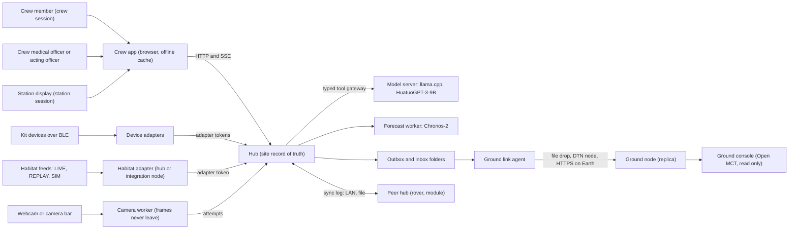

# System architecture

The architecture every builder follows. The planning package wins on product behavior and shared shapes (PRD.md,
CONTRACTS.md, `api/openapi.yaml`); `docs/BUILD-CHARTER.md` wins on how we build; this document fixes the processes, the
module map, the shared kernel, the repository layout, the data lifecycle, the cross-cutting rules and the build order.
`docs/DEPLOYMENT.md` says where each process runs. Part A of `docs/requests/COORDINATOR-DECISIONS.md` overrides conflicting package lines; its A3 is the
central supersession index. Requests live in `docs/requests/SYSTEM.md`; section 13 references them.

## 1. Principles

1. One hub per site owns the records; everything else is a client, a worker or a replica (DEPLOYMENT.md 4.1).
2. The minimum setup is complete: every safety function runs on one laptop with the model stopped, devices absent and
   the link down. Optional parts are separate processes with health checks, timeouts and restart policies.
3. Modules talk through application ports and events only; the composition root wires them; import-linter enforces it.
4. One hub command commits state, audit, outbox, command identity and replication atomically (5.7). Private journal
   writes use D4's two-store acknowledgment barrier (5.8.1).
5. Valid input is never lost because something downstream failed (section 8.6).
6. Clinical content is never merged automatically and never authorized by competence alone (sections 8.4, DEPLOYMENT
   4.4).

## 2. Context



The ground node and every peer hub are replicas reachable only through bundles or sync; the crew never waits on them.

## 3. Runtime processes

Ports are deployment settings (`crew-health.toml`) with these native loopback defaults. Container workers bind their
private network interface with no published host port; native/container routing and authentication are in DEPLOYMENT
7.3. Every profile tests authenticated cross-process connectivity. Budgets
are for the reference laptop (Apple M3, 16 GB, PRD section 10) and are verified by the reference deployment (8.7).

| Process | Owner | Port | Budget (RSS, CPU) | Health check | Restart policy | When it is down |
|---|---|---|---|---|---|---|
| Supervisor `crew-health run` | E20 | none | 64 MB | OS service manager | OS restarts it | OS restarts it; children keep running until it returns |
| Hub (uvicorn, FastAPI) | E01 assembly | 127.0.0.1:8080; LAN 8443 when enabled | 768 MB, 2 cores | `GET /v1/health` every 2 s, 3 misses | Always; backoff 1 s doubling to 30 s; never gives up | Clients serve cached help and plan steps and queue commands; station shows the fault and the printed card fallback |
| Crew app | E03 shell, E20 offline | Served by the hub; Vite 5173 in development only | Browser | Service worker state | Browser reload | n/a |
| Ground console | E16 | Served by the ground node at `/ground/` (ground node 127.0.0.1:8180 in the single laptop demo) | Browser | n/a | n/a | Ground reads nothing new; nothing on board changes |
| Camera worker | E06 | 127.0.0.1:8091 | 1 GB, 2 cores | Own `/health` every 5 s | Backoff to 60 s; after 5 crashes in 10 min, unavailable until restarted | Camera checks show "Not measured" with the reason; manual entry |
| Device adapters (one per family) | E07, E08, E23 | 127.0.0.1:8101 to 8109 | 256 MB total | Own `/health`; hub sees heartbeats | Backoff to 60 s, then unavailable | Manual entry; kit map counts change |
| Model server (`llama-server`) | E12 and E17 (settings), E20 (process) | 127.0.0.1:8092 | 7.5 GB, GPU or 6 cores; loaded on demand | `/health` of llama-server | Started on demand; unloaded after the configured idle time; crash leaves the assistant off | Assistant says it is off; everything else unchanged |
| Embedding server (`llama-server --embedding`) | E10 (use), E17 (model), E20 (process) | 127.0.0.1:8093 | 768 MB | `/health` | On demand | Lexical retrieval only, labeled |
| Forecast worker | E14 | 127.0.0.1:8094 | 1.5 GB, 2 cores; paused while the model serves a turn | Own `/health` | Backoff, then unavailable | Deterministic baselines; the second view is absent and labeled |
| Ground link agent | E29 | 127.0.0.1:8095 | 256 MB | Own `/health` | Backoff to 60 s, never gives up | Bundles wait in the outbox; queue shown |
| DTN daemon (µD3TN or dtn7-rs), optional | E29 | Its own configured sockets | 128 MB | Agent probes it | Restarted by the agent | File drop transport |
| Research worker | E19 | 127.0.0.1:8096, ground or editor hosts only | 1 GB | Own `/health` | Backoff, then unavailable | Workbench shows unavailable; nothing on board affected |

Every call into a worker has a timeout from the hub settings document (5.11). The hub never blocks a request on a
worker: model turns, assessments, forecasts and extraction use E01's durable task runner (5.10.1).
Public Jobs and internal tasks are distinguished by D17; a model turn never invents a Job kind.

## 4. Module map

### 4.1 Layout of a module

`hub/src/crew_health/<module>/` with `domain/` (pure types and rules), `application/` (use cases and the module's port
protocols in `ports.py`), `adapters/` (SQLite repositories under `adapters/migrations/NNNN_<module>.sql`, device and
transport clients) and `api/` (FastAPI routers). Each module exposes `module.py` with `register(registry: ModuleRegistry) -> None`
for the composition root (5.12). Tests in `hub/tests/<module>/`. Tables carry the module name as prefix
(`rules_warning`, `help_session`). A module owns its tables; no other module reads them.

### 4.2 Bounded contexts of CONTRACTS section 20

| CONTRACTS 20 context | Module (`crew_health.`) | Epic | Tables | Provides (ports) | Consumes (ports) | Publishes (CONTRACTS 18) | Consumes (events) |
|---|---|---|---|---|---|---|---|
| Configuration loader | `config` | E01 | `config_release`, `config_document`, `config_activation` | `ConfigReleaseReader`, `ConfigReader`, `LoaderCheckRegistry`, `TemplateRenderer` | Checks registered by modules; `SourceRegistryPort`, `ConditionRegistryPort` (E10) | `config.release_activated` | none |
| Clock | `clock` | E01 | `clock_correction` | `Clock`, `MissionClock`, `HlcClock`; domain events `ClockCorrected`, `ClockRegressed` | `ConfigReader` | none | none |
| Identity | `identity` | E02 | `identity_person`, `identity_credential`, `identity_session`, `identity_adapter_token`, `identity_device` | `SessionContext`, `require_roles`, `RosterPort`, `SessionRevocation` | `Clock`, settings | none | none |
| Identity (consent) | `consent` | E02 | `consent_grant` | `ConsentQueries.allows` | `RosterPort` | none | none |
| Event log | `events` | E01 | `events_outbox`, `events_cursor` | `OutboxSubscriptions`, SSE and `GET /v1/events` | `SessionContext`, `Visibility` (8.3) | (carries all) | none |
| Mission and environment | `mission` | E23 | `mission_environment`, `mission_overlay`, `mission_event`, `mission_state_fact`, `mission_location` | `MissionStatePort`, `OverlayPort`, `EnvironmentFacts` (8.2), `LocationPort` (8.5) | `ConfigReader`, `Clock` | `environment.*`, `overlay.changed`, `mission.event_recorded` | `config.release_activated` |
| Ground link and comms queue | `groundlink` | E29 | `groundlink_status`, `groundlink_bundle`, `groundlink_ack` | `GroundLinkQuery` (three readers only), `BundleOutbox`, `BundleInbox` | `MissionStatePort`, `ConfigReader` | `ground_link.changed` | `environment.activated` |
| Sensor ingest and monitor | `sensors` | E23 | `sensors_channel`, `sensors_reading`, `sensors_evaluation`, `sensors_status` | `SensorStateQuery`, `SensorSeriesReader`; domain events `SensorEvaluated`, `ChannelFreshnessChanged` | `ConfigReader`, `Clock` | `sensor.status_changed`, `sensor.quiet`, `sensor.resumed` | none |
| Rule engine | `rules` | E24 | `rules_warning`, `rules_dwell`, `rules_trigger`, `rules_note` | `WarningQueries`, `WarningCommands`, `InsightWarningPort`, `AssistantWarningGuard` | `SensorStateQuery`, `MissionStatePort`, `RecordFactsPort`, `AnswerQuery`, `GroundLinkQuery`, `SupplyCoverFacts`, `InsightQuery` | `warning.raised`, `warning.updated`, `warning.cleared` | Domain events `SensorEvaluated`, `ChannelFreshnessChanged`, `AnswerAccepted`, `SupplyCoverChanged`, mission domain events |
| Routine scheduler | `routine` | E25 | `routine_occurrence`, `routine_override`, `routine_deadline` | `RoutineQueries`, `RoutineCommands` | `MissionStatePort`, `OverlayPort`, `Scheduler`, `WarningQueries` | `routine.occurrence_changed`, `routine.override_changed` | `DailyCheckSubmitted`, `WarningRaised`, `WarningCleared`, drill and guided check completions |
| Records (core) | `records` | E01 | `records_observation`, `records_answer` | `ObservationReader`, `AnswerQuery`, `RecordFactsPort`, `ObservationCommands`; `AnswerAccepted` (internal domain payload) | `SessionContext`, `ConsentQueries` | none (no observation event in CONTRACTS 18) | none |
| Records (daily checks, journal, profile) | `checks` | E03 | `checks_daily_check`, `checks_profile`; `private_journal_entry` in the private store | `DailyCheckQueries`, `ProfileFactsPort`, `JournalPort`; domain events `DailyCheckSubmitted`, `DailyCheckAbandoned`, `CheckCompletionRecorded` | `ObservationCommands`, `AnswerQuery`, `MissionClock` | none | none |
| Records (intake) | `intake` | E04 | `intake_concern`, `intake_chain` | `IntakeQueries` | `AnswerQuery`, `EpisodePort` (implemented by E15), `ConditionRegistryPort` | none | `AnswerAccepted` |
| Records (measurement requests, attempts, capabilities, gaps) | `measurement` | E05 | `measurement_request`, `measurement_attempt`, `measurement_gap` | `CapabilityQueries`, `MeasurementCommands`, `GapProposalPort` | `KitGate` (E27), `RequestGatePort` (E11), `ConsentQueries` | `measurement_request.changed` | none |
| Records (reports) | `reports` | E09 | `reports_report` references, `reports_confirmation`; encrypted versions in private store | `ReportQueries` | `ObservationReader`, `ConsentQueries`, E01 `PrivateRecordCoordinator` | none | none |
| Records (episodes, follow-up, reviews) | `episodes` | E15 | `episodes_episode`, `episodes_followup`, `episodes_review` | `EpisodeFacts`, `EpisodePort`, `EpisodeReader`; `RecordsView` | `UrgencyQueries` (E11), `ObservationReader`, `ClinicalAuthorityQuery` | none (R-SYS-32 asks for `episode.changed`) | `AnswerAccepted` |
| Records (urgency, pathways) | `pathways` | E11 | `pathways_urgency`, `pathways_signal`, `pathways_effect` | `UrgencyQueries`, `UrgencyCommands`, `InferenceGate`, `RequestGatePort`, `PathwayQueries` | `EpisodeFacts`, `HelpEntryPort` (E26), `AssistantTurnControl` (E13), `ClinicalAuthorityQuery` (E31), `EvidenceQueryPort` (E10), `KitGate` | none | `AnswerAccepted` (in transaction); `help.session_changed`, `warning.raised` (durable subscription) |
| Records (handoffs) | `handoff` | E16 | `handoff_handoff`, `handoff_receipt` | `HandoffQueries`, `GroundInboxView` | `EpisodeReader`, `ReportQueries`, `BundleOutbox` | `handoff.changed` | none |
| Kit map | `kitmap` | E27 | `kitmap_check`, `kitmap_whatif` | `KitGate`, `KitMapQueries`, `EquipmentFacts` | `CapabilityQueries`, `MissionStatePort`, `CoverPlanningPort` (E32), `RosterPort` | none | `config.release_activated` |
| Guidance eligibility (new, 8.2) | `guidance` | E27 | none | `GuidanceEligibility.evaluate`, pure `decide` | `ContentFacts` (E10), `EnvironmentFacts` (E23), `EquipmentFacts` (E27), `SkillFacts` (E31), `StockFacts` (E32) | none | none |
| Plan engine | `plans` | E28 | `plans_run`, `plans_step_state`, `plans_escalation` | `PlanQueries`, `PlanRunReader`, `PlanAvailability` | `GuidanceEligibility`, `SupplyLedgerPort`, `StockReader`, `HelpEntryPort`, `RoleQueryPort` | `plan_run.changed`, `plan_run.step_done`, `plan_run.escalated` | `GuidedCheckCompleted` (in transaction) |
| Plan engine (return readiness) | `readiness` | E33 | `readiness_run` | `ReadinessQueries` | `PlanQueries`, `MissionStatePort`, `GuidanceEligibility` | none | `environment.activated` |
| Teach and check | `teach` | E30 | `teach_guided_check`, `teach_beat`, `teach_sample` | `GuidedCheckQueries`; domain event `GuidedCheckCompleted` | `ObservationCommands`, `PlanRunReader`, `HelpSessionReader`, `GuidanceEligibility` | `guided_check.beat`, `guided_check.checked`, `coaching.sample` | none |
| Role engine, skills and drills | `roles` | E31 | `roles_assignment`, `roles_skill_record`, `roles_drill`, `roles_patch` | `RoleQueryPort`, `ClinicalAuthorityQuery` (8.4), `SkillFacts` | `RosterPort`, `OverlayPort`, `LocationPort`, `HelpSessionReader`, `PlanRunReader` | `role.proposed`, `role.changed`, `skill.practiced`, `drill.changed` | `help.session_changed`, `GuidedCheckCompleted` |
| Supplies ledger | `supplies` | E32 | `supplies_stock`, `supplies_use`, `supplies_custody` | `SupplyLedgerPort`, `StockReader`, `SupplyCoverFacts`, `CoverPlanningPort`, `StockFacts`; `SupplyCoverChanged` (internal domain payload) | `MissionStatePort`, `LocationPort`, `PlanRunReader`, `HelpSessionReader` | `supply.used` | none |
| Supplies (medicines) | `medicines` | E32 | `medicines_assessment`, `medicines_proposal`, `medicines_administration` | `MedicineQueries` | `pharmacy` package (only from `medicines/adapters`), `ClinicalAuthorityQuery`, `ProfileFactsPort`, `ObservationReader` | none | none |
| Catch-up composer | `catchup` | E29 | `catchup_message`, `catchup_line` | `GroundLogComposer`, `GroundLogView` | `HelpLogSnapshot` reads (E26), `GroundLinkQuery`, `ConfigReader` | none | `help.session_changed`, `plan_run.*`, `supply.used` |
| Help | `help` | E26 | `help_session`, `help_action`, `help_broadcast`, `help_ground_message`, `help_log_snapshot` | `HelpEntryPort`, `HelpSessionReader`, `HelpLogSnapshots` | `SessionContext`, `MissionStatePort`, `LocationPort`; optional `BroadcastRolesSource` (E31), `HelpAssistantPort` (E13), `GroundLogComposer` (E29), `WarningQueries` (E24) | `help.session_changed`, `help.broadcast_changed`, `ground_message.changed` | none required |
| Assistant controller | `assistant` | E13 | `assistant_conversation`, `assistant_turn`, `assistant_insight` | `AssistantTurnControl`, `InsightQuery`, `HelpAssistantPort`, `AssistantStatusPort` | `ToolGateway` (E12), `InferenceGate` (E11), `AssistantWarningGuard` (E24), `GuidanceEligibility`, `TaskQueue` | `assistant.status_changed`, `insight.changed` | `warning.*` |
| Jobs and task execution | `platform` | E01 | `platform_task`, `platform_job`, `platform_task_attempt` | `TaskQueue`, `TaskRunner`, `JobQueries`; `getJob`, `cancelJob` | Registered task handlers and visibility policies | `job.progress` for public Jobs only | none |
| Participation | `participation` | E22 | `participation_completion`, `participation_award`, `participation_goal_consent` | `CompletionRecorder` | `MissionStatePort`, `MissionClock`, `RosterPort` | `participation.streak_changed`, `participation.crew_goal_changed` | `CheckCompletionRecorded` and other completion domain events |
| Views | `views` (Today, How you are) | E03 | none | `TodayView`, `HowYouAreView` | Query ports of the modules above; `IndicatorSummaryPort` (E14) | none | none |
| Views (Habitat, Records, Ground inbox) | built in `mission` (E23), `episodes` (E15), `handoff` (E16) | as listed | none | `HabitatView`, `RecordsView`, `GroundInboxView` | Query ports | none | none |
| HTTP API | `app` (assembly, middleware, error envelope) | E01 | none | `create_app(settings) -> FastAPI` | Every module's `register` | none | none |

### 4.3 Modules outside CONTRACTS section 20

| Module or path | Epic | Purpose |
|---|---|---|
| `crew_health.kernel` | E01 | Pure shared types and port protocols (section 5); no I/O |
| `crew_health.platform` | E01 | Storage kernel, unit of work, migrations, backup, audit chain, idempotency and command ledger, scheduler, health, settings, replication log |
| `crew_health.knowledge`, top level `knowledge/` (except `knowledge/workbench/`) | E10 | Registry, evidence releases, passage reads, condition registry |
| `crew_health.workbench`, `knowledge/workbench/`, `docs/research/` | E19 | Research and content workbench (section 8.1, E10 and E19) |
| `crew_health.tools`, `model/` | E12 (gateway), E17 (model settings, prompts, quantization) | Typed tool gateway; retrieval fusion and reranking over E10 primitives |
| `crew_health.trends`, `workers/forecast/` | E14 | Baselines, `IndicatorSummaryPort`, Chronos-2 worker |
| `crew_health.export` | E29 | FHIR R4 export (section 7.3) |
| `crew_health.supervisor`, `crew_health.cli` | E20 | Process supervision and the CLI shell; each epic adds its own subcommand module |
| `workers/camera/` | E06 | Camera worker (`crew_health_camera`) |
| `adapters/oximeter/`, `adapters/cuff/`, `adapters/thermometer/` | E07 | BLE adapters |
| `adapters/band/` | E08 | Band adapter and sleep pipeline (hub side scoring, if its design needs one, in `crew_health.sleep`) |
| `adapters/habitat/` | E23 | LIVE, REPLAY and SIM habitat adapters |
| `eval/bench/`, `eval/harness/` | E18 | HealthBench harness |
| `eval/scenarios/<epic>/`, `eval/runner/`, `fixtures/demo-mara-fd19/` | Each epic its folder; E21 the runner and the fixture | V and D scenarios |
| `pharmacy/`, `config/pharmacy/`, `contracts/pharmacy/`, `docs/ENGINE-SPEC.md` | Potency engine team | Read only for everyone else; imported only by `medicines/adapters` |

### 4.4 Ownership resolutions

| Conflict | Resolution |
|---|---|
| ReturnReadiness listed under the plan engine (CONTRACTS 20) and assigned to E33 | `readiness` module owned by E33, consuming `plans` ports; `plans` never imports it |
| RecordsView, HabitatView, GroundInbox in a shared "Views" context | Built by the epic that owns the data (E15, E23, E16); E03 builds only Today and How you are, consistent with E03 Q-E03-2 and E24 |
| `ui-copy.json` owner | E03 (design system and shell); every other epic files word requests to E03 |
| Roster and `medical_officer_rank` (E27, E28 assumed E01; E31 assumed E02) | E02 `RosterPort` (`crew(at)`, `members()`, `person_ids()`); the names `RosterReader` and `CrewRosterReader` are retired |
| Early episode core | E15 delivers create/facts/record_route/view/AnswerAccepted attachment as E15-core before E04 and E11. It depends on E01/E02/E23; reverse intake, urgency and participation consumers bind later |
| getContext (D16) | E23 mission owns getContext: E02 SessionContext, E01 ConfigReleaseReader and optional E13 AssistantStatusPort. Assistant absence is unavailable, never a missing context endpoint |
| Mission reader (E22 X-E22-5, E32) | E23 `MissionStatePort.current() -> MissionFacts`; `MissionReader` is retired |
| `ProfileFactsPort` (E26 named E04; E04 R-SYS-27 says profile facts are E03-01's) | E03 provides it from the first use profile |
| `IndicatorSummaryPort` (E03 X-E03-16) | E14 |
| CapabilityGap writes (E27 section 4.5 writes gaps; E12 names E05 and E15) | E05 owns MeasurementRequest and CapabilityGap and `GapProposalPort`; E27 provides `KitGate.check` and never writes gaps |
| E10 and E19 both claimed files in `knowledge/policy/` and `knowledge/schemas/` | E10 owns `knowledge/**` except `knowledge/workbench/**`, which E19 owns with `docs/research/**`; `knowledge/docs/**` does not exist |
| E10 and E19 research store | Separate SQLite files: E10's catalog store and E19's workbench store; E19 calls E10 only through `ResearchCatalogPort`, `ReleaseBuilderPort`, `ReleaseAdminPort`; no cross-file joins |
| `HelpSessionReader` (E32 attributed it to E11; E30 asked E26 for `readable_by`) | E26 provides `HelpSessionReader.context(session, help_session_id)` and `.readable_by(session, help_session_id)` |
| `MedicalOfficerQuery.acting` (E32) and `RoleQueryPort.medical_officer_assignments` (E11) | Both answered by E31 `ClinicalAuthorityQuery` (8.4); the assignment list query stays for display |
| Cached help flows (E29-06 in the package brief; E26 claims the help cache) | E26 owns the help cache content and replay; E20 owns the shared offline mechanism (service worker, versioned document store, bootstrap artifact) in `ui/crew/src/offline/`; E29 keeps link independence evidence |
| "For the ground" card (E29-05; E26 claims it) | E29 owns the card component and composition; E26 owns the help lines it shows and the preview endpoint |
| FHIR export (no owner) | E29 `crew_health.export`, since the ground log is the IPS shaped document bundle |

## 5. Shared kernel (E01)

These are the exact public signatures, using Python 3.14 syntax and postponed annotations. Files import their named
kernel types from the files shown below. The kernel imports only the standard library and the generated, standard
library only `crew_health.contracts_gen.enums` (`ErrorCode`, `EventType`, `ConfigName`, `Role`, `EvidenceKind`).
`crew_health` and `contracts_gen` package initializers are empty so importing enums has no model/framework side effect. It never imports
Pydantic, FastAPI, sqlite3, networking, platform adapters or feature modules. Its import allowlist is
`__future__`, `abc`, `collections.abc`, `contextlib`, `dataclasses`, `datetime`, `decimal`, `enum`, `hashlib`,
`hmac`, `json`, `math`, `re`, `typing`, its own kernel modules and `contracts_gen.enums`. Traverse the import closure
through project/generated modules; reviewed allowlisted standard-library modules are terminal trusted dependencies,
not recursively linted Python distribution internals. Direct forbidden imports remain forbidden in every kernel file;
no `os`, `pathlib`, `time`, `random`, `uuid`, `threading`, `subprocess`, dynamic import or I/O helper enters the kernel.
IDs, clocks and crypto/storage implementations are injected. All unqualified names in section 5 resolve to another
section-5 kernel declaration or this standard-library allowlist; assembly and wire-mapping snippets explicitly name
their non-kernel file. Generated wire models are parsed at the
API or adapter boundary and mapped to these types. E01 supplies bounded in-memory fakes in `kernel.testing` using
injected identifiers and time. No fake reads files, starts threads or reads the wall clock.

### 5.1 Identifiers

```python
# crew_health/kernel/ids.py
ID_PATTERN: Final[str] = r"^[A-Za-z0-9][A-Za-z0-9_.:-]{0,127}$"

class IdFactory(Protocol):
    def new(self, prefix: str) -> str: ...
    def derived(self, prefix: str, *parts: str) -> str: ...

def require_id(value: str) -> str: ...
```

`new` is implemented in platform using an injected UUIDv7 source. `derived` hashes the UTF-8 RFC 8785 encoding of
`[prefix, *parts]` and returns `prefix + "_" + digest[:32]`. A length-delimited array avoids separator collisions.
Both validate the complete result and raise `ProblemError(MALFORMED_REQUEST)` on invalid input. Each module declares
its prefixes in its own `module.py`; assembly rejects collisions at startup. No epic edits a central prefix file.
Client IDs never authorize access.

### 5.2 Clock, hybrid logical clock and corrections

```python
# crew_health/kernel/clock.py
class Clock(Protocol):
    def now(self) -> datetime: ...
    def monotonic_ns(self) -> int: ...
    def process_epoch(self) -> str: ...

@dataclass(frozen=True, slots=True, order=True)
class Hlc:
    physical_ms: int
    logical: int
    node_id: str
    incarnation_id: str

@dataclass(frozen=True, slots=True)
class ClockCorrection:
    correction_id: str
    source_clock_id: str
    segment_id: str
    version: int
    valid_from: datetime
    valid_until: datetime | None
    offset_ms: int
    uncertainty_ms: int
    recorded_at: datetime
    source: Literal["operator", "measured", "ground"]  # internal enum

@dataclass(frozen=True, slots=True)
class TimeInput:
    original_at: datetime
    source_clock_id: str
    segment_id: str
    source_clock_version: int
    basis: Literal["source_raw", "hub_corrected"]  # internal enum
    origin_mode: Literal["LIVE", "REPLAY", "SIM"]  # internal enum

@dataclass(frozen=True, slots=True)
class NormalizedTime:
    original_at: datetime
    corrected_at: datetime | None
    correction_id: str | None
    uncertainty_ms: int | None
    state: Literal["known", "unknown", "future", "replay"]  # internal enum

@dataclass(frozen=True, slots=True)
class ClockCorrected:
    event_type: ClassVar[str] = "clock.corrected"
    previous_offset_ms: int
    offset_ms: int
    detected_at: datetime
    clock_version: int
    source: Literal["operator", "measured", "ground"]  # internal enum

@dataclass(frozen=True, slots=True)
class ClockRegressed:
    event_type: ClassVar[str] = "clock.regressed"
    observed_at: datetime
    last_committed_at: datetime
    delta_ms: int

@dataclass(frozen=True, slots=True)
class ClockSegment:
    source_clock_id: str
    physical_clock_id: str
    segment_id: str
    predecessor_id: str | None
    first_sequence: int
    capture_offset_version: int

class ClockSegments(Protocol):
    def open(self, uow: UnitOfWork, segment: ClockSegment) -> None: ...
    def for_sequence(self, snapshot: ReadSnapshot, *, source_clock_id: str,
                     sequence: int) -> ClockSegment | None: ...

class ClockCorrections(Protocol):
    def apply(self, uow: UnitOfWork, correction: ClockCorrection) -> ClockCorrected: ...
    def history(self, snapshot: ReadSnapshot, *, after_version: int, limit: int) -> tuple[ClockCorrection, ...]: ...
    def normalize(self, snapshot: ReadSnapshot, value: TimeInput) -> NormalizedTime: ...
    def elapsed(self, snapshot: ReadSnapshot, start: TimeInput, end: TimeInput) -> timedelta | None: ...

class HlcClock(Protocol):
    def tick(self, uow: UnitOfWork) -> Hlc: ...
    def observe(self, uow: UnitOfWork, remote: Hlc) -> Hlc: ...
```

All datetimes are aware UTC, validated at construction; offsets and uncertainties are finite bounded integers.
`Clock.now` is the corrected hub time. `UnitOfWork.now` captures it once. Corrections append immutable versions;
`apply` validates increasing version, explicit effective half-open range and trusted local operator or measured source
(or authenticated ground suggestion accepted locally). It commits the correction, audit and event together. Reads
choose the highest accepted correction revision covering the raw timestamp **within the captured segment** of that
source clock. A segment identifies one continuous source-clock incarnation, not a correction revision. Persist the
segment before accepting captures. source_clock_id identifies one capture stream/channel, not a shared physical
oscillator; physical_clock_id links related streams for calibration without sharing sequence ranges. The hub's own
capture stream likewise has a unique source_clock_id. Correction version is a globally increasing journal revision
allocated across all streams/segments; history(after_version) uses that global cursor, so no stream revision is skipped.
Apply compares the global head and rejects duplicate/conflicting revisions; segment selection remains per stream.
A source restart, reset or backward jump opens a new immutable segment and closes
the predecessor's sequence interval. Adapter sequences stay monotonic per channel across restarts (CONTRACTS 13);
E01 maps authenticated source/channel sequence ranges to segments at ingestion, retaining the mapping beside the wire
record. The hub's own clock captures its segment directly. A legacy or disconnected capture with no proven segment
mapping is unknown; never guess its segment from timestamp or arrival. A retrospective correction adds a revision
inside the same segment and cannot move a record to another one. Segment boundaries and revisions survive restart.

For `source_raw`, corrected time is original time plus that segment's selected offset. For `hub_corrected`, subtract
the offset of `source_clock_version` in that segment at capture, then add the selected revision's offset. Missing
capture revision is unknown. Select effective ranges on the raw timeline within the segment. The original input,
segment, capture revision and normalization revision remain immutable provenance. `elapsed` normalizes both endpoints
under one history snapshot; across segments it requires an explicit calibrated relationship to hub UTC. Missing
mapping, excessive uncertainty, negative intervals or disjoint histories return unknown, never receipt time.

Required clock case: raw 10:05 in segment A (offset zero), then a reset and raw 10:05 in segment B (offset +1 hour).
A delayed A reading remains 10:05, B becomes 11:05, before and after restart and retrospective revision. At 11:06 with
a freshness window smaller than an hour, only B can be fresh; A cannot clear a warning raised at 11:00. Unmapped
segments cannot clear it either. Test the same raw time with different corrections, not just increasing timestamps.

D3: freshness uses corrected observation time, never arrival. A value is fresh only if its entire uncertainty interval
fits inside the freshness window and no endpoint is in the future. A future time beyond `clock.future_tolerance_ms`
is flagged `future`; a smaller skew still cannot count toward clearing until its upper bound is at or before now.
Unknown, future and regressed times cannot clear warnings. A regression beyond `clock.regression_tolerance_ms` emits
`ClockRegressed` and suspends time-based clearing until a correction and sweep finish. Forward jumps sweep overdue
work without inventing observations; backward jumps neither replay completed jobs nor overwrite newer facts.

D14 is the explicit REPLAY exception to D3 freshness. E23 persists, per channel/dataset/origin partition, window end E
and the hub receive TimeInput of the latest accepted reading whose observed_at **strictly advanced E**, in the ingest
transaction with that reading. Duplicate, rejected, late and repeated rows never replace this reference. Restart
retains E and the reference; looping a file cannot reset either. A deliberate new dataset/channel starts with no
reading and keeps its separate REPLAY identity. Freshness compares now to that correction-aware receive reference;
unknown time fails closed. Windows, coverage and threshold evaluation still follow original dataset observed_at.
Display the original date, REPLAY label and freshness separately; never imply a historical measurement is live.
Replay facts never clear a LIVE warning. Within REPLAY, an advancing observation must also be later in dataset time
than the evidence that raised the warning before it can contribute to clearing. LIVE and SIM keep D3 unchanged.
Test advancing playback, stop, duplicate rows, restart and a loop from the top: only advancing E refreshes the channel.
Within one process epoch durations use monotonic time; after restart use the correction-aware durable interval,
never compare monotonic counters from different epochs.

HLC algorithm: let `p` be corrected hub milliseconds, `(l,c)` the durable local high water and `(r,d)` the remote stamp.
For tick, `m=max(p,l)` and counter is `c+1` if `m==l`, else zero. For observe, `m=max(p,l,r)`; counter is
`max(c,d)+1` if `m==l==r`, `c+1` if only `m==l`, `d+1` if only `m==r`, else zero. The `(node_id, incarnation_id)` pair breaks equal stamps lexically; local stamps always use the current
write incarnation from DEPLOYMENT 4.2. Reject untrusted future remote stamps beyond `clock.hlc_future_ms` into
quarantine, never advance the clock from them. Counter overflow at `clock.hlc_logical_max` fails loudly. Persist the
high water in the same transaction as each record and replication entry; rollback returns no stamp to callers.
Restart loads it before any write. Restore uses a new incarnation and the fencing protocol in DEPLOYMENT 4.2.

### 5.3 Mission elapsed time

```python
# crew_health/kernel/met.py
@dataclass(frozen=True, slots=True)
class MissionClockVersion:
    clock_version: str
    generation: int
    epoch: datetime
    effective_from: datetime
    effective_until: datetime | None
    day_label_template: str

@dataclass(frozen=True, slots=True)
class MetLabel:
    met: str
    mission_day: int
    day_label: str
    clock_version: str

class MissionClock(Protocol):
    def version_at(self, at: datetime) -> MissionClockVersion: ...
    def met(self, at: datetime, *, version: str | None = None) -> MetLabel: ...
    def label(self, at: datetime, *, version: str | None = None) -> tuple[str, int]: ...
    def mission_day(self, at: datetime, *, version: str | None = None) -> int: ...
    def day_bounds(self, mission_day: int, *, version: str) -> tuple[datetime, datetime]: ...
```

The public clock_version is the package's opaque nonempty string, for example `clock-1`; it round-trips unchanged
through MissionContext, CheckCompletion and StreakView. E01 persists a separate increasing generation with each
accepted mission-clock version. IDs are never ordered lexically or parsed as integers. Explicit version selects that
exact retained ID; otherwise epoch/effective ranges select the highest accepted generation covering `at`; gaps are `CONFIG_INVALID`, never a guessed epoch. With elapsed whole seconds `s=floor((at-epoch).total_seconds())`,
mission day is `floor(s/86400)+1`, MET is elapsed days (zero based) and HH:MM:SS; 86400 is the contract definition of a
mission day, not a tunable cadence. A day is `[epoch+(day-1)*86400s, epoch+day*86400s)`, so a boundary belongs to the
new day. Pre-epoch MET that cannot fit the wire pattern is `INVALID_VALUE`, not clamped. Stored labels retain their
version. An explicit retrospective correction triggers an audited rebuild recording old and new day assignments
(CONTRACTS 389); ordinary activation never moves past completions. REPLAY selects its dataset mission clock.

### 5.4 Units (UCUM)

```python
# crew_health/kernel/units.py
@dataclass(frozen=True, slots=True)
class Unit:
    code: str

@dataclass(frozen=True, slots=True)
class Quantity:
    value: Decimal
    unit: Unit

@dataclass(frozen=True, slots=True)
class WireQuantity:
    value: Decimal
    unit: str

@dataclass(frozen=True, slots=True)
class PressureContext:
    pressure: Quantity
    basis: Literal["measured", "assumed"]  # internal enum
    source_ref: str
    observed_at: datetime | None

@dataclass(frozen=True, slots=True)
class ConvertedQuantity:
    original: WireQuantity
    canonical: Quantity
    conversion: str
    mapping_version: str
    pressure: PressureContext | None
    rounding: str

class UnitRegistry(Protocol):
    def parse(self, code: str) -> Unit: ...
    def convert(self, quantity: Quantity, to: Unit) -> Quantity: ...
    def commensurable(self, a: Unit, b: Unit) -> bool: ...

class WireUnitConverter(Protocol):
    def convert(self, value: WireQuantity, *, indicator_code: str, release: ReleaseHandle,
                to: Unit, pressure: PressureContext | None = None) -> ConvertedQuantity: ...
```

Quantities reject nonfinite values; units are case sensitive UCUM. Ordinary conversion rejects incompatible dimensions.
The wire mapper reads a versioned, sourced unit mapping in the accepted release overlay (D12, R-SYS-19), including
`bpm` to `/min`, `mmHg` to `mm[Hg]` and `ppm` to `[ppm]`; labels are never parsed heuristically. It also verifies the
indicator's accepted units from the sensor catalog or observation definition. No raw float crosses a port.

Contextual `ppm_to_mmhg` requires explicit positive cabin pressure and its measured or assumed basis. It computes
`ppm / 1000000 * pressure_in_mmHg`, retaining original value/unit, mapping version, pressure and source. It never
supplies an assumed 760 on its own. Canonical sensor values round once to four decimal places (CONTRACTS 659), decimal
half even under D12; calculations retain the unrounded Decimal internally. Unknown mapping, pressure or provenance
fails `INVALID_UNIT` or `INVALID_VALUE`, and the input remains available with its rejection reason. `ucumvert`/`pint`
implement the registry only in adapters; kernel contains no dependency on either.

### 5.5 Errors and the RFC 9457 mapping

```python
# crew_health/kernel/errors.py
@dataclass(frozen=True, slots=True)
class FieldError:
    field: str
    code: str
    message: str

class ProblemError(Exception):
    def __init__(self, code: ErrorCode, message: str, *, field_errors: Sequence[FieldError] = (),
                 current_state: Mapping[str, object] | None = None,
                 supported_alternative: Mapping[str, object] | None = None,
                 retryable: bool | None = None) -> None: ...
    code: ErrorCode
    status: int
    retryable: bool

class StorageUnavailable(ProblemError):
    def __init__(self, cause: Literal["disk_full", "locked", "io_error", "corrupt"]) -> None: ...  # internal enum
    cause: Literal["disk_full", "locked", "io_error", "corrupt"]  # internal enum

@dataclass(frozen=True, slots=True)
class Problem:
    type: str
    title: str
    status: int
    detail: str
    instance: str

# crew_health/app/errors.py, outside kernel; contracts_gen is the generated wire model package
# titles and safe messages come from the validated ui-copy document
def to_envelope(error: ProblemError, correlation_id: str) -> contracts_gen.ErrorEnvelope: ...
def to_problem(error: ProblemError, correlation_id: str, *, title: str) -> Problem: ...
```

D5 settles R-SYS-1: ErrorEnvelope on the wire, RFC 9457 in logs. Status and retryability come from generated contract
tables. `type` is `urn:crew-health:error:<code>` and instance is the correlation ID URN. Unknown exceptions become
`INTERNAL_ERROR`; storage and integrity errors cannot be isolated as evaluator failures. Log serialization replaces
all free text and field values with allowlisted codes and references; it never logs the exception object, request,
`current_state` or raw traceback locals. Stored-result visibility is checked before including even a resource ID.

### 5.6 Configuration loading with provenance

```python
# crew_health/kernel/config.py
@dataclass(frozen=True, slots=True)
class ConfigDocumentView:
    name: ConfigName
    version: str
    raw: bytes

class ReleaseHandle(Protocol):
    @property
    def release_id(self) -> str: ...
    def document(self, name: ConfigName) -> ConfigDocumentView: ...
    def version_of(self, name: ConfigName) -> str: ...

@dataclass(frozen=True, slots=True)
class CandidateRelease:
    release_id: str
    documents: Mapping[ConfigName, ConfigDocumentView]

class ConfigReleaseReader(Protocol):
    def active(self) -> ReleaseHandle: ...
    def release(self, release_id: str) -> ReleaseHandle: ...

class ConfigReader(Protocol):
    def document(self, name: ConfigName, version: str | None = None) -> ConfigDocumentView: ...

@dataclass(frozen=True, slots=True)
class Finding:
    check_id: str
    document: ConfigName | None
    pointer: str
    message: str

class ReleaseCheck(Protocol):
    @property
    def check_id(self) -> str: ...
    def check(self, candidate: CandidateRelease) -> tuple[Finding, ...]: ...

class ActivationGuard(Protocol):
    @property
    def check_id(self) -> str: ...
    def check(self, uow: UnitOfWork, candidate: CandidateRelease) -> tuple[Finding, ...]: ...

class LoaderCheckRegistry(Protocol):
    def register(self, check: ReleaseCheck) -> None: ...
    def register_guard(self, guard: ActivationGuard) -> None: ...

class TemplateRenderer(Protocol):
    def render(self, field_key: str, template: str, values: Mapping[str, str]) -> str: ...

@dataclass(frozen=True, slots=True)
class ReleaseRevision:
    release_id: str
    revision: int
    etag: str

class ReleaseActivation(Protocol):
    def revision(self, snapshot: ReadSnapshot, release_id: str) -> ReleaseRevision: ...
    def activate(self, uow: UnitOfWork, session: SessionContext, *, release_id: str,
                 expected_etag: str) -> ReleaseRevision: ...
```

Readers are bound to a UnitOfWork or ReadSnapshot; `active` means active at its start. Document versions hash raw
bytes; typed parsing and generated model validation happen at startup outside kernel. Every activated version remains
readable for pinned work. Candidate maps are immutable. Unknown template values render configured unknown text and
log the field key only.

Activation validates schema, all 16 loader checks, module checks and state guards inside the write transaction,
then atomically swaps the active release with audit, outbox and replication entries. Any failure rejects the candidate
and retains the last good release, never downgraded to a warning. Editor or operator can activate, including while
sessions are open. Existing sessions, runs and warnings keep their pins; D1 prevents clearing or lowering an active
warning; stock cannot become negative. Clinical-review absence is a label under Q1/Q7/Q18, not a validation failure.
D8 defines the strong ETag of the release object, read through response headers without adding undeclared JSON fields.
Release provenance is stored in audit until R-SYS-14's wire extension is applied.

### 5.7 Unit of work, event envelope and in-transaction bus

```python
# crew_health/kernel/storage.py; concrete sqlite3 types occur only in platform/storage.py
# Decimal quantities persist as validated decimal text plus UCUM, never an SQL REAL.
type SqlValue = str | int | bytes | None

@dataclass(frozen=True, slots=True)
class StatementResult:
    affected_rows: int
    last_row_id: int | None

class StorageSession(Protocol):
    def execute(self, sql: str, parameters: tuple[SqlValue, ...] = ()) -> StatementResult: ...
    def rows(self, sql: str, parameters: tuple[SqlValue, ...], *, limit: int) -> tuple[tuple[SqlValue, ...], ...]: ...

# crew_health/kernel/uow.py
@dataclass(frozen=True, slots=True)
class Actor:
    kind: Literal["person", "station", "ground", "operator", "adapter", "engine", "assistant"]  # internal enum
    id: str

class DomainEvent(Protocol):
    event_type: ClassVar[str]

@dataclass(frozen=True, slots=True)
class AudienceProjectionKey:
    owner: str
    name: str
    version: int

@dataclass(frozen=True, slots=True)
class Audience:
    rule: str
    object_ref: str
    projection: AudienceProjectionKey
    policy_version: str

@dataclass(frozen=True, slots=True)
class EventScope:
    kind: Literal["person", "habitat", "crew", "ground", "operator"]  # internal enum
    person_id: str | None
    environment_id: str | None

@dataclass(frozen=True, slots=True)
class OutboxEvent:
    type: EventType
    occurred_at: datetime
    scope: EventScope
    config_release_id: str
    correlation_id: str | None
    data_json: bytes
    audience: Audience

@dataclass(frozen=True, slots=True)
class StoredEvent:
    seq: int
    event_id: str
    type: EventType
    occurred_at: datetime
    emitted_at: datetime
    scope: EventScope
    config_release_id: str
    correlation_id: str | None
    data_json: bytes
    audience: Audience

class UnitOfWork(Protocol):
    @property
    def connection(self) -> StorageSession: ...
    @property
    def now(self) -> datetime: ...
    @property
    def actor(self) -> Actor: ...
    @property
    def release(self) -> ReleaseHandle: ...
    @property
    def correlation_id(self) -> str: ...
    def publish(self, event: DomainEvent) -> None: ...
    def emit(self, event: OutboxEvent) -> StoredEvent: ...
    def audit(self, entry: AuditEntry) -> None: ...
    def schedule(self, job: ScheduledJob, *, expected_generation: int | None) -> int: ...
    def cancel_schedule(self, key: str, *, expected_generation: int) -> bool: ...
    def replicate(self, change: ReplicationChange) -> ReplicationRef: ...
    def savepoint(self, name: str) -> AbstractContextManager[None]: ...

class UnitOfWorkFactory(Protocol):
    def begin(self, *, actor: Actor, command: CommandIdentity | None = None,
              correlation_id: str) -> AbstractContextManager[UnitOfWork]: ...

class ReadSnapshot(Protocol):
    @property
    def connection(self) -> StorageSession: ...
    @property
    def release(self) -> ReleaseHandle: ...
    @property
    def now(self) -> datetime: ...

class ReadSnapshotFactory(Protocol):
    def snapshot(self) -> AbstractContextManager[ReadSnapshot]: ...

class DomainEventBus(Protocol):
    def subscribe[E: DomainEvent](self, event_type: type[E], handler: Callable[[UnitOfWork, E], None], *,
                                  name: str) -> None: ...
    def publish(self, uow: UnitOfWork, event: DomainEvent) -> None: ...

@dataclass(frozen=True, slots=True)
class SessionContext:
    session_id: str
    kind: Literal["crew", "station", "ground", "operator", "editor", "adapter"]  # internal enum
    actor: Actor
    person_id: str | None
    roles: frozenset[Role]

class AudienceRule(Protocol):
    def admits(self, snapshot: ReadSnapshot, session: SessionContext, audience: Audience) -> bool: ...

@dataclass(frozen=True, slots=True)
class LocalProjectionRegistration:
    key: AudienceProjectionKey
    payload_schema_json: bytes
    required_field_pointers: tuple[str, ...]
    rule: AudienceRule

class OutboxSubscriptions(Protocol):
    def register(self, subscriber: str, types: frozenset[EventType],
                 handler: Callable[[UnitOfWork, StoredEvent], None]) -> None: ...

@dataclass(frozen=True, slots=True)
class ReplicationChange:
    export_projection: ProjectionKey | None
    record_type: str
    record_id: str
    operation: Literal["create", "version", "append", "retract"]  # internal enum
    payload_json: bytes
    causal_refs: tuple[str, ...]
    release_id: str
    audience: Audience

@dataclass(frozen=True, slots=True)
class ReplicationRef:
    origin_node_id: str
    origin_incarnation: str
    origin_seq: int
```

Actor kind is the contracted actor enum, separate from session kind and role; an editor credential uses its
attributed person/operator actor with the editor role, never an invented wire actor kind.
AudienceProjectionKey names a registered **local** event/task visibility schema and required-field set, not a replica
export. LocalProjectionRegistration permits private person-only job/streak/help/assistant audiences without making
them exportable. Rule admission must cover every stored payload field under the current grant; if a grant narrows,
suppress that event and let the client refetch its authorized view. Never emit an invalid partial wire Event payload.
ReplicationChange separately declares export_projection: an exact registered ProjectionKey or explicit None for
local-only data. None still records the internal recovery change/reference and advances the local scan cursor, but
creates no recipient delivery. Private plaintext never enters that internal log; private-store operations declare
reference/tombstone changes only. No unexportable local record is prevented from committing by an absent exporter.

Only a module's repository adapters use `connection`, only for their tables; no raw connection escapes platform.
`rows` enforces `storage.max_rows` and raises on excess rather than silently truncating. `execute` bounds input bytes.
ReadSnapshot rejects mutations. SQLite implementation uses WAL, FULL synchronous, foreign keys, STRICT tables and
one writer with bounded busy timeout. Every command begins IMMEDIATE; successful context exit commits once, any
exception rolls back. Nested transactions and public manual commits are forbidden.

State, command identity/result reference, audit, outbox, scheduled changes, replication log and origin sequence
allocation commit atomically. Each repository mutation declares its replication change; missing declarations fail
commit. Journal plaintext is exempt from replication and uses 5.8.1. Savepoint rollback also rolls back buffered
events and replication changes. Domain events dispatch through a bounded iterative FIFO, in stable handler-name
order, with no recursive publish; excess fanout fails the transaction. Evaluator isolation is only as in 8.6.

`emit` assigns event ID and local sequence once and sets `emitted_at=uow.now`; validates data against the Event type's
schema outside kernel. It persists every field above before commit. The generated Event maps these exact fields,
with scope as `{kind, person_id, environment_id}` and decoded `data_json` as `data`; only `audience` is internal.
The producer supplies the work's pinned release, not the currently active release. Retries replay the same event ID,
time, release and JSON. Audience metadata is mandatory; current grant checks can suppress delivery but cannot expand
the saved projection. Per-scope rows have distinct IDs and sequence numbers. SSE starts after commit. Durable
subscriber effects and its cursor advance share a new transaction; duplicate seq is a no-op, storage failure retries
without cursor advance. Retention waits for all subscribers.

#### 5.7.1 Replica projections and transactional delivery

These are internal transport contracts, not additions to public API resources. E01 owns the envelope and catalog
validator. Each producer owns `replica.schema.json` and projection/apply implementations beside its `module.py`;
build discovery registers them without editing platform or another epic's files. Recipient is constructed from enrolled transport identity, purpose, roles and current grant references, not a
public node Session kind or caller-supplied grant. A ProjectionKey is an exact
`(owner, name, version)` from the signed build catalog, never a free-form selector or import path.

```python
# crew_health/kernel/replication.py
@dataclass(frozen=True, slots=True)
class ProjectionKey:
    owner: str
    name: str
    version: int

@dataclass(frozen=True, slots=True)
class Recipient:
    recipient_id: str
    purpose: str
    policy_epoch: int
    roles: frozenset[Role]
    grant_refs: tuple[str, ...]

@dataclass(frozen=True, slots=True)
class ProjectionDependency:
    field_pointer: str
    record_ref: str | None
    disposition: Literal["included", "omitted", "required"]  # internal enum

@dataclass(frozen=True, slots=True)
class ProjectionBody:
    key: ProjectionKey
    object_ref: str
    selected_fields: tuple[str, ...]
    data_json: bytes
    dependencies: tuple[ProjectionDependency, ...]

@dataclass(frozen=True, slots=True)
class Delivery:
    stream_id: str
    policy_epoch: int
    delivery_seq: int
    recipient_id: str
    purpose: str
    source_node_id: str
    source_incarnation: str
    origin_token: str
    body: ProjectionBody
    envelope_sha256: str

class ProjectionProvider(Protocol):
    def export(self, snapshot: ReadSnapshot | UnitOfWork, change: ReplicationChange,
               recipient: Recipient) -> ProjectionBody | None: ...

class ReplicaApplier(Protocol):
    def apply(self, uow: UnitOfWork, delivery: Delivery, recipient: Recipient) -> None: ...

@dataclass(frozen=True, slots=True)
class ProjectionRegistration:
    key: ProjectionKey
    schema_json: bytes
    schema_sha256: str
    provider: ProjectionProvider
    applier: ReplicaApplier

@dataclass(frozen=True, slots=True)
class RevocationControl:
    control_id: str
    recipient_id: str
    stream_id: str
    old_policy_epoch: int
    new_policy_epoch: int
    authority_ref: str
    signature: bytes

class ReplicaExchange(Protocol):
    def revoke(self, uow: UnitOfWork, recipient: Recipient, *, stream_id: str) -> RevocationControl: ...
    def apply_revocation(self, uow: UnitOfWork, control: RevocationControl) -> str: ...
    def acknowledge_revocation(self, uow: UnitOfWork, *, control_id: str, recipient_id: str) -> None: ...
    def materialize(self, uow: UnitOfWork, recipient: Recipient, *, limit: int) -> int: ...
    def page(self, snapshot: ReadSnapshot, recipient: Recipient, *, stream_id: str,
             after: int, limit: int) -> tuple[Delivery, ...]: ...
    def apply(self, uow: UnitOfWork, recipient: Recipient, delivery: Delivery) -> int: ...
    def acknowledge(self, uow: UnitOfWork, recipient: Recipient, *, stream_id: str,
                    through: int, envelope_sha256: str) -> None: ...
```

The version-1 catalog below is closed by default. For rows using a generated resource, its effective schema supplies
field types, not authority. `selected_fields` is a sorted set of leaf JSON pointers. The schema permits only those
properties, with the original type/nullability and no additional properties; it does not instantiate the full wire
model with invented defaults. Registration validates each pointer against the guarded effective schema and the
catalog allowlist. Local event/task audience registration is independent of this export catalog. A producer may add a narrower named projection in its own file; adding a broader field or recipient
class needs a shared request. Nested objects are projected recursively; an allowed parent never grants every child.

| Catalog key (owner/name/version 1) | Permitted payload fields | Recipients and dependencies |
|---|---|---|
| `help/broadcast/1` | All fields of CrewBroadcast, validated without clinical enrichment | Crew/station P0; session reference is an opaque handle, never authority to fetch the session |
| `mission/context/1`, `sensors/reading/1`, `rules/operational/1`, `routine/operational/1` | Leaf fields of mission-context.schema.json, sensor-reading.schema.json, warning.schema.json and routine-occurrence.schema.json respectively, only habitat/crew scope; person IDs and personal fields excluded | Authorized onboard operational peers; pin required; missing private evidence links omitted with null reference, no ID/hash disclosed |
| `records/observation/1`, `records/answer/1`, `checks/daily-check/1`, `episodes/episode/1`, `plans/plan-run/1`, `teach/guided-check/1` | Only explicit current subject-granted leaf fields of observation.schema.json, answer.schema.json, daily-check.schema.json, episode.schema.json, plan-run.schema.json and guided-check.schema.json respectively; no journal, report source/draft, prompt, private attachment or private communication fields | Onboard subject-authorized recipient only; omit ungranted related IDs and links, and mark field unavailable; unavailable required clinical facts forbid use as guidance or a write model |
| `help/task/1`, `roles/task/1` | Accepted task ID, assignee, task state, configured instruction and the 8.3 limited SubjectSummary fields only | Current helper; no general chart references/access; closes with task/session/grant |
| `supplies/ownership/1`, `routine/ownership/1` | 8.5.1 transfer certificate, resource snapshot, epoch, revision and pending timer/ledger references necessary for the named resource | Enrolled destination with custody/person authorization; all required authorized dependencies precede activation; incomplete transfer stays fenced |
| `routine/action/1` | Immutable action fact of 8.5.1, with exact validated action body and captured epoch | Current owner only; required occurrence/grant; cannot update occurrence on replica |
| `handoff/approved/1`, `help/approved/1`, `catchup/approved/1` | Exact approved Handoff snapshot, GroundMessage lines/text/hash or catch-up lines; only separately consented attachment bytes | Named ground recipient; pinned snapshot/template dependencies required, unapproved source-record links omitted; never backfill raw charts |
| `config/release/1`, `knowledge/release/1` | Signed public release manifest and its content-addressed documents | Authorized node/editor; verify every required hash before activation; Q2 redistribution rules still apply |
| `platform/revocation/1` | Exactly RevocationControl of this section, revoking the entire previously delivered stream; no hidden object IDs/counts | Named enrolled recipient; processed on authenticated control channel independently of fenced data epochs |
| `platform/receipt/1` | Stream ID, committed delivery sequence, envelope hash and signed opaque checkpoint only | Enrolled peer; no raw audit references or excluded counts |
| `participation/goal/1` | CrewGoalView aggregate fields only | Crew operational recipient; D10 consent and revocation; no person IDs, counts or completion links |

Source paths above are relative to the effective `api/schemas/`. Broadcast uses crew-broadcast.schema.json;
goal uses crew-goal-view.schema.json. Approved handoff uses handoff.schema.json fields `handoff_id`, `revision`,
`fields`, `catch_up`, `approved_at` and separately consented attachments; GroundMessage uses ground-message.schema.json
fields `ground_message_id`, `session_revision`, `lines`, `text`, `text_sha256`, `catch_up` and `queued_at`. Lifecycle metadata
is a separately authorized version; a local source link never grants the recipient chart access. Catch-up is the
same approved GroundMessage line schema, not an arbitrary transcript. Task projections use role-assignment.schema.json
and subject-summary.schema.json under 8.3's field grants; instruction content is pinned configuration, not private
plan text. Ownership snapshots use the closed Transfer schema of 5.7.2 plus the E25/E32 resource port's explicitly
registered schema, never a dump of tables. Routine action schema is precisely the closed fact in 8.5.1 with the
contracted routine-action request body. Receipt schema is the four allowlisted fields in the catalog. Release schema
is the signed manifest and verified public documents, excluding credentials and keys. Internal schemas live in the
producer's owned replica.schema.json, with a one-to-one key/schema hash binding.

Report confirmations replicate only as the resulting records/observation projection. Private reports are approved
attachments only. Other types, including notes, medicine records and audit envelopes, are not exportable until an
explicit narrower projection is registered and reviewed through R-SYS-3; they remain fully usable on their home hub.
No unresolved registration starts that projection; sync must report it unavailable. The required dependency tests
still apply. This restriction does not disable local records, warnings, help or offline medication work.

origin_token is HMAC-SHA256 of the canonical raw origin tuple using a per-recipient/policy-epoch secret held at the
sender. Only the opaque token crosses the boundary; raw origin_seq, local vector gaps and skipped counts never do.
The sender retains token-to-origin mapping internally for recovery. Permitted source node/incarnation provenance
reveals the record's source, not intervening log counts. Deduplication uses stream/sequence/envelope hash and opaque
origin token plus projection hash. A policy change cannot correlate excluded source positions through a stable token.

Materialization scans bounded source-log rows and commits scan cursor, allowed delivery rows and allocated contiguous
sequence together, including a scan that excludes every row. Recheck grant before sending; revocation fences the
stream epoch rather than deleting a sequence inside a live stream. Import validates signature/schema/policy/hash,
then applies through the registered applier and advances its contiguous cursor with audit/events in one transaction.
A missing required dependency leaves the delivery pending without advancing the applied cursor; bounded overflow
quarantines visibly. An omitted dependency contains no forbidden ID or hash. Duplicate delivery with identical hash
is a no-op; a different hash is corruption. Replica appliers write owned replica tables only, never local authoritative
clinical tables or commands. Read authorization remains current after import. Tests remove one allowed dependency,
one forbidden dependency and a grant between materialize/send/apply, and crash before/after cursor commit.
Revocation controls use a separate signed/encrypted control lane keyed by control_id, never the blocked data cursor.
revoke durably fences the old epoch and queues the control atomically. apply_revocation verifies the pinned grant
issuer, recipient and strictly newer policy epoch (a duplicate control is a no-op), fences that stream, removes its
replica views/caches and records the control receipt atomically; data from the old epoch is thereafter rejected.
The returned control_id is ACKed only after commit through acknowledge_revocation. Crash retries repeat the same
control; old-epoch queued data cannot prevent it being applied. This whole-stream withdrawal discloses no previously
excluded object, and a narrower regrant creates a new authorized stream. A missing ACK stays visible; remote erasure
while disconnected is never claimed.

#### 5.7.2 Ownership protocol

```python
# crew_health/kernel/ownership.py
@dataclass(frozen=True, slots=True)
class OwnedResource:
    kind: str
    resource_id: str
    owner_node_id: str
    owner_incarnation: str
    epoch: int
    revision: int

@dataclass(frozen=True, slots=True)
class Transfer:
    transfer_id: str
    source: OwnedResource
    destination_node_id: str
    destination_incarnation: str
    new_epoch: int
    snapshot_ref: str
    snapshot_sha256: str
    command: CommandIdentity

@dataclass(frozen=True, slots=True)
class TransferReceipt:
    transfer_id: str
    phase: Literal["prepared", "fenced", "accepted", "completed", "cancelled"]  # internal enum
    certificate_json: bytes

class Ownership(Protocol):
    def require(self, uow: UnitOfWork, resource: OwnedResource) -> None: ...
    def prepare(self, uow: UnitOfWork, transfer: Transfer) -> TransferReceipt: ...
    def fence(self, uow: UnitOfWork, transfer: Transfer, prepared: TransferReceipt) -> TransferReceipt: ...
    def accept(self, uow: UnitOfWork, transfer: Transfer, fenced: TransferReceipt) -> TransferReceipt: ...
    def complete(self, uow: UnitOfWork, transfer: Transfer, accepted: TransferReceipt) -> TransferReceipt: ...
    def cancel(self, uow: UnitOfWork, transfer: Transfer) -> TransferReceipt: ...
    def status(self, snapshot: ReadSnapshot, transfer_id: str) -> TransferReceipt: ...
```

E01 implements the checks and phase transitions in 8.5.1. Each call operates only on the local participant's state;
network exchanges happen outside the UoW. Certificates are canonical signed transport bytes validated at the adapter
boundary. No epoch, snapshot hash or revision supplied by a caller is trusted without comparing the local durable
head. Owners register resource-specific snapshot/apply through the projection registration of 5.7.1. A transfer of
an unknown kind is disabled, never an implicit ownership grant.

### 5.8 Idempotency and command identity

```python
# crew_health/kernel/commands.py
@dataclass(frozen=True, slots=True)
class CommandIdentity:
    key: str
    actor_ref: str
    operation: str
    target: str
    parameters_sha256: str
    body_fingerprint: str
    fingerprint_kind: Literal["sha256", "hmac_sha256"]  # internal enum

@dataclass(frozen=True, slots=True)
class StoredResult:
    receipt: AcceptedReceipt
    status: int
    resource_ref: str | None
    result_code: str
    safe_body: bytes | None

class IdempotencyStore(Protocol):
    def lookup(self, uow: UnitOfWork, identity: CommandIdentity) -> StoredResult | None: ...
    def record(self, uow: UnitOfWork, identity: CommandIdentity, result: StoredResult) -> None: ...

class ResultVisibility(Protocol):
    def authorize(self, snapshot: ReadSnapshot | UnitOfWork, session: SessionContext,
                  identity: CommandIdentity, result: StoredResult) -> None: ...

def command_identity(*, key: str, actor_ref: str, operation: str, target: str,
                     parameters_json: bytes, body_fingerprint: str,
                     fingerprint_kind: Literal["sha256", "hmac_sha256"]) -> CommandIdentity: ...  # internal enum
```

The boundary creates `target` from the matched route and canonical validated path IDs, never an untrusted URL string;
parameters include every semantically relevant query/header (revision, pin and origin partition), exclude tokens and
transport/correlation headers, and preserve ordered lists. Hash canonical RFC 8785 JSON with UTF-8 and SHA-256.
A key is unique within the authenticated actor namespace across operations and targets. Any operation, target,
parameter or body mismatch is `409 DUPLICATE_COMMAND`, including reuse on another plan's identical action body.
Both the 24 hour cache and mission-life ledger compare the entire identity. Matching execution is never repeated.

Authenticate and check current operation access first; lookup before mutable business preconditions, repeat inside
the write transaction. Before returning any saved result, recheck object and field visibility under the current grant.
Revoked access returns `UNAUTHORIZED_SCOPE` without its reference or contents and without re-execution. Private text
never enters either cache: store references and safe codes, reconstruct an authorized representation from the owning
store. Exact original bodies may be cached only for P0/P1 responses. D6's accepted replay is unambiguous:
HTTP 409, code DUPLICATE_COMMAND, retryable false, with current_state equal to the closed receipt
`{kind: "accepted_command", command_key: string, operation_id: string, target: string, receipt_id: id,
accepted_at: instant}`. No body digest, parameters, clinical value or result reference is sent in this receipt.
It is returned only after complete server-side identity equality and current ResultVisibility authorization. The
receipt ID and accepted_at are allocated once with the original command. Within 24 hours an authorized original
response or this receipt may be returned; beyond the cache window use the receipt. A mismatch always returns
current_state null and never this discriminator. ErrorEnvelope itself stays unchanged (D6 effective overlay).
The client accepts a 409 only when all receipt fields validate, kind is accepted_command and key, operation and
normalized target equal its immutable queued request. It never infers success from the error code alone. A mismatched
409 keeps the new command queued as rejected for reconciliation; no automatic new key or changed body. Revocation
also leaves it quarantined under its owner. Test same body on two targets, wrong parameters and retries after 24 hours
with intervening state changes: only the original approved action is accepted. Fingerprints of private command bodies
use keyed HMAC, never a guessable plaintext hash.

```python
# crew_health/kernel/commands.py
@dataclass(frozen=True, slots=True)
class AcceptedReceipt:
    command_key: str
    operation_id: str
    target: str
    receipt_id: str
    accepted_at: datetime

class CommandPolicy(Protocol):
    def requires_ledger(self, operation_id: str) -> bool: ...

class CommandReceipts(Protocol):
    def accepted(self, uow: UnitOfWork, identity: CommandIdentity) -> AcceptedReceipt: ...
    def read(self, view: ReadSnapshot | UnitOfWork, session: SessionContext,
             identity: CommandIdentity) -> AcceptedReceipt: ...
```

E01 generates the exhaustive operation-policy table from the effective OpenAPI at build time. Every POST/PUT/PATCH/
DELETE uses mission-life identity for accepted state changes, records, approvals, cancellations and external effects.
Only createSession (authentication) and kitMapWhatIf (the side-effect-free what-if operation) are exempt as CONTRACTS 210 specifies; the generator binds exceptions by
method/path `/v1/sessions` and `/v1/kit-map/what-if`, then verifies their operationIds. There is no caller-set durable
flag. Unknown or unclassified mutations fail assembly. The table includes queueGroundMessage, all routine actions and
overrides, report uploads/extractions/deletions/confirmations, consent, jobs and decision-overlay operations. Rejected
validation is not acceptance; accepted deletion/cancellation keeps a reference-only tombstone receipt. No feature may
maintain a replacement deduplication ledger. Tests iterate every effective mutation and assert classification and
trace late retries of Tell the ground to the original immutable approved snapshot, never a newly composed message.

Multi-transaction orchestration uses the same ledger's pending intents, not a feature replacement ledger. Pending
identity is reserved before side effects; a mismatch still conflicts. lookup returns a StoredResult only after the
parent has completed. The boundary also checks CommandIntents.pending before treating a miss as new work and invokes
its registered resumer with current authentication. Pending is never sent as accepted_command. Internal child
operations register namespaced operations in their own module, are always durable and bind the parent intent.

```python
# crew_health/kernel/commands.py
@dataclass(frozen=True, slots=True)
class PendingCommand:
    intent_id: str
    identity: CommandIdentity
    resume_handler: str
    input_ref: str

class CommandIntents(Protocol):
    def reserve(self, uow: UnitOfWork, identity: CommandIdentity, *,
                resume_handler: str, input_ref: str) -> PendingCommand: ...
    def pending(self, view: ReadSnapshot | UnitOfWork,
                identity: CommandIdentity) -> PendingCommand | None: ...
    def complete(self, uow: UnitOfWork, intent: PendingCommand, result: StoredResult) -> None: ...

class CommandResumer(Protocol):
    def resume(self, session: SessionContext, intent: PendingCommand) -> StoredResult | None: ...
```

Reserve is idempotent by full identity and input reference. Complete atomically resolves the reservation and records
the original parent receipt with final effects. None from a resumer means still pending; the original command returns
retryable INTERNAL_ERROR without an acceptance receipt and its queue entry stays. A durable bounded recovery schedule
also invokes the resumer. Retry/restart never loses the intent or treats the child receipt as parent completion.

#### 5.8.1 Private records two-store protocol (D4, D18)

```python
# crew_health/kernel/private.py
@dataclass(frozen=True, slots=True)
class PrivateIntent:
    identity: CommandIdentity
    owner_person_id: str
    entry_id: str
    record_kind: str
    version_id: str
    source_version_id: str | None
    plaintext: bytes

@dataclass(frozen=True, slots=True)
class SealedPrivateRef:
    entry_id: str
    version_id: str
    record_kind: str
    owner_person_id: str
    command_key: str
    fingerprint: str
    key_id: str
    ciphertext_sha256: str

@dataclass(frozen=True, slots=True)
class PrivateReceipt:
    entry_id: str
    command_key: str
    hub_reference_seq: int

class PrivateStore(Protocol):
    def seal(self, intent: PrivateIntent) -> SealedPrivateRef: ...
    def verify(self, reference: SealedPrivateRef) -> bool: ...
    def acknowledge(self, reference: SealedPrivateRef, receipt: PrivateReceipt) -> None: ...
    def discard_orphan(self, reference: SealedPrivateRef) -> None: ...
    def pending(self, *, after_entry_id: str | None, limit: int) -> tuple[SealedPrivateRef, ...]: ...

@dataclass(frozen=True, slots=True)
class RevocationReceipt:
    revocation_id: str
    generation: int
    complete: bool
    outstanding_replica_ids: tuple[str, ...]

@dataclass(frozen=True, slots=True)
class PrivateDeletionResult:
    entry_ids: tuple[str, ...]
    command_key: str
    revocation: RevocationReceipt
    hub_reference_seq: int | None

class PrivatePublicationRejected(ProblemError):
    def __init__(self) -> None: ...

class PrivateRecordCoordinator(Protocol):
    def publish(self, session: SessionContext, intent: PrivateIntent, reference: SealedPrivateRef,
                apply: Callable[[UnitOfWork], bool]) -> PrivateReceipt: ...
    def write(self, session: SessionContext, intent: PrivateIntent) -> PrivateReceipt: ...
    def delete(self, session: SessionContext, *, identity: CommandIdentity,
               owner_person_id: str, entry_ids: tuple[str, ...]) -> PrivateDeletionResult: ...
    def recover(self, *, limit: int) -> int: ...
    def backup_barrier(self) -> AbstractContextManager[None]: ...

class PrivateReferenceWriter(Protocol):
    def attach(self, uow: UnitOfWork, reference: SealedPrivateRef, intent: PrivateIntent) -> None: ...
    def tombstone(self, uow: UnitOfWork, *, entry_ids: tuple[str, ...], revocation_ref: str) -> None: ...

class PrivateKeyVault(Protocol):
    def create_entry_key(self, *, owner_person_id: str, entry_id: str) -> str: ...
    def revoke(self, *, owner_person_id: str, entry_ids: tuple[str, ...], command_key: str) -> RevocationReceipt: ...
    def revocation(self, revocation_id: str) -> RevocationReceipt: ...
    def is_revoked(self, *, entry_id: str) -> bool: ...
    def fingerprint(self, *, owner_person_id: str, canonical_identity_and_body: bytes) -> str: ...
    def encrypt(self, *, key_id: str, plaintext: bytes, associated_data: bytes) -> SealedBlob: ...
    def decrypt(self, session: SessionContext, *, reference: SealedPrivateRef,
                blob: SealedBlob, associated_data: bytes) -> bytes: ...

@dataclass(frozen=True, slots=True)
class SealedBlob:
    nonce: bytes
    ciphertext: bytes
    wrapped_dek: bytes
```

E01 platform owns PrivateRecordCoordinator; E03 owns journal references and E09 report references.
PrivateJournalCoordinator is retired. Each registers a PrivateReferenceWriter by record_kind in its owned module. It validates owner authentication, bounded body and
identity first. It recomputes the identity fingerprint through the vault, never trusts a supplied digest, and
constructs PrivateIntent only within that owner-authorized path. Vault decrypt checks current owner session, live hub
reference and revocation generation on every read; an orphan cannot be read. HMAC-SHA256 uses a per-owner random fingerprint secret kept only in the live key vault; its input
covers operation, target, parameters and canonical private body. The hub stores only that keyed fingerprint and
references. No journal body or response text goes to logs, generic command caches, replication, browser persistence,
service worker caches or client command journals. An unsent edit stays in owner-session memory with a visible unsaved
state; locking clears it. No offline acceptance is claimed.

Order: (1) seal and FULL-commit private ciphertext with entry ID, key, HMAC and command identity; (2) verify the sealed
entry and commit hub reference, durable deduplication and reference-only audit in one hub transaction; (3) persist the
private receipt marker, then acknowledge the client only after both stores are durable. Private error messages contain
codes only. A repeat with the same key and HMAC returns the same receipt; a mismatch conflicts. Startup recovery runs
before any private writes or backup and joins only by command key and keyed fingerprint, never plaintext.

| Crash point | Recovery and retry |
|---|---|
| Before private commit | No accepted record. Retry seals once; incomplete key allocation is garbage collected only after checking both stores |
| After private commit, before hub commit | Orphan is unacknowledged. Recovery discards it and revokes its entry key after proving no hub reference, or a same-owner retry completes the reference with the same identity |
| During hub commit | Inspect committed ledger/reference after SQLite recovery. Never infer acceptance from a client timeout |
| After hub commit, before receipt marker | Verify private ciphertext and repair the marker; never discard this entry; retry returns the committed receipt |
| After marker, before or after client acknowledgment | Both stores retain the entry and identity; retry returns the receipt without another entry |
| Hub reference with missing or corrupt ciphertext | Integrity fault, affected private-record reads/writes disabled with visible restore path; never an empty successful entry |

Backup takes the shared private-record barrier after recovery: pause every private-store writer, including journal,
report upload, extraction-version publication, deletion and vault-key allocation, finish in-flight
coordinators, capture a hub snapshot and matching private snapshot at one reference watermark, then release the barrier.
A signed manifest binds both hashes, watermark, audit head, key-vault generation and deduplication checkpoint. Verify
every live hub reference resolves to ciphertext or a committed deletion tombstone before rotating. Never restore only
one store. Current vault revocations override old manifests (7.4); accepted ciphertext and deduplication survive a
crash between every write and acknowledgment.

Report storage follows the same crash matrix and acknowledgment barrier. Source bytes, file hash, original filename,
private metadata, extraction drafts and source spans live encrypted in private.sqlite. The hub holds opaque
report/version IDs, owner/grant refs, job refs, tombstones and keyed fingerprints only, never a guessable source-file
hash. E09 validates upload media/size and ownership before seal; a private version gets a new entry key and immutable
version ID. An extraction pins the exact source version, engine version and release. Workers receive bounded plaintext
only under the current owner's authority, never via generic job payload or logs; results stage encrypted versions.
Publishing a completed extraction uses coordinator.publish outside any hub transaction. It owns the barrier and
hub transaction, verifies the sealed version and invokes the supplied apply callback in that transaction. E09's
callback calls TaskRunner.complete, which checks task generation and attaches the reference through the registered
writer; no nested coordinator or UoW is permitted. The callback must return the completion boolean. False raises PrivatePublicationRejected, rolls back the whole hub
publication and leaves the staging entry
unreferenced for discard. Only after private receipt repair does publish acknowledge. Cancellation, source deletion or a stale generation discards the unreferenced
staging version and revokes its key; it cannot publish late drafts.

Confirmation is a hub-only transaction after verifying the live private source/version and grant under the shared
barrier: E09 validates each source span, identity, value and unit and creates the confirmed Observation plus source
reference, ledger, audit and events atomically. Only explicitly confirmed fields cross into the clinical record.
Deletion reserves the same command intent and first denies reads/leases and cancels extraction generations,
then follows 7.4 vault revocation for every
source/draft version, then hub tombstones. Retries and startup finish the same deletion intent. Existing confirmed
clinical records remain append only with source marked deleted; private draft text is not retained in the hub.
ReferenceWriter receives private plaintext transiently only for validation; it must never persist it to hub tables.
A shared E01 lock order is barrier, private seal, hub write, private receipt; no hook starts another unit of work.
After hub commit, storage failure repairing a receipt is an unacknowledged durable operation recovered by the matrix,
never a false success. Fault tests cover upload, extraction publish, confirmation versus deletion, orphan keys and
paired backup while either E03 or E09 is writing. No local E09 two-store coordinator is permitted.
PrivateDeletionResult has a hub_reference_seq only when revocation.complete is true and the tombstone/parent receipt
committed. A pending vault replica returns an internal pending result; an endpoint without a pending response shape
returns retryable INTERNAL_ERROR, never accepted deletion. Same-owner retry checks the durable intent and current
revocation receipt. The public mapper exposes no replica identifiers or private entry list without the owner grant.
PrivatePublicationRejected maps to INVALID_TRANSITION with no acceptance receipt and no private current_state.

### 5.9 Audit hash chain

```python
# crew_health/kernel/audit.py
@dataclass(frozen=True, slots=True)
class AuditEntry:
    event_id: str
    event_type: str
    event_version: int
    actor: Actor
    refs: Mapping[str, str]
    correlation_id: str
    causation_id: str | None
    safe_metadata: Mapping[str, str | int | bool]

@dataclass(frozen=True, slots=True)
class AuditEnvelope:
    origin_node_id: str
    origin_incarnation: str
    audit_seq: int
    at: datetime
    entry: AuditEntry
    prev_hash: str

@dataclass(frozen=True, slots=True)
class AuditVerification:
    ok: bool
    first_bad_seq: int | None
    head_seq: int
    head_hash: str

class AuditVerifier(Protocol):
    def verify(self, *, expected_head_seq: int, expected_head_hash: str) -> AuditVerification: ...

def audit_bytes(envelope: AuditEnvelope) -> bytes: ...
def audit_hash(envelope: AuditEnvelope) -> str: ...
```

`audit_bytes` serializes every envelope field, including sequence, UTC timestamp with six fractional digits and Z,
actor, version, references, correlation, causation and previous hash as RFC 8785 UTF-8 JSON. Integers stay within the
canonical encoder's exact range. `entry_hash=SHA256(b"crew-health.audit.v1\0" + audit_bytes(envelope))`, lowercase hex;
genesis previous hash is 64 zero characters. The digest itself is the only stored field excluded from the preimage.
All indexed columns must equal the canonical envelope. No unchained timestamp or metadata column is authoritative.
Append-only triggers reject update/delete; appends and chain head update share the command transaction.

Verification checks contiguous sequence, unique identity, canonical bytes, every previous link and the independently
checkpointed expected head, detecting timestamp alteration and truncation. Backup manifests pin heads; local sealed
checkpoints and peer receipts anchor later heads without revealing private references. Restore verifies to the manifest
head and records a new incarnation linked to it; an older checkpoint is visibly a recovery, never claimed as current.
No offline hash chain alone proves absence of a privileged rewrite without a trusted checkpoint.

### 5.10 Scheduler and health

```python
# crew_health/kernel/scheduler.py
@dataclass(frozen=True, slots=True)
class AbsoluteDeadline:
    at: datetime

@dataclass(frozen=True, slots=True)
class ElapsedDeadline:
    anchor: TimeInput
    duration: timedelta

@dataclass(frozen=True, slots=True)
class ScheduledJob:
    key: str
    handler: str
    deadline: AbsoluteDeadline | ElapsedDeadline
    payload: Mapping[str, str]
    ownership_epoch: int | None

class Scheduler(Protocol):
    def replace(self, uow: UnitOfWork, job: ScheduledJob, *, expected_generation: int | None) -> int: ...
    def cancel(self, uow: UnitOfWork, key: str, *, expected_generation: int) -> bool: ...

class SchedulerRegistry(Protocol):
    def register(self, handler: str, fn: Callable[[UnitOfWork, ScheduledJob], None]) -> None: ...

@dataclass(frozen=True, slots=True)
class ComponentHealth:
    component: str
    code: str | None
    since: datetime | None

@dataclass(frozen=True, slots=True)
class HealthSnapshot:
    status: Literal["ok", "degraded"]  # internal enum
    components: tuple[ComponentHealth, ...]

class HealthState(Protocol):
    def mark_degraded(self, component: str, code: str, since: datetime) -> None: ...
    def mark_ok(self, component: str) -> None: ...
    def snapshot(self) -> HealthSnapshot: ...
```

A new key expects `None`; replacement compares the current generation and increments it. Stale generations fail
`STALE_VERSION`; cancellation of an already cancelled same generation returns false. `uow.schedule/cancel_schedule`
are the identical transactional operations. Payloads contain bounded references, no private text. A dispatcher checks
ownership epoch and generation inside IMMEDIATE, applies the handler and marks that generation completed in the same
transaction; crash before commit rolls back both, crash after commit cannot rerun effects. External work uses an
outbox/job receipt, never an external call inside this transaction. Startup reconciles persisted jobs by key without
resetting generation or completed state.

Absolute deadlines (a stated next contact plus its silence allowance, appointment, expiry instant) never shift with a
clock offset. Elapsed deadlines (dwell, retry delay, ongoing duration) retain their anchor and duration and are
recomputed using 5.2 corrections, preserving elapsed time across a hub correction. If time is unknown, leave a visible
pending job and prohibit safety clearing. Correction and recomputation commit together; overdue jobs dispatch in
bounded deadline/key order. Forward/backward jump tests cover both classes, retries and duplicate callbacks.

Health component details are internal until R-SYS-9. Current Health JSON exposes only its declared fields and overall
`status=degraded`. The station uses that status or a failed health call to render a configured general fault notice
that warning evaluation may be unavailable; it does not invent an evaluator code or a `since` timestamp on the wire.
Diagnostics CLI reads the internal snapshot with codes/times. Durable pending evaluations rebuild degradation on start.

#### 5.10.1 Durable asynchronous tasks and public Jobs

E01 owns the task tables, runner, leases, getJob/cancelJob endpoints and public job.progress emission. Feature owners
register typed boundary codecs and handlers, never queues or retry loops of their own. D17 keeps public Job.kind
limited to assessment, report_extraction and participation_rebuild. Assistant turns bind internal task ID to existing
turn_id and use streamConversation/cancelTurn; forecasts use internal task IDs and existing forecast views. Refresh
reconnects to that identity. Public Job authorization follows its subject object, not merely the endpoint's broad roles.

```python
# crew_health/kernel/tasks.py
@dataclass(frozen=True, slots=True)
class TaskInput:
    task_id: str
    handler: str
    handler_version: str
    input_ref: str
    input_fingerprint: str
    release_id: str
    model_release_id: str | None
    actor: Actor
    audience: Audience
    command: CommandIdentity
    public_kind: Literal["assessment", "report_extraction", "participation_rebuild"] | None  # internal enum

@dataclass(frozen=True, slots=True)
class TaskLease:
    task: TaskInput
    generation: int
    worker_id: str
    expires: ElapsedDeadline

@dataclass(frozen=True, slots=True)
class TaskResult:
    task_id: str
    generation: int
    result_ref: str
    result_fingerprint: str

@dataclass(frozen=True, slots=True)
class TaskStatus:
    task_id: str
    job_id: str | None
    public_kind: Literal["assessment", "report_extraction", "participation_rebuild"] | None  # wire: Job.kind for public tasks
    state: Literal["queued", "running", "succeeded", "failed", "cancelled"]  # internal enum
    progress: Quantity
    result_ref: str | None
    error_code: ErrorCode | None
    created_at: datetime
    updated_at: datetime

class TaskQueue(Protocol):
    def submit(self, uow: UnitOfWork, task: TaskInput) -> TaskStatus: ...
    def cancel(self, uow: UnitOfWork, session: SessionContext, task_id: str) -> TaskStatus: ...

class TaskRunner(Protocol):
    def claim(self, uow: UnitOfWork, *, worker_id: str,
              handlers: frozenset[str], limit: int) -> tuple[TaskLease, ...]: ...
    def progress(self, uow: UnitOfWork, lease: TaskLease, value: Quantity) -> bool: ...
    def complete(self, uow: UnitOfWork, lease: TaskLease, result: TaskResult) -> bool: ...
    def fail(self, uow: UnitOfWork, lease: TaskLease, *, code: ErrorCode, retryable: bool) -> bool: ...
    def recover(self, uow: UnitOfWork, *, limit: int) -> int: ...

class TaskHandler(Protocol):
    def execute(self, lease: TaskLease) -> TaskResult: ...
    def apply(self, uow: UnitOfWork, lease: TaskLease, result: TaskResult) -> None: ...
    def discard(self, result: TaskResult) -> None: ...

@dataclass(frozen=True, slots=True)
class JobResultRef:
    kind: EvidenceKind
    ref_id: str

class JobResultProjector(Protocol):
    def project(self, snapshot: ReadSnapshot | UnitOfWork, session: SessionContext,
                result_ref: str) -> JobResultRef | None: ...

class JobQueries(Protocol):
    def get(self, snapshot: ReadSnapshot, session: SessionContext, job_id: str) -> TaskStatus: ...
    def result(self, snapshot: ReadSnapshot, session: SessionContext, job_id: str) -> JobResultRef | None: ...

@dataclass(frozen=True, slots=True)
class TaskRegistration:
    name: str
    version: str
    handler: TaskHandler
    result_projector: JobResultProjector | None
    public_kind: Literal["assessment", "report_extraction", "participation_rebuild"] | None  # internal enum
```

Submit commits the pinned input reference/hash, task identity and optional public job with the originating record,
command ledger and audit. Task IDs and public job IDs are equal when a public job exists; no public kind is inferred
from an arbitrary handler name. Inputs are immutable bounded snapshots in the owner's store. Private content remains
there; a fingerprint is keyed when sensitive. Missing versions fail visibly, never substitute the current model or
release. Task progress is a dimensionless Quantity with UCUM unit 1 and value in the contracted closed interval [0, 1].
E01 maps its validated value to Job.progress and maps TaskStatus to generated Job with an authorized typed evidence_ref from the result owner and a
sanitized ErrorEnvelope; a string result_ref is never sent as a wire evidence_ref. Every public task registration requires its result_projector;
internal tasks have none. JobQueries.result dispatches it under the same read snapshot and current grant as get.
EvidenceKind is generated from common.schema.json#/$defs/evidence_ref/properties/kind into the pure enums package.
The projector returns only a legal kind/ref_id that the recipient may read; no free text. If the result type is not
in that enum (assessment/report/participation result), return null and use the originating authorized feature view
for its result. Never disguise a report as an observation or extend the enum locally. A public status always has its
registered nonnull kind; internal task IDs return NOT_FOUND through getJob.

Claim is a short transaction that increments execution generation and records a bounded elapsed lease and attempt.
Execute occurs outside all hub write transactions, with worker timeout/cancellation token enforced by its adapter.
It produces a staged result only, never accepted records or safety mutations. Progress and completion compare task,
worker and generation and require a live lease; expired/cancelled generations return false and discard staged data.
Complete calls the registered apply inside the same transaction as succeeded state, result ref, audit and public
job.progress. All domain/input validation and current grants are rechecked there. Private staged results use 5.8.1:
seal first, then attach with generation check; both stores must pass the acknowledgment barrier. A failed database
write rolls back completion and effects together. Task apply cannot confirm a draft finding or a dose for a human.

Cancellation increments generation and commits cancelled state, audit and public event before best-effort worker
stop. A late reply cannot resurrect or publish the task. Restart never assumes a running lease finished: recover
waits until the persisted lease expires under 5.2/5.10, then increments generation and retries within task bounds.
Unknown clock makes the lease visibly pending until reconciled; no overlapping valid generation. Retry exhaustion
records failed with a safe code; explicit retry is a new task intent pinned to the original input. External calls
use task/generation identity; no external irreversible side effect is allowed inside execute. Result visibility and
get/cancel/events recheck object/field consent, including after success. A lost grant blocks publication and cancels
private work without revealing its result. Required tests cover crash after claim, timeout, cancel racing completion,
late success, restore, duplicate submission, changed source/release and cross-owner Job access.

#### 5.10.2 Evaluation isolation and recovery (D13)

```python
# crew_health/kernel/evaluation.py
class EvaluatorComputationFailure(Exception):
    def __init__(self, code: str) -> None: ...
    code: str

@dataclass(frozen=True, slots=True)
class EvaluationInput:
    evaluator: str
    evaluator_version: str
    input_ref: str
    observed: TimeInput
    release_id: str
    partition_ref: str
    input_revision: int
    completion_id: str

@dataclass(frozen=True, slots=True)
class PendingEvaluation:
    input: EvaluationInput
    first_failed_at: datetime
    attempts: int
    fault_code: str

class Evaluator(Protocol):
    def evaluate(self, uow: UnitOfWork, value: EvaluationInput) -> None: ...

class EvaluationIsolation(Protocol):
    def run(self, uow: UnitOfWork, value: EvaluationInput) -> Literal["completed", "pending"]: ...  # internal enum
    def retry(self, uow: UnitOfWork, *, completion_id: str) -> Literal["completed", "pending"]: ...  # internal enum
    def pending(self, snapshot: ReadSnapshot, *, after_id: str | None,
                limit: int) -> tuple[PendingEvaluation, ...]: ...

@dataclass(frozen=True, slots=True)
class EvaluatorRegistration:
    name: str
    version: str
    evaluator: Evaluator
```

E01 owns isolation, markers, recovery schedule and registry. The producer provides the validated durable input
reference, original TimeInput, partition, pinned release and immutable evaluator version. completion_id is derived
from evaluator/version, input reference/revision and release. Registration rejects missing versions and duplicate IDs.
`run` dispatches that version within a savepoint covering its state, buffered domain events, outbox and replication.
It catches **only** EvaluatorComputationFailure, whose code is an allowlisted computation code; evaluators raise it
only for a known bounded calculation failure. No broad exception conversion is allowed. StorageUnavailable, I/O,
integrity, authorization, configuration-validation and input-validation errors escape and abort the producer.

On the typed failure, roll back the savepoint, then persist the marker, keyed scheduler retry and reference-only
fault audit in the producer transaction with the valid input. Failure writing any of these aborts everything.
Health degradation is derived from committed markers, not emitted before commit. Existing warnings/urgency cannot
clear or lower. Retry reads the original immutable input and pinned evaluator/release; success commits evaluator
effects, completion identity, marker resolution and audit atomically. Duplicate completion is a no-op. Exhausted
bounded automatic retries leave a visible pending marker; operator retry reuses completion_id. No retry is a new
observation and none inherits arrival-time freshness. Each evaluator compares input revision and corrected observed
time against its partition high water in the same transaction; old inputs may add historical evidence, never replace
newer safety state or clear a warning raised later. Live safety-state recovery uses the current validated facts in a
separate normal evaluation if needed. Tests inject each forbidden error class, marker/audit storage failure, duplicate
recovery and delayed older success after a newer warning. 8.6 uses this API exclusively.

### 5.11 Settings

```python
# crew_health/kernel/settings.py
@dataclass(frozen=True, slots=True)
class SettingSpec:
    key: str
    kind: Literal["integer", "quantity", "boolean", "text"]  # internal enum
    unit: Unit | None
    minimum: Decimal | None
    maximum: Decimal | None
    max_text_bytes: int | None
    basis: str

class HubSettings(Protocol):
    def integer(self, key: str) -> int: ...
    def quantity(self, key: str) -> Quantity: ...
    def boolean(self, key: str) -> bool: ...
    def text(self, key: str) -> str: ...
```

Wrong types or unknown keys are startup `CONFIG_INVALID`, never coercions or defaults. Deployment settings live in
`crew-health.toml`; operational bounds in `hub-settings.json`, each `{value, unit, basis, to_be_set_by}` with schema
minimum and maximum. E01 owns the base schema; modules register bounded settings descriptors from their own manifest.
Mission content lives in the release, including D12 overlays, never here. Each descriptor supplies a concrete validated
upper limit; unresolved values prevent that optional service starting, not a silent unbounded loop.

| Setting family | Bound enforced | Basis |
|---|---|---|
| `storage.busy_timeout_ms`, `storage.max_rows`, `storage.max_statement_bytes`, `storage.reserve_mb` | Every database call, result and reserve allocation | Deployment disk and measured transaction envelope |
| `event_bus.max_events`, `events.page_size`, `events.retention_hours`, `events.max_subscribers` | Iterative dispatch, reads, retention and subscribers | Measured hub load; subscriber retention cannot drop unconsumed events |
| `clock.regression_tolerance_ms`, `clock.future_tolerance_ms`, `clock.max_uncertainty_ms`, `clock.hlc_future_ms`, `clock.hlc_logical_max`, `clock.history_page_size` | Time normalization, remote skew, counter and correction pages | Clock measurement envelope; no setting permits stale clearing |
| `commands.max_bytes`, `commands.cache_entries`, `private.max_entry_bytes`, `private.recovery_batch` | Boundary bodies, safe cache and recovery pages | Contract maxima and laptop memory |
| `scheduler.batch_size`, `scheduler.poll_ms`, `scheduler.max_jobs`, `scheduler.retry_max`, `scheduler.retry_backoff_ms` | Dispatch, persistent queue and failure retry | Operational throughput; exhausted work stays visible pending |
| `sync.page_entries`, `sync.pending_max`, `sync.max_bytes`, `sync.retry_max`, `sync.timeout_ms`, `sync.transfer_timeout_ms`, `sync.max_projection_fields`, `sync.max_dependencies` | Authorized projections, buffers, calls and transfer retry | Transport capacity; no dropped accepted records |
| `bundle.max_bytes`, `bundle.max_inflight`, `bundle.retry_max`, `bundle.retry_backoff_ms`, `bundle.renewal_batch` | Envelope construction and per-contact retry | Transport capacity; lifetime is release content, D11 |
| `workers.<name>.timeout_ms`, `workers.<name>.health_ms`, `workers.<name>.restart_max`, `workers.<name>.restart_window_ms`, `workers.<name>.backoff_max_ms`, `workers.<name>.rss_mb`, `workers.<name>.cpus` | Every process call, health and restart budget | Section 3 reference measurement; hub retries indefinitely at bounded rate |
| `backup.interval_minutes`, `backup.keep`, `backup.timeout_ms`, `logs.keep_days`, `logs.max_bytes` | Backup and log storage | Deployment capacity; no deletion of unreplicated clinical records |
| `security.enrollment_code_minutes`, `security.idle_lock_minutes`, `security.auth_attempts`, `security.auth_window_ms` | Enrollment, session lock and login rate | Local security policy |
| `tasks.max_pending`, `tasks.claim_batch`, `tasks.max_attempts`, `tasks.lease_ms`, `tasks.retry_backoff_ms`, `tasks.max_input_bytes`, `tasks.max_result_bytes` | Worker admission, leases, retries and staged result size | Measured service capacity; exhaustion is visible, never silent loss |
| `evaluation.retry_max`, `evaluation.retry_backoff_ms`, `evaluation.page_size` | Pending recovery scans and retry work | Bounded computation recovery; markers remain durable |
| `private.max_report_bytes`, `private.max_versions`, `private.coordinator_timeout_ms` | Upload/version admission and two-store calls | Contract upload limits and bounded storage calls; reject before acceptance, never delete accepted versions to meet a cap |
| `registry.max_modules`, `registry.max_ports`, `registry.max_hooks`, `registry.startup_timeout_ms` | Discovery and startup work | Installed artifact manifest |

Each module lists any further bounds in its design and registers them with type, unit, minimum, maximum and source.
All numerical budgets in section 3 and DEPLOYMENT 7.3 are seeded operational settings, not literals in request code.

### 5.12 Composition root and startup order

The registry is an application assembly interface, not a kernel import. It may import FastAPI; feature domains cannot.
All callbacks below are bounded by the startup setting. Fact providers for guidance are optional; the guidance rule
itself and all required loader checks are mandatory.

```python
# crew_health/app/registry.py
class StartupPhase(IntEnum):
    STORAGE = 10
    CONFIG = 20
    CLOCK = 30
    STATE_SWEEP = 40
    INGEST = 50
    SERVE = 60

class Resolver(Protocol):
    def require[P](self, port: type[P]) -> P: ...
    def optional[P](self, port: type[P]) -> P | None: ...

class ModuleRegistry(Protocol):
    def router(self, router: APIRouter) -> None: ...
    def provide[P](self, port: type[P], factory: Callable[[Resolver], P], *,
                   requires: tuple[type[object], ...] = ()) -> None: ...
    def bind(self, name: str, fn: Callable[[Resolver], None]) -> None: ...
    def subscribe[E: DomainEvent](self, event_type: type[E], handler: Callable[[UnitOfWork, E], None], *,
                                  name: str) -> None: ...
    def audience_rule(self, name: str, rule: AudienceRule) -> None: ...
    def projection(self, registration: ProjectionRegistration) -> None: ...
    def local_projection(self, registration: LocalProjectionRegistration) -> None: ...
    def task(self, registration: TaskRegistration) -> None: ...
    def evaluator(self, registration: EvaluatorRegistration) -> None: ...
    def private_records(self, record_kind: str, writer: PrivateReferenceWriter) -> None: ...
    def internal_command(self, operation: str) -> None: ...
    def command_resumer(self, name: str, resumer: CommandResumer) -> None: ...
    def durable_subscriber(self, subscriber: str, types: frozenset[EventType],
                           handler: Callable[[UnitOfWork, StoredEvent], None]) -> None: ...
    def loader_check(self, check: ReleaseCheck) -> None: ...
    def activation_guard(self, guard: ActivationGuard) -> None: ...
    def scheduler_handler(self, name: str, fn: Callable[[UnitOfWork, ScheduledJob], None]) -> None: ...
    def on_startup(self, phase: StartupPhase, fn: Callable[[], None]) -> None: ...
    def id_prefix(self, *, record_type: str, prefix: str) -> None: ...
    def setting(self, spec: SettingSpec) -> None: ...
    def audit_policy(self, policy: AuditPolicy) -> None: ...
    def replicated_table(self, table: ReplicatedTable) -> None: ...

# each crew_health/<module>/module.py owns these entry functions
def register(registry: ModuleRegistry) -> None: ...
```

E01's assembly discovers installed first-party `crew_health.<name>.module` files by a fixed naming convention and
sorted module name. The signed build manifest lists their hashes; no configuration, request or database value is an
import path. Build-time discovery generates the static import list and import-linter rules (6.4); installation verifies
it against actual packages, rejecting missing/unlisted plugins. An epic plugs in by adding its owned module file;
assembly and hub/pyproject.toml never need an epic edit. Module import has no I/O or registration side effects.
A module's SQL migrations are found by the same convention, `crew_health/<name>/adapters/migrations/NNNN_<name>.sql`
numbered from 0001 without gaps; each module's manifest hash covers its module.py and every migration, and the STORAGE
phase applies them expand-only, platform first, before any provider or binding runs. A module declares the audit event
types it writes with `audit_policy` (kernel AuditPolicy) and its replicated tables with `replicated_table` (kernel
ReplicatedTable: table, record type, key column, export projection and the leaf JSON pointers it may carry); assembly
installs both in storage before bindings run and builds the only projection allowlist (ReplicationAllowlist) from them.

Pass 1 invokes every `register` to declare factories and named bindings; `register` cannot call `require` or construct
another provider. Pass 2 resolves the explicit provide.requires graph by a deterministic, bounded iterative topological walk.
Resolver.require inside a factory may access only declared dependencies; optional lookups happen in late bindings.
It rejects cycles, duplicate
ports and missing required ports, then invokes bindings. For mutual dependencies use consumer-owned protocols plus
late bindings; never a factory cycle. Pass 3 freezes and validates audiences, projection schemas/appliers, task handlers, evaluator versions, private-record
writers, operation policies and command resumers, scheduler handlers, settings and the full
loader-check inventory, including E10 checks 2 and 11 or E01's equivalent offline source/condition registry checks.
Absent semantic validation is fatal, never skipped because a provider is optional.

Then execute STORAGE (integrity, migration, restore fencing, all private-record recovery), CONFIG (all validation), CLOCK (load
histories/high water), STATE_SWEEP (freshness, warnings, timers, pending evaluations), INGEST, SERVE. Configuration
validation may read stored clock data but cannot require the later live sweep. Before SERVE only liveness and static
emergency resources are available. Failure keeps the hub in visible safe mode with cached/printed help and no accepted
mutations. E27 delivers the kernel-only guidance rule and bounded unknown-provider facade before its kit-map UI.
The facade depends on consumer-owned fact protocols, not imports of E10/E23/E31/E32 implementations.

## 6. Repository layout, workspaces and contracts

### 6.1 Layout (extends KICKOFF.md section 6)

```
crew-health-check/
  AGENTS.md  CLAUDE.md  AI-USE-LOG.md  THIRD-PARTY.md  CHECKPOINTS.md
  pyproject.toml              potency engine project (engine team); uv workspace table by request R-SYS-10
  pnpm-workspace.yaml  package.json            E01
  contracts/
    api/openapi.yaml  api/schemas/**  api/examples/**    verbatim package copies (E01)
    SHA256SUMS                                           the contract SHA guard list (E01)
    pharmacy/                                            engine team
  config/<document>.json      the 18 documents; owner is the epic whose module reads it (CONTRACTS 11)
  config/pharmacy/            engine team
  hub/
    pyproject.toml            package crew-health (E01)
    src/crew_health/{kernel,platform,config,clock,events,records,app}/        E01
    src/crew_health/contracts_gen/                       generated, never edited (E01 codegen)
    src/crew_health/<module>/                            per section 4
    tests/<module>/  tests/contracts/
  packages/contracts-ts/      generated TypeScript types and the API client (E01)
  ui/crew/                    E03 shell and design; ui/crew/src/features/<module>/ per epic; ui/crew/src/offline/ E20
  ui/ground/                  E16 (Open MCT application and plugins)
  workers/camera/  workers/forecast/                     E06, E14
  adapters/{oximeter,cuff,thermometer,band,habitat}/     E07, E08, E23
  model/                      E12 and E17
  knowledge/                  E10 (except knowledge/workbench/, E19)
  fixtures/demo-mara-fd19/    E21
  eval/{bench,harness}/  eval/runner/  eval/scenarios/<epic>/    E18, E21, each epic
  deploy/compose.yaml  deploy/images/  deploy/service/   E20
  packaging/                  offline bundle build (E20)
  scripts/validate_contracts.py   engine team
  scripts/validate_hub.py     hub contracts, configuration and knowledge validation (E01; E10 extends for knowledge)
  .github/workflows/          E20 (jobs of DEPLOYMENT.md 8)
  pharmacy/  tests/  data/  docs/ENGINE-SPEC.md         engine team
```

### 6.2 Python workspace (uv)

Members: `hub` (`crew-health`), `workers/camera` (`crew-health-camera`), `workers/forecast` (`crew-health-forecast`),
each `adapters/*` (`crew-health-adapter-<name>`), `eval/bench`, `eval/harness` (answers E18 request 5) and the root
`pharmacy` project. The root `pyproject.toml` belongs to the engine team, so the workspace table is request R-SYS-10.
Interim: `hub/pyproject.toml` is a standalone uv project with path sources for the other members and for `pharmacy`
(`{ path = "..", editable = true }`); hub gates run as `uv run --project hub ...`. Each member has its own ruff, mypy and
pytest configuration so `pytest hub/tests` never picks up the engine's settings. Workers and adapters use the
generated contract models (`crew_health.contracts_gen`, importable without the rest of the hub because
`crew_health/__init__.py` is empty) and talk to the hub over HTTP; they never import hub modules.

### 6.3 JavaScript workspace (pnpm)

`pnpm-workspace.yaml` lists `ui/crew`, `ui/ground` and `packages/contracts-ts`. Both apps import types and the typed
client only from `@crew-health/contracts`; TypeScript `strict`; no shared type is written by hand.

### 6.4 Import-linter contracts

E01 owns the generator `hub/src/crew_health/app/import_contracts.py`; a build discovers module directories and
generates contracts for each automatically. `hub/pyproject.toml` invokes the generator once by convention. Each module
may add stricter rules in its owned `architecture.toml`; it cannot relax the base rules. CI runs `python -m crew_health.app.import_contracts --output <temporary-file>`, then
`lint-imports --config <temporary-file>`, and rejects any module omitted from discovery. Adding a module edits no shared file:

| Contract | Kind | Rule |
|---|---|---|
| `kernel-pure` | forbidden plus allowlist | Enforce section 5's explicit pure standard-library allowlist and pure generated enums; reject all other direct/transitive imports, including sqlite3 and I/O-capable standard-library modules |
| `<module>-layers` | layers | `api` > `adapters` > `application` > `domain` inside every module |
| `domain-pure` | forbidden | Any `*.domain` imports only its own domain, `crew_health.kernel` and the standard library |
| `modules-independent` | independence | No module imports another module's `domain`, `adapters` or `api`; cross-module imports only of `<other>.application.ports` |
| `app-only-assembles` | forbidden | Only `crew_health.app` imports `*.module` |
| `pharmacy-only-from-medicines` | forbidden | Only `crew_health.medicines.adapters` imports `pharmacy` |
| `ground-link-readers` | forbidden | Only `rules` (ground silence evaluator), `catchup`, `mission` (Habitat line) and `groundlink` import `groundlink.application.ports` |
| `no-model-in-safety` | forbidden | Safety modules never import assistant implementations, tools or model clients. Optional assistant integration uses consumer-owned application protocols, bound only by assembly |
| `rules-no-vehicle-write`, `pathways-no-io-clients` | forbidden | As E24 and E11 request |

Cycles between modules are broken by declaring the needed protocol in the consumer's `application/ports.py` and
wiring the provider at the composition root (E32 section 2 pattern). The module's register function owns its bindings;
assembly discovers them rather than hand-writing epic imports. A build-time AST walk enforces the import allowlist
and rejects dynamic imports in addition to import-linter. Test an added temporary feature module: discovery includes
its ports, router, projection, task, evaluator, private writer and settings; generated layer/independence contracts
cover it without a shared-file edit. A deliberately forbidden kernel sqlite3 import and a transitive framework import
must fail. Validate the produced artifact, never execute module names from configuration.

### 6.5 Code generation and the contract SHA guard

- `contracts/api/**` are byte copies of the package's `api/openapi.yaml`, `api/schemas/**` and `api/examples/**`.
  `contracts/SHA256SUMS` lists each file's SHA-256. `hub/tests/contracts/test_sha_guard.py` fails when a copy differs
  from its listed hash, and, when the package directory is present, when the list differs from the package.
- Python: `datamodel-code-generator` produces Pydantic v2 models from the schemas into
  `hub/src/crew_health/contracts_gen/` (plus generated enums: `ErrorCode`, `EventType`, `ConfigName`, `Role`, `EvidenceKind`, and the
  `ERROR_STATUS` and `ERROR_RETRYABLE` tables from CONTRACTS 5). TypeScript: `openapi-typescript` produces
  `packages/contracts-ts/src/generated/`. Both run with `uv run --project hub python -m crew_health.contracts_gen.build`
  and `pnpm -C packages/contracts-ts generate`; CI regenerates and fails on a diff.
- Base copies remain byte-identical to the package. D12 supplies a separate, deterministic decision overlay for
  accepted Part A supersessions; generated effective validators and models record both base SHA and decision-overlay
  SHA. CI proves each overlay edit matches an A3 row, validates examples against the effective schema and reports
  obsolete base assertions as superseded, never silently weakens a test. Pending requests do not enter the overlay.

## 7. Data lifecycle

### 7.1 Retention

| Data | Kept | Where |
|---|---|---|
| Accepted records (observations, answers, episodes, help sessions, plan runs, supply uses, reviews) | Mission life, then exported | `hub.sqlite` |
| Audit chain, durable command ledger, replication log | Mission life | `hub.sqlite` |
| Idempotency cache | 24 hours (CONTRACTS 5) | `hub.sqlite` |
| Event outbox | `events.retention_hours` (hub settings) and until every durable subscriber passed; older cursors get `410 CURSOR_EXPIRED` | `hub.sqlite` |
| Sensor readings | Mission life at the configured cadence; REPLAY and SIM kept separate by `origin_mode` | `hub.sqlite` |
| Raw camera frames | Never stored (CONTRACTS 10) | none |
| Journal, private reports | Until the owner deletes them | `private.sqlite`, per-entry encryption with owner-only vault access |
| Backups | Last `backup.keep` verified snapshots plus the golden copy | `backups/`, golden medium |
| Ground bundles | Until acked; expired transmission copies removed, local records kept | `outbox/` |
| Logs and crash reports | `logs.keep_days`; crash reports until downlinked | `logs/`, `crash/` |

### 7.2 Backup and restore

Backup uses the D4 barrier and paired manifest in 5.8.1, not independent snapshots. It runs every
`backup.interval_minutes` and before migration, activation or software install, within `backup.timeout_ms`. Verify both
databases, every hub/private reference, command ledger checkpoint, replication/incarnation state, audit head and release
hash before rotating. Key-vault secrets are never in a data backup. A restore validates the pair and current vault
revocations, fences the old writer, creates a fresh incarnation and reconciles deduplication before writes (DEPLOYMENT
4.2, 7.5). E02 also reconciles the current credential/device/session and consent checkpoint before authentication, reads or
exports (DEPLOYMENT 4.2.1); old backup grants are untrusted and fail closed until renewed/reconciled locally.
Private ciphertext is portable; decryption requires the current owner-authorized vault. A missing vault is
visible unavailable private data, never a fallback to a stale key snapshot.

### 7.3 Export: HL7 FHIR R4 with LOINC and UCUM

**Decision: export FHIR R4 4.0.1**, not R5. The HL7 Personal Health Device IG (the official IEEE 11073 to FHIR mapping,
with gateway, untrusted device clock and idempotent re-upload semantics) and the International Patient Summary are both
built on R4 (health-data-standards.md "Key conclusions", 1 "PHD IG" and "IPS"; medical-systems-standards.md 4.2 and 8.1
item 1). Observation is normative in R4 and R5, so nothing the hub records is lost (health-data-standards.md 1). R6 is
not a target here. BUILD-CHARTER section 2 already specifies R4; R-SYS-2 concerns the mapping document only.

- Building: `fhir.resources` 8.3.0 has no R4 models (R5 default, R4B and STU3 sub-packages; health-data-standards.md
  4 "Python libraries"), so the exporter builds with the R4B models for the resources whose R4 and R4B structure is the
  same (Observation, Device, Patient, Provenance, Bundle, Composition) and CI validates every exported bundle against R4
  4.0.1 with the HL7 FHIR validator, the PHD IG and the IPS IG.
- Mapping (health-data-standards.md 6): LOINC first and MDC second in `Observation.code`; `valueQuantity` with
  `http://unitsofmeasure.org` codes (`/min`, `%`, `Cel`, `mm[Hg]`, `[ppm]`); LOINC 8867-4 heart rate, 9279-1
  respiratory rate, 2708-6 with 59408-5 oxygen saturation by pulse oximetry, 8310-5 body temperature, 85354-9 blood
  pressure panel with 8480-6 and 8462-4; habitat CO2 has no LOINC code and uses a local code with `subject` a Location;
  camera vital signs use the plain vital sign code with the camera in `method` and `device`; SIM records carry the
  `HTEST` security label and REPLAY a local tag; idempotent upload by a PHD style `identifier` and conditional create in
  a transaction Bundle; the ground log is an IPS shaped document Bundle.
- The code tables are content, so they belong in a configuration document (`export-mapping.json`), request R-SYS-2.
  Until that document is part of the signed, pinned, validated release, FHIR export is off and says mapping unavailable.
  Onboard records, consent-filtered approved handoffs and catch-up remain available; no ad hoc clinical mapping ships.
- Never exported: journal entries, private reports, raw prompts, audit metadata beyond references, anything the subject
  has not consented to send (CONTRACTS: the journal is "never in prompts, indexes, exports or other people's events").

### 7.4 Deletion of private data

- Each private entry has a distinct data encryption key (DEK), wrapped by a distinct entry wrapping key in the live
  key vault. Data backups contain ciphertext and wrapped DEKs only. Owner credentials authenticate vault access; they
  cannot derive entry wrapping keys. Node backup keys cannot unwrap them. The live vault and its recovery device, if
  provisioned, are mutable erasure domains, never versioned/copied into data backups or golden images.
- Deletion first records a durable revocation intent in the vault. The vault denies unwrap immediately and destroys
  the entry wrapping key in every registered vault replica; only after all replicas attest deletion does the hub
  commit the deletion tombstone and reference-only audit and acknowledge complete deletion. Offline replicas leave
  deletion pending, visibly, and cannot serve unwrap while stale. On one laptop this is one local vault, with no ground
  dependency. Person deletion performs this for every owned entry, then removes the owner fingerprint secret.
- Vault generation and revocation ledger are monotonic and outside snapshot restore. Startup/restore refuses any older
  or unverified vault generation. Interrupted deletions resume from the intent, never resurrect a key. Retained keys
  remain usable; deleting entry A cannot destroy entry B's key. OS keystore integration must document secure key
  deletion and exclusion from OS/cloud snapshots; whole-disk snapshot copies containing vault secrets are unsupported.
- Restore test: back up entries A and B; delete A and verify every registered key replica's receipt; restore that old
  data backup against the current vault. A fails unwrap and is displayed deleted, B decrypts under owner access.
  Restore of an old vault image is rejected; a backup wrapper plus owner credentials never recovers A. Run the same
  test for person deletion, power loss at each phase and an offline vault replica. Do not claim completed erasure while
  a key-bearing recovery copy is unaccounted for. Total loss of every live vault loses private recovery; data backups
  intentionally cannot restore keys. This tradeoff is stated in the recovery screen before provisioning.
- Journal is never sent. A report explicitly sent by its owner is an immutable approved snapshot; deletion cannot
  recall an already delivered recipient copy. Send a reference-only deletion request and record its receipt, and tell
  the owner this limitation before sharing.
- Accepted clinical records remain append only during the mission; corrections supersede them (CONTRACTS 3).

## 8. Cross-cutting resolutions

### 8.1 Seams the reviews found incompatible

**E11 and E26 (urgent handling and Someone needs help).**

- E26 owns help sessions, `openHelpSession` and `createUrgentEvent` (one handler), broadcasts, ground messages and
  their endpoints. E11 owns urgency semantics: classification of red flag answers, the urgency cycle, the durable
  `open_help` effect and the only disposition path, `actOnEpisodeUrgency` (R-SYS-33).
- A `red_flag` entry's `ref_id` is the Episode ID (R-SYS-13); E26's seam row names E11, not E15, as the consumer
  (R-SYS-13).
- E26 provides `HelpEntryPort.open_from_red_flag(episode_id, answer_id, subject_person_id, flow_id, client_time,
  idempotency_key) -> str`, opener `engine`, joining an open session for the same subject (I-H4) and linking the
  episode; a second red flag on an open session links its episode and never resets the flow.
- E11 consumes `help.session_changed` through a durable outbox subscription after commit. Help close never changes
  urgency. No in-transaction coupling exists between the two modules, so E26 builds and runs without E11.
- Primary path: the client opens the cached flow from `choices[].opens` before any network call; dissimilar backup:
  the hub's classification and durable effect (E11 section 9).

**E28 and E26 (plan escalation).** E26 owns the canonical port in
`crew_health/help/application/ports.py`; E28 imports it. Retire both the caller-UoW `open_for_plan_step` and the
unkeyed `open_from_plan_step` variants. The fixed cached help entry renders immediately, before any persistence.

```python
# crew_health/help/application/ports.py
@dataclass(frozen=True, slots=True)
class PlanEscalation:
    escalation_id: str
    plan_run_id: str
    step_id: str
    occurrence: int
    expected_run_revision: int
    subject_person_id: str
    flow_id: str | None
    pinned_release_id: str
    origin_mode: Literal["LIVE", "REPLAY", "SIM"]  # internal enum
    client_time: TimeInput
    session: SessionContext
    parent_command: CommandIdentity
    help_command: CommandIdentity

@dataclass(frozen=True, slots=True)
class HelpEscalationReceipt:
    escalation_id: str
    help_session_id: str
    help_revision: int
    pinned_release_id: str
    help_command_receipt: AcceptedReceipt

class PlanEscalationReader(Protocol):
    def read(self, snapshot: ReadSnapshot, session: SessionContext,
             escalation_id: str) -> PlanEscalation: ...

class PlanHelpEntry(Protocol):
    def open_from_plan_step(self, request: PlanEscalation) -> HelpEscalationReceipt: ...
    def receipt(self, snapshot: ReadSnapshot, session: SessionContext,
                escalation_id: str) -> HelpEscalationReceipt | None: ...
```

The parent command identity binds the run, step, occurrence, pin and body; E28 assigns occurrence once in a durable
escalation intent, using expected revision, before any intermodule call. This short intent transaction records no
completed plan step. Its ID derives from the run/step/occurrence, and retries recover the same intent. E26 opens or
joins help in **its own** transaction after E28's intent commits; no caller UoW is accepted. It revalidates the trusted
intent through a E26-owned PlanEscalationReader late-bound to E28, session/grant, subject, origin and source/flow pin. A
fixed emergency entry is always available if validation/storage fails. E26 commits help, the immutable escalation
receipt, command ledger, audit and a durable help.session_changed event together. The E26 ledger entry is the **child** help_command: key derived from escalation_id, operation
`internal.plan_help_entry`, target the stable escalation ID, attributed actor and parent-intent reference retained.
It is never the public actOnPlanRun key. E28 keeps parent_command pending until its final plan transaction commits;
a generic ledger lookup distinguishes pending intent from accepted receipt and resumes reconciliation. A child
receipt cannot acknowledge the parent. The receipt and internal event
reference retain escalation_id even when joining an existing session with a different public entry ref. Joining
never changes that session's pinned release or resets its flow. A new session pins the validated requested flow.

E28 then records the receipt in its own plan transaction and acknowledges actOnPlanRun only after that commit.
The same durable intent runner retries after restart; its help-event subscriber also reconciles by escalation_id.
If help committed but plan recording failed, the next attempt reads the existing receipt and appends exactly one
plan escalation. It does not re-open a closed help session for the old occurrence or silently repeat approval.
A changed/closed run retains an attributed historical escalation and reconciliation notice; it is never reset to an
older step. The help entry, human path and session remain usable even when recording is pending. E26's late-bound
plan-intent reader is needed only for this command, not for ordinary help; E28 requires E26 for escalation acceptance.
Fault tests stop after intent, help and plan commits, duplicate events, race run closure and retry a joined flow.

**E24 and E32 (warning inputs from supplies).**

Canonical definitions live only in `crew_health/supplies/application/ports.py` (E32). E24 imports these exact
names; neither side declares a local variant. The producer owns the transaction and emits one batch per partition.

```python
@dataclass(frozen=True, slots=True)
class SupplyPartition:
    mission_id: str
    environment_id: str
    custody_location_id: str
    origin_mode: Literal["LIVE", "REPLAY", "SIM"]  # internal enum

@dataclass(frozen=True, slots=True)
class CoverFact:
    supply_id: str
    supply_name: str
    quantity_now: Quantity | None
    per_use: Quantity | None
    cover_uses: int | None
    quantity_text: str
    per_use_text: str | None
    last_use_id: str | None
    last_use_at: datetime | None
    release_id: str
    stock_revision: int
    source_refs: tuple[str, ...]

@dataclass(frozen=True, slots=True)
class SupplyCoverChanged:
    event_type: ClassVar[str] = "supplies.cover_changed"
    partition: SupplyPartition
    cause: Literal["use", "stock_edit", "release_activation", "custody_transfer", "recovery"]  # internal enum
    cause_ref: str
    observed_at: datetime
    rows: tuple[CoverFact, ...]

class SupplyCoverFacts(Protocol):
    def rows(self, view: UnitOfWork | ReadSnapshot, *, partition: SupplyPartition,
             after_supply_id: str | None, limit: int) -> tuple[CoverFact, ...]: ...
```

Rows are sorted by supply ID, unique, bounded by the registered batch setting; paged scans share one snapshot. The
batch contains every changed supply in that partition, not one arbitrary row. Quantities carry units, display text
comes from pinned configuration, and null stock/per-use gives null cover, never zero. `last_use_at` is observation
time, never delivery time. Release changes preserve last-use fields; older batches never replace newer revisions.
E24 handles the batch synchronously under 8.6, retains provenance, and rescans on startup and activation. A null cover
cannot raise or clear a warning. Q19 leaves the low threshold inactive until configured. `SupplyUseRecorded` is retired;
public clients still receive contracted `supply.used` after commit. Until locations land, custody is the environment's
single local site and no cross-site stock transfer is enabled (R-SYS-6).

**E10 and E19 (knowledge paths and review flow).** Section 4.4 gives the file split and separate stores. Review flows
one way: E19 records reviews, claims and per-use approvals and exports them as the review export; E10's
`ReleaseBuilderPort.build(review_export)` pins provenance, permitted purposes and review status at exact content
hashes. E10 serves eligible passages through its public purpose-checked reader; legacy `read_approved` means
source/purpose eligible, never a requirement for clinical sign-off (Q1/Q18). Unreviewed content carries the visible
"not clinically reviewed" label; withdrawal, absent provenance and disallowed purpose still block use. The PathwayVersion
shape is dropped (E11 response 7): E11 evaluates E10's `pathway_card` at the pinned release.

**Other seams settled here.** Section 4.4 table, plus:

- E28 and E30: E30 publishes the domain event `GuidedCheckCompleted(guided_check_id, plan_run_id, step_id, outcome,
  observation_ids)` inside its transaction; E28 handles it there. Q8 overrides the package disagreement prohibition:
  preserve the valid manual Observation and every available camera Observation, their methods, operators, times,
  origin and disagreement, without averaging or overwriting either. `disagree` moves the check to `retry`; the plan
  step remains incomplete and no successful skill practice is awarded. A retry appends a new attempt and keeps prior
  observations. `agree` or `no_reference` moves to `checked` and may complete the eligible step; missing camera is
  labeled unchecked. A camera failure or disagreement never vetoes manual capture; drills still keep health data out
  of the clinical record under EI10.
- E04 and E15: E15-core owns `EpisodePort` and its types in episodes/application/ports.py; E04 imports it.
  Retire the consumer-local duplicate. The core can start without intake; E04's chain index is rebuildable from answers.
- E27 and E32: `CoverPlanningPort` is defined by E27 and implemented by E32; every quantity is a `Quantity`.
- GroundMessagePreview (E26 Q10): E26 builds the durable `HelpLogSnapshot` at the session revision inside the press
  transaction. Preview and press use the same pure line composer and pinned templates. The transaction stores approved
  `lines`, `text`, UTF-8 `text_sha256`, revision, snapshot and `state=queued`, and returns the full generated GroundMessage
  shape, including `catch_up`, `leaves_at`, all nullable delivery fields and `allowed_actions`. No `composition_pending`
  property appears on the wire. If E29 is absent or composition fails, the snapshot fallback supplies header/answers
  to `what_happened`, one line per known tick and crew call to `what_was_done`, and configured unknown lines for
  unavailable watch/advice facts. Empty known activity is distinct from missing facts; never claim `nothing_watched`
  when unknown. `leaves_at` is next contact if queued/down, otherwise null, also null when contact is unknown.
  `status_text` shows configured unknown contact text. Optional transport enrichment cannot alter the approved text or
  hash; newly shared clinical facts require another explicit approval. No worker call or ground response blocks press.

**Warning delivery and review state (D1/D2/Q9).** Active warnings retain their defining release; configuration changes
never clear or lower them. A solar-storm shelter call is Emergency and wakes everyone. During sleep, Act routes at
once to an awake officer or crew member on duty; only an unacknowledged configured interval wakes the sleeper. Lower
levels wait for waking; Emergency never waits. E24 owns the routing timer, with an elapsed deadline under 5.10.
Source, threshold, input-quality and provenance checks remain in force; missing clinical sign-off is labeled under Q1,
not treated as a runtime dependency on a clinician. Q8's camera validation reference uses a consenting second person's
30-second manual pulse count and an oximeter when available; taught check duration still comes from its pinned catalog.

### 8.2 One eligibility rule for clinical guidance

E27's first deliverable `guidance` depends only on the kernel. It is required by E26, E28, E30, E33, E11, E12 and
E13. Optional fact providers return typed unknowns, never optimistic defaults. Source/purpose/applicability checks
remain mandatory; Q1/Q7/Q18 make clinical review a display state independent of eligibility. No ground role is required.

```python
# crew_health/guidance/application/ports.py; domain consumes kernel value types through a local mapper
@dataclass(frozen=True, slots=True)
class ContentRef:
    kind: Literal["flow_step", "plan_step", "teach_step", "passage", "pathway_card", "prepare_step"]  # internal enum
    id: str
    content_sha256: str

@dataclass(frozen=True, slots=True)
class Requirements:
    instruments: frozenset[str]
    supplies: Mapping[str, Quantity | None]
    skills: frozenset[str]
    operator: Literal["any_crew", "skill", "crew_medical_officer"]  # internal enum
    operator_skill_id: str | None

@dataclass(frozen=True, slots=True)
class GuidanceRequest:
    content: ContentRef
    purpose: str
    release_id: str
    origin_mode: Literal["LIVE", "REPLAY", "SIM"]  # internal enum
    subject_person_id: str | None
    patient_location_id: str | None
    requirements: Requirements
    fixed_first_screen: bool
    proposed_operator_id: str | None

@dataclass(frozen=True, slots=True)
class Known[T]:
    value: T

@dataclass(frozen=True, slots=True)
class Unknown:
    provider: str
    reason: str

type Fact[T] = Known[T] | Unknown

@dataclass(frozen=True, slots=True)
class StockFact:
    aboard: bool
    quantity_now: Quantity | None
    per_use: Quantity | None
    consumable: bool

@dataclass(frozen=True, slots=True)
class OperatorFact:
    person_id: str
    roster_order: int
    awake: bool
    on_site: bool
    on_eva: bool
    officer_rank: int | None
    skill_freshness: Mapping[str, Literal["fresh", "due", "stale"]]  # internal enum

@dataclass(frozen=True, slots=True)
class GuidanceFacts:
    source_and_hash_valid: Fact[bool]
    purpose_allowed: Fact[bool]
    clinical_review: Literal["clinically_reviewed", "not_clinically_reviewed"]  # internal enum
    withdrawn: Fact[bool]
    simulation_only: Fact[bool]
    pinned_release_matches: bool
    environment_applicable: Fact[bool]
    instruments_here: Fact[frozenset[str]]
    stock: Mapping[str, Fact[StockFact]]
    operators: Fact[tuple[OperatorFact, ...]]
    substitute: ContentRef | None

@dataclass(frozen=True, slots=True)
class GuidanceDecision:
    outcome: Literal["show", "show_with_substitute", "not_here", "not_supported"]  # internal enum
    availability: Literal["aboard", "substituted", "not_aboard", "needs_skill_holder", "unknown"]  # internal enum
    executable: bool
    who_can: tuple[str, ...]
    reasons: tuple[str, ...]
    unknown: tuple[str, ...]
    label: Literal["live", "replay", "simulation_only"]  # internal enum
    clinical_review: Literal["clinically_reviewed", "not_clinically_reviewed"]  # internal enum
    substitute: ContentRef | None

def decide(request: GuidanceRequest, facts: GuidanceFacts) -> GuidanceDecision: ...

class GuidanceEligibility(Protocol):
    def evaluate(self, snapshot: ReadSnapshot, request: GuidanceRequest) -> GuidanceDecision: ...
```

The pure rule computes the primary result; the facade resolves a configured substitute once, under the same snapshot
and pin, then calls the same rule for it. Loader rejects substitute cycles; no recursive evaluation. E27's facade
adapts every optional provider to these facts. The internal fields are not undeclared additions to PlanView JSON.

| Ordered dimension | Deterministic calculation |
|---|---|
| Source, hash, purpose, withdrawal, pin | Missing/unknown source or purpose, withdrawn content or wrong pin is `not_supported`; no clinical review alone never blocks. Preserve and show the exact review label |
| Origin | Simulation-only content in LIVE or REPLAY is `not_supported`; SIM practice is labeled; origin partitions never mix |
| Environment | Known inapplicable content is left out. Unknown is unavailable guidance with a reason, except the fixed entry screen described below |
| Instruments and stock | Missing instruments, absent stock row, not aboard or zero stock are missing. For a consumable with `per_use` and quantity set, compare quantity against `per_use` in matching units, not against zero. Configured null quantity/per-use preserves package availability and null cover; it is distinct from an Unknown provider. Do not invent a SupplyUse amount; an explicit stock-consuming command still validates its quantity and nonnegative balance |
| Skills | For every required skill, including the skill in `who`, find a non-subject holder whose record is `fresh` or `due`. Different skills may have different holders. Stale/missing records cannot satisfy a skill |
| Availability | Missing instrument/supply takes precedence: `substituted` if the configured substitute has its own instruments and supplies, else `not_aboard`; otherwise missing skill gives `needs_skill_holder`; otherwise `aboard`. Unknown facts stay unknown and never enable execution |
| Operator | `who_can` follows roster order among awake, on-site people not on EVA. `any_crew` includes the subject; `skill` requires that skill and excludes subject; officer requires rank and excludes subject. An empty list leaves the step visible but non-executable. A proposed operator must belong to this list; assignment is not a competence or record-access grant |
| Substitute | Its source, purpose, pin, origin, environment, quantities, every skill and operator are checked too. It can be displayed as the package's equipment substitute while non-executable for missing skills/operator; never shown as doable without all checks |

Accumulate every failure/unknown in the table order, then stable dimension/key order, with no dependence on provider
arrival order. Content rejection dominates environment, which dominates resource/skill availability; operator denial
always prevents execution. `Requirements.supplies` maps each required item to its pinned step per-use quantity or null; StockFact.per_use
is that same effective requirement, not a substituted default from a different plan or active release.
Q14's acting-officer medication authorization is an additional action-specific query in 8.4, never a shortcut around
source, quantity, allergy, interaction or engine gates.

Fixed first screens are the release's validated emergency entry content, available from the signed cache before auth,
storage or providers. Missing environment/equipment facts add a configured "not confirmed here" label, never hide
entry or permit a measurement/dose action that fails its checks. Missing source validation does not turn arbitrary
content into a fixed first screen: use the last good emergency cache or printed vehicle procedure. Other unsupported
content shows the configured human path. Unreviewed sourced content always displays "not clinically reviewed".

### 8.3 Privacy

| Class | Examples | Who may read | Events | Client cache | Ground copy |
|---|---|---|---|---|---|
| P0 operational broadcast | CrewBroadcast: someone needs help at a place, who is responding | All crew and station sessions | `help.broadcast_changed` (crew) | Yes | Ground log line as configured |
| P1 crew operational | Habitat and crew warnings, crew routine, environment, link status | Per role (CONTRACTS 20) | As CONTRACTS 18 | Yes | Catch-up lines as configured |
| P2 clinical record | HelpSession log, limited SubjectSummary, episodes, observations, plan runs, assessments, doses | Object and field grants below; help membership or officer status never grants a general chart | Delivered only to sessions that may read the object | In memory for the signed in reader only; discarded at sign-out, leave, close or loss of access | Only through an approved handoff (E16) or the catch-up lines CONTRACTS 26 defines |
| P3 private | Journal, private reports, private medical communications | Owner only; consented recipients for reports | Never | Never | Never, except a report the owner sends |

Mechanisms:

- **HTTP**: every read goes through `Visibility.can_read(session, object_ref) -> bool` in the application layer of the
  owning module, checking subject, purpose, consent, open session membership and authority; failures are `403
  UNAUTHORIZED_SCOPE` (after close the subject summary returns `UNAUTHORIZED_SCOPE`, V64).
- **Events**: the event log delivers an event only to sessions for which the owning module's audience rule admits the
  object and fields. `help.session_changed` goes only to authorized session readers under the object grants below;
  every other crew and station session receives `help.broadcast_changed` only (request R-SYS-7 records this). Ground scope events
  are emitted by `groundlink` when an item is delivered, never when it is queued, so a ground session never reads a
  queued message (E26 finding 14).
- **Caches**: the client offline store keeps P0, P1 and configuration by version; queued commands are partitioned by
  person, encrypted, and replayed only under that person's session (DEPLOYMENT.md 5.5).
- **Logs**: IDs and codes only; free text, queries and prompts are never logged; query fingerprints use a per install
  secret salt (E10 finding 15).
- **Object and field grants**: the subject reads their own records. A helper reads only an accepted task's necessary
  fields and, while the help session is open, SubjectSummary's configured recent readings with source/age and allergies
  and medicines by name only (CONTRACTS 924). This is not a grant to the referenced Observation endpoint or full chart.
  Help logs are projected to the authorized session purpose; each summary read is audited. Leaving, closure, role
  expiry or consent revocation ends the grant and invalidates cache/event delivery. A crew or acting medical officer
  reads explicitly shared objects/fields only (PRD 146), even when allowed to disposition a case. Station gets P0/P1,
  fixed emergency content and broadcasts; D9 denies clinical plan lists/details without an authenticated person grant.
- **Emergency access**: the limited open-session summary is the existing emergency exception. Its trigger is a real
  open help session and authenticated opener/current helper/subject; scope is the panel above, duration ends on leave
  or close, and every read is audited. No general officer break-glass chart permission is introduced. An incapacitated
  subject can still receive fixed help, manual capture and this panel; nothing waits for a new consent or ground role.
- **Crew goal consent (Q15/D10)**: E22 owns `participation_goal_consent`, keyed by mission, origin mode and person,
  with explicit owner action, time, revision and policy version; missing consent is off. E02 authenticates that owner.
  E22 filters both completed and due contributions before deriving the aggregate, including rebuilds, exports and
  events. Consent starts prospectively, not a retrospective exposure of prior activity. Revocation immediately removes
  the member's contributions from the current rolling window, invalidates caches and sends only a new aggregate with
  no identity or contributor count. Personal completions/streaks remain private and unchanged. Day-boundary publication
  can reduce inference but never replaces opt-in; revoked results are removed immediately. Until the opt-in UI/API is
  applied, everyone is excluded. With no opted-in due contributions, `reached` is false and the configured no-activity
  state is shown. Crew views show goal progress only, no per-person totals or participation identity.

### 8.4 Authority: assignment, competence and clinical authorization are separate

| Record | Owner | Means | Never implies |
|---|---|---|---|
| RoleAssignment | E31 | Who does which task now (proposed, accepted, declined) | Competence or authority |
| SkillRecord | E31 | Demonstrated competence with attributable evidence: a successful guided check, a performed and attested event action, a drill whose scenario exercises that skill | Authority; acceptance of an assignment or presence in a session is not evidence (E31 findings 7 and 8) |
| Clinical authorization | Derived by E31 `ClinicalAuthorityQuery` | Who may disposition urgency or confirm a dose for this subject now | n/a |

```python
# crew_health/roles/application/ports.py
@dataclass(frozen=True, slots=True)
class AuthorityDecision:
    kind: Literal["crew_medical_officer", "acting_medical_officer", "none"]  # internal enum
    role_assignment_id: str | None
    reason: str

class ClinicalAuthorityQuery(Protocol):
    def authority(self, snapshot: ReadSnapshot | UnitOfWork, *, person_id: str, subject_person_id: str,
                  action: Literal["urgency_disposition", "dose_confirmation", "record_review", "clinician_assessed"],  # internal enum
                  dose: DoseAuthorityContext | None, at: datetime) -> AuthorityDecision: ...

@dataclass(frozen=True, slots=True)
class DoseAuthorityContext:
    proposal_id: str
    proposal_revision: int
    medicine_id: str
    lot_id: str
    recommended_dose: Quantity
    label_dose: Quantity
    compensated: bool
    engine_context_fingerprint: str
    plan_run_id: str | None
    plan_step_id: str | None
    condition_id: str | None
    pinned_release_id: str
```

Rules:

1. `crew_medical_officer`: roster rank 1 or 2 (E02 session role, R-SYS-33), never for their own case.
2. **Acting medical officer (binding owner decision).** When both medical officers are unavailable for this subject
   (each is the subject, away from the subject's location, or under an overlay that `role-rules.json` lists as
   unavailable), the crew member whom Who helps (E31) assigns the `medical_officer` duty and who accepts it is the
   acting medical officer and may record urgency dispositions. Every such record shows `acting_medical_officer` and the
   audit names the assignment (R-SYS-33 for the Episode field; R-SYS-5 for the session view).
3. **Dose confirmation (Q11/Q14).** The crew medical officer or accepted acting officer may confirm the engine's
   recommended dose, including a compensated dose. For an acting officer require either the product's
   `any_trained_crew` permission with the required training, or that the subject's active plan step names this medicine
   for this condition. Resolve proposal, lot, current assignment, product permission, training and plan context from
   trusted ports in the same transaction, never trust caller-supplied booleans. Check proposal revision/fingerprint,
   all dose limits, validated range, coverage, toxic degradants, fixed-device exclusion and product opt-out. Never use
   a `do_not_use` lot. Show degraded potency estimate and interval, recommended dose beside label dose, and any
   shortfall after capping; do not remove a gate to reach a dose. Recompute
   when lot, quantity, unit, weight or concurrent administrations change. Never allow allergy or interaction overrides.
   Record `acting` with the accepted assignment on confirmation and audit. Ground/pharmacist approval is never a gate.
   Permission fields live in E32's sourced formulary; R-SYS-5 documents the accepted wire propagation, not a pending
   decision. The assistant can point to the proposal but cannot confirm or compute a dose.
   Q16 also permits an acting clinical review, visibly acting; `clinician_assessed` resolution requires a crew medical
   officer and leaves the episode open and visible otherwise. Authority never creates a chart-reading grant.
4. A drill never confers authority; drills record practice only for skills their scenario exercises (E31 finding 8).
5. `ROLE_NOT_ELIGIBLE` covers the subject and anyone on a walk for on-site roles (PRD 11 roles and drills).

### 8.5 Locations, custody and a disconnected sortie

| Concept | Meaning | Source today | Contract gap |
|---|---|---|---|
| Mission phase | Station, transit, surface, return | Environment profile and mission mode | Explicit `phase` (R-SYS-6) |
| Vehicle or site | The habitable volume with its hub (`node_id`) | Deployment settings | none (internal) |
| Location | A named place: habitat module, medical bay, pressurized rover, EVA site | Not in the contract | `locations[]` in environment profiles (R-SYS-6) |
| Patient location | Where the subject is now | Not in the contract | `patient_location_id` on HelpSession and Episode (R-SYS-6) |
| Supply custody | Which location holds a stock (a rover sortie carries its own kit) | Environment level stock (E32 interim) | `custody_location_id` on stock and uses (R-SYS-6) |

Interim: one location per environment; crew movement recorded as configured mission event types (`crew_departed`,
`crew_arrived`) once R-SYS-6 lands; before that, a sortie is a separate site with its own hub (T6) and its own kit map.

**Disconnected sortie (two crew groups).**

1. *Before departure*, authorize the rover's exact record projections (8.3), install validated releases and transfer
   routine and stock ownership using 8.5.1. A read replica or copied stock row never grants write custody. Departure
   requires the transfer's durable destination acceptance; interrupted transfer is visible and retains the human backup.
2. *Apart*: each hub records independently and raises its own alerts; help, plans and warnings run locally. If both
   medical officers stay at the base, the rover's acting medical officer comes from Who helps on the rover hub (8.4).
   An open episode homed at the base is read only on the rover; new rover findings are new records (observations,
   notes, a new rover episode linked to the old one). Supply uses on the rover decrement only rover custody.
3. *Return*: anti-entropy sync (DEPLOYMENT.md 4.3). Observations union; housekeeping by HLC; every clinical object
   changed on both sides appears as "two versions, choose" for a medical officer; custody transfers back by a new
   transfer record; streaks recompute from completions with their original times (E22). Nothing is merged silently;
   the conflict list is shown on Today for authorized onboard reviewers until resolved; acting review follows Q16.
4. *Environment change* (E28 finding 4, E33 finding 6): open plan runs keep their history; from the change, actions
   are re-evaluated by 8.2 against the new location and its custody; steps whose equipment or stock stayed behind show
   `not_here`; uses after the move are charged where the step happens.

#### 8.5.1 Ownership transfer with fencing

E01 platform owns the transfer mechanism; E25 and E32 supply resource snapshots through their ports. The immutable
record includes `transfer_id`, resource kind/ID, source/destination node and incarnation, old/new ownership epoch,
source final revision, snapshot hash, last timer generation or stock ledger head, phase, command key and audit refs.
One unique transfer exists per resource and epoch. Both peers authenticate and validate the snapshot, consent and
configuration; no ground party participates.

| Phase | Durable action and failure behavior |
|---|---|
| Prepared at destination | Destination stores snapshot and acceptance of proposed epoch but cannot mutate or fire timers; source remains sole owner. Retried prepare returns the same acceptance |
| Fenced at source | Source atomically checks final revision, appends transfer certificate and replication entry, cancels/fences owned timer generations and disallows stock mutations at the old epoch. Certificate binds destination and snapshot hash. Source cannot unilaterally resume after this phase |
| Accepted at destination | Destination verifies the certificate and exact snapshot, durably installs new epoch, stock head and pending timers in one transaction, then acknowledges. Retried certificate is idempotent. Only now can it consume stock or fire timers |
| Completed at source | Source records destination receipt; remains a read replica. Lost receipt cannot cause a second owner; resend certificate and query destination status |

Every mutation and timer checks the active epoch in the same write transaction. A stale epoch is rejected. Prepare
can be cancelled before source fencing, recorded on both sides; after fencing, reversal is a new transfer from the
accepted destination, never a timeout promotion. During a link failure between fence and acceptance neither side
claims ownership: cached routine checklist and printed cards carry due work with a visible timer-transfer notice;
manual administration/use is recorded as a pending fact, never a second stock decrement or a completed timer action.
On reconnection the destination accepts the same certificate and reconciles those facts without duplicates. Do not
depart with an unaccepted transfer. If a node dies, restore and reconcile the certificate under DEPLOYMENT 4.2 before
resuming that resource; unrelated local safety functions continue. A timeout alerts the crew but cannot elect an owner.

Test link loss and power loss before/after every phase, repeated messages, concurrent source changes, stale restored
source and destination, stock uses at the boundary and overdue routine jobs. Assert at most one writer/timer owner,
no negative stock, no lost accepted use, no missed occurrence concealed and an explicit backup during the handover gap.

Remote routine activity is an immutable fact, not an occurrence mutation. E25's canonical internal action fact is
`{fact_id, command_identity, occurrence_id, person_id, action, observed: TimeInput, captured_epoch,
source_node_id, source_incarnation, pinned_release_id, validated_action_json}`. Its payload validates against the
exact routine action request schema; fact_id is derived from the full command identity. The accepting remote node
may durably acknowledge capture of the fact but marks application pending. It cannot change the occurrence, resolve
a miss, reschedule a timer or advance the occurrence's revision. The current E25 owner alone applies it under
Ownership.require in the same UoW as fact deduplication, occurrence change, audit and timer generation changes.

A captured older epoch is evidence, not a write credential. The current owner follows the transfer certificate chain,
verifies original authorization and observation time, and reconciles against its current window and pinned policy.
An on-time completion beats a miss even if it arrives after fencing; append a reconciliation retaining the miss and
both timestamps, never erase history or use arrival time. A late, unknown-time or invalid completion cannot fill a
miss and stays visible for human review. Reschedule/override proposals require current revision and current owner
validation; HLC cannot choose a stale reschedule. Timer misses require the active epoch and generation. Facts arriving
at a fenced former owner are retained/forwarded to the accepted destination without any local occurrence mutation.
A prepared destination waits for acceptance; a lost certificate cannot elect either node. Test offline completion
received by the old owner after fencing, both before/after destination acceptance, duplicate forwarding and restart:
exactly one owner applies, the true on-time completion is retained and no old-owner timer fires.

### 8.6 Durability

1. **Durable command identity.** Clients create each command's Idempotency-Key as a UUIDv7 at the moment of intent and
   persist it in their command journal with the actor, device, release ID, client time and body, except journal/private
   text, which stays in owner-session memory and uses 5.8.1. The hub keeps the
   24 hour cache of CONTRACTS 5 and, for durable commands, the permanent ledger of 5.8. A replay of a durable command
   after 24 hours uses the exact accepted receipt and client recognition rule of 5.8. The generated effective-OpenAPI
   policy in 5.8 classifies every mutation, including routine commands, report uploads and queueGroundMessage.
   A feature cannot opt out or substitute its own ledger; privacy-sensitive commands keep only keyed identity and
   authorized references.
2. **Capture first, evaluate second (D13).** In-transaction evaluators (rules on readings and answers, urgency
   classification, cover facts) run inside a savepoint. If an evaluator raises a EvaluatorComputationFailure under 5.10.2 (never storage, I/O,
   integrity, authorization or domain-validation errors), the savepoint rolls back, the valid input commits with an `evaluation_pending` marker and a durable
   re-evaluation job, health marks the evaluator degraded, and existing warnings and urgency stay exactly as they were
   (never cleared by a failed evaluation). Current views show a configured general degraded notice from Health.status;
   only internal diagnostics carry evaluator and since until R-SYS-9 is applied (5.10). This
   replaces E24's "reading not committed without evaluation" row for evaluator faults (R-SYS-12).
3. **Storage faults are different.** Disk full, a locked database or an I/O error commits nothing: the command fails
   with `INTERNAL_ERROR` retryable, the client and adapters keep their queues, health shows the cause and guidance keeps
   running from cache with a visible "not recorded yet" line. The hub keeps a reserve file (`storage.reserve_mb`)
   released on disk full so queued emergency records and the fault itself can still commit.
4. **Crash safety**: WAL with `synchronous=FULL`; integrity check and audit tail verification on start; supervisor
   restart; backups verified; golden restore (DEPLOYMENT.md 7).

### 8.7 Reference deployment and measured envelopes

Integration checkpoint at CP4 (Sun 10:00), preliminary at CP2. The record lives in `eval/reference/` with the machine,
operating system, versions and release IDs.

| Machine | Status |
|---|---|
| R1: Apple M3, 16 GB (PRD 10 target) | Required |
| R2: any Windows x86 laptop available at the venue (stands in for SSC and PCD class Windows devices) | Hub, crew app and camera worker; model if it fits |
| Capsule class tablet | Not available; stated as not measured (answers E18 request 12) |

| Envelope | Method | Pass |
|---|---|---|
| RAM | Peak RSS per process and total with hub, camera, adapters (SIM), model loaded and one assistant turn, forecast paused | Within section 3 budgets; no swap growth over 30 minutes |
| Model latency | Time to first token, tokens per second, demo path turn median and worst case (PRD 11) | Reported; never blocks help |
| Camera | Frames per second, CPU, quality gate refusals on a covered face and low light | Refuses rather than guesses; CPU within budget |
| Thermal | 30 minutes of combined load; CPU frequency and throttling (`powermetrics` on macOS) | Help first screen still ≤ 500 ms at the end |
| Help under load | Playwright: help first screen with the hub loaded and the model generating | ≤ 500 ms p95 |
| Recovery under combined load | `kill -9` of the hub mid write; disk full; clock jump; model crash; device unplugged | Zero accepted records lost; every fault visible; restart time recorded |

### 8.8 Walking skeleton

Runs early and stays green on every merge (`eval/scenarios/skeleton/`, owned by E21 with E01, E02, E20, E23, E24, E26):

| Step | Path | Checkpoint |
|---|---|---|
| W1.1 | `uv run crew-health`: supervisor, hub on 127.0.0.1:8080, the package example release validates | CP1 |
| W1.2 | Crew sign-in with a PIN; manual pulse entry in the crew app; `POST /v1/observations` with an Idempotency-Key commits state, audit and outbox | CP1 |
| W1.3 | `kill -9` the hub; the supervisor restarts it; integrity and audit checks pass | CP1 |
| W1.4 | Authenticated `GET /v1/observations/{id}` returns the record; another person gets `403`; no session gets `401` | CP1 |
| W1.5 | REPLAY of the RR-1 CO2 file raises `co2_1h_act` (CONTRACTS 20 test vector); `warning.raised` reaches the station view | CP2 |
| W1.6 | Hub stopped: the station renders the Someone needs help first screen from cache within 500 ms; actions queue; on restart one session exists | CP1 (first screen), CP2 (replay) |
| W2.1 | A real local model turn through the tool gateway citing a sourced, purpose-eligible passage with its clinical-review label; then the model is stopped and the assistant shows off while help is unaffected | CP3 |
| W2.2 | Camera success (accepted pulse, method camera) and refusal ("Not measured: signal quality too low") | CP2 |
| W2.3 | Private journal: written, unreadable by another session, absent from events, exports and logs; deletion shreds it | CP2 |
| W2.4 | Daily check submitted, CheckCompletion recorded, the person's streak changes and only that person receives the event | CP2 |

## 9. Dependencies per epic

Hard: the epic cannot build or run its acceptance without it. Optional: integration that adds capability; the epic
builds against a fake and runs with the documented fallback. Package dependencies not listed as hard are optional.
Test fakes never supply a production fallback. E15-core owns the same episodes files as E15: it is a sequential
early deliverable, not a second editor. It has no hard import of E04, E11 or E22. E04 implements its own chain index
from core answers; E11 urgency queries and E22 completion consumers bind after all providers register. E04/E22
require real E23 MissionStatePort for acceptance. E01 is hard for every epic except itself. Someone needs help (E26) has no hard dependency on the model (E13, E17) or
the ground (E16, E29). `E27-guidance` is a separately greenlit kernel-only deliverable, not a dependency on
the full E27 kit-map implementation; E01 includes offline emergency-content and source registry validation when E10
is absent. E28/E33 inherit guidance through their hard E27/E28 edges.

| Epic | Hard | Optional |
|---|---|---|
| E01 | none | E10 (loader checks 2 and 11 providers) |
| E02 | E01 | none |
| E03 | E01, E02 | E14, E22, E24 |
| E04 | E01, E02, E03, E23, E15-core | E10 |
| E05 | E01, E02 | E06, E07, E11, E27 |
| E06 | E01, E02, E05 | E30 |
| E07 | E01, E02, E05 | E27 |
| E08 | E01, E02, E05 | E14 |
| E09 | E01, E02, E05 | E14, E15 |
| E10 | E01 | E17, E19, E29 |
| E11 | E01, E02, E15-core, E27-guidance | E10, E13, E15, E26, E31 |
| E12 | E01, E02, E10, E27-guidance | E05, E09, E11, E15, E17 |
| E13 | E01, E02, E11, E12, E27-guidance | E04, E10, E15, E17, E24, E26 |
| E14 | E01, E05 | E08 |
| E15-core | E01, E02, E23 | none (reverse consumers bind later) |
| E15 | E01, E02, E04, E15-core | E05, E09, E11, E31 |
| E16 | E01, E02, E15 | E09, E29 |
| E17 | E01, E12 | E10, E13, E18 |
| E18 | E01 | E12, E13, E17 |
| E19 | E01, E02, E10 | E18, E27 |
| E20 | E01 | E03, E06, E08, E13, E14, E16, E17, E29 |
| E21 | E01, E02 | Every other epic (each scenario runs when its epic is built) |
| E22 | E01, E03, E23 | E25, E30, E31 |
| E23 | E01, E02 | E05, E10 |
| E24 | E01, E23 | E03, E11, E13, E25, E29, E32 |
| E25 | E01, E23 | E03, E24, E31, E32 |
| E26 | E01, E02, E23, E27-guidance | E03, E11, E13, E15, E16, E24, E28, E29, E31 |
| E27-guidance | E01 | none (fact providers optional; unknown facts enforced) |
| E27 | E01, E02, E23, E27-guidance | E05, E10, E28, E31, E32 |
| E28 | E01, E02, E23, E26, E27 | E10, E15, E29, E30, E31, E32 |
| E29 | E01, E23 | E10, E16, E24, E26, E28, E32 |
| E30 | E01, E02, E05, E27-guidance | E06, E07, E22, E28, E31 |
| E31 | E01, E02, E23 | E22, E25, E26, E28, E30 |
| E32 | E01, E02, E23, E27 | E11, E15, E24, E26, E28, E31 |
| E33 | E01, E02, E23, E28 | E31, E32 |

## 10. Build order and integration checkpoints

The seams that must exist before parallel work (first hours, E01 with E02, E20, E23, E15-core and E27-guidance in support):

1. `contracts/` copies, `SHA256SUMS`, generated Pydantic and TypeScript types.
2. `crew_health.kernel` protocols of section 5 with in-memory fakes in `crew_health.kernel.testing`, the
   `ModuleRegistry`, and a module template that passes import-linter.
3. The event type and error code enums, the outbox and SSE stub, the session dependency `require_roles`.
4. E27-guidance with unknown-provider behavior and tests; mandatory loader-check providers or complete offline equivalents.
5. The supervisor and `uv run crew-health` serving an empty crew app shell (E20, E03).

Waves computed from the hard dependencies of section 9 (wave = 1 + the highest wave among hard dependencies). A wave
is the earliest point at which an epic can be greenlit; with the kernel fakes every epic can start building at once.

| Wave | Epics |
|---|---|
| 0 | E01 |
| 1 | E02, E10, E18, E20, E27-guidance |
| 2 | E03, E05, E12, E19, E21, E23 |
| 3 | E06, E07, E08, E09, E14, E15-core, E17, E22, E24, E25, E26, E27, E29, E30, E31 |
| 4 | E04, E11, E28, E32 |
| 5 | E13, E15, E33 |
| 6 | E16 |

| Checkpoint (KICKOFF.md 4) | Integration evidence from this architecture |
|---|---|
| Seams merged (first hours) | Seams 1 to 5 above; every epic builds against the kernel fakes |
| CP1 (Sat 13:00) | Walking skeleton W1.1 to W1.4 and the W1.6 first screen (E26 renders it without E23's place line if E23 is not yet in) |
| CP2 (Sat 18:00) | Adapters with success, failure, unavailable, stale and identity handling; W1.5, W1.6 replay, W2.2 to W2.4; environment switch |
| CP3 (Sat 23:00) | Retrieval, tools, pathways, the assessment, plans, guided check, roles, help session, ground log queued; W2.1 |
| CP4 (Sun 10:00) | Band, camera station, Chronos-2, ground flows; reference envelopes (8.7) |
| Demo freeze (Sun 14:00) | All D assertions in stub mode and one clean live run |

Multi-node sync (DEPLOYMENT.md 4) is not on this path: every record carries a UUIDv7 ID and an origin node from wave 0,
and the atomic replication log, incarnation fencing and durable deduplication are implemented from wave 0. Transport
integration may come later; multi-node acceptance cannot pass until privacy filtering and transfer fault tests pass.

## 11. Answers to design questions addressed to this document and DEPLOYMENT.md

| Question | Answer |
|---|---|
| E03 Q-E03-2, E22 Q-E22-5 views and mission reader | Section 4.4 |
| Several-hub questions from E03/E04/E11/E22/E24/E25/E28/E32/E33 (R-SYS-6) | One hub per site; UUIDv7 IDs; replication by DEPLOYMENT.md 4; urgency, plan runs and supply custody have one home node; a rover hub activates its own environment and kit; interim for every epic: one hub |
| E03 Q-E03-4 | Data directory and files: DEPLOYMENT.md 6.1; journal in `private.sqlite`, backed up as ciphertext, with per-entry revocation in the current vault; TLS from the hub's local CA at enrollment; idle lock in hub settings (E02 policy) |
| E03 Q-E03-5 | E14 |
| E04 R-SYS-27, E26 Q10 | Section 4.4 and 8.1 |
| E04 R-SYS-34 | `questionnaires.json` owned by E03; E04 writes the intake section content by request to E03 |
| E10 item 8 | Uplink by bundle into the inbox (DEPLOYMENT.md 4.6, 7.6); interim CLI install |
| E10 item 9 | Confirmed: E10 provides primitives and pinned reads; E12 fusion, reranking, budgets and tools; E11 evaluates pathway cards; stores separate (4.4) |
| E12 R-SYS-27 | `EpisodeFacts` E15, `GapProposalPort` E05 |
| E12 R-SYS-6 | Each hub runs tools only against its own records; a rover hub runs the assistant only if it has a model server |
| E18 requests 5, 12, 13 | `eval/bench` and `eval/harness` are workspace members; hardware per 8.7 |
| E19 items 6, 12 | Workbench UI in `ui/crew/src/features/workbench` behind `editor` sessions; flight hubs run with workbench network off and the research worker only on ground or editor hosts |
| E24/E25 shared scheduler and isolation (R-SYS-30) | Section 5 (`DomainEventBus`, `Scheduler`, `ClockCorrected`, `ClockRegressed`, `HealthState`, `StorageUnavailable`, startup phases with E23's sweep before ingest); E03 mounts the attention layer |
| E26 Q9 | DEPLOYMENT.md 3.1 and 3.3 |
| E26 Q11 | One outbox row per scope (5.7); ground copies on delivery (8.3) |
| E27 Q27-3 | Locations and custody (8.5, R-SYS-6) |
| E27 item 18, E28 item 19 | Section 5 names; table prefix is the module name; composition root 5.12 |
| E30 X17 | Module `teach`; a tablet hosts a camera only with the camera worker on it; a treatment area camera is a camera worker on the node that holds it |
| E31 Q11 | Away devices never run a role engine; practice recorded on a device syncs as a queued command on return; a rover with a hub runs its own |
| E31 Q12 | `ui-copy.json` E03; roster and rank E02 |
| E33 X8 | Saved form texts are read from E10's `knowledge/inputs/package/` through E10 ports, never from the package path at run time |

## 12. Quality and assurance hooks

Class E today; an operational onboard version would most likely be Class A (AGENTS.md section 7). The safety critical
core (sensor monitor, rule engine, warning states, help fixed steps, configuration loader, record durability, dose
limits) carries full condition coverage of its decisions, cyclomatic complexity of at most 15 and mutation testing
(DEPLOYMENT.md 8). Alert levels map to NASA-STD-3001 classes (info Advisory, watch Caution, act Warning, emergency
Emergency; medical-systems-standards.md 6.2 and 8.3), and the app never uses vehicle alarm tones. Q17 keeps the
reference design as default; the optional configured flight readability theme provides ink-3 contrast of at least
6:1 and a short clock on narrow screens. State this deviation in claims; do not claim default NASA-STD-3001 compliance.
Numerical verification, model validation, clinical validation and mission acceptance remain separate.

### 12.1 Shared-document verification

Run `.venv/bin/python -B scripts/design_lint.py docs/SYSTEM.md docs/DEPLOYMENT.md --json` and retain the findings.
The shared-document gate and regression coverage are requested in R-SYS-22; failures are not waived. Its maintainer
owns scripts/design_lint.py, outside this document author's scope. Until that gate passes and independent review is
resolved, these documents have no greenlight. Do not renumber them to satisfy an epic template.

Every section-5 code block declares typed internal kernel interfaces unless its file comment names app or a feature
application port. `# internal enum` means a closed internal state, never an undeclared JSON property. `# wire:` binds
an enum to the exact effective schema field. API/adapter mappers must use generated models and validate both the base
hash and accepted decision-overlay hash; internal transport schemas are separately registered under 5.7.1.

Document checks parse every Python block, reject missing parameter/return annotations, and type-check their combined
interfaces with only explicit external generated enum/framework boundary stubs. Compare existing heading numbers,
existing decision rows and all of Part B to the pre-edit snapshot. Check every A3 file/line, every R-SYS reference and
the dependency DAG/wave table. The first implementation gate additionally builds a fresh convention-discovered module
and proves the actual import-linter/AST import contracts reject sqlite3/framework ingress to kernel. No signature-only
check is claimed as an executed runtime, vault, fault-injection, container, hardware or CI acceptance suite.

## 13. Requests

The canonical entries, exact proposals, reasons, status and acceptance-preserving interims are in
[docs/requests/SYSTEM.md](requests/SYSTEM.md). IDs R-SYS-1 through R-SYS-16 remain stable there; R-SYS-17 through
R-SYS-21 record seam decisions; R-SYS-22 through R-SYS-35 record the remaining gate and shared
  mechanism propagation work. This section defines no separate proposal or interim. Binding Part A decisions
and their package-line index are in [COORDINATOR-DECISIONS.md](requests/COORDINATOR-DECISIONS.md#part-a-system-and-product-decisions).
