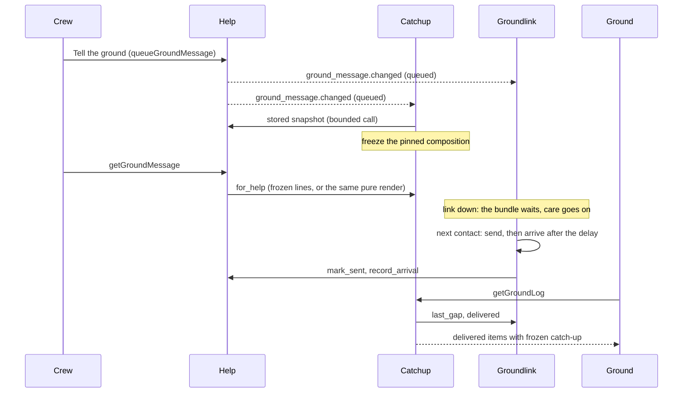

# E29 as built: the ground as a reader

The brief ([docs/product/tdd/E29.md](../../product/tdd/E29.md)) asks the design to settle six decisions. This note
records what the hub implements, with the tests that hold each one. Contracts are CONTRACTS sections 12, 16, 26 and
28 and `api/openapi.yaml` (`getGroundLink`, `demoSetGroundLink`, `getGroundLog`); nothing here changes them. Link
values and their sources are in [LINK-SCHEDULE.md](LINK-SCHEDULE.md).

## Modules and ports

| Module | Owns | Provides | Consumes |
|---|---|---|---|
| `crew_health.groundlink` | `groundlink_status` (link history, pruned to `groundlink.history_retention_rows`), `groundlink_gap` (one row per gap), `groundlink_bundle` (outbox), `groundlink_ack` (inbound), `groundlink_quarantine` | `GroundLinkQuery` (`current`, `last_gap`), `BundleOutbox`, `BundleInbox`, `getGroundLink`, `demoSetGroundLink`, event `ground_link.changed` | `MissionStatePort` (E23, structural copy), `GroundMessageLifecyclePort` (help, E26), release documents `environment-profiles` and `environment-hazards` |
| `crew_health.catchup` | `catchup_message`, `catchup_line`, `catchup_quarantine` | help's `GroundLogComposer` (registered under help's class, A6), `GroundLogView`, `getGroundLog` | `GroundLinkQuery`, `BundleOutbox`, `HelpLogSnapshots` (help), `ConfigReader` (pinned document versions), `ConsentQueries` (E02, structural copy), `PlanCatchUpPort` (E28, structural copy), release documents `ui-copy` and `help-presentation` |

Help stays the single emitter of `ground_message.changed`. groundlink feeds its outbox from a durable subscriber on
that event (crew scope, state `queued`, approved content hash) and reports progress back only through
`GroundMessageLifecyclePort`; it never emits the message event itself.

## Decisions

1. **GroundLink fields.** `status`, `one_way_delay_s`, `next_contact_at`, `last_contact_at`, `gap_kind`,
   `gap_planned`, `source`, `environment_id`, `delay_text`, `delay_source_ids`, computed at read time from the
   active environment's `link.sim_schedule` (contiguous down windows chain into one gap) or the demo override.
   `source` is `schedule` or `demo`; no measured link adapter exists yet, so nothing produces a measured value.
   Unknown environment answers a retryable `INTERNAL_ERROR`, never a guessed link. The demo switch works only in
   SIM or REPLAY (LIVE and an absent mission answer 404), needs the operator role and an Idempotency-Key, and its
   replay is rebuilt from the history row (SYSTEM 5.8; a replay whose row was pruned answers the retryable
   `INTERNAL_ERROR`). A stored override is served only while the mission is SIM or REPLAY: in LIVE the schedule is
   served. A planned demo gap ends at its `next_contact_at` and the link returns to the schedule; an unplanned one
   holds until switched back. Every change emits one `ground_link.changed`, the first activation included. Tests: `hub/tests/groundlink/test_http.py`, `test_domain.py`, `test_properties.py`.
2. **Who reads the link.** Only `rules` (the ground-silence evaluator), `catchup`, `mission` and `groundlink` may
   import `groundlink.application.ports`. Two checks hold it: the import-linter contract `ground-link-readers`
   (`crew_health.app.import_contracts`) and an AST scan of every hub source, including `TYPE_CHECKING` blocks,
   relative imports and dynamic import strings (`hub/tests/groundlink/test_link_independence.py`). The same scan
   also catches the second road to the link, help's `GroundLogComposer.link()` and its `LinkSnapshot`: any import,
   attribute access or string naming them outside `help` and `catchup` fails, with planted cases for each. The Habitat line
   reads the public `getGroundLink` response, not the port.
3. **Byte comparison.** `eval/scenarios/E29` fixes one injected instant, switches the link up, delayed and down
   through the demo route, and compares raw response bytes. The help session is byte-identical in the three states;
   the ground message differs only in `leaves_at` and `status_text`. The run writes the hashes and the permitted
   differences to `eval/results/E29/independence.json`, a kept artifact rewritten on every run, and prints its
   path.
4. **Catch-up look-back.** `getGroundLog` lists delivered bundles only (transport truth from `BundleOutbox`).
   `since` defaults to the start of the last gap from `GroundLinkQuery.last_gap`, so after an outage the ground sees
   everything sent since the link dropped; with no gap on record it lists all delivered items. `last_gap` reads the
   newest `groundlink_gap` row by primary key. A log larger than `catchup.log_max_items` answers a retryable error,
   never a partial log (P29-2 interim). Every item passes the consent rule on the way out (AGENTS section 6,
   "every way out of the hub"): the caller must be a ground session with a `person_id`, and an item is listed only
   when `ConsentQueries.allows` grants that recipient the scope `ground_log` / `catchup/approved/1` for the item's
   subject. No consent provider means 403 `CONSENT_REQUIRED`; a session without a person means 403
   `UNAUTHORIZED_SCOPE`. A handoff, whose subject is unknown until E16, is shown to nobody.
5. **Freezing the catch-up.** Help stores an immutable snapshot at the press, with the document versions the
   session pinned. Catch-up composes only from that snapshot and the pinned `ui-copy` and `help-presentation`
   versions (read through `ConfigReader`), never from the active release (SYSTEM 8.1, SYSTEM 840 `catchup/approved/1`,
   SYSTEM 1954). So the preview, help's press response and every later read render the same lines, and a release
   activated after the press changes nothing. Reads never write. The durable subscriber on help's queued event
   inserts the message row and, in the same transaction, freezes its four sections (`what_happened`,
   `what_was_done`, `being_watched`, `advice_welcome`) from help's stored snapshot; SQLite triggers refuse any later
   update, delete or insert. Until that subscriber runs, a read renders the same pure composition; if help's
   snapshot cannot be read in time, the read answers a retryable `INTERNAL_ERROR` and never shows the unknown word
   in place of approved content. Facts the hub does not have (plan steps until E28 lands) render the configured
   unknown word, and `nothing_watched` appears only for a known empty plan.
6. **Cache currency (E29-06).** The hub reports the active release id (`config_release_id` on the health
   response, and the `Config-Release` header the groundlink and catchup routes set); a device compares it with the
   release id stored beside its cached plans, teach steps and help flows. The device side is the crew app (`ui/crew`),
   deferred by the owner, so this is the design only.

## Failure modes

| Failure | Behavior | Test |
|---|---|---|
| Long outage with a backlog | Items wait while `down` (nothing else waits), then leave in `queued_at`, id order, `bundle.max_inflight` at a time, and arrive after the one-way delay | `test_26_hour_outage_keeps_300_items_then_drains_in_order`; E29-OUTAGE scenario (40 presses) |
| Help owner hung, absent or failing | One outstanding call per boundary, bounded by `groundlink.port_timeout_ms`; the bundle stays `sending` and retries with capped exponential backoff; no state is lost | `test_hung_and_absent_owners_keep_durable_sending_and_retry`, `test_edges.py` |
| Crash after the owner applied an event | The derived event id is reused; the owner answers `duplicate` and the bundle completes | `test_owner_crash_reuses_event_identity_and_completes_on_duplicate` |
| Ground reply while down, duplicated or oversize | Waits until contact, reaches help once through `record_reply`, oversize UTF-8 refused; no step state changes | `test_inbound_waits_then_delivers_once_and_rejects_oversize_utf8`; E29-REPLY |
| Invalid schedule in a release | The loader check `groundlink.sim_schedule` refuses the release and points at the window (overlaps, reversed windows, gap fields on the wrong status) | `test_config_edit.py` |
| Storage unavailable | Propagates as `StorageUnavailable`, including from a call that finishes after its caller timed out; never quarantined | `test_storage_failures_in_the_owner_are_raised_now_or_on_the_next_call` |
| Owner fails on the oldest bundle | Strict order: nothing queued after it leaves until it is sent | `hub/tests/groundlink/test_fix_regressions.py` |
| A bad queued event (malformed, hash conflict) | Each durable subscriber retries it up to `catchup.subscriber_max_attempts` / `groundlink.subscriber_max_attempts`, then rolls back its own writes, records it in its quarantine table with a safe reason code (no payload, no exception text) and moves on, so later events still flow | `hub/tests/catchup/test_application.py`, `hub/tests/groundlink/test_fix_regressions.py` |
| Help snapshot slow or failing during a read | Retryable `INTERNAL_ERROR`, nothing written, never placeholder content | `test_a_degraded_snapshot_read_is_a_retryable_error_never_unknown_content` |
| Release activated between the press and the subscriber | The frozen lines are the press-time composition (pinned versions) | `test_release_change_between_press_and_subscriber_never_changes_the_approved_catch_up` |
| Long mission, link history | `groundlink_status` keeps `groundlink.history_retention_rows` rows plus the latest environment and override rows; gaps live in their own bounded table | `hub/tests/groundlink/test_fix_regressions.py` |

## Sequences

The failure path is the same with the help owner absent: `mark_sent` times out, the bundle stays `sending`, and the
agent retries on its backoff while the crew flow is untouched.

## Ground silence (E29-03)

The rule belongs to E24 (`docs/tdd/E24.md`, the `ground_silence` row). groundlink provides what it reads: a down
link with `next_contact_at` and `gap_planned`. `hub/tests/groundlink/test_ground_silence_consumer.py` runs a
structural copy of that row against the provided query: the configured Moon line-of-sight gap raises nothing at any
threshold (D35), silence past `next_contact_at` plus a fixture threshold raises, and the link coming back clears.
The shipped threshold stays `null` ("to be set by clinical review", USE-CASES UC21); no NASA source in the catalog
gives a ground-silence duration, so none is configured.

## Reported against A6 and the package

- **SYSTEM 8.3 emitter text.** SYSTEM.md 8.3 says ground scope events "are emitted by `groundlink` when an item is
  delivered". A6 makes help the single emitter of `ground_message.changed`, and this branch follows A6: groundlink
  reports delivery through `GroundMessageLifecyclePort` and help emits the ground-scope copy only after arrival, so
  the privacy intent (a ground session never reads a queued message) holds. The coordinator should align SYSTEM 8.3.
- **Help recomposes on read (follow-up F2).** Help calls `GroundLogComposer.for_help` on every read and falls back
  to its own text when the composer times out. Catch-up returns the frozen lines or the identical pure render, so
  the lines agree, but on a composer timeout help can still show its fallback instead of the approved lines. That
  path is help's code (E26) and is left for F2.
- **`BundleOutbox` for E16.** E29 builds its side (handoff bundles queue, wait and arrive). E16 cannot import
  `BundleOutbox` today because the `ground-link-readers` import contract lists only `rules`, `catchup`, `mission`
  and `groundlink`; widening it is a coordinator decision.
- **Export.** Nothing is built for export (A6). When it is, it applies the same consent rule as `getGroundLog`.
- **Consent scope name.** `ground_log` / `catchup/approved/1` is an interim scope until E02 publishes the ground
  reader scope.

## Built in help's place (rule 9)

`help/application/ports.py` (`ConfigPinView`; `HelpLogSnapshotView` gains `crew_time_text`, `helping`, `pins`,
`subject_person_id`), `help/domain/ground.py` (`HelpLogSnapshot.subject_person_id`) and `help/adapters/codec.py`
(stores and reads it, older snapshots read as unknown subject). Catch-up needs them to compose from the pinned
snapshot and to check consent per subject.

## Not built here

- E29-05, the Habitat ground line and the For the ground card, and the device side of E29-06 live in `ui/crew`,
  which the owner deferred (E03 shell).
- Plan, warning and routine byte comparisons need E28, E24 and E25, which other people are building now.
- Handoff owner callbacks need E16; handoff bundles already queue, wait and arrive without an owner.
