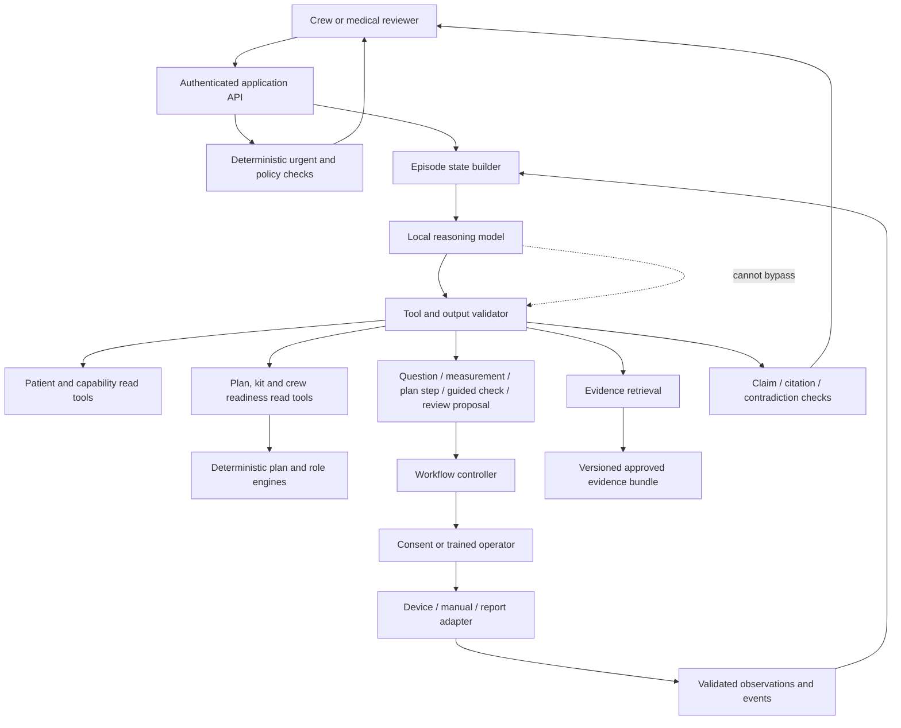
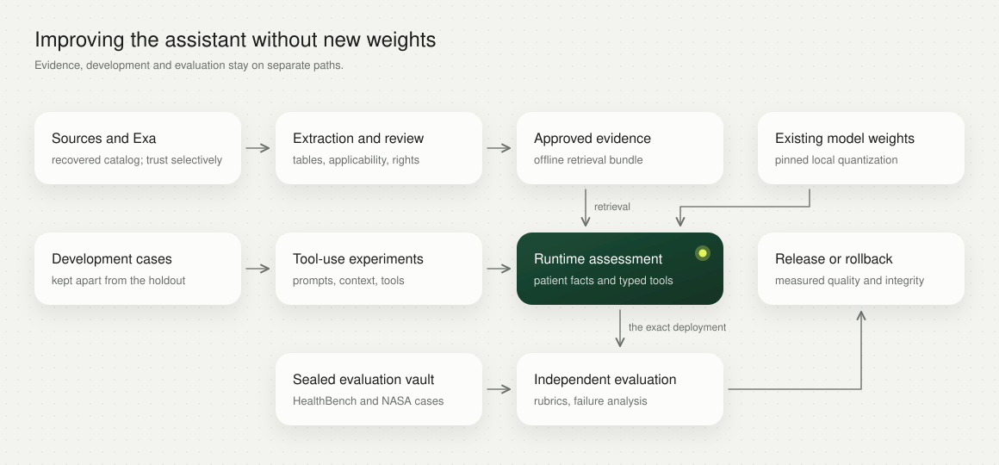

# LLM, knowledge and evaluation architecture

**Full hackathon scope · Proposed architecture, not measured performance**

The recommended system is a **local medical reasoning model inside a deterministic, capability-aware workflow**, supported by a curated evidence database, typed patient records and narrowly defined tools. Use the existing medically adapted HuatuoGPT-3 weights. **We will not perform additional fine-tuning or weight training.** Our work improves tool use, retrieval, context construction, measurement selection and verification around the model. Retrieval supplies the changing medical and NASA knowledge.

The assistant's job has two halves: **ask and measure** (one question at a time, and only the measurements this kit can take), and **explain the plan aboard to the person doing it** (section 4.1). The plans themselves are packed before launch in versioned configuration and computed by the deterministic plan engine ([PRD](PRD.md) section 4.13). The model chooses among a plan's steps and explains them; it never writes a step, a medicine or a dose. **Every plan runs with the model switched off**, and so do the teach steps, the camera checks and Someone needs help.

The model should have many useful capabilities available across the system, but only the relevant tools visible at any one step. More calls, larger prompts or more debating agents are not inherently better clinical reasoning. Select those features by controlled comparisons on the actual deployed artifact.

## 1. Preserve the right baseline

The product scope contains a local explanation assistant, read-only tools, Chronos-2, the wrist band, station cameras and a ground console. This architecture combines that full product scope with the requirement for stronger diagnostic reasoning, tool use and benchmark evaluation.

The current [HuatuoGPT-3-9B model card](https://huggingface.co/FreedomIntelligence/HuatuoGPT-3-9B) identifies Qwen3.5-9B as its backbone and requires thinking mode. It is the model the team builds with (PRD, model decision). Treat that as a choice to verify, not a measured result: the comparisons below test it on the deployed artifact and size the fallback. The publisher's HealthBench score is not reproduced here as our result. Pin the exact model revision, tokenizer, template, license, conversion procedure and weight hash before testing.

Compare at least these roles:

| Candidate | Purpose of comparison |
|---|---|
| Original HuatuoGPT-3-9B | Medical candidate without our additional training |
| Its compatible general instruction backbone or a comparable small general model | Tests whether medical adaptation helps this task |
| Same medical model plus retrieval and tools | Measures architecture gains without fine-tuning |
| Same model plus improved tool descriptions, context and verification | Measures gains from orchestration without changing weights |
| Smaller local fallback, such as the later proposal's Qwen3-4B candidate | Measures availability and latency tradeoff honestly |
| Larger development reference model, if compute is available | Estimates a reference ceiling; does not become an undisclosed cloud dependency |

Candidate selection is constrained by license, offline compatibility, correctness, privacy, memory and responsiveness. A higher benchmark score does not compensate for fabricated measurements or broken tool permissions.

## 2. Runtime components

The workflow controller owns state, permissions, request execution, retries, cancellation and stop conditions. The plan engine computes each condition's plan for the current environment, kit, stock and roster, and the role engine proposes who helps; neither calls the model, and neither reads the ground link outside the plan's ground stage. The reasoner chooses among permissible next steps and writes explanations. The safety controller operates even when inference fails. A verifier catches identifiable grounding and contract errors; it cannot guarantee medical truth.

Use one reasoning model process on the constrained laptop initially. A separate verifier pass can use the same loaded model, with a distinct prompt and structured evidence, without keeping another 9B model in memory. Correlated errors remain possible. A larger independent reviewer can be used in development evaluation, clearly separated from the offline product.

Do not use free-running multiagent debate as the default clinical runtime. Multiple development agents are useful for implementation and data curation; several clinical agents repeating the same unsupported assumption do not create independent evidence. An ensemble is an experiment with measured benefit, cost and failure modes.

## 3. The knowledge database: yes, catalog all the NASA sources

**Put all recovered NASA documents and URLs into a research catalog. Do not automatically put every recovered page into the model's trusted retrieval set or a training corpus (no training is planned).** The recovered archive contains thousands of links, not thousands of verified clinical references. Some are duplicates, historical versions, navigation pages, summaries or unrelated resources.

Maintain three physically or logically separate collections:

| Collection | Contents | Runtime use |
|---|---|---|
| Research archive | Every recovered URL, query, download, provenance record and review status | Researcher access; no automatic clinical citation authority |
| Approved evidence bundle | Reviewed passages, structured pathways, applicability, versions and source metadata | Offline patient-facing retrieval and fixed guidance |
| Development/evaluation vault | Development cases, tool traces, labels, benchmark data and holdout answers | Development/evaluation only; unavailable to clinical retrieval |

The patient chart is a fourth store with separate authorization. Public document search must never expose private patient records or journal entries. Patient attachments are not added to the global medical corpus.

### Ingestion pipeline

1. Import existing source indices and raw Exa results without losing query/session provenance. Exa is the preferred discovery service for new research.
2. Normalize URLs conservatively; resolve canonical document identity while retaining the original URL and retrieval time. Do not merge two editions merely because their titles match.
3. Fetch full content where access and rights permit; preserve immutable originals and SHA-256 hashes. Track inaccessible or summary-only items explicitly.
4. Extract text with page and section coordinates. OCR only when needed; verify tables, symbols, superscripts, units and minus signs. Table headers travel with every extracted row.
5. Deduplicate by exact content and near-duplicate passages. Keep version relationships and reasons for exclusion.
6. Classify source type: standard, operational requirement, technical brief, clinical evidence report, modeling CLiFF, clinical guideline, primary study, dataset, device manual or secondary commentary.
7. Review claim-level applicability: intended population, mission/gravity context, evidence type, contraindications, equipment and revision date. A risk-model resource is not automatically a treatment protocol.
8. Promote reviewed passages into an immutable evidence release. Build indexes only for that release, with an allowlist of citation IDs.
9. Validate retrieval and content integrity, sign or hash the release manifest, then install it locally. Preserve the previous release for rollback.

### Minimal storage design

Use SQLite for metadata, condition mappings, review records and full-text search. Store PDFs, extracted text and attachments as local files addressed by hash. Add a separate local dense-vector index, such as FAISS, for semantic retrieval; select the embedding model and index parameters through retrieval evaluation. Keep vectors keyed to immutable passage IDs and evidence-release IDs. Do not add a remote vector service to the critical offline path.

Suggested tables: `documents`, `document_versions`, `passages`, `passage_tables`, `claims`, `conditions`, `condition_aliases`, `condition_inventory_memberships`, `pathways`, `pathway_versions`, `capability_requirements`, `source_reviews`, `licenses`, `retrieval_releases`, `exclusions`, `model_releases`, `experiment_manifests`, `evaluation_runs`.

A passage includes `passage_id`, `document_version_id`, `page_start`, `page_end`, `section`, `text`, `table_context`, `source_url`, `retrieved_at`, `publication_date`, `hash`, `evidence_type`, `population`, `mission_phase`, `gravity_context`, `review_state`, `supersedes`, `allowed_uses` and `license_record_id`. Unsupported metadata remains unknown; never infer a publication date from a URL folder and present it as verified.

### Retrieval plan

First retrieve an approved pathway or measurement card by structured condition/complaint mapping. Then search supporting literature when it can resolve a specific uncertainty. Combine lexical search with dense retrieval because exact names, units and rare conditions matter alongside semantic similarity. Fuse ranked candidates, filter by permissions and applicability, and rerank a small candidate set.

Initial experimental settings: section-aware chunks of 400 to 800 tokens with limited overlap, 20 lexical plus 20 semantic candidates, reranking the deduplicated pool, and 4 to 8 final passages within a measured context budget. These numbers are tuning hypotheses, not best-practice claims. Tables and short protocols should remain intact even when that exceeds a nominal chunk size. Store parent sections for expansion.

Retrieve both support and important counterevidence. Expose contradictory versions rather than blending them. For questions about available equipment, retrieve device capabilities from structured state, not from a paper describing a device we do not own. For absence of evidence, return `no_supported_passage`; do not let a search similarity score become a clinical confidence score.

Use clinical synonyms and NASA condition aliases, but retain exact IDs and inventory versions. A query about SANS should find its full name; it should not conflate it with all causes of visual change. Retrieval from [MedRAG/MIRAGE research](https://arxiv.org/abs/2402.13178) supports testing different corpora and retrievers; it does not establish that one particular retrieval setup is optimal here.

No internet search runs in the offline clinical loop. An optional connected research workspace can use Exa to discover new sources, then stage them for review. It receives a generalized research question, not patient identifiers or private clinical text. An internet result cannot immediately become an approved clinical recommendation.

## 4. Tool catalog and action permissions

All calls require schema validation and an authenticated scope supplied by the controller, never trusted from model-generated patient IDs. Every response carries `tool_call_id`, `status`, `data`, `provenance_ids`, `observed_at`, `generated_at`, `limitations` and `error_code`. Missing values are explicit. The model cannot fill in missing tool output.

| Tool | Input purpose | Output | Permission / side effect |
|---|---|---|---|
| `get_episode_context` | Current episode and allowed fields | Symptoms, history, open tasks, freshness | Read authorized patient only |
| `get_observations` | Codes, time interval, context filter | Values, units, origin, quality and conflicts | Read; no cross-person lookup |
| `get_medication_allergy_context` | Relevant context | Recorded substances, reactions, dates | Read with sensitive-field policy; no dose advice |
| `get_capabilities` | Needed examination/measurement | Connected, manual, import-only, unavailable; operator/gravity limits; the kit map's state for the conditions in question and the missing instrument | Read |
| `get_pathway` | Complaint/condition and evidence release | Reviewed steps, conditions, limits and source IDs | Read approved release |
| `search_evidence` | Specific medical question and applicability | Ranked approved passages | Read; not web search |
| `read_source_passage` | Allowed passage ID and adjacent context | Exact text, pages, tables and metadata | Read; reject unknown IDs |
| `compare_observations` | Accepted IDs and versioned method | Deterministic trend/conflict result | Computation; no arbitrary code |
| `calculate_validated_metric` | Registered formula and required inputs | Result, units, applicability and missing inputs | Allowlisted calculation only; no partial validated score |
| `get_environment_context` | Mission and interval | Exposure/replay origin, time alignment and caveats | Read; cannot associate another mission with this person |
| `get_report_findings` | Confirmed report IDs | Typed findings and source spans | Read; extraction drafts marked unusable for conclusions |
| `propose_question` | Missing fact and reason | UI question draft | Proposal; controller chooses display and captures real answer |
| `propose_measurement` | Capability, purpose, decision changed | Request draft with the server's kit check (can, instrument, missing instruments, form links) | Proposal; the controller rejects any request the kit cannot perform before it reaches a person and keeps it as an unresolved gap; the person authorizes acquisition |
| `propose_review` | Concern and unresolved evidence | Review task draft | Proposal; does not send messages or assert care received |
| `draft_assessment` | Structured findings and differential | Candidate explanation with linked support/conflict | Draft; validation before display |
| `draft_handoff` | Episode, plan run or help session, and approved fields | Previewable log for the ground, written as a catch-up: what happened, what was done, what is being watched, what advice is welcome | Draft; the person approves it, the controller queues it with the time it leaves (the next contact), and nothing waits for it |
| `record_unresolved_gap` | Missing evidence and consequence | Episode gap draft | Controller persists if valid; cannot mark result normal; the gap opens the plan's check another way, never a ground step |
| `get_forecast` | Eligible series and model version | Experimental forecast and limits | Read/computation; no safety authority |
| `get_plan` | The episode's condition (or the help session's flow) | The plan view for this condition and environment: stages in order, each step's availability (aboard, not aboard, substituted, needs a skill holder), who can do it, the supply cover and the mode | Read; computed by the plan engine, never by the model |
| `choose_plan_step` | The helper's latest answers | A proposed next step ID from the active plan, with the answer that led to it | Proposal; the controller checks that the ID is in the active plan and can run with this kit, stock and roster, and rejects and logs anything else |
| `explain_step` | A step ID in the active plan | The step's authored first-time text and cited passages that answer "why" | Read; the step text itself is always rendered from configuration, never from the model |
| `propose_guided_check` | A gap or a plan step that has a substitute check | A guided check draft: the skill and the helper proposed by the role engine | Proposal; the person accepts it, and the guided-check engine, not the model, compares the count with the cameras |
| `get_crew_readiness` | A step's needed skill | Who can do the step now, with reasons (fresh practice, on a walk, is the subject); no health data | Read; medical officer scope, and the role engine's proposal for a help session |

The camera acquisition service, BLE service and report ingestion service are tools of the **controller**, not unrestricted tool executors available directly to the LLM. The LLM requests a measurement; a person accepts and the controller starts the device with the correct subject and consent.

Do not expose shell, arbitrary Python, arbitrary SQL, unrestricted HTTP, file deletion, chart overwrites or automatic prescribing. Numerical questions use registered calculators with tested units. Treatment-order tasks in external benchmarks run only in their isolated simulated environment, never through a product endpoint.

Expose roughly 5 to 8 relevant tools per stage as an initial design: context and capability reads during intake; retrieval and comparison during assessment; proposal tools when a gap is identified; the plan tools once a plan runs or a help session opens. Exact grouping is evaluated. Tool descriptions are short and specific, with examples of `unavailable`, `declined`, `stale`, `conflicting` and `not_aboard` results. No tool returns or reads the ground link's state, and no tool call waits for the ground.

### 4.1 The assistant's grown job: explain the plan to the person doing it

HuatuoGPT-3-9B stays, offline, with its tools. Its job grows from "ask and measure" to "explain the plan to the person doing it":

- It interviews the helper one question at a time and chooses the next library step from the helper's answers (`choose_plan_step`). The controller rejects any step that is not in the active plan or cannot run with this kit, and logs the rejection.
- It answers "why" in plain words from cited passages (`explain_step`). The step's own text is always rendered verbatim from the configuration, never from the model.
- It switches between each step's short and first-time versions, both authored, when a helper says "I've never done this".
- It proposes a guided check when the confirming test is not aboard (`propose_guided_check`); the person accepts it, and the deterministic guided-check engine compares the helper's count with the cameras.
- It sees who can help (`get_crew_readiness`) as skills and reasons only, never as health data, and never assigns a role itself; the role engine proposes and the helper decides.
- It never names a medicine dose, a threshold or a step that is not in the release. Medicine steps read "as in the onboard procedure", and the plan schema has no dose field; any output that names a dose is rejected before display (PRD R56, invariant EI6).

With the model stopped, the plan, the teach steps, the camera checks and Someone needs help all run unchanged: the plan card shows its steps in order, the helper moves through them by hand, and the assistant's card says it is stopped.

## 5. The reasoning loop

1. **Check urgency and policy before inference.** Structured urgent signals interrupt immediately. Narrative concerns can be flagged for confirmation, but safety cannot depend on successful LLM parsing.
2. **Build state deterministically.** Include relevant facts, explicit negatives, unknowns, timestamps, quality, source mode, mission/gravity and available capabilities. Never ask the model to compress away the authoritative record.
3. **Retrieve a pathway and relevant evidence.** Source selection is separate from diagnosis selection; a retrieved paper about a disease does not make that disease likely.
4. **Identify a useful next question or test.** The model states what uncertainty it addresses and how the result could change the next action. The controller checks feasibility and duplicate requests.
5. **Wait for the actual result.** A request is not a finding. No model-created patient or measurement response is permitted in LIVE mode.
6. **Reassess evidence and alternatives.** Preserve material contradictions, serious unresolved alternatives and the limits of available testing. Do not force a ranked diagnosis when the evidence supports only a symptom summary.
7. **Validate output.** Check cited observations, source passages, units, patient identity, stale data, unsupported claims and action permissions.
8. **Present an assessment and the plan aboard.** The controller attaches the condition's plan from the plan engine; the model may propose the next plan step or a guided check, and explains it. The person can inspect evidence, correct a fact, start the plan, stop, share or schedule follow-up. The log for the ground is the plan's last row and never the next step.

Use a structured output envelope: `summary`, `findings[]`, `hypotheses[]`, `supporting_observation_ids[]`, `conflicting_observation_ids[]`, `supporting_passage_ids[]`, `unresolved_alternatives[]`, `missing_evidence[]`, `next_step` (a question, a measurement, or a step ID from the active plan), `urgency_review_requested`, `limitations`, `evidence_release_id`, `model_release_id`.

Do not expose hidden chain-of-thought. Present a concise explanation of the evidence and the decision. Preserve action/result traces for audit without storing private raw reasoning by default. Thinking-mode compatibility matters for the candidate model, but its internal reasoning budget is a measured inference setting, not an assurance of correctness.

### Stopping and failure behavior

Initial software budget: at most 8 reasoning iterations per assessment segment and at most one schema repair per response. A segment can pause for a human measurement and resume. These are configurable loop protections, not clinical stop rules. A user can continue a new segment with the existing record.

Stop earlier when the next supported step is clear, the next available test would not change it, all useful capabilities are unavailable/declined, or repeated retrieval produces no new support. Budget exhaustion produces a structured incomplete assessment and remaining gaps, never a forced diagnosis. An emergency interrupts at any point.

Set a visible elapsed-time indicator and cancellation. Measure reasonable latency targets on the laptop. Do not impose an arbitrary 128-token thinking cap solely to reproduce an old timing estimate; compare reasoning budgets and output quality. Timeout, malformed output or model crash falls back to structured records, fixed reviewed cards, the plan aboard and the log for the ground. It never produces a fabricated successful consult.

### Verification layers

Deterministic checks prove narrower facts: an observation exists, belongs to this patient, has usable quality, has the cited unit and time, or a passage is approved. A citation ID alone does not prove that the passage supports the sentence. Add a claim-support review pass and a clinician audit sample. Assess omission of serious alternatives, not just hallucinated additions. If support is absent, remove or qualify the claim; do not append a decorative citation.

## 6. Improve the system without training new weights

**Decision confirmed by Joaquin: use HuatuoGPT-3's existing medical adaptation; concentrate on tool use. No SFT, LoRA, QLoRA, preference optimization or reinforcement-learning training jobs belong to this build.** “Already medically adapted” describes the upstream model. It does not imply that it has learned our tools, NASA pathways or device constraints.

### What we optimize

1. **Tool interfaces:** short descriptions, strict schemas, stage-specific exposure and realistic examples of failed, unavailable, declined and conflicting results.
2. **Context construction:** relevant symptoms, explicit negatives, unknowns, timing, mission/gravity, equipment and prior comparable observations. Keep authoritative facts outside model-generated summaries.
3. **Retrieval:** reviewed passages, hybrid search, applicability filtering, reranking, intact tables and honest no-result behavior.
4. **Information gathering:** a useful next question or measurement tied to a decision; no unnecessary repeat requests or invented results.
5. **Grounding and verification:** observation-ID checks, source support, contradictions, serious unresolved alternatives and action boundaries.
6. **Inference configuration:** correct template and thinking mode, context/reasoning budgets, quantization, caching and cancellation, measured on the deployment hardware.

Prompt examples and tool descriptions can be adjusted on development cases. That is prompt/orchestration work, not weight training. The test cases used to select those settings must remain separate from final evaluation.

### Development data and evaluation separation

Create reviewed synthetic episodes covering ordinary and urgent presentations, overlapping symptoms, missing equipment, failed devices, conflicting evidence, sensitive-answer refusal, a medical officer who is the patient or outside, a helper who has never done the step, and a ground that is delayed or out of reach for a day. Each episode defines only the information available at a given step and what a simulator may reveal after an appropriate request. Final diagnoses and scoring rubrics remain hidden from the evaluated model.

Split by case family, source vignette, patient and temporal episode before paraphrasing. Keep all derivatives together. Deduplicate exact and near-duplicate cases. A new wording of the same case is not a new holdout. A larger model may help draft examples, but medical labels and expected actions require review; teacher-generated cases are not automatically clinically valid.

Never put HealthBench test answers, rubric items or close derivatives in prompt examples or retrieval. Avoid repeatedly selecting prompts on the final benchmark. Use independent development cases, then freeze configuration for final reporting. Upstream pretraining contamination may be unknown and must be disclosed. No private crew records or journals are used for optimization by default.

### Reproducible configuration releases

A release contains the original model revision and hash, deployment conversion/quantization, chat template, prompt version, tool schemas, controller policy, evidence release and inference settings. Verify tool-call parsing with thinking mode before integrating the UI. Compare the original higher-precision reference when available with the exact local artifact; weight conversion or quantization is not additional medical fine-tuning.

Release changes only when they improve independently measured behavior without violating safety and tool-integrity gates. Keep the previous configuration for rollback. No online learning from consults and no background training process are present.

## 7. HealthBench: make the intended benchmark explicit

[HealthBench](https://openai.com/index/healthbench/) evaluates responses to health conversations using physician-created rubrics; it is not a direct test of astronaut diagnosis or device control. Use the [official evaluation implementation](https://github.com/openai/simple-evals/blob/main/healthbench_eval.py), pinned to a commit, with dataset hashes and the prescribed scoring behavior.

Run distinct tracks and label them:

- **Model-only HealthBench:** the candidate answers the supplied conversation without our patient simulator. Report exact model, precision, prompt, decoding and grader.
- **System-assisted HealthBench:** our retrieval-enabled architecture answers the same task with a frozen permitted corpus. Report this as a different configuration, including tool budgets. It cannot invent additional patient answers or laboratory results that the benchmark does not supply.
- **HealthBench Hard and Consensus:** report the relevant subset metrics separately using the official harness. They overlap with the main evaluation and are not independent datasets to pool.

If a small sample is used during development, label it as a development subset with its selection rule. A partial run is not a full benchmark score. Use a full frozen run for the headline result when resources permit; missing cases, timeouts and failed generations remain in the accounting.

Pin grader identity/version, rubric/scoring code and sampling. The model being evaluated must not grade itself. Preserve raw completions and per-criterion grades for audit, excluding private clinical data. Grader calls may require a connected development environment and credentials; that does not alter the offline product claim. If a replacement grader is used, label the evaluation as modified and validate agreement rather than comparing it directly with official reported scores.

Report paired differences and bootstrap intervals over conversations, alongside critical error categories. Do not optimize a scalar average while hiding a rise in harmful omissions. Avoid quoting a publisher's full-precision score as an expected result for our quantized or tool-using deployment.

## 8. Evaluation for actual assessment behavior

HealthBench alone does not test whether the assistant selects a useful next test. Add the following independently reported suites:

| Suite | What it tests | Main measures |
|---|---|---|
| NASA scenario suite | Mission context, all active condition families, missing equipment and a ground that is delayed or out of reach | Urgency handling, evidence use, appropriate next step, unresolved risks and diagnostic adequacy when assessable |
| Plan suite | Plan step choice, explanations and guided-check proposals with the link up and down | Proposed step IDs inside the active plan and runnable with this kit; zero steps, medicines or doses outside the release; "why" answers supported by their passages; first-time text chosen when the helper says so; identical behavior with the link up, delayed and down |
| Interactive tool suite | Correct sequencing, real outcomes, failure handling and stop behavior | Successful allowed actions, invalid calls, fabricated results, unnecessary requests |
| Retrieval suite | Correct passages, obsolete sources, contradictory evidence | Recall at k, ranking quality, support precision, no-answer behavior and applicability |
| Clinical review sample | Medical validity beyond machine assertions | Independent clinician ratings, disagreements and adjudication |
| Privacy/adversarial suite | Prompt injection, cross-patient requests, private data and malicious PDFs | Zero policy bypasses in defined cases; failures listed |
| Robustness suite | Quantization, paraphrases, missing units, negation, timestamps, mixed modes | Error changes by perturbation and subgroup |
| Sensor/forecast suite | Measurement reliability and temporal prediction | Error, rejection, coverage and comparison with simple baselines |

[MedAgentBench](https://github.com/stanfordmlgroup/MedAgentBench) provides a relevant simulated EHR tool-use setting. Keep its simulated orders and writes isolated from the product's narrower permissions. [AgentClinic](https://github.com/samuelschmidgall/agentclinic) is relevant to interactive diagnostic assessment; simulator realism and hidden-label leakage need their own checks. Neither benchmark establishes performance in space.

For diagnostic cases, use clinician-adjudicated labels, acceptable differentials and appropriate test choices. Measure top-choice/top-k accuracy only where a definitive label and sufficient evidence exist. Also measure abstention, selective accuracy, serious missed alternatives and unnecessary testing. A correct diagnosis reached through invented findings is a failed case. A well-supported “cannot determine with available equipment” can be correct.

Numerical confidence requires separate calibration on representative cases; use reliability curves and calibration metrics if probabilities are produced. Class imbalance and out-of-distribution astronaut conditions make a single confidence number fragile. Default UI uses evidence and limitations rather than percentages.

### Experiment matrix

Hold the test set, corpus and inference budget fixed when attributing a gain:

1. General baseline versus medical candidate.
2. Medical candidate with versus without retrieval.
3. Lexical versus dense versus hybrid retrieval; with versus without reranking.
4. Flat tools versus stage-specific tools; single pass versus one verification pass.
5. Original tool descriptions/context builder versus revised descriptions/context builder, with weights fixed.
6. Higher precision versus deployment quantization.
7. Reasoning-budget and context-budget sweeps.
8. Entire system versus a simple reviewed rule/pathway baseline.

Select on an independent development objective: no critical contract failures first, then clinically reviewed assessment quality, grounding and appropriate acquisition, followed by benchmark score and latency. Publish the actual tradeoffs instead of asserting universal superiority.

## 9. What maximizing performance means in practice

The highest-value work is better evidence and test design: complete relevant history, reliable tool output, clinically reviewed development examples, realistic missingness, correct retrieval, and explicit uncertainty. Our controller, tool interfaces and prompts make that environment usable by the existing medical model.

Do not stuff the entire NASA archive into every prompt. Do not fine-tune on every PDF. Do not let the model generate a plausible test result. Do not chase HealthBench by leaking its rubrics into prompts or retrieval. Do not replace unresolved clinical questions with more internal debate.

What a judge sees is the list in [PITCH.md](PITCH.md) ("What a judge sees"). The model's part in it is narrow and inspectable:

- **It works inside the kit map:** every request it proposes carries the server's kit check and shows "This kit can" or "This kit can't" (PRD R45); `get_capabilities` reports what is unavailable and the kit map's state for the conditions in question, and `record_unresolved_gap` keeps the missing ECG on the episode with the condition's Clinical Findings Form.
- **Check it another way:** the gap opens the plan's first stage; `propose_guided_check` drafts the substitute check with the helper the role engine proposed, and the person accepts it.
- **Teach and check:** `explain_step` answers "why" from cited passages and the first-time text helps a helper who has never done the step; the counting, the comparison with the cameras and the verdict belong to the deterministic guided-check engine, never to the model.
- **It asks for the next measurement and takes it itself:** `propose_measurement` names the decision it could change; once the person accepts, the controller starts the camera station with the correct subject and consent.
- **Every value says where it came from:** every tool response carries `provenance_ids` and `observed_at`, and output validation checks each cited observation and passage; a claim without support is removed or qualified (section 5).
- **A failed measurement is a result:** a failed acquisition comes back as an explicit result with its status and reason, stays on the episode, and can never be cited as support (PRD R16); no model-created measurement is permitted in LIVE mode (section 5, step 5).
- **Every plan, and Someone needs help, works with the model switched off:** the deterministic safety controller runs before inference (section 5, step 1), the plan engine computes every plan without the model, and both keep working when inference fails.
- **The log goes to Earth last:** `draft_handoff` writes the catch-up the person previews and approves; it leaves at the next contact, and nothing waits for it.

The rest sits outside the model. The kit map's counts and the plans are computed by the plan engine; the roster and role proposals by the role engine; supply cover by the ledger; stay or return lists criteria and never decides. The body map is the interface's presentation of the same records. The streak, patches, practice patches and crew goal (PRD section 4.6) are deterministic counts from completion events; none of the tools in section 4 reads or changes them.

Behind those points, the audit trail lets a judge inspect the fact that changed the next question, the tool that supplied the measurement, the passage supporting the action, the missing equipment that limits the assessment, and the exact offline model configuration that was evaluated. That is a stronger and more defensible demonstration than an unsupported claim to diagnose every NASA pathology.

## 10. Architecture decisions to carry into TDDs

- **ADR-01:** local modular hub with isolated heavy workers; no cloud clinical dependency.
- **ADR-02:** catalog everything, retrieve only reviewed/versioned evidence, keep development examples separate from sealed evaluation.
- **ADR-03:** stage-specific typed tools; controller owns every write and acquisition.
- **ADR-04:** deterministic urgent and numerical logic; LLM interpretation cannot override it.
- **ADR-05:** source selection before fusion; any physiological fusion is an independently evaluated experiment.
- **ADR-06:** one local reasoning process; verification/ensemble variants chosen by measured benefit.
- **ADR-07:** HealthBench retained as a named benchmark, with model-only and system-assisted results separated.
- **ADR-08:** exact exported/quantized deployment artifact must pass evaluation; upstream scores are contextual only.
- **ADR-09:** explicit session pairing is the station identity default; opt-in face matching is separately tested.
- **ADR-10:** no online learning from patients; releases and evidence bundles are reproducible and reversible.
- **ADR-11:** every plan runs with the model switched off; the model proposes plan step IDs and explains them, the controller renders step text from the release, and no output may name a step, medicine or dose outside it.
- **ADR-12:** no tool reads the ground link and no model action waits for the ground; the log for the ground is drafted, approved by a person and queued for the next contact.
