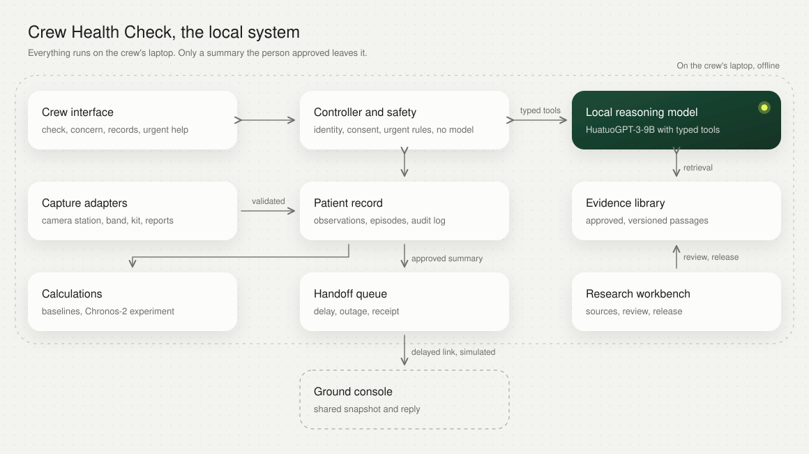

# Crew Health Check: full hackathon product requirements

> **Crew Health Check**
>
> *Measures what it can. Shows what it can't. Teaches the crew the rest.*
>
> On a long mission there may be no doctor aboard, and Earth may be out of reach for a day or for weeks. Crew Health Check is an offline, all-in-one health dashboard for the crew: the mission routine with plain how-to steps, the habitat's sensors read against their limits on a station, in deep space, on the Moon or on Mars, warnings that say who raised them, and a “Someone needs help” button on every screen. A short daily check, cameras that read pulse and breathing, a wrist band and the medical kit build each person's own baseline. When something feels wrong, a medical AI running on the same laptop asks one question, takes the next measurement and says plainly what this kit cannot test. For every condition the crew then has a plan aboard, starting with the best check the ship can do; when a step needs hands, the app teaches a crewmate on the body while the cameras check the crewmate's work. The ground reads the log at the next contact, and nothing waits for it. It is built on NASA's list of 119 medical conditions modeled for exploration missions.
>
> **The loop:** know the kit → ask → measure → check it another way → act aboard (the log goes to Earth last).
>
> The full pitch and the demo story are in [PITCH.md](PITCH.md). How the team starts on Saturday is in [KICKOFF.md](KICKOFF.md).

**Working plan for the event · 14 November 2026**

**Single source of truth:** This package is the working plan for the event. It covers the expanded assessment system, research tooling and evaluation: the pitch and the loop, gamification (streak, patches, crew goal), the brief's five questions on every measurement card, the reaction test, the cabin CO2 replay, HuatuoGPT-3-9B as the model and the M3/16 GB laptop target. If this PRD and [PITCH.md](PITCH.md) disagree about the story, the demo or what we show, PITCH.md wins.

**The product:** an offline health dashboard for the crew aboard a mission that knows what its ship can and cannot test. Its center is the **kit map** (section 4.12): for each of the 119 conditions NASA models for exploration missions, the test that would confirm it, from NASA's Clinical Findings Forms, checked against the medical kit actually on board and drawn on the crew member's body, and, in its plan column, what the crew does about each condition here with what is aboard (section 4.13). Around it sits the crew's whole day. One screen, Today, answers “is anything wrong, and what do I do now?”: warnings raised by deterministic rules, sensor limits or the local medical model; the daily check and the routine tasks due now; the habitat's sensors for the current environment; and “Someone needs help”, always visible, for oneself or a crewmate. Behind it sits a capability-aware assessment workspace that brings together symptoms, measurements and mission context, helps the person choose a useful next check, runs the plan aboard, and preserves a clear record for the medical officer and, at the next contact, the ground. It handles a broad medical intake without pretending every condition can be diagnosed with a webcam, and it assumes no medical training anywhere. The binding design for every flow, its actors and its 26 use cases is [USE-CASES.md](USE-CASES.md).

**Model decision:** HuatuoGPT-3-9B is the model, with its existing medical adaptation and no additional weight training. Improve tool use, retrieval, context and verification.

**Scope decision:** the entire system in this package is for the hackathon. There are four developers, each able to use agent teams. Stages express dependencies, not time-based cuts. Hardware availability, evidence quality and clinical review determine how a capability is represented; they do not silently remove its software workflow.

This is a specification, not an implementation or a clinical validation report. No new diagnostic performance, trained checkpoint or hardware capability is claimed.

## 1. The product and the challenge

### 1.1 Design principles

The strongest part of the concept is the complete loop from a questionable reading to another measurement and an understandable next step. Broad condition coverage helps only if the product is precise about what it knows and what it still needs.

The concept brings a credible offline setting, several complementary inputs, and explicit handling of failed measurements. The gaps to close: limited symptom intake, an underspecified local assistant, and no way to represent the many tests that require equipment outside the current kit. Adding a long disease checklist would make the interface harder to use without closing those gaps.

The product is therefore an **all-in-one crew health dashboard built around a capability-aware medical assessment workspace**. The dashboard keeps the crew's daily health work in one place: the check, the routine, the habitat, the warnings and help for a crewmate. The workspace can record information across the NASA inventories, collect appropriate additional context, display clinician-entered diagnoses, and help organize a differential assessment. Diagnostic confirmation remains dependent on the actual evidence and an appropriate clinician or reviewed protocol. Its central question is: *What information would change the next decision, can this ship get it, and what can this crew do about it here?*

**The differentiator: the kit map and its plan column.** NASA's Integrated Medical Model helps planners “optimize the medical resources packed” for a mission, and under “Clinical Optimism” it “assumes that all medical conditions are correctly diagnosed by the crew” ([NASA IMM overview](https://www.nasa.gov/nasa-integrated-medical-model-imm-overview/)). The kit map asks the crew-side question, condition by condition: with this kit, can they? A lime dot marks a region where the kit measures, a hollow ring where only the person's report is possible, a dashed ring where the confirming test is not aboard, and the view names the instrument that would close each gap. Every other part reads the same kit: the assistant may request only what the kit can do (R07, R45), the routine marks a task “Not available” when its instrument is missing, the help steps list kit items only when the kit has them, and each environment carries its own kit. Every health app in the field shows what it measures; this one also shows what the ship cannot test.

The same map then answers a second question for every row: what does this crew do about it, here, with nobody to call? The kit widens to everything aboard (the instruments, the supplies, the procedures the flight surgeons packed before launch, and the crew's trained hands), and every row gets a **plan aboard** (section 4.13). Where the confirming test is missing, the plan starts with the best check the ship can do (**check it another way**); where a step needs hands, the app teaches a crewmate on the body while the camera array checks the crewmate's work (**teach and check**); a skills roster with practice recency says **who helps**, including when the medical officer is the patient or outside on a walk; and drills of the same steps keep those skills fresh and earn practice patches. The ground is a reader of the log, never a step. Offline operation, link badges and fixed help steps are common in the field and are never the claim; what no other entry does is point its cameras at the helper's hands, assign roles by practice recency, reward drills, and hold a plan for every one of NASA's conditions that starts where the test is missing. The 119 rows and their plans are written at the event from the forms (section 13); nothing in this package claims them before then.

Seven rules shape every flow. The binding text is in [USE-CASES.md](USE-CASES.md), section 1:

1. **Today says what needs you.** Warnings first, then what is due, then everything else.
2. **Help is one tap away, always.** "Someone needs help" sits at the top of every screen, and its first steps never wait for the model, a sensor or the ground.
3. **Nothing assumes medical training.** Every task and every warning says what to do in plain words, step by step, and why.
4. **The app knows where it is.** The environment (space station in low Earth orbit, deep-space transit, Moon base, Mars base) and the activity (spacewalk, exercise, sleep) change the hazards watched, the sensors that matter, the tasks due and the ground link.
5. **Every warning says who raised it.** A rule, a sensor limit or the assistant, with the evidence. The assistant can add a warning; it can never lower or clear one that a rule or sensor raised.
6. **It is not the vehicle's alarm system.** The app repeats the vehicle's alarms, points to the crew's procedure and looks after the people afterwards. It never replaces or silences an alarm.
7. **The ground is a reader, never a step.** Every plan, help flow, warning and routine task runs to its end with the link down. The log for the ground is always the last row and leaves at the next contact; a reply is advice for later and never unlocks anything.

Inside the dashboard, the assessment workspace follows five principles:

1. Add guided complaint intake, relevant history, medications, allergies and exposure context. These have more immediate value than adding another speculative signal from the face.
2. Give ECGs, laboratory results, eye examinations, imaging, dosimetry and other specialist findings a typed import path. “Not available here” must be a useful outcome.
3. Separate deterministic warnings and Someone needs help, trend calculations, experimental forecasts and LLM interpretation. Each has a different evidential role.
4. Build a versioned research library with source passages and reviewed pathways; improve tool use around the existing medical model rather than treating PDFs as a training set.
5. Evaluate the shipped model and the complete system separately, including HealthBench, interactive tool tasks, missing data, misleading evidence and safety failures.

### 1.2 How it answers the challenge

The challenge is “Create Health Monitoring Software for Astronauts on Space Missions”. Each ask in the brief maps to a part of the product.

| The brief asks for | Where it is in the product |
|---|---|
| Gather health indicators | All six indicators the brief names: blood pressure, heart rate, blood sugar, body temperature, sleep hours and mood. Also blood oxygen, breathing rate, reaction time, exercise, specialist findings imported as reports (section 4.4), and the habitat's own sensors for the current environment: CO2, oxygen, radiation, dust and particles, chemicals, noise and more, each against its sourced limit (section 4.8). The [input dictionary](input-dictionary.csv) types every field |
| “Your tool could prompt astronauts to take measurements or complete specific actions from time to time as a part of the mission routine” | The mission routine (section 4.9). Every measurement and task has a cadence (continuous, daily, every few days, weekly, monthly, per spacewalk, after an event, by mission phase or as needed), the minutes it takes, the kit, plain numbered steps and why it is done that often, sourced in [ROUTINE.md](ROUTINE.md) or marked “frequency to be set by the flight surgeon”. A spacewalk, dust, a radiation storm, a symptom or a new environment tightens one task for a stated time with its reason, then the task returns to normal on its own. “To do” on Today lists what is due now |
| A visual tool for self-assessment | Today, the all-in-one screen: warnings first, then what is due, how the person is against their usual, and the habitat against its limits. The body map gives every reading, symptom, warning and missing test a place on the figure; trend charts compare with the person's own baseline; states are in plain words (sections 4 and 4.7) |
| Guidance on treatments and improvements | The plan aboard for every condition on the kit map: check it another way, do now, watch, if it gets worse, the medical officer's step, with manual steps taught to a crewmate on the body and checked by the cameras where a camera can (section 4.13). The plain steps of every routine task and every warning (sections 4.9 and 4.10); the “What you can do” heading of every full measurement card and the assessment's sourced next step (section 4.3); and “Someone needs help”, whose fixed first steps and guided session draw only on reviewed procedures and what the kit holds (section 4.11). No medicine or dose that a reviewed procedure does not contain, no treatment orders, no invasive instructions (section 9) |
| Explanations for people who cannot interpret every metric | Every full measurement card answers the brief's five questions (section 1.3). Every warning says what is happening, why it matters for the body, what to do and who raised it. Every habitat sensor explains the adverse effects it can cause in this environment. Assessments separate what was observed, what might explain it and what cannot be assessed here |
| Inputs by text, clicks, camera images and numbers | Typed concerns and journal entries; chips, choices and sliders in the daily check and the help flow; the click-based reaction test; camera pulse and breathing from the camera station; numeric kit readings, routine task results and imported reports |
| Routine reminders, gamification, trend charts, color coding (optional ideas) | “To do” on Today, the Routine screen with “Changed for now”, and the “what is due” step of the daily check; the streak, mission patches and crew goal (section 4.6); trend charts on the measurement and habitat cards; color that always comes with text, the four warning levels in words, and the words Live, Replay or Sim beside every value |

### 1.3 The brief's five questions on every measurement card

The brief's five questions are the five headings of every full measurement card.

| Brief question | Card heading | Where the text comes from |
|---|---|---|
| What can be measured in space? | How to measure it here | Device instructions, oximeter and cuff guidance, the reaction-test protocol |
| Why is an examination needed? | Why it is worth measuring | The same sources and NASA technical briefs |
| How do spaceflight hazards affect the indicator? | What spaceflight does to it | NASA hazard pages, technical briefs and Human Research Roadmap evidence reports |
| When does a result need crew or ground attention? | When to tell a crewmate or the ground | Generated from that indicator's deterministic attention and urgent rules, so the card and Today never disagree |
| What actions can prevent a critical condition? | What you can do | NASA sleep and CO2 briefs, exercise countermeasures, first-aid guidance |

The seven full cards carry over: heart rate and blood oxygen, blood pressure, blood sugar, body temperature, sleep, mood, and cabin CO2. The reaction test, exercise and the camera reading get a short card (how to do it, what it does not mean). Each heading holds one to three sentences, every statement carries a source ID from the approved evidence bundle, and a heading with no applicable source reads “No supported guidance in this build” instead of improvising. The cards answer the five questions whether or not the model is running. A measurement request inside a concern (the measurement screen in [UX-DESIGN.md](UX-DESIGN.md)) links to the card for its indicator.

### 1.4 NASA data used

NASA data is the core of the product, not decoration. The [Judging and Awards Guide](https://www.spaceappschallenge.org/resources/judging-awards-guide/) scores Relevance, and at least one NASA data or resource is required for a Global Award. The product uses 96 NASA documents and two NASA datasets, each listed with what it does in [NASA-SOURCES.md](NASA-SOURCES.md); the table below is the core.

| NASA data or resource | What it does in the product |
|---|---|
| [ExMC Evidence Library Methods, Rev B](https://ntrs.nasa.gov/api/citations/20240004774/downloads/HRP-48036%20RevB_ExMC%20Evidence%20Library%20Methods.pdf): ICL 1.0 v3.2 with 119 conditions, plus the broader inventories (section 2) | The condition registry. For each condition: what the person reports, what would confirm it, and whether this kit can. Drives the assistant's requests, its “not available here” answers and the [condition browser](condition-browser.html) |
| [NASA Open Science Data Repository](https://osdr-tutorials.readthedocs.io/en/latest/pages/guides/environmental_data_application.html): Rodent Research-1 ISS cabin telemetry (2014) | The Replay CO2 channel of the space station profile, shown on the Habitat card and the cabin air card, and the evidence behind the CO2 warning in act 2. 12,087 records from 2014-09-20 to 2014-11-01, with a week of rising CO2 to a one-hour mean of 4,606 ppm (3.50 mmHg at an assumed 760 mmHg) over the twelve five-minute samples up to 15:36 on 7 October 2014. The replay clock is set there and shown as mission day 19 in this demo. It is another mission's cabin, not a crew member's exposure. Data file: [nasa-data/eda_rr1_telemetry.csv](nasa-data/eda_rr1_telemetry.csv); all NASA sources are in [NASA-SOURCES.md](NASA-SOURCES.md) |
| [NASA-STD-3001 Vol 2 Rev F](https://standards.nasa.gov/system/files/tmp/NASA-STD-3001%20Vol%202%20Rev%20F.pdf) and [Appendix E](https://www.nasa.gov/reference/appendix-e-health-and-medical-care-technical-requirements/) | The 3 mmHg one-hour CO2 limit on the CO2 channel and the cabin card; the medical capability categories behind the condition families. The other habitat limits and their sources are in [ENVIRONMENTS.md](ENVIRONMENTS.md) |
| NASA technical briefs: [SANS (OCHMO-MTB-001)](https://www.nasa.gov/wp-content/uploads/2024/02/ochmo-mtb-001-sans.pdf), sleep, CO2 | Evidence passages behind measurement cards, warnings and assessments |
| [NASA's five hazards of human spaceflight](https://www.nasa.gov/hrp/hazards/) | The “What spaceflight does to it” heading, and what the product tracks or marks “not measured by this kit” for each hazard (below) |
| NASA Clinical Findings Forms, beyond the confirming test | Each row's ground needs (“Communications and Support Needs”), treatment scope and NASA's modeled removal to definitive care (Table 4), which the plan aboard replaces with onboard steps or shows as context (section 4.13) |
| NASA on the link and on care aboard: the [Lunar Communications and Navigation Architecture](https://www.nasa.gov/wp-content/uploads/2024/01/lunar-communications-and-navigation-architecture.pdf), [ExMC on Earth Independent Medical Operations](https://ntrs.nasa.gov/api/citations/20230007863/downloads/EIMO.AsMA2023.Lemery.final.pdf) and [NASA-STD-3001 Vol 1 Rev C](https://standards.nasa.gov/sites/default/files/standards/NASA/C/nasa-std-3001-vol-1-rev-c-signature.pdf) [V1 3004], [V1 3006], [V1 3007] | The ground link's schedule in each environment, why no plan step waits for the ground, the second medical officer on the roster, and why only the Moon base has a return stage |

| Hazard | What the product tracks | What stays outside its measurements |
|---|---|---|
| Isolation and confinement | Mood, sleep and the reaction test; a private journal that never reaches the model or a summary | A psychiatric diagnosis from a slider or a journal |
| Distance from Earth | Offline operation; Someone needs help with the model stopped; the ground link on the Habitat line (up, delayed or down, with the delay or the next contact); a plan aboard for every condition, which runs the same with the link down; the log for the ground, approved by a person and queued until the next contact (section 4.13) | Proven safety of prolonged autonomous care; the decision to return, which belongs to the commander and the medical officer |
| Hostile, closed environment | The habitat sensors that matter in the current environment against their sourced limits, with the adverse effects each can cause (section 4.8); the CO2 REPLAY channel with NASA's limit drawn on it; exposure logs (section 6) | A live cabin feed unless a sensor is on the table; a person's actual exposure; the vehicle's own caution and warning system |
| Altered gravity | Pulse and blood pressure trends, exercise minutes, the gravity context on every observation, and the readaptation tasks after landing on the Moon or Mars (section 4.9) | Bone density (only through an imported DXA report), fluid-shift disorders |
| Radiation | The radiation dose-rate channel (an instrument's rate, never a person's dose), storm shelter steps, the personal dosimeter task in the routine, and imported dosimeter records (section 4.4) | Personal dose from anything but the person's own dosimeter |

Today carries a fixed “Not measured by this kit” line naming radiation dose, bone density and immune function.

### 1.5 The demo story

The demo follows Mara Okafor (SIM), flight day 19 of 30 on a space station in low Earth orbit, then “Mara Okafor, surface day 4, Moon base”, in six acts. The crew of four has roles: Ilya Brandt is the crew medical officer and Sofia Reyes the second medical officer; Mara Okafor and Tomas Lind are crew. Ilya and Sofia are outside on surface walk 1 until 11:40 during acts 4 and 5, which is why a crewmate without medical training helps. The ground is out of reach from act 3 to the end, and nothing breaks. The acts are the six steps of the walkthrough in the [interaction prototype](design/interaction-prototype.html):

1. **The kit (station).** Before any reading, the This kit card and the kit view show what this ship can test: the counts of conditions measured here, only reported, and needing a test not aboard, computed from the kit map, and under them “[P] of 119 have a plan aboard”. Adding a single-lead ECG on the planning list fills the rings it would close; then it is removed.
2. **Notice (station).** Short sleep (band estimate, confirmed by Mara), a slower reaction test and mood below the usual. The habitat's CO2 channel replays NASA cabin telemetry, labeled Replay, and its sensor limit raises a CO2 warning at “Act now” that adds a headache and vision question to the daily check and makes the vision self-check daily while CO2 stays high. The short-sleep rule offers the reaction test that morning. The assistant adds a sleep pattern insight at “Keep an eye on it”, naming its evidence and what to do. Mara completes the daily check: the streak goes from 18 to 19 days and the crew goal from 23 to 24 of 28 checks this week. The journal stays private.
3. **Earth out of reach (Moon base).** The demo control proposes the move to the Moon base and Mara confirms it. Habitat shows the lunar sensors, and the presenter sets the link: “Ground link down · next contact in 26 h”, labeled SIM. Nothing else changes: the same warnings, the same tasks. The This kit card recomputes for the Moon base kit and still reads “[P] of 119 have a plan aboard”. Ilya and Sofia are on surface walk 1.
4. **Ask and measure (Moon base).** Mara reports a racing heart. Fixed red-flag questions (chest pain, fainting, breathlessness) come before the model. The assistant's pulse request shows “This kit can: camera station”; the rhythm keeps its dashed ring. A camera reading fails with “No reading: too much movement” and is kept as failed, then a LIVE pulse arrives with two cameras agreeing.
5. **Check it another way (Moon base).** The assessment's gap card reads “Rhythm: needs an ECG. Not aboard.” and offers the check another way: a crewmate feels the pulse for 60 seconds while the cameras count it, which cannot replace an ECG. The role engine proposes Tomas (pulse check practiced on day 12) because the medical officer is on a surface walk. **Teach Tomas** lights the base of the thumb on the figure, Tomas taps Beat for 60 seconds, and the engine compares the count with the camera pulse: “Your count 92 · cameras 96 · they agree.” The wrist gets a dot and the heart keeps its dashed ring. The plan aboard for ICL10 follows: now, watch, if it gets worse, the medical officer; “Ground link down · next contact in 26 h (SIM). The log goes then. Nothing here waits for it.”
6. **Help, anywhere (Moon base).** The walkers come in. Dust high in the airlock raises “Act now” from a sensor limit; the routine adds a check of eyes, skin and breathing for everyone in the area, with its reason and its end. Tomas helped the walkers out of their suits and has dust in one eye. The presenter stops the model and presses Someone needs help. The fixed first screen appears at once; below the steps, who does what: Mara helps, and Ilya is the medical officer once out of the suit. The “Do this now” steps show without the model (rinse with clean water for at least 20 minutes); once the model runs again, the assistant asks one question at a time beside the steps. The **For the ground** card previews the drafted log; Mara presses **Tell the ground**, which approves it and queues it for the next contact, and nothing waits for it.

The numbers in quotes are examples; the screen shows whatever was counted and measured. The 30-second video and the seven slides are in [PITCH.md](PITCH.md). The same story is the demo-path fixture the team runs at every integration checkpoint ([KICKOFF.md](KICKOFF.md), [VALIDATION.md](VALIDATION.md) section 3). The persona, the crewmates and their history are SIM; the presenter's own camera readings and counted pulse are LIVE and go to a separate demo-operator record, never into the persona's baseline.

## 2. What “covering NASA conditions” means

NASA's inventories are planning and risk-modeling resources. They are not an exhaustive list of diseases astronauts actually develop, nor a prevalence ranking. The [ExMC Evidence Library Methods, Rev B](https://ntrs.nasa.gov/api/citations/20240004774/downloads/HRP-48036%20RevB_ExMC%20Evidence%20Library%20Methods.pdf) contains the active model list and several broader, overlapping inventories. [NASA-STD-3001 Appendix E](https://www.nasa.gov/reference/appendix-e-health-and-medical-care-technical-requirements/) also groups conditions relevant to medical capability planning.

| Inventory retained | Entries | How this package handles it |
|---|---:|---|
| Active ICL 1.0 v3.2 | 119 | Individual indicative assessment entries, linked to source pages |
| Master candidate inventory | 450 | Catalog entries and provisional assessment-family routing |
| Proposed future condition list | 92 | Same, with original inventory identity retained |
| Additional remaining condition list | 184 | Same; not silently promoted into the active model |
| Removed or consolidated list | 66 | Historical mapping retained; no double-counting as new active diagnoses |
| Total source rows | 911 | Includes overlap; **not 911 unique pathologies** |

Every condition has separate capability states: **listed**, **intake available**, **assessment pathway authored**, **pathway reviewed**, **test available**, **finding recorded**, and **clinical interpretation available**. These states cannot be collapsed into a green “covered” badge. The present artifacts provide planning assessments, not approved clinical pathways.

The [119-condition matrix](condition-assessments-119.csv) answers what information and indicative tests would be relevant for each active condition. The [expanded matrix](expanded-inventory-assessments-792.csv) preserves the broader inventory. A provisional family route is explicitly weaker than a condition-specific workup. A reviewer must refine those entries before activating clinical advice.

## 3. People, responsibilities and permission boundaries

| Person | Primary need | Default visibility and authority |
|---|---|---|
| Crew member | Complete a routine check; describe a concern; understand what happens next | Own record and journal; controls sharing; can decline an input |
| Assisting crewmate | Help take a measurement, respond to a concern, or do a manual check or step taught on the body and checked by the cameras (section 4.13) | Only the accepted task and shared information; no general chart access; sees their own skills and practice, never anyone's health record |
| Helper | Help someone through “Someone needs help”, trained or not: fixed first steps at once, then step-by-step guidance and a log that writes itself | During a help session only: the person's latest readings, with their sources, and the allergies and medicines on their record. Never the journal or the full history. Each view is logged and the access ends with the session |
| Crew medical officer | Review episodes, observations and unresolved gaps; run the medical officer's steps of a plan; know who in the crew can help with which skill | Explicitly shared clinical records; can add a review and signed findings within the prototype role; can end a help session or a plan with a disposition; sees the crew's skill readiness (skills only, never health values). With two officers aboard, the second takes the role when the first is the patient or away |
| Ground clinician | Read the log at the next contact and send advice for later | Shared snapshots and the catch-up log; receives timestamps and delivery state. A reply is a new record: it changes no step and unlocks nothing |
| Research/content editor | Maintain sources, pathways, datasets and scenario definitions | Public evidence and synthetic cases; no patient access by default |
| Demo operator | Run reproducible scenarios and demonstrate device behavior | Isolated demo namespace; cannot turn a simulated result into a live patient observation |

Five automated actors raise warnings, set the routine, compute the plans and propose roles. None of them is a person and none has clinical authority:

| Actor | What it is | What it may do |
|---|---|---|
| Rule engine | Deterministic, versioned rules on the laptop | Raise warnings at any level from answers and readings; set how often tasks are due and tighten a task after an event |
| Sensor monitor | Deterministic limits on habitat and wearable data | Raise warnings at the level a sensor limit sets when a reading crosses it, and “Keep an eye on it: sensor quiet” when a sensor stops reporting |
| Plan engine | Deterministic, versioned plans and the kit map on the laptop | Compute each condition's plan for this environment, kit, stock and roster: which steps can run, which show “Not aboard” with their substitute, and the supply cover. It never reads the ground link outside the plan's ground stage |
| Role engine | Deterministic, versioned role rules | Propose who does what in a help session or a plan step, each with its reason, from the skills roster; never the subject; nobody on a walk for an on-site role; every role can be changed by the helper |
| Assistant | HuatuoGPT-3-9B on the laptop, offline | Ask the next question, ask for the next measurement, raise “For your information” or “Keep an eye on it” from patterns across days, guide a helper from reviewed steps and the kit, choose the next step from the active plan and explain it in plain words to the person doing it. Never “Act now” or “Emergency”; never lower, clear or acknowledge a warning raised by a rule or a sensor limit; never a step, medicine or dose outside the active plan |

A role name alone does not authenticate clinical credentials. The prototype must distinguish “acting as reviewer in this demo” from any verified professional identity. This is a product boundary, not a request to build credential verification during planning.

## 4. The experience

Today is the all-in-one screen. Every situation, from the morning check to a crewmate who stops responding, starts there and follows a short, plain flow. Its parts, in order, and the use cases each one serves ([USE-CASES.md](USE-CASES.md), sections 6 and 7):

| Today | Shows | Use cases |
|---|---|---|
| Stage title | The person, the flight day and the environment; the headline; how many things need attention | UC04, UC11, UC12 |
| Someone needs help | Always at the top of every screen (section 4.11) | UC07, UC09, UC10, UC18 |
| To do | Warnings first (section 4.10), then what is due now, each with its cadence and minutes (section 4.9), including a drill due and a supply's cover warning (section 4.13) | UC01 to UC06, UC13, UC24, UC25 |
| Habitat | The environment, the ground link (“Ground link up · 6 to 10 seconds” or “Ground link down · next contact in 26 h”, with its source word) and the sensors that matter here, against their limits (section 4.8) | UC04 to UC07, UC12, UC17, UC21 |
| How you are | Sleep, mood and reaction time against the person's usual | UC01, UC11 |
| This kit | What this ship can test: the count of conditions that need a test not aboard, the state line “[P] of 119 have a plan aboard” computed by the server, the three marks as the legend, and the way into the kit view (sections 4.12 and 4.13). It takes the slot of “Routine this week”, whose content stays in To do and on the Routine screen | UC19, UC20, UC22 |
| Daily check | The streak, the patches, the practice patches and the crew goal (sections 4.6 and 4.13) | UC01, UC24 |
| Assistant | One insight, and “I feel unwell” (section 4.3). Stopped, it reads that Someone needs help, the records, the measurement cards and every plan still work | UC08, UC11, UC16 |

The labels, levels, limits, cadences, steps, effects and citations on these screens all come from versioned configuration documents and backend state served through the API ([CONTRACTS.md](CONTRACTS.md), section 11 “Configuration documents and the no-hardcoded-data rule”). The client renders them and holds none of them.

### 4.1 First use

The person selects or creates a profile, confirms the mission setting and the current environment, and sees what data stays on the laptop. They can add existing conditions, medications, allergies and relevant baseline reports. All health-history fields can be unknown or declined. The app explains why a sensitive field is being requested and who can see it.

The capability screen shows actual equipment: camera, pulse oximeter, BP cuff, thermometer, optional wrist band and any specialist instrument. Each capability records its device, connection, operator requirements and current availability. Import-only capabilities are visibly different from connected devices. A simulated ECG is never displayed as an available ECG machine.

### 4.2 Daily check

The default check keeps the shared proposal's short daily flow: symptoms, sleep, mood, camera pulse and breathing when accepted, and any measurements due. The wrist band can prefill a *proposed* sleep estimate for the person to review. A user can correct it without erasing the original estimate.

The reaction test is optional and clearly separated from the short daily check. The person sees its duration before starting. Completing fewer optional tasks does not reduce a “health score”; there is no overall health score.

The “Due today” step inside the check lists the routine tasks due this morning, each with its steps (section 4.9); each can be taken, marked not available, or left for later. The check changes with the environment: after a surface walk it adds the after-walk questions, and in transit during a storm watch it adds the radiation questions. A missed item shows as missing and is never filled in.

At the end, show the observations obtained, their origin and quality, what needs attention, and the next supported step. “No new attention items from the checks completed” is acceptable. “You are healthy” is not. The check ends on the streak line (section 4.6). It counts as complete once the symptom question, sleep and mood are answered; nothing else is required.

### 4.3 “I feel unwell”

The person describes the concern in their own words or selects a symptom area. The app asks three fixed red-flag questions at once, without waiting for the LLM: chest pain or pressure, fainting, hard to breathe. Any yes opens “Someone needs help” for the person (section 4.11); “not sure” is not a no. It then asks only questions relevant to the complaint and missing evidence. Reporting a concern counts as that day's check (section 4.6), so feeling unwell never breaks a streak.

Each question explains its purpose in plain language. Each proposed measurement shows what it can clarify, who can perform it, whether equipment is present, and what happens if it cannot be obtained. The person can choose **Take reading**, **Enter an existing result**, **Not available**, **Prefer not to answer**, or **Stop**.

A result changes the plan only after it is persisted and checked. A failed attempt remains visible with its reason. The assistant finishes with a concise summary: what was observed, possible explanations when supportable, important alternatives still unresolved, what information is missing, and the next step of the plan aboard, starting with the check it another way when the confirming test is not aboard (section 4.13). It must not keep requesting tests simply to avoid admitting uncertainty.

### 4.4 Specialist results

A person or authorized reviewer can add a lab panel, ECG report, eye examination, imaging report, audiogram, DXA report, dosimeter record or other finding. The original file is preserved. Any automated extraction appears as a draft beside the source, with units and date for confirmation. Patient identity must be confirmed before acceptance.

The system can reason over verified report text and typed findings. It does not turn an image attachment into an automated diagnosis. Direct image interpretation is a separately evaluated capability, not something inherited from a multimodal model card.

### 4.5 Follow-up and medical review

Each concern becomes an episode with a timeline, unanswered questions, requested measurements and follow-up ownership. Acknowledging an alert means it has been seen; it does not mean the condition has resolved. A normal repeat can resolve a measurement anomaly under the applicable rule while leaving the symptom episode open.

Each episode runs its condition's plan aboard (section 4.13); the medical officer reviews it on board. The log for the ground is drafted from the episode and its plan run. The person previews it, chooses what to share and approves it; it is queued and leaves at the next contact, with that time shown. The ground console demonstrates the delay, a link that is down, the next contact, retry and receipt. A local export is “Exported,” a queued item is “Queued,” and a simulated receipt is “Received in simulation.” None means a real flight surgeon has been contacted, and nothing on board waits for any of them: a ground reply is a new record and changes no step.

### 4.6 Streak, patches and crew goal

The brief suggests gamification. Ours rewards showing up and never the numbers, because a reward for an in-range reading would be a reason to skip a check on a bad day or to shade an answer. This table is the binding specification for epic E22 and requirements R31, R32 and R33.

| Element | Rule |
|---|---|
| Personal streak | Consecutive mission days with a completed daily check, shown at the end of the check and on Today, with the longest streak kept. A check is complete when the person has answered the symptom question (including “nothing new” or “prefer not to say”), sleep and mood. Camera, kit readings, the reaction test, the band and the journal do not affect it |
| A concern counts | Reporting a concern through “I feel unwell”, or updating an open episode, counts as that day's check. Feeling unwell never breaks a streak |
| Mission patches | Earned at 7, 14 and 30 completed checks. Our own designs; they imitate no NASA or agency insignia |
| Practice patches | A second patch row, “Practice”: a patch for the first completed drill, for [3] drills, and for every core skill practiced within its cadence (section 4.13). Only completion counts. A drill's camera numbers are shown live to the trainee and never stored, ranked or rewarded, and drills never touch the streak or the crew goal (R55) |
| Crew goal | One shared cooperative count: checks completed by the whole crew this week against the number due (28 for a crew of four). Shows only the total. No per-person breakdown, no names, no ranking anywhere |
| What never earns anything | A value, a state, an in-range result, a consult outcome, the number of symptoms, choosing not to report, or what a journal entry says |
| A missed day | Shown as missed in the person's own history. The streak restarts at the next check, with no penalty screen and no nagging beyond the normal “due today” reminder |
| Someone needs help and medical review | Never gamified. No celebration appears on help, warning, assessment, plan, teach, role or shared-care screens. A missed routine task never touches the streak |
| Computation | Derived deterministically from accepted check-completion events, using the mission-day boundary of the mission clock; recomputable at any time; never edited by hand. SIM history is labeled SIM |
| Privacy | The streak is private to the person by default. The crew sees only the crew-goal total |

On screen it stays quiet: “Check done.” at the end of the check with a streak card (a mission day row and three patches) and the crew goal beside it, and on Today a small streak note above the crew gauge in the Daily check card (section 4.7). In act 2 of the demo, Mara's streak goes from 18 to 19 days and the crew goal from 23 to 24 of 28 checks this week. E22 owns the entities CheckCompletion, StreakView, CrewGoalView and PatchAward ([CONTRACTS.md](CONTRACTS.md)).

### 4.7 Visual direction

Every product screen looks like the light body dashboard designed for this project, calm Japanese minimalism, big numbers and short labels, with a plain stage on the left (the title, a slowly breathing point-cloud body and three vitals) and soft-shadowed cards on the right, stacked on phones. Cards, symptoms, measurement requests and assessment lines each name a body region, so the figure turns to show where; a filled lime dot is a measurement, a hollow ring a reported symptom, and an open dashed ring a test that is not available here. the words Live, Replay or Sim sit beside every value, “No reading”, “No data since” and “Not available here” are designed states rather than errors, color always comes with text, a warning's level is always written in words, and Someone needs help opens its calm cards over the right side at once. The full visual specification (tokens, type, body map behavior, accessibility) is in [UX-DESIGN.md](UX-DESIGN.md), and the rebuilt [design/interaction-prototype.html](design/interaction-prototype.html) is the reference implementation.

### 4.8 Habitat and environments

The app knows where it is. One environment is active for the mission at a time: a space station in low Earth orbit (`station_leo`), deep-space transit (`transit`), a Moon base (`lunar_surface`) or a Mars base (`mars_surface`). Activity overlays sit on top of it for one person: a spacewalk or surface walk (`eva`), the hours after one (`post_eva`), `exercise` and `sleep`. The environment changes which hazards are watched, which sensors matter, which routine tasks are due and how often, and how far away the ground is ([USE-CASES.md](USE-CASES.md), section 3).

A mission phase change (docking, landing, leaving orbit) proposes the switch and a crew member confirms it. The app then says so plainly (“You are now on the lunar surface base”) and shows what changed: new hazards, new sensors, new tasks and their cadence, the new ground link and its contact windows. In the prototype the switch is a demo control on the Habitat screen, and it is recorded as a demo control.

The Habitat card on Today shows the environment, the ground link and the sensors that matter here against their limits. The ground line reads the link state (up, delayed or down) with the one-way delay or the next contact and its source word, for example “Ground link down · next contact in 26 h” (Sim); it is the only line that changes when the link drops, and a planned gap raises nothing (section 4.13). The Habitat screen lists every sensor with its reading, its source word and its state. Choosing one shows its trend with the limit line, the adverse effects it can cause in this environment with the affected regions lit on the figure, what to do, and where the limit comes from. Depending on the environment the sensors cover CO2, oxygen, total pressure, radiation, dust and particles, chemicals (combustion products, ammonia, propellants and vapors), noise, temperature and humidity, and water and microbial quality. “Living here” explains the hazards of the place itself: weightlessness, low gravity, lunar or Martian dust, radiation, isolation and distance.

Limits, effects and their sources come from [ENVIRONMENTS.md](ENVIRONMENTS.md) and [environment-hazards.json](environment-hazards.json); this PRD repeats only the CO2 limit of section 1.4. A limit that no source gives reads “threshold to be set by clinical review” and raises nothing on its own, and a team default is labeled as one. The same hazard can have different effects in different places (Martian dust carries perchlorate salts; lunar dust does not), so the effects shown are always those of the active environment. Every sensor channel runs as Live (a sensor on the table), Replay (a NASA series with its original dates, such as the 2014 ISS cabin CO2) or Sim, and says which. A sensor that stops reporting shows “No data since 08:10”, never its last value as if current and never “safe”, and the sensor monitor raises “Keep an eye on it: sensor quiet” (UC17). The contract is [CONTRACTS.md](CONTRACTS.md) section 12 “Environments, hazards and mission context” and section 13 “Sensors and readings”.

The app does not decide whether the vehicle is safe. A reading far past its limit shows “Follow the vehicle's procedure”, and the vehicle's alarm remains the authority (section 9). Unreviewed draft: needs clinician review before live guidance.

### 4.9 Routine: cadence, triggers and task guidance

The mission routine is the list of measurements and tasks the crew does from time to time. [ROUTINE.md](ROUTINE.md) and [routine-schedule.json](routine-schedule.json) hold every task, its cadence and its source; where no source gives a frequency, the task says “frequency to be set by the flight surgeon”. The cadence words are `continuous`, `daily`, `every_n_days`, `weekly`, `monthly`, `per_eva`, `after_event`, `mission_phase` (pre-flight, early flight, return) and `as_needed`, and a task's cadence can differ by environment. The first days after landing on the Moon or Mars add readaptation tasks.

Every task opens with the same parts, written for someone who has never done it: what it is, in one sentence, and why it is done this often; what you need, laid out; numbered steps, with the region lit on the figure; the entry or capture of the result, checked for format and the device's range only, never for its health meaning; and what the result means for you, from the rules (within your usual range, a recheck added, or a warning). “Not available” and “Later” are always offered.

Three rules keep it humane ([USE-CASES.md](USE-CASES.md), section 5):

- **Due is a suggestion, never a scold.** A missed task records “not done” and moves to its next slot. After a stated number of misses the app asks once whether something is in the way (no time, equipment missing, not needed now), and the answer goes into the next log for the ground. The streak counts only the daily check.
- **Events change the frequency, for a while.** A trigger (a spacewalk, dust exposure, a radiation storm, a symptom report, a sensor warning, a new environment) tightens one task with its reason, its source and its end: “Eyes, skin and breathing after dust exposure: everyone in the area does the check, after the habitat dust monitor alert.” The Routine screen lists every change under “Changed for now”. When the end comes, the task returns to its usual cadence without anyone resetting it. The assistant may add a recheck or a question for the day; it never removes, loosens or postpones a task.
- **Not available is a real answer.** Missing or broken equipment is recorded with its reason and nothing is filled in.

The drill task names the skills it practices; a drill runs the same teach steps and camera checks as a real plan, on a manikin or a crewmate's wrist, and its completion keeps each participant's skills fresh and counts toward practice patches (section 4.13). Nothing routine is due during sleep or a spacewalk. The contract is [CONTRACTS.md](CONTRACTS.md) section 15 “Routine”. Unreviewed draft: needs clinician review before live guidance.

### 4.10 Warnings

Warnings rise naturally when something needs attention. They come from three raisers: a deterministic rule, a sensor limit or the assistant. There are four levels, always shown in words:

| Level | Shown as | Means | Can be raised by |
|---|---|---|---|
| `info` | For your information | Worth knowing, nothing to do now | Rule, sensor limit, assistant |
| `watch` | Keep an eye on it | Something is drifting; a task or recheck is added | Rule, sensor limit, assistant |
| `act` | Act now | Do the steps shown, now | Rule, sensor limit |
| `emergency` | Emergency | Follow the emergency steps; “Someone needs help” opens | Rule, sensor limit, or a person's answer through a rule |

Every warning shows the same four things in this order: what is happening; why it matters for your body, with the affected regions lit on the figure; what to do, as numbered steps; and who raised it, from what (the rule, the sensor with its reading and the limit's source, or the assistant with its evidence). Acknowledging records who saw it and when. The warning stays open until its cause clears, and when it clears the app says why. To do on Today lists warnings first and the stage title counts them.

The assistant may raise “For your information” and “Keep an eye on it” from patterns across days in the person's own records: “Three short nights, and your reaction time is slower.” A replayed channel is never a person's exposure, so the insight may mention the habitat CO2 only as a separate habitat fact (“The habitat CO2 channel, a replayed ISS week, is also over its limit.”), never as evidence. Such an insight names its evidence, says it is a pattern and not a diagnosis, and offers one action; the person can dismiss it, and dismissing it changes no other warning. The assistant may recommend pressing “Someone needs help”. It can never raise “Act now” or “Emergency”, and never lower, clear or acknowledge a warning that a rule or a sensor limit raised, so the most serious messages never depend on the model. During sleep and spacewalks only emergencies interrupt; other warnings wait and show when the activity ends, with their original time. The contract is [CONTRACTS.md](CONTRACTS.md) section 14 “Warnings”.

### 4.11 Someone needs help

“Someone needs help” sits in the stage head of every screen and is the only help button. It is for the person pressing it or for a crewmate, and its first steps are fixed, stored on the laptop and cached on every crew device: they never wait for the model, a sensor or the ground ([USE-CASES.md](USE-CASES.md), UC07, UC09, UC10, UC18 and UC23).

1. If an alarm is sounding, or a habitat warning is at “Act now” or “Emergency”, the air-safety line comes first: follow the vehicle's emergency procedure first.
2. Who needs help? Me, or a crewmate by name.
3. For a crewmate: are they responding? If not: are they breathing normally? “No” or “not sure” starts the emergency steps at once (call the crew, the reviewed resuscitation steps for this gravity, the defibrillator), and every crew screen shows who needs help, who is helping and where. Another crew member can join as second helper, and the log is shared. A person who is breathing but not responding gets the steps for that case. During compressions one line from the cameras gives the rate against 100 to 120 a minute (“Cameras: 104 a minute · in range”, “push faster” or “can't see the hands”, never a number without a view of the hands), labeled Experimental; nothing on the help card animates.
4. For a person who is responding, or for oneself: “What happened?” (for example chest pain, hard to breathe, bleeding, burn, head injury, something in the eye, fainted, allergic reaction, breathed something harmful, very unwell, something else), then “Do this now”: that situation's fixed first steps, numbered and checkable, shown at once.
5. Below the steps, never before them, **who does what**: the role engine proposes the helper, who brings the kit and the medical officer, each with its reason (for example “Sofia Reyes · medical officer: Ilya is the patient”), from the skills roster. When the medical officer is the patient or outside on a walk, the second medical officer takes the role, then the crewmate with the freshest practice of the needed skill. The subject never gets a role, nobody on a walk gets an on-site role, and the helper can change any role. The same roles go to every crew screen through the crew broadcast.
6. Beside the steps, never in front of them, the assistant runs a guided help session. It asks the helper what they see, one question at a time, and suggests the next step from the reviewed procedure and what the kit holds. It never suggests a medicine or a dose that the procedure does not contain. With the model stopped, the panel says so and every step still works.
7. The person's latest readings, with their sources, the allergies and medicines on their record, and the kit measurements to take now. Never the journal.
8. The **For the ground** card previews the log drafted from the session as it runs. Pressing **Tell the ground** approves it and queues it; it leaves at the next contact. With the link down the card reads “Ground link down · next contact in 25 h. The log is ready to go then. Nothing here waits for it.”; with the link up it shows the current delay. Nothing in the session waits for the message or for a reply.
9. The log records every check, choice and step with its time, without typing.

A yes to a red-flag question in “I feel unwell” (section 4.3) lands here too. The steps for each situation and their sources are in [RESPONDER-FLOWS.md](RESPONDER-FLOWS.md). The contract is [CONTRACTS.md](CONTRACTS.md) section 16 “Someone needs help” and, for the assistant's side of the session, section 17 “Assistant conversation”. Unreviewed draft: needs clinician review before live guidance.

### 4.12 This kit: what this ship can test

The kit map is a versioned configuration document served by the API (R43, R44). For each of the 119 conditions in NASA's exploration condition list (ICL 1.0 v3.2) it holds the condition's Clinical Findings Form link, its body regions, and the test or tests that would confirm it, each with the instruments it needs (none for a history, an interview or an examination by a trained person). The kit for each environment and the instruments on the planning list sit in the same document. The server computes each condition's state against the current environment's kit; no state is stored or typed by hand:

| State | Mark on the body | Meaning |
|---|---|---|
| Measured here | Filled lime dot | Some confirming test has all its instruments aboard |
| Only what you report | Hollow ring | Otherwise, some confirming test needs no instrument: a history, an interview or an examination by a trained person |
| Needs a test not aboard | Open dashed ring | Every confirming test needs an instrument that is not aboard; the view names the smallest missing set |

1. **On Today**, the paper card **This kit** shows the big number “[C] of 119” with “need a test this ship doesn't carry”, the state line “[P] of 119 have a plan aboard” (or, if a row lacks one, how many are left to write), the three marks as its legend, and an arrow into the kit view. The numbers are computed at the event; none exist in this package.
2. **The kit view** turns the figure to kit view with every mark, lists the conditions grouped by state (each line with its form link and the missing instrument), and ends on a deep green card, **What would close the most gaps**: the planning toggles (instruments such as a single-lead ECG, an ultrasound or urine strips, and also supplies and training, section 4.13) that recompute the counts without changing anything aboard.
3. **Test here and Plan here.** A pill pair at the top of the kit view switches the list. **Test here** is the view above. In **Plan here** each condition's end column shows its plan, for example “Check another way · 5 steps aboard · medical officer step”, with the detail line “Ground was for: follow-up (NASA form)”. Rows keep their test mark, and a row opens its plan.
4. **Every measurement request** from the assistant says “This kit can: camera station” or “This kit can't: needs an ECG”, and every “Not available here” line links to the condition's form (R45). A request the kit cannot perform is rejected before it reaches a person and becomes an unresolved gap, and the gap card offers the plan's check another way (section 4.13).
5. **Each environment** carries its own kit list, so a Mars base that flies an ultrasound shows fewer dashed rings than a Moon base that does not.
6. **How we know**, reachable from the person button, says what is Live, Replay and Sim, what was measured at the venue with its denominators (section 11), and what is unreviewed (R46).

The kit map is the team's reading of NASA's forms, labeled “Unreviewed draft: needs clinician review” until a clinician checks it. The forms model a physician aboard, so the map uses them for what would confirm a condition, what the ground was assumed to do, the treatment scope and NASA's modeled return figures (section 4.13), never for steps a non-doctor follows; those come from the plans and the skills catalog. The contract is [CONTRACTS.md](CONTRACTS.md) section 21 “Kit map”; the use cases are UC19, UC20 and UC22 in [USE-CASES.md](USE-CASES.md).

### 4.13 A plan aboard: Earth independence

On a Moon base or on Mars every issue is either handled aboard with what is aboard, or a crewmate who is not a doctor is talked through the manual step. The ground cannot be a step: at the lunar South Pole Earth is in view for only about half of every month, Mars is up to 24 minutes away each way with weeks of solar conjunction, going home from the Moon takes days, and NASA's own standard and exploration medicine team expect autonomous care ([ENVIRONMENTS.md](ENVIRONMENTS.md), “Distance from Earth”, quotes each source). This section is the binding specification for epics E28 to E33 and requirements R47 to R62. Every plan, step, threshold and count below is written at the event in versioned configuration documents; every clinical line carries “Unreviewed draft: needs clinician review”.

**The kit, widened.** The kit is everything aboard, and each layer is a configuration document or backend state that the server reads:

| Layer | Lives in | What the server computes | Where it shows |
|---|---|---|---|
| Instruments | The kit map | Each condition's test state (section 4.12) | The three marks, This kit |
| Supplies | The kit map's supplies list and stock per environment, and the backend's record of uses | Whether a step can run, and the cover: uses left at the plans' declared rate | The kit aboard card; “Not aboard” on a step; a cover warning |
| Procedures packed before launch | The onboard plans and the responder flows of the active release | The plan for each condition and environment, and which steps can run | The plan card; the Plan here list |
| Trained hands | The skills catalog, the role rules and each person's skill records | Who can do each step now, and who is fresh | Roles in help; the helper line on a plan; the planning view |

**Plan stages.** Every plan has the same stages, in this order. A stage can be empty except the last.

| Stage | What it holds |
|---|---|
| Check it another way | The best check this ship can do when the confirming test is not aboard, and what it cannot replace |
| Do now | First steps, for any crewmate where the sources say anyone can do them |
| Watch | Re-checks on a cadence, each with its basis or “[interval to be set by clinical review]” |
| If it gets worse | The red flags, each opening Someone needs help with its flow |
| Medical officer | The medical officer's steps, written as “as in the onboard procedure”; a medicine is named by category only and the schema has no dose field |
| Return (Moon base only) | The criteria from flight rules, what to prepare and who decides; present only where the environment allows a return |
| Log for the ground | Always last and never blocking: “Log for the ground. It leaves at the next contact. Nothing here waits for it.” |

Each step declares who may do it (any crewmate, the holder of a named skill, or the crew medical officer), what it needs (instruments, supplies and skills), its substitute step when something is missing, the body region and landmark it lights, its re-check, its sources and its review state. A step whose need is missing is never shown as doable: it shows “Not aboard” and its substitute when one exists.

**Four modes.** Every plan ends in one of four modes, shown as a word, never a color:

| Mode | What it means | Example |
|---|---|---|
| Resolve here | The plan's steps end the problem with what is aboard | Dust in the eye: rinse with clean water for at least 20 minutes |
| Talk a crewmate through it | A crewmate without medical training does a manual check or step, taught one step at a time on the body figure, with the cameras checking where they can | Feeling and counting a pulse; chest compressions; pressing on a bleed |
| Stabilize and watch | Hold the person safe, re-check on a cadence, open Someone needs help on stated triggers; the medical officer's steps as in the onboard procedure | Belly pain; a head injury; a racing heart that comes and goes |
| Prepare to return (Moon base only) | The commander and the medical officer decide; the app lists the criteria from flight rules and stages what to prepare, knowing the trip takes days | A penetrating eye injury; chest pain that does not settle |

On Mars and in transit the fourth mode does not exist, and plans say so: “Return is not an option from here. The plan stays aboard.” The product holds a plan aboard for each condition; it never claims to treat a condition or to solve every issue.

**Check it another way.** A dashed ring stops being the end of the story and becomes the first step of the plan. On the Assessment screen the card **Can't test here: check it another way** keeps the gap picture (the dashed ring, “Rhythm: needs an ECG. Not aboard.”, the form link), then offers the substitute: “Check it another way: a crewmate feels your pulse for 60 seconds while the cameras count it. It cannot replace an ECG.” The helper line comes from the roster. The result is recorded as what it is (“Pulse felt by Tomas”), the dashed ring stays, and no text says a condition is excluded. The card **The plan aboard** replaces the old next-step and summary actions with the plan's numbered steps and its ground line.

**Teach and check.** **Teach Tomas** (or any proposed helper) opens the Measurement screen in its “A crewmate checks” form. The figure locks on the step's region and the small lime light sits on the landmark, for example the pulse point at the base of the thumb. One step at a time, the authored text appears verbatim from the skills catalog, in a short version and a first-time version. Where a camera can verify the work, the deterministic engine checks it:

| Skill | Landmark lit | Camera check | Status |
|---|---|---|---|
| Pulse check at the wrist | Base of the thumb | The helper taps Beat for each beat for 60 seconds; the count is compared with the camera pulse within [tolerance: team default, to be set by clinical review]. Agree: both values kept. Disagree: the skill's authored correction and a retry, and no value written. No camera reading: the count is kept and labeled unchecked | Demo path |
| Chest compressions | Center of the chest | The rate from the helper's motion against 100 to 120 a minute; hands not visible gives “can't see the hands”, never a number | Experimental until the venue check on a manikin |
| Pressure on a bleed | The wound's region | None; the step asks “Is it still soaking through?” | Content only |
| Eye rinse | Eyes | None; a timer for the 20 minutes | Content only |
| Recovery position | Head, lungs | None | Content only |

A guided check never confirms or excludes a condition, and a substitute check never closes a dashed ring. Teaching covers only steps the sources say anyone can do (first aid, a pulse check); medical officer steps stay “as in the onboard procedure”.

**Who helps.** Each person's skill records come from preflight training (Sim in the demo), drills and real events; freshness (fresh, due, stale) is computed from the skills catalog's cadence. The role rules name the roles (lead helper, second helper, kit fetcher, medical officer, communicator), the skill each role needs in each flow, and the medical officer cascade: the first officer, then the second, then the freshest holder of the needed skill. A person sees their own skills; the medical officer role sees the crew's. Readiness is operational, not health: skills only, never health values, never ranked, and never in participation views.

**Drills and practice patches.** The routine's drill task names its skills. A drill runs the same teach steps and camera checks, on a manikin for CPR or on a crewmate's real wrist for the pulse check. Completing it updates each participant's skill records and counts toward practice patches (section 4.6). The camera's numbers during a drill are shown live and never stored.

**Supplies and cover.** Plan steps write supply uses; cover (“Dressings, [20] · cover for [n] uses”) is computed from stock and the plans' declared rate, never typed. Cover below [threshold to be set by the flight surgeon] raises “Keep an eye on it”, raised by a rule. A use that would go below zero is refused, and the step shows “Not available” with its substitute.

**The ground as a reader.** The ground link has three states, up, delayed and down, with the one-way delay, the next and last contact, the kind of gap (planned line of sight, relay outage, conjunction, equipment or unknown) and whether the gap was planned. Nothing reads the link except the plan's ground stage, the Habitat line and one warning rule: silence past the next contact plus [threshold to be set by clinical review] raises “Keep an eye on it: ground out of contact longer than planned”, raised by a rule; a planned gap raises nothing. The log for the ground is drafted from plan runs and help sessions, previewed and approved by a person, queued with the time it leaves (the next contact), and sent as a catch-up: what happened, what was done, what is being watched, what advice is welcome. A ground reply is a new record and changes no step.

**Stay or return (Moon base only).** A lunar plan's detail can show **Return**: the criteria from flight rules (“[to be set by flight rules]” until they exist), NASA's modeled chance that the condition ends the mission, treated and untreated (the form's Table 4), the trip (“a three-day lunar trip”, NASA HRP) and what to prepare. **Who decides** reads: “The commander and the medical officer. The app lists; it does not decide.” On Mars and in transit the card reads “Return is not an option from here. The plan stays aboard.” Return stays out of the demo until flight-rule criteria exist.

**What NASA's forms give every row.** The kit map is written from NASA's Clinical Findings Forms, which carry more than the confirming test. Four fields feed the plan:

| Form field | What it says | What the plan does with it |
|---|---|---|
| Diagnostic scope and resourcing | What confirms the condition | The test state and its marks (section 4.12) |
| Treatment scope and resourcing | What treatment needs | The medical officer's step names the category “as in the onboard procedure”, never a dose; the supplies it needs feed the cover |
| Communications and Support Needs | What the ground was assumed to do for the condition | Each ground task gets an onboard step in the plan, shown in Plan here as “Ground was for: …” |
| Removal to definitive care (Table 4) | NASA's modeled chance that the crew ends the mission and returns to Earth, treated and untreated, best and worst case | Shown on the plan's detail and in the planning view as NASA's modeled context, never as a decision rule |

The plan count is honest: “[k] written for the condition, [119 minus k] from its family”, and every row still carries its own form's ground needs, treatment scope and return figures. The seven demo conditions and the plans behind the responder flows are written for the condition.

**Plans survive the laptop.** The active plans, teach steps and help flows are cached on every crew device. With the hub stopped, the first help screen and the active plan's steps render from cache with their release version.

**The assistant's part.** HuatuoGPT-3-9B explains the plan to the person doing it: it interviews one question at a time, proposes the next step from the active plan, answers “why” from cited passages, switches to a step's first-time text when a helper has never done it, and proposes a guided check that a person accepts. The step text is always rendered from configuration, never from the model, and the controller rejects any step outside the active plan or that this kit cannot run, and any dose. Every plan, teach step and camera check runs with the model switched off ([LLM-ARCHITECTURE.md](LLM-ARCHITECTURE.md), section 4).

**Invariants.** These hold in every build and are checked as stated:

| ID | Invariant | How it is checked |
|---|---|---|
| EI1 | No plan step, flow step, warning rule, routine rule or assistant action has a precondition on the ground link or on a ground reply | A static scan of every configuration document and rule; no reader of the link outside the ground stage, the Habitat line and the ground-silence rule |
| EI2 | With the link up, delayed and down, every plan, help flow, warning list and routine list is identical except the ground stage text and the ground line | Comparison of API responses in the three states |
| EI3 | Every kit-map row has, in every environment, a plan with at least one any-crew step that can run with that environment's kit, and at least one watch or check-another-way step | Release validation names every failing row and environment. In LIVE mode a failing release does not activate; in SIM the count shows the gap |
| EI4 | The ground stage is last in every plan and never blocking; nothing follows it | Schema and release validation |
| EI5 | No plan run, help session, handoff or guided check has a state that waits for the ground | State machine definitions; a scan for any state or field named after waiting for the ground |
| EI6 | Every step text, medicine mention and threshold shown comes from the active release; medicine steps have no dose field; the assistant can only point to step IDs in the active plan | Schema; controller validation; the rejection log (R28) |
| EI7 | A step whose instrument, supply or skill is missing is never shown as doable; it shows “Not aboard” and its substitute when one exists | Plan view tests per environment |
| EI8 | A guided check never confirms or excludes a condition; disagreement writes no value; a dashed ring is never closed by a substitute check | Guided check and assessment validation |
| EI9 | Role assignment never assigns the subject, never gives someone on a walk an on-site role, always states a reason, and the helper can change it | Role engine tests |
| EI10 | Drill measurements are never stored as scores, ranked or rewarded; drills never touch health records, the streak or the crew goal | Participation rebuild; storage scan |
| EI11 | A return stage exists only where the environment allows a return; Mars and transit plans have none and say so | Release validation |
| EI12 | Supply cover is computed, never typed; a use that would go below zero is refused and the step shows “Not available” with its substitute | Ledger tests |

The contracts (the onboard plans, skills catalog and role rules documents, the plan view and plan run, guided checks, skill records and roles, supplies, the ground link and return readiness) are in [CONTRACTS.md](CONTRACTS.md) and `api/openapi.yaml`; the use cases are UC21 to UC26 in [USE-CASES.md](USE-CASES.md).

## 5. Scope: all components remain in the hackathon

| Component | Required behavior | Evidence or equipment dependency |
|---|---|---|
| Crew application | Profiles, intake, manual observations, Today as the all-in-one screen, Habitat, Routine, warnings, body map, decision screen, trends, sources and event log; renders only what the API serves | Works offline with manual entry |
| Environment profile and habitat sensors | The four environments and the activity overlays; sensor channels against sourced limits, with the adverse effects each can cause there; adapters in Live, Replay and Sim with a stale state (section 4.8) | Live only for a sensor on the table; the ISS cabin CO2 and an ISS radiation instrument as Replay; the rest Sim. Limits from [ENVIRONMENTS.md](ENVIRONMENTS.md) or “threshold to be set by clinical review” |
| Warnings engine | Four levels raised by rules, sensor limits or the assistant within its limits, with evidence, regions, steps, acknowledgment and a clear reason (section 4.10) | Reviewed rule and limit text for live guidance; draft text labeled in simulation |
| Routine scheduler and task guidance | Cadences, due windows, event triggers with reason, source and end, plain steps, missed and not available outcomes (section 4.9) | Frequencies from [ROUTINE.md](ROUTINE.md) or “frequency to be set by the flight surgeon” |
| Someone needs help | Fixed responder steps, the guided help session, readings for the helper, the ground message and the crew broadcast (section 4.11) | Reviewed responder flows ([RESPONDER-FLOWS.md](RESPONDER-FLOWS.md)); draft flows labeled in simulation; no model dependency for any fixed step |
| Camera pulse | POS pipeline, independent quality gate, source identity, failure reason | Validate on the actual camera and lighting; experimental until measured |
| Camera breathing | Separate torso-motion pipeline and independent results | Separate validation; pulse performance does not validate breathing |
| Oximeter integration | BLE adapter when supported; manual entry always available | Actual documented device protocol and paired device |
| Wrist activity band | Epoch ingestion, offline buffering, synchronization, experimental sleep/wake display | Physical board if available; replay/import adapter still implemented |
| Ground console | The catch-up log read at the next contact; the link states up, delayed and down with contact windows in Sim; acknowledgment; replies as new records that change no step | Local simulated communications; no implied operational ground connection |
| Local LLM | HuatuoGPT-3-9B: tool-assisted, sourced assessment, uncertainty, explaining the plan aboard to the person doing it, and drafting the log for the ground | Exact revision, runtime and tool behavior must be evaluated; every plan runs with it stopped |
| Onboard plans | A plan aboard for every kit-map row in every environment, in stages with the ground stage last; plan runs with re-checks and escalation; Test here and Plan here (section 4.13) | Plans written at the event and labeled “Unreviewed draft: needs clinician review”; “[k] written for the condition, [119 minus k] from its family” |
| Teach and check | The “A crewmate checks” screen, landmarks on the figure, the skills catalog, the guided pulse check against the camera pulse, the CPR rate from the cameras | The camera array; the venue study of crewmate counts and of the CPR rate on a manikin; Experimental until measured |
| Who helps | Skill records with computed freshness, role proposals in help sessions with the medical officer cascade, drills in the routine, practice patches | Preflight training records are Sim in the demo |
| Supplies and the planning view | Supplies and stock per environment, uses from plan steps, computed cover and its warning; planning toggles for instruments, supplies and training | Supply list and stock written at the event; cover threshold “to be set by the flight surgeon” |
| Stay or return (Moon base only) | The Return and Who decides cards with the criteria, NASA's modeled figures and the trip; the Mars and transit wording | Criteria “[to be set by flight rules]”; kept out of the demo |
| Chronos-2 | Experimental forecast beside the deterministic personal baseline, shown under Records and labeled experimental; it stays out of the pitch, the video and the summary | Sufficient suitable history; no forecast becomes a safety limit |
| Station cameras | Optional sessions, device identity, best-view selection and coverage report | Explicit participant association; any face matching requires its own consent and error study |
| Expanded assessment system | Guided complaint families, clinical findings, capability-aware requests, episodes | Reviewed pathways for live guidance; draft pathways labeled in simulation |
| Research and model development | Source database, tool-use optimization, HealthBench and scenario evaluation | Dataset rights, contamination controls, exact model/runtime compatibility |
| Streak, patches and crew goal | Personal streak, mission patches at 7, 14 and 30 checks, and a cooperative crew goal, derived from check-completion events; rewards participation, never values (section 4.6) | Mission clock and accepted check-completion events; no device or model dependency |

Station face matching in the shared proposal is retained as an experimental opt-in design branch, not a hidden prerequisite. The default station interaction pairs the person to a session explicitly. Ambiguous identity means no patient observation. This change addresses the risk of attaching a plausible measurement to the wrong person without removing station cameras.

No new sensor is represented as available merely because an adapter exists. A habitat channel with no sensor on the table runs as Replay or Sim and says so wherever its value appears. No hardware purchase, clinical data collection, training run or external deployment is performed by this planning package.

## 6. Optional inputs worth adding

The highest-value additions use the existing stack: onset and progression; positive, negative and unknown associated symptoms; medications and allergies; relevant prior diagnoses; posture/activity during measurement; prior comparable baselines; intake/output and exposure logs; and a place to record a clinician's finding. The interface requests these progressively.

| Input group | Examples | What it adds |
|---|---|---|
| Complaint | Onset, location, severity, progression, functional impact | Makes “headache” or “dizziness” clinically interpretable without assuming a cause |
| History | Relevant diagnoses, surgeries, prior episodes, medications, allergies | Helps avoid explanations contradicted by known context |
| Mission context | Environment (station, transit, Moon base, Mars base), gravity, phase, EVA and the hours after one, pressure transitions, sleep schedule | Determines whether a test is applicable, which tasks are due and whether readings are comparable |
| Exposure | Live CO2/pressure, dust, chemical, radiation and noise events | Supports exposure assessment with explicit timing and uncertainty |
| Fluid and nutrition | Intake, vomiting/diarrhea, urine output, appetite, mass method | Supports hydration/nutrition review; does not diagnose from logs alone |
| Cardiac | ECG/report, orthostatic observations when appropriate | Adds evidence a pulse rate cannot provide |
| Eye and hearing | Acuity, OCT/fundus report, pressure, audiometry | Provides a path for SANS and sensory concerns |
| Laboratory | CBC, chemistry, urinalysis and condition-selected tests | Records objective evidence for many otherwise inaccessible conditions |
| Imaging and examination | Ultrasound, X-ray/CT/MRI reports, physical findings | Supports medical review without pretending the laptop performs the test |
| Behavioral | Duration, function, sleep, optional validated questionnaires | More useful than a mood slider alone, with private handling |
| Reproductive | Relevant anatomy, menstrual/bleeding context, pregnancy test if indicated | Enables appropriate assessment while minimizing unnecessary disclosure |

The [input dictionary](input-dictionary.csv) specifies types, units, applicability and handling. It is a reusable schema, not a form the person must fill in one sitting.

## 7. Medical assessment boundaries

Clinical tests listed here are **indicative workups selected by a clinician**, not instructions for people to perform all tests on themselves. A catalog entry is not a reason to order a universal panel.

For example, arrhythmia assessment may require an ECG, and intermittent symptoms may require longer monitoring; an optical pulse estimate cannot substitute for it. [NHLBI: arrhythmia diagnosis](https://www.nhlbi.nih.gov/health/arrhythmias/diagnosis). Suspected acute coronary syndrome requires urgent clinical evaluation, with ECG and blood testing among the diagnostic tools; the app must not wait for another camera reading. [NHLBI: heart attack diagnosis](https://www.nhlbi.nih.gov/health/heart-attack/diagnosis).

SANS needs an eye-assessment pathway and baseline comparison, with specialist findings rather than facial appearance. [NASA SANS technical brief](https://www.nasa.gov/wp-content/uploads/2024/02/ochmo-mtb-001-sans.pdf). Bone density belongs to a distinct measurement pathway; exercise minutes cannot establish that bone density is preserved. [NIAMS: osteoporosis diagnosis](https://www.niams.nih.gov/health-topics/osteoporosis/diagnosis-treatment-and-steps-to-take).

The product must never equate “we collect an optional field” with “we can test for this condition.” Each assessment shows the information actually present and the limits of the equipment available.

## 8. Functional requirements and acceptance

The 62 requirement IDs below are the contracts for the backlog and later technical design documents. R31 to R33 cover participation (epic E22), R34 to R42 the environment, sensors, warnings, routine and Someone needs help (epics E23 to E26), R43 the rule that no client holds data, R44 to R46 the kit map (epic E27), and R47 to R62 the plan aboard and Earth independence (epics E28 to E33, section 4.13).

| ID | Requirement | Acceptance example |
|---|---|---|
| R01 | Separate person, operator, mission, device and scenario identities | A guest camera reading cannot change a synthetic astronaut's baseline |
| R02 | Enforce purpose-specific consent and role access | A crewmate given a BP task cannot read the journal or full history |
| R03 | Preserve required monitoring inputs and optional daily tasks | Sleep, mood, BP, pulse, glucose and temperature support typed records with missing states |
| R04 | Provide progressive complaint intake across assessment families | A urinary concern opens relevant questions rather than the whole catalog |
| R05 | Represent symptoms as present, absent, unknown or declined | A blank fever answer is never converted to “no fever” |
| R06 | Validate observations and preserve provenance | Wrong units are rejected; corrections supersede, rather than overwrite, the original |
| R07 | Gate requests on capability, operator, context and consent | A standing orthostatic test is not requested in microgravity |
| R08 | Support connected, manual, imported and simulated acquisitions | An unavailable instrument ends the request without an invented result |
| R09 | Keep camera pulse and breathing quality independent | Valid pulse plus missing shoulders yields pulse only |
| R10 | Ingest band epochs and retain estimate lineage | Corrected sleep hours coexist with the original band estimate and scoring version |
| R11 | Keep source selection and conflicts auditable | A selected camera observation records why it won; disagreement stays visible |
| R12 | Separate deterministic trend, reference and forecast signals | Chronos disagreement cannot clear an urgent state |
| R13 | Maintain a versioned condition and source registry | Each active condition resolves to its NASA page and authored pathway status |
| R14 | Import reports with human confirmation and identity checks | Extracted “1.2” is not accepted until unit, date and patient are confirmed |
| R15 | Show urgent guidance with model and network unavailable | Someone needs help and its fixed steps work during inference, camera capture and process failure |
| R16 | Keep assessment claims traceable to valid observations and evidence | A failed reading cannot appear as support for a conclusion |
| R17 | Bound LLM tool use and reject invalid actions | Unknown tool, unauthorized patient or unsupported test produces a logged denial |
| R18 | Preserve episode state and follow-up ownership | “Reviewed” leaves an unresolved concern open with its remaining task |
| R19 | Support explicit, minimal sharing and reliable delayed delivery | Outage retains queued snapshot; retries do not duplicate the receiving record |
| R20 | Keep the journal outside inference, retrieval and exports | A canary journal phrase is absent from prompts, logs and summaries |
| R21 | Provide research provenance, review and version controls | Superseded guidance is excluded from active retrieval but remains discoverable in history |
| R22 | Provide reproducible model and product evaluation | Dataset, model, prompt, tools, corpus, grader and result hashes identify a run |
| R23 | Optimize tools and prompts with isolated development data; preserve existing model weights | Held-out cases and rubrics are excluded from prompt examples and retrieval; no training job is required |
| R24 | Support accessible and understandable operation | Keyboard-only check, non-color status and readable explanations pass task review |
| R25 | Recover offline without losing accepted data | Restart after an accepted observation retains it and resumes incomplete requests explicitly |
| R26 | Keep all nine original modules represented | Integration manifest names live, imported, replayed or simulated operation for each |
| R27 | Publish honest demonstration results and limitations | Demo panel shows denominators, failed cases, rejected readings and experimental status |
| R28 | Preserve human control of clinical actions | LLM output cannot prescribe, execute an invasive procedure, clear duty or silently contact anyone |
| R29 | Authenticate station identity without guessing | Unpaired or ambiguous face identity produces no patient measurement |
| R30 | Test benchmark performance separately from clinical readiness | HealthBench score never appears as “diagnostic accuracy” or NASA validation |
| R31 | Reward participation, never values | An out-of-range reading, a declined answer or a reported concern never lowers the streak, patches or crew goal |
| R32 | Cooperative crew goal without ranking | No screen, export or API returns per-person completion to anyone but that person |
| R33 | Missed days without penalty | A missed day shows as missed and the streak restarts with no penalty screen; a day with a reported concern counts as checked |
| R34 | Keep one active environment profile that sets the hazards, sensors, routine and ground link | Switching from `station_leo` to `lunar_surface` takes effect only after a crew member confirms it; Habitat, the routine and the ground link change with it, and no station reading appears as a current Moon base value |
| R35 | Show habitat sensors against sourced limits, with the adverse effects each can cause | The CO2 channel shows its reading, the 3 mmHg one-hour limit with its source, and the effects on the body with their regions; a limit with no source reads “threshold to be set by clinical review” and raises nothing |
| R36 | Raise warnings with a level, who raised them, evidence and a lifecycle | Every warning has one of the four levels, `raised_by` rule, sensor_limit or assistant, evidence, regions and numbered steps; acknowledging leaves it open; it clears only under its rule, with the reason shown |
| R37 | Schedule the routine by cadence, with event triggers that tighten a task for a stated time | Dust after a surface walk tightens the eye check with its reason, source and end, and the task returns to its usual cadence on its own; a missed task records “not done” and moves to its next slot; “not available” records its reason and no value |
| R38 | Give every routine task plain guidance: steps, kit and why this often | Each task shows what it is, what you need, numbered steps, where on the body, and why this often with its source or “frequency to be set by the flight surgeon”; a person with no medical training completes the blood pressure task from the steps alone in usability review |
| R39 | Provide “Someone needs help” on every screen, for oneself or a crewmate | With the model stopped, the fixed first screen opens within 500 ms; “not breathing” or “not sure” starts the emergency steps at once; the log writes itself; the log for the ground is queued only after a helper presses Tell the ground and leaves at the next contact; the helper never sees the journal |
| R40 | Keep assistant insights within their level limits | An assistant insight is at most “Keep an eye on it” and names its evidence and one action; an “Act now” or “Emergency” proposal is rejected and logged; no assistant action lowers, clears or acknowledges a rule or sensor warning |
| R41 | Explain adverse effects for the current environment | The dust warning names perchlorate salts on the Mars base and not on the Moon base; every effect line carries a source ID from ENVIRONMENTS.md or reads “No supported guidance in this build” |
| R42 | Run sensor adapters in Live, Replay and Sim, with a stale state | The Rodent Research-1 replay feeds the CO2 channel labeled Replay with its 2014 dates; a channel quiet past its expected interval shows “No data since” and raises “Keep an eye on it: sensor quiet”; a stale value is never shown as current or safe |
| R43 | Hold no data in any client | Every label, threshold, cadence, step text, effect, citation, environment, sensor list and help step comes from versioned configuration documents or backend state served through the API; switching the environment or editing a threshold or a step in its configuration document changes what the app shows with no client code change |
| R44 | Compute what this ship can test from the kit map | Each of the 119 conditions shows Measured here, Only what you report or Needs a test not aboard, computed from the kit map and the current environment's kit; switching the environment or toggling a planning instrument recomputes the counts with no client change; every row links to its Clinical Findings Form |
| R45 | Show the kit check on every assistant request | Each measurement request shows “This kit can” with the instrument or “This kit can't” with what is missing and the form link; a request the kit cannot perform is rejected before it reaches a person and is kept as an unresolved gap |
| R46 | Publish what was measured, with denominators | A How we know panel lists Live, Replay and Sim sources, the venue camera study (people, windows, error, bias, refusals), the assistant's measured turn time and rules alone against rules plus the assistant on the frozen scenarios, with failures counted |
| R47 | No dead ends: a plan aboard for every kit-map row in every environment | Release validation fails, naming the row and environment, when a plan lacks an any-crew step that can run with that environment's kit or lacks a watch or check step (EI3); This kit shows “[P] of 119 have a plan aboard” from the server |
| R48 | The ground is never a step | With the link up, delayed and down, plans, help flows, warnings and routine are identical except the ground text (EI2); no state waits for the ground (EI5); nothing reads the link outside the ground stage, the Habitat line and the ground-silence rule (EI1) |
| R49 | Show the link and the next contact; silence past plan is a watch warning | The Habitat line shows state, delay and next contact with its source word; a planned gap raises nothing; silence past the next contact plus [threshold] raises “Keep an eye on it: ground out of contact longer than planned”, raised by a rule |
| R50 | Check it another way | A condition that needs a test not aboard offers its authored substitute check on the gap card; the result is recorded as what it is (“pulse felt by a crewmate”); the dashed ring stays; no text excludes the condition (EI8) |
| R51 | Teach a manual check or step on the body | Each teach step lights its landmark with the existing light and shows authored text verbatim; a person who never did it completes the pulse check from the screen alone in usability review |
| R52 | The cameras check the helper | A counted pulse within [tolerance] of the camera pulse is accepted with both sources; outside it, the authored correction shows and no value is written; with no camera reading, the count is kept and labeled unchecked; the CPR rate shows only when its quality gate passes; both are labeled Experimental until the venue check |
| R53 | Know who can help | Skill records come from preflight training (Sim), drills and events; freshness is computed from the skills catalog; a person sees their own; the medical officer role sees the crew's; no ranking anywhere |
| R54 | Assign emergency roles, including when the medical officer is the patient or away | Help for the first medical officer proposes the second as medical officer, with the reason; with both unavailable, the freshest holder of the skill; nobody on a walk gets an on-site role; the subject never gets a role; every role can be changed (EI9) |
| R55 | Drills keep skills fresh and earn practice patches, never scores | A completed drill writes skill records and counts toward practice patches; drill measurements are shown live and not stored; nothing on a medical screen shows practice (EI10) |
| R56 | Decisions packed before launch | Every step, medicine mention and threshold comes from the active release, which shows its review state; a proposal naming a step outside the plan, or any dose, is rejected and logged (EI6) |
| R57 | Treat here: each step declares what it needs | Each step lists instruments, supplies and skills; availability is computed per environment, stock and roster; a missing need shows “Not aboard” and its substitute (EI7) |
| R58 | Supplies and cover | Plan steps write uses; cover is computed; cover below [threshold] raises “Keep an eye on it”, raised by a rule; a use below zero is refused (EI12) |
| R59 | The planning view covers instruments, supplies and training | Toggles recompute rings, medical-officer-only dependencies and cover; nothing is written |
| R60 | Stay or return, Moon base only | Lunar plans with a return stage show the criteria [from flight rules], NASA's modeled chance from the form's Table 4 and the trip; the app names who decides and never decides; Mars and transit plans say return is not an option (EI11) |
| R61 | A log for a late reader | The log is drafted from plan runs and help sessions, previewed and approved, waits for the link with the time it leaves, and goes as a catch-up; a ground reply is a new record and changes no step |
| R62 | Plans survive the laptop | The active plans, teach steps and help flows are cached on every crew device; with the hub stopped, the first help screen and the plan steps render from cache with their release version |

## 9. Safety and reasoning policy

Unreviewed draft: needs clinician review before live guidance. Every clinical text in the product (warning steps, task steps, responder flows, effects) carries this label until a clinician reviews it.

**The app is not the vehicle's caution and warning system.** Fire, depressurization and toxic atmosphere alarms belong to the vehicle. The app repeats them, puts the air-safety line first in “Someone needs help”, points to the crew's procedure and looks after the people afterwards (after-event checks, exposure noted, a log for the ground). It never replaces, acknowledges or silences a vehicle alarm, and it never states that the vehicle or its air is safe.

**“Act now” and “Emergency” never depend on the model.** Those levels come only from deterministic rules, sensor limits, or a person's answer through a rule. Someone needs help and urgent handling form an independent module with versioned, source-linked content. A structured concerning answer, the Someone needs help button, or a suspected emergency in the narrative can interrupt the normal flow. The LLM may raise “For your information” or “Keep an eye on it” and may recommend escalation or pressing Someone needs help for controller review; it cannot manufacture a clinical alarm threshold, raise “Act now” or “Emergency”, lower or clear a warning a rule or sensor raised, or close an urgent state or a help session. This extends the older explanation-only role explicitly.

The fixed first screens of Someone needs help stay usable before authentication is complete, without exposing private records; the person's readings appear only once the helper's session is authenticated. The immediate message directs the person to the designated medical/emergency response pathway, and the fixed first steps for each situation come from reviewed responder flows ([RESPONDER-FLOWS.md](RESPONDER-FLOWS.md)). Detailed procedural content is available only if appropriately sourced and reviewed for the intended setting.

**Treatment guidance comes only from reviewed procedures and the kit.** In a help session, the assistant asks one question at a time and suggests a next step only from a reviewed procedure step or an item the kit holds. It never invents a medicine, a dose or a technique. A suggestion that names a medicine or dose the procedure does not contain is rejected before it is shown.

**A plan aboard is not a treatment order.** Every plan is a sequence of steps packed in the active release, with its review state. Medicine steps read “as in the onboard procedure” and the plan schema has no dose field (EI6). Only steps the sources say anyone can do (first aid, a pulse check) are taught to a crewmate; the rest belong to the medical officer. A guided check never confirms or excludes a condition, and a substitute check never closes a dashed ring (EI8). The product says “a plan aboard”, never that it treats a condition or solves every issue.

**The ground is never a step.** No plan, flow, warning, routine task or assistant action waits for the ground link or a ground reply (EI1, EI5). The log for the ground is always last and never blocking (EI4); a reply is advice for later.

**A stale sensor is never shown as current or safe.** A quiet or failed sensor shows “No data since” with its last time, raises “Keep an eye on it: sensor quiet”, and never clears an open warning. A Replay or Sim value is labeled as such and is never anyone's exposure.

Do not copy partial NEWS2 bands into a universal astronaut diagnostic rule. If Earth-based reference values are displayed, show their population, purpose, source and configured applicability. Repeating a measurement can help assess quality but is not a prerequisite for urgent response. Serious symptoms are not canceled by a normal number. No partial score is presented as a complete validated score.

Narrative screening is imperfect. Always provide structured red-flag questions and the explicit Someone needs help button; test paraphrases, negation and ambiguous answers. An “unknown” answer is not a negative screen. Uncertainty can trigger additional questions or human review, not automatic reassurance.

The app can record an imported clinician diagnosis with attribution. Model output remains an assessment or differential, with supporting and conflicting facts. Avoid numerical diagnostic confidence until a suitable calibration study supports it. No medication dosing beyond what a reviewed procedure contains, no autonomous treatment orders, invasive instructions or fitness-for-duty clearance are in the product scope. These boundaries are clinical-use choices, not time cuts.

## 10. System architecture

Use the shared proposal's local hub pattern. The browser is the interface; a Python/FastAPI service owns patient data, rules, workflows and adapters; SQLite stores structured records and events. Files are stored locally by content hash. The LLM runs as an isolated local inference service. The band, camera workers and optional BLE devices communicate through typed adapters. The ground console is a separate authorized view backed by a durable simulated communications queue.

A service boundary does not require a fleet of microservices. Use one application with clear modules, plus isolated workers for camera capture, inference, imports and forecasting. Workers cannot write arbitrary chart entries or bypass authorization. The environment profile, the sensor monitor, the rule engine, the routine scheduler, the plan engine, the role engine, the guided-check engine and the Someone needs help module are deterministic hub modules; none of them calls the model, none of them waits for the ground link, and the help module's fixed steps and the active plans also render from the cache on every crew device. Habitat sensors reach the hub through the same typed adapters as the kit, in Live, Replay or Sim.

**No data in any client.** Every label, threshold, cadence, step text, effect, citation, environment, sensor list, help step, plan, skill, role rule, supply and link line comes from versioned configuration documents (built from [ENVIRONMENTS.md](ENVIRONMENTS.md), [ROUTINE.md](ROUTINE.md), [RESPONDER-FLOWS.md](RESPONDER-FLOWS.md) and their JSON) or from backend state, served through the API. The crew app and the ground console only render. Switching the environment, or editing a threshold or a step in its configuration document, changes what the app shows with no client code change (requirement R43; [CONTRACTS.md](CONTRACTS.md) section 11 “Configuration documents and the no-hardcoded-data rule”).

The full [LLM and knowledge architecture](LLM-ARCHITECTURE.md) specifies retrieval, tools, configuration, model selection and evaluation. The [contracts](CONTRACTS.md) specify shared objects, states and API behavior, including the event stream (section 18 “Event stream”), the screen to endpoint map (section 19) and the backend implementation guide (section 20); the endpoints are in `api/openapi.yaml`. Diagram sources are in [diagrams](diagrams/system.mmd).

### Numbers and forecasts

Compute units, aggregations, baselines and comparisons in deterministic code. The LLM receives results, not responsibility for arithmetic. Compare rest with rest and preserve gravity, device, method and operator context. A baseline excludes the current reading and excludes unresolved episode periods according to a versioned policy. Insufficient samples remain insufficient.

Chronos-2 is an experimental second view of a trend. Forecast evaluation uses temporal holdouts, appropriate sampling and a simple rolling/persistence baseline. Do not interpolate across gaps without recording that transformation. Prediction intervals are not medical safety limits, and a low forecast error does not prove early disease detection.

Historical cabin telemetry is a replay of another mission, not the current person's exposure. It may illustrate the environment module; it cannot explain a live headache. A scripted synthetic case can include a scenario-linked environmental series, visibly labeled SIM. Pressure conversions retain their assumptions.

### Resource use

The M3 laptop with 16 GB memory is the deployment and demo target. The full system remains scoped even if reference-model evaluation uses separate development compute. Offline inference, UI responsiveness and data integrity are the deployment requirements; no additional model training is planned.

Serialize heavy local inference jobs by default. Pause or schedule forecasting and embedding jobs around interactive requests. Someone needs help, warnings from rules and sensor limits, and record entry never wait on those queues. Measure latency and peak resident memory on the actual deployment artifact rather than extrapolating from a different model size.

## 11. Quality targets and release evidence

These are proposed engineering targets, not observed results or clinical standards.

| Area | Target or release evidence |
|---|---|
| Someone needs help | The fixed first screen visible within 500 ms in the local UI with the LLM stopped, on every screen; test under load |
| Warnings | Zero “Act now” or “Emergency” warnings raised by the assistant, and zero rule or sensor warnings lowered or cleared by it, in the defined suite |
| Sensors | Zero stale or offline readings shown as current or safe; every Replay value shows its original date |
| Routine | Zero missed or not available tasks filled in; every tightened task shows its reason, source and end |
| Configuration | Zero labels, thresholds, cadences, steps, effects or citations held in client code; a configuration edit changes the screen with no client change |
| Data durability | No lost accepted record in restart/retry fixtures; idempotent repeated commands |
| Privacy | Zero cross-patient, journal or unauthorized report leakage in the defined adversarial suite |
| Tool integrity | Zero executed unauthorized actions or fabricated accepted measurements in that suite |
| Usability | Users distinguish LIVE/REPLAY/SIM, unavailable/normal, acknowledged/cleared and reviewed/resolved without coaching; a person with no medical training completes a routine task, the first help steps and a taught pulse check from the screen alone |
| Camera pulse | Preserve prior target of MAE ≤5 bpm at rest, report bias and rejection rate; no broad accuracy claim. Measured at the venue: consenting adult volunteers sit at the camera station with the kit oximeter on a finger; record each camera, the agreed value and the oximeter, plus refusals and their reasons; report people, windows, mean error, bias, refusal rate, and one camera against two agreeing |
| Kit map | All 119 rows written from their Clinical Findings Forms, each linked and checked by a second team member; zero states typed by hand; the counts on Today, in the kit view and on the project page match the computed view |
| Plans aboard | “[P] of 119 have a plan aboard” in every environment, computed by the server and equal on the card, the kit view and the project page; zero plans whose only steps belong to the medical officer; the ground stage last in every plan; the count of plans written for the condition reported beside the count from a family |
| Link independence | Plans, help flows, warnings and routine identical with the link up, delayed and down except the ground text and the ground line; zero reads of the link outside the ground stage, the Habitat line and the ground-silence rule; published as a result |
| Crewmate counts | Crewmate counts against the cameras on [N] pairs at the venue: agreement within [tolerance: team default, to be set by clinical review], with disagreements and no-reference checks counted and reported; a person who never did it completes the pulse check from the screen alone |
| CPR rate (experimental) | The camera's compression rate on a manikin against a metronome, error [w] a minute, with “can't see the hands” windows counted; rate only, never depth; labeled Experimental and kept out of the video |
| Roles and drills | Zero roles given to the subject or, for an on-site role, to anyone on a walk; zero drill measurements stored, ranked or rewarded |
| Supplies | Zero uses below zero; zero cover values typed by hand |
| Offline cache | With the hub stopped, the first help screen and the active plan's steps render from a crew device's cache with their release version |
| Assistant turn time | Measured on the M3 with 16 GB for every demo-path turn and reported as median and worst case on the project page |
| Rules against the assistant | Rules alone and rules plus the assistant run on the same frozen scenarios; both results are published, including a finding that the assistant adds little |
| Camera breathing | Preserve prior target of MAE ≤2 breaths/min; report paced and natural breathing separately, against counted breaths at the venue |
| Band | Demonstrate storage, sync and scoring; agreement with one sleep diary is an engineering demonstration |
| Forecast | Compare to simple baselines on future held-out windows; report history length and missingness |
| LLM | HealthBench plus tool, grounding, scenario and safety results; no fabricated target score |
| Evidence | Every displayed clinical recommendation has an approved passage or a fixed “not supported” state |
| Recovery | Network/model/device loss, clock skew, duplicate uploads and corrupt files have visible outcomes |

The same data used to tune quality thresholds cannot serve as the held-out performance report. Report participant count, recordings, windows and exclusions separately. Windows from one person are not independent people. Neither the hackathon evaluation nor a public benchmark establishes flight or clinical readiness.

## 12. Backlog and dependency stages

The machine-readable [backlog](backlog.csv) and [epic briefs](tdd/README.md) allocate the full system across four streams:

- **A (platform and data):** identity, storage, permissions, contracts, configuration documents, synchronization and integration.
- **B (clinical content and knowledge):** condition registry, intake, assessment pathways, evidence and review, the warnings engine, the responder flows of Someone needs help and the routine's task guidance.
- **C (sensing and intelligence):** cameras, device and habitat sensor adapters, the environment profile and its limits, band processing, forecasting, LLM integration and tool-use optimization.
- **D (experience and evaluation):** crew/ground interfaces, Today, Habitat, Routine and the help screens, accessibility, participation (streak, patches and crew goal), scenarios, independent evaluation and presentation.

There are 33 epics and 120 work packages. E27 carries the kit map, E28 to E33 carry its plans aboard and Earth independence (section 4.13), and four more carry the dashboard around them:

| Epic | Stream | Stage | Depends on | Requirements |
|---|---|---|---|---|
| E23 Environment profile and habitat sensors | C | S2 | E01, E05, E10 | R34, R35, R41, R42, R43 |
| E24 Warnings engine | B | S2 | E01, E11, E23 | R36, R40, R43 |
| E25 Routine scheduler and task guidance | D, with B for task content | S2 | E01, E03, E23, E24 | R37, R38, R43 |
| E26 Someone needs help | B, with D for the screens | S3 | E03, E11, E13, E16, E24 | R15, R39, R43 |
| E27 Kit map: what this ship can test | B for the rows, A for the engine, C for the request gate, D for the screens and the venue study | S2 | E01, E05, E10, E23 | R07, R43, R44, R45, R46 |
| E28 Onboard plans: no dead ends | B, with A | S2 | E10, E26, E27 | R47, R50, R56, R57 |
| E29 The ground as a reader | A | S2 | E16, E23 | R48, R49, R61, R62 |
| E30 Teach and check | C, with D and B | S3 | E06, E07, E28 | R51, R52 |
| E31 Who helps | A, with D and B | S3 | E01, E22, E25, E26 | R53, R54, R55 |
| E32 Treat here: supplies and planning | A, with B and D | S3 | E27, E28 | R57, R58, R59 |
| E33 Stay or return | B, with D | S4 | E28 | R60 |

**E22 Participation streak, patches and crew goal** sits in stream D at stage S2. It depends on E01 (platform, identities and durable records) and E03 (crew experience and daily check), carries R31, R32 and R33, and owns the entities CheckCompletion, StreakView, CrewGoalView and PatchAward. E21 (integration, evidence and demonstration) depends on all of these, and gains the demo fixture of section 1.5 and its demo assertions. The backlog files and epic briefs carry their work packages: 89 for E01 to E27 and 31 for E28 to E33.

An owner coordinates integration; agents can implement bounded tasks behind frozen contracts. The evaluator for a held-out suite should not inspect or tune prompts against those cases. Use separate access and manifests, not merely a different agent name.

| Stage | Dependency outcome | Exit evidence |
|---|---|---|
| S0 | Authority, contracts, configuration documents and evaluation partitions defined | Source-of-truth decision, example records, IDs, the limit table and holdout policy |
| S1 | A complete offline record-to-screen path | Manual observation, episode, the Someone needs help first screen and audit event survive restart |
| S2 | All capture channels, optional intake paths and the deterministic dashboard | Each adapter, the habitat sensors included, demonstrates success, failure, unavailable, stale and identity handling; streak and crew goal recompute from check-completion events; warnings raise and clear from rules and sensor limits; the routine tightens a task after an event and returns it on its own |
| S3 | Evidence-backed reasoning, review and guided help | Retrieval, tools, pathways, model assessment, assistant insights within their limits, the guided help session with its roles, plan runs, the guided pulse check against the cameras, and the log for the ground operate together, with the link up and down |
| S4 | Full module integration and model improvement | Band/station/Chronos/ground flows integrated; tool-use experiments and benchmark harness reproducible |
| S5 | Verification and hackathon demonstration | Frozen results, failure demonstration, documentation and truthful capability manifest |

These stages are all part of the hackathon release. A clinical-content approval dependency can keep a pathway in clearly labeled simulation while its software is complete. It cannot be reported as a verified live diagnostic capability.

## 13. Decisions to resolve in the technical design documents

Do not reopen the agreed full scope or impose a smaller release based on developer count. Resolve the actual technical questions: who writes which of the 119 kit map rows from its Clinical Findings Form and who checks each; the instruments on the kit map's planning list; the venue camera study protocol and consent wording; the devices physically available; exact BLE protocol; station pairing implementation; band board and epoch format; the habitat sensor modules on the table and their adapters; model/runtime compatibility; evaluation compute; source licenses; source review ownership; clinically reviewed pathways, responder flows and thresholds; routine frequencies with the flight surgeon; the number of misses before the app asks what is in the way; benchmark grader configuration; who writes and checks each plan, and which are written for the condition rather than from a family; the supply list and stock per environment; the skills catalog's teach text, landmarks and drill cadence; the return criteria for each lunar plan, from flight rules (until then they read “[to be set by flight rules]” and return stays out of the demo); the chest compression technique in partial gravity, which RS04 and the reduced-gravity literature leave open and clinical review must set; the tolerance for agreement between a crewmate's counted pulse and the camera pulse (a team default until clinical review sets it); the re-check intervals in each plan's watch stage; the ground-silence threshold; and the supply cover threshold with the flight surgeon. One question is already settled: a sensor limit raises the level of the environment-hazards.json row the reading crosses (a CO2 one-hour mean above 3 mmHg and lunar dust above 0.3 mg/m³ both raise “Act now”), and every document and screen follows that file.

Record each choice as an architecture decision with evidence. The model and the broader architecture are specified now; the exact HuatuoGPT-3-9B revision, quantization, retrieval settings, tool configuration and reasoning budget must come from measured comparisons. No amount of planning establishes them as “best.”

## 14. Reading and implementation order

Read [PITCH.md](PITCH.md) and [KICKOFF.md](KICKOFF.md) first, then this PRD (sections 4.12 and 4.13 carry the kit map and its plans aboard) and [USE-CASES.md](USE-CASES.md). Continue with [UX-DESIGN.md](UX-DESIGN.md) (with the [interaction prototype](design/interaction-prototype.html) open beside it), then [CONTRACTS.md](CONTRACTS.md) and `api/openapi.yaml`, then [LLM-ARCHITECTURE.md](LLM-ARCHITECTURE.md). The sourced specifics behind the dashboard are in [ENVIRONMENTS.md](ENVIRONMENTS.md) (hazards, sensors and limits for each environment), [ROUTINE.md](ROUTINE.md) (every routine task, how often and why) and [RESPONDER-FLOWS.md](RESPONDER-FLOWS.md) (what Someone needs help shows, step by step). Use the [research annex](RESEARCH-ANNEX.md) for source provenance and open questions, [DEMO-CONDITIONS.md](DEMO-CONDITIONS.md), the [condition browser](condition-browser.html) and the matrices for condition coverage, and [VALIDATION.md](VALIDATION.md) for acceptance evidence. Each epic has a technical-design brief with dependencies and decisions to settle before implementation.
