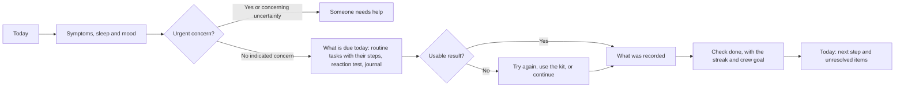

# Crew experience and interaction design

The interface is a calm, practical health workspace. Its main job is to help the person see the next step. Technical evidence is available on demand rather than embedded in every sentence. Every screen serves the question behind the product: what information would change the next decision, and can we get it here? It is one dashboard for everything a crew member meets aboard, from the morning check to a crewmate who stops responding; the use cases behind every screen are in [USE-CASES.md](USE-CASES.md). The demo story in [PITCH.md](PITCH.md) is the path this design must make obvious: the kit → notice → Earth out of reach → ask and measure → check it another way → help, anywhere. Its line: "Measures what it can. Shows what it can't. Teaches the crew the rest."

**Reference build.** [design/interaction-prototype.html](design/interaction-prototype.html) is the reference implementation of this design. Its look: the same tokens, type, stage and cards throughout. Everything the flows add is built from those same parts. The prototype is local and synthetic: it makes no network requests and saves no health data. The figure is drawn by [design/body-render.js](design/body-render.js) from [design/body-mesh.js](design/body-mesh.js), the MakeHuman base mesh shaped with MakeHuman's male targets (both released as CC0). The renderer's header comment lists its API and regions. For behavior and copy, this document is the specification. For pixels and spacing, the prototype is the reference; where the two differ, fix this document.

**Where the prototype's data comes from.** The prototype holds no clinical content of its own, the same rule the product follows (PRD R43, [CONTRACTS.md](CONTRACTS.md)). Three layers feed it, loaded in this order:

| File | What it is | Who changes it |
|---|---|---|
| [design/config-bundle.js](design/config-bundle.js) | The three configuration documents, [environment-hazards.json](environment-hazards.json), [routine-schedule.json](routine-schedule.json) and [responder-flows.json](responder-flows.json), each with its SHA-256 version. Built by `python3 -I design/tools/bundle-config.py`; never edited by hand | Whoever edits a configuration document, then rebuilds the bundle |
| [design/crew-data.js](design/crew-data.js) | Backend state only, in the shapes the API serves: the person, the crew, the readings, the warnings, the task occurrences and their states, and the demo's starting point. Every value is SIM or a labeled REPLAY | The backend; in the prototype, a stand-in fixture |
| [design/view-model.js](design/view-model.js) | Joins the two: hazard effects, limits and what to do; task names, cadences, steps and sources; help questions, answers, steps and environment notes. Its only own words are the display words for the fixed vocabulary (section 1.13) | Front end |

Editing a configuration document and rebuilding the bundle changes the screens with no code change; the source IDs, limits and levels shown always match the files. The screens of acts 4 and 5 (the concern, the measurement and the assessment), shared care and records are still scripted mockups of their final states and move to the same pattern when their contracts land. The plan aboard, A crewmate checks and the help screen's role rows (sections 3.8, 7, 8 and 9) are served from `onboard-plans.json`, `skills-catalog.json` and `role-rules.json` from the start.

## 1. Visual direction

This section is binding for every product screen. The product looks like the light point-cloud body dashboard the team designed, not like a clinical form.

### 1.1 Principles

- **Light and calm.** Japanese minimalism: balance, symmetry, generous space. One screen holds one idea.
- **Very little text.** Big numbers, short labels, one line of insight. Explanations open on request.
- **The body is the index.** Every reading, reported symptom, measurement request, assessment line and missing test has a place on the figure, so the person always sees where.
- **Honesty is visual.** Every value says where it came from, in words: Live, Replay or Sim. "No reading" and "Not available here" are designed states, not errors.
- **Color never works alone.** Every color comes with words or a shape. Lime is the one accent.
- **Participation is quiet.** The streak, patches and crew goal are small, and absent from medical screens.
- **Today says what needs you.** Warnings first, then what is due with its cadence and minutes, then how you are and where you are. Nothing assumes medical training: every task and warning opens to plain numbered steps.
- **Every warning says who raised it.** A rule, a sensor limit or the assistant, in words, with the evidence one tap away.
- **Someone needs help is calm and immediate.** Always reachable, no flashing, no red floods, no waiting.

### 1.2 Layout: the stage and the cards

Wide screens have two zones side by side at full viewport height (minimum 820 px). Reference CSS: `grid-template-columns: minmax(520px, 0.76fr) minmax(0, 1fr)`.

**The stage (left)** is the page itself, not a card: page background with a soft white glow behind the figure (`radial-gradient(44% 36% at 50% 46%, rgba(255, 255, 255, 0.9), rgba(255, 255, 255, 0) 72%)`). Top to bottom:

1. **Stage head** (24 px from the top, 28 px side margins): the brand mark (a 36 px tile holding our own ring and point drawing), the product name **Crew Health Check**, the mission clock in DM Mono (for example `MET 018/09:10:16`), **Someone needs help**, and the person button (a 36 px circle with initials that opens the person's records).
2. **Title block**, centered: the who-line with the person, the day and the place (`Mara Okafor, flight day 19 of 30, space station`) and one line of insight as the h1 (`Short sleep, CO2 above the limit`). When a region is locked, the title crossfades to the region or symptom name, with a **Whole body** button under it.
3. **The figure**, filling the stage behind everything. It is masked to a middle band (a vertical `mask-image` gradient) so the words above and below always sit on clear page. The band narrows when a region is locked, because there are more words.
4. **Lights for warnings.** A small lime light sits on each region named by an active warning (the head for high CO2), beside the beating heart and the band anchor.
5. **Three vitals**, centered at the bottom: a big number, its unit and a one-word label, each a button. When a region is locked they fade out and the region reading takes their place: a number or a word, a label, a word tag, and up to four rows such as `Your usual 54 to 62`, `Taken 07:37, camera station` and `Source Sim`.

The walkthrough adds one line under the vitals, "Walkthrough, synthetic data" with six numbered circles for the demo acts. It is part of the demo build only. The mission clock follows the acts: 09:10 for acts 1 and 2, 09:20:40 for act 3, 09:30 for act 4, 09:34:30 for act 5 and 12:02 for act 6.

**The cards (right)** sit on top of the page with a soft shadow, in a 24-column grid with 12 px gaps and 16 px padding (none on the stage side). Rows are `minmax(0, 1fr) minmax(0, 1fr) minmax(0, 0.86fr)`. Today uses the reference grid and its six slots exactly, filled so that Today is the all-in-one screen (section 3).

| Card | Kind | Grid columns | Grid rows |
|---|---|---|---|
| To do | Paper | 1 to 10 | 1 to 2 |
| How you are | Sun gradient | 11 to 24 | 1 |
| Habitat | Dusk gradient | 11 to 24 | 2 |
| This kit | Paper | 1 to 8 | 3 |
| Daily check | Green gradient | 9 to 15 | 3 |
| Assistant | Deep green gradient | 16 to 24 | 3 |

To do is paper because it is a list: the reference keeps text off the light middle of the green gradient, so the green moves to the daily check, whose half gauge turns to white segments like the crew goal ring. How you are takes the sun card, with its dark lower line as in the reference mood card. Habitat takes dusk, which keeps white text legible from top to bottom.

| Width | Layout |
|---|---|
| Over 1180 px | Two zones side by side, full height |
| 721 to 1180 px | The stage on top (820 px tall); the cards below in the same grid, with rows of 300, 300 and 260 px |
| 720 px and below | The stage 700 px tall, the title at 26/34 px, the vitals in equal thirds, the clock hidden. The cards in one column with 8 px gaps and side padding, in reading order: To do, How you are, Habitat, This kit, Daily check, Assistant. The product name hides; **Someone needs help** stays |

**Other screens keep the two zones and the same grid.** The stage stays on the left with the figure focused on the region that matters (the heart, in the demo concern). The right zone swaps Today's cards for the flow's cards, in the same 24 columns and three rows:

| Screen | Cards (columns, rows) |
|---|---|
| How you are | The reference cards: Sleep, green (1 to 10, rows 1 to 2); Mood, sun (11 to 24, row 1); Reaction time, dusk (11 to 24, row 2); Latest readings, paper (1 to 15, row 3); What this means, deep green (16 to 24, row 3) |
| Habitat | Habitat, paper (1 to 14, rows 1 to 3): the place, the environment switch and the sensors; the chosen sensor or hazard, dusk (15 to 24, rows 1 to 2); Living here, deep green (15 to 24, row 3) |
| Routine | Routine, paper (1 to 14, rows 1 to 3): Today, This week, This month, Per walk and After events; the chosen task, paper (15 to 24, rows 1 to 2); Changed for now, dusk (15 to 24, row 3) |
| Needs attention | The warnings, paper (1 to 14, rows 1 to 3); the chosen warning, paper (15 to 24, rows 1 to 3) |
| Daily check | The check, paper (1 to 14, rows 1 to 3); Your streak, paper (15 to 24, row 1); Crew goal, green (15 to 24, rows 2 to 3) |
| A concern | The concern, paper (1 to 14, rows 1 to 3); Assistant, deep green (15 to 24, rows 1 to 3) |
| Measurement | The measurement, paper (1 to 14, rows 1 to 2); Pulse today, paper (1 to 14, row 3); About this measurement, paper (15 to 24, rows 1 to 3) |
| Assessment | What we observed, paper (1 to 8, rows 1 to 3); What might explain it, paper (9 to 16, rows 1 to 2); Can't test here: check it another way, paper (17 to 24, rows 1 to 2); The plan aboard, deep green (9 to 24, row 3) |
| A crewmate checks | The teach steps, paper (1 to 14, rows 1 to 2); Your taps, paper (1 to 14, row 3); About this check, paper (15 to 24, rows 1 to 3) |
| The plan aboard | The plan, paper (1 to 14, rows 1 to 3); Return, paper (15 to 24, rows 1 to 2); Who decides, deep green (15 to 24, row 3) |
| Shared care | The summary, paper (1 to 14, rows 1 to 3); Delivery, deep green (15 to 24, rows 1 to 3) |
| Records | Records, paper (1 to 14, rows 1 to 3); Add an existing result, paper (15 to 24, rows 1 to 2); On the body (the mark key), paper (15 to 24, row 3) |
| Someone needs help | Over the right zone, on the page: the help flow, paper (1 to 14, rows 1 to 3); Assistant, deep green (15 to 24, rows 1 to 2); For the ground, paper (15 to 24, row 3) |

Below 1180 px the flow cards keep their column split with rows sized by content (at least 260 px); at 720 px and below they stack in one column. Someone needs help covers the right zone (section 1.9).

### 1.3 Design tokens

Define these as CSS custom properties, exactly as in the reference.

| Token | Value | Use |
|---|---|---|
| `--page` | `#f3f3ef` | Page and stage background |
| Dot grid | `radial-gradient(rgba(28, 30, 28, 0.065) 1px, transparent 1.2px)`, `background-size: 14px 14px` | Faint texture on the page only; never on cards |
| `--paper` | `#fcfcfa` | Plain cards |
| `--tile` | `#e8e8e3` | Brand-mark tile, quiet fills, a failed reading's mark, future days |
| `--ink` | `#1c1e1c` | Text, the open-card ring, the primary pill |
| `--ink-2` | `#555954` | Secondary text, tag text |
| `--ink-3` | `#6b6f69` | Labels, units, legends, the clock |
| `--line` | `rgba(28, 30, 28, 0.12)` | Hairlines between rows, chart label outlines |
| `--green` | `#1f4d38` | Primary data color on paper, the Live swatch and fill |
| `--green-2` | `#2f6b4a` | Keyboard focus ring, notes on paper, checked days |
| `--lime` | `#e2f55c` | The one accent: lit regions, measurement dots, the current point on a chart, the chosen answer, the current demo act. Never text, never the keyboard focus ring |
| Watch | Background `rgba(180, 105, 14, 0.12)`, text `#8a4f08` | Word tags such as "Short", "Below usual", "Slower", "Kept as failed", the **Someone needs help** button, the help flow's questions, and the warning words (section 1.13). Always words, never a bare color |
| Card shadow | `0 1px 2px rgba(28, 30, 28, 0.05), 0 12px 32px rgba(28, 30, 28, 0.08)` | Every card |
| Radii | Cards 24 px, vitals and camera tiles 16 px, tags 5 px, swatches 3 px; buttons, chips and pills fully round | |
| `--ease` | `cubic-bezier(0.22, 1, 0.36, 1)` | Every transition |
| `--sans` | `"Outfit"` (variable, weights 100 to 900), then `ui-sans-serif, system-ui, -apple-system, "Segoe UI", sans-serif` | Everything, including units and source words |
| `--mono` | `"DM Mono"` (400), then `ui-monospace, "SF Mono", Menlo, monospace` | The mission clock and the help log, nothing else |

Both fonts are under the SIL Open Font License and are served from the app's own files, never from a CDN, so the app works offline.

### 1.4 Type scale

Sizes are font size over line height, in px, as used in the reference. Use tabular figures (`font-variant-numeric: tabular-nums`) wherever a number can change.

| Role | Font | Size | Weight | Notes |
|---|---|---|---|---|
| Body text | Outfit | 15/20 | 400 | |
| Product name | Outfit | 16/20 | 500 | Stage head |
| Mission clock | DM Mono | 12 | 400 | ink-3 |
| Who-line | Outfit | 14 | 400 | ink-3 |
| Stage title (h1) | Outfit | 34/42 (26/34 on phones) | 300 | Letter spacing `-0.01em` |
| Vital number | Outfit | 32/36 (26/30 on phones) | 300 | Unit 13 px ink-3 |
| Vital label | Outfit | 13/18 | 400 | ink-3 |
| Region reading number | Outfit | 40/44; a word such as "No reading" at 28 | 300 | Unit 15 px ink-3 |
| Region reading label | Outfit | 15/22 | 400 | |
| Card title | Outfit | 17/22 | 500 | Also the title of every flow card |
| Card big number | Outfit | 56/58 | 300 | Letter spacing `-0.02em`; unit 18 px |
| Card state line | Outfit | 16/22 | 400 | "Below your usual 7" |
| Card note | Outfit | 14/20 | 400 | "1 h 36 min under your usual"; green-2 on paper |
| Axis, scale and chart keys | Outfit | 13/18 | 400 | |
| Legends, swatches and source words | Outfit | 12/16 | 400 | ink-3 |
| Assistant line | Outfit | 17/24 | 300 | |
| Gauge and ring number | Outfit | 32/36 | 400 | Daily check and crew goal |
| Word tag | Outfit | 13/18 | 400 | "Short", "Symptom, not measured" |
| Question in a flow | Outfit | 28/34 (24/30 on phones) | 300 | "Anything new since yesterday?" |
| Flow text | Outfit | 15/22 | 400 | ink-2 |
| Row text | Outfit | 15/20, detail 13/18 ink-3 | 400 | Lists in flows and records |
| Pill | Outfit | 13 | 400 | 30 px tall |
| Help question | Outfit | 34/42 | 300 | Watch text color: "Who needs help?", "Do this now" |
| Habitat meter | Outfit | 26/30, unit 12 | 300 | Label 13/18; a 4 px track with the limit as a dotted tick |

### 1.5 Cards

Every card on Today follows the reference anatomy: a head row (the title and a 34 px round button with an arrow), one big number with its unit, one state or note line, and one picture. Cards have a 24 px radius, 20 px padding and the shadow token. Hover lifts a card 2 px. A card whose region is locked gets a 2 px ink ring.

Activating a reading card (click, Enter or Space) locks its region on the figure and puts the reading, with its source, under the figure. The Daily check card opens the daily check. On the Assistant card, the arrow and **I feel unwell** open A concern. In the product, a reading card's arrow opens its full measurement card (section 7); the walkthrough shows one, the pulse card.

| Type | Background | Text | Used for |
|---|---|---|---|
| Paper | `--paper` | Ink; notes in green-2 | To do, This kit, and most flow cards: warnings, tasks, questions, measurement cards, assessment sections, the shared-care preview, records |
| Green | Pale green highlights over `linear-gradient(180deg, #3d7a50 0%, #679d6b 48%, #4f8a62 100%)` | White | Daily check on Today; Sleep; the crew goal in the daily check |
| Sun | A darkened top band and warm yellow and orange highlights over `linear-gradient(155deg, #8d7a70 0%, #c48e66 52%, #d9b356 100%)` | White; the axis line in `#3a2a0c` on the light lower part | How you are; Mood |
| Dusk | A darkened top band and an orange glow over `linear-gradient(180deg, #b98d7c 0%, #bd8b79 30%, #8d8796 58%, #4f7193 100%)` | White | Habitat and a sensor's detail; Reaction time; Changed for now |
| Deep green | Fine concentric rings and a `#2f7a55` glow over `linear-gradient(160deg, #1d4c37, #113324)` | White | The assistant, the plan aboard, Who decides, delivery to the ground, Living here |

The exact layer stacks are the reference classes `.g-green`, `.g-sun`, `.g-dusk` and `.g-deep`. The gradient cards carry a fine grain: an SVG fractal-noise layer (`baseFrequency 0.85`, two octaves) at opacity 0.2 with `mix-blend-mode: overlay`. On a gradient card the round button is white at 94% opacity with an ink arrow.

Rules for cards:

- A gradient names the card, never the health state. It does not change with the value, so color never says good or bad. The state is in words, with the watch tag when it needs attention.
- There are no other gradients and no red or alarm card.
- Each picture has a text alternative (`role="img"` and a sentence that says what it shows, as in the reference).

The pictures: **Sleep**, two wire spheres sized by hours (a usual night and last night) meeting at a lime point. **Mood**, three seven-day lines of self ratings (mood solid, energy dashed, stress dotted) with today's point lit. **Reaction time**, one arc per response landing at its time, with lapses (355 ms or slower) drawn bolder past the lapse line and a scale reading "Fast", "Usual" and "Lapses, over 355 ms". **How you are**, three columns (sleep, mood, reaction time), each a 36 px number over a seven-day white line with today's point lit, and its state in `#3a2a0c` underneath. **Habitat**, the place and the ground line (the link state, for example "Ground link up · near real time") in one line, then four meters: a 26 px number, the sensor's name, and a 4 px white track filled to the reading with the limit as a dotted tick; a reading past its limit fills lime and puts a lime dot by its name. **CO2 in Habitat**, a week of hourly CO2 means as a white line over a faint white area, NASA's 3 mmHg one-hour limit as a dotted white line, the last hour lit in lime with the label "3.5 mmHg". **Radiation in Habitat**, two hours of a dose-rate instrument rising and falling with the orbit, its mean as a dotted line. **This kit**, the three counts as big numbers, each beside its mark drawn as on the figure (a lime dot, a hollow ring, a dashed ring). The week of tasks lives on the Routine screen's This week list. **Daily check**, the reference half gauge cut into the crew's 28 checks for the week (section 11), in white segments on the green card, with "18 days in a row" as the note above it.

**Parts the flows add, all from the same tokens.**

| Part | Look | Use |
|---|---|---|
| Pill | The **Whole body** button's shape: 30 px tall, fully round, 1 px ink border at 40%, 13 px text. Chosen: lime fill, no border. Primary: ink fill, white text. On gradients: the chip style (white border at 42%), primary white with green text | Answers and actions |
| Round close | The card's 34 px round button with an × | Leaves a flow, top right of its first card |
| Steps | 6 px bars: done green-2, current lime, to come tile | Progress through the daily check and the help flow |
| Numbered step | A row with a 24 px tile circle holding the step number; tapped, the circle turns green-2 and the text ink-3 | Every how-to, every warning's "What to do", every help step |
| Warning row | A lime mark, the warning's title, "Raised by ..." as the detail, and the level word as a tag at the right | To do and Needs attention |
| Row | 10 px vertical padding, a hairline between rows, a 12 px mark at the left, detail in 13 px ink-3, the source word at the right | Lists in every flow |
| Underlined field | The ask field's underline in ink at 30%, 17 px light text | Free text and corrections |
| Camera tile | Tile-colored, 16 px radius, a face outline, the camera name; green-2 ring when it contributed, faded when it did not | The camera station |

### 1.6 The body map

The figure is a filled 3D point cloud of a human body, drawn with WebGL points and no library: points spread evenly over the skin and through the inside, shaded by a soft light. It breathes slowly at the person's latest accepted breathing rate (14 per minute when there is none) and sways very slightly at rest. A lime point on the heart beats at the latest accepted pulse.

Mount it as in the reference: `BodyRender.mount(canvas, { breathsPerMin, still, onFrame, frame })` returns `focus(name, { camera, ax })`, `start()`, `stop()`, `renderNow(jump)` and `resize()`. `BodyRender.project(BodyRender.point(name))` gives a region's screen position for marks and labels, and `BodyRender.regionAt(x, y, names)` gives the region under the pointer.

**Regions.** Every region is addressable. The identifiers are fixed and shared with the data contract ([CONTRACTS.md](CONTRACTS.md), section 7).

| Identifier | Label | Typical use |
|---|---|---|
| `head` | Head | Mood; the face glows while the camera station reads |
| `eyes` | Eyes | Reaction time, vision concerns, eye findings |
| `ear` | Ear | Ear pain, hearing |
| `neck` | Neck | Neck pain or stiffness |
| `shoulder` | Shoulder | Blood pressure (the cuff), shoulder pain or injury |
| `heart` | Heart | Pulse, the racing-heart concern, the missing ECG |
| `lungs` | Lungs | Breathing rate, breathlessness |
| `abdomen` | Abdomen | Abdominal pain, nausea |
| `flank` | Flank | Flank pain, urinary concerns |
| `back` | Back | Back pain |
| `wrist` | Wrist band | Sleep and activity, the band's estimates |
| `hand` | Hand | Blood oxygen from the kit oximeter (finger clip), blood glucose |
| `legs` | Legs | Activity, leg swelling |
| `knee` | Knee | Knee injury |
| `ankle` | Ankle | Ankle injury |

`band` is not a region. It is an anchor on the face of the wrist band, where the band's own light sits while it holds today's estimate.

**Hover peeks, click locks.**

| Input | What happens |
|---|---|
| Pointer over a card (after 140 ms), a vital, a chip or a row that names a region | Peek: the named region lights where it is. The view does not move (`focus(name, { camera: false })`) |
| Pointer over the figure | The region under the pointer lights and a small ink label names it. Pointer hit-testing covers the large front regions (head, neck, shoulder, heart, lungs, abdomen, wrist); every other region is reached from cards and lists, and from the region menu (section 1.11) |
| Click, Enter or Space | Lock: the figure turns to face the region, the view moves in, the title becomes the region or symptom name, the reading replaces the vitals, and the control that locked it shows as pressed (`aria-pressed="true"`) |
| The same control again, Escape, **Whole body**, or a click on the figure while locked | Return to the whole figure and the rest title |

**Everything names a region**, so the figure always shows where.

| Thing | Region it names | Mark |
|---|---|---|
| Vital: pulse (camera station) | `heart` | Filled dot, beating |
| Vital: breathing (camera station) | `lungs` | Filled dot |
| Vital: oxygen (kit oximeter) | `hand` | Filled dot |
| Sleep card | `wrist`, because the band made the estimate | Filled dot |
| Mood card | `head` | Filled dot |
| Reaction time card | `eyes` | Filled dot |
| How you are card | None; it opens the reference cards, which name their own regions | None |
| A habitat sensor | The region its adverse effects reach first (CO2: `head`; dust: `lungs`; noise: `ear`), or none (radiation). A Replay reading never lights the body as an exposure: its reading says whose air it was | Filled dot when shown |
| A hazard of the place (Living here) | The first region it affects; the others listed as rows | Filled dot |
| A warning | Its region, if it has one; a small light at rest | Filled dot |
| A routine task | Where it is measured or done (blood pressure: `shoulder`) | Filled dot |
| A help situation | The region it is about (bleeding: `hand`; not breathing: `heart`) | Hollow ring |
| Daily check and Assistant cards | None; they open flows | None |
| A reported symptom (an answer or an assistant chip) | The symptom's region | Hollow ring |
| A measurement request | The region its result is about, with a hollow ring until a result is accepted. While it runs, the source place glows: the face (`head`) for the camera station, the band anchor for the band, the `hand` for the oximeter | Hollow ring, then filled dot |
| An accepted observation | Its region | Filled dot |
| An assessment line (observed, might explain, cannot assess) | Its region, when it has one | The mark of what the line cites |
| A test not available here | The region it would examine | Dashed ring |

**Three marks.**

| Mark | Drawing | Meaning | Words that always go with it |
|---|---|---|---|
| Filled dot | An 8 px lime dot with a lime halo (`0 0 0 5px rgba(226, 245, 92, 0.34), 0 0 20px 7px rgba(226, 245, 92, 0.6)`) | A measurement: an accepted value | The value, unit and source |
| Hollow ring | A page-colored center inside a 2 px ink ring, with a 7 px soft outer ring (`rgba(28, 30, 28, 0.08)`) | A reported symptom: the person said it, nothing was measured | "Symptom, not measured" |
| Dashed ring | A 26 px ring, 2 px dashed ink, with a faint page-colored fill | A test we cannot do here | "Not available here" and what would answer it |

In lists the same marks appear at 12 px, with one more: a tile-colored dot for a failed reading ("No reading, kept") or an answer with no measurement. The marks differ in shape, so they read without color. A symptom is never drawn as a dot. When one region holds both a symptom and a measurement, the ring is drawn around the dot so both stay visible.

**At rest** the figure shows two lights: the beating heart (latest accepted pulse) and the band anchor (when the band produced today's estimate).

**Without WebGL** the stage gets the `no-gl` class: no figure and no marks, while the title, vitals, region reading, cards and flows work unchanged. This works because the figure never carries information that is not also in text.

**Performance.** The render loop stops when the page is hidden. The renderer caps the cloud at 210,000 points (140,000 on the skin and 70,000 inside; the current mesh fills about 149,000) and builds it in under half a second on load; that build is the "body forming from points" shot in the video.

### 1.7 Where a value came from

Every value says where it came from, in the reference's swatch language: a 10 px square with a word, in 12 px ink-3.

| Word | Square | Meaning | Example |
|---|---|---|---|
| Live | Solid green `#1f4d38` | Measured or entered at the event from a real person or instrument | The presenter's camera pulse: "Live, camera 2" |
| Replay | Solid `#7fb38e` | Historical NASA data, with its original dates visible | Habitat CO2: "Replay, ISS 2014"; radiation: "Replay, ISS 2022" |
| Sim | Hatched (`#8f9b90` diagonal stripes) | Constructed for the demo | Mara Okafor and her history |

The swatch sits at the right end of a row, beside a result, or in a card's legend. In the region reading under the figure the source is a row: `Source Sim`, `Source Band, sim`. Charts fill by source, as the reference activity bars do: Sim hatched, Replay solid pale green, Live the green gradient from `#2f6b4a` to `#1f4d38`. A Live reading taken inside the Sim demo goes to the demo-operator record. A camera value whose accuracy gate has not been met also carries the word tag "Experimental".

### 1.8 Designed states

These are results, not errors. Each is plain words in the position of the value it replaces (28 px in the region reading, 40 px on a measurement card), with no red, no warning icon and no spinner.

| State | When | What the screen shows | Mark |
|---|---|---|---|
| No reading | An attempt was made and gave no usable value | "No reading", the watch tag "Kept as failed, not guessed", and the reason: "too much movement", "too dark", "face not found", "camera covered", "shoulders not in frame" or "views disagree". Choices: Try again, Use the kit oximeter, Skip | Tile dot in lists |
| Not available here | The kit has no instrument or operator for it | "Not available here" and what would answer it: "An ECG would answer this. This kit has none." Choices: Check it another way (when the skills catalog has a substitute check), Add an existing report. The plan aboard still runs | Dashed ring |
| Unknown | The person answered "Not sure", or the system cannot tell | "Unknown". Never shown as normal and never as absent | None |
| Declined | The person chose "Prefer not to say" | "You chose not to say" to the person; "Declined" to anyone else with access. Never read as a negative answer. It still counts as an answer for the daily check | None |
| Nothing recorded | A region has no data | "No reading" with the label "nothing reported here", as in the reference | None |
| Not enough history yet | Fewer readings than the baseline needs | "Not enough history yet" in place of a usual range | As the value |
| Sensor quiet | A habitat sensor stopped reporting | "No data since 08:10" in place of the value, faded, and the warning "Keep an eye on it" with "sensor quiet". Never the last value as if current, never "safe" | Tile dot |
| Not done | A routine task passed its slot | "Not done" in the person's routine history; the task moves to its next slot. No penalty and no streak change | None |
| Not available (task) | The equipment for a task is missing or broken | "Not available" in the task's row, and nothing filled in | Dashed ring |

### 1.9 Someone needs help style

- **Someone needs help** is in the stage head on every screen, a 36 px pill in the watch colors (`rgba(180, 105, 14, 0.12)` with `#8a4f08` text, 14 px, weight 500), the same height as the person button. It is never red and never animated.
- Pressing it covers the right zone at once with three cards on the page: the help flow (paper; its title and questions in the watch color, questions at 34/42), the assistant (deep green) and For the ground (paper, with the log in DM Mono). The figure fades to 30% until there is a situation to show, then returns at full strength, focused on it with a hollow ring.
- Fixed content comes first and needs nothing else: the air-safety line on a watch-tinted panel, then one question at a time as pills, then numbered steps. Tapping a step marks it done and writes its log line with the mission time.
- A status line names what runs: "Assistant: running" or "stopped", "Works without the assistant", "Stored on this laptop".
- No flashing, no red flood, no sound, no countdown, no streak or patch, no request for an unrelated reading.
- **Close** (the round × button) returns to the previous screen and does not resolve anything. Escape does not close it.
- It is static local content in the app shell, so it renders with the model, the network and the figure stopped. Target: visible within 500 ms.
- Below 1180 px the three cards cover the whole viewport in one column, help flow first.

### 1.10 Motion and reduced motion

| Motion | Specification |
|---|---|
| Breathing | The figure swells gently at the breathing rate (a cosine over each breath) |
| Sway | A slow sway of at most 0.10 rad, at rest only |
| Heartbeat | The heart point scales from 1 to 1.4 and back once per beat, at the measured period (58 bpm is 1034 ms) |
| Focus | The view eases to the region (time constants about 0.26 s for the turn and 0.18 s for the zoom); the mask band moves in 320 ms; titles and readings crossfade in 240 ms |
| Cards and hints | Cards lift in 220 ms; the pointer label fades in 140 ms |
| Camera station | A lime band sweeps the camera tiles while they read |
| Load | The point cloud builds progressively |
| Easing | `--ease` everywhere |

Nothing flashes or loops quickly, and nothing moves on the help cards. Under `prefers-reduced-motion: reduce`, mount the renderer with `still: true`: no breathing, sway or heartbeat; the cloud is complete before the first frame; region changes jump to the final view; card transitions and the camera sweep are off; the loop draws only when something changes.

### 1.11 Accessibility of the visual direction

- The canvas is `aria-hidden`. The figure never carries information that is not also in text: the title, the reading, the cards and the lists say everything the figure shows.
- **Region menu.** A **Body regions** control lists all fifteen regions as buttons, regions with data first, so every region is reachable without a pointer (E20-04). It is not in the walkthrough yet.
- The focus title block is `aria-live="polite"`, so a lock announces the region or symptom name.
- Locking controls use `aria-pressed`.
- The keyboard focus ring is 2 px green-2 with a 2 px offset (5.7:1 against the page). Lime is never the focus ring (1.1:1 against the page).
- Text contrast on the light tokens: ink 15.1:1 on the page, ink-2 6.4:1, ink-3 4.6:1 on the page and 5.0:1 on paper, watch text 5.5:1. White on the gradients ranges from about 2.8:1 to 13.8:1 depending on where the text sits: text under 24 px must sit on a part measured at 4.5:1 or better (the darkened top bands, the deep green), and big numbers on a part at 3:1 or better. The mood axis uses `#3a2a0c` (7.0:1 on the light lower sun). E20-04 measures every text position.
- Pills are 30 px tall and chips 26 px, above the 24 px minimum target.
- Color never works alone: tags and swatches have words, marks differ in shape, charts have legends in words and hatching for Sim.
- Anything shown on hover is also shown on focus and on click.

### 1.12 No agency branding

- No NASA logos, wordmarks, flags, insignia or mission identifiers anywhere: product, video, slides or patches. This is the official rule for generated content.
- The mission patches (section 11) are our own abstract designs and imitate no agency insignia.
- Data sources are named in plain text as citations. The habitat legend says "Replay, ISS 2014" and "Replay, ISS 2022"; the CO2 reading names the date and says whose air it was. A citation is attribution, not branding, and uses no logo.
- The demo mission has no real mission name. The clock shows mission elapsed time only.
- The brand mark is our own ring and point.

### 1.13 Warning words

A warning is always a word, in the watch color, stronger as the level rises. The word is the level; the color only repeats it.

| Level | Word | Tag on paper | Tag on a gradient | When |
|---|---|---|---|---|
| info | For your information | Tile tint, ink-2 text | White tint, white text | Worth knowing, nothing to do now |
| watch | Keep an eye on it | Watch tint `rgba(180, 105, 14, 0.12)`, text `#8a4f08` | Lime, ink text | Something is drifting; a task or recheck is added |
| act | Act now | Solid `#8a4f08`, white text (6.6:1) | Lime, ink text | Do the steps shown, now |
| emergency | Emergency | Solid `#8a4f08`, white text | Lime, ink text | Follow the emergency steps; Someone needs help opens |

Who raised it is a phrase, never an icon: "Raised by a rule", "Raised by a sensor limit", "Raised by the assistant". In lists a warning carries the lime mark (the attention light of the figure); on the figure, its region carries a small light at rest. There is no red, no siren icon and no flashing at any level: the vehicle's own alarms are the loud ones.

## 2. Navigation

There is no tab bar. Today is home, and everything opens from what is on it, as in the reference:

| From | Opens |
|---|---|
| A warning in To do | Needs attention, at that warning |
| A task in To do | Routine, at that task; the daily check opens the check |
| The To do card | Routine |
| This kit | This kit, the kit view (section 3.6) |
| The person button | Records, and How we know (section 3.7) |
| How you are | The reference cards: sleep, mood, reaction time, latest readings |
| Habitat | Habitat: the place, its sensors, a sensor's detail and what living here does to the body |
| A reading card or a vital | Its region on the figure, with the reading |
| The Daily check card | The daily check, with the streak and crew goal beside it |
| **I feel unwell** or the arrow on the Assistant card | A concern |
| **Why is this?** on the Assistant card | The warning behind the insight |
| A measurement request | The measurement |
| The end of a measurement | The assessment |
| A plan row in This kit (Plan here), or the arrow on The plan aboard | The plan aboard, with Return and Who decides on the Moon base (section 3.8) |
| **Teach [name]** on the assessment | A crewmate checks (section 7) |
| **Start the plan** on The plan aboard | The plan's steps, run and logged (sections 3.8 and 8) |
| **Log for the ground** on The plan aboard | Log for the ground (shared care): the log's preview; **Tell the ground** queues it for the next contact (section 10) |
| A drill in To do | Routine, at the drill; it runs its skills' teach steps in drill mode (section 5) |
| The person button (initials) | Records, the import of an existing result and the mark key |
| The brand mark | Today, from anywhere |
| **Someone needs help**, on every screen | The help flow |

Every flow's first card has the round close button at its top right, which returns to Today (or, from a measurement or the summary, to the step before). The journal lives in the daily check and is never shown elsewhere. Research and scenario controls belong in a separate operator workspace, not the crew's daily flow; the environment switch on the Habitat screen is a demo control, and in the product the mission phase sets the environment and a crew member confirms it. Do not make the person understand runtime versions to complete a check.

## 3. Today and the views it opens

### 3.1 Today

Today is the first act of the demo and the home of the product. It answers three questions at a glance: does anything need me, how am I, and where am I? The values below are the demo fixture (Mara Okafor, Sim, flight day 19 of 30, crew of four, space station). In the product each value comes from its record, and every hazard, limit, effect, task, cadence and help step comes from the configuration documents served by the API (CONTRACTS.md section 11). The screens hold no clinical text or numbers of their own; section 19 of CONTRACTS.md maps each card to its endpoints.

**The stage.** The title is chosen by the deterministic attention rules, never written by the model; when nothing needs attention it reads "Nothing needs attention today".

| Element | In the demo | Source | Region |
|---|---|---|---|
| Who-line | Mara Okafor, flight day 19 of 30, space station | Profile and environment profile, Sim | None |
| Title | Short sleep, CO2 above the limit | Attention rules | None at rest |
| Lights | The head (CO2 warning) and the eyes (the sleep pattern) | Active warnings | `head`, `eyes` |
| Vital 1 | 58 bpm, "pulse" | Camera station, Sim | `heart`, beating at 58 |
| Vital 2 | 14 per min, "breathing" | Camera station, Sim | `lungs` |
| Vital 3 | 97 %, "oxygen" | Kit oximeter, Sim | `hand` |

**The cards.**

| Card | Kind | What it shows in the demo | Source | Opens |
|---|---|---|---|---|
| To do | Paper | The big number counts the warnings and the tasks still open, "6 today", with "2 need attention"; the list scrolls inside the card. Warnings first: "CO2 above the habitat limit" (Act now, raised by a sensor limit) and "Short nights, slower reactions" (Keep an eye on it, raised by the assistant). Then today's tasks, each with cadence and minutes: Daily check (due now), Blood pressure (due today), Vision self-check (daily while CO2 is high, 13:00), Reaction test (after a short sleep, done 07:38), Exercise session (15:00). The names, cadences and minutes come from routine-schedule.json; the states and times come from the backend. The fine line: "Nothing routine is due while you sleep or on a spacewalk." Three more rows can appear, all from rules: "Ground out of contact longer than planned" (Keep an eye on it, only after the next contact passes by [threshold to be set by clinical review]; a planned gap raises nothing), "[Supply]: cover for [n] more uses" (Keep an eye on it) and a drill due ("Practice: pulse check", a routine task with its cadence and minutes) | Warnings engine, routine scheduler | A warning, a task, or Routine |
| How you are | Sun | Sleep 5 h 12 min, "1 h 36 min under your usual"; Mood 6 of 10, "Below your usual 7"; Reaction 291 ms, "4 lapses, usual 1"; each with its seven days | Band, self rating, reaction test; Sim | The reference cards |
| Habitat | Dusk | "Space station." and the ground line from `GET /v1/ground-link` with its source word: "Ground link up · near real time" (Sim). Meters: CO2 3.5 mmHg past its dotted limit, lit; radiation 6.1 µGy/h; oxygen 149 mmHg; noise 61 dBA. Legend: "Replay, ISS 2014", "Replay, ISS 2022", "Sim", "Dotted line: limit" | Habitat sensors: CO2 and radiation Replay, the rest Sim | Habitat |
| This kit | Paper | The big number "[C] of 119" with "need a test this ship doesn't carry", and the three marks as the legend: a lime dot "Measured here", a hollow ring "Only what you report", a dashed ring "Needs a test not aboard". Under it, the state line "[P] of 119 have a plan aboard", computed; if a row lacks a plan it says so: "118 of 119 have a plan aboard · 1 to write". The prototype, built on the bundled example documents, reads "7 of 7 have a plan aboard". The numbers are computed at the event from the kit map and the onboard plans; none exist yet | The kit map, the onboard plans and the current environment's kit, computed by the server | This kit |
| Daily check | Green | "18 days in a row" and the crew half gauge at 23 of 28; after her check, "19 days in a row, done today" and 24 of 28 with the newest segment lime (section 11) | Check-completion events; Sim history | The daily check |
| Assistant | Deep green | One line: "Three short nights and slower reactions. The habitat CO2 channel, a replayed ISS week, is also over its limit." "Something feels wrong?" with **I feel unwell** and **Why is this?**; an "Ask about a reading" field with a microphone button | Local model when running | A concern, or the warning behind the line |

The band gives two estimates, sleep and activity, and both are proposals: the person confirms or corrects the sleep estimate in the daily check, and the original estimate is kept beside the correction. Pulse and breathing come from the camera station, which reads them while the person sits still. Oxygen comes from the kit oximeter, entered or connected.

When the model is stopped, the Assistant card reads "Assistant stopped. Someone needs help, your records, the measurement cards and every plan still work." and shows the rules' suggested next task instead of a model line. Warnings raised by rules and sensors stay exactly as they were.

**Act 2 in the demo.** Mara reads Today: two things need attention, five tasks are due. She opens the CO2 warning, reads what is happening, why it matters and what to do, and acknowledges it (it stays open: its cause has not cleared). She opens the daily check, answers "Nothing new", confirms the band's sleep estimate, rates her mood and looks at what is due. The check ends on "Check done." with "19 days in a row" and "Crew: 24 of 28 checks this week." Today then shows the daily check done in To do and 24 of 28. Nothing about her values changed the count.

### 3.2 How you are

The reference cards, unchanged: Sleep (two wire spheres), Mood (three seven-day lines), Reaction time (one arc per response), each locking its region on the figure. Below them, **Latest readings** (pulse, breathing, oxygen and what is due, each with its source) and **What this means**, the assistant's plain explanation of the pattern with its sources: "Three short nights, and your reaction time is slower. Short sleep slows reactions; it is a pattern, not an illness."

### 3.3 Habitat

One screen answers "where am I, and what can it do to me?"

1. **The place.** Its name as the question line ("Space station"), one sentence on what is different for the body there, and the ground line: the link state served by `GET /v1/ground-link`, for example "Ground link up · 6 to 10 seconds" or "Ground link down · next contact in 26 h", with its source word (Sim in the demo). A planned gap raises nothing, and only this line changes when the link drops: warnings, routine, plans and help stay exactly the same. The four places are pills: **Space station**, **Deep-space transit**, **Moon base**, **Mars base**. In the demo the pills switch the whole app; the fine line says "In the product the mission phase sets this and a crew member confirms it. Here it is a demo switch."
2. **Sensors here.** One row per sensor that matters in this place: name, value, unit and state ("3.5 mmHg, limit 3 mmHg, one-hour average"), the level word when past a limit or "Usual", and its source word. The sensors differ by place: dust appears on the Moon and Mars, radiation leads in transit.
3. **The chosen sensor** (dusk card): the value large, the limit beside it, a trace when there is one (CO2 and radiation replay real NASA data), **What it can do to you** as a short list of adverse effects, **What to do** as short steps, and the source line. The figure focuses the region its effects reach first.
4. **Living here** (deep green card): the place's longer-term hazards as chips (on the station: Weightlessness, Radiation, Closed air, Isolation, Noise). Choosing one fills the detail card with what it does to the body and what to do, and lights the regions it affects.

Hazards, sensors, limits and adverse effects for each place, with sources, are in [ENVIRONMENTS.md](ENVIRONMENTS.md). A value is shown against its limit only when the limit has a source; otherwise the track has no tick.

**Act 3 in the demo (Earth out of reach).** The mission moves to the Moon base through the demo control, and Mara confirms it. The presenter sets the link with a second demo control: "Ground link down · next contact in 26 h" (Sim), with the fine line "At the lunar South Pole, Earth is in view about half the month." Nothing else changes: the same warnings, the same tasks. This kit recomputes for the Moon base kit and still reads "[P] of 119 have a plan aboard". Ilya Brandt and Sofia Reyes, the two medical officers, are outside on surface walk 1 until 11:40.

### 3.4 Routine

The mission routine: what to measure or do, how often, and how.

1. **Lists by rhythm**, as pills: **Today**, **This week**, **This month**, **Per spacewalk** (or **Per surface walk** on the Moon and Mars) and **After events**. Each row: the task, its cadence in words, its minutes and equipment, and when it is due ("due now", "14:00", "day 21", "done day 17", "not available").
2. **The chosen task** (paper): its cadence as a tag; what it is in one sentence; **You need**; **How**, as numbered steps a person without medical training can follow; **Why this often**; the source of the frequency, or "Frequency to be set by the flight surgeon". Actions: **Record it**, **Not available**, **Later**. The figure focuses where the task is done.
3. **Changed for now** (dusk): every task whose frequency a trigger changed, with the reason and when it ends: "Daily check: add a headache and vision question at the next check and again 2 hours later. Cabin CO2 is above the one-hour limit of 3 mmHg. Raised by a sensor limit."

A drill is a routine task with its skills: it lists them and runs their teach steps and camera checks in drill mode (section 5).

Tasks, cadences, triggers and their sources are in [ROUTINE.md](ROUTINE.md).

### 3.5 Needs attention

Every active warning in one list, each a row with its level word and "Raised by ...". The chosen warning, on the right, always shows the same four parts in the same order: **What is happening**, **Why it matters for you**, **What to do** (numbered steps) and where it came from (the rule, the sensor and its reading, or the assistant and its evidence). **Acknowledge** records the time and keeps the warning open: "Acknowledged 09:12, still open". A warning leaves the list only when its cause clears, and then says why in the person's history. **Ask the assistant** opens a concern with the warning attached. The warning levels and who may raise each are in [USE-CASES.md](USE-CASES.md), section 4.

### 3.6 This kit

What this ship can test, and act 1 of the demo. It opens from the This kit card on Today. The data is the kit map, a configuration document, with every state computed by the server against the current environment's kit ([PRD.md](PRD.md) section 4.12, R44). Nothing here is new visual language: the marks are the body map's own (section 1), the cards are the reference cards.

**The kit, widened.** The kit is four layers, each from a configuration document or backend state: the instruments (the kit map), the supplies with their stock and cover (the kit map's supply list and the backend's uses), the procedures packed before launch (`onboard-plans.json`, `responder-flows.json` and `skills-catalog.json` in the active release) and the trained hands (the skills catalog and each person's skill records). The server computes what each layer allows; the screens only draw it.

**The stage.** The figure in kit view: a filled lime dot on each region where a confirming test is aboard, a hollow ring where only the person's report is possible, an open dashed ring where the confirming test is not aboard. Tapping a mark lists that region's conditions. The stage title reads "This kit" with the environment's name; the vitals stay.

**The cards.**

| Card | Kind | Grid | What it shows |
|---|---|---|---|
| This kit | Paper | 1 to 14, rows 1 to 2 | A pill pair at the top: **Test here** and **Plan here**. Test here: the three counts as big numbers with their marks: "[A] measured here", "[B] only what you report", "[C] need a test not aboard". Below, the conditions grouped by state as list rows: the condition's plain name, the missing instrument in the row's end column, and the source line "NASA Clinical Findings Form" linking to the form. Plan here: each condition row's end column reads the plan's first stage, how many of its steps are aboard and whether it has a medical officer step, for example "Check another way · 5 of 6 steps aboard · medical officer step" (warning signs are not counted as steps), and its detail line "Ground was for: follow-up (NASA form)". Rows keep their test mark; the marks never change meaning. A row opens its plan (section 3.8). Pills filter by state and by region |
| The kit aboard | Sun | 15 to 24, row 1 | The instruments in this environment's kit with their source words (connected, manual, import only); then **Supplies** with their cover ("Clean water for an eye rinse, 6 · cover for [n] uses"); then **Trained hands** as counts ("Pulse check: 1 fresh", "CPR: 2 fresh"), each with its source word. Counts only: who holds a skill is shown to the person and to the medical officer role, never here |
| How this was built | Dusk | 15 to 24, row 2 | "From NASA's Clinical Findings Forms for the 119 conditions in NASA's exploration condition list. Unreviewed draft: needs clinician review." With the count of rows checked by a second person. Then: "Plans: [k] written for the condition, [f] from their family, [w] to write." (the prototype reads "Plans: 7 written for the condition, 0 from its family, 0 to write."), and "Every row's ground needs and return figures come from its NASA form. Unreviewed draft: needs clinician review." |
| What would close the most gaps | Deep green | 1 to 24, row 3 | The planning toggles as pills: instruments ("+ single-lead ECG: [n] rings fill", "+ ultrasound", "+ urine strips"), supplies ("+ [supply]: [m] plans keep every step aboard") and training ("+ pulse check practice for 2: no plan waits for the medical officer"). A toggle recomputes the counts, the cover and the stage; it changes nothing aboard and is labeled "Planning view" |

**A request the kit cannot perform.** The assistant's measurement request card (section 4, step 4) carries one more line, from the server's kit check: "This kit can: camera station" or "This kit can't: needs an ECG", the second with the form link. A request the kit cannot perform never shows as a request; it shows as "Not available here" with what would answer it and, when the plan has one, how to check it another way.

**Act 1 in the demo.** The presenter opens the This kit card: the figure turns to kit view, the counts appear with "[P] of 119 have a plan aboard", and on What would close the most gaps the presenter adds "single-lead ECG": the dashed rings it closes fill; then removes it.

### 3.7 How we know

From the person button: Records, then **How we know**. Three cards side by side, each a list in the reference style: **Where values come from** (paper, columns 1 to 8: every Live, Replay and Sim stream, the person's own and the habitat's, with its device or dataset and dates), **What we measured** (deep green, columns 9 to 17: the venue camera study with people, windows, mean error, bias and refusal rate; one camera against two agreeing; breathing against counted breaths; the assistant's turn time; rules alone against rules plus the assistant, failures counted; scenarios and demo assertions passing; each line reads "Not measured yet" until the result panel holds its number) and **What is unreviewed** (paper, columns 18 to 24: each configuration document with its review state and version; for the kit map, how many rows are unreviewed and how many a second person has checked). It holds no number of its own: every line comes from the result panel, the provenance records and the configuration documents.

### 3.8 The plan aboard

Every condition on the kit map and every responder flow has an onboard plan in `onboard-plans.json`, served as a PlanView for the current environment and release ([CONTRACTS.md](CONTRACTS.md) section 22). It opens from a row in This kit (Plan here), from the plan card on the assessment (section 8) and from a help flow. The ground is a reader, not a step: every plan runs to its end with the link down.

**The plan, in order.** Check it another way, Do now, Watch, If it gets worse, Medical officer, Return (Moon base only), and the log for the ground, always last: "Log for the ground. It leaves at the next contact. Nothing here waits for it." Each step is a numbered step with its who line ("Any crew", a named skill, or "Medical officer"), what it needs, and its recheck when it has one. A step whose instrument, supply or skill is missing shows "Not aboard" with its substitute step, and is never shown as doable. A medicine step reads "as in the onboard procedure" and never shows a dose.

**Four ways a plan ends**, each a word on screen, never a color: **Resolve here**, **Talk a crewmate through it**, **Stabilize and watch** and **Prepare to return** (Moon base only).

| Card | Kind | Grid | What it shows |
|---|---|---|---|
| The plan | Paper | 1 to 14, rows 1 to 3 | The tag with the plan and its review state ("Onboard plan ICL10 · unreviewed draft"), the mode word, the stages as numbered steps with their who lines, and "Ground was for: follow-up (NASA form)" with the form link. **Start the plan** (primary) and **Log for the ground** (chip). The fine line is the ground line: "Ground link down · next contact in 26 h (Sim). The log goes then. Nothing here waits for it." or "Ground link up · the log goes now" |
| Return | Paper | 15 to 24, rows 1 to 2 | Moon base only. The criteria from flight rules (today "[to be set by flight rules]"); NASA's modeled chance that the condition ends the mission, treated and untreated, from the form's Table 4, labeled as NASA's model and never a decision rule; the trip ("a three-day lunar trip", NASA HRP); and what to prepare, as steps |
| Who decides | Deep green | 15 to 24, row 3 | Moon base only: "The commander and the medical officer. The app lists; it does not decide." |

On Mars and in transit the Return card reads "Return is not an option from here. The plan stays aboard." The plan is the same with the link up, delayed or down; only its ground line changes. No streak, patch or celebration appears on it.

## 4. Screens

| Screen | Primary action | Essential information | Important states |
|---|---|---|---|
| Today | Open what needs you | The stage (title, figure with warning lights, three vitals) and the six cards | Nothing needs attention, warnings, due, done, interrupted, model stopped, sensor quiet, no WebGL |
| Habitat | Read a sensor or hazard | The place, the ground line (link state and next contact), the sensors against their limits, adverse effects and what to do | Past a limit, sensor quiet, Replay, no limit on file, new place, link up, delayed or down |
| Routine | Do or record a task | Tasks by rhythm, how-to steps, why this often, changes for now | Due, later, done, not done, not available, changed by a trigger |
| Needs attention | Read and acknowledge | Level, who raised it, what is happening, why it matters, what to do, source | Raised, acknowledged and still open, cleared with reason |
| Someone needs help | Follow the steps | Who, the two checks, the situation, the fixed steps, who does what, the assistant, the person's readings, For the ground, the log | Model stopped, link down, crewmate not responding, not breathing, self |
| Profile and equipment | Add relevant history / connect device | What is optional, who sees it, actual capabilities | Unknown history, consent declined, missing hardware |
| Daily check | Record and continue | Symptoms, sleep (band estimate to confirm or correct), mood; then what is due (reaction test, camera reading, kit readings) and the journal; ends on "Check done." with the streak and crew goal cards beside it | Skip, correction, declined, failed measurement, no history |
| Measurement | Start / enter result | The full measurement card (section 7): purpose, the five headings, subject, operator, duration, quality and method | Preparing, capturing, accepted, failed, unavailable, cancelled |
| Concern intake | Describe concern | Onset, effect on tasks, fixed urgent questions, relevant follow-ups | Unknown answer, sensitive question declined, urgent interruption |
| Assessment | Start the plan or teach a check | Findings, possible explanations, what this kit can't test and how to check it another way, the plan aboard, uncertainty and sources, each line tied to a region | Supported next step, insufficient evidence, checked another way, plan running |
| The plan aboard | Start the plan | The stages in order, who does each step, what it needs, Return and Who decides on the Moon base | Aboard, not aboard with a substitute, needs a skill holder, running, watching, closed |
| A crewmate checks | Tap Beat, then answer | The teach steps with the landmark lit, the taps, the camera reference and the engine's result | Teaching, counting, checked, retry, no camera reading |
| Records and test/report entry | Add existing result | The person's records, then report date, patient, original file and field confirmation; opened from the person button | Draft extraction, conflicting units, wrong patient |
| Episode timeline | Review / schedule follow-up | What changed, who reviewed, unresolved tasks, failed attempts kept | Acknowledged, reviewed, unresolved, resolved with reason |
| Shared care | Preview the log; Tell the ground queues it | Recipient, exact data, sensitive exclusions, delivery state | Queued, waiting for the next contact, simulated receipt, reply |
| Research workspace | Review evidence | Source, version, claim applicability, approval and license | Discovered, unread, reviewed, superseded |

## 5. Routine journey

The check is complete once the symptom question, sleep and mood are answered; "nothing new", "not sure" and "prefer not to say" are answers. **Finish check** is available from that point, and the optional steps never gate completion. The check does not require a journal, a sensitive history or every optional measurement. Skipping is a valid outcome. Band estimates show their method and can be corrected. The app never changes "I was awake but still" into sleep because the activity signal is low.

If Someone needs help opens from the check, the concern it records counts as the day's check; the help screens show nothing about it. The tasks under "Due today" are the routine's (section 3.4), each with its steps; a task that is not done today moves to its next slot.

**Drills.** A drill is a routine task (ROUTINE item 26) with its `skill_ids`. It runs the same teach steps and camera checks as a real event (section 7) in drill mode: chest compressions on a manikin, the pulse check on a crewmate's real wrist. The camera's numbers show live to the trainee and are not stored; only completion is kept, which updates each participant's skill record and counts toward the practice patches (section 11). A drill due appears in To do as "Practice: pulse check" with its cadence and minutes. A person sees their own skills; the medical officer role sees the crew's readiness, which never appears in participation views.

The optional reaction test has a separate invitation and duration. If the tab loses focus or timing becomes unreliable, the session is interrupted and excluded from comparison, with a clear explanation. It is not a duty-clearance test, and taking it or skipping it never changes the streak.

## 6. Concern journey

This is acts 4 and 5 of the demo, on the Moon base with the ground link down. The who-line reads "Mara Okafor, surface day 4, Moon base".

1. **Ask.** Mara taps **I feel unwell** and writes "My heart has been racing since this morning." The app keeps her words as written. The figure turns to the heart, with a hollow ring.
2. **Urgent questions first.** The fixed urgent questions appear at once, from the urgent module and before any model call: chest pain, fainting, breathlessness, each answered Yes, No or Not sure. "Not sure" is never treated as no. Any yes opens Someone needs help at "Do this now" for that sign. She answers no to all three.
3. **One question.** The assistant asks one question about timing on its deep green card: "Is it there all the time, or does it come and go?" with **Comes and goes, easing now**, **All the time, still now** and **Not sure**. Palpitations that do not go away are an urgent trigger on their own ([DEMO-CONDITIONS.md](DEMO-CONDITIONS.md), source C01), so **All the time, still now** opens Someone needs help at once; how long counts as "do not go away" is a threshold to be set by clinical review. Mara's scripted answer is **Comes and goes, easing now**.
4. **A request with a reason, inside the kit.** The assistant requests a pulse reading at the camera station and says why, and the card shows the kit check ("This kit can: camera station"), for example: "Your pulse I can measure. Your rhythm I can't: that needs an ECG, and this kit has none." The request card shows what we want to learn, what is needed (camera station, about 30 seconds, sit still) and the choices **Take reading**, **Enter an existing result**, **Not available**, **Prefer not to answer** and **Stop**.
5. **Measure.** While the cameras read, the face glows. The first attempt ends "No reading: too much movement" and is kept as failed. The second attempt gives an accepted Live pulse with the camera that carried it ("Live, camera 2"), recorded to the demo-operator record. The result lands on the heart as a filled dot.
6. **Check it another way.** The assessment (section 8) says what was observed and what might explain it, shows what this kit can't test with how to check it another way, and shows the plan aboard. **Teach Tomas** opens A crewmate checks (section 7): Ilya Brandt, the medical officer, is on a surface walk until 11:40, and Tomas Lind practiced the pulse check on flight day 12.

The assistant can read current pulse data, but it must explain that a pulse value does not establish heart rhythm. When an ECG is unavailable, the gap card says: **"Heart rhythm: needs an ECG."** and offers to check it another way: a crewmate feels the pulse for 60 seconds while the cameras count it, which cannot replace an ECG. An existing ECG report can still be added from Records. A dashed ring sits on the heart. The episode retains the gap. It never displays "arrhythmia excluded."

The model decides what to ask and request, so a live run can differ from this path. The screens must work for whatever it actually did.

For a vision concern, the app can capture onset, laterality and existing eye findings, with a hollow ring on the eyes. It can show that SANS evaluation needs specialist evidence. The camera measurement screen is not repurposed into an eye diagnostic test.

For a urinary concern, only relevant urinary and systemic questions appear. Sensitive reproductive questions appear when relevant, with a reason and a decline option. Pregnancy is presented as a relevant clinical state, not as a pathology or an inference about the user's identity.

## 7. Measurement cards

Every measurement card answers the brief's five questions, and its five headings are those questions in plain words. This applies to every card: camera pulse, camera breathing, pulse and oxygen from the kit oximeter, blood pressure, temperature, blood glucose, sleep, mood, the reaction test, activity and each habitat sensor. Under each heading a 13 px ink-3 caption quotes the brief's original question.

| Brief question | Card heading | Where the text comes from | Also holds |
|---|---|---|---|
| What can be measured in space? | How to measure it here | Device instructions, kit guidance, the reaction-test protocol, the capability registry | What you need (device and operator, with availability shown before starting) and how to record it (start, enter a kit value, add an existing result) |
| Why is an examination needed? | Why it is worth measuring | The same sources and NASA technical briefs | |
| How do spaceflight hazards affect the indicator? | What spaceflight does to it | NASA's hazard pages, technical briefs and Human Research Program evidence | Which of the five hazards it relates to |
| When does a result need crew or ground attention? | When to tell a crewmate or the ground | Generated from that indicator's attention rules, so the card and Today never disagree | |
| What actions can prevent a critical condition? | What you can do | NASA sleep and CO2 briefs, exercise countermeasures, first-aid guidance | No medication guidance |

**Card anatomy, top to bottom.** The full card is a paper card in the right zone, with the figure locked on its region.

1. **Result:** value, unit, state in words ("In your usual range", "Lower than your usual", "Not enough history yet"), source word, person, device and method, observed time and age, quality. Or a designed state (section 1.8).
2. **What we want to learn:** shown when the card opens from a request; one sentence tied to the current concern and the decision the result would change.
3. **The five headings** above, each one to three sentences with source IDs. A heading with no approved source reads "No supported guidance in this build" instead of improvising.
4. **What this does and does not tell us:** a concise, specific limitation.
5. **Next step:** driven by the actual result and the reviewed policy.

Card text is written at the event from approved sources, so the cards answer the five questions whether or not the model is running. For a habitat sensor, "How to measure it here" names the habitat's own sensor; in the demo the CO2 and radiation cards replay NASA telemetry from other missions and say so.

Show a failed attempt as a completed interaction: "No reading: too much movement. Kept as failed." Then offer relevant choices. Avoid an endless spinner or a rounded estimate taken from a weak signal.

### 7.1 A crewmate checks

**Teach [name]** opens the measurement screen in its "A crewmate checks" form: same grid, same parts. The steps come verbatim from `skills-catalog.json` ([CONTRACTS.md](CONTRACTS.md) section 23); the check is computed by the deterministic engine, never by the model.

**The stage.** The figure locks on the `wrist` region, and the small lime light (the warning light) sits on the landmark "Pulse point at the base of the thumb". Title: "Pulse at the wrist". The region label `wrist` reads "Wrist" (a ui-copy change; the band stays an anchor, section 1.6).

| Card | Kind | Grid | What it shows |
|---|---|---|---|
| Tomas checks Mara's pulse | Paper | 1 to 14, rows 1 to 2 | One numbered step at a time, at the help question size, with the step tiles, from the skill `pulse_check_wrist` (British Heart Foundation): **1** "Mara: hold your arm out, palm up, elbow slightly bent." **2** "Tomas: place the pads of your first and middle fingers on the inside of her wrist, at the base of her thumb." **3** "Press lightly. If you cannot feel anything, press slightly harder." **4** "Tap Beat each time you feel one. Keep going for 60 seconds." **Next step** moves on; "Tomas has done this before" switches to the short versions. A wide primary pill **Beat** and the 60-second countdown in tabular figures. **5** "Did it feel regular?" with **Yes**, **No, it jumped around** and **Not sure**. Each step has a first-time version for a helper who says "I've never done this" |
| The taps | Paper | 1 to 14, row 3 | One tick per tap on a 60-second line, drawn like the reaction-time arcs. No classification: the picture shows the spacing, and the helper's answer says what he felt |
| About this check | Paper | 15 to 24, rows 1 to 3 | The camera tiles reading the subject's face ("Live, camera 2"), and the helper's count with its origin tag. The engine's result: "Your count 92 · cameras 96 · they agree" (green-2 note); or the skill's authored correction, "Your count is 31 lower than the cameras. Move your fingers a little toward the thumb, and count again."; or "Cameras: No reading, too much movement. Your count is kept, unchecked." Then **What this does and does not tell us**: "You may be able to tell if you have a normal or irregular heart rate by checking your pulse" (BHF), and "It cannot show why. Only an ECG can (S03)." Last, the tolerance line: the catalog's tolerance and its basis |

**What gets written.** An Observation with method `crewmate_palpation`, the helper as operator, the subject, the value and the duration; the helper's answer as a separate Answer (present, absent, unknown); and the GuidedCheck with the camera reference and the result. A disagreement writes no value; a count with no camera reading is kept, labeled unchecked, and never cited as support. The heart's dashed ring stays: no text ever says the rhythm is normal or an arrhythmia excluded. In the demo the beats come from a teammate playing Tomas and the camera reference from the presenter's face, so the Observation goes to the demo-operator record.

**The same pattern for every teachable skill.** Each skill in the skills catalog has teach steps with landmarks, and a check where a camera can verify something:

| Skill | Landmark lit | Camera check | Status |
|---|---|---|---|
| Pulse check at the wrist | Base of the thumb | Count against the camera pulse, within [tolerance: team default, to be set by clinical review] | Demo path |
| Chest compressions | Center of the chest | Rate from the helper's motion, against 100 to 120 a minute; hands not visible gives "can't see the hands", never a number | Experimental until the venue check on a manikin |
| Pressure on a bleed | The wound's region | None; the step asks "Is it still soaking through?" | Content only |
| Eye rinse | Eyes | None; a timer for the 20 minutes | Content only |
| Recovery position | Head, lungs | None | Content only |

## 8. Assessment information hierarchy

The grid stays as in section 1.2. Each line names its region when it has one: hovering a line peeks at it on the figure, activating it locks it, and the can't-test lines draw dashed rings. A failed attempt appears in the record, never as support for a line. Sources and raw observations expand beneath each card.

**The stage.** The figure locked on the heart, title "Racing heart", who-line "Mara Okafor, surface day 4, Moon base". Marks: a hollow ring on the heart (the symptom), a filled dot on the heart (the camera pulse), the dashed ring around it (the rhythm) and, after the check, a filled dot on the wrist ("Felt by Tomas").

| Card | Kind | Grid | What it shows in the demo |
|---|---|---|---|
| What we observed | Paper | 1 to 8, rows 1 to 3 | Rows, each with its mark and source word: "Racing heart since this morning, comes and goes, easing" (hollow ring, heart, "Symptom, not measured"); "No chest pain, no fainting, no breathlessness"; "Pulse 96 · Live · cameras 2 and 3 agree" (dot, heart); "First try: No reading, too much movement · kept" (tile dot); after the check, "Pulse check by Tomas: 92 in 60 s" with what he felt and whether the cameras agree (dot, wrist); "Three short nights (band, confirmed)" (dot, wrist) |
| What might explain it | Paper | 9 to 16, rows 1 to 2 | "Short sleep and stress can cause a noticeable heartbeat (C01). Possible, not a conclusion." "A rhythm problem such as atrial fibrillation (ICL10). This kit can't test it: see the next card." Never "only stress" |
| Can't test here: check it another way | Paper | 17 to 24, rows 1 to 2 | The gap: the dashed ring, "Heart rhythm: needs an ECG." and the link "NASA Clinical Findings Form". Then the check_another_way step of ICL10's plan: "Check it another way: a crewmate feels your pulse for 60 seconds while the cameras count it. It cannot replace an ECG." The helper line from the role engine: "Tomas Lind · Pulse check practiced on flight day 12" and "Ilya Brandt, medical officer, is on a surface walk until 11:40." Primary pill **Teach Tomas**; chip **Not now**. After the check: "Felt regular by Tomas. 92 in 60 s; cameras 96. They agree. The ring stays: only an ECG answers the rhythm." |
| The plan aboard | Deep green | 9 to 24, row 3 | **Start the plan** (white, primary) and **Log for the ground** (chip) in the card head. Four numbered stages across: **1 Now** "Rest. No caffeine. Note each time it starts and stops." (C01, C02) **2 Watch** "Pulse at the cameras in [interval to be set by clinical review], and at tonight's check." **3 If it gets worse** "Chest pain, fainting, hard breathing, or it won't stop: Someone needs help opens." (C01) **4 Medical officer** "Ilya reviews when he is back inside. Anything more, as in the onboard procedure." The fine line: "Onboard plan ICL10 · unreviewed draft. Ground link down · next contact in 26 h (Sim). The log goes then. Nothing here waits for it." The arrow opens the plan (section 3.8) |

With the link up the plan card is the same; only the fine line reads "Ground link up · the log goes now". There is no "Prepare a summary for medical review" action: the log for the ground is the plan's last row, previewed in shared care (section 10).

The actual urgency and wording depend on the reviewed plan and the person's answers. This example is not a universal clinical recommendation. Do not display a disease leaderboard or percentages unsupported by calibration. A "possible explanation" needs linked evidence; a serious alternative can remain unresolved without being assigned a fabricated probability. A check another way never closes a dashed ring. The assessment screen shows no participation element and no celebration.

## 9. Someone needs help

One button for every emergency and every "I don't know what to do": for the person themselves or a crewmate. It is always reachable with keyboard and pointer, and it opens the fixed local help flow at once, before any model call, styled as in section 1.9. The flow is in [USE-CASES.md](USE-CASES.md) (UC09 and UC10) and its sourced steps in [RESPONDER-FLOWS.md](RESPONDER-FLOWS.md).

| Step | The screen asks or shows | Answers |
|---|---|---|
| 1. Is the air safe? | The air-safety line ("If an alarm is sounding, follow the vehicle's emergency procedure first"; with the active warning named when there is one), then the question from responder-flows.json | **Yes**, smoke or a smell, a pressure alarm, a radiation alarm, **Not sure**; each answer other than yes opens its flow at once |
| 2. Who | "Who needs help?" | **Me**, or each crewmate by name; **Me** skips steps 3 and 4 |
| 3. Responding? | For a crewmate: "Is the person awake and answering you?" with "Say their name loudly and gently shake their shoulders." | **Yes**, **No, or not sure** |
| 4. Breathing? | If not responding: "Are they breathing normally?" with how to check, and "Gasping is not normal breathing." | **Yes**, **No, gasping, or not sure** |
| Heavy bleeding? | If responding, or for me: "Is there heavy bleeding?" | **Yes** opens the bleeding flow; **No** goes on |
| Emergency steps | Not breathing, or not sure: "Start the emergency steps", numbered, at once. The crew sees the emergency on every screen | Tap each step as it is done |
| Breathing, not responding | "Keep them safe while they breathe", numbered | **Stopped breathing**, **Now responding** |
| What happened? | The situations as pills, from responder-flows.json (choking, chest pain, trouble breathing, fainted, seizure, hit the head, eye injury or dust in the eye, burn, toxic air, pressure loss, after a spacewalk, radiation, allergic reaction, low blood sugar, belly pain, mental health crisis, bleeding, something else) | One pill |
| Do this now | The situation's fixed first steps, numbered, its level word, and the person's latest readings and recorded allergies and medicines | Tap each step as it is done |

Beside the steps, the **assistant** guides the helper: one question at a time from the flow ("What got in, or what hit the eye?") with answer pills, and a short reply that keeps to the steps, says who to tell and adds the answer to the log for the ground. It guides from the reviewed steps and what the kit holds, never adds a medicine or a dose, and says so on its card. When it is stopped, its card says "The steps on the left are all you need to start."

**Who does what.** Rows in the help flow card, always below the steps and never before them, from the role engine and `role-rules.json` ([CONTRACTS.md](CONTRACTS.md) section 24): for example "Tomas Lind · compressions · CPR practiced day 12", "Mara Okafor · bring the AED and the restraint board", "Sofia Reyes · medical officer: Ilya is the patient" (the second medical officer, by the cascade in the role rules). Each row states its reason and has a **Change** pill. The subject never gets a role, and nobody on a surface walk gets an on-site role. The same roles go to every crew screen through the crew broadcast.

**CPR feedback.** On step 3 of `not_breathing`, one line from the help module: "Cameras: 104 a minute · in range", "Cameras: 88 a minute · push faster" or "Cameras: can't see the hands", with the phrases from the skills catalog. The line updates every [5] seconds; nothing on the help card animates (sections 1.9 and 1.10). The pacer is the stage: during compressions the heart point beats at 110 a minute instead of the pulse. Under reduced motion it stays still and the line carries everything. The compression rate is Experimental, rate only and never depth.

**For the ground** shows the link state with its source word ("Ground link down, Sim") and previews the log as the helper works ("Tomas Lind, eye injury or something in the eye. 5 logged steps and the latest readings."). Pressing **Tell the ground** approves the previewed log and queues it; it leaves at the next contact, and nothing waits for it. With the link down, after **Tell the ground** the card reads "Queued: it leaves at the next contact, in 26 h. Nothing here waits for it."; with the link up on the Mars base, "Queued at 09:14. The ground will see it in up to 20 minutes. Keep going: nothing here waits for a reply." The log writes itself from the answers and the tapped steps, with the mission time.

A red-flag answer in a concern opens this flow at "Do this now" for that sign, for the person themselves. In the demo (act 6, on the Moon base with the ground link down) the walkers come in, the airlock dust goes over its limit, and Tomas, who helped them out of their suits, has dust in his eye. The presenter stops the model and presses **Someone needs help**, answers that the air is safe, chooses Tomas Lind, answers "responding" and "no heavy bleeding", chooses **Eye injury, chemical or dust in the eye**, taps the steps, restarts the model and answers the assistant. Who does what shows "Mara Okafor · Rinse the eye, Helps, free to help" and "Ilya Brandt · Medical officer" (back inside), each with a **Change** pill. The For the ground card previews the log and Mara presses **Tell the ground**: "Queued: it leaves at the next contact, in 26 h. Nothing here waits for it."

Acknowledging or closing the screen does not mean anything is resolved. A normal SpO2 result does not dismiss severe breathlessness. The simulator can demonstrate this behavior without exposing a real person to a diagnostic experiment. Unreviewed draft: needs clinician review before live guidance.

## 10. Shared care

The summary preview shows included symptoms, accepted observations, unresolved questions, source and time labels and attachments. Sensitive fields are unchecked by default unless essential to the person's chosen sharing purpose; the journal and participation data are always excluded. The person previews the snapshot; pressing **Tell the ground** approves and queues it. It leaves at the next contact, and nothing waits for it.

The screen is titled **Log for the ground**, with rows from the episode. A timeline distinguishes **Prepared → Queued → Sent → Acknowledged**, every delivery event naming the simulator, with the simulated delay shown while the link is up. While the link is down, Queued shows "leaves at the next contact, in 26 h" and the card reads "Waiting for the next contact. The plan keeps running." instead of a delay countdown, and the queued log carries the catch-up: what happened, what was done, what is being watched and what advice is welcome. A real implementation may later connect an authorized transport, but the hackathon console must label the simulator. A reply is a new attributed record, not a mutation of the crew's original report, and a reply that arrives after a plan closed changes no step. The shared-care screens show no participation element and no celebration.

## 11. Participation: streak, patches and crew goal

The brief suggests gamification. Ours rewards showing up and never the numbers, because a reward for an in-range reading would be a reason to skip a check on a bad day or to shade an answer. Requirements R31, R32 and R33; data contract in [CONTRACTS.md](CONTRACTS.md), section 8; scenarios V41 to V48 in [VALIDATION.md](VALIDATION.md).

| Element | Rule |
|---|---|
| Personal streak | Consecutive mission days with a completed daily check, with the longest streak kept. A check is complete when the person has answered the symptom question (including "nothing new" or "prefer not to say"), sleep and mood. The camera, kit readings, the reaction test, the band and the journal do not affect it |
| A concern counts | Reporting a concern through **I feel unwell**, or updating an open episode, counts as that day's check. Feeling unwell never breaks a streak |
| Mission patches | Earned at 7, 14 and 30 completed checks (one per mission day). Our own designs |
| Practice patches | Earned by completing drills: the first drill, [3] drills, and each core skill practiced within its cadence. A drill's camera numbers are shown live to the trainee and never stored, scored or ranked; only completion counts. Drills never change the streak or the crew goal |
| Crew goal | One shared, cooperative count: checks completed by the whole crew in the seven mission days ending today, against the number due (28 for a crew of four). Only the total. No per-person breakdown, no names, no ranking anywhere |
| What never earns anything | A value, a state, an in-range result, a consult outcome, the number of symptoms, choosing not to report, or what a journal entry says |
| A missed day | Shown as missed in the person's own history. The streak restarts at the next check, with no penalty screen and no nagging beyond the normal "due today" reminder |
| Privacy | The streak and patches are private to the person by default. The crew sees only the crew-goal total |
| Never on medical screens | No streak, patch, practice patch, crew goal or celebration on Someone needs help, concern, measurement-during-a-concern, assessment, plan, A crewmate checks, shared-care or ground screens |

**Where each element appears.** Participation lives in two places only: the Daily check card on Today and the daily check itself. There is no separate participation screen.

| Element | Where | Form |
|---|---|---|
| Daily check card | Today, bottom row (paper) | The note "18 days in a row" (after the check, "19 days in a row, done today") above the reference half gauge, cut into the week's 28 checks: done segments in the green ramp, the newest one lime on the day it is earned, the rest hatched. "24 of 28" at the center (32/36 px). Legend: "Crew, this week" and the Sim swatch "Sim history" |
| Check done | The last step of the daily check | "Check done." as the question line, "Showing up is what counts. Nothing here scores your health.", then the big number "19 days in a row", the note "Crew: 24 of 28 checks this week." and "Next patch at 30 checks, 11 to go." |
| Your streak | Paper card beside the check (columns 15 to 24, row 1) | The big number in days; swatches "History, sim", "Longest 19", "Private to you"; the mission day row; the patch row |
| Mission day row | Inside Your streak | 30 dots in two rows of 15, one per mission day: checked (green-2), missed (a hollow tile ring), today due (a hollow ink ring), today done (lime), future (tile). The row has a sentence as its text alternative, for example "Mission days 1 to 30: days 1 to 18 checked, today due." |
| Patch row | Inside Your streak | Three 52 px round patches captioned "7 checks", "14 checks" and "30 checks". Earned: a lime glyph on deep green (`#1f4d38`) with a green-2 rim. Not yet earned: hatched with a grey glyph |
| Practice row | Inside Your streak, under the patch row | A second patch row, "Practice", in the same style: "First drill", "[3] drills" and one patch per core skill practiced within its cadence ("Pulse check", "CPR") |
| Crew goal | Green gradient card beside the check (columns 15 to 24, rows 2 to 3) | A full ring of 28 equal segments, one per check due this week: done in white, the newest in lime, still due hatched. "24 of 28" and "checks this week, together" at the center; legend "Done" and "Still due this week"; "One shared count. No names, no ranking." The segments are checks, never people: the order is the order checks arrived, and no segment maps to a crew member |

**Copy rules.**

| Situation | Copy | Never |
|---|---|---|
| Check done | "Check done. 19 days in a row." | Exclamation marks, "Great job", "Perfect", any praise of a value ("Great sleep") |
| Patch earned | "14 checks. Patch earned." | "Unlocked!", confetti, sound, a pop-up |
| Practice patch earned | "Pulse check practiced. Patch earned." | A drill's numbers, "best", a rank, names |
| Crew goal | "Crew: 24 of 28 checks this week." When reached: "Crew goal reached: 28 of 28." | Names, ranks, "you're behind", "who hasn't checked" |
| A missed day in history | "Missed" | "You broke your streak", "Don't lose your streak", red, warning icons |
| Streak after a missed day | "Today's check starts a new streak. Longest: 18 days." | "Streak lost", a large zero |
| Reminder | "Daily check due today." | Countdowns, "save your streak", repeated nudges |
| A day counted through a concern | Nothing on the concern screens. Today later shows "Done today" | Any participation copy on concern, assessment or shared-care screens |
| Sim history | The Sim swatch beside the streak and the crew count | A Sim count shown without its swatch |

The only motion is a 240 ms fade of the streak line and, on the day a patch is earned, of the patch; none under reduced motion.

**Patches.** Our own abstract designs: a crescent (7 checks), an orbit around a point (14) and a five-point star (30), in lime on deep green. They use no agency names, flags, insignia, spacecraft silhouettes or lettering that imitates one.

**In the demo.** Mara's streak and the crew goal come from Sim history and carry the Sim swatch: 18 to 19 days and 23 to 24 of 28 for flight days 13 to 19. She has 19 completed checks, so the 7 and 14 patches are earned and the 30 patch is still hatched. The presenter's Live camera reading changes neither. A guest who tries the check works in a guest Live profile with its own streak, starting at 1; it never changes Mara's Sim streak or the Sim crew goal. To replay act 2, the demo resets the Sim scenario to its frozen start state.

## 12. Layout and accessibility

Flows use the same stage and card grid as Today (section 1.2): the question and its answers sit in one paper card, the stage stays beside it on wide screens and above it on phones. A flow's primary action sits at the bottom left of its card, and the round close button at the top right. Keep primary actions in these predictable positions. Use high-contrast text, visible focus, programmatic labels, screen-reader status announcements and text alongside every color (section 1.11). Do not animate help content or rely on a red and green distinction.

Large controls support gloves or reduced dexterity where practical; the prototype does not claim glove usability without testing. Critical actions should not require dragging. Numeric fields always show units; allow explicit unknown and declined controls rather than forcing a guess. Long lists are searchable and grouped by the person's concern.

Empty states explain the consequence: "No comparable history yet" instead of a blank graph; "No ECG available" instead of a disabled unlabeled button. Error messages say what can happen next and preserve already-entered information.

## 13. Walkthroughs to test with users

- Complete a routine check while skipping the band and journal.
- Record a failed camera attempt, then choose manual entry.
- Explain the difference between a live reading and historical replay of the habitat's CO2.
- From Today, find out why CO2 matters for you and what to do about it.
- Find when blood pressure is next due, and take it from the steps alone.
- Switch to the Moon base and say what changed: hazards, sensors, tasks and the ground line.
- Cut the ground link for a day and say what changed (only the ground line) and what still works.
- From the assessment, teach a crewmate to count a pulse at the wrist from the screen alone, and say what the check can and cannot tell.
- Find the plan aboard for a condition this kit can't test, and say who does each step and what happens if it gets worse.
- In Someone needs help, say who is helping and why, and change a role.
- Enter a complaint, mark a requested test unavailable, and identify what remains unknown.
- Confirm an imported lab result while correcting its unit or date.
- Acknowledge a concern and explain why it remains unresolved.
- Preview the log for the ground, press Tell the ground, and say when it leaves and what waits for it.
- Preview a ground summary and identify what private information will not be shared.
- Help a crewmate with a bleeding cut using only the screen, then do it again with the model stopped.
- Use Someone needs help for a crewmate who is not responding, and say what you would do if you were not sure they were breathing.
- Tap the Sleep card and explain what the lit wrist band means.
- On the figure, tell a measurement from a reported symptom and from a test that is not available here, with color turned off.
- Reach the ankle region with the keyboard only, then return to the whole body.
- Complete a check answering "prefer not to say" to the symptom question, and say whether the streak changed and why.
- Explain why a reading outside your usual range did not cost anything in the streak.
- Return after a missed day: find the missed day in your history and say whether anything was taken away.
- Report a concern instead of doing a check, and confirm later on Today that the day counted. Note that nothing about the streak appeared on the concern screens.
- Find the crew goal and confirm that no crewmate's own count is visible anywhere.

Record task success, help needed, misunderstandings and duration. Do not report a small usability sample as proof of medical safety.
