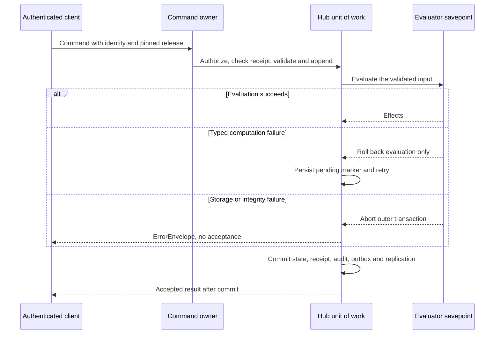

# E01: Platform, identities and durable records

Technical design. Binding inputs: `AGENTS.md`, `docs/SYSTEM.md`, `docs/DEPLOYMENT.md`,
`docs/requests/COORDINATOR-DECISIONS.md` Part A, `docs/BUILD-CHARTER.md` and `docs/product/`.
Implementation and fault-test evidence below is planned, not an assertion that those tests have run.

Part A decisions D1 through D18 apply at the boundaries identified below. Q23 fixes the living package. Q1, Q7 and Q18
make clinical-review status a label, not a runtime authorization gate; source and purpose eligibility still apply.
Q8 preserves disagreeing readings; Q9 does not let a background queue delay Emergency. D17 fixes public Jobs versus internal tasks; D18 extends the private-record barrier to reports. Other Part A choices
stay in their named domain owners and enter effective contract generation only through accepted A3 entries.

## 1. Scope

E01 implements SYSTEM sections 5 and 6: the pure kernel, storage, configuration, clocks, events, record primitives,
contract generation and application assembly. It delivers E01-01, E01-02 and E01-03, R01, R06 and R25; its parts of
V09, V15, V16, V35, V46, V47 and V75; and the record infrastructure for D02 and D09. Flows are USE-CASES sections
1, 2 and 6. SYSTEM 8.8 and 10 define the walking skeleton. Replication append is required from that first build.

E01 owns CONTRACTS sections 1, 3, 5, 10, 11, 18 and 20 at the shared infrastructure boundary. Endpoint-specific
clinical decisions in those sections remain with their owning modules. E02 owns authentication, namespace routing,
consent and key custody; E03 owns daily checks, journal content and screens; E15 owns episodes; E20 owns deployment
commands and reference evidence; E23 owns mission state and `getContext` (Part A ownership decision); E24 owns warnings. Other modules
retain their workflows, tables and content. No platform or assistant bypass may write their safety state.

### 1.1 Rule trace

Source lines refer to `docs/product/CONTRACTS.md`. Each normative sentence in the owned sections has a row, including
delegated behavior. Additional rows cover explicit safety and acceptance clauses without those keywords.

| Source | Rule or delegated decision | Design section | Test ID |
|---|---|---|---|
| PRD.md:477 R01 | Patient, operator and scenario identities | 3, 6 | T-E01-05 |
| PRD.md:482 R06 | Validated, attributed, unit-bearing immutable observations | 3, 4 | T-E01-06 |
| PRD.md:501 R25 | Accepted records and incomplete requests recover | 4, 5, 12.1 | T-E01-03, T-E01-19 |
| CONTRACTS.md:7 | Synthetic and live patients never coincide | 3 | T-E01-05 |
| CONTRACTS.md:13 | No numerical missing sentinel | 3 | T-E01-06 |
| CONTRACTS.md:21 | Consent restricts actions and fields | 6, 10 | T-E01-05 |
| CONTRACTS.md:68 | Identity from session | 6 | T-E01-05 |
| CONTRACTS.md:72 | Private content excluded from logging | 10 | T-E01-14 |
| CONTRACTS.md:101 | Adapter supplies actual method, subject and device | 3, 4 | T-E01-06 |
| CONTRACTS.md:109 | Failed attempts and rejected quality never become usable readings | 3 | T-E01-06 |
| CONTRACTS.md:166 | Evidence release and use eligibility belongs to E10 | 8, 10 | T-E01-08 |
| CONTRACTS.md:169 | Aggregate-only crew goal belongs to E22 | 6, 10 | T-E01-05 |
| CONTRACTS.md:170 | E22 rebuild has no per-person response | 6, 10 | T-E01-05 |
| CONTRACTS.md:171 | No other person's participation events | 5 | T-E01-11 |
| CONTRACTS.md:174 | E02 roster returns names and roles | 6, 10 | T-E01-05 |
| CONTRACTS.md:181 | E29 demo switch restricted to explicit profile | 6, 9 | T-E01-20 |
| CONTRACTS.md:188 | Journal author only, excluded from other exits | 4, 5, 10 | T-E01-04, T-E01-14 |
| CONTRACTS.md:196 | E28 plans never wait for ground | 9 | T-E01-20 |
| CONTRACTS.md:201 | E23 return readiness does not decide | 2, 10 | T-E01-02 |
| CONTRACTS.md:210 | Idempotency exceptions | 4, 6 | T-E01-13 |
| CONTRACTS.md:211 | Revision preconditions | 4, 8.1 | T-E01-09 |
| CONTRACTS.md:214 | Config-Release mismatch | 4, 6 | T-E01-13 |
| CONTRACTS.md:218 | Pagination, UTC and IDs | 3.1, 5, 6 | T-E01-01, T-E01-11 |
| CONTRACTS.md:220 | UI uses configured error copy, never message | 6, 7 | T-E01-13 |
| CONTRACTS.md:241 | Accepted units per code | 3 | T-E01-06 |
| CONTRACTS.md:244 | Subject mismatch rejected | 3, 6 | T-E01-05 |
| CONTRACTS.md:255 | Role eligibility delegated to E31, no platform shortcut | 10 | T-E01-05 |
| CONTRACTS.md:257 | Cached emergency path survives internal fault | 9 | T-E01-20 |
| CONTRACTS.md:414 | No simulated answer/result in LIVE | 3, 6 | T-E01-05 |
| CONTRACTS.md:415 | No missing, declined, failed or stale-as-current normal finding | 3, 3.1 | T-E01-06, T-E01-12 |
| CONTRACTS.md:416 | No journal in prompts, indexes, evaluation screenshots or exports | 10 | T-E01-14 |
| CONTRACTS.md:417 | Camera/forecast cannot replace a required clinical instrument | 3, 9; E27 capability gate | T-E01-06, T-E01-20 |
| CONTRACTS.md:418 | Review never implicitly resolves warning | 4, 8.1; E24 transition owner | T-E01-09, T-E01-10 |
| CONTRACTS.md:419 | Urgent response never waits for model, sample or ground | 9 | T-E01-20 |
| CONTRACTS.md:420 | No onboard workflow waits for ground | 4, 9 | T-E01-20 |
| CONTRACTS.md:421 | Historical cabin data needs explicit actual association | 3.1; E23 association owner | T-E01-12 |
| CONTRACTS.md:422 | Corrections preserve lineage | 3 | T-E01-06, T-E01-07 |
| CONTRACTS.md:423 | E18 benchmark rubrics excluded from model/retrieval | 10; E18 evaluator isolation | T-E01-14 |
| CONTRACTS.md:424 | No probability inferred from retrieval/sensor confidence | 3, 10; E13/E23 computation owners | T-E01-06 |
| CONTRACTS.md:425 | Value/outcome/declined/journal never alters participation | 4; E22 completion-only derivation | T-E01-19 |
| CONTRACTS.md:426 | Owner-only participation except aggregate | 5, 10 | T-E01-05, T-E01-11 |
| CONTRACTS.md:427 | Fixed body_region enum, symptom is not measurement | 3, 6; E04 presentation owner | T-E01-06 |
| CONTRACTS.md:431 | Deletion reaches backup ciphertext; external exports caveat | 5 | T-E01-17 |
| CONTRACTS.md:433 | Restore validates schema, namespace and release | 5 | T-E01-17 |
| CONTRACTS.md:439 | Engines read content from release | 8 | T-E01-08 |
| CONTRACTS.md:441 | Only enumerated client constants | 7, 8 | T-E01-08 |
| CONTRACTS.md:443 | Vocabulary keys are not display words | 7, 8 | T-E01-08 |
| CONTRACTS.md:476 | E26 ground log last, nonblocking | 8, 9 | T-E01-08, T-E01-20 |
| CONTRACTS.md:518 | Display version is not content identity | 8 | T-E01-08 |
| CONTRACTS.md:519 | Draft and rejected documents retained | 8 | T-E01-08 |
| CONTRACTS.md:520 | Open work pinned | 8.1 | T-E01-09 |
| CONTRACTS.md:521 | Definition removal cannot lower warnings, D1 supersedes | 8.1 | T-E01-09 |
| CONTRACTS.md:522 | Clients refetch on activation | 5, 8.1 | T-E01-09 |
| CONTRACTS.md:523 | Example kit cannot activate in LIVE | 8 | T-E01-08 |
| CONTRACTS.md:527 | All sixteen loader checks execute | 8 | T-E01-08 |
| CONTRACTS.md:541 | Allowed placeholders only | 8 | T-E01-08 |
| CONTRACTS.md:542 | E28 plan order, references, substitutes, eligibility and text checks | 8 | T-E01-08 |
| CONTRACTS.md:544 | E30/E31 skill and role checks, no omitted exclusions | 8 | T-E01-08 |
| CONTRACTS.md:548 | Client copy from configuration | 7, 8 | T-E01-08 |
| CONTRACTS.md:979 | SSE heartbeat contract | 5, 11 | T-E01-11 |
| CONTRACTS.md:981 | Expired cursor returns 410 | 5 | T-E01-11 |
| CONTRACTS.md:982 | Postcommit ordered, at-least-once delivery | 4, 5 | T-E01-11 |
| CONTRACTS.md:983 sentence 1 | Scope and current role authorization | 5, 10 | T-E01-11 |
| CONTRACTS.md:983 sentence 2 | Person participation never crosses person | 5, 10 | T-E01-11 |
| CONTRACTS.md:1012 | skill.practiced crew projection restricted to medical officer | 5, 10 | T-E01-11 |
| CONTRACTS.md:1080 sentence 1 | E02 credential exchange returns token once | 6 | T-E01-13 |
| CONTRACTS.md:1080 sentence 2 | No body/model identity | 6 | T-E01-05 |
| CONTRACTS.md:1088 | E29 demo operation restricted to demo | 6, 9 | T-E01-20 |
| CONTRACTS.md:1099 | E26 emergency independent of later modules | 9 | T-E01-20 |
| CONTRACTS.md:1101 | E28/E31 plans and roles use config, roster, clock | 8, 9 | T-E01-20 |
| CONTRACTS.md:1104 | E22 participation consumes CheckCompletion only | 4, 5 | T-E01-19 |
| CONTRACTS.md:1108 | Atomic state, audit, outbox; D4 two-store exception | 4 | T-E01-03, T-E01-04 |
| CONTRACTS.md:1109 | Injected clock | 3.1 | T-E01-01 |
| CONTRACTS.md:1118 | Reproduce package vectors; label accepted overlay supersessions | 8, 12 | T-E01-08 |
| CONTRACTS.md:1128 | E27 kit-map expected counts, not locally recomputed | 8, 12 | T-E01-08 |
| CONTRACTS.md:1133 | E26 help snapshot independent of ground | 9 | T-E01-20 |

## 2. Seams

Canonical declarations are imported from SYSTEM, not redefined here. The following is an implementation inventory;
all parameter names, keyword-only markers, defaults, return types and dataclass fields are exactly the referenced
SYSTEM declarations. T-E01-01 compares the complete extracted public interface, including methods not abbreviated
in this table, and imports the runtime module template. A legacy consumer name is not a compatibility alias.

| Name | Provider epic | Consumer epics | Signature or payload with types | SYSTEM section |
|---|---|---|---|---|
| `IdFactory`, `require_id` | E01 | All modules | `new(prefix: str) -> str`; `derived(prefix: str, *parts: str) -> str`; exact validation function | 5.1 |
| `Clock` | E01 | All modules | `now() -> datetime`; `monotonic_ns() -> int`; `process_epoch() -> str` | 5.2 |
| `ClockSegments`, `ClockSegment` | E01 | All capture owners | Exact `open(uow, segment)` and `for_sequence(snapshot, *, source_clock_id, sequence)`; TimeInput/ClockCorrection include captured segment_id | 5.2 |
| `ClockCorrections` | E01 | All modules | Exact `apply`, `history`, `normalize`, `elapsed` declarations with `TimeInput`, `NormalizedTime`, `ClockCorrection` | 5.2 |
| `HlcClock` | E01 | Replication, storage | `tick(uow: UnitOfWork) -> Hlc`; `observe(uow: UnitOfWork, remote: Hlc) -> Hlc` | 5.2 |
| `ClockCorrected`, `ClockRegressed` | E01 | All timed modules | Exact domain-event fields, not public Event types | 5.2 |
| `MissionClock`, `MissionClockVersion`, `MetLabel` | E01 | All mission-day consumers | Exact `version_at`, `met`, `label`, `mission_day`, `day_bounds` declarations | 5.3 |
| `Unit`, `Quantity`, `WireQuantity`, `UnitRegistry`, `WireUnitConverter` | E01 | All quantity consumers | Exact Decimal/UCUM types, `parse`, `convert`, `commensurable`; `PressureContext`, `ConvertedQuantity` | 5.4 |
| `FieldError`, `Problem`, `ProblemError`, `StorageUnavailable`, `to_envelope`, `to_problem` | E01 | All modules | Exact typed errors and mappers; adapters own framework integration | 5.5 |
| `ConfigDocumentView`, `ConfigReleaseReader`, `ConfigReader`, `ReleaseHandle` | E01 | All content consumers | Exact `active`, `release`, `document`, `version_of`; snapshot-bound immutable views | 5.6 |
| `ReleaseCheck`, `ActivationGuard`, `LoaderCheckRegistry`, `TemplateRenderer` | E01 | All configuration owners | Exact `check`, `render` and registry declarations; `CandidateRelease`, `Finding` | 5.6 |
| `ReleaseActivation`, `ReleaseRevision` | E01 | Config API | Exact `revision(snapshot, release_id)` and `activate(uow, session, *, release_id, expected_etag)` | 5.6 |
| `StorageSession`, `StatementResult`, `SqlValue` | E01 | Typed repositories | Exact `execute` and bounded `rows` declarations | 5.7 |
| `UnitOfWork`, `UnitOfWorkFactory` | E01 | All command owners | Exact properties, `publish`, `emit`, `audit`, `schedule`, `cancel_schedule`, `replicate`, `savepoint`, `begin` | 5.7 |
| `ReadSnapshot`, `ReadSnapshotFactory` | E01 | All query owners | Exact `connection`, `release`, `now`, `snapshot`; mutation refused | 5.7 |
| `Actor`, `SessionContext`, `DomainEvent`, `DomainEventBus` | E01 | All modules | Exact actor/session fields, `subscribe`, iterative `publish` | 5.7 |
| `AudienceProjectionKey`, `LocalProjectionRegistration`, `Audience`, `AudienceRule`, `EventScope`, `OutboxEvent`, `StoredEvent` | E01 | All event producers | Exact immutable fields, mandatory audience; `admits(snapshot, session, audience) -> bool` | 5.7 |
| `OutboxSubscriptions` | E01 | Durable subscribers | Exact `register` declaration; effect and cursor in one UOW | 5.7 |
| `ReplicationChange`, `ReplicationRef` | E01 | Replicated record owners | Exact change and reference fields, `UnitOfWork.replicate` | 5.7 |
| `ProjectionKey`, `Recipient`, `ProjectionDependency`, `ProjectionBody`, `Delivery`, `RevocationControl` | E01 | All replica producers | Exact immutable fields and closed version-1 catalog; selected leaf pointers never imply authority | 5.7.1 |
| `ProjectionProvider`, `ReplicaApplier`, `ProjectionRegistration`, `ReplicaExchange` | E01 | All replica producers | Exact `export`, producer `apply`, `materialize`, `page`, exchange `apply`, `acknowledge`, `revoke`, `apply_revocation`, `acknowledge_revocation`; transactional cursors and recipient epoch | 5.7.1 |
| `OwnedResource`, `Transfer`, `TransferReceipt`, `Ownership` | E01 | Resource owners | Exact `require`, `prepare`, `fence`, `accept`, `complete`, `cancel`, `status`; local UOW only, signed certificate and epoch checks | 5.7.2, 8.5.1 |
| `CommandIdentity`, `StoredResult`, `AcceptedReceipt`, `CommandPolicy`, `CommandReceipts`, `IdempotencyStore` | E01 | All command owners | Exact `command_identity`, `requires_ledger`, `accepted`, `read`, `lookup`, `record` declarations; no caller-set durable flag | 5.8 |
| `PendingCommand`, `CommandIntents`, `CommandResumer` | E01 | Multi-transaction command owners | Exact `reserve`, `pending`, `complete`, `resume`; parent intent cannot be acknowledged by its child receipt | 5.8 |
| `ResultVisibility` | E01 | All result owners | Exact `authorize` declaration; reauthorization on every replay | 5.8 |
| `PrivateIntent`, `SealedPrivateRef`, `PrivateReceipt`, `SealedBlob`, `PrivatePublicationRejected` | E01 | Journal, private reports | Exact value fields; never generic response bytes | 5.8.1 |
| `PrivateStore` | E03, E09 | Private coordinator | Exact `seal`, `verify`, `acknowledge`, `discard_orphan`, bounded `pending` | 5.8.1 |
| `PrivateRecordCoordinator` | E01 | Journal and private-report owners | Exact `write`, `publish`, `delete`, `recover`, `backup_barrier`; private record kind/version fields (D18) | 5.8.1 |
| `PrivateReferenceWriter` | E03, E09 | Private coordinator | Exact `attach` and `tombstone`, registered by record_kind; E09 integration pending current design | 5.8.1 |
| `PrivateKeyVault` | E02 | Private coordinator, private owners | Exact `create_entry_key`, `revoke`, `is_revoked`, `fingerprint`, `encrypt`, `decrypt` | 5.8.1, 7.4 |
| `AuditEntry`, `AuditEnvelope`, `AuditVerification`, `AuditVerifier`, `audit_bytes`, `audit_hash` | E01 | Storage, restore | Exact envelope fields and `verify(*, expected_head_seq, expected_head_hash)` | 5.9 |
| `Scheduler`, `SchedulerRegistry`, `ScheduledJob`, `AbsoluteDeadline`, `ElapsedDeadline` | E01 | Timed modules | Exact `replace`, `cancel`, registry and deadline declarations | 5.10 |
| `TaskInput`, `TaskLease`, `TaskResult`, `TaskStatus`, `TaskRegistration` | E01 | Task owners | Exact pinned-input, generation, result and public-kind types; no clinical quantities in task metadata | 5.10.1 |
| `TaskQueue`, `TaskRunner`, `TaskHandler`, `JobQueries`, `JobResultRef`, `JobResultProjector` | E01 | Task owners | Exact `submit`, `cancel`, `claim`, `progress`, `complete`, `fail`, `recover`, `execute`, `apply`, `discard`, `get`, `result`, `project` declarations; progress is Quantity with UCUM unit 1 | 5.10.1 |
| `EvaluatorComputationFailure`, `EvaluationInput`, `PendingEvaluation`, `Evaluator`, `EvaluationIsolation`, `EvaluatorRegistration` | E01 | Evaluation owners | Exact `evaluate`, `run`, `retry`, bounded `pending`; immutable evaluator version and completion identity | 5.10.2 |
| `HealthState`, `HealthSnapshot`, `ComponentHealth` | E01 | Modules, health API | Exact `mark_degraded`, `mark_ok`, `snapshot` | 5.10 |
| `HubSettings`, `SettingSpec` | E01 | All modules | Exact `integer`, `quantity`, `boolean`, `text`; no `get` alias | 5.11 |
| `ModuleRegistry`, `Resolver`, `StartupPhase` | E01 | Module registration functions | Exact 5.12 including provide.requires, local_projection/projection/task/evaluator/private_records/internal_command/command_resumer registrations and `register(registry: ModuleRegistry) -> None`; outside kernel | 5.12, 6 |
| Session identity | E02 | E01 | `SessionContext` exactly SYSTEM 5.7; authentication/role/subject/query binding consolidation R-E01-18, current E02 2 | 5.7, 8.3 |
| Role gate | E02 | E01 | Current E02 2 proposes `require_roles(operation_id: str)`; review requires operation versus role-name distinction; R-E01-18 settles this before wiring | 8.3 |
| Session revocation | E02 | E01 | Current E02 4 checks authoritative session/generation at every delivery and heartbeat; callback signature pending R-E01-18 | 8.3 |
| Identity and subject binding | E02 | E01 | Snapshot-bound person/routing and trusted assignment, current E02 3.4 and R-E01-18; no undocumented call-order adapter | 8.3 |
| Object and field policy | E02 | E01 | Current E02 3.3 policy; AccessPolicy/AccessAudit/SubjectBinding signatures require R-E01-18 agreement | 8.3 |
| Consent query | E02 | E01 | `ConsentQueries.allows(view, *, subject_person_id: str, recipient: str, scope: tuple[str, str]) -> bool`; current E02 2; required field/action projection pending R-E01-18 | 8.3 |
| Recipient export projections | E02 | E01 | Current E02 3.3/3.5 policy with SYSTEM Audience/ReplicationChange; export adapter binding pending R-E01-18 | 8.3 |
| Source and condition lookup | E10 | E01 | `SourceRegistryPort.resolve_many(source_ids, extra=()) -> ResolutionReport` or `RegistryUnavailable`; `ConditionRegistryPort.condition_status(condition_id)`, exact E10 4 | 5.6, 5.12 |
| Mission state | E23 | E01 | `MissionStatePort.current(uow: Snap \| None = None) -> MissionFacts \| None`, remaining methods in E23 4.2 | 5.3, 8.5 |
| Episode binding | E15 | E01 | `EpisodeFacts.get(uow, episode_id) -> EpisodeFact` or `None`; `visible_to(uow, episode_id, actor) -> bool`, E15 4 | 8.3 |
| Assistant health | E13 | E01 | `AssistantStatusPort.state() -> AssistantState`, E13 4; absence returns contracted unavailable | 5.10 |
| Record consumers | E01 | E03, E04, E11, E15, E24, E25, E27, E28, E30, E31, E32 | Shared record DTO/signature consolidation pending R-E01-17; required facts, answer paging and mission-filtered observations are not omitted | 8.6 |
| Deployment operations | E01 | E20 | E01 storage lifecycle, E20 command shell; archive/verifier/compatibility bindings pending R-E01-19, R-E01-20, R-E01-24 | 6, 7.4 |
| Contract and module integration | E01 | E17, E19, E21, E22, E26 | Generated contracts and canonical 5.x ports only; no additional module-specific port | 6, 9 |

Current E02 and E20 revisions were reread after they changed during this work. They now adopt SYSTEM private-key,
backup and access policy. E02's role/consent table still proposes a different call shape from the reviewed E01/E02
interfaces; R-E01-18 forwards that integration gap without adopting an ambiguous overload. SYSTEM 5.7.1 now settles the
replica projection envelope/catalog and exchange methods; use that revision rather than a local ship protocol. E03's older journal
acknowledgment remains superseded by SYSTEM 5.8.1. Retired StoreView, HubSettings.get and custom clocks do not enter
the kernel. Pending bindings are not production agreements; a fake proves policy, not integration. E05, E09 and E29
have no current design; R-E01-25 tracks their adapter, private-report and replication handoffs before integration.

## 3. Domain model

Use generated effective-contract models at the boundary and pure immutable domain values inside. Identifier prefixes,
UUIDv7, derived IDs, collision rejection, UTC, decimals and unit validation are exclusively SYSTEM 5.1 through 5.4.
`Observation`, `Answer`, `AuditEvent` and release states retain all contracted fields, nullability and enums, including
REPLAY, SIM and `crewmate_palpation`. Store original quantities and conversion provenance alongside canonical Quantity;
never a bare float, NaN, infinity, fabricated zero or guessed unit. Supersession appends a new version and a typed link;
it does not mutate or delete its predecessor. A disagreeing source remains an independent fact with a conflict flag.

Observation validation is ordered: generated shape; authenticated subject and routed record; mission/origin partition;
code and acquisition method; accepted wire unit for that code then UCUM conversion; finite value and time; source,
range, saturation, stuck-value and rate-of-change checks; episode and supersession lineage. `episode_id`, if supplied,
must resolve through E15 and match bound patient, mission and origin, and be visible to the actor. Supersession targets
must match that partition and code. Unknown reference, wrong patient or origin fails before insertion.

Manual entry is not a claimless substitute for a camera/device quality gate. Manual methods require the configured
manual checks. Other methods require authenticated producer evidence bound to this request, subject, device, actual
method, origin and measured sample; an HTTP body cannot assert that evidence. A failed measurement has no numerical
observation. A real but rejected/uncertain reading is preserved with its reason, excluded from accepted-value queries
and safety clearing. Missing policy is unknown, never acceptance. R-E01-1 and R-E01-17 block acceptance paths lacking
the requisite sourced policy or producer proof; rejected facts remain available through their owner, not fabricated.

E03 and records use one question validator under the daily check's pinned release. Presence/choice values must be
configured choice IDs with matching presence semantics; scale values are integral Decimal inside configured bounds,
not Python booleans. Duration corrections are finite, nonnegative Quantity commensurable with the question's unit.
`confirm_estimate` accepts either its configured confirmation choice (no unit) or a numeric duration correction with
the configured unit. Confirmation retains the estimate observation reference; correction records its own value and
lineage without rewriting the estimate. Unknown/declined answers have null value/unit and never become an absent finding. Completion is an explicit
E03/E22 event independent of answer values: a recorded decline does not itself deny a completed daily check.
Internal lineage belongs to the E03 command and record reference, never a new Answer wire field (R-E01-17).

### 3.1 Time

Implement SYSTEM 5.2, 5.3 and 5.10 exactly. Persist original time, source clock/segment/version, normalization, uncertainty,
HLC and mission-clock version. Mission clock_version is the opaque package string, with a separate monotonic
generation; never parse or order that ID as an integer. Freshness and clearing use corrected observation time with the entire uncertainty
interval inside the window; unknown/future values never clear. Arrival time is audit information, not a correction.
Delayed, duplicated and out-of-order inputs never replace newer state. D14's sole channel-freshness exception is E23
REPLAY: receipt time advances freshness only when an accepted row advances the dataset window end. Replay windows
still use original observation times, and REPLAY cannot clear LIVE state.

Persist ClockSegment and its authenticated source-sequence mapping before accepting captures; a reset/restart or
backward jump opens a new segment. Equal raw times in two segments never select the same correction by accident.
Source clocks identify capture streams; physical_clock_id associates oscillators without sharing stream sequences.
Correction history uses one globally increasing revision cursor across streams, while selection stays within a captured
segment. Missing segment/capture revision is unknown, never inferred from arrival. T-E01-12 repeats SYSTEM 5.2's raw 10:05
case in segments A and B before/after restart: the delayed A reading cannot clear the newer warning.

Apply corrections, HLC high-water changes and affected schedule generations transactionally. Relative timers use
`ElapsedDeadline` and correction-aware elapsed time; absolute contact/expiry instants use `AbsoluteDeadline` and do
not move. Monotonic durations are valid only inside a process epoch. Regression freezes time-based clearing until
correction and the startup/state sweep finish. Mission days use versioned half-open bounds, including midnight,
pre-epoch rejection and explicit audited retrospective rebuilds; existing labels remain pinned otherwise. MET beyond
the current wire pattern fails visibly, never truncates (R-E01-3). Tests T-E01-01 and T-E01-12 cover every branch.

## 4. Application layer

SYSTEM 5.7 and 5.8 are the sole command protocol. Authenticate and authorize the operation first. Normalize identity
from actor, key, operation, target, semantic parameters and canonical body fingerprint. Look up a matching receipt
before mutable revision/config preconditions; repeat under the writer lock. A reused key with another identity is
`DUPLICATE_COMMAND`. An exact match still requires current object and field visibility. P2/P3 results reconstruct
from the owning repository; only permitted P0/P1 responses use safe_body. The generated exhaustive CommandPolicy is authoritative, with no caller-set durable flag. The 24-hour response
cache is not the mission-lifetime ledger. Beyond cache expiry return SYSTEM 5.8's closed accepted_command receipt
in current_state: original key/operation/target, receipt ID and accepted_at, retryable false. Current visibility and
complete identity equality precede that response; mismatch has null current_state, never that discriminator. The client
verifies every receipt field against its immutable queued request; a generic 409 never means acceptance (D6).
Multi-transaction work reserves SYSTEM 5.8 CommandIntents before side effects. Check pending after a missing completed
receipt and invoke its registered resumer under current authentication. Child command identity and receipt never
acknowledge the parent; only final parent effects resolve its reservation. A still-pending resume returns retryable
INTERNAL_ERROR without accepted_command, retaining the original queue entry and bounded recovery schedule.

| Command | Unit of work and acceptance boundary | Crash/retry and emitted effects |
|---|---|---|
| `recordObservation` | One hub UOW: validation, immutable reading, lineage, audit, evaluation result or pending marker, receipt, declared replication, outbox when contracted | No ACK before FULL commit. Public observation event is undefined; R-E01-22 blocks the walking-skeleton event assertion, not durable manual capture. No invented public type |
| E03 answer/completion through record ports | E03 owns outer UOW; E01 appends Answer; E03 validates daily check and lineage, publishes its internal event and contracted completion effects | Same receipt/state/audit/outbox/replication commit. No nested UOW; recorded unknown/declined answers retain their semantics; failed guided checks cannot earn completion |
| Journal and private report write | Exact `PrivateRecordCoordinator.write` protocol, SYSTEM 5.8.1 | Private seal, owner PrivateReferenceWriter attach plus hub ledger/audit commit, private receipt acknowledgment, then ACK. Every private writer participates in the shared barrier |
| Private deletion and report confirmation | SYSTEM 5.8.1/7.4: PrivateRecordCoordinator.delete revokes all version keys and task generations before tombstones; E09 confirmation verifies live source spans/grant under shared barrier then writes confirmed fields in one hub UOW | No late extraction publication after cancellation/deletion; existing confirmed records retain deleted-source provenance. Every private writer joins backup_barrier |
| `createConfigRelease` | Stage verified immutable input, then proposal and findings, provenance, audit, receipt and replication in one UOW | Rejected proposal retained under R-E01-10 response interim; never partially activates |
| `activateConfigRelease` | One UOW with E02 role gate, D8 If-Match, all checks/guards, pointer, revisions, schedule/state effects, audit, receipt, replication, `config.release_activated` | Old release remains on any error. Concurrent activation yields one winner; open work retains pins |
| Clock correction and mission-clock version command | SYSTEM 5.2/5.3; history, HLC, schedule recalculation, audit, receipt, replication in one UOW | No wall-clock reads or duplicate timer shifts; absolute deadlines remain fixed |
| Task submit/cancel/complete | SYSTEM 5.10.1; submit pin/input/command identity with public Job only for contracted kinds; cancellation/completion compare lease generation and current grants | Execute outside hub writes. Apply effects/result/state/audit/job.progress together; late/cancelled/expired result discarded. Restart recovers lease without overlapping execution |
| Scheduled handler | SYSTEM 5.10 generation/ownership CAS; effect, completion, audit/outbox/replication in same UOW | Restart reconciles incomplete work; completed generation cannot run twice; external I/O outside writer |
| Durable event subscriber | SYSTEM 5.7; effect and cursor transaction, declared output replication | No cursor advance without effect. Poison input remains pending/degraded until replay or verified rebuild repairs it |
| Sync import and custody transfer | SYSTEM 5.7.1, 5.7.2, 8.5.1; validate signed projection, causal refs and authority epoch; effect/log/receipt atomic | Prepared, fenced, accepted, completed protocol only. No timeout promotion; replay is idempotent; remote routine action facts are capture-pending until current owner applies once |
| Backup/restore | SYSTEM 5.8.1, 7.4 and DEPLOYMENT 4, 7; paired barrier and staged restore, section 5 | No acceptance during replacement; verify before switch, recover interrupted staging without mixed stores |

SYSTEM 5.10.2 EvaluationIsolation is the sole D13 implementation, not a records-local failure wrapper. The producer
supplies durable input reference, original TimeInput/partition/revision, pinned evaluator/release and derived
completion_id. Catch only EvaluatorComputationFailure within the shared savepoint; all buffered events/replication
roll back with it. Persist PendingEvaluation, scheduler retry and reference-only fault audit with the valid input;
a failure writing those aborts the outer command. Storage, I/O, integrity, authorization, configuration and input
validation errors are never converted. Health derives from committed pending markers. Retry preserves identity and
pins, checks the partition high water, and atomically resolves marker/effects/completion/audit. Exhaustion stays
pending/degraded; operator retry retains completion_id. No operator cursor skip or assistant warning mutation.
T-E01-10 exercises each forbidden error class, marker-write failure and older success after a newer warning.
Private extraction publication calls PrivateRecordCoordinator.publish outside every hub UOW; its callback invokes
TaskRunner.complete inside the coordinator-owned transaction. The callback returns the completion boolean; false raises PrivatePublicationRejected, rolls back publication and
discards the orphan;
only repaired private receipt acknowledgment completes publication. No callback starts a nested coordinator/UOW.



The abort branch terminates the command; it never reaches the subsequent commit/acceptance arrows. T-E01-03 and
T-E01-10 exercise both success and failure paths. Cancellation uses SYSTEM 5.10.1 generation and receipt protocol. E01 exclusively owns getJob/cancelJob and
job.progress; E13 registers task handlers and removes its former router (R-E01-8, settled ownership). Assistant turns
and forecasts remain internal tasks through their existing views, never invented public Job kinds. Public registrations
require JobResultProjector and the generated EvidenceKind; unavailable/unrepresentable result references remain null,
never relabeled as another evidence kind. Internal task IDs return NOT_FOUND from getJob. Progress carries Quantity
with UCUM unit 1, validated in the contracted interval; current object/field grants also govern result projection.

## 5. Adapters

SQLite adapters implement SYSTEM 5.7: WAL, synchronous FULL, STRICT tables, foreign keys, bounded single-writer
admission, read snapshots and typed storage errors. SQL accepts bound parameters only. The exact SYSTEM 5 import allowlist and transitive closure exclude I/O helpers as well as SQLite,
even under TYPE_CHECKING; pure StorageSession fakes live in kernel testing, real SQLite fakes in platform.
Decimal values are stored as canonical text with UCUM; nullable wire fields remain nullable. SQL statements, result
pages and transaction callbacks are bounded. SQLite progress handlers bound SQL work only, not Python callbacks;
R-E01-21 supplies the missing supervisor handshake before a hard callback-timeout claim can pass.

| Owned storage | Constraints and indexes |
|---|---|
| `platform_command_ledger`, `platform_idempotency` | Unique actor/key; full SYSTEM identity including target/parameter digest; durable safe reference/code and keyed private fingerprint, never private text; cache eviction leaves ledger |
| `platform_audit` | SYSTEM 5.9 full canonical envelope plus matching indexed columns; unique origin/incarnation/sequence; no update/delete; trusted head/checkpoint detects truncation |
| `platform_task`, `platform_job`, `platform_task_attempt`, `platform_evaluation_pending`, `platform_health`, `platform_migration` | Schedule key/generation/completion/epoch; reference-only fault state; verified migration checksums and compatibility metadata |
| `platform_private_reference` | Entry/owner/command identity, ciphertext digest, key reference, hub reference sequence; no plaintext or unkeyed journal digest |
| `clock_correction`, `clock_segment`, `clock_mission_version`, `clock_hlc` | Exact SYSTEM histories, half-open effective ranges, durable per-incarnation high water |
| `config_document`, `config_release`, `config_release_pin`, `config_activation` | Content hash identity, immutable bytes, pins, positive object revision and activation generation; one active pointer |
| `events_outbox`, `events_cursor`, `events_retention` | StoredEvent fields including mandatory Audience; monotonic seq, per-subscriber cursor; bounded page index; no reconstruction from current release |
| `records_observation`, `records_answer` | Append-only versions, patient/mission/origin/code/observed ordering indexes, supersession FKs; pending evaluation belongs to platform under SYSTEM 5.10.2 |
| `repl_log` and custody records | Exact unprefixed deployment log, gap-free origin/incarnation sequence, canonical hashes and causal refs; ownership phase/epoch records per SYSTEM 8.5.1 |

Module repositories own their SQL and migrations. Cross-module facts use ports, never table joins. All committed fields,
including timestamps, sequence, origin and indexed-column copies, are covered by SYSTEM 5.9's canonical audit hash.
A bad link, divergent indexed field, removed suffix or missing expected trusted head is an integrity failure, not a
warning. Replication declaration checking rejects a replicated mutation without its same-UOW log entry.

Events persist the exact generated Event envelope and immutable audience before commit. SYSTEM 5.7 local audience
registration is independent of export registration: explicit export_projection None still records the reference-only
local recovery change, never recipient delivery. Absence of an exporter does not prevent a local clinical commit. Delivery rechecks session,
role, object and field grants; missing/unknown audience registration fails closed, including P0/P1. Clinical fixed
payloads that cannot satisfy a restricted grant are withheld. Closed/revoked sessions stop at once; person participation
never crosses person. One event row has one scope; distinct authorized projections are distinct rows.

Each events request scans at most `events.page_size` raw rows after the supplied cursor. `next_cursor` is the last
scanned sequence, even when every row is filtered; if no rows exist it stays at the input/high-water position.
`has_more` means raw rows remain after that scan, not that a visible row was found. The delivered SSE event ID is its
own sequence; the client persists EventPage.next_cursor across empty pages and resumes polling to discover later
visible events. Scanned cursors contain no private payload. SYSTEM event cursor semantics do not define peer sync:
replication uses recipient delivery sequences and excludes unauthorized identifiers/counts/hashes (SYSTEM 5.7.1, DEPLOYMENT 4).
Expired retention returns contracted 410 and a refetch, never an invented replay. A bounded SSE stream cap rejects a
new stream with retryable `INTERNAL_ERROR` before headers when full, regardless of session; no silent eviction.
Durable subscriber cursors never skip a failed event; repair/replay must first reconstruct and commit its effects.

Retention uses ordinary SQL guards with `trusted_schema=OFF`, never a Python UDF in a trigger. Outbox UPDATE is
forbidden; DELETE is permitted only below a monotonic retention watermark, itself advanced by the retention owner
inside a UOW after age and every durable subscriber cursor are checked. Connection authorization denies arbitrary
watermark writes; audit, receipts, replication and authoritative facts have no purge exception. Test actual production
connection settings, stalled subscribers, attempted watermark decrease and unauthorized deletion (T-E01-11).

Migration and rollback follow SYSTEM 6 and DEPLOYMENT 7: additive expansion is readable by the previous supported
executable. Unknown additive migrations inside the signed compatibility manifest are not an automatic startup refusal;
unrecognized/incompatible schema or checksum mismatch is. No down migration drops newer tables or accepted rows.
Software rollback switches the executable pointer only after compatibility verification. Destructive restore is a
separate fenced operation, never the rollback strategy. The manifest binding is R-E01-24, consolidated with E20's matching request, not an invented local schema.
R-E01-19 also forwards E20's missing shared maintenance/pristine-init contract: every writer and supervisor honors
one durable token; explicit installation identity distinguishes a new station from lost established stores. Before
that contract exists, staging/verification are available but automatic switching/replacement and store recreation
are off. Never initialize empty stores over missing accepted history.

Backup and restore use the exact paired-store barrier of SYSTEM 5.8.1 and current independent per-entry wrapping keys
of 7.4. Pause all private writers, including upload, extraction publication, deletion and key allocation, finish coordinators, capture hub/private at the reference watermark using
SQLite backup/checkpoint facilities, then sign both hashes, watermark, audit head, vault generation and receipt
checkpoint. Do not copy an uncheckpointed database without its WAL. E20 owns CLI/packaging; E01 owns these storage
operations. R-E01-19 settles the common encrypted envelope and exclusive maintenance binding; current E20 delegates these
operations to E01. No competing archive format or historical vault mirror is implemented while the request is pending.

Restore verifies signature, both stores, reference integrity, namespace, release/schema compatibility, audit head,
current revocation generation and surviving receipt checkpoint before atomic installation. A restore creates a new
incarnation, fences old writers/credentials and reconciles post-backup receipts/resource heads before old-command
retries. Missing history is visible reconciliation, not permission to rerun. Never claim recovery of destroyed data
with no surviving copy. Never restore an older vault: credentials and backup keys cannot recreate revoked per-entry
wrapping keys. Deleted A remains unreadable after old-backup restore while retained B remains readable; an unavailable
current vault leaves private records unavailable. Interrupted restore cannot mix generations. T-E01-17 proves this
on a replacement laptop and at each staging boundary.

## 6. API

Routes use generated base/effective schemas and operationIds from `docs/product/api/openapi.yaml`. E01 mounts
`getHealth`, `getConfigIndex`, `getConfigDocument`, `listConfigReleases`, `createConfigRelease`, `getConfigRelease`,
`activateConfigRelease`, `getEvents`, `recordObservation`, `getObservation`, `getJob` and `cancelJob`. Their request/response types and error
sets are generated, with no handwritten shared shapes. E03 owns answer/journal routes, E13 its task handlers,
E23 `getContext`, E20 CLI. Pending routes are not mounted by guessing their contract.

For every request: bounded operation-aware parsing, authenticated SessionContext, generated operation-role gate,
then object and field policy. R-E01-18 settles the separate operation versus explicit-role functions and authentication/
SubjectBinding/RecordRouting signatures with E02; do not call a role-list function with an operationId. Subject binding
is explicit and audited, never inferred from a body ID, help membership or station presence. Current E02 3.4 permits
verified officer manual capture for an identified incapacitated subject, recording care basis without a later chart
grant; self/manual care never depends on E05, devices, the model, ground or new consent. Other helpers require the
current accepted-task grant. Task/adapter integration stays off without its trusted assignment seam. Record reads
use the agreed E02 AccessPolicy/AccessAudit adapter and consent actions/fields (R-E01-18); ownership or an explicit object grant must be established
under SYSTEM 8.3 and D9. A fixed Observation response requiring
withheld fields is denied, not partially fabricated. Missing/expired task, grant or eligibility fails closed.

Parse JSON strictly with finite Decimal and duplicate-key/depth/byte checks. Middleware selects content type and
limits from the matched operation. `uploadReport` supports its contracted multipart types and full 20 MB file limit,
with bounded streaming envelope overhead; it never passes through the JSON-only limiter or whole-file allocation.
Canonical command fingerprints stream file content and include semantic form fields in contract order. Private
content uses SYSTEM's keyed fingerprint, never an ordinary content hash in generic receipt/log storage.
`createSession` and `kitMapWhatIf` retain their CONTRACTS 5 idempotency exemptions. Generate classification for every effective mutation, including overlay operations, with only the method/path
exceptions of SYSTEM 5.8. Use the actual package operationId kitMapWhatIf for the what-if path, never a prose alias.
Unknown/unclassified mutations fail assembly; preconditions include semantic headers in command identity. Global Config-Release mismatch enforcement is
retained while R-E01-23 corrects operation-level declarations.

Wire errors are the closed ErrorEnvelope (D5), never RFC 9457 JSON or an exception object. Domain failures map to
contract codes; generic storage/capacity errors use retryable `INTERNAL_ERROR`, not an uncontracted 503.
`current_state` and references require current field/object visibility. Public health exposes only contracted fields:
general degraded status, config pin, assistant state, adapter state and server time. Detailed faults stay in sanitized
local diagnostics until R-SYS-9. Existing E03 station fault copy supplies the visible notice. Tests include exact examples,
malformed/oversized payloads, revoked replay, successful multipart, both exemptions and error-envelope conformance.

## 7. User interface

None. E03 owns crew screens and the station notice; E20 owns deployment UI. E01 supplies loading/error/unavailable,
stale/offline, missing and origin facts without fabricated readings. Clients use configuration copy, never server
exception messages; sign-out clears private editor memory. No journal command or plaintext enters browser persistence. E20 owns the independent owner queue-key lifecycle of
DEPLOYMENT 5.5.1; local decryption never supplies hub replay authorization or a new command key.
T-E01-08 changes a configured label and verifies the API payload consumed by E03 without code edits; E21 owns the
client content scan for V75. Emergency cached/printed guidance remains reachable if all record writes fail.

## 8. Configuration

SYSTEM 5.6, 5.11, 5.12 and 6 define loading, settings and generation. Base package copies are byte exact; accepted,
versioned, signed decision overlays produce effective schemas/types/examples with base/effective hashes and A3 source
traces. Pending proposals never enter the overlay. D12 adds release-pinned `unit-mapping` and updates the effective
inventory consistently; no `config_extra` or unversioned units document. Numeric conversion uses explicit pressure
context and recorded rounding exactly as SYSTEM 5.4. R-E01-1 is the unresolved observation policy, not a unit alias.

Delivered bundles require the verified provenance boundary in R-E01-20: signer trust/revocation, signature and content
hash verification before proposal. Record bundle hash, signer key, source release and ground message in the same audit
transaction; unverified directories are not accepted updates. Bootstrap uses the verified installed release manifest
and explicitly selected profile. It never substitutes an example kit into LIVE or falls back to fixtures. Missing
verification disables delivered updates while the verified last-good release and local safety work remain available.

Every schema and all sixteen CONTRACTS 11 checks execute for every candidate in all origins. E01 supplies checks 1,
2, 9 and 13; E26 supplies 3 and 10; E23 supplies 4, 7 and the sensor/effect parts of 12; E24 supplies 5; E25 supplies 6;
E03 supplies 8; E27 supplies 11 and the kit-review part of 12; E28 supplies 14 and 15; E30/E31 supply 16. A split check is complete only when all required contributors execute. E10 source/condition lookups
have a validated offline equivalent at startup per SYSTEM 5.12; absence never skips their checks. No fingerprint
cache substitutes for execution. A missing check rejects every mode. Only an executed check-15 finding explicitly
allowed by CONTRACTS 11 may be a SIM/REPLAY warning; neither origin gets a missing-check waiver.
Executed check 6 retains its specified unbound-trigger warning; it never substitutes for executing the check.

Activation revalidates schemas, all checks, source/purpose eligibility and stateful guards under the same transaction,
including current mission mode versus example kit and stock/reference constraints. Validation failure leaves the last
good release active. Startup with an invalid active release enters visible safe mode: no accepted mutation or clinical
guidance from that invalid release; liveness, verified static emergency material and recovery diagnostics remain.
Restore or activate a verified valid release through the recovery path, then rerun startup phases before service.
Clinical-review labels per Q1/Q7/Q18 do not relax draft status, source, purpose or structural checks.

### 8.1 Activation effects

| Documents read | Open work | Warnings, stock and scheduled work | Test |
|---|---|---|---|
| `questionnaires`, `indicator-catalog`, `ui-copy` | Retain session/check release and estimate lineage; new work gets new release | No completion fabricated; E03/E04 reconcile new work only; existing deadlines keep their class | T-E01-09 |
| `warning-rules`, `sensor-catalog`, `sensor-limits`, `environment-hazards`, `environment-profiles` | Existing warning definition pinned; mission state guard checks references | D1 never clears/lowers; withdrawn label; E23/E24 reevaluate new facts without overwriting newer state; preserve absolute versus relative timers | T-E01-09 |
| `kit-map`, `onboard-plans`, `responder-flows`, `help-presentation`, `role-rules`, `skills-catalog` | Open runs/help/assignments keep pins | Never negative stock; removal cannot reset stock or bypass eligibility; E28/E31 reschedule only owned future work | T-E01-09 |
| `routine-schedule`, `routine-rules`, `participation-rules`, `assistant-policy` | Existing completion provenance and session policy pins retained | E25 owns future cadence, E22 explicit audited rebuild/default-off goal consent; assistant policy cannot weaken authority invariants | T-E01-09, T-E01-19 |
| `unit-mapping` effective D12 document | Keep conversion release and original quantity | No retroactive reinterpretation or safety clearing; new measurements use new accepted mapping | T-E01-06, T-E01-09 |

Mission-clock history is backend state under SYSTEM 5.3, not a nineteenth base configuration document.
This inventory uses the package document names; the generated inventory test rejects omissions or unknown names.
Activation emits the contracted `config.release_activated` payload after commit. Clients refetch new content; existing work
still uses its pin. Deleting definitions cannot silently unpin work, lose accepted records or retire durable retries.

## 9. Deployment and fallbacks

Use DEPLOYMENT tiers and SYSTEM 9 dependency order. T0 is the complete native laptop station: local API/database,
manual record entry, optional webcam and cached emergency material. Clients at T1/T2, medical devices at T3, habitat feeds at T4,
vehicle/base integration at T5 and additional hubs at T6 add capability without changing record, privacy or safety paths.
Optional model/forecast processes have health, timeout and restart policies; no UOW waits on them. Loss of a device
uses an attributed manual measurement; loss of ground retains approved queues, not a claim of delivery. D11 leaves
BPv7 off without sourced lifetime while preserving the local queue. Loss of laptop UI uses verified printed guidance
and manual pending notes; it is not a durable digital acceptance. No independent medical safeguard is claimed.

Assembly first resolves the explicit provide.requires graph iteratively, then freezes projection schemas/appliers,
task handlers/result projectors, evaluator versions, private writers, operation policy/command resumers and every required check. Startup follows SYSTEM 5.12 exactly: STORAGE integrity/migration/restore fences/all-private-record recovery; CONFIG validation;
CLOCK histories/HLC; STATE_SWEEP warnings/freshness/timers/pending; INGEST; SERVE. Before SERVE only liveness and
verified static emergency content are available. Missing optional models/devices/link cannot block these phases;
missing required checks, keys for an attempted private operation or unresolved integrity cannot appear healthy.

| Critical path | Primary | Independent backup | Fail-safe state/test |
|---|---|---|---|
| Record entry | Hub FULL transaction | Paper/manual pending note, later explicit entry with original time | Unaccepted visibly, never success; T-E01-03, T-E01-16 |
| Storage integrity/recovery | Active paired stores | Verified paired backup and current vault on replacement laptop | Fenced/reconciliation state; T-E01-17 |
| Warning evaluation | Deterministic owner evaluator | Human review through cached/printed guidance while pending repairs | Existing warning retained, evaluation degraded; T-E01-10, T-E01-20 |
| Measurement | Available device/camera | Manual attributed reading | Missing/quality rejection shown, no guessed value; T-E01-06 |
| Custody change | Verified prepare/fence/accept/complete | Printed/manual care with pending facts during owner gap | No timeout self-promotion; departure waits acceptance; T-E01-18 |

## 10. Safety, security and privacy

Authorization is per object, action and field on every exit: API, receipt reconstruction, events, sync, backup and
export. Station/help membership and officer role are not chart grants. Participation stays owner-only except E22's
opted-in aggregate. Missing audience, consent, role, source or purpose fails closed. Approved ground snapshots are
immutable authorized projections; raw P2/P3 replication is not a substitute. Peer streams use SYSTEM 5.7.1 ProjectionRegistration/ReplicaExchange and contiguous recipient
delivery_seq, never leak excluded origin IDs/counts/hashes, and recheck consent epochs before send/ACK. Only SYSTEM 5.7.1's registered closed catalog projections can leave the hub; unresolved or unlisted projections
stay unavailable while local records remain usable. Opaque per-recipient/epoch origin tokens replace raw origin sequence on the wire. Revocation controls travel on
SYSTEM 5.7.1's independent authenticated control lane, atomically fence the old epoch and remove replica views before
ACK; blocked data cannot stall revocation. Remote erasure while disconnected is never claimed.
Report confirmations use the observation projection, private
reports use explicitly approved attachments, and no raw audit/notes/medicine row gains an implicit export. Revocation
cancels unsent projections; new grants need explicit bounded backfill (SYSTEM 8.3, DEPLOYMENT 4).

Private plaintext exists only in the owning session's memory and sealed private store. SYSTEM 5.8.1 recomputes HMAC
identity through the vault, verifies owner/live hub reference/current revocation for every decrypt, and denies orphan
ciphertext. Recover private entries before journal writes or backup: finish committed refs; discard only proven
orphans and revoke their keys. A committed reference with missing ciphertext is an integrity fault and disables the
private feature pending restore, not an empty journal. Deletion uses immediate unwrap denial, durable revocation
intent and all replica attestations before acknowledgment; offline stale vault replicas cannot decrypt.

Audit metadata is an explicit per-event field allowlist with generated ID/code types and validated referents, never
a regex that accepts arbitrary words. Logs use sanitized RFC 9457 fields from SYSTEM 5.5: fixed title/code/status,
retryability and safe correlation only; strip arbitrary detail, exception text, locals, body and current_state.
No private text or unauthorized field enters URLs, generic response caches/ledgers, tracing, prompts, crash dumps
or exported diagnostics. Authorized nonprivate queued intents retain SYSTEM 8.3's encrypted owner partition.
Canaries include space-free clinical words, malicious IDs, error messages and Problem.detail (T-E01-14).

### 10.1 Failure and edge cases

| Failure case | Behavior | Test ID |
|---|---|---|
| Crash/power loss at every command step | Before commit no acceptance; after commit same receipt; private acknowledgment barrier and pending recovery; custody epochs fenced | T-E01-03, T-E01-04, T-E01-18 |
| Duplicate/retried submissions | Same identity has one result; different target/parameters conflict; current visibility on replay | T-E01-03, T-E01-04 |
| Clock jumps/mission boundaries | Observation normalization, regression freeze, relative/absolute deadlines, pinned labels and explicit rebuild | T-E01-12, T-E01-19 |
| Disk full | Entire command fails; no success or assumed fault-audit durability; independent page-limit and ENOSPC recovery | T-E01-16 |
| Corrupt/missing configuration | Reject candidate; invalid active startup safe mode; no sample fallback | T-E01-08 |
| Partial/implausible/disagreeing readings | Validate actual producer and units; retain real rejected facts, missing stays missing; disagreement never averaged | T-E01-06 |
| Concurrent clients | One writer, identity/revision/epoch CAS; no lost update or second completion | T-E01-03, T-E01-09, T-E01-18 |
| Long ground outage/backlog | Durable bounded projection queues; no 24-hour reexecution; priority and consent preserved; no transport wait inside UOW | T-E01-18, T-E01-20 |
| Incapacitated/absent crew member | Verified officer manual-care binding or accepted-task binding as applicable; emergency independent of sign-in/save; no implicit chart or journal access | T-E01-05, T-E01-20 |
| Privacy between crew | Current object/field grant on every path, private-key revocation persists across old restore | T-E01-05, T-E01-11, T-E01-14, T-E01-17 |

## 11. Performance and resources

SYSTEM 5.11 is the complete SettingSpec contract. Deployment supplies values with unit, minimum, maximum and basis;
no implicit defaults. Below are admissible operational ceilings, not clinical content or mandatory deployed values.
All extra keys register through ModuleRegistry; subsystem owners retain their worker/sync/security specifications.
Integer settings without physical units are counts/bytes. A missing spec or value rejects startup.

| Resource | Hub setting name | Permitted bound and basis |
|---|---|---|
| SQL wait, rows, statement, reserve | `storage.busy_timeout_ms`, `storage.max_rows`, `storage.max_statement_bytes`, `storage.reserve_mb` | Positive; at most 2000 ms, 1000 rows, 1048576 bytes, 256 MB; bounded interactive wait/memory and fault reserve |
| Writer admission and callback | `storage.writer_queue_max`, `storage.transaction_timeout_ms` | 1..64 waiters, 1..2000 ms; admission never blocks beyond busy timeout; supervisor binding R-E01-21 |
| Domain bus | `event_bus.max_events` | 1..1024 per UOW; fail transaction on cycle/budget exhaustion |
| Event scan, retention, subscriptions | `events.page_size`, `events.retention_hours`, `events.max_subscribers` | 1..200 rows, 1..8760 hours, 1..128 registered subscribers; retention also waits for cursors |
| SSE capacity and wake queue | `events.max_streams`, `events.stream_queue_size`, `events.heartbeat_seconds` | 1..128 streams, 1..256 wakeups, exactly contract 15 seconds; overflow policy section 5 |
| Clock tolerances and history | `clock.regression_tolerance_ms`, `clock.future_tolerance_ms`, `clock.max_uncertainty_ms`, `clock.hlc_future_ms`, `clock.hlc_logical_max`, `clock.history_page_size` | Nonnegative tolerances capped at 60000 ms; logical counter 1..2147483647; pages 1..200; these bounds never authorize unsafe freshness |
| Command JSON and cache | `commands.max_bytes`, `commands.cache_entries`, `commands.max_depth` | 1..8388608 bytes, 1..10000 entries, 1..64 nesting; separate multipart contract below; 24-hour cache rule cannot erase durable ledger |
| Multipart overhead | `commands.multipart_overhead_bytes` | 1..1048576 bytes beyond the operation's contracted file maximum; streaming hash, no full-file allocation |
| Private entries/recovery | `private.max_entry_bytes`, `private.recovery_batch` | 20000000..33554432 bytes, 1..200 entries; bounded private record staging accommodates a full contracted report; owning journal schema stays tighter |
| Scheduler | `scheduler.batch_size`, `scheduler.poll_ms`, `scheduler.max_jobs`, `scheduler.retry_max`, `scheduler.retry_backoff_ms` | 1..200 jobs, 1..1000 ms, 1..100000 retained jobs, 0..10 retries, 1..60000 ms; exhausted pending jobs remain visible |
| Durable tasks | `tasks.max_pending`, `tasks.claim_batch`, `tasks.max_attempts`, `tasks.lease_ms`, `tasks.retry_backoff_ms`, `tasks.max_input_bytes`, `tasks.max_result_bytes` | 1..10000 pending, 1..200 claims, 1..10 attempts, 1..300000 ms lease, 1..60000 ms backoff, 1..1048576 reference-metadata bytes each; worker timeout also applies; no private payload |
| Evaluation recovery | `evaluation.retry_max`, `evaluation.retry_backoff_ms`, `evaluation.page_size` | 0..10 retries, 1..60000 ms backoff, 1..200 pending markers; exhaustion never erases input or marker |
| Private reports/coordinator | `private.max_report_bytes`, `private.max_versions`, `private.coordinator_timeout_ms` | Exactly 20000000 bytes (20 MB per uploadReport), 1..10000 admitted versions, 1..300000 ms per call; capacity refuses new work without deleting accepted versions |
| Sync | `sync.page_entries`, `sync.pending_max`, `sync.max_bytes`, `sync.retry_max`, `sync.timeout_ms`, `sync.transfer_timeout_ms`, `sync.max_projection_fields`, `sync.max_dependencies` | 1..200 entries, 1..10000 staged entries, 1..8388608 bytes, 0..10 retries, 1..30000 ms, 1..300000 ms, 1..1024 leaf fields, 1..256 dependencies; durable facts never silently evicted |
| Bundle processing | `bundle.max_bytes`, `bundle.max_inflight`, `bundle.retry_max`, `bundle.retry_backoff_ms`, `bundle.renewal_batch` | 1..8388608 bytes, 1..8 in flight, 0..10 retries, 1..60000 ms, 1..200 renewals; D11 lifetime is sourced domain config |
| Backup and diagnostics | `backup.interval_minutes`, `backup.keep`, `backup.timeout_ms`, `logs.keep_days`, `logs.max_bytes` | 1..1440 minutes, 1..100 copies, 1..300000 ms, 1..365 days, 1..104857600 bytes; never purge ledger/audit with logs |
| Registry/startup | `registry.max_modules`, `registry.max_ports`, `registry.max_hooks`, `registry.startup_timeout_ms` | 1..128 modules, 1..1024 ports/hooks, 1..300000 ms; startup timeout leaves safe mode |

Allocation and CPU budgets follow BUILD-CHARTER 2 and DEPLOYMENT 9 for the 16 GB laptop. Module and subprocess
settings use SYSTEM's `workers.<name>` timeout/health/restart/window/backoff/RSS/CPU family, without alternative timers.
No model/forecast runs in the hub writer. Background tasks yield after each bounded batch; writer admission reserves
capacity for interactive safety work and rejects excess background work before taking the lock. T-E01-15 measures
interactive record latency and Emergency availability under stalled callback, subscriber and sync load; E20 owns the
reference report. A watchdog timeout kills/restarts the owning worker, preserving SQLite recovery and a visible fault;
this capability cannot be greenlit before R-E01-21 is settled and tested.

## 12. Test plan

All E01 tests carry marker `E01`, the test ID and the cited R/V/D or invariant. Fixtures come from pinned configuration
and explicit `fixtures/` or `eval/` profiles. Unit/integration tests inject clock, IDs, randomness, devices and I/O;
no network, wall clock or hardware. Hardware tests are separate optional gates. Independent golden unit/hash/clock
vectors are checked against their cited specification, not derived from the configuration under test.

| Test ID | Level | Proof and trace |
|---|---|---|
| T-E01-01 | Unit, property, contract | Exact complete SYSTEM 5/6 public declarations; generated enums; runtime kernel pure imports; deterministic ID/hash/clock/unit parsers, independent golden conversions; R01, R06 |
| T-E01-02 | Contract, integration | Static module discovery, explicit dependency graph/binding/freeze, no cycles/missing ports, all required checks and projection/task/evaluator/private-writer registrations; actual consumer calls and pending seam gates; no cross-owner SQL; SYSTEM 5.12/6 |
| T-E01-03 | Integration, fault | Kill at each write/commit/ACK, duplicate and concurrent identity/target/query/header cases, parent intent versus child receipt and resumer recovery, cache eviction/expiry, revoked result replay; exactly one accepted effect and defined events; R25, V16 |
| T-E01-04 | Integration, fault | Private seal/hub/receipt crash matrix, same-owner retry before/after cache expiry, keyed fingerprint, orphan proof, missing referenced ciphertext, E09 upload/extraction/source deletion versus confirmation, shared backup barrier and stale task generation, no private source hashes/filenames/drafts in hub; SYSTEM 5.8.1 |
| T-E01-05 | Contract, integration | E02 actual binding/policy/audit; LIVE guest versus SIM and REPLAY, task expiry, absent/incapacitated subject, wrong episode patient/mission/origin, partial/revoked grant and station/CMO denial; R01, V09, V47, D09 |
| T-E01-06 | Unit, property, integration | Every observation validation branch, zero/negative/empty/maximum, accepted-units/method bypass, forged producer quality, saturation/stuck/rate, no-default pressure, supersession/conflict, nullable fields; R06, V15 |
| T-E01-07 | Contract, integration | E03 through records: confirmation choice, duration correction, wrong unit, bool, unknown/declined, estimate lineage and duplicate answer; R06, D02 |
| T-E01-08 | Unit, property, contract | All 16 checks including absent contributors in each mode, check15 exception only, LIVE example guard, corrupt active startup, source offline equivalent, template parser, signed overlay/base hashes, tamper/unknown or revoked signer/replayed delivery; R06, V75 |
| T-E01-09 | Integration | Each 8.1 document: pins, withdrawn warning, stock, schedule class, D8 stale/missing ETag and concurrent activation; no assistant safety writes; D1, D8 |
| T-E01-10 | Integration, fault | Typed evaluator failure commits input/pending/retry; storage/I/O/integrity/validation failures roll everything back; retry original pin/time, newer state retained, repair before healthy; D13 |
| T-E01-11 | Contract, integration | Empty filtered pages then visible event across restart/resume; exact immutable envelope; missing audience, revoked/closed session, person privacy; poison repair without skip; SQL retention under trusted_schema=OFF; V35 |
| T-E01-12 | Unit, property, integration | Equal raw timestamps in distinct durable clock segments, missing mapping, both clock jumps, uncertainty, future, HLC overflow/remote quarantine, midnight and pre-epoch, relative/absolute schedules, generation CAS, process epoch and D14 nonadvancing replay; V46 |
| T-E01-13 | Contract, integration | Assembled middleware: 20 MB multipart, streaming limits/hash, session/what-if exemptions, Config-Release semantics, fixed ErrorEnvelope, health schema and private-safe replay; D5, D6 |
| T-E01-14 | Unit, integration | Assembled policy also excludes E18 benchmark rubrics from model retrieval; audit every-field tamper/truncation/index equality; safe per-type metadata and sanitized Problem; private canaries including space-free strings in logs, queues, sync, error details and receipts; R25/privacy |
| T-E01-15 | Integration, load, fault | Stalled in-transaction Python callback, bounded admission, distinct-session SSE overflow, model/adapter timeout and safety request availability; SYSTEM 5.10/5.11 |
| T-E01-16 | Integration, fault | SQLite page-limit rollback then explicitly raise/remove injected limit before retry; separately real constrained-filesystem ENOSPC reserve release, and still-full fault audit failure; R25 |
| T-E01-17 | Integration, fault, end to end | Upgrade/accept/previous-executable rollback with newer records intact; incompatible refusal; paired WAL backup/interrupt/restore on replacement laptop, old backup deleted A unreadable and B readable, current vault unavailable, incarnation 80/100 fencing and receipt reconciliation; E01-01 |
| T-E01-18 | Integration, fault | Atomic repl append/sequence rollback, exact 5.7.1 projection catalog and closed schemas, missing required/forbidden dependencies, conflicting duplicate hash, filtered contiguous deliveries, local-only projection commits, opaque origin tokens, blocked data versus revocation control, revoke/backfill, offline backlog, fork/quarantine, each custody phase crash and concurrent epoch mutation, late remote routine completion forwarded to the current owner exactly once; R25 |
| T-E01-19 | Integration, end to end | E03 incomplete daily check and pending measurement reference preserved; E22 day rebuild and opt-in partition; unfinished adapter requests require E05 handoff; V35, V46, V47, R25 |
| T-E01-20 | End to end | Native laptop, model/devices/ground removed, safe startup and invalid-storage emergency fallback, manual input and last-good release; E20 assembled walking skeleton and owner A/browser restart/owner B cannot decrypt or replay/A resumes once; V09, V16, V35, D02, D09 |

T-E01-08 contains a content-edit subcase for every E01 module: change a sourced display label and observe its new
release projection without code changes. For V75, E23/E24 also change a sourced threshold consistently in hazard and
sensor scratch documents (D15), E26 changes a configured step, and E21 scans client content. No test changes a safety
level or authority mapping. Clinical goldens retain independent expected outcomes. T-E01-16 never treats deletion of
reserve.bin as removal of SQLite max_page_count: when no storage remains even for a fault audit, report failure through
in-memory health/emergency display and diagnostics with no claim that the fault itself was persisted.

### 12.1 Acceptance matrix

| Acceptance | E01 evidence | Counterpart and completion condition |
|---|---|---|
| E01-01 | T-E01-03, T-E01-16, T-E01-17 | E20 replacement-laptop command harness; incompatible schemas refused, accepted rows survive supported rollback and recoverable backup boundary |
| E01-02 | T-E01-05 | E02 namespace and access policy; guest never becomes synthetic baseline, cross-patient reads fail |
| E01-03 | T-E01-03, T-E01-11, T-E01-20 | One persisted outcome/event for defined commands; observation event acceptance remains open until R-E01-22 |
| R01, V09 | T-E01-05, T-E01-20 | E02 identity, E21 demo persona; no cross-origin inclusion |
| R06, V15 | T-E01-06, T-E01-07 | E05/E06 trusted producers and E03 lineage; R-E01-1/17/25 must be resolved for production acceptance |
| R25 | T-E01-03, T-E01-04, T-E01-17, T-E01-19 | E03 incomplete checks/journal, E05 measurement requests, E13 jobs and E20 restore each recover their owned work; missing E05 design is R-E01-25, not silently complete |
| V16 | T-E01-03, T-E01-18, T-E01-20 | E23 batch deduplication and E05 device retries integrate against the ledger |
| V35 | T-E01-03, T-E01-11, T-E01-19, T-E01-20 | E03 cursor/refresh and pending UI, E20 process-kill harness |
| V46 | T-E01-12, T-E01-19 | E22 proves 23:58/00:03 contributions and correction rebuild; E01 supplies versioned day boundaries |
| V47 | T-E01-05, T-E01-19 | E22 proves SIM-only participation, separate LIVE and no REPLAY contribution; E21 demo profile |
| V75 | T-E01-08, T-E01-09 | E23/E24 threshold, E26 step, E21 client scan; full scenario passes only with all counterparts |
| D02 | T-E01-07, T-E01-20 | E03 daily-check/estimate lineage presentation |
| D09 | T-E01-05, T-E01-20 | E21 presenter/demo namespace and fixture controls |

## 13. File ownership

Handwritten files below are exclusive to E01. Brace notation expands to the finite exact paths shown; it is not a
claim on a shared directory. Generated artifact ownership is the exact manifest-derived set in SYSTEM 6: byte-copy
each package API file under contracts/api, and generate Python/TypeScript leaves from the effective schema inventory.
The generator records every owned output path/hash; it never deletes or claims an unlisted file. New handwritten paths
require an ownership update before implementation.

```text
hub/pyproject.toml
hub/src/crew_health/__init__.py
hub/src/crew_health/kernel/{__init__,ids,clock,met,units,errors,config,storage,uow,commands,private,replication,ownership,tasks,evaluation,audit,scheduler,settings,testing}.py
hub/src/crew_health/platform/{__init__,module,storage,settings,cli}.py
hub/src/crew_health/platform/domain/{__init__,audit,commands,replication,errors}.py
hub/src/crew_health/platform/application/{__init__,uow,commands,intents,private,recovery,scheduler,tasks,evaluation,health,replication,ownership}.py
hub/src/crew_health/platform/adapters/{__init__,audit,ledger,intents,private,recovery,tasks,evaluation,replication,ownership,migrations}.py
hub/src/crew_health/platform/adapters/migrations/0001_platform.sql
hub/src/crew_health/platform/api/{__init__,jobs}.py
hub/src/crew_health/platform/schemas/hub-settings.schema.json
hub/src/crew_health/platform/testing/{__init__,sqlite,faults}.py
hub/src/crew_health/config/{__init__,module,settings}.py
hub/src/crew_health/config/domain/{__init__,checks,text_rules,templates,errors}.py
hub/src/crew_health/config/application/{__init__,ports,loader,activation}.py
hub/src/crew_health/config/adapters/{__init__,repository,verification}.py
hub/src/crew_health/config/adapters/migrations/0001_config.sql
hub/src/crew_health/config/api/{__init__,router}.py
hub/src/crew_health/clock/{__init__,module,settings}.py
hub/src/crew_health/clock/domain/{__init__,corrections,met,hlc,errors}.py
hub/src/crew_health/clock/application/{__init__,clock,history}.py
hub/src/crew_health/clock/adapters/{__init__,repository,system_clock}.py
hub/src/crew_health/clock/adapters/migrations/0001_clock.sql
hub/src/crew_health/events/{__init__,module,settings}.py
hub/src/crew_health/events/domain/{__init__,cursor,errors}.py
hub/src/crew_health/events/application/{__init__,delivery,subscriptions,retention}.py
hub/src/crew_health/events/adapters/{__init__,repository,notifier}.py
hub/src/crew_health/events/adapters/migrations/0001_events.sql
hub/src/crew_health/events/api/{__init__,router}.py
hub/src/crew_health/records/{__init__,module,settings}.py
hub/src/crew_health/records/domain/{__init__,observations,answers,lineage,errors}.py
hub/src/crew_health/records/application/{__init__,ports,commands,queries,evaluation,visibility}.py
hub/src/crew_health/records/adapters/{__init__,repository}.py
hub/src/crew_health/records/adapters/migrations/0001_records.sql
hub/src/crew_health/records/api/{__init__,router}.py
hub/src/crew_health/app/{__init__,__main__,registry,assembly,errors,middleware,import_contracts}.py
hub/tests/kernel/{test_interfaces,test_properties}.py
hub/tests/platform/{test_transactions,test_private,test_audit,test_recovery,test_replication,test_disk_full}.py
hub/tests/config/{test_validation,test_activation}.py
hub/tests/clock/test_time.py
hub/tests/events/test_delivery.py
hub/tests/records/{test_observations,test_answers}.py
hub/tests/app/{test_assembly,test_middleware,test_load}.py
hub/tests/contracts/test_e01_contracts.py
hub/src/crew_health/contracts_gen/{__init__,build}.py
hub/tests/contracts/test_sha_guard.py
contracts/SHA256SUMS
contracts/reference/{input-dictionary.json,assessment-families.json}
packages/contracts-ts/{package.json,tsconfig.json}
pnpm-workspace.yaml
package.json
scripts/validate_hub.py
eval/scenarios/E01/{test_recovery,test_acceptance}.py
docs/tdd/E01.md
docs/requests/E01.md
docs/tdd/reviews/E01.conformance.md
```

Test mapping: kernel T01; app assembly T02, middleware T13, load T15; platform transactions T03, private T04,
audit T14, disk_full T16, recovery T17, replication T18; records observations T05/T06 and answers T07; configuration
validation T08 and activation T09; records evaluation faults inside test_observations T10; events T11; clock T12;
eval recovery T19 and acceptance T20. Here T01 means T-E01-01. The contract test file validates all shared interfaces.

`hub/tests/contracts/rules_inputs.py` belongs to E24. E01 supplies its provider fixture through `platform.testing`;
E24 owns that consumer contract file. E20 alone writes `eval/reference/`; E01 emits measurements into temporary test
artifacts for E20's ingestion. Base-copy and generated inventory ownership do not authorize editing the living package,
root engine pyproject, pharmacy/config/contracts, shared SYSTEM or other epic files. D12 overlay/unit-mapping artifacts
use SYSTEM 6 ownership and coordinator-approved paths; no pending observation configuration is written. This revision
edits only the three documentation paths authorized by the user, not implementation or AI-USE-LOG.md.

## 14. Requests and open questions

See `docs/requests/E01.md`: R-E01-1 through R-E01-26. Each entry records target, exact proposal, reason, status and safe
interim. Decided legacy items are closed, not reopened. Pending shared mechanisms block their named integration gates;
none is approval to omit a validation or acceptance clause. Existing upstream references: R-SYS-3, R-SYS-9,
R-SYS-10 and R-SYS-14 in `docs/requests/SYSTEM.md`.

## 15. Build plan

| Order | Work | Done criterion |
|---|---|---|
| 1 | SYSTEM 6 base/effective generation and empty runtime packages; pure kernel signatures and fakes | T-E01-01, T-E01-02; no pending contract used |
| 2 | Storage, command ledger, audit, outbox and same-UOW replication | T-E01-03, T-E01-11, T-E01-14, T-E01-16, T-E01-18 |
| 3 | Configuration checks/activation, clock/scheduler and startup | T-E01-08, T-E01-09, T-E01-10, T-E01-12 |
| 4 | E02 authorization/vault and E03 journal integration | T-E01-04, T-E01-05; current SYSTEM semantics, not retired provider behavior |
| 5 | Record ports/quality policy and assembled middleware | Resolve R-E01-1/17/18/22/25; T-E01-06, T-E01-07, T-E01-13 |
| 6 | E20 backup/rollback, supervisor and signed intake | Resolve R-E01-19/20/21/24; T-E01-15, T-E01-17 |
| 7 | Walking skeleton, full counterpart acceptance and independent review | T-E01-19, T-E01-20; section 12.1 complete, every finding evidenced, local gates and CI green |

Implementation gates below are obligations, not checks claimed by this documentation revision. `validate_hub.py` owns
subcommands `interfaces`, `generated`, `safety`, `mutations` and `trace`: nonzero for any mismatch, missing registered
test ID, uncovered safety condition, complexity above 15 per safety function or unresolved non-equivalent surviving
mutant. Mutation scope includes platform application, records domain/application, events application and configuration
domain/application. Threshold is 100% killed non-equivalent mutants; equivalence requires independent evidence, never
an ignore list to pass. Branch coverage is at least 95% for each owned domain/application module; full condition
coverage applies to safety decisions. No coverage dilution through unrelated adapters. `generated` regenerates into a
temporary directory and compares hashes, without running git. All commands select the owned E01 tests, and end-to-end
collection fails if any promised acceptance marker or counterpart test is absent.

```sh
.venv/bin/python scripts/design_lint.py docs/tdd/E01.md
uv run python scripts/validate_contracts.py
uv run --project hub python scripts/validate_hub.py interfaces generated trace safety
uv run --project hub mypy --strict hub/src/crew_health/kernel hub/src/crew_health/platform hub/src/crew_health/config hub/src/crew_health/clock hub/src/crew_health/events hub/src/crew_health/records hub/src/crew_health/app
uv run --project hub ruff check hub
uv run --project hub ruff format --check hub
uv run --project hub python -m crew_health.app.import_contracts --output .cache/e01-imports.ini
uv run --project hub lint-imports --config .cache/e01-imports.ini
uv run --project hub pytest -q hub/tests/kernel hub/tests/platform hub/tests/config hub/tests/clock hub/tests/events hub/tests/records hub/tests/app hub/tests/contracts/test_e01_contracts.py hub/tests/contracts/test_sha_guard.py -m E01 --cov=crew_health --cov-branch --cov-fail-under=95
uv run --project hub python scripts/validate_hub.py mutations
pnpm -C packages/contracts-ts typecheck
uv run --project hub pytest -q eval/scenarios/E01 -m E01
```

Run the full owned suite after each implementation fix, then the assembled acceptance gates. E20 owns clean offline
install/upgrade/rollback CI on Windows, macOS and Linux. A pending coordinator decision, counterpart gate, CI result or
independent review prevents implementation greenlight; a documentation lint pass is not clinical validation.
