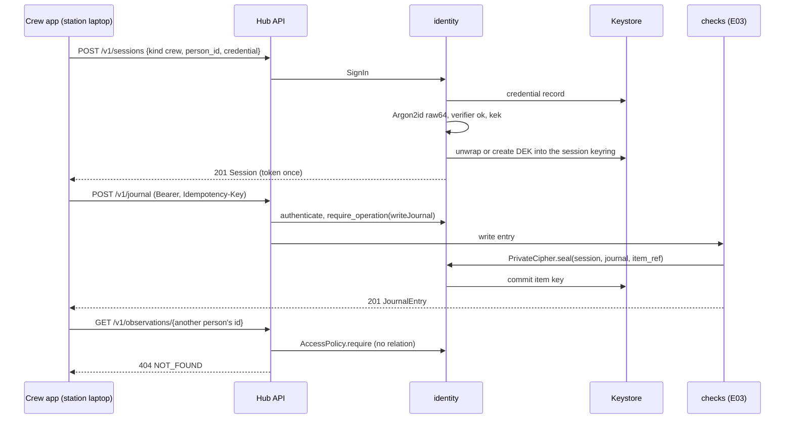

# E02: Consent, authentication and privacy

Technical design for epic E02. Inputs: the brief (`tdd/E02.md` in the planning package), PRD.md sections 3, 8 (R02,
R20, R29), 10 and 11, USE-CASES.md (UC01, UC10, UC14, UC15, UC18, UC22), CONTRACTS.md sections 1 to 5, 9, 10, 11, 18,
19 and 20, `api/openapi.yaml` (operations `createSession`, `getCurrentSession`, `deleteCurrentSession`, `listCrew`,
the `x-roles` and `x-error-codes` of all 133 operations), the schemas `session`, `crew-member`, `journal-entry`,
`error`, `common` (`role`, `actor`, `person_ref`), `requests.schema.json#/$defs/SessionCreate`, VALIDATION.md (V08,
V09, V25, V26, V64, D09, D13, D24, D26), the E02 work packages in `backlog.json`, `docs/BUILD-CHARTER.md`, `AGENTS.md`,
`docs/SYSTEM.md` (binding: 4.2, 4.4, 5, 7.4, 8.3, 8.4, 8.6) and `docs/DEPLOYMENT.md` (binding: 3, 4.4, 5, 6, 7). The
consumer shapes asked of E02 by E03, E04, E10, E11, E12, E15, E19, E21, E22, E25, E26, E28, E30, E31 and E33 are
settled in section 4 and confirmed in section 14.

Status: design. Every test named here is planned; none has run. E02 carries no clinical content.

## 1. Scope

**Work packages.** E02-01 role and purpose checks ("crews cannot read others by changing IDs; tasks reveal minimum
data"), E02-02 journal isolation and secure local storage ("canary absent from prompts, telemetry, retrieval and
exports"), E02-03 grants, revocation and session lock ("revoked access blocks subsequent reads; export history remains
auditable").

**Requirements.** R02 (purpose specific consent and role access), R20 (journal outside inference, retrieval and
exports), R29 (station identity without guessing). Contributes to the PRD 10 privacy target ("zero cross-patient,
journal or unauthorized report leakage in the defined adversarial suite"): E02 owns that suite (section 12).

**Validation and demo.** V08 (unpaired station participant), V09 (presenter namespace), V25 (cross-patient request,
server side part), V26 (journal canary), V64 (helper reads during and after a help session, access part), D09
(presenter reading goes to the demo-operator record), D13 and D26 (canary clauses), D24 (access and audit clauses).
Use cases: UC01 (journal privacy), UC10 and UC18 (helpers see the readings panel only), UC14 (consent for ground
copies), UC15 (records by owner), UC22 (a crewmate's task reveals minimum data).

**Decisions the brief asks for.** Local session authentication (3.2, DE02-1 to DE02-3), encryption and key management
(3.5, DE02-4 to DE02-6), consent revocation behavior (3.4, DE02-7, DE02-8).

**Not delivered here.** The sign-in and station screens (`SignIn.vue`, `StationHome.vue`: E03); the journal module and
its table (E03 `checks`); private reports (E09); each module's own `Visibility.can_read` and audience rule (the owning
module, using E02's policy of 3.6); the event log and SSE (E01 `events`); backups, golden restore and the offline client
store (E01 platform, E20); device enrollment endpoints (request R-SYS-4; E02 ships the interim CLI); `getContext`
(question 14.13); face matching (never: 3.8).

| ID | Decision | Alternatives rejected | Selected and why |
|---|---|---|---|
| DE02-1 | Session token | JWT (signing key management for nothing: every request needs a revocation check against state anyway); cookies (CSRF on a shared laptop) | Opaque 256 bit random bearer token, returned once, stored as SHA-256 only, checked against the session row; revocable at once |
| DE02-2 | Credential | WebAuthn or passkeys (needs a TLS origin and platform authenticators; T0 is loopback HTTP and Orion class PCDs are not confirmed to carry them); OS accounts (one shared OS account on the medical laptop) | PIN or passphrase per person, Argon2id (RFC 9106) in one raw derivation that yields both the verifier and the private key encryption key (3.5) |
| DE02-3 | Shared laptop | Personal sessions only | Rest in a `station` session; a person signs in over it; sign-out, idle lock or any 401 returns to station (DEPLOYMENT 3.1, E03 DE03-11) |
| DE02-4 | Private data at rest | Whole file encryption of `private.sqlite` with one hub key (any session could read any journal) | Per person data key, per item key, both wrapped; the person key is wrapped by a key derived from the person's credential, so a journal opens only while its owner is signed in (DEPLOYMENT 5.4) |
| DE02-5 | Where keys live | Wrapped keys inside `private.sqlite` or `hub.sqlite` (they would sit in every rolling backup, so deletion could never reach backups) | A separate keystore `<data_dir>/keys/keystore.sqlite` kept latest only: never in rolling snapshots, mirrored as one current copy; deleting a key there makes every backup copy of the ciphertext unreadable at once (SYSTEM 7.4) |
| DE02-6 | Credentials location | `identity_credential` in `hub.sqlite` (a restore of an older `hub.sqlite` would resurrect an old PIN that no longer unwraps the current keys) | Credential verifiers live in the keystore with the keys they unwrap (request 14.9 updates the SYSTEM 4.2 table list) |
| DE02-7 | Consent check timing | Cache grants in the session | Checked at every use (read, event delivery, ship); never cached |
| DE02-8 | Revocation effect | End the recipient's sessions | Revocation commits, publishes `ConsentRevoked` in the transaction (E05 ends the task, E16 cancels unsent handoffs) and every later read and event delivery is refused; sessions continue; history is never deleted |
| DE02-9 | Role checks | Hand written role lists per router | `require_operation(operation_id)` reads `x-roles` from `contracts/api/openapi.yaml` at startup; a contract test proves equality for all 133 operations |
| DE02-10 | One privacy rule | Each module invents its own | Pure `decide()` over SYSTEM 8.3 classes (3.6), called by every owning module through `AccessPolicy`; privacy invariants are code, never configuration (AGENTS rule 1) |

## 2. Dependencies and seams

Hard: E01 (kernel, platform, settings, clock, idempotency, audit, `events`, `ModuleRegistry`). Optional: E05, E26, E31
(relation facts; absent means the relation is not established, so access fails closed). E02 is hard for E03, E04,
E05, E06, E07, E08, E09, E11, E12, E13, E15, E16, E19, E21, E23, E26, E27, E28, E30, E31, E32, E33 (SYSTEM 9).

| Seam | Direction | Mechanism | Owner |
|---|---|---|---|
| Session from bearer token | E01 `app` middleware calls | `SessionAuthenticator.authenticate` (4.2); builds kernel `SessionContext` (SYSTEM 5.7) | E02 |
| Role gate | every router uses | `require_operation(op_id)`, `require_roles(*roles)` (6.2) | E02 |
| Session liveness for SSE | E01 `events` calls | `SessionValidator.is_live`, `SessionRevocation.on_end` (4.2) | E02 |
| Roster, person lookup, record origin | E03, E04, E11, E12, E15, E19, E22, E25, E26, E27, E28, E30, E31, E33 | `RosterPort`, `PersonDirectory`, `RecordRouting` (4.2) | E02 |
| Consent | E05, E09, E11, E12, E13, E15, E16 | `ConsentQueries`, `ConsentCommands`; domain events `ConsentGranted`, `ConsentRevoked`, `ConsentEnded` | E02 |
| Access decision and read audit | every module that serves P2 or P3 | `AccessPolicy.evaluate` / `.require`, `AccessAudit.record`, `PrivacyRegistry.register` | E02 |
| Ship guard (ground, peer hub, export) | E29 `groundlink`, `export`; E01 replication; E16 | `ShipGuard.check` | E02 |
| Subject binding (R29) | E01 `records` (`recordObservation`), E05 (attempts) | `SubjectBinding.bind` | E02 |
| Private cipher | E03 (journal), E09 (private reports) | `PrivateCipher`, `PrivateDataShredder` | E02 |
| Help membership fact | E02 consumes, optional | `HelpMembershipPort.readable_by`, `.was_member` (declared in identity ports) | E26 |
| Clinical authority fact | E02 consumes, optional | `ClinicalAuthorityQuery.authority` (SYSTEM 8.4) | E31 |
| Task fact | E02 consumes, optional | `TaskRelationPort.operator_task` (declared in identity ports) | E05 |
| Overlays and helping session for `listCrew` | E02 consumes, optional | `OverlayPort.active` (E23), `HelpMembershipPort.helping_session_of` (E26) | E23, E26 |
| Mission day | E02 consumes | `MissionClock.mission_day(at)` | E01 |
| Mission bootstrap | E01 `mission init` CLI calls | `IdentityBootstrap.apply` (4.2) | E02 |
| Clock regression | E02 consumes | Domain events `ClockRegressed`, `ClockCorrected` | E01 |
| Keystore mirror encryption | E02 consumes | `BackupCipherPort.encrypt/decrypt` (request 14.5) | E01 |

## 3. Domain model

Pure code in `hub/src/crew_health/identity/domain/` and `hub/src/crew_health/consent/domain/`; no I/O, no clock reads
(every function takes `now`).

### 3.1 Principals, persons and the roster

| Entity | Fields | Rules |
|---|---|---|
| Person | `person_id` (contract `id`, never `"ground"`), `display_name`, `kind` (`crew`, `demo_operator`), `record_origin` (`LIVE`, `SIM`), `live_record_person_id` (SIM personas only: the demo-operator record that receives LIVE data, V09) | Display names never join records (CONTRACTS 1) |
| RosterEntry | `person_id`, `mission_id`, `on_roster_from_day`, `on_roster_until_day` (X-E22-3), `medical_officer_rank` (1, 2 or null, unique per mission) | `demo_operator` persons are never on the roster |
| Principal | `principal_id`, `kind` (`person`, `station`, `operator`, `editor`, `ground`), `person_id` (kind `person` only), `fixture` (bool), `state` (`active`, `disabled`) | At most `identity.principals.max_per_kind` per non-person kind |

Roles of a crew session (R-E11-11): `{"crew"} | {"crew_medical_officer"} if medical_officer_rank in {1, 2}`. Other
kinds get exactly their kind as role (`station`, `operator`, `editor`, `ground`); adapter tokens get `adapter`. Roles
are fixed at issue; any roster change for a person ends that person's sessions (3.2), so roles never go stale.

### 3.2 Session state machine

`active -> ended(reason)`; `ended` is final. Reasons: `signed_out`, `idle_lock`, `expired`, `roster_changed`,
`credential_changed`, `revoked_operator`, `revoked_device`, `superseded`, `reauth_required`.

`live(s, now, listener) = s.ended_at is None and s.listener == listener and t < s.expires_at and (s.idle_expires_at
is None or t < s.idle_expires_at)` where `t = max(now, s.last_seen_at)`. Taking the maximum means a backward clock jump
can never extend a session (INV-E02-15). Lifetimes per kind come from settings (section 8): crew absolute and idle;
station absolute, no idle; operator, editor and ground absolute and idle. `superseded`: issuing a session beyond
`identity.session.max_per_person` ends that person's oldest.

### 3.3 Sign-in attempts

Per `(principal_key, client_key)` (person ID or kind; client address): `open -> locked(until) -> open`. Failures in
`identity.signin.window_seconds` reaching `identity.signin.max_failures` lock for `lockout_base_seconds * 2^k`, capped
at `lockout_max_seconds`, `k` the number of consecutive lockouts; a success resets. Unknown person IDs run one dummy
Argon2id derivation so timing does not reveal roster membership.

### 3.4 Consent grant

| Field | Meaning |
|---|---|
| `grant_id`, `revision` | ID prefix `cns`; revision starts at 1 |
| `subject_person_id` | Whose data |
| `recipient` | `{kind: "person", person_id}` or `{kind: "ground"}`; the recipient token `"ground"` in port calls (E15) |
| `scope` | `(kind, target)`; kinds `measurement` (capability code, E11), `restricted_answer` (question ID, E15), `episode` (`clinical_review`, E15), `handoff` (episode ID, E16), `report` (report ID, E09) |
| `fields` | Allowed field IDs (CONTRACTS 2 "allowed fields/actions"); empty means the scope's default projection owned by the consuming module |
| `valid_from`, `valid_until` | `valid_until` may be null |
| `ends_with_ref` | The task or object whose end ends the grant (a measurement request, a handoff) |
| `state` | `active -> revoked` (by the subject) or `active -> ended` (by `ends_with_ref` ending); both final. `expired` is derived: `active` and `now >= valid_until` |
| `granted_by` | The subject's session ID and actor; never an engine, operator, ground or assistant actor |

`allows(grant, now, regressed) = state == active and valid_from <= now and (valid_until is None or (not regressed and
now < valid_until))`. While the clock is regressed (between `ClockRegressed` and `ClockCorrected`), every time bounded
grant fails closed (INV-E02-15). Self access needs no grant: `recipient == subject` is refused at creation and
`ConsentQueries.allows` returns True for it (INV-E02-08).

### 3.5 Keys and sealed items

| Object | Contents | State |
|---|---|---|
| Credential record | `principal_id`, `salt` (16 bytes), Argon2id `m_kib`, `t`, `p`, `verifier` (32 bytes), `set_at` | Replaced on change; never versioned |
| Person key | `person_id`, `key_id`, `wrapped_dek`, `wrap_nonce`, `seal_count` | `none -> active -> shredded` (final, tombstone kept without key material) |
| Item key | `item_ref`, `purpose` (`journal`, `private_report`), `person_id`, `key_id`, `wrapped_ek`, `wrap_nonce` | `active -> destroyed` (row deleted, tombstone kept) |

Derivation, one Argon2id call per sign-in: `raw = Argon2id(credential, salt, m_kib, t, p, out=64)`;
`verifier = SHA-256("chc/verifier/v1" || raw[0:32])`, compared with `hmac.compare_digest`; `kek =
HKDF-SHA256(ikm=raw[32:64], salt=None, info="chc/kek/v1|" || person_id, L=32)`. `dek` (32 random bytes) is created at
the person's first successful sign-in and wrapped `AES-256-GCM(kek, wrap_nonce, dek, aad="dek|"||person_id||"|"||
key_id)`. Each item has its own `ek` (32 random bytes) wrapped by `dek` with `aad="ek|"||purpose||"|"||item_ref`; the
item is `AES-256-GCM(ek, nonce, plaintext, aad=purpose||"|"||person_id||"|"||item_ref)`. Nonces are 96 bit random;
`seal_count` is bounded by `identity.private.max_seals_per_key` and a seal past it raises `PrivateKeyExhausted` (fail
loud, never reuse). Python cannot guarantee memory zeroing; key bytes live in `bytearray`s overwritten on session end
(stated limit, section 10).

### 3.6 Access policy (SYSTEM 8.3)

```python
# crew_health/identity/domain/access.py
class PrivacyClass(StrEnum): P0 = "P0"; P1 = "P1"; P2 = "P2"; P3 = "P3"
class Purpose(StrEnum):
    READ = "read"; WRITE = "write"; EVENT = "event"; INFERENCE = "inference"; INDEX = "index"
    EXPORT = "export"; GROUND_COPY = "ground_copy"; REPLICATE = "replicate"
class Relation(StrEnum):
    SELF = "self"; OPEN_HELP = "open_help"; CLOSED_HELP = "closed_help"; TASK_OPERATOR = "task_operator"
    OFFICER = "officer"; ACTING_OFFICER = "acting_officer"; GROUND = "ground"

@dataclass(frozen=True, slots=True)
class KindRule:                          # registered once per record kind by its owning module
    object_kind: str                     # "observation", "subject_summary", "journal_entry", ...
    privacy_class: PrivacyClass
    help_scoped: bool                    # readable by members of an open help session for the subject
    task_scoped: bool                    # readable by an accepted task operator within the grant's fields
    shareable_with_consent: bool         # P3 only: a private report the owner sends; False for the journal
    ground_line: bool                    # a CONTRACTS 26 catch-up line, shipped as P1

@dataclass(frozen=True, slots=True)
class AccessRequest:
    object_kind: str
    subject_person_id: str | None
    purpose: Purpose
    restricted_fields: frozenset[str] = frozenset()      # field IDs that need a consent scope each
    consent_scope: tuple[str, str] | None = None

@dataclass(frozen=True, slots=True)
class AccessFacts:
    session_kind: str
    roles: frozenset[str]
    relations: frozenset[Relation]
    consented_scopes: frozenset[tuple[str, str]]          # subject to this session's recipient, active now
    task_fields: frozenset[str] | None

@dataclass(frozen=True, slots=True)
class AccessDecision:
    allowed: bool
    basis: Literal["self", "open_help", "task", "officer", "acting_officer", "break_glass", "consent", "role", "none"]
    allowed_fields: frozenset[str] | None                 # None: every field not withheld
    withheld_fields: frozenset[str]
    denial: Literal["NOT_FOUND", "UNAUTHORIZED_SCOPE", "CONSENT_REQUIRED"] | None
    audit: bool                                           # True for every allowed P2 or P3 read by a non-self

def decide(request: AccessRequest, facts: AccessFacts, rule: KindRule) -> AccessDecision: ...   # pure, total
```

Decision table, evaluated top to bottom; the first matching row wins.

| # | Class and purpose | Condition | Result |
|---|---|---|---|
| 1 | P3, any purpose | `SELF` and purpose in {read, write} | allow, `self` |
| 2 | P3, read or ground_copy | `rule.shareable_with_consent` and `consent_scope` in `consented_scopes` | allow, `consent`, audit |
| 3 | P3, anything else | | deny `NOT_FOUND` (journal: inference, index, export, ground copy, replicate and event are refused for everyone, the owner included) |
| 4 | P0 or P1, any purpose | session role in the operation's `x-roles` (already enforced) | allow, `role` |
| 5 | P2, replicate or index | `replicate`: to the site's own peer hubs (DEPLOYMENT 4.4); `index`: only `SELF` | allow, `role` or `self`; an `index` by anyone else is denied `NOT_FOUND` |
| 6 | P2 ground_copy or export | `rule.ground_line` | allow, `role` (P1 projection) |
| 7 | P2 ground_copy or export | `consent_scope` in `consented_scopes` | allow, `consent`, audit |
| 8 | P2 ground_copy or export | otherwise | deny `CONSENT_REQUIRED` |
| 9 | P2 read, event or inference | `SELF` | allow, `self`, every field |
| 10 | P2 | `OPEN_HELP` and `rule.help_scoped` | allow, `open_help`, audit |
| 11 | P2 | `TASK_OPERATOR` and `rule.task_scoped` and `task_fields` not None | allow, `task`, `allowed_fields = task_fields`, audit |
| 12 | P2 | `OFFICER` or `ACTING_OFFICER` | allow, `officer` or `acting_officer`, audit; `withheld_fields = restricted_fields` minus fields whose `("restricted_answer", f)` is consented; basis `break_glass` when `rule.help_scoped` and not `OPEN_HELP` |
| 13 | P2 | `GROUND` and `consent_scope` in `consented_scopes` | allow, `consent`, restricted fields withheld unless consented, audit |
| 14 | P2 | `GROUND` | deny `CONSENT_REQUIRED` |
| 15 | P2 | `CLOSED_HELP` | deny `UNAUTHORIZED_SCOPE` (V64) |
| 16 | any | otherwise | deny `NOT_FOUND` (an ID the session has no relation to is indistinguishable from an absent one) |

An unregistered `object_kind` resolves to `KindRule(P3, False, False, False, False)`: fail closed (INV-E02-18).

### 3.7 Record routing (V09)

`record_for(person, origin)`: a LIVE person accepts `LIVE` only; a SIM persona accepts `SIM` and `REPLAY` on itself and
routes `LIVE` to `live_record_person_id`; anything else raises `RoutingUnavailable` (`422 ORIGIN_MISMATCH`). No SIM
datum reaches a LIVE record (CONTRACTS 9, INV-E02-14).

### 3.8 Subject binding (R29)

`bind(session, claimed_subject_id, origin, task_ref)`:

| Session | Rule | Refusal |
|---|---|---|
| `station` | Never binds: a station has no person (V08) | `422 IDENTITY_MISMATCH` |
| `crew` | Subject is the session person; another subject only through `TaskRelationPort.operator_task(task_ref, session person, subject)` with an active `("measurement", capability)` grant | `422 IDENTITY_MISMATCH` |
| `adapter` | Subject is the subject of the measurement request named by `task_ref`, resolved by E05; an adapter never names a subject itself | `422 IDENTITY_MISMATCH` |
| any other | Never binds | `422 IDENTITY_MISMATCH` |

The bound record is `record_for(subject, origin)`. No input field carries a face identity; camera attempts carry no
subject (request 14.12 to E06), so an ambiguous or unpaired face can never produce a patient observation (V39 part).

### 3.9 Invariants

| ID | Invariant | Tests |
|---|---|---|
| INV-E02-01 | Identity and roles come only from the token; IDs in a body, path or model output never authorize | T-E02-004, 005 |
| INV-E02-02 | A crew session's roles are exactly `crew` plus `crew_medical_officer` for rank 1 or 2 | T-E02-018 |
| INV-E02-03 | A token works only on its listener, before expiry and idle lock, while not ended | T-E02-015, 016 |
| INV-E02-04 | An ended session never becomes live; an ended or revoked grant never becomes active | T-E02-016, 008 |
| INV-E02-05 | Credentials and tokens are never stored in plain form, logged, audited or returned after creation | T-E02-014 |
| INV-E02-06 | Only the subject's own crew session grants or revokes consent | T-E02-024 |
| INV-E02-07 | Granting never removes access; revoking never adds it | T-E02-003 |
| INV-E02-08 | A grant never names its subject as recipient; self access needs none | T-E02-024 |
| INV-E02-09 | P3 never reaches a non-owner except a shareable item through consent; the journal never reaches inference, index, export, ground, replication or events | T-E02-001, 006, 007 |
| INV-E02-10 | No relation means no P2 or P3 | T-E02-002, 004 |
| INV-E02-11 | Private plaintext is never written to any file; a person key is unwrapped only into memory for that person's live session | T-E02-006, 019 |
| INV-E02-12 | A shredded or destroyed key never returns, including by restore | T-E02-020, 021 |
| INV-E02-13 | A station session never binds a subject | T-E02-011 |
| INV-E02-14 | SIM never enters a LIVE record; LIVE on a SIM persona goes to its demo-operator record | T-E02-012 |
| INV-E02-15 | A backward clock jump never extends a session or a time bounded grant | T-E02-017 |
| INV-E02-16 | Every allowed non-self P2 or P3 read is audited with its basis, by reference only | T-E02-009, 010 |
| INV-E02-17 | The role gate of every operation equals its contract `x-roles` | T-E02-005 |
| INV-E02-18 | An unregistered record kind is treated as P3 and is never shipped | T-E02-026 |

## 4. Application layer

### 4.1 Use cases

| Use case | Input | Output | Errors | Idempotency |
|---|---|---|---|---|
| `SignIn` | `SessionCreate`, listener, client key | `Session` with token | `IDENTITY_MISMATCH` (unknown person, wrong credential, kind and person mismatch, locked, disabled principal, person off the roster today, fixture principal outside `demo`, `ground` on a `flight` hub), `INTERNAL_ERROR` retryable (storage, Argon2 queue full) | None (contract: no key); every call issues a new session |
| `SignOut` | session | 204 | `DUPLICATE_COMMAND` | E01 store, `actor_ref` the session's actor ID; a replay after the session ended gets 401, which clients treat as done |
| `Authenticate` | token, listener | `SessionContext` | `UNAUTHENTICATED`; `ADAPTER_NOT_TRUSTED` for a revoked adapter token or a path `adapter_id` that differs from the token's | n/a |
| `SweepSessions` | scheduler tick | ended count | none | Idempotent by state |
| `ListCrew` | session, page | `CrewMember` page | `UNAUTHORIZED_SCOPE` | n/a |
| `GrantConsent` | caller's `uow`, subject session, `GrantSpec` | `grant_id` | `ACTION_NOT_ALLOWED` (not the subject, self recipient, assistant or engine actor), `INVALID_VALUE` (scope kind, fields), `PAYLOAD_TOO_LARGE` (over `consent.max_active_per_subject`) | The calling command's key |
| `RevokeConsent` | `uow`, subject session, `grant_id`, expected revision | grant view | `NOT_FOUND`, `ACTION_NOT_ALLOWED`, `STALE_VERSION`, `INVALID_TRANSITION` (already final) | The calling command's key, or the CLI's generated key |
| `EndConsentForObject` | `uow`, `object_ref`, reason | ended count | none | Idempotent by state |
| `Seal` / `Open` / `Destroy` | session, purpose, item ref | `Sealed` / bytes / none | `UNAUTHENTICATED` (key not in memory: session ends `reauth_required`), `NOT_FOUND` (not the owner, destroyed item) | Seal by `item_ref` (a second seal of the same ref returns the stored key) |
| `ShredPerson` | owner session or CLI owner credential | `ShredReceipt` | `ACTION_NOT_ALLOWED` | Idempotent by state |
| `Bootstrap` | roster document, profile, mission mode | report | `CONFIG_INVALID` with findings | Re-applying the same document is a no-op |

### 4.2 Ports provided (exact signatures)

```python
# crew_health/identity/application/ports.py
type Snap = ReadSnapshot | UnitOfWork
type RecordOrigin = Literal["LIVE", "SIM"]
type Listener = Literal["loopback", "lan"]
type EndReason = Literal["signed_out", "idle_lock", "expired", "roster_changed", "credential_changed",
                         "revoked_operator", "revoked_device", "superseded", "reauth_required"]

@dataclass(frozen=True, slots=True)
class RosterMember:
    person_id: str
    display_name: str
    roles: frozenset[str]
    medical_officer_rank: int | None
    on_roster_from_day: int
    on_roster_until_day: int | None
    record_origin: RecordOrigin

class RosterPort(Protocol):           # order: rank ascending (null last), display_name casefold, person_id
    def crew(self, at: datetime, *, snapshot: Snap | None = None) -> Sequence[RosterMember]: ...
    def crew_on_day(self, mission_day: int, *, snapshot: Snap | None = None) -> Sequence[RosterMember]: ...
    def members(self, *, snapshot: Snap | None = None) -> Sequence[RosterMember]: ...
    def person_ids(self, *, snapshot: Snap | None = None) -> frozenset[str]: ...
    def display_names(self, *, snapshot: Snap | None = None) -> frozenset[str]: ...          # R-E12-6
    def members_by_day(self, mission_id: str, origin: RecordOrigin, first_day: int, last_day: int, *,
                       snapshot: Snap | None = None) -> Mapping[int, frozenset[str]]: ...    # X-E22-3
    def first_mission_day(self, person_id: str, *, snapshot: Snap | None = None) -> int | None: ...

@dataclass(frozen=True, slots=True)
class PersonRef:
    person_id: str
    display_name: str
    kind: Literal["crew", "demo_operator"]
    record_origin: RecordOrigin
    on_roster: bool

class PersonDirectory(Protocol):
    def person(self, person_id: str, *, snapshot: Snap | None = None) -> PersonRef | None: ...
    def origin_mode(self, person_id: str, *, snapshot: Snap | None = None) -> RecordOrigin: ...  # UnknownPerson

class RecordRouting(Protocol):        # E30 X10, E22, E03
    def record_origin(self, person_id: str, *, snapshot: Snap | None = None) -> RecordOrigin: ...
    def record_for(self, person_id: str, origin: Literal["LIVE", "REPLAY", "SIM"], *,
                   snapshot: Snap | None = None) -> str: ...                               # RoutingUnavailable

class SessionAuthenticator(Protocol):
    def authenticate(self, token: str, *, listener: Listener, path_adapter_id: str | None,
                     now: datetime) -> SessionContext: ...       # Unauthenticated, AdapterNotTrusted

class SessionValidator(Protocol):
    def is_live(self, session_id: str, now: datetime) -> bool: ...                       # in memory, O(1)

class SessionRevocation(Protocol):
    def end(self, uow: UnitOfWork, session_id: str, reason: EndReason) -> bool: ...
    def end_for_person(self, uow: UnitOfWork, person_id: str, reason: EndReason) -> int: ...
    def end_all(self, uow: UnitOfWork, kinds: frozenset[str], reason: EndReason) -> int: ...
    def on_end(self, callback: Callable[[frozenset[str]], None]) -> None: ...   # session IDs, after commit

@dataclass(frozen=True, slots=True)
class GrantSpec:
    recipient_id: str                 # a person ID or "ground"
    scope: tuple[str, str]
    fields: frozenset[str]
    valid_until: datetime | None
    ends_with_ref: str | None

@dataclass(frozen=True, slots=True)
class ConsentGrantView:
    grant_id: str; revision: int; subject_person_id: str; recipient_id: str; scope: tuple[str, str]
    fields: frozenset[str]; valid_from: datetime; valid_until: datetime | None; ends_with_ref: str | None
    state: Literal["active", "revoked", "ended", "expired"]; granted_at: datetime; closed_at: datetime | None

class ConsentQueries(Protocol):       # E11, E15 signature; never cached by callers
    def allows(self, snapshot: Snap, subject_id: str, recipient_id: str, scope: tuple[str, str]) -> bool: ...
    def fields(self, snapshot: Snap, subject_id: str, recipient_id: str,
               scope: tuple[str, str]) -> frozenset[str] | None: ...          # None: no active grant
    def granted_scopes(self, snapshot: Snap, subject_id: str, recipient_id: str) -> frozenset[tuple[str, str]]: ...
    def grant(self, snapshot: Snap, grant_id: str) -> ConsentGrantView | None: ...   # E16 consent_ref check

class ConsentCommands(Protocol):
    def grant(self, uow: UnitOfWork, session: SessionContext, spec: GrantSpec) -> str: ...
    def revoke(self, uow: UnitOfWork, session: SessionContext, grant_id: str, *,
               expected_revision: int | None) -> ConsentGrantView: ...
    def end_for_object(self, uow: UnitOfWork, object_ref: str,
                       reason: Literal["task_completed", "task_cancelled", "object_closed"]) -> int: ...

class PrivacyRegistry(Protocol):
    def register(self, rule: KindRule) -> None: ...      # startup only; a duplicate kind raises
    def rule(self, object_kind: str) -> KindRule: ...    # unknown: P3, nothing shareable

class AccessPolicy(Protocol):
    def evaluate(self, snapshot: Snap, session: SessionContext, request: AccessRequest, *,
                 help_session_id: str | None = None, task_ref: str | None = None) -> AccessDecision: ...
    def require(self, snapshot: Snap, session: SessionContext, request: AccessRequest, *,
                help_session_id: str | None = None, task_ref: str | None = None) -> AccessDecision: ...
        # raises ProblemError(decision.denial)

class AccessAudit(Protocol):
    def record(self, uow: UnitOfWork, session: SessionContext, decision: AccessDecision, *,
               object_kind: str, object_ref: str, subject_person_id: str | None) -> None: ...

@dataclass(frozen=True, slots=True)
class ShipDecision:
    allowed: bool
    reason: Literal["p0_p1", "ground_line", "consent", "own_peer", "p3_never", "consent_required", "unregistered"]

class ShipGuard(Protocol):
    def check(self, snapshot: Snap, object_kind: str, subject_person_id: str | None,
              destination: Literal["ground", "peer_hub", "export"],
              consent_scope: tuple[str, str] | None) -> ShipDecision: ...

@dataclass(frozen=True, slots=True)
class BoundSubject:
    subject_person_id: str
    record_person_id: str             # after record routing
    operator_person_id: str | None
    basis: Literal["self", "task", "adapter_request"]

class SubjectBinding(Protocol):
    def bind(self, snapshot: Snap, session: SessionContext, *, claimed_subject_id: str | None,
             origin: Literal["LIVE", "REPLAY", "SIM"], task_ref: str | None) -> BoundSubject: ...

type PrivatePurpose = Literal["journal", "private_report"]

@dataclass(frozen=True, slots=True)
class Sealed:
    key_id: str
    nonce: bytes                      # 12 bytes
    ciphertext: bytes                 # GCM tag appended

class PrivateCipher(Protocol):        # replaces E03's FieldCipher (request 14.6)
    def seal(self, session: SessionContext, *, purpose: PrivatePurpose, item_ref: str, plaintext: bytes) -> Sealed: ...
    def open(self, session: SessionContext, *, purpose: PrivatePurpose, item_ref: str, sealed: Sealed) -> bytes: ...
    def destroy(self, session: SessionContext, *, purpose: PrivatePurpose, item_ref: str) -> None: ...
    def reconcile(self, purpose: PrivatePurpose, person_id: str,
                  present_item_refs: frozenset[str]) -> ReconcileReport: ...  # orphan keys, keyless items

@dataclass(frozen=True, slots=True)
class ShredReceipt:
    person_id: str
    items_destroyed: int
    mirror: Literal["current", "golden_pending"]

class PrivateDataShredder(Protocol):
    def shred_person(self, actor: Actor, person_id: str) -> ShredReceipt: ...

class IdentityBootstrap(Protocol):
    def apply(self, uow: UnitOfWork, document: RosterBootstrapDocument, *,
              profile: Literal["flight", "ground", "demo"],
              mission_mode: Literal["LIVE", "REPLAY", "SIM"]) -> BootstrapReport: ...
```

`RosterBootstrapDocument` is validated against `hub/src/crew_health/identity/schemas/roster-bootstrap.schema.json`
(E02): `persons[]` (3.1 fields), `roster[]`, `principals[]` with `credential: {format: "argon2id-split-v1", salt_b64,
m_kib, t, p, verifier_b64}` (never plain text), `adapter_tokens[]: {adapter_id, token_sha256}`, `fixture: bool`.
`crew-health identity hash-credential` produces the credential record from a TTY prompt.

### 4.3 Ports consumed (declared in E02's ports, implemented by others)

```python
class HelpMembershipPort(Protocol):       # E26 HelpSessionReader
    def readable_by(self, session: SessionContext, help_session_id: str) -> bool: ...
    def was_member(self, session: SessionContext, help_session_id: str) -> bool: ...   # request 14.10
    def helping_session_of(self, person_id: str) -> str | None: ...                     # listCrew
class TaskRelationPort(Protocol):         # E05
    def operator_task(self, snapshot: Snap, task_ref: str, operator_person_id: str,
                      subject_person_id: str) -> TaskRelation | None: ...  # accepted, not terminal, scope, fields
class BackupCipherPort(Protocol):         # E01
    def encrypt(self, plaintext: bytes) -> bytes: ...
    def decrypt(self, ciphertext: bytes) -> bytes: ...
```

`ClinicalAuthorityQuery` (E31) and `OverlayPort` (E23) are consumed with their SYSTEM shapes.

### 4.4 Events

Outbox: none (CONTRACTS 18 has no identity or consent type; request 14.1 adds `consent.changed`). Domain events,
published in the producing transaction:

| Event | Fields | Consumers |
|---|---|---|
| `ConsentGranted` | `grant_id`, `subject_person_id`, `recipient_id`, `scope` | none required |
| `ConsentRevoked` | `grant_id`, `subject_person_id`, `recipient_id`, `scope`, `at` | E05 (in-progress task to `unavailable`, E11 3.3), E16 (cancel handoffs not yet in transit) |
| `ConsentEnded` | as revoked, plus `reason` | none required |
| `SessionEnded` | `session_id`, `person_id`, `kind`, `reason` | none required (post-commit `on_end` closes SSE) |
| `RosterChanged` | `person_ids` | E31 (cascade), E22 (rebuild) |

Consumed: `ClockRegressed` (set `identity_state.clock_regressed`), `ClockCorrected` (clear it).

### 4.5 Principal success path and a failure path



```mermaid
sequenceDiagram
  participant S as Subject (crew)
  participant O as Operator crewmate
  participant H as Hub
  participant I as consent
  participant E as E05 measurement
  participant V as events (SSE)
  O->>H: GET task details (grant measurement: bp)
  H->>I: allows(subject, operator, (measurement, bp)) true
  H-->>O: 200, task fields only
  S->>H: revoke (CLI interim; POST /v1/consents/{id}/revoke after 14.1)
  H->>I: RevokeConsent in one transaction
  I->>E: ConsentRevoked (in transaction): request to unavailable
  H-->>S: revoked, revision 2
  O->>H: GET task details again
  H->>I: allows false
  H-->>O: 403 CONSENT_REQUIRED
  V->>V: next measurement_request event for the operator: audience refuses, not delivered
```

## 5. Adapters

### 5.1 `hub.sqlite` tables (migration `adapters/migrations/NNNN_identity.sql` and `NNNN_consent.sql`, numbers from E01)

All STRICT, foreign keys on, times as RFC 3339 UTC text, every row with `origin_node_id`.

| Table | Columns and constraints | Indexes |
|---|---|---|
| `identity_person` | `person_id TEXT PK CHECK (person_id <> 'ground')`, `display_name TEXT NOT NULL`, `kind TEXT CHECK IN ('crew','demo_operator')`, `record_origin TEXT CHECK IN ('LIVE','SIM')`, `live_record_person_id TEXT NULL REFERENCES identity_person`, `created_at`, `revision INTEGER` | none |
| `identity_roster` | `person_id TEXT PK REFERENCES identity_person`, `mission_id TEXT NOT NULL`, `on_roster_from_day INTEGER NOT NULL`, `on_roster_until_day INTEGER NULL CHECK (until >= from)`, `medical_officer_rank INTEGER NULL CHECK (rank >= 1)`, `UNIQUE (mission_id, medical_officer_rank)` | `(mission_id, on_roster_from_day)` |
| `identity_principal` | `principal_id TEXT PK`, `kind TEXT CHECK IN (...)`, `person_id TEXT NULL REFERENCES identity_person`, `display_name`, `fixture INTEGER CHECK IN (0,1)`, `state TEXT CHECK IN ('active','disabled')`, `CHECK ((kind = 'person') = (person_id IS NOT NULL))` | `UNIQUE (person_id)` where not null |
| `identity_session` | `session_id TEXT PK`, `token_sha256 BLOB NOT NULL UNIQUE CHECK (length = 32)`, `kind`, `principal_id`, `person_id NULL`, `roles_json`, `listener CHECK IN ('loopback','lan')`, `client_key`, `created_at`, `expires_at`, `idle_expires_at NULL`, `last_seen_at`, `ended_at NULL`, `end_reason NULL` | `(person_id) WHERE ended_at IS NULL`; `(expires_at) WHERE ended_at IS NULL` |
| `identity_signin_attempt` | `principal_key`, `client_key`, `window_start`, `failures`, `lockouts`, `locked_until NULL`, PK both keys | none |
| `identity_adapter_token` | `adapter_id TEXT PK`, `token_sha256 BLOB UNIQUE`, `state CHECK IN ('active','revoked')`, `fixture`, `created_at`, `revoked_at NULL` | none |
| `identity_device` | `device_id PK`, `kind`, `name`, `enrolled_by`, `enrolled_at`, `revoked_at NULL` (R-SYS-4 interim, CLI only) | none |
| `identity_state` | `key TEXT PK`, `value TEXT`: `revocation_epoch` (integer bumped by every session, principal, roster or token change, including from the CLI process), `clock_regressed` | none |
| `consent_grant` | 3.4 fields; `recipient_kind CHECK IN ('person','ground')`, `recipient_person_id NULL`, `CHECK ((recipient_kind='person') = (recipient_person_id IS NOT NULL))`, `CHECK (recipient_person_id IS NULL OR recipient_person_id <> subject_person_id)`, `state CHECK IN ('active','revoked','ended')` | `(subject_person_id, recipient_kind, recipient_person_id, scope_kind, scope_target, state)`; `(ends_with_ref) WHERE state='active'` |

Triggers: `consent_grant` refuses DELETE and any UPDATE except `active` to `revoked` or `ended` with `revision + 1`;
`identity_session` refuses UPDATE of `token_sha256` and any change to a row with `ended_at` set. Migrations are additive
(DEPLOYMENT 7.4).

### 5.2 Keystore `<data_dir>/keys/keystore.sqlite`

Opened only by `identity/adapters/keystore.py` (import-linter, request 14.5), WAL, `synchronous=FULL`, file mode 0600 for
the service account. Tables: `keystore_credential` (3.5), `keystore_person_key`, `keystore_item_key`
(`item_ref TEXT PK`, `purpose`, `person_id`, `key_id`, `wrapped_ek`, `wrap_nonce`, `created_at`), `keystore_tombstone`
(`ref TEXT PK`, `kind CHECK IN ('person','item')`, `at`; no key material). Write order across the two files has no
shared transaction (WAL gives no cross-file atomicity), so: seal commits the item key first, then the owner writes the
ciphertext (a crash leaves an orphan key, removed by `reconcile` after `identity.private.orphan_grace_seconds`);
destroy deletes the key first, then the owner deletes the row (a crash leaves an unreadable row, removed by
`reconcile`). Plaintext never touches either file.

**Mirror.** After every keystore commit, `keystore_mirror.py` writes `BackupCipherPort.encrypt(online backup bytes)` to
`<data_dir>/backups/keystore-latest.enc` and, when mounted, to the golden medium's `keystore-latest.enc` (temp file,
fsync, rename). It is the only keystore copy outside `keys/`; rolling snapshots exclude `keys/` (request 14.5). A golden
medium that is not mounted sets health `identity.keystore_mirror` to degraded `golden_pending` until the next refresh.
Restore verifies the mirror and refuses any keystore containing a key whose `ref` appears in the tombstones of the
newest available copy (INV-E02-12).

**Missing or corrupt keystore at start.** Hub starts; existing sessions (in `hub.sqlite`) keep working, so the station
and Someone needs help are unaffected; new sign-ins fail with `INTERNAL_ERROR` retryable and health shows
`identity.keystore` degraded; `crew-health identity keystore recover` restores from the mirror. If no copy verifies,
the operator resets credentials and every person's private data stays unreadable (stated, section 10).

### 5.3 In-memory state (bounded)

| Structure | Bound | Content |
|---|---|---|
| Session cache | `identity.session.max_active` | `token_sha256 -> session row`; reloaded when `revocation_epoch` differs from the cached value (one integer read per request) |
| Activity map | same | `session_id -> last request instant`; flushed to `last_seen_at` and `idle_expires_at` at most every `identity.session.activity_flush_seconds`; after a restart idle is measured from the persisted value (conservative) |
| Keyring | same | `session_id -> dek bytearray`; overwritten and dropped on session end; empty after restart |
| Argon2 gate | `identity.signin.max_concurrent` slots, wait at most `identity.signin.queue_timeout_ms` | Derivations run in the threadpool outside any transaction |

### 5.4 Workers and the CLI

No worker processes. Scheduler handler `identity:sweep` re-armed every `identity.session.sweep_seconds` ends at most
`identity.session.sweep_batch` expired or idle sessions per run (bounded loop), audits each and calls `on_end`
callbacks after commit. CLI module `crew_health/identity/cli.py` (E20 shell): `identity hash-credential`, `identity
crew add|update|leave`, `identity credential set <principal_id>` (owner: old and new credential, rewraps the person
key; operator reset: new key, old private items unreadable, typed confirmation), `identity sessions list|end`,
`identity adapters token create|revoke`, `identity keystore verify|recover`, `devices enroll|revoke` (R-SYS-4 interim;
revoke ends every session), `consent list|grant|revoke` and `private shred --person` (interim for 14.1 and 14.4; the
subject types their own credential at the TTY). Every CLI write runs the same use cases in a `UnitOfWork` with the
authenticated actor and bumps `revocation_epoch`. Timeouts: SQLite `busy_timeout` from settings; no network calls.

## 6. API

### 6.1 Operations owned

| `operationId` | Roles | Request / response | Errors (`x-error-codes`) | Notes |
|---|---|---|---|---|
| `createSession` | none (`security: []`) | `SessionCreate` / 201 `Session` with `token` | 400 `MALFORMED_REQUEST`, 415, 422 `IDENTITY_MISMATCH`, 500 `INTERNAL_ERROR` | Every refusal of 4.1 is `IDENTITY_MISMATCH` with no detail that reveals which check failed, except a lockout, which adds `field_errors: [{field: "/credential", code: "temporarily_locked", message}]` (request 14.2). Body never logged |
| `getCurrentSession` | all seven | 200 `Session` without `token` | 401, 403 | |
| `deleteCurrentSession` | all seven | 204 | 401, 403, 409 `DUPLICATE_COMMAND` | Ends `signed_out`; `on_end` closes the session's SSE streams |
| `listCrew` | crew, crew_medical_officer, ground, operator, station | 200 page of `CrewMember` | 401, 403 | Roster plus `active_overlays` (E23, `[]` when absent), `location` (null until R-SYS-6), `helping_session_id` (E26, null when absent); never health or participation data |

`Session.actor`: crew `{kind: person, id: person_id, display_name}`; station, operator, ground their own kinds with the
principal ID; editor `{kind: operator, id: principal_id}` until request 14.3 adds `editor` to the actor kinds (the audit
records `session_kind: editor`). `Session.mission_id` from the roster; `expires_at` the absolute expiry.

Example (crew sign-in, the package example values): request `{"kind": "crew", "person_id": "mara", "credential":
"<typed PIN>"}`; response 201 `{"session_id": "ses_<uuid7>", "token": "<returned once>", "actor": {"kind": "person",
"id": "mara", "display_name": "Mara Okafor"}, "person": {"person_id": "mara", "display_name": "Mara Okafor"},
"roles": ["crew"], "mission_id": "demo-mission", "created_at": "...Z", "expires_at": "...Z"}`. Wrong PIN: 422
`{"code": "IDENTITY_MISMATCH", "retryable": false, "field_errors": [], "current_state": null, ...}`.

### 6.2 Authentication and the role gate for every operation

- `current_session(request) -> SessionContext` (FastAPI dependency): reads `Authorization: Bearer`, the listener from
  the ASGI server port, and calls `SessionAuthenticator`. Missing or invalid token, wrong listener, ended or expired
  session: 401 `UNAUTHENTICATED`. Adapter operations (`ingestReadings`, `recordAttempt`): a known revoked adapter token
  or a token whose adapter differs from `{adapter_id}` gives 403 `ADAPTER_NOT_TRUSTED`; an unknown token gives 401.
- `require_operation(operation_id)`: roles from the contract's `x-roles`, loaded once at startup from
  `contracts/api/openapi.yaml`; a session with no role in the list gets 403 `UNAUTHORIZED_SCOPE`. `require_roles` exists
  for internal routes only. Contract test T-E02-005 checks every operation.
- Authorization of objects is the owning module's `Visibility.can_read`, which calls `AccessPolicy.require` and, when
  `decision.audit`, `AccessAudit.record` in a `UnitOfWork` (D24: each view is an audit event).
- Private endpoints (`listJournal`, `writeJournal`, private reports): when the session's key is not in the keyring
  (after a hub restart) the session ends `reauth_required` and the request gets 401; the client signs the person in
  again (7).

## 7. User interface

E03 owns the sign-in and station screens; E02 owns the client behavior that keeps private data off shared screens, in
`ui/crew/src/features/identity/`:

| Item | Behavior |
|---|---|
| `privateStores.ts` | Registry: every feature store holding P2 or P3 data registers a `wipe()`; P2 and P3 live in memory only (never IndexedDB, localStorage or the service worker cache: SYSTEM 8.3, DEPLOYMENT 5.5) |
| `sessionLock.ts` | `lock(reason)`: wipes every registered store, drops the crew token (memory only), returns to the station session. Triggered by sign-out, any 401 from any call, SSE close followed by a 401 on reconnect, and the idle timer once request 14.3 gives `idle_lock_at`; until then the hub's idle lock (3.2) is the only timer and the client learns it from the 401 |
| Station token | Kept in localStorage (P0 and P1 reach only); renewed with the station credential provisioned by the operator in E03's station setup |
| `writeJournal` | Never queued offline (DEPLOYMENT 5.5: the journal is never cached on a client); with the hub unreachable the text stays in the open form and the designed offline state shows (request 14.7 to E20) |
| `SharingView.vue` | Lists and revokes the person's grants; ships only after request 14.1 (interim: none) |

States: loading, error (ui-copy `error_messages` by code), offline (`designed_states.offline`), locked (returns to
station), reauth (E03 sign-in with the person preselected), empty grants. Every word comes from `ui-copy.json` (E03;
word requests in 14.6). Test T-E02-040 scans the folder for literal user-facing text. Accessibility: lock moves focus
to the station view's main heading; no private value is announced by a live region.

## 8. Configuration

E02 reads none of the 18 configuration documents: roles are contract vocabulary, roster and credentials are state, and
the privacy rules of 3.6 are safety invariants held in code (AGENTS rule 1 third case). Operational bounds live in the
hub settings document (SYSTEM 5.11), each `{value, unit, basis, to_be_set_by}`, added to E01's schema by request 14.5:

| Key | Unit | Proposed value | Basis |
|---|---|---|---|
| `identity.session.crew_max` | `h` | 12 | team default (matches the package session example) |
| `identity.session.idle_lock` | `s` | 300 | team default; to be set by mission operations |
| `identity.session.station_max`, `operator_max`, `editor_max`, `ground_max` | `h` | 24, 8, 8, 8 | team default |
| `identity.session.max_active`, `max_per_person`, `sweep_batch` | count | 64, 4, 64 | team default |
| `identity.session.activity_flush`, `sweep` | `s` | 30, 15 | team default |
| `identity.signin.max_failures`, `window`, `lockout_base`, `lockout_max` | count, `s` | 5, 300, 30, 900 | team default |
| `identity.signin.max_concurrent`, `queue_timeout` | count, `ms` | 2, 3000 | team default, bounded by the hub memory budget |
| `identity.argon2.memory`, `time_cost`, `parallelism` | `KiBy`, count | 65536, 3, 4 | sourced: RFC 9106 section 4, second recommended option |
| `identity.credential.min_length_pin`, `min_length_passphrase` | count | 6, 12 | team default; question 14.15 |
| `identity.principals.max_per_kind` | count | 8 | team default |
| `identity.private.max_seals_per_key`, `orphan_grace` | count, `s` | 1000000, 86400 | below the AES-GCM random nonce bound (NIST SP 800-38D 8.3); team default |
| `consent.max_active_per_subject` | count | 64 | team default |

Loader checks at startup (STORAGE phase): every key present with a unit commensurable with its declared dimension,
`argon2.memory * max_concurrent` within the hub budget, `idle_lock < crew_max`. A failure keeps the last good settings.
Configuration change test T-E02-041: changing `idle_lock` and `max_failures` in the settings document changes the lock
time and the lockout threshold with no code change.

## 9. Deployment and fallbacks

| Tier | Behavior |
|---|---|
| T0 one laptop and webcam | Loopback listener only; the browser rests in a station session; a crew member signs in over it; idle lock and sign-out return to station. Help opens from the station session with no sign-in (PRD 11); the subject's readings appear only after the helper signs in (DEPLOYMENT 3.1) |
| T1 crew laptops, station display | Tokens issued on the LAN listener (TLS 1.3) work only there; loopback tokens never work on the LAN |
| T2 tablets | Enrollment by CLI until R-SYS-4; device revoke ends every session (interim) and the operator rotates the credentials used on it |
| T3, T4, T5 adapters | Per adapter tokens (SHA-256 stored), revocable by CLI; adapters never name a subject (3.8) |
| T6 several hubs | Sessions, keyrings and the keystore never replicate; the journal stays on the node where it was written (DEPLOYMENT 4.4); roster, principals and consent have the base hub as home node and arrive elsewhere as proposals, never auto merged; interim one hub (SYSTEM 11) |
| T7 ground | `ground` sessions are refused by a `flight` hub unless the profile is `demo`; every ground copy passes `ShipGuard` (P3 never; P2 only with consent or as a catch-up line) |

| Missing part | Effect on E02 |
|---|---|
| Model | None; E02 never calls it. The assistant can never grant, revoke or read P3 |
| Devices, camera | None; no subject is ever bound without a person (3.8) |
| Ground link | None; consent checks are local |
| E26, E31, E05 absent | Their relations are not established: helpers, acting officers and task operators get `NOT_FOUND`; officers keep role access; self access unaffected (fail closed, never open) |
| Keystore | 5.2: existing sessions and help continue; no new sign-in until recovered |
| Hub restart | Sessions survive; private endpoints ask for sign-in again (6.2) |

## 10. Safety, security and privacy

| Hazard | Cause | Mitigation | Test |
|---|---|---|---|
| H1 Another person's record shown | ID changed in a path or body | Policy 3.6 row 16; `NOT_FOUND`; identity only from the token | T-E02-004 |
| H2 Journal text reaches the model, an index, an export, the ground or a log | A module reads P3 | Rows 1 to 3; `ShipGuard`; import-linter `journal-isolated` (14.5); body logging off; canary byte scan | T-E02-001, 006, 007, 042 |
| H3 Helper keeps access after the session closes | Cached access | Relation recomputed per read; row 15; client wipe on close | T-E02-009 |
| H4 Revoked consent still honored | Grant cached | Checked at every use (DE02-7); audience evaluated per delivery | T-E02-008 |
| H5 A measurement attached to the wrong person | Station or ambiguous identity | 3.8; no face identity input | T-E02-011 |
| H6 Presenter data in a SIM persona | Namespace mixing | 3.7 | T-E02-012 |
| H7 Signed-in person walks away | Shared laptop | Idle lock, absolute expiry, client wipe | T-E02-016, 039 |
| H8 PIN guessing | Online attempts | Lockout, timing equalization | T-E02-013, 044 |
| H9 Offline PIN brute force from a copied keystore | Low entropy PINs | Argon2id at RFC 9106 parameters, file permissions, OS full disk encryption, encrypted mirror; stated limit: a short PIN resists casual access, not an attacker holding the keystore; passphrases are offered | T-E02-014 (no plain secrets); question 14.15 |
| H10 Deleted private data recoverable from a backup | Keys in backups | Latest-only keystore, tombstones on restore | T-E02-020, 021 |
| H11 Clock jump re-opens access | Backward jump | `max(now, last_seen_at)`; time bounded grants fail closed while regressed | T-E02-017 |
| H12 Identity outage blocks emergency help | Keystore or Argon2 failure | Help runs on the station session; sign-in failures never touch the help path | T-E02-035, 036 |
| H13 Demoted officer keeps authority | Stale roles | Roster change ends the person's sessions | T-E02-018 |

**Authorization.** Session identity and roles only (INV-E02-01). Consent is created and revoked only by the subject's
own crew session (INV-E02-06); grants are always purpose specific (no wildcard target). Acting medical officer is never
a role: it is E31's derived authority fact (SYSTEM 8.4) and only widens P2 reads per row 12.

**Private data.** Journal and private reports are P3: sealed per item (3.5), readable only while the owner is signed
in, never cached on a client, never replicated, never shipped. Deleting an entry destroys its key first; shredding a
person destroys their key and every item key and leaves tombstones; data already delivered to the ground cannot be
recalled and the UI never promises it (CONTRACTS 10, SYSTEM 7.4). Memory zeroing in Python is best effort (stated).

**Observability without leakage.** Logs and health carry IDs, codes and counters only: `identity.signin_failed`,
`identity.lockouts`, `identity.sessions_active{kind}`, `consent.denied{code}`, `privacy.ship_refused{reason}`. Never a
credential, token, journal text, display name in a log line, or request body of `createSession` and `writeJournal`.
Audit entries (SYSTEM 5.9): `identity.session_created`, `identity.session_ended`, `identity.signin_locked`,
`identity.roster_changed`, `identity.credential_set`, `identity.adapter_token_changed`, `identity.device_*`,
`consent.granted`, `consent.revoked`, `consent.ended`, `identity.access` (basis, object kind and ref, subject ref),
`identity.private_destroyed`, `identity.private_shredded`; references and codes only. Export history stays auditable
because grants are never deleted and every ship decision is audited by the shipping module with the `grant_id`.

**Assistant.** The assistant cannot sign in, grant, revoke, read P3 or name a subject; its tool scope comes from the
session and `ConsentQueries.granted_scopes` (E12 `ToolScope.consent_purposes`), never from model output.

## 11. Performance and resources

| Path | Budget on the reference laptop | How |
|---|---|---|
| Token check per request | p99 2 ms | In-memory cache, one integer read for `revocation_epoch` |
| Sign-in | p95 1.0 s | One Argon2id (64 MiB, t 3, p 4) in the threadpool, at most 2 at once (128 MiB peak within the hub's 768 MB) |
| `ConsentQueries.allows` | p99 1 ms | Covering index 5.1 |
| `decide()` | p99 50 µs | Pure, no allocation beyond the decision |
| Keystore mirror | under 200 ms per change | Database of a few hundred KB; runs after commit, off the request path |
| SSE liveness | O(1) per event batch | `SessionValidator` in memory |

Someone needs help never waits on Argon2, the keystore or the mirror. Sweeps and reconcile are bounded batches run by the
scheduler and yield between batches.

## 12. Test plan

Fixtures come from the package examples and the E21 demo fixture through `IdentityBootstrap` (credentials hashed by
`identity hash-credential` from per-run random PINs); the canary is a random per-run phrase. No clinical content is
typed into a test. Tests are hermetic (injected clock, no network).

| Test ID | Level | Proves | Traces to |
|---|---|---|---|
| T-E02-001 | property | Over all requests and facts, P3 is never allowed to a non-owner except a shareable kind with consent, and the journal never for inference, index, export, ground copy, replication or events | INV-E02-09, R20, V26 |
| T-E02-002 | property | Facts with no relation never allow P2 or P3 | INV-E02-10, R02 |
| T-E02-003 | property | Adding a consented scope never removes access; removing one never adds | INV-E02-07 |
| T-E02-004 | contract | Generated from `openapi.yaml`: every operation with a path ID and every list, called by crew B with crew A's IDs from the fixture, returns 404 or 403 and never A's data | INV-E02-01, 10, R02, V25, E02-01 |
| T-E02-005 | contract | For all 133 operations: each role outside `x-roles` gets 403, no token gets 401 (except the two `security: []` operations) | INV-E02-17 |
| T-E02-006 | integration | Canary journal entry, then the assistant (fake model server capturing prompts, or E13 when built), retrieval build, FHIR export, ground bundle, backup, sync export, crash report; byte scan of every file in the data directory and the fake model capture (UTF-8, UTF-16, JSON escaped, base64): canary only as ciphertext; the report lists surfaces covered | INV-E02-09, 11, R20, V26, D13, D26 |
| T-E02-007 | integration | Canary absent from every HTTP response and SSE event for every session, except `listJournal` for the owner | R20, V26 |
| T-E02-008 | integration | Revoke commits; the next operator read is 403 `CONSENT_REQUIRED`; the next event for that object is not delivered; grant, revoke and earlier ship audit entries remain and the chain verifies | INV-E02-04, E02-03 |
| T-E02-009 | integration | With an E26 fake: helper reads `subject_summary` while open (audited `open_help`), never the journal or history kinds; after close 403 `UNAUTHORIZED_SCOPE`; officer read outside the session audited `break_glass` | V64, D24, INV-E02-16 |
| T-E02-010 | integration | A BP task operator sees only the grant's fields; the subject's episode, history and journal return 404 | R02 (PRD acceptance), E02-01 |
| T-E02-011 | integration | `recordObservation` from a station session, and an adapter attempt whose request has no subject, are 422 `IDENTITY_MISMATCH`; no observation stored | INV-E02-13, R29, V08 |
| T-E02-012 | integration | LIVE reading for the SIM persona lands on the demo-operator record; SIM on a LIVE person is 422 `ORIGIN_MISMATCH` | INV-E02-14, V09, D09 |
| T-E02-013 | integration | Wrong PIN 422; lockout after `max_failures`; unknown person runs the dummy derivation (call count) | H8 |
| T-E02-014 | integration | After sign-ins and failures, no file, log, audit row or response holds a credential or a token in plain form | INV-E02-05 |
| T-E02-015 | integration | Loopback token on the LAN listener and the reverse: 401 | INV-E02-03 |
| T-E02-016 | integration | Idle past `idle_lock`: session ended `idle_lock`, its SSE stream closed, next request 401; ended sessions never revive | INV-E02-03, 04 |
| T-E02-017 | integration | Clock jumps back: session not extended; time bounded grant refused until `ClockCorrected` | INV-E02-15 |
| T-E02-018 | integration | Rank 1 and 2 get `crew_medical_officer`; a rank change ends the person's sessions | INV-E02-02, R-E11-11 |
| T-E02-019 | integration | Journal ciphertext only in `private.sqlite`; DEK only in the keyring; after a hub restart private endpoints return 401 and end `reauth_required` while other endpoints work | INV-E02-11 |
| T-E02-020 | fault | Shred a person: keys gone from keystore and mirror; an older `private.sqlite` backup is unreadable with the current keystore; restoring a keystore copy holding a tombstoned key is refused | INV-E02-12 |
| T-E02-021 | fault | Kill between key destroy and row delete, and between key commit and row insert: no readable orphan; `reconcile` cleans both | INV-E02-12 |
| T-E02-022 | integration | Owner credential change rewraps; old PIN fails; entries open with the new PIN | DE02-4 |
| T-E02-023 | integration | Operator reset: new key; old entries unreadable and not listed | DE02-4 |
| T-E02-024 | integration | Grant or revoke by an officer, operator, engine or assistant actor: `ACTION_NOT_ALLOWED`; self recipient refused | INV-E02-06, 08 |
| T-E02-025 | integration | `ConsentRevoked` handled in the transaction; a handler failure rolls the revoke back | 4.4 |
| T-E02-026 | integration | `ShipGuard`: P3 refused for every destination; P2 to ground refused without consent and allowed with it; an unregistered kind refused | INV-E02-18, UC14 |
| T-E02-027 | integration | Sign-out replay with the same key 204 or 401; same key different body 409 | CONTRACTS 5 |
| T-E02-028 | contract | `Session` and `CrewMember` responses validate; `getCurrentSession` never carries `token`; `listCrew` has no health or participation field | CONTRACTS 20 |
| T-E02-029 | integration | `listCrew` with E23 and E26 absent: `active_overlays` empty, `helping_session_id` null | 9 |
| T-E02-030 | integration | `ground` sign-in refused on `flight`, accepted on `demo` | DEPLOYMENT 5.3 |
| T-E02-031 | integration | Fixture principals and adapter tokens refused outside `demo` with SIM or REPLAY | V09, E21 request 5 |
| T-E02-032 | integration | Adapter: unknown token 401, revoked 403, path mismatch 403 `ADAPTER_NOT_TRUSTED` | CONTRACTS 5 |
| T-E02-033 | integration | Bootstrap validates the document; duplicate rank, `"ground"` as a person ID and plain credentials refused; re-apply is a no-op | 4.2 |
| T-E02-034 | mutation | `mutmut` on `access.py`, `session.py`, `consent` domain: score at least 90% | charter 4 |
| T-E02-035 | integration | Argon2 gate saturated: sign-in returns 500 retryable while `openHelpSession` on the station session stays within its budget | H12 |
| T-E02-036 | fault | Keystore deleted: hub starts, station and help work, health `identity.keystore` degraded, sign-in refused, `keystore recover` restores | H12, 5.2 |
| T-E02-037 | integration | Mirror rewritten after each keystore commit; golden medium absent sets `golden_pending` | 5.2 |
| T-E02-038 | integration | Events: after `SessionEnded` commits, the session receives nothing further | 6.2 |
| T-E02-039 | ui (vitest, Playwright) | Lock and any 401 wipe every registered store; nothing P2 or P3 in IndexedDB, localStorage or caches afterwards; `writeJournal` never enters the offline queue | H7, DEPLOYMENT 5.5 |
| T-E02-040 | ui lint | No user-facing literal text in `features/identity` and `features/consent` | R43 |
| T-E02-041 | integration | Settings edit changes idle lock and lockout threshold with no code change | AGENTS rule 1 |
| T-E02-042 | static | Import-linter: `journal-isolated`, `keystore-only-identity` hold | H2 |
| T-E02-043 | end to end | `eval/scenarios/E02/`: D24 access and audit clauses, V64, V08, V09, V26 on the demo fixture, model stopped | D24, V08, V09, V26, V64 |
| T-E02-044 | integration | Sign-in failure counters survive a hub restart | H8 |
| T-E02-045 | integration | Crew claiming another subject without an accepted task and grant: 422; with both: bound with `operator_person_id` | 3.8, R29 |
| T-E02-046 | unit | `crew(at)` and `crew_on_day` order and roster windows deterministic | 4.2 |

Critical path coverage: T-E02-001 to 012 run on every merge; 95% branch coverage on `identity` and `consent` domain and
application; full condition coverage on `decide()`.

## 13. File ownership

Creates and owns:

- `hub/src/crew_health/identity/**` (domain, application, adapters including `keystore.py`, `keystore_mirror.py`,
  migrations, api, `cli.py`, `module.py`, `schemas/roster-bootstrap.schema.json`)
- `hub/src/crew_health/consent/**`
- `hub/tests/identity/**`, `hub/tests/consent/**`, `hub/tests/privacy/**` (adversarial suite and canary scan)
- `ui/crew/src/features/identity/**`, `ui/crew/src/features/consent/**`
- `eval/scenarios/E02/**`
- Runtime files `<data_dir>/keys/keystore.sqlite`, `<data_dir>/backups/keystore-latest.enc`

Reads, never edits: `contracts/**`, `hub/src/crew_health/kernel/**` and `platform` ports (E01), the hub settings
document and schema (E01), `config/ui-copy.json` (E03), the application ports of E05, E23, E26, E31, the E21 fixture.

## 14. Open questions and requests

1. **R-E02-1 Consent API (package: `openapi.yaml`, new `consent-grant.schema.json`, `requests.schema.json`, CONTRACTS
   2, 5, 18, 19).** Schema `ConsentGrant`: `grant_id`, `revision`, `subject` (`person_ref`), `recipient: {kind:
   "person" | "ground", person: person_ref | null}`, `scope: {kind: "measurement" | "restricted_answer" | "episode" |
   "handoff" | "report", target: string}`, `fields: config_id[]`, `valid_from`, `valid_until | null`, `ends_with_ref |
   null`, `state: "active" | "revoked" | "ended" | "expired"`, `granted_at`, `closed_at | null`. Operations (tag Hub):
   `listConsents` `GET /v1/consents?as=subject|recipient` (crew, crew_medical_officer); `grantConsent` `POST
   /v1/consents` body `ConsentCreate {recipient, scope, fields, valid_until}` (crew, crew_medical_officer; subject is
   the session person; Idempotency-Key); `revokeConsent` `POST /v1/consents/{grant_id}/revoke` (subject; If-Match;
   Idempotency-Key); errors `UNAUTHORIZED_SCOPE`, `ACTION_NOT_ALLOWED`, `NOT_FOUND`, `STALE_VERSION`,
   `INVALID_TRANSITION`, `INVALID_VALUE`, `PAYLOAD_TOO_LARGE`. Event `consent.changed` (data ConsentGrant, scope person,
   delivered to subject and recipient person) so clients drop cached P2 at once. Screen map row "Sharing". Reason: R02
   and CONTRACTS 2 define ConsentGrant but no operation creates or revokes one. Interim: grants are created inside the
   subject's own consenting command by E05 (accepting a named operator), E16 (the subject approving a handoff of their
   own episode) and E09 (sending a private report), and by the CLI; revocation by the CLI.
2. **R-E02-2 Sign-in lockout code (package `error.schema.json`, CONTRACTS 5).** Add `SIGN_IN_LOCKED` (429, retryable
   true) with `current_state: {retry_after: instant}` on `createSession`. Interim: `IDENTITY_MISMATCH` with
   `field_errors[0].code = "temporarily_locked"`.
3. **R-E02-3 Session fields (package `session.schema.json`, `common.schema.json#/$defs/actor`).** Add `kind` (the
   SessionCreate kinds plus `adapter`), `idle_lock_at: instant | null`, and actor kind `editor`. Interim: client learns
   the idle lock from 401; editor actors use kind `operator` with `session_kind` in the audit.
4. **R-E02-4 Private data deletion (package `openapi.yaml`).** `deleteJournalEntry` `DELETE /v1/journal/{entry_id}`
   (author; Idempotency-Key; 204, 404) and `shredMyPrivateData` `POST /v1/me/private-data/shred` (crew; body
   `{confirm: true}`; 200 `{items_destroyed, mirror}`). Interim: CLI with the owner's credential.
5. **R-E02-5 E01.** (a) Hub settings schema keys of section 8. (b) Import-linter: `journal-isolated` (`tools`,
   `assistant`, `knowledge`, `workbench`, `export`, `groundlink`, `catchup`, `trends`, `participation` never import
   `checks.application.ports.JournalPort` or `identity.application.ports.PrivateCipher`), `keystore-only-identity` (only
   `identity.adapters` opens `keys/`). (c) Rolling backups, sync export and replication exclude `keys/`; restore calls
   `crew-health identity keystore recover`; `BackupCipherPort` (4.3). (d) `events` calls `SessionValidator.is_live` per
   delivery batch and registers `SessionRevocation.on_end` to close streams; audience rules are evaluated at delivery.
   (e) Replication calls `ShipGuard.check(destination="peer_hub")` and never logs request bodies of `createSession` and
   `writeJournal` (with E03 X-E03-17). (f) `mission init` calls `IdentityBootstrap.apply` (E21 request 4).
   Interim: E02 builds against the kernel fakes; until (c) lands the mirror is written unencrypted with 0600 permissions.
6. **R-E02-6 E03.** Adopt `PrivateCipher` (session bound, per item) in place of `FieldCipher` (X-E03-14 answered), with
   `item_ref = entry_id`; store entries in `private.sqlite` table `private_journal_entry` per SYSTEM 4.2 (not
   `journal.db`); call `reconcile` at startup; on 401 from a private endpoint show sign-in with the person
   preselected; mount `sessionLock` and register private stores. ui-copy words: `designed_states.session_locked`,
   `designed_states.reauth_for_private`, `error_messages.IDENTITY_MISMATCH` lockout variant, `consent_words` (scope
   kinds, states). Interim: none needed for the cipher shape change beyond the fake.
7. **R-E02-7 E20.** The offline command queue excludes `writeJournal` and private report operations; P2 and P3 never
   enter the service worker cache; the golden copy includes `keystore-latest.enc`. Interim: E02's client test fails if
   violated.
8. **R-E02-8 E05, E09, E16 (consent producers and consumers).** E05: call `ConsentCommands.grant` when the subject
   accepts a named operator (`ends_with_ref` the request), `end_for_object` on terminal states, handle `ConsentRevoked`
   by moving an open request to `unavailable`; implement `TaskRelationPort`. E16: `consent_ref` must name an active
   grant from the episode's subject with recipient `ground` and scope `("handoff", episode_id)`, else 403
   `CONSENT_REQUIRED`; the subject's own approval creates it; cancel handoffs not yet `in_transit` on `ConsentRevoked`;
   audit the `grant_id` on every send. E09: private reports are P3 `shareable_with_consent`.
9. **R-E02-9 SYSTEM.md and DEPLOYMENT.md (coordinator).** SYSTEM 4.2 Identity row: tables add `identity_principal`,
   `identity_signin_attempt`, `identity_state`; `identity_credential` moves to the keystore (DE02-6); provides add
   `PersonDirectory`, `RecordRouting`, `SessionAuthenticator`, `SessionValidator`, `AccessPolicy`, `AccessAudit`,
   `PrivacyRegistry`, `ShipGuard`, `SubjectBinding`, `PrivateCipher`, `IdentityBootstrap`; Consent row adds
   `ConsentCommands`, `ConsentQueries.fields`, `.granted_scopes`, `.grant`. DEPLOYMENT 6.1 adds `keys/` ("credential
   verifiers and wrapped keys, latest only, never in rolling backups") and 7.5 adds the keystore mirror. Interim: as
   designed here.
10. **R-E02-10 E26.** `HelpMembershipPort.was_member(session, help_session_id)` and `.helping_session_of(person_id)`;
    register kind rules `subject_summary` (P2, `help_scoped`) and the help log kinds. Interim: closed sessions resolve
    through E26's own endpoint check (R-E26-4); `listCrew` shows `helping_session_id` null.
11. **R-E02-11 Every module serving P2 or P3.** Register a `KindRule` per record kind at startup and route reads
    through `AccessPolicy` and `AccessAudit`; ship through `ShipGuard`. Unregistered kinds fail closed (INV-E02-18).
12. **R-E02-12 E06.** Camera attempts carry no subject or face identity field; the subject comes from the measurement
    request bound by 3.8. Interim: E05 ignores any such field.
13. **Q-E02-13 (coordinator).** Owner of `getContext`: proposed E23 (it carries the ground link, which only `mission`
    may read under `ground-link-readers`), with `person` and `roles` from `SessionContext`. Interim: E02 does not build
    it.
14. **Consumer shapes accepted.** R-E11-11 (roles and measurement scope), R-E12-6 (`display_names`), R-E15-13 (scopes
    `("restricted_answer", question_id)` and `("episode", "clinical_review")` with recipient `ground`; rank), X-E22-3
    (`members_by_day`, `first_mission_day`; `on_roster_until_day` is stored now and needs the package field), E25
    (`crew_on_day`), E30 X10 (`record_origin`, `record_for`), E31 Q20 (`crew(at)`), E19 (`crew_names_and_ids` maps to
    `members()`), E21 requests 4 and 5 (bootstrap and fixture principals). Signature differences: consumers call with
    keyword `snapshot=` (optional) instead of a positional unit of work (E33 `PersonDirectory.person`). Interim: the
    kernel fakes expose exactly section 4.2.
15. **Q-E02-15 USER.** Crew credential policy: a 6 digit PIN (fast at the laptop, weak against someone holding a
    copied keystore) or a passphrase of at least 12 characters (strong, slower in an emergency sign-in)? Interim: both
    accepted with the minimums of section 8.
16. **Q-E02-16 USER.** A crew member who forgets their credential: an operator reset makes their earlier journal and
    private reports permanently unreadable, because no escrow key exists (escrow would let someone else read the
    journal). Accept that, or require an escrow held by the crew member on a removable medium? Interim: no escrow.
17. **Q-E02-17 USER.** May the operator shred a departed crew member's private data without that person's credential
    (for example at mission end)? Interim: only the owner can shred.

## 15. Build plan

| Step | Work | Done when |
|---|---|---|
| 1 | Domain: `access.py` `decide()`, session and grant state machines, roles, routing, binding rules | T-E02-001, 002, 003, 046 green; full condition coverage of `decide()` |
| 2 | Ports file and kernel fakes for every provided port (shared with all epics on day one) | Fakes importable from `crew_health.kernel.testing`; consumers build |
| 3 | Migrations, repositories, keystore and mirror, bootstrap and `hash-credential` | T-E02-033, 020, 021, 037 green |
| 4 | Sign-in, authentication middleware, `require_operation`, sweep, the four operations | T-E02-005, 013 to 018, 027 to 032, 044 green; walking skeleton W1.2 and W1.4 (SYSTEM 8.8) |
| 5 | Consent commands and queries, domain events, `AccessPolicy`, `AccessAudit`, `ShipGuard`, `SubjectBinding` | T-E02-008 to 012, 024 to 026, 045 green |
| 6 | `PrivateCipher` with E03's journal store fake; restart reauth | T-E02-019, 022, 023, 036 green; W2.3 |
| 7 | Adversarial suite and canary scan across the built modules; client identity features | T-E02-004, 006, 007, 035, 038 to 043 green |
| 8 | CLI subcommands; mutation run | T-E02-034 score met |

Gate commands (charter section 8, hub run with `--project hub` per R-SYS-10):

```
uv run python scripts/validate_contracts.py
uv run --project hub python scripts/validate_hub.py
uv run --project hub mypy --strict hub/src/crew_health/identity hub/src/crew_health/consent
uv run --project hub ruff check . && uv run --project hub ruff format --check .
uv run --project hub lint-imports
uv run --project hub pytest -q hub/tests/identity hub/tests/consent hub/tests/privacy --cov=crew_health.identity --cov=crew_health.consent --cov-branch
pnpm -C ui/crew typecheck && pnpm -C ui/crew test -- features/identity features/consent
uv run --project hub pytest -q eval -m "E02"
```
