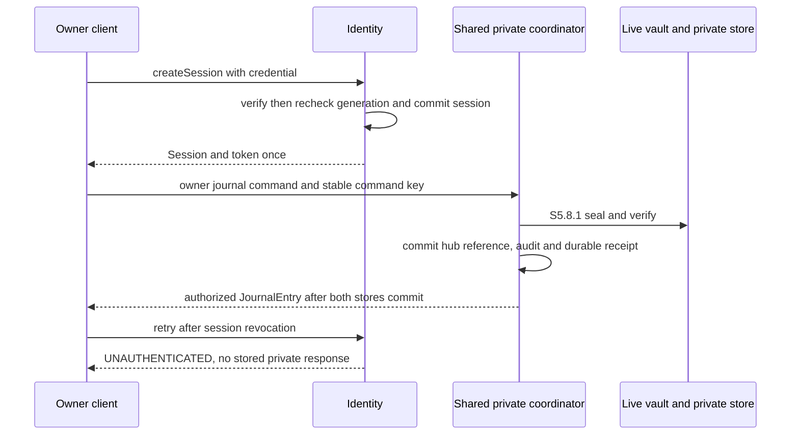

# E02: Consent, authentication and privacy

Binding inputs: `AGENTS.md`, `docs/SYSTEM.md`, `docs/DEPLOYMENT.md`,
`docs/requests/COORDINATOR-DECISIONS.md` Part A and `docs/BUILD-CHARTER.md`.
Product references below are relative to `docs/product/`. S means SYSTEM; C means CONTRACTS.
This is a design, not implementation evidence. Section 12 tests are planned.

## 1. Scope

E02-01 supplies role and purpose checks; E02-02 supplies private-storage authorization and isolation;
E02-03 supplies consent, revocation and session lock. Requirements: R02, R20, R29.
Owns CONTRACTS section 20's identity/session rules; other section 20 mechanisms belong to their S4 owners.
The rule trace includes the shared obligations E02 must obey, without claiming their implementations.

E02 owns the server privacy assertions of V08, V09, V25, V26, V64 and D09, D13, D24, D26.
UC01, UC10, UC14, UC15, UC18 and UC22 supply the user flows. Section 12.1 assigns the remaining clauses.
The journal repository and shell are E03's, measurements E05's, camera identity quality E06's, reports E09's,
handoffs E16's, offline mechanism E20's and audience projections each record owner's.
E02 never owns clinical authority: S8.4 and Q4/Q14/Q16 assign it to E31.

### 1.1 Rule trace

| Source line and rule | Design | Tests |
|---|---|---|
| PRD.md:478 R02, task permission is purpose specific | 3.3, 4 | T-E02-001, T-E02-003 |
| PRD.md:496 R20, journal outside inference/retrieval/exports | 5, 10 | T-E02-006 |
| PRD.md:505 R29, no guessed station identity | 3.4 | T-E02-004 |
| PRD.md:144 accepted task only; PRD.md:145 limited audited help access | 3.3 | T-E02-002, T-E02-003 |
| PRD.md:146 officer reads explicitly shared records | 3.3 | T-E02-001 |
| PRD.md:548 emergency entry precedes authentication | 7, 9 | T-E02-016 |
| CONTRACTS.md:7 synthetic person is never presenter; no display-name/face joins | 3.4 | T-E02-004, T-E02-005 |
| CONTRACTS.md:9 original times are retained; mission time cannot replace UTC | 3.1 | T-E02-010 |
| CONTRACTS.md:13 no fake missing-value sentinel or erased correction | 3.4 | T-E02-004 |
| CONTRACTS.md:21 consent recipient, purpose, fields/actions, validity and revocation | 3.3, 5 | T-E02-003, T-E02-007 |
| CONTRACTS.md:72 reference-only audit, restricted diagnostics | 4, 10 | T-E02-006, T-E02-012 |
| CONTRACTS.md:111 assigned crewmate accepts before reading task details | 3.3 | T-E02-003 |
| CONTRACTS.md:165 no send without explicit action | 3.5 | T-E02-017 |
| CONTRACTS.md:174 roster has no health or participation | 6 | T-E02-019 |
| CONTRACTS.md:188 journal author only; never prompts, indexes, exports or others' events | 5, 10 | T-E02-006 |
| CONTRACTS.md:210 idempotency, as superseded by D6/S5.8 | 4 | T-E02-013 |
| CONTRACTS.md:220 closed ErrorEnvelope and configured words | 6, 8 | T-E02-019 |
| CONTRACTS.md:414 SIM cannot enter LIVE | 3.4 | T-E02-005 |
| CONTRACTS.md:416 journal cannot enter evaluation screenshots | 10 | T-E02-006 |
| CONTRACTS.md:419 urgent response cannot wait on optional parts | 9 | T-E02-016 |
| CONTRACTS.md:425 private participation cannot affect completion | 3.3 | T-E02-018 |
| CONTRACTS.md:426 personal participation owner only | 3.3 | T-E02-018 |
| CONTRACTS.md:431 deletion covers backups; no promise of external recall | 5 | T-E02-014, T-E02-017 |
| CONTRACTS.md:433 localhost, encryption and restore validation | 5, 9 | T-E02-009, T-E02-014 |
| CONTRACTS.md:439 no hardcoded client or hub content | 8 | T-E02-021 |
| CONTRACTS.md:441 fixed vocabulary is keys, not display words | 7, 8 | T-E02-021 |
| CONTRACTS.md:521 open work pins; warning removal overridden by D1 | 8.1 | T-E02-021 |
| CONTRACTS.md:924 opener/helpers/subject, open summary, configured readings, names only | 3.3 | T-E02-002 |
| CONTRACTS.md:956 assistant context excludes others' records, journal and participation | 3.3, 10 | T-E02-006 |
| CONTRACTS.md:983 person event scope does not confer another person's access | 4 | T-E02-008 |
| CONTRACTS.md:1045 cached first help question needs no network | 7, 9 | T-E02-016 |
| CONTRACTS.md:1052 deterministic engines use config/state/clock, no model/network | 3, 4 | T-E02-010, T-E02-016 |
| CONTRACTS.md:1080 local credential never config; bearer returned once; session is sole identity/role source | 3.2, 6 | T-E02-009, T-E02-019 |
| CONTRACTS.md:1085 officer plan access narrowed by D9 | 3.3 | T-E02-001 |
| CONTRACTS.md:1087 no onboard dependency on ground role | 9 | T-E02-016 |
| CONTRACTS.md:1088 operator demo controls remain operation/profile scoped | 3.4, 6 | T-E02-005, T-E02-019 |
| CONTRACTS.md:1090 adapter only its own channels | 3.4 | T-E02-004 |
| CONTRACTS.md:1092 every operation enforces x-roles | 6 | T-E02-019 |
| CONTRACTS.md:1096 release validation before normal startup | 8 | T-E02-021 |
| CONTRACTS.md:1099 help works with later modules absent | 9 | T-E02-016 |
| CONTRACTS.md:1101 plans/roles work model stopped and link down | 3.3, 9 | T-E02-016, T-E02-018 |
| CONTRACTS.md:1104 participation reads only CheckCompletion | 3.3; E22 owns derivation | T-E02-018; E22 section 12 |
| CONTRACTS.md:1108 one command commits state/audit/outbox; D4 private exception | 4, 5 | T-E02-012, T-E02-014 |
| CONTRACTS.md:1109 injected time, observation-time ordering | 3.1 | T-E02-010 |
| CONTRACTS.md:1110 deterministic views and contracted derived IDs | 3, 4; S5.1 | T-E02-010, T-E02-019 |
| CONTRACTS.md:1111 revision increment and ETag | 4, 6 | T-E02-007, T-E02-013 |
| CONTRACTS.md:1112 no model/network/ground waits | 4, 9 | T-E02-016 |
| CONTRACTS.md:1113 no words/numbers without configuration source | 8, 11 | T-E02-021 |
| CONTRACTS.md:1114 separate journal store; D4 barrier | 5 | T-E02-014 |
| CONTRACTS.md:1118 example computations reproduced exactly | 12; E02 schema examples only, other computations remain with owners | T-E02-019; T27-04, T28-24 |
| CONTRACTS.md:1128 kit vector including report-only findings | None: E27 computation, no E02 policy decision | T27-04 in E27 section 12 |
| CONTRACTS.md:1133 lunar plan link-up/down vector changes only transport text/time | None: E28 computation, E02 must not add ground authority dependency | T28-24 in E28 section 12 |
| CONTRACTS.md:1143 schema/example validation | 6, 12 | T-E02-019 |

## 2. Seams

Only E01 is a hard dependency (S9). An in-process reader is bound to the caller's S5.7 snapshot or unit of work;
no implicit second snapshot may decide authorization. S5 signatures prevail over older provider text.
Pending seams below are requests, not implemented contracts. Missing E05, E06, E09, E16 and E29 design files prevent
agreement with those providers; fakes prove policy only, never integration acceptance.

| Seam | Owner | Consumers | Signature or payload with types | Source/status |
|---|---|---|---|---|
| Shared identifiers | E01 | E02 | `IdFactory.new(prefix: str) -> str`, `derived(prefix: str, *parts: str) -> str` | S5.1 |
| Shared time | E01 | E02 | `Clock.now() -> datetime`, `monotonic_ns() -> int`, `process_epoch() -> str`; `MissionClock.mission_day(at, version=None) -> int` | S5.2, S5.3; exact keyword rules there |
| Shared units and errors | E01 | E02 | `Quantity`, `ProblemError`, `to_envelope`; exact S5.4/S5.5 types | No local replacements |
| Shared configuration | E01 | E02 | `ConfigReleaseReader.active() -> ReleaseHandle`, `ConfigReader.document(name, version=None) -> ConfigDocumentView` | S5.6 |
| Shared transactions and events | E01 | E02 | `UnitOfWorkFactory`, `ReadSnapshotFactory`, `AudienceRule.admits(snapshot, session, audience) -> bool` | S5.7 |
| Shared command identity and result visibility | E01 | E02 | `CommandIdentity`, `IdempotencyStore`, `ResultVisibility.authorize(snapshot, session, identity, result) -> None` | S5.8 |
| Shared audit, scheduling, settings and assembly | E01 | E02 | `AuditEntry`, `ScheduledJob`, `HubSettings`, `ModuleRegistry`; exact S5.9 to S5.12 methods | No local bus, retry or migration runner |
| Shared private protocol | E01 | E02, E03 | `PrivateJournalCoordinator.write(session, intent) -> PrivateReceipt`; `PrivateKeyVault` methods exactly S5.8.1 | S5.8.1, S7.4; R-E02-6 tracks E03 propagation |
| Session identity | E02 | E01, E03 | `SessionContext` exactly S5.7 | Authentication constructs it; never a second Session type |
| Role gate | E02 | E01 | `require_roles(operation_id: str)` returns the session dependency | E01 section 2; S4.2, C20; signature integration R-E02-9 |
| Roster | E02 | E22, E23, E25, E26, E28, E31 | `RosterPort.crew(at: datetime) -> Sequence[RosterMember]`, `members() -> Sequence[RosterMember]`, `person_ids() -> frozenset[str]` | S4.4; bound to caller snapshot; extensions R-E02-9 |
| Consent query | E02 | E01, E05, E09, E11, E13, E15, E16 | `ConsentQueries.allows(view, *, subject_person_id: str, recipient: str, scope: tuple[str, str]) -> bool` | E01 section 2 spelling; S4.2; field/purpose extensions R-E02-9 |
| Session revocation | E02 | E01, E03, E20 | `SessionRevocation`; authoritative liveness at each delivery/heartbeat, section 4 | S4.2; exact shared callback/generation API pending R-E02-5 |
| Object visibility | Each record owner | E01, E02 | `Visibility.can_read(session: SessionContext, object_ref: str) -> bool`; saved `Audience` checked by owner rule | S8.3, S5.7; not a boolean grant to every field |
| Help membership | E26 | E02 | `HelpSessionReader.context(session, help_session_id)` and `readable_by(session, help_session_id)` | S4.4; neither proves summary membership; snapshot fact pending R-E02-10 |
| Measurement assignment | E05 | E01, E02 | `MeasurementAssignmentPort.allows(view, *, request_id, operator_id, patient_id) -> bool` | E01 section 2; adapter/acquisition extension pending R-E02-8 |
| Clinical authority | E31 | Clinical command owners | `ClinicalAuthorityQuery.authority(snapshot, *, person_id, subject_person_id, action, dose, at) -> AuthorityDecision` | S8.4 exact types; E02 does not use this to grant reads |
| Operational overlays | E23 | E02 | `OverlayPort.active(person_ids: Collection[str], at: datetime) -> Mapping[str, Sequence[OverlayFact]]` | E23 section 4.2; bounded roster input |
| Client session lifecycle | E03 | E02 | `sessionEpoch`, `resetAll()`, `usePrivateDraft()` and request cancellation | E03 section 7.2; integration R-E02-6 |
| Offline storage | E20 | E02, E03 | P0/P1 cache; encrypted owner-partitioned pending commands | S8.3, DEPLOYMENT 5.5; R-E02-7 |
| Recipient export projections | E01, E09, E16, E29 | E02 | `Audience` and `ReplicationChange` exactly S5.7; recipient streams DEPLOYMENT 4.3 | R-E02-11; report snapshot integration R-E02-19 |

No new public identity/consent events exist in C18. E02 emits no invented event name.
Roster and consent commands retain audit and replication declarations through S5.7; credentials and sessions are
local secrets, never recipient payloads. Local-only replication declaration support is requested in R-E02-5.

## 3. Domain model

Pure domain functions take typed facts and time; no I/O or mutable module globals. Kernel IDs, actor, roles, units
and errors are S5.1/S5.4/S5.5/S5.7. Domain quantities use `Quantity`, including operational durations.

| Internal entity | Decision |
|---|---|
| Person/roster | Stable ID, display name, mission, namespace, roster order, start day, nullable end day, nullable officer rank. Unique rank per mission; ranks 1 and 2 yield `crew_medical_officer` in addition to `crew`. Roster order is stored, not sorted by name or rank |
| Principal | Crew selects by person ID. Exactly one provisioned principal for each non-person SessionCreate kind; never scan multiple credential hashes. Editor uses an attributed `operator` actor with `editor` role (S5.7), not a new actor enum |
| Session | ID, token digest, principal/credential generation, listener, process epoch, created/expiry times, terminal end state. Person nullable as Session schema requires. Token is opaque random 256-bit secret, returned once |
| Adapter token | Adapter ID, digest, stable session ID, issue/expiry times, listener, generation, active/revoked state. Current-session reads map it to Session with person null and adapter actor/role. Sign-out revokes it; renewal is explicit provisioning |
| ConsentGrant | Subject, recipient, mission/origin partition, object reference, purpose/action, explicit field set, validity, policy version, revision and grant actor. Scope keys are consumer-defined references, not authority. Empty/unknown fields or purpose authorize nothing |

### 3.1 Time

Use S5.2 `Clock` and correction history; use S5.3 only for roster-day membership. Never compare monotonic readings
across process epochs. Session lifetime and idle duration are elapsed timers (S5.10): compare monotonic deadlines in
one epoch; correction recomputes durable anchors without adding elapsed life. The wire expiry remains an absolute
upper bound and never moves later for an existing token. End all old-epoch sessions at startup before serving;
adapters require fresh token provisioning after restart. A regression or unknown correction ends affected sessions.
Ended sessions are terminal, including after correction, delayed responses and restore.

Consent `valid_from`/`valid_until` are absolute instants, not durations; corrections do not shift them. Expiry is
checked at every use and latched durably once reached. A regression or uncertain time suspends time-bounded grants;
correction alone cannot revive an expired grant. If expiry across restart cannot be established, the grant remains
unusable until the owner issues a new one. Null expiry still requires active state and a live object relationship.
Consent closure/revocation revisions dominate delayed older grants; never apply arrival-order last-writer-wins.

Rate-limit windows are elapsed intervals with S5.2/S5.10 anchors. Restart preserves failure debt; unknown elapsed time
cannot unlock a bucket. S5.10 jobs use generations and bounded batches. Explicit enrollment expiry is absolute;
unknown time denies redemption. No E02 deadline clears a warning. Observation freshness stays with the reading owner,
using D3 for LIVE/SIM and D14 for REPLAY channel liveness. E02 never recomputes sensor freshness or rewrites
REPLAY observation dates; delayed/looping replay rows cannot refresh a channel or patient record.

### 3.2 Authentication and lock

Argon2id verifies a credential; it does not derive private encryption keys. Verifiers live in `identity_credential`
in `hub.sqlite` (S4.2); private keys live in the S7.4 vault. Credential change therefore has no cross-store rewrap.
A sign-in reads a verifier generation, reserves rate-limit capacity transactionally, runs one bounded Argon2 operation
outside the writer, then rechecks the generation, principal, listener and roster in the issuance transaction.
Opaque tokens permit immediate server revocation; self-contained role tokens would retain stale authority. Keeping
verifiers separate from vault keys avoids password-change rewrapping and resurrection from old credential backups.
Replacement during verification rejects issuance. Success does not erase another in-flight attempt's failure debt.

Enforce independent aggregate limits per principal and per trusted client identity, plus a global cap. No pair-only
counter. Before device binding lands, use the listener's actual remote address, never forwarding headers; localhost
shares a client bucket. Unknown principals share one bounded overflow bucket per client rather than allocating IDs.
Unknown or unavailable principals use a provisioned dummy verifier at the same bounded cost; generic refusal
does not expose existence. Reserve attempts atomically before hashing so concurrent attempts cannot exceed either limit. At capacity refuse
sign-in with the existing generic error; help never enters the Argon2 queue. Expired counters are reclaimed in pages;
never evict a locked bucket to admit another identity.

Current wire fields do not expose an idle budget. Safe interim: issue person/operator/editor/ground sessions with
lifetime no longer than `security.idle_lock_minutes`, and never renew them from HTTP polling or SSE traffic.
The client obtains that configured upper bound from the elapsed difference between `created_at` and `expires_at` before displaying private content.
Start its elapsed cap at sign-in request dispatch, not response arrival; a late response cannot add network time.
Its local human-activity deadline cannot exceed this bound or the remaining session life. R-E02-3 proposes a renewable
human-presence contract; until accepted, active users reauthenticate at the short absolute expiry.

### 3.3 Object, field and purpose authorization

Evaluate session liveness, operation role, object ownership/subject, relationship, validity, purpose, field projection
and current policy in that order. A role gate never substitutes for object authorization. A successful boolean
`allows` is necessary but insufficient for projection; the owning module intersects requested fields, the saved
approved selection, the current grant and its purpose-specific maximum. An unknown dimension denies access.

| Relationship | Permitted access | Explicit exclusions |
|---|---|---|
| Subject | Own clinical reads/writes authorized by the operation; own journal reads/writes | Self access is not permission to export a journal or send an unapproved report |
| Accepted task operator | Necessary task fields for read, task action and its admitted event projection; current subject consent for that task/purpose/fields, and nonterminal accepted assignment | No chart/history; expiry/revocation denies even if assignment still says accepted; no inference/export/sync from a task grant |
| Authenticated opener/current helper/subject of a real open help session | SubjectSummary only through its endpoint: same subject, configured recent readings with origin/age and allergies/medicines by name; purpose-projected help log | No Observation endpoint access from summary IDs; no journal/history/doses or general inference/export permission; station never qualifies |
| Crew or acting medical officer | Explicitly shared objects and fields; action authority independently checked by the clinical command owner | No role-wide chart, break-glass permission or station plan-run access (D9) |
| Ground | Delivered, approved snapshots and C26 catch-up projection | Never queued payloads or raw clinical rows because a grant or sync vector exists |
| Station | P0/P1 views, broadcasts and validated fixed help content | No clinical plan list/detail, subject summary, personal participation or private records |
| Assistant/tools | Owner record context only as C17 allows; tool actions reauthorize at execution | No journal, private report, participation or another person's record; model claims never grant access |

A help-summary read verifies actual open state, subject and authenticated person's opener/helper/subject membership
in one caller snapshot, then commits its reference-only access audit before release. `readable_by` is not membership.
Closure, leave, assignment end or consent revocation invalidates the corresponding projection; the same summary read
after close is `UNAUTHORIZED_SCOPE`, including for the subject. Owner chart access uses its own endpoint.
If E26 cannot supply snapshot membership, the summary remains off with a visible unavailable reason (R-E02-10);
fixed help and manual entry continue. No stale membership cache substitutes for the fact.

Grants can be created/revoked only by their authenticated subject. An operator, helper, officer, assistant or ground
actor cannot impersonate that action. Revocation is final for a grant ID; renewal creates a new explicit grant.
No consent defaults or wildcard targets. The emergency panel is S8.3's existing limited exception and does not wait
for an incapacitated subject to consent. E22 owns crew-goal consent under Q15/D10: E02 authenticates its owner only;
missing opt-in excludes the member, and revocation removes aggregate contributions immediately. No general consent
scope or roster membership can replace that per-mission/per-origin state.

### 3.4 Subject binding and namespace

E01's `recordObservation` transaction permits self capture or an authenticated crew medical officer's manual capture
for a verified named subject, with actor/operator/subject and care basis audited. The latter works without E05,
E26, devices, model, ground or new consent from an incapacitated subject. It grants no later chart read.
Other helpers require the accepted assignment and consent checks of 3.3. Unknown/ambiguous person stays unassigned;
no face, display name, proposed subject ID or model output authenticates a person.

An adapter must match the target request's trusted assignment, adapter ID, allowed device, capability, subject,
mission/origin and acquisition generation, verified by E05 inside the recording transaction. Knowing `request_id`
is insufficient, especially for `recordAttempt`, which has no adapter path parameter. A late cancelled result remains
an attributed attempt requiring explicit review, never an accepted replacement. With that seam absent, adapter
patient ingestion stays off (R-E02-8); direct manual capture stays available. Habitat ingest independently checks the
adapter against its channel. Device/method, units, quality and conflicting observations remain the recording owner's
checks; E02 neither averages nor discards readings.

All origins remain LIVE, REPLAY and SIM. A LIVE presenter has an explicit `demo_operator` Person and crew credential
in the demo profile, excluded from roster/goal totals and officer ranks. It can sign in without a roster entry only
in that explicit profile. LIVE input selected while displaying a SIM persona routes to that verified presenter
record; the acquisition retains the original real source, and no SIM episode/baseline receives it. SIM stays in its
SIM namespace; REPLAY retains dataset identity/date and cannot become current LIVE patient evidence. Fixtures and
fixture credentials load only under explicit demo SIM/REPLAY setup. Routing does not grant access to the target;
missing presenter authorization refuses capture. Cross-consumer namespace signatures await R-E02-9.

### 3.5 Report sharing

Journal data never leaves its private store except an authorized owner response. A private report may leave only
when its owner authenticates, selects recipient/purpose/fields, previews and approves an immutable snapshot.
The owner-authorized path decrypts through S5.8.1 and materializes only that selection into recipient-protected
storage, recording snapshot ID/hash, grant revision, recipient and approval audit. It never hands the recipient a
vault key or the private-store row. A source attachment is included only if the owner explicitly approves the whole
file; field redaction cannot safely expose its original bytes.

Recipients read the approved snapshot through its owning module, with current recipient/object/field checks;
ground additionally requires delivery. Recheck grants before export, transmission, import and read (DEPLOYMENT 4.3).
Revocation cancels unsent projections, invalidates local caches/events and sends the signed revocation control record;
a delivered external copy cannot be recalled. Keep approval, delivery and revocation receipts. R-E02-19 blocks sharing
integration until E09/E16 define the snapshot read/write path; it does not declare all report sharing forbidden.

## 4. Application layer

S5.7 owns transactions; S5.8 owns target-bound idempotency, private HMACs and current result visibility; S5.9 owns the
hash chain covering every stored field. No local transaction, event, audit, replication or retry implementation.
`require_roles` reads the generated effective operation table (D12), including D9; never hand-maintained role lists.
Use S5.12 registration, bound readers and local typed errors mapped by S5.5. No new event without a contract request.

| Command/use case | Unit of work, concurrency and durable effects | Crash/retry |
|---|---|---|
| Sign in (`createSession`) | Separate attempt-reservation UoW; bounded verifier outside writer; issuance UoW rechecks credential/roster generations and counters, inserts digest/session and audit | Before issuance commit no token is valid. After commit lost response may leave an unused expiring session; no idempotency header exists. No token in audit/cache |
| Sign out (`deleteCurrentSession`) | One UoW ends session or revokes adapter token, increments identity generation, appends audit and S5.8 result code | Failure rolls back; client locks regardless. Retry of ended credential returns 401, treated as signed out; no reactivation |
| CLI credential set/change | One hub UoW checks owner proof and old generation, replaces verifier, increments generation, ends affected sessions and audits; no vault mutation | Before commit old credential remains; after commit only new generation issues sessions. Interrupted KDF cannot mint an old-generation token |
| Roster/bootstrap/adapter token/enrollment changes | One UoW per bounded command validates schema/profile and expected revision; records state, invalidations, audit and permitted replication declarations | S5.8 command identity on local CLI intents; no partial roster or duplicate token; token plaintext returned once |
| Grant/revoke/end consent | Caller UoW checks authenticated owner, exact object/purpose/fields, validity, expected revision; records state, audit, policy invalidation and recipient-stream fencing | Abort on storage, integrity, authorization or validation failure. Revocation survives loss of notification; next use reads authoritative state |
| Audited clinical/private read | Current session, membership and field projection in one UoW; access audit commits before response body release | Audit failure denies the read; no content in generic idempotency cache or error |
| Private write/delete/recovery | Only S5.8.1 coordinator and S7.4 revocation barrier | Acknowledgment only after shared durability barriers; section 5 |
| Session/counter sweeps | S5.10 bounded job; state changes and audit share UoW with generation completion | Repeated callbacks are no-ops; persisted terminal state wins over delayed work |

A replay binds actor, operation, canonical target and semantic parameters as well as body. Authenticate before lookup,
then apply `ResultVisibility` under current grants before returning even a stored resource reference. Beyond the
24-hour cache, retain mission-life identity for durable operations (D6). Private bodies use keyed fingerprints;
responses are reconstructed only from the owning store. Grant/roster changes are single-writer, revision checked,
never auto merged (DEPLOYMENT 4.4). D13 cannot isolate an authorization, storage or integrity error.

HTTP requests, each SSE delivery and each heartbeat query current authoritative session/generation state, even when
there was no intervening HTTP request. Before sending buffered clinical events, reauthorize their object/fields and
saved audience under a fresh snapshot; discard batches stamped with an older access generation. An in-memory callback
is an optimization only. CLI revocation commits the same state checked by the running hub. Every vault decrypt also
checks current session, live reference and revocation generation. Cross-process invalidation wiring and local-only
state declarations are R-E02-5; no private stream is enabled with callback-only liveness. A disconnected client wipes
private projections immediately; local lock is independent of delivery of any event (section 7).



## 5. Adapters

SQLite access only through S5.7 StorageSession, typed repositories and E01 migrations; S7.2 paired backup and
DEPLOYMENT 4.2 fencing apply. Expand migrations, then separately plan contraction; software rollback never drops
tables, resets consent or restores old credentials. A restore with unresolved credential/revocation freshness refuses
old authentication and private unwrap (R-E02-16). It still serves static help and new locally provisioned identity.

| Owned tables | Columns/constraints and indexes |
|---|---|
| `identity_person` | ID PK, namespace, preferred label, mission, roster order, nullable roster bounds/rank and presenter mapping, revision; unique mission/order and nonnull mission/rank; no implicit demo mapping |
| `identity_credential` | Principal PK, kind, nullable person ID, Argon2 verifier/parameters, credential generation, enabled state; unique non-person kind. No key-encryption material |
| `identity_session` | Session PK, unique token digest, principal generation, listener, process epoch, created/expiry, ended time/reason nullable; index active principal and expiry; ended state irreversible |
| `identity_adapter_token` | Adapter/session ID unique, digest unique, issue/expiry, generation, listener and revocation; no patient binding from token alone |
| `identity_device` | Enrollment reference, kind, name, actor/time, digest of one-time code, expiry/redeemed/revoked times; unique code digest; CLI interim of R-SYS-4 |
| `identity_auth_bucket` | Scope and bounded bucket key PK, window anchor, process epoch, reserved attempts, failure debt and revision; separate principal/client/global indexes |
| `identity_access_generation` | Singleton monotonic generation for durable invalidation, not an event sequence or HLC replacement |
| `consent_grant` | ID/revision, actor, subject/recipient, mission/origin, object/purpose/actions/fields, policy version, absolute validity and terminal state; nullable expiry/object-end reference; indexed by subject/recipient/object/purpose and expiry |

The extra local bookkeeping tables and mutation declarations require R-E02-5. Credentials/tokens never replicate.
Roster and grants replicate only permitted projections via S5.7/DEPLOYMENT 4.3. Every query is bounded; revoked grants
and access audits remain retained for export history, never deleted to reclaim an active-capacity limit.

Private cryptography is exactly DEPLOYMENT 5.4 and S5.8.1/S7.4: per-entry random DEK and distinct live wrapping key,
owner/entry/version associated data, keyed command fingerprint and current owner authorization. E02 supplies vault
access controls; E01 supplies the coordinator; E03 supplies journal persistence. No `PrivateCipher`, credential-derived
wrapping key, historical keystore mirror or unencrypted mirror fallback exists. E03's legacy `PrivateKeys`/`DataKey`
interface is not adopted: R-E02-6 propagates the shared protocol, including fingerprint, replay and typed errors.

Delete first commits the shared vault revocation intent, denies unwrap, destroys the entry key at every registered
vault replica and waits for receipts; only then may the hub tombstone/audit commit and deletion complete. Resume
interrupted deletion under S7.4. An offline key-bearing recovery device leaves deletion pending and cannot unwrap
while stale. Backup A/B, delete A with recovery media absent, lose laptop, then present old media: reject old or
unverifiable vault state, never recover A. B opens only with the current owner-authorized vault; total vault loss is
visible private-data unavailability. Data backups contain ciphertext, never secrets that reconstruct wrapping keys.
Forgotten credentials do not trigger deletion; recovery authorization is R-E02-16, unavailable until settled.
Operator reset of an existing account is disabled until that shared protocol can persistently lock prior private
unwrap in the reset transaction. A new account ID never inherits the prior owner's private records.

## 6. API

Generated effective models from the guarded base plus accepted D12 overlay only; pending requests add no wire fields.
All errors are C5 ErrorEnvelope through S5.5; no private input, tokens, exception objects or hidden resource IDs leak.

| operationId | Request/response | Roles and failures |
|---|---|---|
| `createSession` | SessionCreate; 201 Session with token once; no Idempotency-Key | Public credential exchange. `MALFORMED_REQUEST`, `UNSUPPORTED_MEDIA_TYPE`, generic `IDENTITY_MISMATCH`, `INTERNAL_ERROR`; no invented 429 until R-E02-2 |
| `getCurrentSession` | 200 Session without token | All seven contracted roles, including adapter; 401 if not live, 403 scope denial |
| `deleteCurrentSession` | Idempotency-Key; 204 | Same roles; 401/403/409 as operation contract; section 4 |
| `listCrew` | Cursor/limit; generated CrewMember page | crew, crew_medical_officer, ground, operator, station; 401/403; no health or participation fields |

Each also retains its declared 400/default response. Use existing package examples
`api/examples/requests/session-create.json`, `api/examples/session/create-crew.json` and
`api/examples/session/station-screen.json` for concrete payloads. Never hardcode fixture identities in runtime code.
Crew requires person ID; non-person kinds reject it. Rank roles come from current roster, not caller fields.
Ground signs in only on ground/demo profiles, never an ordinary flight hub. Adapters do not use SessionCreate.

`listCrew` projects only schema fields. Internal roster index/version/end day do not become JSON additions.
Unknown location and helping session remain null; absent overlay provider yields an empty list without claiming known
availability. Missing role/help presence never authorizes care. Additional source-age semantics are R-E02-10.
Station `recordObservation` fails its role gate with `UNAUTHORIZED_SCOPE` before subject-binding validation.
Adapter trust/assignment failures use the operation's `ADAPTER_NOT_TRUSTED` or `IDENTITY_MISMATCH`; ordinary missing
bearer is `UNAUTHENTICATED`. Inaccessible clinical reads are `UNAUTHORIZED_SCOPE` under S8.3; absent objects are
`NOT_FOUND`. Missing explicit consent uses `CONSENT_REQUIRED` where the operation declares it.

## 7. User interface

E03 owns SignIn and StationHome; E02 contributes session-lock integration, no duplicate shell/store implementation.
Loading/errors use `getHealth`, `createSession`, `getCurrentSession`; sign-out uses `deleteCurrentSession`.
Private views cannot mount until authenticated identity and the configured deadline from section 3.2 are available.
Only trusted human key/pointer/touch interactions count as activity; polling, responses, animations and SSE do not.

Local lock immediately increments E03 `sessionEpoch`, aborts all requests/streams, clears registered Pinia stores and
`usePrivateDraft()` drafts, clears personal tokens and private DOM, then replaces the route with station/sign-in.
Late responses/events from the old epoch are discarded before reaching any store. Browser Back cannot restore a
private route. Lock on deadline, sign-out, 401, account change, connection loss, `pagehide`, tab hiding or suspend.
On resume or bfcache `pageshow`, remain covered and reauthenticate before private rendering; a paused timer is never
proof of presence. Server sign-out is best effort after the local wipe. Fixed help remains available without a token.

P2/P3 views and journal edits stay in session memory only. Journal offline state says unsaved using configuration;
locking discards that unsent draft, never claims durable acceptance. Already queued nonprivate clinical commands stay
encrypted under their original owner, quarantined after revocation, and never replay under the next person.
No personal credential/token is persisted by the browser. A station token cannot authorize private content.

States: loading, empty, error, offline, locked, stale, unavailable and the source words LIVE/REPLAY/SIM come from
versioned `ui-copy.json`, never literal fallback content. Missing security copy/policy keeps the private surface off
while the signed emergency cache remains usable. Lock restores focus to the station heading without announcing
private values. Consent UI awaits R-E02-1; authenticated owner CLI can manage grants. Report sharing additionally waits for
R-E02-19 and its provider tests; a CLI grant alone cannot enable transfer.

## 8. Configuration

Read `ui-copy.json` through S5.6 and generated `config-ui-copy.schema.json`; E03 owns it. Consume existing
`designed_states`, `error_messages` and origin words; additional lock/sharing wording is R-E02-6. Provenance and all
applicable C11 loader checks remain mandatory. T-E02-021 edits a displayed label only and proves a changed screen
without code changes; settings tests separately change lock duration. Privacy/safety mappings are never test-edited (D15); label edits use scratch copies, never shipped documents.

Roster, credentials and grants are validated backend state; credentials never belong in a content document.
Operational settings are S5.11 registrations in E02 module manifests, with concrete bounds in section 11.
Use CONFIG and CLOCK startup phases before STATE_SWEEP; invalid configuration rejects startup/activation and retains
the last good version, not a validation warning. Q1/Q7/Q18 change clinical-review labels only; E02 cannot bypass source,
purpose or applicability validation. No E02 behavior waits for a clinician or ground sign-off.

### 8.1 Activation effects

| Input | Effect |
|---|---|
| `ui-copy.json` | New screens use the new valid version; open help/plan sessions retain their S5.6 pins. Missing required words reject the candidate. A removed label never grants access or replaces an unknown with safe |
| Hub settings | Validate before use; tighter security settings shorten/end affected sessions, looser settings apply to newly issued sessions only. Never extend old deadlines, reset failure debt or revive expired consent. Restart requires reauthentication |
| Roster/grant state | Revision-checked commands, not release activation; invalidate affected authorization immediately |
| Warnings, stock and other open work | None owned by E02. Preserve D1 warning definitions/levels, nonnegative stock and all open-work pins; role/consent changes do not erase records or cancel fixed emergency guidance |

## 9. Deployment and fallbacks

| Tier/failure | Primary, backup and fail-safe state |
|---|---|
| T0 laptop/webcam | Local credential and current policy; station at rest. If identity/storage fails, signed fixed help cache then printed vehicle/help card (E26). Private reads deny visibly; manual officer capture resumes with valid identity and storage, never fabricates acceptance |
| T1 LAN/station | Explicit TLS 1.3 listener, listener-bound tokens. Lost LAN: local lock, cached help; the hub laptop remains complete |
| T2 tablets | R-SYS-4 CLI enrollment; revoke all sessions and rotate affected credentials until selective device binding exists. Original-owner encrypted pending commands stay quarantined |
| T3 medical devices | Scoped adapter token plus request assignment; device absence uses direct manual capture, not sample data |
| T4/T5 habitat feeds/integration | Channel-bound adapter authorization; absent/untrusted feed stays missing and manual input remains. No vehicle-control write |
| T6 peer hub | DEPLOYMENT 4 recipient projections and single home writer; no session/key/private-row replication. Unresolved grant/identity conflict denies sharing. One-hub interim until sync privacy and restore tests pass |
| T7 ground | Explicit approved delivered snapshots only, consent checked at every exit. Link absence leaves local care/authentication complete |
| Model, forecast or any optional provider absent | No authentication/safety dependency. Missing task/membership facts deny that projection, not manual officer entry or fixed help |

Critical privacy path: current online authorization; independent backup: local human-presence lock and separate private
vault owner check. Fail-safe: blank private surface, explicit unavailable state and public emergency content.
Critical durability path: S5.7/S5.8.1; backup: verified paired snapshot and current vault; fail-safe: visible unaccepted
or reconciliation state. T-E02-014 and T-E02-016 remove the primary paths, including all optional parts at once.

## 10. Safety, security and privacy

| Hazard | Control | Tests |
|---|---|---|
| Cross-person or excess-field disclosure | 3.3 per-object/purpose intersection; D9 station denial; no officer break-glass | T-E02-001, T-E02-002, T-E02-003 |
| Unattended screen or stale stream | Human activity lock, request epochs, authoritative cross-process checks | T-E02-008, T-E02-011 |
| Wrong subject/adapter/demo namespace | 3.4 verified binding, independent manual path, explicit presenter | T-E02-004, T-E02-005 |
| Deleted/private data leakage | Shared live vault and paired protocol; no historical keys; journal canary | T-E02-006, T-E02-014 |
| Credential race or brute force | Generation fence, independent attempt limits, bounded KDF | T-E02-009, T-E02-015 |
| Safety blocked by privacy infrastructure | Cached first screen without auth/storage; manual officer capture independent of tasks | T-E02-004, T-E02-016 |

Use S8.3 on HTTP, events, files, sync, exports, recipient backups and ground snapshots. P0/P1 caches contain only their
approved projections. P3 journal text never enters prompts, indexes, evaluation screenshots, logs, telemetry, events,
exports, command caches or browser persistence. Owner `writeJournal` and `listJournal` responses are legitimate
plaintext exceptions. Explicit report snapshots are the separate allowed sharing path of 3.5.

Audit/diagnostics contain allowlisted IDs/codes only, no request objects, private text, raw exception locals, tokens or
credentials. The sole token response and local provisioning output are secret-delivery exceptions, not logs.
Vault material is confined to its adapter; E01 backup keys and E20 TLS keys retain their own isolation domains.
Assistant output cannot grant consent, bind a person, confer authority or change warning/urgency safety state.

### 10.1 Failure and edge cases

| Failure | E02 behavior | Test |
|---|---|---|
| Crash/power loss at every command phase | S5.7 rollback or durable receipt; S5.8.1 private recovery; no premature acknowledgment | T-E02-012, T-E02-014 |
| Duplicate/retried submission | Complete identity match; current result visibility; no new consent/read grant from a replay | T-E02-013 |
| Clock jumps/mission boundaries | Monotonic session limits, terminal expiry, suspended uncertain grants, versioned roster day | T-E02-010 |
| Disk full | No acknowledged mutation or unaudited protected read; typed storage error; help cache | T-E02-012, T-E02-016 |
| Corrupt/missing configuration | Reject candidate, retain last good; no guessed policy/copy | T-E02-021 |
| Partial/implausible/disagreeing readings | No identity inference or value fabrication; preserve recording-owner quality/unit/conflict checks | T-E02-004 |
| Concurrent clients | Revision and credential-generation fences; revoke/close cannot be undone by stale read/action/replay | T-E02-007, T-E02-008, T-E02-015 |
| Long ground outage/backlog | Current consent at send/renewal/import; no raw clinical catch-up; durable identities survive cache expiry | T-E02-013, T-E02-017 |
| Incapacitated/absent crew member | No new consent needed for fixed help, limited open panel or verified officer manual capture; no full-chart exception | T-E02-002, T-E02-004, T-E02-016 |
| Privacy between crew members | Positive and negative object/field/purpose tests, local lock, private canary | T-E02-001, T-E02-006, T-E02-011 |
| Empty/zero/negative/maximum inputs | Empty field set denies; invalid time/bounds/IDs rejected; nullable fields preserved, no null-to-zero coercion | T-E02-003, T-E02-020 |
| Changed clinical lot/unit/dose | None computed here. No identity/consent grant bypasses S8.4 action-specific recomputation by clinical owner | T-E02-018 |

## 11. Performance and resources

S5.11 owns settings; E02 registers descriptors, not another loader. Values below are proposed operational defaults and
validated ceilings, basis `team default`, to be set by mission operations. They carry no clinical meaning. Missing or
out-of-range values refuse that service, never an unbounded fallback. All durations use the indicated UCUM unit.

| Setting | Default; valid range/ceiling | Bound/overflow behavior |
|---|---|---|
| `security.idle_lock_minutes` | 5; 1 to 30 min | Human-presence and interim person-session cap |
| `security.enrollment_code_minutes` | 5; 1 to 30 min | One-time enrollment, no replay |
| `security.auth_attempts` | 5; 1 to 20 | Each independent principal/client window |
| `security.auth_window_ms` | 300000; 1000 to 3600000 ms | Elapsed attempt window |
| `identity.global_auth_attempts` | 20; 1 to 100 | Global attempts per same window; bounded unknowns |
| `identity.auth_buckets_max` | 256; 1 to 4096 | No eviction of live lockouts; refuse new buckets |
| `identity.auth_concurrency` | 2; 1 to 2 | KDF slots, no unbounded worker queue |
| `identity.auth_wait_ms` | 1000; 1 to 3000 ms | Admission deadline, then retryable INTERNAL_ERROR |
| `identity.auth_compute_ms` | 2000; 1 to 5000 ms | KDF deadline; retain occupied slot until bounded computation exits |
| `identity.argon2_memory_kib` | 65536; 65536 to 65536 KiBy | Fixed reviewed parameter for this build; two slots at most 128 MiB |
| `identity.argon2_iterations` | 3; 3 to 3 | Fixed work factor, benchmark before any future policy change |
| `identity.argon2_parallelism` | 4; 4 to 4 | Fixed worker fanout, not caller input |
| `identity.credential_max_bytes` | 1024; 1 to 4096 By | Pre-KDF body bound; no truncation |
| `identity.sessions_max` | 64; 1 to 256 | Admission refuses new session, never deletes durable history |
| `identity.sessions_per_principal` | 4; 1 to 8 | End oldest live session in issuance UoW; stable created-time/ID order |
| `identity.station_lifetime_s` | 86400; 60 to 86400 s | Station absolute cap; no private access |
| `identity.adapter_lifetime_s` | 3600; 60 to 86400 s | Provisioned token cap; expiry refuses ingest visibly |
| `identity.roster_max` | 64; 1 to 256 | Reject oversized roster transaction, preserve prior state |
| `identity.roster_day_span_max` | 366; 1 to 3660 | Reject oversized range before allocation; paginate longer history |
| `identity.page_max` | 200; 1 to 200 | HTTP maximum C5; internal roster/reconciliation pages too |
| `identity.sweep_batch` | 64; 1 to 256 | Sessions, counters, grants, enrollment sweep page |
| `identity.sweep_interval_ms` | 1000; 100 to 15000 ms | S5.10 job interval, never authorization freshness |
| `identity.vault_call_timeout_ms` | 2000; 1 to 5000 ms | Local vault/registered replica call deadline; pending on timeout |
| `consent.active_per_subject_max` | 64; 1 to 256 | Refuse new grant at capacity; revocation still available |
| `consent.fields_max` | 64; 1 to 256 | Refuse oversized field/action selection |
| S5.11 `storage.busy_timeout_ms`, `storage.max_rows`, `storage.max_statement_bytes` | E01 validated finite maxima | Every repository operation, no silent truncation |
| S5.11 `commands.max_bytes`, `commands.cache_entries`, `private.max_entry_bytes`, `private.recovery_batch` | E01 validated finite maxima | Input/cache/private recovery, no private body cache |
| S5.11 `scheduler.batch_size`, `scheduler.max_jobs`, `scheduler.retry_max`, `scheduler.retry_backoff_ms` | E01 validated finite maxima | Shared jobs only, exhausted work remains visible |
| S5.11 `events.page_size`, `events.max_subscribers`, `sync.page_entries`, `sync.pending_max`, `sync.timeout_ms` | E01 validated finite maxima | Stream/recipient work, no E02 unbounded queue |
| S5.11 `backup.timeout_ms`, `backup.keep`, `logs.max_bytes`, `logs.keep_days` | E01 validated finite maxima | Shared backup/log bounds, no vault mirror |

Inherited concrete maxima must be present in E01's validated descriptors before integration; R-E02-5 requests any
missing descriptor evidence. Every list/range and bootstrap input is admitted before allocation. Background work
runs one page then yields to interactive requests. No E02 permission cache or keyring bypasses authoritative checks.
Targets, measured on the reference laptop: token/grant check p99 2 ms; sign-in p95 1 s (both team targets); no blocking of the charter
500 ms
first-help target. Measure rather than claim these results; exceeding capacity must keep fixed help responsive.

## 12. Test plan

Hermetic fakes inject clock, IDs, credential randomness, faults and stores; LIVE/REPLAY/SIM use the normal adapters.
Configuration and fixture documents supply content, with an independent policy truth table for expected access.
No clinical expected value is derived tautologically from its input configuration. Each ID maps to the exact test
file listed in section 13 and to pytest marker E02; UI tests carry the ID in their names. No disabled integration
counts as passed. Run full built-system privacy acceptance once the providers exist.

| Test ID | Level | Proof and trace |
|---|---|---|
| T-E02-001 | property/integration | R02/E02-01: owner positive, restricted explicit grant positive, unshared officer/acting/station/other crew negative; every list/ID operation has its own expected projection; no blanket denial of public resources; D9 plan list/detail denial |
| T-E02-002 | integration | V64/D24: audited same-subject opener/helper/subject summary while open; station/uninvolved/wrong subject denied; leave/close/concurrent closure deny summary and invalidate events/cache; summary IDs grant no chart |
| T-E02-003 | property/integration | R02/E02-01: accepted task with valid grant sees intersection; expired/revoked/future grant, wrong purpose, empty/restricted fields, missing fact and terminal task deny; removing grant cannot add access |
| T-E02-004 | integration | R29/V08: station rejected at role gate; ambiguous/unpaired acquisition never stores patient value; trusted adapter cannot submit another adapter's request or old acquisition; verified officer manual capture with incapacitated subject and E05/E26/model/devices/link absent succeeds and audits |
| T-E02-005 | integration | V09/D09: explicit demo presenter signs in without roster privileges; LIVE routes to presenter, SIM/REPLAY never enter LIVE patient evidence; missing binding refuses; SIM baseline/participation unchanged |
| T-E02-006 | integration | R20/E02-02/V26/D13/D26/V25: journal canary absent from prompts, retrieval, telemetry, events, logs/errors, exports/sync/backups plaintext and evaluation captures; allowed owner writeJournal/listJournal response retained; forged tool subject denied |
| T-E02-007 | integration | E02-03: owner-only grant/revoke, stale revisions conflict, expiration terminal, no assistant/operator consent; read after revoke denies, reference-only export history retained |
| T-E02-008 | integration | CLI revoke with established SSE and no later HTTP: next delivery/heartbeat revalidates, buffered old-generation event discarded, vault decrypt denied; delayed older grant cannot reopen access |
| T-E02-009 | contract/integration | Every principal kind, listener binding, generic failed authentication, one non-person credential lookup, adapter Session expiry/sign-out; secret scan exempts initial token/provisioning response only |
| T-E02-010 | property/fault | Wall clock regresses an hour while monotonic advances beyond five-minute test budget: access ends; correction/restart cannot revive grant/session; roster-day boundaries/version stable; absolute expiry never shifted |
| T-E02-011 | UI/end to end | Offline/human idle, background polling, hidden/suspended tab, resume, bfcache, late responses, account switch and 401: wipe before private repaint, request epochs fence drafts; original-owner queue retained encrypted |
| T-E02-012 | fault | Every UoW phase killed/disk full: no accepted partial credential/session/grant/audit, all stored audit fields protected by chain; storage failures never swallowed |
| T-E02-013 | integration | Same key different target/parameters conflicts; same identity retries once; revoked result visibility denies even cached reference; long-outage mission-life receipt prevents duplicates |
| T-E02-014 | fault/integration | D4 write crash matrix and paired restore; owner fingerprint replay; S7.4 A/B deletion including absent recovery device, laptop loss, old-media-only restore and every deletion boundary; stale vault refused, retained B works with current vault |
| T-E02-015 | fault/integration | Concurrent reset versus in-flight verification; old generation cannot issue; independent principal/client/global limits resist rotating clients/IDs, restart and clock regression |
| T-E02-016 | fault/end to end | R29 safety fallback: model/devices/link/providers/auth/KDF/storage primary paths removed; fixed emergency cache without session <=500 ms, printed fallback and visible unsaved/manual path |
| T-E02-017 | integration | R02/E02-03: owner-approved report snapshot positive with field-only recipient read; no journal send, wrong recipient/field/expiry denied; revoke queued export cancels, delivered-copy limitation and receipt preserved; all transport paths use same checks |
| T-E02-018 | integration | S8.4/Q4/Q14/Q16 actions stay with E31; acting not session role/chart grant; D10 owner authentication, default-off goal consent and revocation without individual disclosure remain E22's |
| T-E02-019 | contract | Generated base/effective schemas and exact E02 session examples, all operation x-roles and error envelopes; token omission after creation; nullable roster fields, no added Session/actor enum; new endpoint requires accepted overlay |
| T-E02-020 | property/integration | IDs/parsers, bounded roster windows, all settings below/at/above limits and concurrent admissions; no silent truncation, fake zero or unbounded KDF; help responsive under saturation |
| T-E02-021 | integration/UI | ui-copy label edit changes rendered content; invalid release rejected; activation preserves pins/warnings/stock; settings changes never extend sessions or revive grants |

### 12.1 Acceptance matrix

| Acceptance | Tests | Boundary of claim |
|---|---|---|
| E02-01 | T-E02-001, T-E02-002, T-E02-003, T-E02-004, T-E02-019 | Role, object, purpose and field enforcement |
| E02-02 | T-E02-006, T-E02-014 | Journal isolation and shared private-storage integration |
| E02-03 | T-E02-007, T-E02-008, T-E02-011, T-E02-017 | Revocation, local lock and durable export history |
| R02 | T-E02-001, T-E02-003, T-E02-017 | Minimum shared data; positive and negative tests |
| R20 | T-E02-006, T-E02-014 | Journal has only authorized owner responses |
| R29 | T-E02-004, T-E02-016 | Identity fallback; E06 owns face/acquisition quality |
| V08 | T-E02-004 | E02 binding; E06 acquisition integration remains required |
| V09 | T-E02-005 | Presenter namespace and baseline isolation with E03/E14/E22 |
| V25 | T-E02-006 | Server denies forged tool scope; E12/E13 run tool path |
| V26 | T-E02-006 | Canary across E03/E09/E12/E13/E16/E29 surfaces; absent surface is not_run |
| V64 | T-E02-002 | E26 supplies actual panel content; E02 proves grants and audit |
| D09 | T-E02-005 | E06 owns selector/device/disagreement; E14/E22 baseline and participation |
| D13 | T-E02-006, T-E02-017 | Canary/consent; E16/E29 own queue, timing, delivery and simulator attribution |
| D24 | T-E02-002 | E26 owns source/age/name rendering; E02 read denial and audit |
| D26 | T-E02-006, T-E02-017 | Canary/consent; E26/E29 own post-queue ticks and independent delivery |
| UC01, UC10, UC14, UC15, UC18, UC22 | T-E02-001, T-E02-002, T-E02-003, T-E02-006, T-E02-017 | Only privacy clauses, not whole-flow completion |

## 13. File ownership

Exact E02 implementation paths, not shared-directory claims:

- `hub/src/crew_health/identity/module.py`
- `hub/src/crew_health/identity/domain/access.py`
- `hub/src/crew_health/identity/domain/session.py`
- `hub/src/crew_health/identity/domain/routing.py`
- `hub/src/crew_health/identity/application/ports.py`
- `hub/src/crew_health/identity/application/service.py`
- `hub/src/crew_health/identity/adapters/repository.py`
- `hub/src/crew_health/identity/adapters/credentials.py`
- `hub/src/crew_health/identity/adapters/vault.py`
- `hub/src/crew_health/identity/adapters/migrations/0001_identity.sql`
- `hub/src/crew_health/identity/api/router.py`
- `hub/src/crew_health/identity/cli.py`
- `hub/src/crew_health/identity/schemas/roster-bootstrap.schema.json`
- `hub/src/crew_health/consent/module.py`
- `hub/src/crew_health/consent/domain/grants.py`
- `hub/src/crew_health/consent/application/ports.py`
- `hub/src/crew_health/consent/application/service.py`
- `hub/src/crew_health/consent/adapters/repository.py`
- `hub/src/crew_health/consent/adapters/migrations/0001_consent.sql`
- `hub/src/crew_health/consent/cli.py`
- `ui/crew/src/features/identity/sessionLock.ts`
- `ui/crew/src/features/identity/sessionLock.test.ts`
- `ui/crew/src/features/identity/sessionLock.spec.ts`
- `hub/tests/identity/test_sessions.py`
- `hub/tests/identity/test_routing.py`
- `hub/tests/identity/test_bounds.py`
- `hub/tests/consent/test_grants.py`
- `hub/tests/privacy/test_policy.py`
- `hub/tests/privacy/test_streams.py`
- `hub/tests/privacy/test_canary.py`
- `hub/tests/privacy/test_private_protocol.py`
- `eval/scenarios/E02/test_privacy_acceptance.py`

Test mapping: sessions T009/T010/T012/T015/T019; routing T004/T005; bounds T020/T021; grants T003/T007/T013;
policy T001/T002/T017/T018; streams T008; canary T006; private protocol T014; UI T011;
eval T016 and section 12.1 scenarios. Prefix every abbreviated T here with `T-E02-` and three digits.
Read provider ports, generated contracts, configuration and fixtures; never edit their files or E03 shell.
This revision edits only `docs/tdd/E02.md`, `docs/requests/E02.md`, `docs/tdd/reviews/E02.conformance.md`.

## 14. Requests and open questions

Canonical entries: `docs/requests/E02.md`.

- R-E02-1, R-E02-2, R-E02-3, R-E02-4: consent, lockout, human-presence and private-deletion wire contracts.
- R-E02-5, R-E02-9, R-E02-10, R-E02-11: coordinator decisions on shared invalidation, exact identity/consent
  signatures, help membership and recipient projections.
- R-E02-6, R-E02-7, R-E02-8, R-E02-12, R-E02-19: provider propagation, UI/vault integration, missing measurement/report designs.
- R-E02-13: getContext ownership is answered by D16 and current E23 section 6.1.
- R-E02-15, R-E02-16, R-E02-17: credential provisioning, owner recovery and deletion authority.
- R-E02-18: coordinator records the AI-use row outside this task's three-file scope.

## 15. Build plan

1. Settle R-E02-5/9/10 and provider contracts; verify exact signatures against S5/S8 and consumer fakes.
2. Implement policy/session/grant domain tests first. Full condition coverage on access decisions; no role-wide reads.
3. Implement bounded repositories, transactional credential generation, rate limits, CLI and the four contracted routes.
4. Wire shared vault/coordinator and E03 epoch lock; pass every crash/deletion/offline case before private data is enabled.
5. Integrate task/report/recipient projections as providers land. No disabled acceptance scenario is marked passed.
6. Run the full built suite, independent review and CI; resolve findings with evidence and record the AI-use row.

Design gate now:

```sh
.venv/bin/python scripts/design_lint.py docs/tdd/E02.md
```

Implementation gates after the files exist (all section 12 tests carry E02):

```sh
uv run python scripts/validate_contracts.py
uv run --project hub python scripts/validate_hub.py
uv run --project hub mypy --strict hub/src/crew_health/identity hub/src/crew_health/consent
uv run --project hub ruff check hub/src/crew_health/identity hub/src/crew_health/consent hub/tests
uv run --project hub ruff format --check hub/src/crew_health/identity hub/src/crew_health/consent hub/tests
uv run --project hub python -m crew_health.app.import_contracts --output .cache/e02-imports.ini
uv run --project hub lint-imports --config .cache/e02-imports.ini
uv run --project hub pytest -q hub/tests
uv run --project hub pytest -q hub/tests/identity hub/tests/consent hub/tests/privacy --cov=crew_health.identity --cov=crew_health.consent --cov-branch
pnpm -C ui/crew typecheck
pnpm -C ui/crew lint
pnpm -C ui/crew test
pnpm -C ui/crew exec playwright test src/features/identity/sessionLock.spec.ts
uv run --project hub pytest -q eval/scenarios/E02 -m E02
```

Require 95% branch coverage of domain/application, full access-decision condition coverage and mutation tests of access,
session and grant decisions with at least 90% killed. Reference deployment measures sign-in, memory and help under load.
CI and independent review remain required; design lint alone is not implementation or clinical validation.
