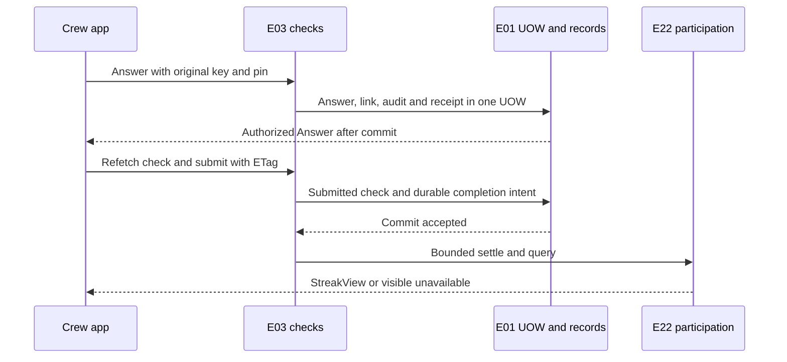

# E03: Crew experience and daily check

Binding inputs: `AGENTS.md`, `docs/SYSTEM.md`, `docs/DEPLOYMENT.md`,
`docs/requests/COORDINATOR-DECISIONS.md` Part A, `docs/BUILD-CHARTER.md` and `docs/product/`.
Shared mechanisms are imported by SYSTEM section, never reimplemented here. Pending contracts are in
`docs/requests/E03.md`; a test fake is not a production agreement. All implementation test evidence is planned.

## 1. Scope

E03-01 builds Today, daily check, private journal and first-use profile; E03-02 builds How you are and value/cards;
E03-03 builds optional reaction acquisition; E03-04 builds the Vue 3/Vite/strict TypeScript shell, stage and design
system. Requirements R03, R05, R24 and the E03 contribution to R25/R31 are mapped in 12.1. Flows: UC01, UC13,
UC24. No optional task changes participation. Profile, reaction and complete card acceptance remain gated by section 14.

E03 owns CONTRACTS section 7 presentation and section 19 shell/projection integration. Within section 4 it owns
DailyCheck, within section 11 questionnaires/indicator/copy consumers, and within section 20 checks and Today/HowYouAre
only. Other workflows in those sections remain with their owners. E01 owns records, kernel and HTTP assembly;
E02 identity/consent/vault; E04 concern; E08 band acquisition; E14 summaries; E20 offline/bootstrap; E22 participation;
E23 context/Habitat; E24 warnings; E25 routine; E26 help; E27 guidance. E15/E16 own Records/GroundInbox, not E03.

### 1.1 Rule trace

Sources are relative to `docs/product/`. Each normative sentence in the owned presentation sections has its own
row; the remaining rows trace E03's daily-check, privacy and shared-boundary obligations. Delegation does not waive a test.

| Source | Decision implemented | Section | Test ID |
|---|---|---|---|
| PRD.md:479 R03 | Typed monitoring and optional tasks | 3, 4, 7 | T-E03-006, T-E03-005 |
| PRD.md:481 R05 | Explicit presence, no blank-to-absent conversion | 3 | T-E03-009, T-E03-018 |
| PRD.md:500 R24 | Keyboard, words, accessible explanation | 7 | T-E03-080, T-E03-081 |
| PRD.md:501 R25 | Durable accepted inputs | 4 | T-E03-032, T-E03-065 |
| PRD.md:507 R31 | Completion independent of values | 4 | T-E03-004, T-E03-021 |
| CONTRACTS.md:7 | Separate actor/subject and LIVE/SIM identity | 3, 6 | T-E03-013, T-E03-062 |
| CONTRACTS.md:13 | No sentinel; immutable corrections | 3 | T-E03-009, T-E03-037 |
| CONTRACTS.md:123 | Core answers in any presence; optional parts never alter completion | 3, 4 | T-E03-003, T-E03-005 |
| CONTRACTS.md:188 | Journal author only, no other exits | 4, 10 | T-E03-060, T-E03-064 |
| CONTRACTS.md:210 | Shared durable identity, D6 effective semantics | 4 | T-E03-039 |
| CONTRACTS.md:211 | Optimistic concurrency and authorized current state | 3, 4 | T-E03-033, T-E03-037 |
| CONTRACTS.md:214 | Pin/header contract gap explicit | 8.1 | T-E03-036 |
| CONTRACTS.md:220 | UI renders configured error code words, never raw message | 6, 7 | T-E03-041 |
| CONTRACTS.md:257 | Cached help survives internal fault | 7, 9 | T-E03-068 |
| CONTRACTS.md:299 | Region and laterality only on symptom answers | 3, 7 | T-E03-053 |
| CONTRACTS.md:308 | Region never guessed from text | 3, 7 | T-E03-057 |
| CONTRACTS.md:309 | Band anchor never stored as a region | 7 | T-E03-057 |
| CONTRACTS.md:311 | State-derived mark never stored | 7 | T-E03-053 |
| CONTRACTS.md:311 | Model never chooses mark | 7, 10 | T-E03-053 |
| CONTRACTS.md:318 | Rejected/absent/unknown/declined draw words only | 7 | T-E03-053 |
| CONTRACTS.md:322 | Participation never rewards values | 4, 7 | T-E03-004 |
| CONTRACTS.md:334 | Completion references only | 4 | T-E03-004 |
| CONTRACTS.md:382 | No optional input consulted for completion | 3, 4 | T-E03-006 |
| CONTRACTS.md:389 | Versioned mission day; explicit audited correction | 3.1 | T-E03-034 |
| CONTRACTS.md:395 | Late completion retains original time | 4 | T-E03-039 |
| CONTRACTS.md:400 | Answer corrections never void completion | 3 | T-E03-038 |
| CONTRACTS.md:408 | Owner-only participation; crew projection aggregate only, D10 | 7, 10 | T-E03-071 |
| CONTRACTS.md:409 | SIM/LIVE separated; REPLAY creates no completion | 3 | T-E03-013 |
| CONTRACTS.md:410 | Participation absent from medical surfaces and model/ground | 7, 10 | T-E03-070 |
| CONTRACTS.md:414 | No synthetic fallback into LIVE | 3, 9 | T-E03-054 |
| CONTRACTS.md:415 | Missing/stale cannot read as normal | 7 | T-E03-067 |
| CONTRACTS.md:416 | Journal excluded from prompts, exports and screenshots | 10 | T-E03-060 |
| CONTRACTS.md:419 | Urgent entry never waits on model/sample/ground | 7 | T-E03-068 |
| CONTRACTS.md:422 | Corrections retain lineage | 3 | T-E03-037 |
| CONTRACTS.md:425 | Values, outcomes and journal never affect rewards | 4 | T-E03-021 |
| CONTRACTS.md:426 | Personal participation remains private | 10 | T-E03-071 |
| CONTRACTS.md:427 | Symptom is not a measurement | 7 | T-E03-053 |
| CONTRACTS.md:431 | Private deletion/backup claims follow SYSTEM 7.4 | 5, 10 | T-E03-112 |
| CONTRACTS.md:433 | Authenticated transport and verified restore | 5, 9 | T-E03-112 |
| CONTRACTS.md:439 | Data/configuration outside code | 8 | T-E03-040, T-E03-076 |
| CONTRACTS.md:441 | Only enumerated UI literals | 7 | T-E03-075 |
| CONTRACTS.md:443 | Vocabulary keys never display words | 7 | T-E03-075 |
| CONTRACTS.md:520 | Open work pins | 8.1 | T-E03-036 |
| CONTRACTS.md:521 | D1 prevents warning lowering on activation | 8.1 | T-E03-036 |
| CONTRACTS.md:527 | All loader checks reject invalid releases | 8 | T-E03-040 |
| CONTRACTS.md:548 | Configured templates; unknown placeholders explicit | 7, 8 | T-E03-076 |
| CONTRACTS.md:983 | Session-scoped events and no cross-person participation | 7 | T-E03-063, T-E03-069 |
| CONTRACTS.md:1018 | Hub computes levels, states, due times and labels | 7 | T-E03-075 |
| CONTRACTS.md:1023 | Link indicator reads context; no domain link dependency | 2, 7 | T-E03-093 |
| CONTRACTS.md:1041 | Operator actions stay in owning module | 6, 7 | T-E03-062 |
| CONTRACTS.md:1045 | Cached first help before any network call | 7 | T-E03-068 |
| CONTRACTS.md:1046 | Model/link loss changes only their displays | 9 | T-E03-090, T-E03-093 |
| CONTRACTS.md:1080 | Session is identity/role authority | 6, 10 | T-E03-062 |
| CONTRACTS.md:1099 | Help independent of later modules | 7, 9 | T-E03-098 |
| CONTRACTS.md:1104 | E22 reads completion facts only | 4 | T-E03-004 |
| CONTRACTS.md:1108 | UOW and D4 acknowledgment barrier | 4 | T-E03-032, T-E03-065 |
| CONTRACTS.md:1109 | Injected time, observed-time semantics | 3.1 | T-E03-035 |

## 2. Seams

Hard dependencies are E01/E02 (SYSTEM 9). Safety rendering never waits on optional projections. Read current provider
sections, not old E03 response claims. E08 and E14 have no current designs; their proposed interfaces remain requests.
Bindings below that SYSTEM does not fully define require coordinator agreement under X-E03-12/15/16/22/24/29.
No compatibility alias or cross-module table read fills a gap. Providers' legacy clocks, catch-all error isolation,
Session aliases and day-boundary-only consent rules are superseded by SYSTEM and Part A.

| Name | Provider epic | Consumer epics | Signature or payload with types | SYSTEM section / provider / status |
|---|---|---|---|---|
| Identifiers and clocks | E01 | E03 | IdFactory, Clock, ClockCorrections, MissionClock, ClockCorrected, ClockRegressed; exact declarations by reference | 5.1, 5.2, 5.3; no local types |
| Quantities and errors | E01 | E03 | Quantity, UnitRegistry, WireUnitConverter, ProblemError, StorageUnavailable; exact declarations | 5.4, 5.5 |
| Release and templates | E01 | E03 | ConfigReleaseReader, ConfigReader, ReleaseHandle, ReleaseCheck, ActivationGuard, TemplateRenderer | 5.6 |
| Transactions and delivery | E01 | E03 | UnitOfWorkFactory, ReadSnapshotFactory, DomainEventBus, OutboxSubscriptions, ReplicationChange, Audience | 5.7, 5.7.1 |
| Commands and receipts | E01 | E03 | CommandIdentity, IdempotencyStore, ResultVisibility, CommandPolicy, CommandReceipts; exact declarations | 5.8 |
| Private coordination | E01 | E03 | PrivateRecordCoordinator.write(session, intent) -> PrivateReceipt; recovery and barrier exactly as shared | 5.8.1 |
| Private journal adapters | E03 | E01 | PrivateStore and PrivateReferenceWriter: implement every shared method without changing signatures | 5.8.1 |
| Private key vault | E02 | E03 | PrivateKeyVault; owner check, per-entry encrypt/decrypt/revoke/fingerprint | 5.8.1, 7.4 |
| Audit, scheduling, health, settings, registration | E01 | E03 | AuditEntry, Scheduler, ScheduledJob, HealthState, HubSettings, SettingSpec, ModuleRegistry | 5.9 to 5.12 |
| Authentication and grants | E02 | E03 | SessionContext and Visibility/ConsentQueries per current E02 2/3; exact field binding pending R-E01-18 | 5.7, 8.3; X-E03-29 |
| Record primitives | E01 | E03 | ObservationCommands, ObservationReader, AnswerQuery, AnswerAccepted; typed bounded DTO consolidation R-E01-17 | 4.2, 8.6; X-E03-12 |
| Completion intake | E22 | E03 | CompletionRecorder.record(uow: UnitOfWork, basis: CompletionBasis) -> IntakeOutcome | 4.2; E22 3.1/4.2, X-E03-22 |
| Completion settlement | E22 | E03 | ParticipationSettle.settle(intent_key: str, deadline: timedelta) -> the E22 settlement outcome (settled, pending or parked) | E22 4.2; postcommit only |
| Participation queries | E22 | E03 | StreakQueries.for_person(person_id, origin_mode, now); CrewGoalQueries.for_origin(origin_mode), generated views | 8.3; E22 4.2; D10 overrides delayed revocation |
| Added questions | E25 | E03 | DailyCheckQuestionSource.added_questions(person_id: str, mission_day: int, at: datetime) -> Sequence[AddedQuestion] | E25 4.2; insufficient occurrence payload, X-E03-24 |
| Routine projection | E25 | E03 | RoutineTodayPort.due_today(person_id, at) -> Sequence[OccurrenceRef]; today_summary(session, at) -> TodayRoutinePart | E25 4.2; SessionContext binding X-E03-29 |
| Warning projection | E24 | E03 | WarningQueries.active_visible(session), headline(session), count_active_visible(session), exact E24 4.2 DTOs | 4.2, 8.1; independent provider snapshots |
| Habitat projection | E23 | E03 | HabitatParts.today_part(snapshot: ReadSnapshot, at: datetime) -> TodayEnvironment; today_sensors(snapshot, at) -> Sequence[SensorStatusModel] | 4.4; E23 4.2, X-E03-15 |
| Insight and status | E13 | E03 | InsightQueries.current(session) -> Insight or None; AssistantStatusPort.state() -> AssistantState | 4.2; E13 2/4, plural current versus singular active, X-E03-29 |
| Broadcast query | E26 | E03 | BroadcastQueries.active_for(session: SessionContext) -> Sequence[CrewBroadcast] | 8.3; E26 4.2 |
| Indicator projection | E14 | E03 | IndicatorSummaryPort owned by E14; full signature/DTO pending X-E03-16 | 4.4; absent provider design |
| Clinical guidance | E27 | E03 | GuidanceEligibility.evaluate(snapshot: ReadSnapshot, request: GuidanceRequest) -> GuidanceDecision | 8.2; card content kind pending X-E03-8 |
| Daily check query | E03 | E25 | DailyCheckQueries owner fixed; bounded authenticated current-state payload pending X-E03-29 | 4.2 |
| Profile names | E03 | E26, E32 | ProfileFactsPort.allergies_and_medicines(person_id: str) -> ProfileFacts; E26 NamedList states recorded/none_recorded/unknown, names tuple[str,...] | 4.4, 8.3; E26 4.2; X-E03-21/29 |
| Submitted notification | E03 | E25, E13 | DailyCheckSubmitted(daily_check_id: str, person_id: str, mission_day: int, origin_mode: generated OriginMode, submitted_at: datetime) | 4.2, 5.7; E25 4.3/E13 2 |
| Abandoned notification | E03 | E25 | DailyCheckAbandoned(daily_check_id: str, person_id: str, mission_day: int) | 4.2, 5.7; E25 4.3 |
| Reaction notification | E03 | E25 | ReactionTestRecorded(reaction_test_id: str, person_id: str, state: validated reaction state, occurrence_id: str or None) | E25 4.3; pending X-E03-6/24 |
| Completion event | E03 | E22 | CheckCompletionRecorded ownership in SYSTEM; reconcile with reference-only CompletionRecorder, no double emission | 4.2; X-E03-22 |
| Offline/bootstrap | E20 | E03 | DocumentStore and DurableCommandQueue exact proposed signatures in R-E20-4; immutable command, opaque retention references | 8.6; E20 4; pending integration |
| Shell components and slots | E03 | E13, E22, E23, E24, E25, E26, E27 | Section 7 components, SurfaceGate, useCopy and named slots; medical surfaces deny participation | 4.4, 6.3 |

## 3. Domain model

DailyCheck uses the generated wire shape; internal fields additionally retain mission/home node, immutable release
and questionnaire pins, opaque mission-clock version, correction history, revision and per-question chain heads.
Wire origin retains the whole enum; new DailyCheckCreate permits LIVE/SIM only. REPLAY history is readable as labeled
history but creates no daily-check completion. Validate routed person, mission and origin before returning an existing
start result. Optional nulls, especially submitted_at, band_confirmed and reaction_test_occurrence_id, remain nullable.

| Transition / invariant | Decision | Tests |
|---|---|---|
| INV-E03-01 start | One authoritative check per person/mission/origin/day/home node; concurrent starts return the same row | T-E03-001, T-E03-030 |
| INV-E03-02 answer then submit | Only started checks submit; symptom, sleep and mood each need an accepted head in any presence. Blank is no answer | T-E03-003, T-E03-014 |
| INV-E03-03 completion | One reference-only completion intent per accepted submission; no values or optional-task facts | T-E03-004 |
| INV-E03-04 optional work | Attachments, corrected answers and repeat questions never alter submitted state or create another completion | T-E03-005, T-E03-038 |
| INV-E03-05 day end | Started becomes abandoned at the proven mission-day boundary; closure commits even when a later command is rejected | T-E03-007, T-E03-031 |
| INV-E03-06 band confirmation | Link the exact proposed estimate; do not copy or overwrite its numerical observation | T-E03-008 |
| INV-E03-07 missingness | Explicit unknown/declined yields no quantity; zero remains a real value | T-E03-009 |
| INV-E03-08 reaction | Invalid/interrupted/unqualified/insufficient acquisition yields no summary or accepted derived observation | T-E03-010, T-E03-025 |
| INV-E03-09 journal | Only owner-authorized private-store plaintext in bounded memory; never replicated, cached or logged | T-E03-060, T-E03-064 |
| INV-E03-10 plan | Core semantic roles fixed; additions optional, occurrence identity retained, open plan never silently replanned | T-E03-024, T-E03-040 |
| INV-E03-11 origin | No REPLAY start, synthetic fallback or mixed-origin association | T-E03-013 |
| INV-E03-12 lineage | Immutable per-check/per-question chain; append names the current head, same subject/question/check/origin | T-E03-019, T-E03-037 |
| INV-E03-13 retry | Full identity plus current authorization, no duplicate execution before or after cache expiry | T-E03-032, T-E03-039 |

A first answer has no supersedes. Subsequent answers require the current head; simultaneous corrections have one
winner and a typed conflict. Sequence is the committed link sequence, never timestamps. Corrections remain possible
after submission, including an older check's existing answers, and leave participation unchanged. New optional parts
must refer to the actual capture day/instance; arrival day is not an attachment rule. If the required lineage API is
missing, the correction integration remains blocked under X-E03-12/29, never a destructive overwrite.

Validation uses E01's shared question validator with the check pin (E01 3). JSON booleans/strings are not numbers.
Presence/choice requires a configured choice ID, matching presence and no unit. Scale requires integral Decimal inside
scale.min/max. Duration/correction requires finite nonnegative Quantity in a compatible declared unit, converted by
SYSTEM 5.4 with original unit/value retained. Confirmation requires an eligible estimate, configured confirm choice,
matching presence and no unit. Unknown/declined accepts absent/null value and no unit for every kind. Reject extraneous
region/laterality on nonsymptom questions; region is null or a CONTRACTS 7 key, never band or guessed text. Bounds and
zero/negative/empty/maximum cases are covered by T-E03-018; no input-range failure is evaluator isolation.

Required-core validation needs semantic roles, not just presence/duration/scale kinds: energy cannot replace mood.
X-E03-25 supplies this mapping; without an independently validated mapping, the release is rejected, last good retained,
and daily-check completion is not advertised. Question text/range edits cannot weaken required core or safety levels.
E25 owns each addition/repeat instance and its release/due window. The current lossy port cannot implement repeats;
X-E03-24 blocks that integration, including additions arriving after start/submit. Once agreed, refresh appends optional
instances without deleting answered/cleared history; post-submit instances never count as another daily completion.

Sleep estimate eligibility requires proven band lineage (device or derived), accepted quality, current supersession
head, matching person/mission/origin, a completed main sleep period ending inside the pinned day's bounds, normalized
nonfuture time and configured policy. Select latest eligible end time then observation ID; never use arrival time,
yesterday's estimate, a nap or self report. Before answer, a newly eligible estimate can refresh; after confirmation
its link is immutable even if later superseded. No E08 design currently provides this evidence: X-E03-26 keeps the
estimate absent while manual duration/unknown/declined work. Date, method, quality and origin are shown.

### 3.1 Time

Use SYSTEM 5.2 TimeInput/NormalizedTime, 5.3 MissionClock and 5.10 scheduler. Mission-clock IDs are opaque strings,
not integers or sortable revisions. Record start/submission/answer original time, segment, capture revision,
normalization and mission assignment version. Unknown mapping never becomes receive time. Late answers retain their
answered_at; a new submission records uow.now, while replay retains the original acceptance time. Future/unmapped
answers cannot imply a current measurement or clear newer warning state; timestamp validation uses shared clock settings.

Boundary jobs use AbsoluteDeadline at MissionClock.day_bounds(day, version=pin)'s end. A routine clock offset does
not move that UTC instant. An explicit retrospective mission-clock correction is a new audited assignment and job
generation under SYSTEM 5.3/5.10. Regression suspends closure until correction and sweep; forward jumps close overdue
checks in bounded order, without invented answers. A false forward jump already committed as abandonment needs
X-E03-20's state-transition decision: never reopen implicitly, discard answers or reuse the old ID for new history.
That affected day's daily check stays visibly blocked; independent manual/concern/help paths remain.

Relative durations (SSE silence/reconnect, elapsed acquisition and retry backoff) use monotonic time within one process
epoch and shared correction-aware elapsed intervals across restart. Sleep interval endpoints and stated due/expiry
instants are absolute. D3 applies to observation freshness; only E23 REPLAY channel freshness uses D14. Delayed,
duplicate or replayed inputs never replace a newer head or clear a newer safety state.

### 3.2 Reaction acquisition and scoring

This optional feature stays off pending X-E03-6/7/16. The following are required acceptance constraints, not invented
wire fields. Pin acquisition/scoring configuration at start; store raw trials, original times, release, origin,
software/acquisition version, device/browser/input method, timing calibration ID and timing-quality record.
A validated timing cohort must match all of those comparability dimensions. Hardware latency not measured is stated;
source thresholds alone never validate this browser or switching input devices.

State sequence: idle, armed after a fresh press/release, ISI, stimulus, feedback, next ISI, ended; any active state may
become interrupted. Use injected seeded jitter, rAF stimulus paint timestamps and normalized event timestamps from the
same monotonic origin. Record actual ISI start, requested interval, stimulus, first response, release and trial end.
Ignore autorepeat/duplicate event identities and secondary pointers; an already-held key cannot become a fresh response.
Input kind changes, hidden/blur/help/route changes, process loss or failed frame/timer qualification interrupt.
X-E03-6 requests an E20 bounded owner-encrypted acquisition checkpoint adapter, separate from the immutable
DurableCommandQueue. Never mutate an enqueued command as trials arrive. Until checkpoint durability and final-command
handoff are agreed, acquisition stays off; after restart an unfinished run becomes interrupted, never completed. Interruption before the first trial is valid with zero trials.

At configured duration, start no new trial. Finish an already painted stimulus by response or timeout, include its
configured feedback and terminate; an ISI without a painted stimulus ends without inventing one. Bound allowed overrun
by no-response plus feedback and timing tolerance. Server validation checks contiguous unique indices, finite times,
ordered nonoverlapping intervals, matching pin/version, correct ISI and feedback, response/release consistency, end time
and elapsed consistency, qualified timer/frame limits, and evidence that every null-response timeout actually elapsed.
A completed claim cannot rely only on client state or trial count. Missing release evidence cannot become a valid
response; interrupted trials may be partial but are never scored. Invalid retained evidence is rejected, not completion.

Scoring precedence: held/stuck response excluded; premature ISI response or RT below false-start threshold is a false
start; elapsed no-response timeout is timeout_lapse; RT at/above lapse threshold is lapse; otherwise valid. Median uses
valid and lapse RTs plus timeout_lapse at the configured timeout, explicitly; lapses include timeout_lapse. Too few
scorable trials gives insufficient result. Every branch and exact boundary has an independently checked golden vector.
Quantities use ms through SYSTEM 5.4. No score diagnoses sleep loss or fitness for duty, and no test parameter is tuned
to pass. Declining/skipping/interrupting cannot change participation.

## 4. Application layer

All commands use SYSTEM 5.7/5.8: authenticate, check current operation authority, parse generated boundaries, construct
full identity (operation, canonical target, semantic headers including pin/revision, body fingerprint), look up receipt,
reauthorize stored-result visibility, then check mutable preconditions under the writer. An accepted retry carries its
original If-Match, which may now be stale; changing that header is a different identity, not an accepted retry.
Clinical/private bodies use keyed fingerprints and reference-only StoredResult, never full response caches.
After cache expiry accept only SYSTEM's validated accepted_command receipt; a generic DUPLICATE_COMMAND is not success.
Rejected or conflicted commands remain visible under their original owner, never silently rekeyed.

| Command | Producer UOW and durable effects | Crash/response |
|---|---|---|
| StartDailyCheck | Validate routed origin even for existing check; resolve day/core/pin and authorized additions; insert check, reference-only audit, ledger and replication projection together | Before commit no check; after commit retry returns the same authorized check/receipt |
| AnswerDailyCheck | Check owner, question/instance pin and chain head; records provider appends Answer and AnswerAccepted, E03 link/revision, audit, identity and replication in the same UOW | Every write rolls back together. D13 typed evaluation failure alone retains input with pending marker/retry; storage/I/O/integrity/auth/config/input faults abort |
| SubmitDailyCheck | Require matching revision and three core heads; transition and publish DailyCheckSubmitted plus one reference-only completion intent, audit, receipt and replication | Acceptance at commit, not StreakView rendering. No recorder call again on replay; X-E03-22 gates the unresolved provider binding |
| CloseCheck | Internal scheduled UOW checks job generation/day/state, appends abandonment and audit/replication | Lazy closure uses a separate committed UOW before the rejected command resumes; rejection cannot roll closure back |
| RefreshCheck | Explicit internal reconciliation UOW attaches only proven new optional instances/estimates under retained pins, increments revision on change | GET reads only after reconciliation; no mutation inside ReadSnapshot; no new event type without agreement |
| WriteJournal | Delegate to PrivateRecordCoordinator; E03 PrivateReferenceWriter attaches owner/day/entry metadata and check reference, audit and ledger in its hub UOW | SYSTEM 5.8.1 only: no acceptance after private seal alone; receipt marker and both stores durable before acknowledgment |
| RecordReactionTest (pending) | Validate complete acquisition; append raw result, accepted derived observations via E01 when scorable, optional occurrence/check links, audit/receipt/replication | Atomic commit; incomplete/invalid acquisition never produces successful occurrence or completion |
| UpdateProfile (pending) | Owner, revision and bounded state validation; append version and current pointer, audit/receipt and authorized projection | Unknown/declined never become none_known; no privileged role bypass |

Submit's CompletionBasis is E22 3.1's exact reference-only type: daily_check basis/ref, patient, mission, origin,
original accepted occurred_at/offset and actor, required_answers_complete true, cause_kind/cause_ref null. E22 may
project after commit, using bounded ParticipationSettle then StreakQueries. Unavailable StreakView returns the provider's
retryable INTERNAL_ERROR with unavailable state; a subsequent matching receipt proves acceptance and the UI refetches
getDailyCheck/getMyStreak. Never roll back a submitted check because optional projection failed or return fabricated zero.
E22's catch-all savepoint policy is not adopted: X-E03-22 requires storage-error propagation and durable pending work.

Journal delegates every crash point, orphan decision, acknowledgment, backup barrier and deletion to SYSTEM 5.8.1/7.4.
E03 implements bounded PrivateStore and PrivateReferenceWriter only. Missing/corrupt sealed data with a live reference
is an integrity fault, never an empty journal. Orphan private commits are unacknowledged; repair a committed hub
reference before retries. Reads authorize the owner and current vault revocations on every entry. Never synchronize
journal bodies or client-persist an unsent edit. Test every shared crash/backup boundary, including a report writer
contending for the same barrier.

Attachments are explicit: accepted observations are associated by subject/mission/origin and normalized observation
interval, never arrival; records notification and check revision update share the producer UOW (X-E03-12/29). Journal
existence follows a committed private reference, updated through PrivateReferenceWriter. Reaction uses E25's actual
occurrence ID in reaction_test_occurrence_id, not a reaction result ID. Band confirmation links its exact estimate.
After any answer/attachment the UI refetches check plus ETag. No optional path invokes participation again.

Internal lifecycle payloads are those listed in section 2; they are not public Event enum additions. E03 emits no
clinical/private outbox payload. Consumed shared clock/config notifications use SYSTEM 5.7/5.10; durable handler effects
and cursor commit together. E24/E25 notifications retain original observation time and pin. Recovery never replays
an old notification over a newer state.



```mermaid
sequenceDiagram
    participant UI as Crew app
    participant H as Hub
    UI->>H: Immutable queued answer K
    H->>H: Commit answer and receipt
    Note over UI,H: Response lost; day ends; hub restarts
    UI->>H: Replay identical K under same owner
    H-->>UI: Authorized original response or accepted_command receipt
    UI->>H: Refetch check
    Note over UI,H: A new late answer cannot silently change the previous day
```

## 5. Adapters

Use E01 StorageSession/UOW, WAL/FULL, bounded statements and migrations (SYSTEM 5.7), audit chain over every stored
field (5.9), projections (5.7.1), and paired restore (7.2). No local transaction, SQL attachment, hash chain, retry or
replication implementation. Migrations expand first; rollback switches compatible code without deleting records.

| Owned table | Data and constraints |
|---|---|
| checks_daily_check | ID/revision, person/mission/origin/home node/day, opaque clock version, pin, state, nullable submitted_at/band_confirmed/reaction occurrence, plan and estimate references. Unique authoritative local day key; index state/day. Wire nullability preserved |
| checks_answer_link | Monotonic committed link sequence; check/question/instance, answer ID, nullable predecessor and estimate reference. Unique answer and successor; append only; current-head CAS under UOW |
| checks_journal_marker | Owner/entry/day/check references, creation time, pin and tombstone; no text or plaintext hash. PrivateReferenceWriter owns updates under shared barrier |
| private_journal_entry | Shared sealed-entry metadata, per-entry key reference, ciphertext and receipt marker in private.sqlite; schema implements SYSTEM 5.8.1, no second command ledger |
| checks_reaction_test | Pending schema: immutable bounded acquisition/trials, pin, origin, capture interval, nullable summary/occurrence/check, timing cohort; no accepted observation for invalid result |
| checks_profile | Pending schema: immutable attributed versions and current revision; four-state private history and display preferences |
| checks_clock_assignment | Immutable old/new mission assignments and correction reference; no unapproved reopening, X-E03-20 |

Separate read-only replica tables hold authorized remote histories; local uniqueness never rejects a remote history.
Cross-site reconciliation remains off until its registered projection/applier passes Q-E03-3. Private rows never enter it.
Timers use Scheduler.replace and generation checks, not call_at; boundary sweep pages by stable ID within section 11
bounds. Journal startup recovery belongs to platform STORAGE before writes/backup/SERVE, not an E03 periodic sweep.
No camera/model/device worker is added by E03. Every adapter/provider call has the section 11 deadline.

## 6. API

Generated effective models and clients come from SYSTEM 6.5. E03 uses closed ErrorEnvelope on the wire (D5, SYSTEM
5.5); RFC 9457 is the redacted logging representation. No local migration of that envelope. Roles and headers are
copied from `docs/product/api/openapi.yaml`; person is the authenticated session person, never a body/query grant.
Station/ground/operator/editor receive no E03 person view; medical-officer status grants no other person's check.

| operationId | Request | Response | Preconditions |
|---|---|---|---|
| startDailyCheck | DailyCheckCreate | DailyCheck, 201 or existing 200 | Key; Config-Release semantics 8.1 |
| getDailyCheck | daily_check_id | DailyCheck with ETag | Owner/object read; wrong owner denied without data |
| answerDailyCheck | AnswerCreate at check target | Answer 201 | Key, pin, current chain predecessor; error declarations X-E03-29 |
| submitDailyCheck | Check target, no body | StreakView 200 | Key, If-Match, core heads; postcommit failure as section 4 |
| writeJournal | JournalEntryCreate | JournalEntry 201 | Owner/key; shared private barrier |
| listJournal | cursor, limit | items/page of JournalEntry | Owner/vault on every entry; bounded page |
| getTodayView | none | TodayView | Authenticated person; incomplete required provider returns error |
| getHowYouAreView | none | HowYouAreView | Authenticated person, no invented summaries |

Reaction/profile/versioned-config extensions are proposals only in X-E03-6/21/28, not live endpoints. Use current
API examples for contract tests, recording X-E03-9 corrections without rewriting the package. Every person response
is no-store; unknown properties are rejected. No browser token in URLs. Errors contain pointers/codes, never input text.

Typed checks errors map through SYSTEM 5.5: missing resource to NOT_FOUND, denied grant to UNAUTHORIZED_SCOPE,
closed transition to INVALID_TRANSITION, stale head/revision to STALE_VERSION, invalid answer/acquisition to
INVALID_VALUE, incompatible unit to INVALID_UNIT, wrong subject to IDENTITY_MISMATCH, wrong partition to
ORIGIN_MISMATCH, missing pin to CONFIG_INVALID or CONFIG_VERSION_MISMATCH as applicable. Missing required answers
are field_errors, not detail. StorageUnavailable and corrupt/missing vault/private data are visible INTERNAL_ERROR;
retryability follows generated tables, never local overrides. Missing key is not empty data. A dependency failure is
INTERNAL_ERROR with allowlisted unavailable part names only. X-E03-29 requests absent operation error declarations
before integration; do not replace typed failures with an undocumented success or bypass validation.

## 7. User interface

### 7.1 Application structure (`ui/crew/`)

| Path | Contents |
|---|---|
| `src/shell/` | `App.vue`, `router.ts` (E03 routes plus `import.meta.glob('../features/*/routes.ts', {eager: true})`), `slots.ts`, `session.ts` (7.2), `api/client.ts` (7.3), `api/events.ts` (7.3), `freshness.ts` (7.4), `copy.ts` (`useCopy()`), `stage.ts`, `StageHead.vue`, `StaleBanner.vue`, `ClinicalNotice.vue`, `SurfaceGate.vue` |
| `src/design/` | `tokens.css` (verbatim `:root`), `cards.css`, `type.css`, `fonts.css`, `BodyFigure.vue`, `body-render.d.ts`, `marks.ts`, `Card`, `Pill`, `Row`, `SourceSwatch`, `LevelTag`, `Mark`, `DesignedState`, `Steps`, `NumberedStep`, `RegionMenu`, `ValueCard`, `MeasurementCard`, `TrendLine`, `Skeleton`, `ChoicePills`, `ScalePills`, `NumberField` (`.vue`) |
| `src/features/today/` | `TodayView.vue`, six card shells, `SafetyFallback.vue` (7.9), `routes.ts` |
| `src/features/checks/` | `CheckView.vue`, `QuestionStep.vue`, `DueTodayStep.vue`, `JournalStep.vue`, `ReviewStep.vue`, `ReactionTest.vue`, `useDailyCheck.ts`, `routes.ts` |
| `src/features/how-you-are/` | `HowYouAreView.vue`, `SleepCard.vue`, `MoodCard.vue`, `ReactionCard.vue`, `LatestReadingsCard.vue`, `WhatThisMeansCard.vue`, `routes.ts` |
| `src/features/profile/` | `SignIn.vue`, `StationHome.vue`, `ProfileView.vue`, `routes.ts` |
| `public/vendor/`, `public/fonts/` | renderer, mesh, four `.woff2` (SHA-256 pinned) |

Feature epics add `features/<name>/routes.ts` and `slots.ts`; nobody else edits `src/shell`. Slots: `today.todo.warnings`
(E24), `today.habitat` (E23), `today.kit` (E27), `today.daily_check` (E22), `today.assistant` (E13), `screen.top.attention` (E24), `station.crew_goal` (E22 with D10 consent), `check.done`,
`check.side.streak`, `check.side.crew_goal` (E22), `check.review.attention` (E24), `stage.head.help` (E26),
`screen.top.broadcast` (E26).

### 7.2 Session lifecycle and private state

Use current E02 lifecycle and SYSTEM 8.3. Increment sessionEpoch on sign-in/out, idle lock, 401, account change,
connection loss, pagehide, tab hiding and suspend. Abort all requests/streams; reject late responses before stores;
clear tokens, Pinia, private DOM and component drafts; guard Back/bfcache before render. Resume requires owner
reauthentication. Unsaved journal is cleared on lock, never queued. Immutable encrypted commands remain quarantined
under their original owner, never replayed as the new person. Ordinary navigation within an unlocked session may keep
a check draft in memory; a privacy lock clears it. An anonymous emergency action stays unaccepted until attributed
through the shared emergency path, never silently assigned to the next login.

### 7.3 API client and authenticated stream

Use generated client and E20 R-E20-4 interfaces, not a second queue. Intent fixes UUIDv7 key, operation, target, body,
pin, revision, actor and clock provenance. Timeout or restart reuses exactly those bytes. CONFIG_VERSION_MISMATCH stops
replay; refetching does not authorize editing the queued request. A changed action requires proven nonacceptance and
explicit owner choice with a new key. A validated SYSTEM 5.8 accepted_command receipt acknowledges the original
command; a conflict without that discriminator never does. Journal uses only in-memory intent and shared private write.

Fetch streaming sends Authorization and Last-Event-ID headers. Parse UTF-8 incrementally across chunk/CRLF boundaries,
comments and multi-line data within section 11 byte/line bounds. Cursor is the last fully applied event sequence, not
last received bytes; drop duplicates. Store no personal event body/cursor in a shared cache. Observe heartbeat comments;
silence watchdog cancels/reloads even if the socket remains open. Reconnect backoff and maximum attempts are settings;
exhaustion is visible offline with manual retry. On 410 discard the expired cursor, reload authoritative views then
subscribe from their supported stream checkpoint; X-E03-29 covers a missing snapshot/cursor handoff, not a guessed
sequence. Buffer only bounded invalidations during reload. Overflow cancels and restarts a full reload. On 401 or
session epoch change cancel and lock; tokens never enter URLs. Bootstrap settings exposure is X-E03-19/R-E20-4,
never undeclared Context fields or hardcoded defaults.

### 7.4 Freshness and figure motion

Transport liveness, observation freshness and source availability are separate. Successful HTTP/SSE does not make
an old observation fresh. Values always show original observed time, age, origin and actual source status. D3's
normalized observed-time uncertainty and D14's replay exception are computed by providers, not inferred by the UI.
X-E03-23 supplies an absolute server expiry lease. Client monotonic expiry may demote a value; only a new authorized
server result can promote it. Poll/renew before expiry, and immediately stop measured motion on source stale,
lease expiry, watchdog loss, hidden tab or resume. No clock estimate or last heartbeat renews a measurement lease.
Until the full freshness/quality projection exists, measured animation is off and values are historical text only.

Decorative rest motion requires sourced configuration X-E03-5, has no numeric vital label and is aria-hidden. Without
that configuration the figure stays still. No heartbeat or measured breathing rate is fabricated. Fresh measured
motion consumes typed Quantity, source reference and expiry; a unitless float never crosses the module boundary.

### 7.5 Layout

UX 1.2: `minmax(520px, 0.76fr) minmax(0, 1fr)` above 1180 px; stage on top at 820 px from 721 to 1180 px; at 720 px and
below the stage at 700 px and one column. 24 column card grid, 12 px gaps, rows `minmax(0, 1fr) minmax(0, 1fr)
minmax(0, 0.86fr)`. Each route declares `meta.cards` copied from UX 1.2. No tab bar; no horizontal scroll from 320 px.

### 7.6 Stage store

```ts
type Region = keyof typeof window.BodyRender.REGIONS;          // the 15 keys of CONTRACTS 7
interface StageState { peek: Region | null; lock: Region | null; lockSource: string | null;
  marks: MarkSpec[]; helpOpen: boolean; webgl: 'pending' | 'on' | 'off'; motion: FigureMotion; }
// FigureMotion is a generated typed-quantity/expiry projection after X-E03-4/23; until then still only.
```

| State | Event | Next | Effect |
|---|---|---|---|
| rest | pointer on a control naming R for the motion token, or focus | peek R | `focus(R, {camera: false})` |
| peek R | leave, blur | rest | `focus(null, {camera: false})` |
| rest, peek | click, Enter, Space on a control naming R | lock R | `focus(R)`; title shows the region or symptom name; `aria-pressed` on the source |
| lock R | same source, Escape, Whole body, click on the figure | rest | `focus(null)` |
| lock R | another control naming S | lock S | as lock |
| any | route change | rest | the screen sets its focus from data |
| any | `helpOpen` | frozen | the help freeze rule |

Durations are UX 1.10 motion tokens. Under `prefers-reduced-motion: reduce`: `still: true`, transitions off.

### 7.7 `BodyFigure.vue`

Props: `marks`, `alertRegions` (E24), `landmark` (E30 X14: a DOM light at `BodyRender.project(BodyRender.point(r))`),
`motion`. `mount` returning `null` or throwing sets `webgl = 'off'` and the `no-gl` class; marks are DOM elements placed
in `onFrame`; the loop stops on hidden and on `helpOpen`; help freezes the figure before any I/O. The figure carries nothing that is not also in text (UX 1.11).

### 7.8 Marks (`design/marks.ts`)

A total function of object kind and state, exactly CONTRACTS 7; the mark is never stored and never chosen by a model.

| Object and state | Mark | Words |
|---|---|---|
| Observation, `quality_status` accepted | filled dot | value and source |
| Symptom Answer (a `presence` question with a region), presence `present` | hollow ring | `mark_words.reported` ("Symptom, not measured", X-E03-1) |
| CapabilityGap or a hub vital with `mark: gap` | dashed ring | `designed_states.not_available_here` |
| Observation rejected, uncertain or not assessed; failed attempt; declined or cancelled request; symptom answer absent, unknown or declined; any non symptom answer (mood, sleep, scale) | none | words only |

Hub views that carry `mark` (vitals) are drawn as given. A ring and a dot at one region draw the ring around the dot
(V50). Locking the Sleep card with an estimate lights `wrist` and the band anchor (D04); mood lights `head`, reaction
`eyes`, by region focus, not by a mark.

### 7.9 Today (`/`) and failure containment

Independently starts authenticated warning, routine, health and broadcast loads before optional Today assembly. Loads `GET /v1/views/today`, `GET /v1/help/broadcasts` (independently, CONTRACTS 19 broadcast row) and, until X-E03-4,
`GET /v1/views/how-you-are` for historical stage vital text only. Updates on the CONTRACTS 19 Today events.

Each provider uses its declared snapshot boundary. Do not claim an atomic cross-provider snapshot: X-E03-15/29 tracks that gap. Bound every call by views.part_timeout_ms; storage/integrity errors fail loudly, never enter an optional-value fallback:

| Part | On provider absent, failing or slow |
|---|---|
| `insight` | `null` |
| `assistant_state` | `unavailable` |
| `streak`, `crew_goal` (E22) | `null` only after X-E22-6 is accepted/generated; until then fail Today visibly and keep independent safety loads |
| `warnings`, `headline`, `needs_attention_count` (warning count plus routine open_today), `routine` (E25), `environment`, `sensors` (E23) | `500 INTERNAL_ERROR` retryable with `current_state.unavailable` listing the parts; never an empty list or an invented view |

Client: when Today fails, `SafetyFallback.vue` loads `GET /v1/warnings`, `GET /v1/routine/today` and the broadcasts
separately, renders the warning lights, To do and broadcasts with "part of Today is unavailable", and labels each missing
part "could not be loaded" (fail loud). Help is never behind any of these loads.

| Element | Binds to | Words |
|---|---|---|
| Who line | `person.display_name`, `environment.day_label`, `environment.place` | X-E03-1 `shell_words.who_line` |
| Title, lights | `headline.text`, `warnings[].body_region` | hub |
| Vitals | `vitals[]` only entries selected by configured presentation order, `SourceSwatch(origin_mode)`, time | `origin_words` |
| To do | `routine`, `needs_attention_count`, slot `today.todo.warnings` | `designed_states.nothing_due` |
| How you are card | HowYouAreView indicators from a separate request; TodayView has no indicators field | `label`, `delta_text` |
| Habitat, This kit, Daily check, Assistant | slots | owners' |
| Daily check entry | `daily_check.state`, id | `check_flow_words.start`, `.continue`, `.done_today` |

### 7.10 Daily check (`/check`)

Layout per UX 1.2: the check (paper, columns 1 to 14, rows 1 to 3), slots `check.side.streak` and `check.side.crew_goal`.
Loads `POST /v1/daily-checks`, `GET /v1/daily-checks/{id}`, the check-pinned questionnaire (X-E03-28); acts with answers, submit,
journal and reaction tests. `ClinicalNotice` shows `questionnaires.notice` on every step.

Steps (`Steps.vue`): one per id in `question_ids` (consecutive `scale` questions share a step), **Due today**
(`due_today_occurrence_ids`, E25 labels; the reaction test row when due), **Journal**, **Review**, then slot
`check.done`. A submit response never skips Review; show it before the completion line even when Finish was pressed early. **Finish check** is enabled when `missing_question_ids` is empty and stays on every later step (UX 5).
After each accepted answer the client refetches the check (one request in flight, latest wins) for
`missing_question_ids`, `answers` and `ETag`; it never computes completeness.

Per question: text and hint from questionnaires; `{value}` replaced by the estimate's `value_text` (CONTRACTS 11);
choices as `ChoicePills`; scales as `ScalePills` from `scale.min` to `scale.max` with `scale.label`; duration and
correction as `NumberField` that always shows the unit; explicit **Not sure** and **Prefer not to say** everywhere (X-E03-2;
interim `designed_states.unknown` and `designed_states.declined`). With an estimate, a `ValueCard` under the question
shows the estimate's date, method and origin from `GET /v1/observations/{observation_id}` only with its own current object/field grant; the estimate link itself grants no access. With none, the question uses
X-E03-3 `when_no_estimate`; interim: the indicator `label`, the `NumberField`, Not sure and Prefer not to say, no confirm
pill. A correction posts `supersedes` set to the head.

Urgent handoff (independent of saving and of the hub): selecting a choice with `opens: help_flow` navigates to E26
`/help?flow=<flow_id>` synchronously in the press handler, then hands the answer to the E20 queue; `opens: concern`
navigates to E04's concern route the same way. Neither waits for the answer to be accepted; a disk-full or unreachable
hub leaves the answer visibly unaccepted. After the agreed E20 queue is integrated it remains queued; before that
it is unsaved in memory. Ordinary navigation can retain the draft; any privacy lock clears it under 7.2.

Symptom region: on the figure or in `RegionMenu` (all 15 regions as buttons); laterality as pills (X-E03-1).

**Journal**: a `textarea` posted once to `POST /v1/journal`; cleared after the acknowledged write; never client-persisted, logged or sent to
analytics; on failure it stays in memory with `error_messages[code]` until the person retries or leaves. `listJournal`
appears only on this step, collapsed (UX 2).

**Review** (PRD 4.2): the observations obtained today (`optional_parts.observation_ids`, each a `ValueCard` with value,
unit, origin, quality, time), what needs attention (slot `check.review.attention`, E24; empty text X-E03-1
`check_flow_words.review_no_attention`, "No new attention items from the checks completed"), and the next supported
step (the next due routine item from `GET /v1/routine/today`). Never a health verdict.

### 7.11 Reaction test (`ReactionTest.vue`, in Due today)

Full card, one large target, the stimulus a counter on the green token, start by explicit press, duration shown before
start (PRD 4.2), the card says the test is optional, experimental and not a fitness for duty test (`check_flow_words`).
Acquisition per 3.2, only after its request gates; posts through the E20 queue. Taking or skipping calls nothing in E22 (T-E03-021).

### 7.12 How you are (`/how-you-are`) and its projection

`ClinicalNotice` shows `indicator-catalog.notice`. Cards: Sleep (two wire spheres), Mood (three seven-day lines), Reaction
time (one arc per response), Latest readings, What this means.

| HowYouAreView field | Assembled from |
|---|---|
| `indicators[].code, label, body_region` | indicator catalog, catalog order, codes with `trend_days` |
| `today, usual, delta_text, state, trend` | E14 `IndicatorSummaryPort`. Inputs E14 must use (X-E03-16): an Observation's value; for a `scale` question with an `answer_code`, the head answer's value when `present` (unknown and declined give no value, never zero); for sleep, the person's correction when one exists, else the confirmed band estimate, each with its own lineage |
| `extra` | E14: `pvt_lapses` under `pvt_median`; energy and stress under Mood |
| `origin_mode`, `source_label` | E14 from the inputs' origin and method; mixed origins are never merged |
| `vitals[]` | the agreed E01 bounded observation-head query (X-E03-12) per vital code (`pulse`, `respiratory_rate`, `spo2` from the catalog); `value_text` by `TemplateRenderer`; `detail` method and device; `mark` from 7.8; `occurrence_id` null until E25 offers a per code lookup |
| `why` | E13 `InsightQueries.current` with its citation, else `null` |

Trend points with `value: null` are drawn as gaps; a line never crosses a gap (no interpolation, AGENTS rule 5).
Reaction arcs need per trial data: the pending history operation in X-E03-6; until then the card shows the trend
and a designed state in place of the arcs. Results outside the qualified cohort show configured not-comparable text (3.2).

### 7.13 `ValueCard` and `MeasurementCard` (E03-02)

`ValueCard` shows the five parts of a value: value with unit, time (`observed_at`, mission time and age), origin
(`SourceSwatch`), quality (`quality_status` words), next step. `MeasurementCard` is the UX 7 anatomy: result, what we want
to learn (E05 passes it when opened from a request), the five headings, limits, next step. E03 owns both components and
the content shape; E05 mounts `MeasurementCard` for requests.

Heading texts, limits and next steps are clinical guidance: they come from the indicator catalog (X-E03-8) with
`source_ids` and review state, and the hub shows one only when `GuidanceEligibility.evaluate` (purpose
`patient_instruction`, SYSTEM 8.2) returns an eligible executable result for that content; otherwise the heading reads "No supported guidance in this build" (UX
7) and the next step is the human path. A notice is a label, never authorization. The current shared content-kind enum has no indicator-card entry; X-E03-8 must resolve it before constructing that request. Q1/Q7/Q18 permit sourced purpose-eligible content labeled "not clinically reviewed" without runtime sign-off; missing source, withdrawal or applicability still blocks. Until X-E03-8: every heading shows that
fixed state, quality shows `designed_states.unknown` where the view lacks it, and E03-02 acceptance is reported blocked.

### 7.14 Profile and first use (`/profile`)

Display preferences: text size is owner-persisted by X-E03-21, with session-only adjustment until then; motion follows the OS. Preference persistence remains blocked, not claimed complete. First use facts (PRD 4.1): conditions,
medicines, allergies, each with `known`, `none_known`, `unknown` or `declined`, a reason for asking and who can see it
(ui-copy). They need X-E03-21; until then the section shows `designed_states.not_available_here`, nothing is stored, and
`ProfileFactsPort` returns authorized E26 `NamedList(state="unknown", names=())` for both lists (E26 and E32 handle `unknown`). E03-01's profile acceptance is
reported blocked on X-E03-21.

### 7.15 Medical surfaces never show participation

Every route declares `meta.surface: 'everyday' | 'medical' | 'help' | 'station'`. `SurfaceGate` renders personal participation
slots and E22 or E31 participation components only on `everyday`. A station may mount only E22
aggregate crew_goal with D10 consent filtering, never a personal streak, patch, count or identity. Medical or help: E04 concern, E05 during a concern, E13
assessment, E16 shared care, E24 warning detail, E25 routine and task screens, E26 help, E28 plans, E30 teach, E31 roles.

### 7.16 Stage head

On every screen and width, including sign in and station (Appendix F.4.2 f): brand (opens Today), mission clock from
`GET /v1/context` advanced locally (display only), mode marker when `mission_mode` is not LIVE, ground link word,
`HelpButton` (first in tab order) and the person button. The help button and the `/help` route are in the main bundle and
read the E20 bootstrap cache, so they render before any session, view fetch or network call. The broadcast line sits
above every crew screen. Q17 keeps the reference look as default, including its narrow-screen clock omission. The optional configured flight theme keeps a short clock at every width and ink-3 contrast at least 6:1. R-E20-5 supplies the selector/tokens, off by default. The default contrast and hidden-clock deviation from NASA readability guidance is stated in the claims view; neither theme implies certification or clinical validation. Test both modes at narrow width, keyboard zoom and reduced motion.

### 7.17 States

| State | Detection | What shows |
|---|---|---|
| Loading | first fetch pending | `Skeleton` in each card's footprint; never a spinner over values |
| Empty | list empty | `designed_states.nothing_due`, `no_reading`, `insufficient_data` |
| Error | `ErrorEnvelope` | `error_messages[code]`; entered information preserved (UX 12) |
| Stale | transport `lost` (7.4) | `StaleBanner` with `shell_words.stale_since` and `as_of`; values dimmed |
| Hub unreachable | network error | `shell_words.hub_unreachable`; queued commands shown "not recorded yet"; help from cache |
| Part unavailable | 7.9 | `SafetyFallback` |
| LIVE, REPLAY, SIM | `origin_mode` per value | `SourceSwatch` and `origin_words` on every value (D01) |
| Unavailable | null field, `not_available_here` | `DesignedState` with dashed ring |
| No WebGL | `mount` null or throws | `no-gl`; everything in text |
| Assistant stopped | `assistant_state` | `designed_states.assistant_stopped` (V69) |

### 7.18 Accessibility (R24, V36)

Keyboard completes the check; focus ring 2 px green-2, 2 px offset; `aria-live="polite"` on the title and step
announcer; every mark has a word; pills 30 px and chips 26 px or larger; `RegionMenu` reaches all regions; numeric fields
show units; no meaning by color alone; contrast per default tokens and Q17 flight theme in 7.16.

### 7.19 No content in client code

Allowed literals: vocabulary keys, route names, CSS classes, slot IDs, UX 1.2 layout numbers, motion tokens, ordinary implementation constants; operational bounds come from validated bootstrap settings (11). T-E03-075 parses every `.vue` and `.ts` E03 owns and fails on any string
shown to a person. T-E03-076 edits `questionnaires.json` and `ui-copy.json`, activates, and asserts the screen changes.

Native accessible controls are selected over custom widget libraries; the charter selects Vue over other frameworks.
Vendor the existing renderer/mesh byte-for-byte with a SHA guard rather than rewriting its math. Native text and region
buttons are independent of WebGL; mount failure, context loss or renderer exception leaves them working. During help,
stop animation and apply the reference help visual tokens; the cached flow never waits for renderer initialization.
Route metadata cannot authorize a participation slot: tests enumerate medical route IDs independently, including
E24 warnings, E25 routine, E28 plans, E30 teach and E31 roles. Q15/D10 consent is default off and prospectively enabled;
revocation removes contributions immediately, including cached/SSE station views. Never claim that exact small-crew
aggregates are inference-free. A boundary publication cadence is not a substitute for consent.

## 8. Configuration

Read through SYSTEM 5.6 immutable ReleaseHandle and register checks through 5.12. E01 runs all CONTRACTS 11 checks,
including sources/placeholders and effective overlay validation (D12); E03 never skips a failed check or edits a safety
mapping. Each document uses its package schema, version hash and provenance. Runtime files are configuration, examples
load only through fixtures. Absent or corrupt configuration retains last good; no last good means visible safe mode.

| Document | E03 reads / semantic checks | Change proof |
|---|---|---|
| questionnaires.json | notice, daily_check, questions, question_sets; referenced IDs, role mapping X-E03-25, confirm estimate code/unit/choices, configured scale bounds and region/laterality checks | T-E03-040, T-E03-076 |
| indicator-catalog.json | notice, indicator code/unit display/precision/trend/baseline provenance; source dictionary checks; pending reaction/card/freshness/figure extensions require accepted schema | T-E03-040, T-E03-076 |
| ui-copy.json | all words and unknown states, permitted template placeholders; missing required key rejects the release rather than shipping a literal | T-E03-075, T-E03-076 |
| unit-mapping.json | D12 effective mapping through WireUnitConverter; original quantity and provenance retained | T-E03-018 |
| Q17 presentation fields | R-E20-5 selector, ink and short clock format with provenance, default false | T-E03-113 |

E03 consumes other documents only through provider projections: warnings, routines, habitat, participation and help
remain owned/validated there. Guidance provenance/review/applicability uses SYSTEM 8.2, not a copy of the rule.
Tests change text, scale range or presentation content in scratch releases; semantic-role/core and safety mappings
remain fixed. Independently checked golden cases test medical/scoring behavior rather than deriving expected answers
from the edited document. Pending reaction parameter checks include ordered thresholds, compatible units, finite
positive durations and no-response/feedback/end bounds; no scoring without approved source parameters.

### 8.1 Activation effects

| Read content | Open work and new work | Warnings / stock / timers |
|---|---|---|
| Questionnaires and check copy | Existing check retains its release, question plan and answer semantics; new check uses new validated release. Removed definitions remain retrievable by pin | E03 never clears a warning; no stock mutation; existing check boundary unchanged |
| Indicator catalog and unit mappings | Open reaction and confirmation retain acquisition/conversion provenance; new comparisons use explicitly compatible cohorts; historical inputs never rewritten | Expiry remains tied to observed time; no refreshed age from activation |
| Shell copy and Q17 presentation | Idle shell may refresh; open pinned clinical flow retains its content. Theme affects presentation only, respects reduced motion | No safety state or scheduler change |
| Provider projections | Refetch after config.release_activated; render provider pins and definition-withdrawn labels | D1 active warnings never lower/clear; D2/Q9 routing belongs to E24; no stock change |

SYSTEM 5.6 settles pinning, but current DailyCheck/config HTTP shapes cannot expose/retrieve old pins. X-E03-28
requests that exact seam. Until it is generated, a client that cannot prove its rendered pin must stop affected edits
and submission with visible unavailable state, preserving answers; it never replans under the active questionnaire.
Keep all referenced versions through E20 retention references, even after two activations or another client's reload.
Do not silently rewrite queued Config-Release or If-Match. D8 permits activation while work is open and does not allow
E03 to prevent activation merely to avoid pin support. Invalid candidate rejects atomically, last good stays active.

## 9. Deployment and fallbacks

DEPLOYMENT 3 applies: T0 laptop is the complete station with manual input when webcam/band/devices are absent.
T1/T2 use enrolled TLS clients, original-owner queue and lock semantics; T3 devices, T4 feeds and T5 integration add
provenance-bearing readings only. T7 link loss changes link words/queue state only. T6 is one authoritative hub per
site with read-only projections; E03 multi-site check reconciliation stays off under Q-E03-3, not a promise of answer
union. Journal stays local. Ground sees only approved owning-module projections and no E03 journal/answer export.

| Critical path | Primary | Independent backup | Fail-safe / removal test |
|---|---|---|---|
| Record entry | Authenticated app through shared queue/UOW | Laptop manual entry when optional acquisition dies; printed questionnaire card when UI/hub unavailable | Unrecorded stays visible and unaccepted, T-E03-097 |
| Stale never current | Server observed-time freshness and expiry lease | Client watchdog/resume demotion independent of SSE events | Historical text, no measured motion, T-E03-067 |
| Help | Cached E26 first screen in main bundle before session/save | Signed static emergency artifact and printed procedure; no WebGL dependency | Human path under total failure, T-E03-068, T-E03-098 |
| Journal privacy/durability | Shared sealed store and two-store barrier | Vault denies unauthorized unwrap; paired verified backup for recoverable loss | No false saved/empty state, T-E03-065, T-E03-112 |
| Warning/routine visibility | Provider views and attention slot | Independent warnings/routine/health loads when Today fails | Missing provider visibly unknown, never empty all-clear, T-E03-099 |

Model, forecast and assistant absence cannot block core answers, routine, warnings, help or records. E14 missing means
no comparison, not normal values. Band absent means self-report/unknown/declined; low-quality camera means not measured
with reason and manual path. All parts are stopped together in T-E03-090 through T-E03-094 and combined-load tests.
The optional API gaps in section 14 remain reported blockers; T0 capability does not excuse fabricating implementations.

## 10. Safety, security and privacy

SYSTEM 8.3 object/field grants apply to HTTP, events, caches, sync, exports, files and backups. Owner identity comes
from E02. Helper membership, station credential and medical-officer role never grant another person's journal/chart.
Profile names are a bounded authorized E26 projection, not structured E32 allergy/interaction evidence. Unknown grant
means deny. A missing profile list is unknown, never no allergies. No E03 model tool reads/writes answers or journal,
changes warnings or chooses body marks. A sourced unreviewed guidance label is allowed by Part A only with all other
eligibility checks; draft/withdrawn/unvalidated source content is not approved by displaying a notice.

Hazards and controls: fabricated absence (strict presence validation, T-E03-009); stale-as-safe (7.4, T-E03-067);
old sleep labeled last night (3, T-E03-026); symptom rendered as measurement (7.8, T-E03-053); value-dependent rewards
(reference-only completion and surface gate, T-E03-004/070); cross-person late response (epoch lock, T-E03-063);
small-crew inference (explicit D10 consent with immediate revocation, T-E03-071); unsupported reaction comparisons
(qualification cohorts and experimental claim, T-E03-027).

Journal canary scans cover GET/POST success/error, boundary validation, middleware, crash files, audit, command
receipts, outbox, exports, model/retrieval, browser caches and screenshots. Log only allowlisted IDs/codes and never
serialize an exception/request object. Private pages are not analytics or evaluation captures. SYSTEM 7.4 deletion
and current-vault restore tests prove entry A remains erased while retained B remains readable; do not promise erasure
of unaccounted key copies. Lock clears unsent private drafts with an honest unsaved warning.

### 10.1 Failure and edge cases

| Failure | E03 behavior | Test ID |
|---|---|---|
| Crash/power loss at every command step | Shared UOW rollback/receipt recovery; private crash matrix and paired barrier | T-E03-032, T-E03-065, T-E03-112 |
| Duplicate/retried submissions | Same full identity, original actor/time/pin; reauthorize, no second effects | T-E03-033, T-E03-039 |
| Clock jumps/mission boundaries | 3.1, opaque version history, suspend uncertain closure; unapproved reopen stays off | T-E03-031, T-E03-034, T-E03-035 |
| Disk full | Typed storage failure aborts, queued command retained; sealed orphan is not accepted | T-E03-065, T-E03-066 |
| Corrupt/missing config | Atomic rejection, last good and pinned work retained; no last good safe mode | T-E03-036, T-E03-040 |
| Partial/implausible/disagreeing readings | Preserve both sources and provenance; reject unsafe input, no averaging or fabricated value | T-E03-018, T-E03-067 |
| Two concurrent clients | Revision/head CAS and check uniqueness; no timestamp last-writer merge | T-E03-030, T-E03-037 |
| Long ground outage/backlog | No E03 link dependency; weeks-late receipt replay; bounded owner queue | T-E03-039, T-E03-093 |
| Incapacitated/absent crew member | Fixed help before auth, no proxy daily check or inferred consent | T-E03-068, T-E03-098 |
| Privacy between crew members | Owner grants, epoch cancellation, no private cache or ungranted projection | T-E03-062, T-E03-063, T-E03-071 |

## 11. Performance and resources

All operational bounds are SYSTEM 5.11 HubSettings with registered descriptors in owned module manifests. The ranges
below are deployment engineering limits, not clinical content. Shared descriptors and their provenance belong to E01
11, never E03. Proposed E03 seeds use basis=team_default and to_be_set_by=deployment owner until measurements justify
a sourced update; they are benchmark targets, not measured results. Never insert a request-path
fallback. The shell receives only the allowlisted nonsecret settings through X-E03-19/R-E20-4.

| Setting | Seed; validated range / maximum | Enforced behavior |
|---|---|---|
| storage.busy_timeout_ms | E01 11: positive, at most 2000 ms | Shared SQLite lock deadline; no E03 seed |
| storage.max_rows / storage.max_statement_bytes | E01 11: positive, at most 1000 rows / 1048576 bytes | Page/statement rejection, never silent truncation |
| commands.max_bytes / private.max_entry_bytes | E01 11: 1..8388608 / 20000000..33554432 bytes | Shared parse/seal capacity; journal admission remains tighter |
| checks.journal_max_bytes | 32768 bytes; 1 to 32768 | E03 journal admission before parse/seal, pending X-E03-10 |
| commands.cache_entries | E01 11: 1..10000 | Shared safe-response cache only; ledger never evicted |
| private.recovery_batch | E01 11: 1..200 | Shared private recovery; no E03 override |
| checks.sweep_batch | 100; 1 to 100 | E03 day closure pages |
| checks.answer_chain_max | 128; 1 to 1024 | Per-question correction history limit; visible typed refusal |
| checks.journal_text_max_chars | 8000; 1 to 8000 | Journal input pending X-E03-10, also UTF-8 byte cap |
| checks.question_max / checks.optional_refs_max | 128 / 256; 1 to those maxima | Plan/attachment response bounds; overflow unavailable, no silent loss |
| checks.reaction_max_trials | 1000; 1 to 1000 | Raw acquisition buffer including false starts; overflow interrupts |
| views.part_timeout_ms / views.total_timeout_ms | 200 / 1000 ms; 1 to 1000 / 1 to 5000 ms | Each provider and entire view deadline |
| views.response_max_bytes / views.trend_points_max | 1048576 bytes / 4096; 1 to those maxima | Bounded projections; unavailable rather than truncate |
| shell.request_timeout_ms | 5000 ms; 100 to 30000 ms | HTTP including cancel/reload |
| shell.sse_line_bytes / shell.sse_event_bytes / shell.sse_event_lines | 65536 / 262144 bytes / 1000; 1 to those maxima | Parser bounds including chunk accumulation |
| shell.sse_pending_events | 128; 1 to 1024 | Reload invalidation buffer |
| shell.heartbeat_timeout_ms | 45000 ms; 30000 to 90000 ms | No byte/comment progress causes demotion and lock |
| shell.reconnect_initial_ms / shell.reconnect_max_ms / shell.reconnect_attempts | 1000 / 30000 ms / 10; 1 to 1000 / 1000 to 60000 / 1 to 10 | Bounded retries, visible manual reconnect after exhaustion |
| shell.http_inflight / shell.view_cache_entries | 8 / 16; 1 to those maxima | Per-epoch bounded in-memory requests/views; purged at lock |
| shell.renderer_frame_budget_ms / shell.renderer_point_max | 16 ms / 50000; 1 to 100 / 1 to 50000 | Yield renderer; context loss preserves text |
| shell.tab_heap_mb / checks.heap_mb | 150 / 32 MB; 1 to those maxima | Reference measurement budgets within SYSTEM hub total |
| shell.feedback_budget_ms / shell.route_budget_ms / shell.help_budget_ms | 100 / 1000 / 500 ms; maxima 100 / 1000 / 500 | Acceptance budgets; settings cannot relax the 500 ms help requirement |
| clock.future_tolerance_ms / clock.max_uncertainty_ms | Shared descriptor limits in SYSTEM 5.11 | No second E03 clock-skew policy |
| scheduler.batch_size / scheduler.max_jobs / scheduler.retry_max / scheduler.retry_backoff_ms | Shared descriptor limits in SYSTEM 5.11 | Durable work; exhausted job visible pending |
| security.idle_lock_minutes | Shared E02 descriptor limit | Never an E03 timer policy |
| E20 queue/cache limits | R-E20-4 and E20 11 validated descriptors | Queue count/bytes, cache quota, protected pins and replay limits; no local store |

Unresolved shared limit values prevent affected optional startup; the fixed emergency artifact does not wait on a
settings API. Validate cross-bound constraints (event <= buffer, part <= total timeout, reconnect initial <= max).
Background work yields between bounded transactions; no external calls inside UOW. Measure reference M3 16 GB and
available Windows client, plus 4x-throttled browser as a labeled proxy, not a measured tablet. Under model load, camera,
renderer and storage pressure: help first screen <=500 ms, feedback <=100 ms, warm Today text/route <=1 s, answer p95
50 ms, Today p95 150 ms, figure build <=0.5 s and initial JS <=250 KB gzip excluding mesh. No claim before T-E03-100
through T-E03-108; measure worst help latency as well as percentiles. Forecast yields/unloads per DEPLOYMENT 7.3.

## 12. Test plan

Fixtures: `hub/tests/checks/conftest.py` loads `docs/product/api/examples/config/*.example.json` through the real loader into
`example_release`; questions and labels come from it. Golden reaction vectors `hub/tests/checks/golden/pvt_vectors.json`
are hand computed from RT26's definitions, each with its derivation and reviewer, independently checked against the source; acquisition inputs load the pinned configuration, expected outcomes are never generated by the scorer (AGENTS rule 1). Journal canary `fx_journal_canary`. Markers: `req`, `val`, `demo`, `inv`. UI: Vitest,
fast-check, Playwright. Every evidence row is planned until run.

| Test ID | Level | Proves | Traces to  Marker |
|---|---|---|------|
| T-E03-001 | unit | Second start same day returns the same check; with another origin `ORIGIN_MISMATCH` | INV-01, 11  e03 |
| T-E03-002 | unit | Submit without mood: `INVALID_VALUE`, `field_errors` names `mood`; state `started` | INV-02, R03  e03 |
| T-E03-003 | property | For any subset and presence mix, submit succeeds iff every required id has a head | INV-02, V42  e03 |
| T-E03-004 | unit, property | The completion basis is IDs only, equal for any answer values | INV-03, R31, V41  e03 |
| T-E03-005 | integration | After submit: reaction test, observations, journal, corrections; recorder called once; state `submitted` | INV-04, D03  e03 |
| T-E03-006 | integration | Check completes with every optional part skipped | E03-01 acceptance  e03 |
| T-E03-007 | unit | A command on a day 18 check on day 19 commits the abandonment and returns `INVALID_TRANSITION` | INV-05  e03 |
| T-E03-008 | integration | Confirming the estimate stores the choice id; the band observation is byte identical | INV-06, D02  e03 |
| T-E03-009 | unit | `unknown` and `declined` with `null` on every kind; never `absent` | INV-07, R05  e03 |
| T-E03-010 | unit | Interrupted and not scorable tests write no `pvt_*` observation | INV-08  e03 |
| T-E03-011 | integration | Canary absent from `hub.sqlite`, idempotency rows, audit, outbox, logs | INV-09, V26  e03 |
| T-E03-012 | unit | Added ids never required | INV-10, V51  e03 |
| T-E03-013 | unit | REPLAY start rejected; SIM start for a LIVE person `ORIGIN_MISMATCH`; no row | INV-11, V47  e03 |
| T-E03-014 | integration | Prefer not to say on the symptom question, sleep and mood answered: one recorder call | V42  e03 |
| T-E03-015 | integration | Moon base after a walk adds the after-walk set; transit storm watch adds the radiation set; station with no overlay adds neither; required stays the core three | V51  e03 |
| T-E03-016 | integration | A barrier question added by E25 answers before submit; a repeat set open after submit answers without touching completion | V67, UC13  e03 |
| T-E03-017 | unit | Confirmation with no estimate rejected; correction accepted | 3  e03 |
| T-E03-018 | property | Scales beyond configured maximum, fractional values, numeric strings, booleans and nonfinite input; duration with missing/incompatible unit, negative and string values; confirmation with presence `unknown` or a unit: all rejected with pointers; valid inputs accepted | 3, AGENTS rule 8  e03 |
| T-E03-019 | unit | `supersedes` of another person `IDENTITY_MISMATCH`; of another question `INVALID_VALUE`; absent on an answered question `STALE_VERSION` | INV-12  e03 |
| T-E03-020 | unit | Classification at the configured edges | E03-03  e03 |
| T-E03-021 | integration | Same run with and without a reaction test: identical recorder calls and StreakView | D03, R31  e03 |
| T-E03-022 | property | Scoring deterministic on a valid chronological acquisition; reordered trials rejected; median within included trials | E03-03  e03 |
| T-E03-023 | unit (Vitest) | Interruptions on hidden, blur, route change, help, input kind change, frame gap; held key gives a timeout; repeat events ignored | 3.2  e03 |
| T-E03-024 | integration | Addition after start appears on refresh; a warning clearing keeps the added question; restart re-reads the same additions; agreed lifecycle payload verified after X-E03-24; repeated and late instances retain their IDs | INV-10, 3  e03 |
| T-E03-025 | property | Adversarial acquisitions (duplicate or unordered indices, overlap, release before response, short elapsed, missing timeout evidence, non finite) are rejected; golden vectors match hand values | 3.2  e03 |
| T-E03-026 | integration | Eligible band/device-derived main sleep only; missing, yesterday, late, nap, corrected and self-report inputs; confirmation frozen to its observation; typed unavailable without E08 | 3, D02  e03 |
| T-E03-027 | unit | Cross cohort comparison shows "not comparable" | 3.2  e03 |
| T-E03-030 | integration | Two concurrent starts give one row | INV-01  e03 |
| T-E03-031 | integration | Boundary timer closes; restart re-arms; `ClockRegressed` suspends it | INV-05  e03 |
| T-E03-032 | integration | Crash at every hub write/commit/response boundary for start, answer, submit, reaction; original authorized response or accepted receipt; one durable intent and no lost accepted record | INV-13, V35  e03 |
| T-E03-033 | integration | Missing If-Match 428; stale new command 409; original accepted identity replay after midnight succeeds even though its original revision is now stale; changed header conflicts; unavailable settlement does not unsubmit | INV-13, E22 4.5  e03 |
| T-E03-034 | integration | Forward/backward jumps and restart preserve opaque clock versions and answers; unapproved reopen stays blocked; accepted X-E03-20 restores usable corrected day and collision history without duplicate completion | INV-05, X-E03-20  e03 |
| T-E03-035 | unit | Future, uncertain, same raw timestamp in two segments and delayed answered_at preserve normalization provenance; no arrival-time freshness or replacement of newer state | 3  e03 |
| T-E03-036 | end to end | Open check retains questionnaire/units/copy pin through two activations, reconnect and new client; missing old pin stops edits; never replan; invalid release rejected and active warnings unchanged | 8.1  e03 |
| T-E03-037 | integration | Two clients correct the same answer: one accepted, the other `STALE_VERSION`; order by `link_seq` | INV-12  e03 |
| T-E03-038 | integration | Correcting mood after submit: new head, completion untouched | INV-04  e03 |
| T-E03-039 | integration | Weeks-late retry, restart, same key on another target, changed body/pin/revision and revoked grant; only matching accepted_command receipt is success, no re-execution or private reference leak | INV-13, SYSTEM 8.6  e03 |
| T-E03-040 | integration | Scratch text/range/label edits change content; missing semantic core, energy replacing mood, required optional task and invalid unit rejected; last good remains; no safety mapping edit | INV-10, V75  e03 |
| T-E03-041, 042 | contract | Schemathesis over E03 operations; responses validate against the schemas | CONTRACTS 5  e03 |
| T-E03-050, 051 | unit, end to end | No WebGL (null and throwing `mount`): every value, region label and mark word in the accessibility tree | E03-04  e03 |
| T-E03-052 | unit | No measured fresh pulse: no beat; decorative breathing only; vitals say no reading | AGENTS rule 5  e03 |
| T-E03-053 | unit | Every row of the 7.8 table, every presence and quality state, shared region ring around dot, "Symptom, not measured" | V50, D07  e03 |
| T-E03-054 | end to end | Every Today value has one origin word; SIM mode; embedded habitat REPLAY displays original 2014-10-07 date, not personal exposure, no measured body region; assert actual E23 mounted output | D01, V47  e03 |
| T-E03-055, 056 | unit | Loop stops on hidden and help; peek and lock table | 7.7, E03-04  e03 |
| T-E03-057 | contract | Region sets match; band anchor never stored; assessment invalid-region repair plus stage focus integrated with E13, Sleep wrist/band, Mood head, reaction eyes and CO2 no measurement focus | V49 (set only)  e03 |
| T-E03-058 | contract | SHA-256 of vendored files | 7.7  e03 |
| T-E03-059 | end to end | Visual parity with `interaction-prototype.html` at 1440, 1024, 390 px | E03-04  e03 |
| T-E03-060, 061 | integration, static | Canary scan of every non private file, logs, outbox, exports; import-linter | V26  e03 |
| T-E03-062 | integration | Wrong-owner get/answer/submit denied as UNAUTHORIZED_SCOPE without contents, consistent with SYSTEM 8.3 | 6  e03 |
| T-E03-063 | end to end | Switch/lock/hide/suspend/offline/401 with delayed requests: reject old epoch, clear private DOM and drafts, Back/bfcache cannot expose data; original encrypted queue remains quarantined and never replays under new owner | 7.2  e03 |
| T-E03-064 | integration | Journal validation failure and storage failure logs hold no text; listJournal error logs hold no text | INV-09  e03 |
| T-E03-065 | integration | Power loss and disk exhaustion before/after every SYSTEM 5.8.1 step; no acknowledgment after seal only; orphan proof, repaired receipt, missing/corrupt ciphertext fault, one live entry/reference/audit; report write versus shared backup barrier | 4  e03 |
| T-E03-066 | integration | Disk full and locked database on answer and submit: nothing accepted, `INTERNAL_ERROR` retryable, queue keeps the command | 9  e03 |
| T-E03-067 | end to end | Silent stream stall, old reading on healthy transport, lease expiry without events, partial/disagreeing readings and resumed tablet; historical time/source explicit, no measured motion or false current state | 7.4  e03 |
| T-E03-068 | end to end | Help choice and Someone needs help from the check with the hub unreachable, the disk full, and no session (sign in screen, missing station credential): first help screen within 500 ms | 7.10, 7.16  e03 |
| T-E03-069 | unit | Authenticated SSE chunk/UTF-8/CRLF parser properties; heartbeat, bounds, partial frame, duplicate seq, 401/410, reload race, bounded reconnect exhaustion and epoch cancellation; no tokens in URLs | 7.3  e03 |
| T-E03-070 | end to end | On the named medical and help routes (7.15 list, asserted by route name, not by metadata) no participation component or word renders | V43, D14, D27, D44  e03 |
| T-E03-071 | end to end | Default-off and prospective D10 opt-in; immediate revocation after HTTP/SSE/station publication removes contributions; no person/count membership leaks; sequential observations document residual inference rather than asserting none | SYSTEM 8.3  e03 |
| T-E03-075, 076 | static, end to end | No person facing literal; configuration edit changes the screen | V75, V98  e03 |
| T-E03-080, 081 | end to end | Keyboard only check; grayscale identification | V36  e03 |
| T-E03-090 to 097 | end to end | Fallback ladder in section 9 | 9  e03 |
| T-E03-098 | end to end | Help button first in the stage head on every E03 route, including sign in and station | D15  e03 |
| T-E03-099 | integration, end to end | Failing E22, E24, E25, E14 and E13 providers: Today fails loud and `SafetyFallback` shows warnings, To do and broadcasts; How you are fails alone | 7.9  e03 |
| T-E03-100 to 108 | benchmark | Section 11 | [V2 10022], UX 1.6  e03 |
| T-E03-110 | end to end (eval) | Act 2 through real providers: separate sleep estimate/confirmation, mood and submission; one completion; compare optional-test/value variants; D03 fixture explicitly opts contributing SIM members in before their contributions | D02, D03, D04  e03 |
| T-E03-112 | integration | Paired backup plus current vault restore after deleting A retains B and cannot resurrect A; corrupt/partial pair rejected; expand/rollback preserves accepted records | D4, INV-09  e03 |
| T-E03-113 | end to end | Q17 default parity and configured flight contrast >=6:1 with short clock on narrow screens; reduced motion, zoom and missing-selector unavailable state | R24, Q17  e03 |
| T-E03-114 | integration | Provider storage/I/O/integrity fault aborts command; typed computation fault alone commits input with durable pending evaluation; restart retries original pin/time without changing newer warning | D13, V35  e03 |
| T-E03-115 | contract, integration | Exact provider signatures and generated DTOs, pin/header/error declarations and attachment revision; fakes cannot satisfy integration acceptance | SYSTEM 8.1  e03 |
| T-E03-116 | end to end | First-use profile unknown/declined/none-known, edit/reload, owner-only preferences; final review shows time, origin, quality, attention and supported next step before completion | R03, R24  e03 |
| T-E03-111 | eval | Workload and interruption recovery: check completion time and resumption after an interruption, recorded per run | audit findings 10, 13  e03 |

Coverage: 95% branch with `--cov-fail-under=95` on `checks.domain`, `checks.application`, `views.application`; full
condition coverage and mutation testing on `checks.domain.answers`, `checks.domain.daily_check`, `checks.domain.reaction`
and `checks.application.journal` (record durability is safety critical core, AGENTS 7).


All E03 tests carry marker e03 and the listed req/val/demo/inv markers. A blocked contract test is recorded as blocked,
not skipped green. Test fakes use injected IDs/clock and explicit fixture profile; no network, wall clock or hardware
in unit/integration tests. Real timing/device trials are separately marked. No clinical literals in tests except
independent sourced golden expected outcomes; input fixtures resolve the actual configuration.


### 12.1 Acceptance matrix

| Requirement, scenario or work package | Test ID | Acceptance dependency |
|---|---|---|
| E03-01 | T-E03-006, T-E03-014, T-E03-116 | X-E03-12/21/22/25/28/29; no optional completion gate |
| E03-02 | T-E03-067, T-E03-076, T-E03-116 | X-E03-8/16/23; complete time/origin/quality/next-step evidence |
| E03-03 | T-E03-010, T-E03-021, T-E03-023, T-E03-025, T-E03-027 | X-E03-6/7/16; raw retention and interrupted exclusion |
| E03-04 | T-E03-050, T-E03-051, T-E03-053, T-E03-057, T-E03-059, T-E03-113 | X-E03-1/5 and R-E20-5 |
| R03 | T-E03-005, T-E03-006, T-E03-018, T-E03-116 | Full typed record/profile path |
| R05 | T-E03-009, T-E03-018, T-E03-053 | All presence branches |
| R24 | T-E03-080, T-E03-081, T-E03-113, T-E03-116 | Keyboard, words, configured explanations |
| R25 | T-E03-032, T-E03-065, T-E03-112 | Shared durable mechanisms |
| R31 | T-E03-004, T-E03-021, T-E03-070 | E22 integrated, D10 consent |
| V14, V15, V16 | T-E03-035, T-E03-018, T-E03-039 | Observation provenance, unit and replay integration |
| V26, V31 | T-E03-060, T-E03-064, T-E03-026 | Journal and band boundaries |
| V35, V36 | T-E03-032, T-E03-069, T-E03-080, T-E03-081 | Recovery and accessibility |
| V41, V42 | T-E03-021, T-E03-014 | Optional/out-of-range versus declined core |
| V43, V47, V48 | T-E03-070, T-E03-013, T-E03-004 | E22 owns concern derivation; E03 surface/privacy assertions |
| V46 | T-E03-034, T-E03-039 | Corrected-day path blocked on X-E03-20 |
| V49, V50 | T-E03-057, T-E03-053 | E13 assessment line plus actual stage integration |
| V51, V67 | T-E03-015, T-E03-016, T-E03-024 | E25 instance-aware additions X-E03-24 |
| V69, V70 | T-E03-090, T-E03-099, T-E03-067 | Independent safety providers, all optional parts absent |
| V75, V98 | T-E03-040, T-E03-075, T-E03-076 | Effective schema, scratch config changes |
| V97 | T-E03-068, T-E03-095 | E20/E26 validated cached help, actual stopped hub |
| D01 | T-E03-054 | Actual embedded habitat date/disclaimer/origin |
| D02 | T-E03-008, T-E03-026, T-E03-110 | Band confirmation lineage |
| D03 | T-E03-021, T-E03-110 | D10 consent-aware SIM fixture; unchanged personal reward semantics |
| D04 | T-E03-057, T-E03-110 | Wrist and band anchor, head, eyes, no CO2 measurement |
| D07 | T-E03-053 | State-derived symptom ring |
| D14, D27, D44 | T-E03-070 | Explicit medical/help route list, including warning and routine |
| D15 | T-E03-068, T-E03-098, T-E03-108 | <=500 ms with model stopped and combined load |

## 13. File ownership

This revision edits only docs/tdd/E03.md, docs/requests/E03.md and docs/tdd/reviews/E03.conformance.md.
Implementation ownership is the exact file inventory below, disjoint from provider/offline files. New files outside
this inventory require a request. Module registration and stricter architecture rules are owned files; no edit to
E01 assembly/import-linter configuration is needed (SYSTEM 5.12/6.4).

`hub/src/crew_health/checks/__init__.py` `hub/src/crew_health/checks/module.py` `hub/src/crew_health/checks/architecture.toml`
`hub/src/crew_health/checks/settings.py` `hub/src/crew_health/checks/replica.schema.json` `hub/src/crew_health/views/__init__.py`
`hub/src/crew_health/views/module.py` `hub/src/crew_health/views/architecture.toml` `hub/src/crew_health/views/settings.py`
`hub/src/crew_health/views/replica.schema.json` `hub/src/crew_health/checks/domain/__init__.py` `hub/src/crew_health/checks/domain/types.py`
`hub/src/crew_health/checks/domain/daily_check.py` `hub/src/crew_health/checks/domain/answers.py` `hub/src/crew_health/checks/domain/lineage.py`
`hub/src/crew_health/checks/domain/plan.py` `hub/src/crew_health/checks/domain/estimates.py` `hub/src/crew_health/checks/domain/reaction.py`
`hub/src/crew_health/checks/domain/errors.py` `hub/src/crew_health/checks/application/__init__.py` `hub/src/crew_health/checks/application/ports.py`
`hub/src/crew_health/checks/application/order.py` `hub/src/crew_health/checks/application/start.py` `hub/src/crew_health/checks/application/answer.py`
`hub/src/crew_health/checks/application/submit.py` `hub/src/crew_health/checks/application/refresh.py` `hub/src/crew_health/checks/application/close.py`
`hub/src/crew_health/checks/application/journal.py` `hub/src/crew_health/checks/application/reaction.py` `hub/src/crew_health/checks/application/profile.py`
`hub/src/crew_health/checks/application/events.py` `hub/src/crew_health/checks/adapters/__init__.py` `hub/src/crew_health/checks/adapters/sqlite_repository.py`
`hub/src/crew_health/checks/adapters/journal_store.py` `hub/src/crew_health/checks/adapters/private_references.py` `hub/src/crew_health/checks/adapters/reaction_repository.py`
`hub/src/crew_health/checks/adapters/scheduler_hooks.py` `hub/src/crew_health/checks/adapters/loader_checks.py` `hub/src/crew_health/checks/adapters/projections.py`
`hub/src/crew_health/checks/adapters/migrations/0001_checks.sql` `hub/src/crew_health/checks/adapters/private_migrations/0001_journal.sql` `hub/src/crew_health/checks/api/__init__.py`
`hub/src/crew_health/checks/api/router.py` `hub/src/crew_health/checks/api/errors.py` `hub/src/crew_health/views/application/__init__.py`
`hub/src/crew_health/views/application/ports.py` `hub/src/crew_health/views/application/today.py` `hub/src/crew_health/views/application/how_you_are.py`
`hub/src/crew_health/views/application/containment.py` `hub/src/crew_health/views/api/__init__.py` `hub/src/crew_health/views/api/router.py`
`hub/tests/checks/conftest.py` `hub/tests/checks/test_domain.py` `hub/tests/checks/test_commands.py`
`hub/tests/checks/test_journal.py` `hub/tests/checks/test_reaction.py` `hub/tests/checks/test_clock.py`
`hub/tests/checks/test_contracts.py` `hub/tests/checks/test_config.py` `hub/tests/checks/test_profile.py`
`hub/tests/checks/test_seams.py` `hub/tests/checks/test_faults.py` `hub/tests/checks/golden/pvt_vectors.json`
`hub/tests/views/conftest.py` `hub/tests/views/test_projection.py` `hub/tests/views/test_privacy.py`
`hub/tests/views/test_containment.py` `ui/crew/package.json` `ui/crew/vite.config.ts`
`ui/crew/tsconfig.json` `ui/crew/index.html` `ui/crew/playwright.config.ts`
`ui/crew/vitest.config.ts` `ui/crew/eslint.config.js` `ui/crew/src/main.ts`
`ui/crew/src/shell/App.vue` `ui/crew/src/shell/router.ts` `ui/crew/src/shell/slots.ts`
`ui/crew/src/shell/session.ts` `ui/crew/src/shell/api/client.ts` `ui/crew/src/shell/api/events.ts`
`ui/crew/src/shell/freshness.ts` `ui/crew/src/shell/copy.ts` `ui/crew/src/shell/stage.ts`
`ui/crew/src/shell/StageHead.vue` `ui/crew/src/shell/StaleBanner.vue` `ui/crew/src/shell/ClinicalNotice.vue`
`ui/crew/src/shell/SurfaceGate.vue` `ui/crew/src/design/tokens.css` `ui/crew/src/design/cards.css`
`ui/crew/src/design/type.css` `ui/crew/src/design/fonts.css` `ui/crew/src/design/BodyFigure.vue`
`ui/crew/src/design/body-render.d.ts` `ui/crew/src/design/marks.ts` `ui/crew/src/design/Card.vue`
`ui/crew/src/design/Pill.vue` `ui/crew/src/design/Row.vue` `ui/crew/src/design/SourceSwatch.vue`
`ui/crew/src/design/LevelTag.vue` `ui/crew/src/design/Mark.vue` `ui/crew/src/design/DesignedState.vue`
`ui/crew/src/design/Steps.vue` `ui/crew/src/design/NumberedStep.vue` `ui/crew/src/design/RegionMenu.vue`
`ui/crew/src/design/ValueCard.vue` `ui/crew/src/design/MeasurementCard.vue` `ui/crew/src/design/TrendLine.vue`
`ui/crew/src/design/Skeleton.vue` `ui/crew/src/design/ChoicePills.vue` `ui/crew/src/design/ScalePills.vue`
`ui/crew/src/design/NumberField.vue` `ui/crew/src/features/today/TodayView.vue` `ui/crew/src/features/today/SafetyFallback.vue`
`ui/crew/src/features/today/routes.ts` `ui/crew/src/features/today/cards.ts` `ui/crew/src/features/checks/CheckView.vue`
`ui/crew/src/features/checks/QuestionStep.vue` `ui/crew/src/features/checks/DueTodayStep.vue` `ui/crew/src/features/checks/JournalStep.vue`
`ui/crew/src/features/checks/ReviewStep.vue` `ui/crew/src/features/checks/ReactionTest.vue` `ui/crew/src/features/checks/useDailyCheck.ts`
`ui/crew/src/features/checks/routes.ts` `ui/crew/src/features/how-you-are/HowYouAreView.vue` `ui/crew/src/features/how-you-are/SleepCard.vue`
`ui/crew/src/features/how-you-are/MoodCard.vue` `ui/crew/src/features/how-you-are/ReactionCard.vue` `ui/crew/src/features/how-you-are/LatestReadingsCard.vue`
`ui/crew/src/features/how-you-are/WhatThisMeansCard.vue` `ui/crew/src/features/how-you-are/routes.ts` `ui/crew/src/features/profile/SignIn.vue`
`ui/crew/src/features/profile/StationHome.vue` `ui/crew/src/features/profile/ProfileView.vue` `ui/crew/src/features/profile/routes.ts`
`ui/crew/public/vendor/body-render.js` `ui/crew/public/vendor/body-mesh.js` `ui/crew/src/tests/shell.spec.ts`
`ui/crew/src/tests/design.spec.ts` `ui/crew/src/tests/checks.spec.ts` `ui/crew/src/tests/reaction.spec.ts`
`ui/crew/src/tests/events.spec.ts` `ui/crew/src/tests/freshness.spec.ts` `ui/crew/e2e/today.spec.ts`
`ui/crew/e2e/check.spec.ts` `ui/crew/e2e/how-you-are.spec.ts` `ui/crew/e2e/shell.spec.ts`
`ui/crew/e2e/surfaces.spec.ts` `ui/crew/e2e/no-webgl.spec.ts` `ui/crew/e2e/parity.spec.ts`
`ui/crew/e2e/keyboard.spec.ts` `ui/crew/e2e/offline.spec.ts` `ui/crew/e2e/session.spec.ts`
`ui/crew/e2e/freshness.spec.ts` `config/questionnaires.json` `config/ui-copy.json`
`config/indicator-catalog.json` `eval/scenarios/e03/test_acceptance.py` `eval/scenarios/e03/test_fallbacks.py`
`eval/scenarios/e03/test_performance.py` `eval/scenarios/e03/test_workload.py` `eval/scenarios/e03/test_pvt_timing.py`

Read-only: docs/product/ package and reference design assets; generated contracts and clients; provider designs and
ports listed in section 2; E20 offline interfaces; other epic UI components. Font assets remain referenced from the
existing signed package manifest; any new vendored font path needs explicit assignment and licence provenance.
No write to provider tables, shared configuration schemas, potency engine or AI-USE-LOG.md is authorized by this task.
The coordinator records this run in the shared AI log before implementation hand-in.

## 14. Requests and open questions

Only canonical entries in [docs/requests/E03.md](../requests/E03.md) define proposals and interims:
X-E03-1 through X-E03-10; X-E03-12; X-E03-14 through X-E03-29; Q-E03-1 and Q-E03-3.
X-E03-14 is settled by SYSTEM 5.8.1/7.4; Q-E03-1's product choice is settled by Q17 with implementation R-E20-5.
No local proposal overrides Part A. The provider integration blockers are X-E03-12/15/16/22/24/26/29; pin/reopen/core
contract blockers are X-E03-20/25/28. Work-package acceptance dependencies are explicit in 12.1.

## 15. Build plan

1. Settle/generate core/record/pin and completion contracts before a production daily-check path; use fakes only to
   exercise SYSTEM 8.8 walking-skeleton policies. Done: T-E03-115 exact interfaces and typed error contracts.
2. Build early start/answer/submit, authenticated reload and journal through shared UOW/private coordinator. Done:
   T-E03-032/063/065/069/114, no lost accepted data or private replay cache.
3. Implement core validation, lineage, day closure and optional attachments; provider-first E25 instance agreement,
   then E03 consumption. Done: T-E03-001 through T-E03-019, T-E03-024/030/034/037/038/040.
4. Build shell, source/state marks, independent safety loads, review and profile. Done: UI/contract/accessibility,
   no-WebGL and config tests; profile full acceptance awaits X-E03-21. Mount E24 attention and E26 help early.
5. Implement cards after E14/card/freshness agreement, then optional reaction only after sourced parameters and raw
   acquisition contract. Done: independent golden vectors, timing qualification and E03-02/03 acceptance, never a fake.
6. Run faults, combined load and workload/interruption evaluation on reference machines. Record source file hashes,
   base/effective contract hashes, release ID/document hashes, dependencies/lockfiles and provider design hashes.
   Independent review checks the actual artifact and full evidence; local lint alone is not build/CI greenlight.

Design gate (run for this revision):

```sh
.venv/bin/python scripts/design_lint.py docs/tdd/E03.md
```

Implementation gates (planned, not executed by this design-only task):

```sh
uv run python scripts/validate_contracts.py
uv run --project hub python scripts/validate_hub.py
uv run --project hub mypy --strict hub/src/crew_health/checks hub/src/crew_health/views
uv run --project hub ruff check hub/src/crew_health/checks hub/src/crew_health/views hub/tests/checks hub/tests/views
uv run --project hub ruff format --check hub/src/crew_health/checks hub/src/crew_health/views hub/tests/checks hub/tests/views
import_config=$(mktemp)
uv run --project hub python -m crew_health.app.import_contracts --output "$import_config"
uv run --project hub lint-imports --config "$import_config"
uv run --project hub pytest -q hub/tests/checks hub/tests/views --cov=crew_health.checks.domain --cov=crew_health.checks.application --cov=crew_health.views.application --cov-branch --cov-fail-under=95
uv run --project hub mutmut run
pnpm -C ui/crew lint
pnpm -C ui/crew typecheck
pnpm -C ui/crew test
pnpm -C ui/crew exec playwright test
uv run --project hub pytest -q eval/scenarios/e03 -m e03
```

Configure the mutation runner in the owned test manifest to checks domain and journal/application durability paths;
no surviving non-equivalent critical-path mutant, full decision-condition coverage and complexity <=15 per critical
function. A gate selecting zero tests fails. A baseline bug first gets a failing regression; after its fix rerun the
full suite. CI, real hardware/timing, full independent implementation review and shared AI log remain hand-in gates.
