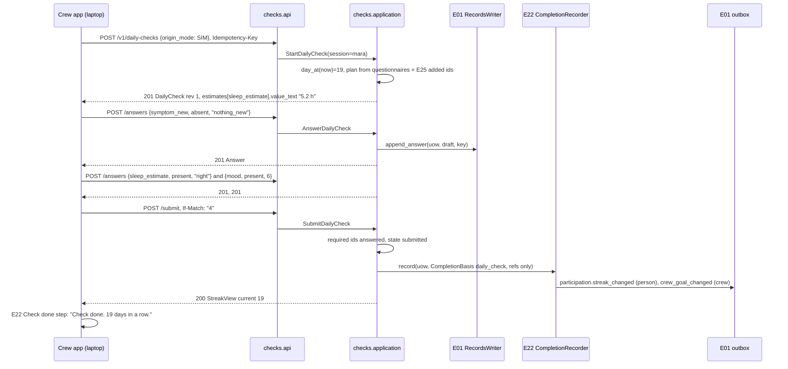

# E03: Crew experience and daily check

Technical design for epic E03. Inputs: the brief (`tdd/E03.md` in the planning package), PRD.md (sections 4.2, 4.6,
9 to 11), USE-CASES.md (UC01, UC13, UC24 and section 7), CONTRACTS.md (sections 4, 5, 7, 8, 9, 10, 11, 12, 15, 18, 19,
20), `api/openapi.yaml`, UX-DESIGN.md (sections 1, 2, 3.1, 3.2, 5, 7, 11, 12), VALIDATION.md, `backlog.json` (E03-01 to
E03-04), `docs/BUILD-CHARTER.md`, `AGENTS.md`, and the deployment research in
`crew-health-build-2026-11-14/research/` (`vehicle-computing.md`, `surface-mobility-comms.md`,
`medical-systems-standards.md`). `docs/SYSTEM.md` and `docs/DEPLOYMENT.md` do not exist yet; every point that depends on
them is marked "per SYSTEM.md" or "per DEPLOYMENT.md" and listed in section 14.

E03 builds two things. On the hub: the daily check workflow (DailyCheck, its answers, the journal, the reaction test) and
the Today and How you are view assembly. In the browser: the crew app shell, the design system reproduced from
`design/interaction-prototype.html` with the point cloud body renderer, Today, the daily check, How you are, the indicator and
measurement cards, sign in and profile. Every other epic's screen is built inside this shell and with these components.

## 1. Scope

### 1.1 Work packages

| Story | Delivers | Acceptance (backlog) | Traces to |
|---|---|---|---|
| E03-01 | Home (Today), the daily check flow (UC01), sign in, station mode, profile settings; the hub `checks` module (DailyCheck, answers through E01 records, journal) | A routine check completes with every optional field skipped | R03, R05, R24; V36, V42, V51, V67, V69; D02, D03 |
| E03-02 | Indicator cards (How you are: Sleep, Mood, Reaction time, Latest readings) and the generic measurement value card used by E05 | Every value shows time, origin, quality and an understandable next step | R03, R24; V35, V70; D01, D04 |
| E03-03 | The optional reaction test (PVT-B, client timing, hub scoring) | Raw timings retained; an interrupted test is invalidated and excluded from comparison; taking or skipping never changes participation | R03, R31; V41; D03 |
| E03-04 | The stage, the body map, the six Today cards, the card grid for every flow, marks, source swatches, designed states | Tokens, type scale, two-zone layout, six cards per UX 1.2; hover peeks, click locks, Escape returns; three marks; Live, Replay or Sim on every value; without WebGL all information stays in text | R24; V36, V49, V50; D01, D04, D07 |

Use cases: UC01 (daily check) end to end in the crew app; UC13 and UC24 only as "the check never shows misses or drills
as a cost". Section 7 of USE-CASES (screen elements) for Today.

### 1.2 Not delivered here

| Item | Owner |
|---|---|
| Answer and observation storage, records, idempotency store, outbox, SSE, audit, mission clock, configuration loader | E01 |
| Sessions, credentials, roles, roster, person origin routing, consent, the at-rest cipher | E02 |
| CheckCompletion, StreakView, PatchAward, CrewGoalView and the participation components (Daily check card body, Check done step, Your streak, Crew goal) | E22 |
| Concern flow, episode, red-flag handling after a red flag answer | E04, E11, E15 |
| Measurement requests and attempts (hub); the camera worker; device adapters; the band pipeline | E05, E06, E07, E08 |
| Warnings and the headline (E03 only mounts `WarningsTodoSection`) | E24 |
| Routine occurrences, misses, added questions (E03 only consumes the port) | E25 |
| Someone needs help screen, help button, broadcast line (E03 only mounts them) | E26 |
| Habitat view and card body, kit map card, plan screens | E23, E27, E28 |
| Insight and assistant panel content | E13 |
| Records view, How we know | E09 or E04 (per SYSTEM.md), E27 |
| Packaging, the native command, compose profiles, the accessibility audit of every text position (E20-04) | E20 |
| Demo fixture `demo-mara-fd19`, the walkthrough line | E21 |

### 1.3 Decisions

| ID | Decision | Alternatives considered | Selected and why | Failure mode and rollback |
|---|---|---|---|---|
| DE03-1 | UI framework | React; Svelte; plain DOM as in the prototype | Vue 3 (Composition API, `<script setup>`), Vite, TypeScript strict, Pinia, Vue Router 4: charter section 2 fixes Vue for Open MCT alignment | None to roll back; the prototype stays the visual reference |
| DE03-2 | Accessible controls | A component library (Headless UI, Radix Vue) | Own small components on native elements (`button`, `fieldset`, `input type=radio`, `input inputmode=decimal`) with `aria-pressed`, `aria-live`; no third party widget code to audit | Native semantics degrade gracefully on iPadOS Safari and older Chromium |
| DE03-3 | Body renderer integration | Rewrite in TypeScript; wrap a Three.js scene | Vendor `design/body-render.js` and `design/body-mesh.js` byte for byte into `ui/crew/public/vendor/`, load them as classic scripts before the app bundle, type `window.BodyRender` in `body-render.d.ts`, and wrap it in one `BodyFigure.vue` component. A SHA-256 guard test pins the copies to the design files | A changed design file fails the guard; the fix is to re-copy, never to edit the vendor copy |
| DE03-4 | Shared stage state (peek, lock) | Props drilling; an event bus | One Pinia store `useStageStore` (section 7.3) holding `peek`, `lock`, `lockSource` and `marks`; every card, vital, row and chip calls `peek(region)`, `lock(region, source)` or `release()`; `BodyFigure` and the title block only read it | A store bug cannot hide information: the text column renders from view data, not from the store |
| DE03-5 | Renderer while Someone needs help is open | Unmount the canvas; keep animating | On the E26 help route the shell sets `stage.helpOpen = true`: `BodyFigure` calls `stop()`, sets canvas opacity to the token value for 30% (UX 1.9) and calls `renderNow(true)` only when `focus` changes; the help screen is in the main bundle, so nothing waits on a chunk | If WebGL hangs, help still renders: help is DOM only and never awaits the figure |
| DE03-6 | Testing the no-WebGL fallback | Headless browser with WebGL disabled only | Both: Vitest with `BodyRender.mount` stubbed to return `null`, and Playwright with `--disable-webgl` and `--disable-3d-apis`; both assert the `no-gl` class and that every region name, value and mark word is still in the accessibility tree | n/a |
| DE03-7 | Where a daily check lives | Inside E01 records | Own module `crew_health.checks` (workflow and lifecycle) writing answers through the E01 `RecordsWriter` port; the journal in its own encrypted store (CONTRACTS 10) | The records port is the single writer of answers, so a rollback of `checks` leaves answers intact |
| DE03-8 | Abandonment at the day boundary | A sweeper job only | Lazy plus scheduled: every command first closes a `started` check of an earlier mission day; `Scheduler.call_at` at the next boundary closes the rest. Restart rebuilds the schedule from `started` rows | A missed timer is harmless: the lazy path closes the check on the next touch |
| DE03-9 | Client side storage of health data | IndexedDB queue of unsent answers for offline tablets | None. Answers are posted one at a time as they are given (each is durable on the hub); the page keeps only the unsent current answer in memory. Service worker caches the shell, fonts, renderer and configuration documents only, never `/v1/*` person data | A tablet that loses the hub loses at most the answer on screen; the hub keeps every earlier one (section 9) |
| DE03-10 | Reaction test timing | Server timed; Web Worker timers | Client times with `performance.now()` and the `requestAnimationFrame` timestamp of the frame that painted the stimulus; the hub scores the raw trials (section 3.4); request X-E03-6 for the endpoint | A device that cannot keep frame timing is marked `interrupted` with reason `timing_unreliable` |
| DE03-11 | Station mode on a shared laptop | Only personal sessions | The shell rests in a `station` session (habitat, broadcasts, crew goal, help) and a crew member signs in over it with their PIN; sign out or idle lock returns to station mode. This is how the ISS medical laptop is used (one shared machine, `vehicle-computing.md` 2.1.7 and 3.1) | If the station credential is not configured, the shell shows sign in only |
| DE03-12 | Another person's check | 403 UNAUTHORIZED_SCOPE; 422 IDENTITY_MISMATCH | `NOT_FOUND` (404) for every read or command on a check that is not the session person's, so existence is not revealed; `IDENTITY_MISMATCH` (422) only when `supersedes` names an answer of another person or another check | n/a |

## 2. Dependencies and seams

| Seam | Direction | Port, event or endpoint | Owner | Interim until available |
|---|---|---|---|---|
| Unit of work, migrations, connection | E03 uses | `crew_health.platform.application.UnitOfWork`; migration runner | E01 | none (S0) |
| Answers into records | E03 calls | `RecordsWriter.append_answer(uow, draft: AnswerDraft, *, idempotency_key: str) -> str`; `RecordsWriter.canonical_unit(code) -> str` | E01 | fake in tests |
| Answer reads for the DailyCheck | E03 calls | `AnswerReader.for_daily_check(daily_check_id: str) -> Sequence[AnswerRecord]` | E01 | request X-E03-12 |
| Observations for estimates and vitals | E03 calls | `ObservationReadPort.latest_accepted(person_id, codes, since) -> Sequence[ReadingView]` | E01 | as in E26 |
| Idempotency store | E03 uses | `IdempotencyStore` keyed by `(session actor, Idempotency-Key)`, 24 h (CONTRACTS 5) | E01 | none |
| In-transaction domain events | E03 publishes and subscribes | `DomainEventBus.publish(uow, event)`, `.subscribe(type, handler)` | E01 (per SYSTEM.md) | direct call in tests |
| Outbox and SSE | E03 publishes none of CONTRACTS 18 directly; the shell consumes `GET /v1/events` | `Outbox`, SSE | E01 | none |
| Audit | E03 writes | `AuditLog.append(AuditEvent)`, safe metadata only (never answer values or journal text) | E01 | none |
| Clock and mission clock | E03 reads | `Clock.now()`, `MissionClock.day_at(instant) -> MissionDayAt(day, version)`, `MissionClock.day_start(day) -> datetime` | E01 | request X-E03-13 for `day_start` |
| Scheduler | E03 uses | `Scheduler.call_at(key, at, handler)` idempotent by key | E01 (per SYSTEM.md) | lazy path only |
| Configuration | E03 reads | `ConfigReleaseReader.active()`, `.document(name)`; `LoaderCheckRegistry.register(name, fn)` | E01 | none |
| Template renderer | E03 calls | `TemplateRenderer.render(field_key, template, values)` | E01 | none |
| Session, roles, person | E03 reads | `Session` (actor, person_id, roles) injected by the API layer; `PersonDirectory.person(person_id) -> PersonRef | None` | E02 | none |
| Person origin | E03 reads | `RecordRouting.record_origin(person_id) -> OriginMode` | E02 | request in E30 X10; same port |
| At-rest cipher for the journal | E03 calls | `FieldCipher.seal(plaintext: bytes, *, purpose: str) -> bytes`, `.open(sealed: bytes, *, purpose: str) -> bytes` | E02 | request X-E03-14 |
| Check completion | E03 calls | `CompletionRecorder.record(uow, basis: CompletionBasis) -> CompletionOutcome` | E22 | fake returning `accepted` |
| Streak after submit | E03 calls | `StreakQueries.for_person(person_id, origin_mode, now) -> StreakView` | E22 | fake |
| Today participation parts | E03 calls | `StreakQueries.for_person(...)`, `CrewGoalQueries.for_origin(origin_mode, now) -> CrewGoalView` | E22 | fake |
| Added questions, misses, due today | E03 calls | `DailyCheckQuestionSource.added_questions(person_id, mission_day, at) -> Sequence[AddedQuestion]`; `RoutineTodayPort.due_today(person_id, at) -> Sequence[OccurrenceRef]` | E25 | none added |
| Routine summary for Today | E03 calls | `RoutineTodayPort.today_summary(session, at) -> TodayRoutinePart` | E25 | empty part with designed state |
| Warnings for Today | E03 calls | `WarningQueries.active_visible(session)`, `.headline(session)`, `.count_active_visible(session)` | E24 | none |
| Environment, sensors, ground link | E03 calls | `EnvironmentReader.today_part(session, at) -> TodayEnvironmentPart`; `SensorSummaryPort.today_sensors(at) -> Sequence[SensorSummary]` | E23 | request X-E03-15 |
| Insight and assistant state | E03 calls | `InsightQueries.current(session) -> Insight | None`; `AssistantStatusPort.state() -> AssistantState` | E13, E17 | `null`, `stopped` |
| Broadcasts | E03 calls | `BroadcastQueries.active_for(session) -> Sequence[CrewBroadcast]` | E26 | empty |
| Indicator summaries for How you are | E03 calls | `IndicatorSummaryPort.summaries(person_id, codes, at) -> Sequence[IndicatorSummary]` | Baselines owner per SYSTEM.md (assumed E14) | request X-E03-16 |
| Daily check submitted | E03 publishes | domain event `DailyCheckSubmitted(daily_check_id, person_id, mission_day, origin_mode, submitted_at)` | E03 | E25 marks the check occurrence done |
| Daily check abandoned | E03 publishes | domain event `DailyCheckAbandoned(daily_check_id, person_id, mission_day)` | E03 | E25 |
| Reaction test recorded | E03 publishes | domain event `ReactionTestRecorded(reaction_test_id, person_id, state, occurrence_id)` | E03 | E25 completes the occurrence |
| App shell, router, route registry, slot registry, API client, configuration cache, SSE client, stage store | E03 provides | `ui/crew/src/shell` (section 7.1) | E03 | consumers: every UI epic |
| Design system and `BodyFigure` | E03 provides | `ui/crew/src/design` (props in section 7.4) | E03 | consumers: E22, E24, E26, E27, E28, E30, E31, E32 |
| Help button, broadcast line, help route | E03 mounts | `HelpButton.vue`, `BroadcastLine.vue`, route `/help` and `/help/:id` | E26 | placeholders that link to E26 route |
| To do warnings section | E03 mounts | slot `today.todo.warnings` filled by E24 `WarningsTodoSection.vue` | E24 | empty slot |

Epics that depend on E03: E04, E22, E24, E25, E26, E27, E28, E30, E31, E32 (UI shell and design system); E22 (the
daily check calls its recorder; it calls nothing back); E10 and E26 (the journal canary fixture `fx_journal_canary`).

## 3. Domain model

Pure code in `hub/src/crew_health/checks/domain/`. No I/O, no framework imports, no clock reads: every function takes
`now` or the mission day as an argument.

### 3.1 Types

```python
OriginMode = Literal["LIVE", "SIM"]               # REPLAY never starts a check (CONTRACTS 8)
CheckState = Literal["started", "submitted", "abandoned"]
Presence = Literal["present", "absent", "unknown", "declined"]

@dataclass(frozen=True, slots=True)
class QuestionPlan:                               # built from questionnaires.json and E25 at start
    question_ids: tuple[str, ...]                 # daily_check.question_ids, then added ids, no duplicates
    required_question_ids: tuple[str, ...]        # daily_check.required_question_ids only (V51)
    added_question_ids: tuple[str, ...]
    repeat_question_ids: frozenset[str]           # added ids with repeat_after_minutes not null

@dataclass(frozen=True, slots=True)
class Estimate:
    question_id: str
    observation_id: str | None                    # None: no device estimate today (minimum setup)
    value_text: str                               # rendered by the hub (indicator-catalog decimals, unit_display)

@dataclass(frozen=True, slots=True)
class AnswerIntent:                               # parsed AnswerCreate, before validation against config
    question_id: str
    presence: Presence
    value: float | str | bool | None
    unit: str | None
    body_region: str | None
    laterality: str | None
    supersedes: str | None
    answered_at: datetime

@dataclass(frozen=True, slots=True)
class ValidatedAnswer:
    intent: AnswerIntent
    choice_id: str | None                         # the choice the value named, if any
    band_confirmation: bool | None                # True confirm, False correction, None otherwise

@dataclass(frozen=True, slots=True)
class DailyCheck:
    daily_check_id: str
    revision: int
    person_id: str
    mission_id: str
    mission_day: int
    origin_mode: OriginMode
    state: CheckState
    started_at: datetime
    submitted_at: datetime | None
    plan: QuestionPlan
    answered: Mapping[str, str]                   # question_id -> latest accepted answer_id
    estimates: tuple[Estimate, ...]
    band_confirmed: bool | None
    reaction_test_id: str | None
    observation_ids: tuple[str, ...]
```

### 3.2 State machine (CONTRACTS 4)

| From | Command or trigger | Guard | To | Effects |
|---|---|---|---|---|
| (none) | `start(person, day, origin)` | no check for (person, mission, day); origin equals the person's record origin | `started` | revision 1; plan frozen at start (V51) |
| (none) | `start` | a check exists for (person, mission, day) | unchanged | returns the existing check (200) |
| `started` | `answer(intent)` | check day equals today; question in plan; value valid (3.3) | `started` | revision + 1; `answered[q]` set |
| `started` | `submit(if_match)` | day equals today; `if_match == revision`; every required id answered in any presence | `submitted` | revision + 1; `DailyCheckSubmitted`; `CompletionRecorder.record` in the same unit of work |
| `started` | `close_if_past(today)` | `mission_day < today` | `abandoned` | revision + 1; `DailyCheckAbandoned`; no completion |
| `submitted` | `answer(intent)` | question in `repeat_question_ids` and not yet answered after its last repeat, or an optional question never answered | `submitted` | revision + 1; never touches completion |
| `submitted` | `attach_optional(kind, ref)` | reaction test, observation or journal flag of the same person and day | `submitted` | revision + 1; never touches completion |
| `submitted`, `abandoned` | `submit` | | unchanged | `INVALID_TRANSITION` (409) |
| `abandoned` | any command | | unchanged | `INVALID_TRANSITION` (409) |

`allowed_actions` is derived: `started` gives `["answer", "submit"]` (submit listed even when required answers are
missing; the server returns `INVALID_VALUE` with the missing ids, so the client never computes completeness);
`submitted` gives `["answer"]` while an optional or repeat question is open, else `[]`; `abandoned` gives `[]`. There is
no `abandon` command in `api/openapi.yaml`, so `abandon` is never listed (request X-E03-9 fixes the example).

### 3.3 Answer validation (per question kind, from questionnaires.json)

| Kind | Accepted `value` with `presence` | Rejected (`INVALID_VALUE`) |
|---|---|---|
| `presence`, `choice` | a choice `id` of the question, with `presence` equal to that choice's `presence` | an id not in `choices`; a presence that differs from the choice |
| `scale` | an integer in `[scale.min, scale.max]` with `present` | non integer, out of range, NaN, infinity |
| `duration` | a finite number `>= 0` with `unit` equal to the question `unit` (or convertible by `RecordsWriter.canonical_unit`) and `present` | missing unit, negative, NaN |
| `confirm_estimate` | the `id` of the choice with `opens: null` (a confirmation, `band_confirmation=True`), or a finite number `>= 0` in the question `unit` with `present` (a correction, `band_confirmation=False`) | a confirmation when the estimate's `observation_id` is `None` (nothing to confirm) |
| every kind | `value: null` with `presence` `unknown` or `declined` (UX 12: explicit "not sure" and "prefer not to say" on every question) | `value: null` with `present` or `absent` |

The confirmation stores what the person said (the choice id), never a copy of the estimate's number: the band's
Observation stays the only number, linked through `DailyCheck.estimates` (D02, AGENTS rule 5). `body_region`, when
given, must be in the `body-regions-1` set; otherwise the question default is stored. A choice with `opens` set
(`concern`, `help_flow`) is stored like any other answer; opening the flow is a client navigation (section 7.6).

### 3.4 Reaction test (PVT-B)

Parameters come from indicator-catalog `reaction_test` (request X-E03-7 adds them; sources: research RT26, the 3 minute
PVT-B with inter-stimulus interval 1 to 4 s including a 1 s feedback period, false start under 100 ms, lapse at 355 ms or
more, 30 s without response counted as a lapse with RT 30 s; RT25 records 130 ms as the ISS false start line).

```python
@dataclass(frozen=True, slots=True)
class Trial:
    index: int
    stimulus_at_ms: float | None        # rAF timestamp of the painted stimulus; None for a response with no stimulus
    response_at_ms: float | None        # None: no response before the timeout
    release_at_ms: float | None

TrialClass = Literal["valid", "lapse", "false_start", "timeout_lapse", "stuck_error"]

def classify(trial: Trial, p: ReactionParams) -> TrialClass: ...
def score(trials: Sequence[Trial], p: ReactionParams) -> ReactionSummary | NotScorable: ...
# ReactionSummary(median_rt_ms, lapses, false_starts, valid_count, params_version); NotScorable(reason)
```

Rules: RT = `response_at_ms - stimulus_at_ms`. `false_start` when there is no stimulus or RT `< p.false_start_ms`;
`timeout_lapse` when no response by `p.no_response_ms` (counted as a lapse with RT `p.no_response_ms`); `stuck_error`
when `release_at_ms - response_at_ms >= p.stuck_ms` (excluded); `lapse` when RT `>= p.lapse_ms`; otherwise `valid`. The
median uses valid and lapse trials. `NotScorable("too_few_trials")` when fewer than `p.min_scorable_trials` remain.
Any trial count above `p.max_trials` is rejected at the boundary (bounded input). State `interrupted` is never scored and
never compared: the summary is absent and the indicator views exclude it (E03-03).

### 3.5 Invariants

| ID | Invariant | Test |
|---|---|---|
| INV-E03-01 | At most one DailyCheck per (person, mission, mission day) | T-E03-001, T-E03-030 |
| INV-E03-02 | `submit` succeeds only when every required question has an accepted answer in any presence; a blank is never an answer | T-E03-002, T-E03-003 |
| INV-E03-03 | Completion facts sent to E22 carry references only: no value, presence, choice, estimate, reaction result or journal fact | T-E03-004 |
| INV-E03-04 | Optional parts (reaction test, observations, journal, band confirmation, added questions) never change state `submitted`, never call the recorder again and never gate submit | T-E03-005, T-E03-006 |
| INV-E03-05 | A check of an earlier mission day is never `started` after any command or the boundary timer | T-E03-007, T-E03-031 |
| INV-E03-06 | A confirmation answer never copies the estimate's value; the estimate observation is never modified | T-E03-008 |
| INV-E03-07 | `unknown` and `declined` are accepted on every question with `value: null`; neither is converted to `absent` | T-E03-009 |
| INV-E03-08 | An `interrupted` or not scorable reaction test produces no `pvt_*` observation | T-E03-010 |
| INV-E03-09 | Journal text exists only in the journal store, sealed; never in the main database, events, audit, logs or exports | T-E03-011, T-E03-060 |
| INV-E03-10 | The plan is frozen at start; required ids never include added ids | T-E03-012 |
| INV-E03-11 | REPLAY never starts a check; a start whose `origin_mode` differs from the person's record origin is `ORIGIN_MISMATCH` | T-E03-013 |

## 4. Application layer

`hub/src/crew_health/checks/application/` and `hub/src/crew_health/views/application/`. One unit of work per command:
state change, records write, audit event and domain events commit together or not at all.

### 4.1 Use cases

| Use case | Input | Output | Errors | Idempotency |
|---|---|---|---|---|
| `StartDailyCheck` | session, `DailyCheckCreate`, key, config release header | `(DailyCheck, created: bool)` | `UNAUTHORIZED_SCOPE` (role or no person), `ORIGIN_MISMATCH`, `INVALID_TRANSITION` (mission day outside the person's roster range), `DUPLICATE_COMMAND` | E01 store, key scoped to actor; a second start without a key returns the existing check (200) |
| `GetDailyCheck` | session, id | DailyCheck + ETag `"<revision>"` | `NOT_FOUND` (absent or another person's) | read |
| `AnswerDailyCheck` | session, id, `AnswerCreate`, key | Answer | `NOT_FOUND`, `INVALID_TRANSITION` (abandoned, past day, not answerable after submit), `INVALID_VALUE` (3.3), `IDENTITY_MISMATCH` (supersedes another person's or check's answer), `DUPLICATE_COMMAND` | records key `chk:{daily_check_id}:{question_id}:{Idempotency-Key}` |
| `SubmitDailyCheck` | session, id, `if_match`, key | StreakView (from E22) | `NOT_FOUND`, `VERSION_REQUIRED` (428), `STALE_VERSION`, `INVALID_TRANSITION`, `INVALID_VALUE` (missing required ids, listed in the problem `detail` by id), `DUPLICATE_COMMAND` | completion key built by E22 from the basis; replay of the same key returns the stored StreakView |
| `WriteJournal` | session, `JournalEntryCreate`, key | JournalEntry (`private: true`) | `UNAUTHORIZED_SCOPE`, `DUPLICATE_COMMAND` | journal store keeps `(actor, key) -> entry_id` for 24 h |
| `ListJournal` | session, cursor, limit | page of JournalEntry | `UNAUTHORIZED_SCOPE` | read; only the session person's entries |
| `RecordReactionTest` | session, `ReactionTestCreate` (X-E03-6) | ReactionTest | `INVALID_VALUE`, `NOT_FOUND` (occurrence or check not the person's) | key scoped to actor |
| `CloseStaleChecks` | `now` (scheduler) | count closed | none | key `checks:boundary:{mission_day}` |
| `GetTodayView` | session | TodayView | `UNAUTHORIZED_SCOPE` (no person) | read |
| `GetHowYouAreView` | session | HowYouAreView | `UNAUTHORIZED_SCOPE` | read |

Steps of `StartDailyCheck`: resolve `today = MissionClock.day_at(now)`; run `close_if_past` on the person's open check;
look up (person, mission, today); if present return it; check origin; build `QuestionPlan` from `questionnaires.daily_check`
plus `DailyCheckQuestionSource.added_questions`; build `estimates` for each `confirm_estimate` question from
`ObservationReadPort.latest_accepted(person, [answer_code], since=MissionClock.day_start(today - 1))`, because the
night the question asks about spans the day boundary; the observation must be accepted and of the person's origin.
`value_text` is rendered through `TemplateRenderer` from the indicator's `decimals` and `unit_display`; with no
observation it is ui-copy `designed_states.no_reading` and `observation_id` is `null`.

Steps of `SubmitDailyCheck`: lazy close; compare `if_match`; compute missing ids; transition; publish
`DailyCheckSubmitted`; call `CompletionRecorder.record(uow, CompletionBasis(basis="daily_check",
basis_ref=daily_check_id, patient_id, mission_id, origin_mode, occurred_at=submitted_at, original_offset,
actor_person_id=session.person_id, cause_kind=None, cause_ref=None, required_answers_complete=True))` (the exact field
set of E22 section 3.1); commit; then `StreakQueries.for_person` for the response.

### 4.2 Ports (Python protocols, `checks/application/ports.py`)

```python
class DailyCheckRepository(Protocol):
    def get(self, daily_check_id: str) -> DailyCheck | None: ...
    def for_day(self, person_id: str, mission_id: str, mission_day: int) -> DailyCheck | None: ...
    def open_before(self, mission_day: int, *, limit: int) -> Sequence[DailyCheck]: ...
    def insert(self, uow: UnitOfWork, check: DailyCheck) -> None: ...
    def update(self, uow: UnitOfWork, check: DailyCheck, *, expected_revision: int) -> None: ...  # raises StaleRevision
    def link_answer(self, uow: UnitOfWork, daily_check_id: str, question_id: str, answer_id: str,
                    choice_id: str | None, band_confirmation: bool | None) -> None: ...

class JournalStore(Protocol):
    def append(self, person_id: str, sealed_text: bytes, created_at: datetime, mission_day: int,
               idempotency_key: str) -> str: ...
    def page(self, person_id: str, cursor: str | None, limit: int) -> JournalPage: ...
    def exists_on(self, person_id: str, mission_day: int) -> bool: ...

class ReactionTestRepository(Protocol):
    def insert(self, uow: UnitOfWork, test: ReactionTestRecord) -> None: ...

class DailyCheckQuestionSource(Protocol):          # E25
    def added_questions(self, person_id: str, mission_day: int, at: datetime) -> Sequence[AddedQuestion]: ...
    # AddedQuestion(question_id: str, cause: Literal["overlay", "miss", "warning"], repeat_after_minutes: int | None)

class CompletionRecorder(Protocol):                 # E22
    def record(self, uow: UnitOfWork, basis: CompletionBasis) -> CompletionOutcome: ...

class StreakQueries(Protocol):                      # E22
    def for_person(self, person_id: str, origin_mode: OriginMode, now: datetime) -> StreakView: ...

class CrewGoalQueries(Protocol):                    # E22
    def for_origin(self, origin_mode: OriginMode, now: datetime) -> CrewGoalView: ...

class IndicatorSummaryPort(Protocol):               # baselines owner per SYSTEM.md
    def summaries(self, person_id: str, codes: Sequence[str], at: datetime) -> Sequence[IndicatorSummary]: ...
```

Provided to other modules:

```python
class DailyCheckQueries(Protocol):                  # E03 provides; E25, views
    def today_state(self, person_id: str, mission_day: int) -> DailyCheckState: ...
    # DailyCheckState(state: Literal["not_started", "started", "submitted"], daily_check_id: str | None)
    def journal_exists(self, person_id: str, mission_day: int) -> bool: ...   # boolean only; never text
```

### 4.3 Events

Published (in transaction, E01 `DomainEventBus`; none is a CONTRACTS 18 SSE type): `DailyCheckSubmitted`,
`DailyCheckAbandoned`, `ReactionTestRecorded` (fields in section 2). E22 publishes `participation.streak_changed` and
`participation.crew_goal_changed` from its recorder; E03 publishes nothing to the outbox, so no answer content can reach
the event stream through this module.

Consumed: `MissionClockCorrected` (E01; re-plan the boundary timer), `config.release_activated` (no stored state depends
on it: a started check keeps the questionnaire version it was started with, `answer.questionnaire_version`).

The crew app consumes over SSE: `participation.*`, `warning.*`, `routine.*`, `sensor.status_changed`, `insight.changed`,
`environment.activated`, `ground_link.changed`, `help.broadcast_changed`, `assistant.status_changed`,
`config.release_activated` (CONTRACTS 19 rows Today, Daily check, How you are, ground link indicator, broadcast line).

### 4.4 Sequence: principal success path (Mara, flight day 19, SIM)



### 4.5 Sequence: failure paths

```mermaid
sequenceDiagram
    participant T as Tablet (crew app)
    participant H as Hub
    T->>H: POST /answers (symptom_new)
    H-->>T: 201
    Note over T,H: Wi-Fi drops; tablet cannot reach the hub
    T->>H: POST /answers (sleep_estimate)
    H--xT: network error
    T->>T: shell marks hub unreachable; answer stays in memory; help screen still works from cache
    Note over T,H: mission day ends at 00:00 mission time; boundary timer fires
    H->>H: CloseStaleChecks: day 19 check started → abandoned (no completion)
    T->>H: retry POST /answers same Idempotency-Key
    H-->>T: 409 INVALID_TRANSITION (check abandoned)
    T->>T: show ui-copy check_flow_words.day_ended; offer today's check
    T->>H: POST /v1/daily-checks (day 20)
    H-->>T: 201 new check
```

## 5. Adapters

### 5.1 Main database (SQLite, STRICT, WAL, foreign keys on)

Migration `hub/src/crew_health/checks/adapters/migrations/0001_checks.sql`, registered with the E01 runner.

| Table | Columns | Constraints and indexes |
|---|---|---|
| `checks_daily_check` | `daily_check_id TEXT PK`, `revision INTEGER NOT NULL CHECK (revision >= 1)`, `person_id TEXT NOT NULL`, `mission_id TEXT NOT NULL`, `mission_day INTEGER NOT NULL`, `origin_mode TEXT NOT NULL CHECK (origin_mode IN ('LIVE','SIM'))`, `state TEXT NOT NULL CHECK (state IN ('started','submitted','abandoned'))`, `started_at TEXT NOT NULL`, `submitted_at TEXT`, `questionnaire_version TEXT NOT NULL`, `plan_json TEXT NOT NULL`, `estimates_json TEXT NOT NULL`, `band_confirmed INTEGER CHECK (band_confirmed IN (0,1))`, `reaction_test_id TEXT` | `UNIQUE (person_id, mission_id, mission_day)`; index `(state, mission_day)` for the boundary sweep; trigger forbids `state` leaving `submitted` or `abandoned` |
| `checks_answer_link` | `daily_check_id TEXT NOT NULL REFERENCES checks_daily_check`, `question_id TEXT NOT NULL`, `answer_id TEXT NOT NULL UNIQUE`, `choice_id TEXT`, `band_confirmation INTEGER`, `linked_at TEXT NOT NULL` | index `(daily_check_id, question_id, linked_at)`; append only (trigger blocks UPDATE and DELETE) |
| `checks_optional_part` | `daily_check_id TEXT NOT NULL`, `kind TEXT NOT NULL CHECK (kind IN ('observation','reaction_test'))`, `ref_id TEXT NOT NULL` | `PRIMARY KEY (daily_check_id, kind, ref_id)` |
| `checks_reaction_test` | `reaction_test_id TEXT PK`, `person_id`, `mission_day INTEGER`, `origin_mode`, `occurrence_id TEXT`, `daily_check_id TEXT`, `state TEXT CHECK (state IN ('completed','interrupted'))`, `interruption_reason TEXT`, `input_kind TEXT CHECK (input_kind IN ('keyboard','pointer','touch'))`, `device_class TEXT NOT NULL`, `params_version TEXT NOT NULL`, `trials_json TEXT NOT NULL`, `summary_json TEXT`, `recorded_at TEXT NOT NULL` | append only; `trials_json` length bounded by `max_trials`; index `(person_id, mission_day)` |

Answers themselves live in E01 records; `checks_answer_link` holds only ids and the choice id. `plan_json` and
`estimates_json` are parsed back through the domain types at load (Pydantic at the boundary).

### 5.2 Journal store (CONTRACTS 10)

A separate SQLite file `journal.db` in the hub data directory (path per DEPLOYMENT.md), opened by
`checks/adapters/journal_store.py` only. Table `journal_entry(entry_id TEXT PK, person_id TEXT NOT NULL, mission_day
INTEGER NOT NULL, created_at TEXT NOT NULL, sealed BLOB NOT NULL, idempotency_key TEXT NOT NULL, UNIQUE (person_id,
idempotency_key))`, index `(person_id, created_at DESC)`. Text is sealed with E02 `FieldCipher` (purpose `journal`)
before the insert. The file is excluded from backups that leave the hub and from every export (request X-E03-14 for the
E02 cipher; per DEPLOYMENT.md for backup rules). The FastAPI route for `POST /v1/journal` sets the E01 router option
that disables body logging (request X-E03-17).

### 5.3 Workers and timers

`CloseStaleChecks` runs from `Scheduler.call_at("checks:boundary:{d}", MissionClock.day_start(d), handler)` with
`d = today + 1`, re-armed after each run and on `MissionClockCorrected`; it closes at most `settings.checks.sweep_batch`
checks per transaction (bounded) and re-arms itself immediately if more remain. No external calls; no retries needed.

## 6. API

Router `hub/src/crew_health/checks/api/router.py` (checks, journal, reaction tests) and
`hub/src/crew_health/views/api/router.py` (Today, How you are). Models are generated from `contracts/`. Every mutating
call requires `Idempotency-Key`; `Config-Release` mismatch follows E01's rule. Errors are RFC 9457 with the codes below.

| operationId | Method and path | Roles | Request | Response | Errors |
|---|---|---|---|---|---|
| `startDailyCheck` | POST `/v1/daily-checks` | crew, crew_medical_officer | DailyCheckCreate | 201 or 200 DailyCheck | 400, 401, 403 `UNAUTHORIZED_SCOPE`, 409 `DUPLICATE_COMMAND`, `INVALID_TRANSITION`, 422 `ORIGIN_MISMATCH` |
| `getDailyCheck` | GET `/v1/daily-checks/{daily_check_id}` | crew, crew_medical_officer | none | 200 DailyCheck, ETag | 401, 403, 404 `NOT_FOUND` |
| `answerDailyCheck` | POST `.../answers` | crew, crew_medical_officer | AnswerCreate | 201 Answer, Location | 404, 409 `INVALID_TRANSITION`, `DUPLICATE_COMMAND`, 422 `INVALID_VALUE`, `IDENTITY_MISMATCH` |
| `submitDailyCheck` | POST `.../submit` | crew, crew_medical_officer | If-Match | 200 StreakView | 404, 409 `STALE_VERSION`, `INVALID_TRANSITION`, `DUPLICATE_COMMAND`, 422 `INVALID_VALUE`, 428 `VERSION_REQUIRED` |
| `writeJournal` | POST `/v1/journal` | crew, crew_medical_officer | JournalEntryCreate | 201 JournalEntry | 403, 409 `DUPLICATE_COMMAND` |
| `listJournal` | GET `/v1/journal` | crew, crew_medical_officer | cursor, limit | 200 page | 403 |
| `getTodayView` | GET `/v1/views/today` | crew, crew_medical_officer | none | 200 TodayView | 403 |
| `getHowYouAreView` | GET `/v1/views/how-you-are` | crew, crew_medical_officer | none | 200 HowYouAreView | 403 |
| (request X-E03-6) `recordReactionTest` | POST `/v1/reaction-tests` | crew, crew_medical_officer | ReactionTestCreate | 201 ReactionTest | 404, 409, 422 `INVALID_VALUE` |

Role note: `crew_medical_officer` uses these endpoints for their own check only; no endpoint here takes a person ID.
TodayView fields are assembled from the ports in section 2; `daily_check` from `DailyCheckQueries.today_state`; `streak`
and `crew_goal` from E22 for the session person's origin; `needs_attention_count` is
`WarningQueries.count_active_visible(session)` plus the open routine occurrences reported by E25 (E24 section 3.8).
Every request whose path, query or body has a field the schema lacks fails with `MALFORMED_REQUEST` (additional
properties are false in every request schema).

## 7. User interface

### 7.1 Application structure (`ui/crew/`)

| Path | Contents |
|---|---|
| `src/shell/` | `App.vue` (two zones), `router.ts` (static routes of E03 plus `import.meta.glob('../features/*/routes.ts', { eager: true })` for every feature's routes), `slots.ts` (same pattern for `features/*/slots.ts`: `{ slot, component, order }`), `api/client.ts` (generated types, Idempotency-Key per command, If-Match from ETag, Config-Release header, typed problem details), `api/events.ts` (one `EventSource` per session, `Last-Event-ID`, `410 CURSOR_EXPIRED` reload), `config/cache.ts` (`GET /v1/config`, `GET /v1/config/{name}`, kept in memory and in the service worker cache by version), `copy.ts` (`useCopy()` returns typed accessors into ui-copy; every word on screen goes through it), `session.ts` (station session, crew sign in over it, idle lock per E02 policy), `stage.ts` (Pinia stage store), `StageHead.vue` (brand, clock, mode marker, ground link word, `HelpButton`, person button), `StaleBanner.vue`, `sw.ts` (service worker) |
| `src/design/` | `tokens.css` (the `:root` of `interaction-prototype.html` verbatim), `cards.css` (`.g-green`, `.g-sun`, `.g-dusk`, `.g-deep`, paper), `type.css`, `fonts.css`, `BodyFigure.vue`, `body-render.d.ts`, `Card.vue`, `Pill.vue`, `Row.vue`, `SourceSwatch.vue`, `LevelTag.vue`, `Mark.vue` (dot, ring, dashed, tile), `DesignedState.vue`, `Steps.vue`, `NumberedStep.vue`, `RegionMenu.vue`, `ValueCard.vue`, `Skeleton.vue`, `ChoicePills.vue`, `NumberField.vue` |
| `src/features/today/` | `TodayView.vue`, the six card shells (`TodoCard`, `HowYouAreCard`, `HabitatCardSlot`, `ThisKitCardSlot`, `DailyCheckCardSlot`, `AssistantCardSlot`), `routes.ts` |
| `src/features/checks/` | `CheckView.vue`, `QuestionStep.vue`, `DueTodayStep.vue`, `JournalStep.vue`, `ReactionTest.vue`, `useDailyCheck.ts`, `routes.ts` |
| `src/features/how-you-are/` | `HowYouAreView.vue`, `SleepCard.vue`, `MoodCard.vue`, `ReactionCard.vue`, `LatestReadingsCard.vue`, `WhatThisMeansCard.vue`, `routes.ts` |
| `src/features/profile/` | `SignIn.vue`, `StationHome.vue`, `ProfileView.vue` (display preferences: reduced motion follows the OS; text size), `routes.ts` |
| `public/vendor/` | `body-render.js`, `body-mesh.js` (verbatim, SHA-256 pinned) |
| `public/fonts/` | the four `.woff2` files of `design/fonts/` (verbatim, SHA-256 pinned) |

Feature epics add `features/<name>/routes.ts` and `features/<name>/slots.ts`; E03 never edits their files and they
never edit `src/shell` (AGENTS rule 9). Slots defined by E03: `today.todo.warnings` (E24), `today.habitat` (E23),
`today.kit` (E27), `today.daily_check` (E22 `DailyCheckCardBody`), `today.assistant` (E13), `check.done` (E22
`CheckDoneStep`), `check.side.streak` (E22 `StreakCard`), `check.side.crew_goal` (E22 `CrewGoalRing`), `stage.head.help`
(E26 `HelpButton`), `screen.top.broadcast` (E26 `BroadcastLine`). Each slot declares the route `meta.surface` it may
appear on (section 7.8).

### 7.2 Layout

`App.vue` reproduces UX 1.2: `grid-template-columns: minmax(520px, 0.76fr) minmax(0, 1fr)` above 1180 px; stage on top
at 820 px from 721 to 1180 px; at 720 px and below the stage at 700 px, cards in one column in reading order. Cards use
the 24 column grid with 12 px gaps and the row template `minmax(0, 1fr) minmax(0, 1fr) minmax(0, 0.86fr)`. Each screen
declares its card placement as route meta `cards: Array<{ slot, kind, cols: [from, to], rows: [from, to] }>` copied
from the UX 1.2 table (layout, which a client may hold, CONTRACTS 11). No tab bar. Nothing scrolls horizontally at
any width from 320 px (NASA-STD-3001 Vol 2 Appendix F, research `medical-systems-standards.md`).

### 7.3 Stage store and the peek and lock machine

```ts
type Region = keyof typeof window.BodyRender.REGIONS;          // the 15 keys, equal to CONTRACTS 7
interface StageState {
  peek: Region | null;
  lock: Region | null;
  lockSource: string | null;      // id of the control that locked (gets aria-pressed="true")
  marks: Array<{ region: Region; kind: 'dot' | 'ring' | 'dashed'; ref: string }>;
  helpOpen: boolean;
  webgl: 'pending' | 'on' | 'off';
}
```

| State | Event | Next | Effect |
|---|---|---|---|
| rest | pointer enters a control naming R for 140 ms, or focus | peek R | `focus(R, { camera: false })` |
| peek R | pointer leaves, blur | rest | `focus(null, { camera: false })` |
| rest or peek | click, Enter or Space on a control naming R | lock R (source) | `focus(R)`; title crossfades to the region or symptom name; the reading replaces the vitals; `aria-pressed` on the source |
| lock R | same source again, Escape, Whole body, click on the figure | rest | `focus(null)`; rest title; vitals back |
| lock R | another control naming S | lock S | as lock |
| any | route change | rest | the new screen sets its own focus region from its data |
| any | `helpOpen` true | frozen | `stop()`; opacity 30% (UX 1.9); focus changes draw one `renderNow(true)` |

The 140 ms and 240 ms and 320 ms durations are UX 1.10 motion tokens in `tokens.css`, not data. Under
`prefers-reduced-motion: reduce` the figure mounts with `still: true` and transitions are off (UX 1.10).

### 7.4 `BodyFigure.vue`

Props: `marks` (from the store), `alertRegions: Region[]` (E24 warning lights), `landmark: { region: Region; offsetPx:
[number, number] } | null` (answers E30 X14: a DOM light placed with `BodyRender.project(BodyRender.point(region))`, so
the vendored renderer is not edited), `heartPeriodMs: number | null`, `breathsPerMin: number | null`. Behavior: on mount
call `BodyRender.mount(canvas, { breathsPerMin, still, onFrame, frame })`; when it returns `null`, set `webgl = 'off'`
and the `no-gl` class; the canvas is `aria-hidden="true"`; marks are DOM elements positioned in `onFrame` with
`project`; the loop stops on `visibilitychange` hidden and on `helpOpen`. `heartPeriodMs` and `breathsPerMin` come from
the latest accepted pulse and breathing values in the view (request X-E03-5 names which indicator codes drive them);
until then the heart dot does not beat and the renderer's own rest breathing applies, which UX 1.6 defines as motion,
not a reading. The figure carries no information that is not also in text (UX 1.11).

### 7.5 Today (`/`)

Loads `GET /v1/views/today` and, for the three stage vitals that TodayView lacks, `GET /v1/views/how-you-are` `vitals`
(request X-E03-4 adds `vitals` to TodayView; interim is this second call). Updates on the CONTRACTS 19 Today events.

| Element | Binds to | Words |
|---|---|---|
| Who-line | `person.display_name`, `environment.day_label`, `environment.place` | three hub strings in three spans; separator is CSS until X-E03-1 `shell_words.who_line` |
| Title | `headline.text` (E24) | hub string |
| Lights | `warnings[].body_region` via `alertRegions` | none |
| Vitals | HowYouAreView `vitals[]` first three in hub order: `value_text`, `label`, `SourceSwatch(origin_mode)` | `origin_words` |
| To do | `routine.counts`, `routine.next`, `needs_attention_count`; slot `today.todo.warnings` | `designed_states.nothing_due` when empty |
| How you are card | `HowYouAreView.indicators` (sleep, mood, reaction from catalog order) | indicator `label`, `delta_text` |
| Habitat, This kit, Daily check, Assistant | slots (E23, E27, E22, E13) | owners' |
| Daily check entry | `daily_check.state` and id; opens `/check` | X-E03-1 `check_flow_words.start`, `.continue`, `.done_today` |

### 7.6 Daily check (`/check`)

Right zone per UX 1.2: the check (paper, columns 1 to 14, rows 1 to 3), slot `check.side.streak` (15 to 24, row 1), slot
`check.side.crew_goal` (15 to 24, rows 2 to 3). Loads `POST /v1/daily-checks` (start or get today), `GET
/v1/config/questionnaires`; acts with answers, submit and `POST /v1/journal` (CONTRACTS 19).

Steps (`Steps.vue` shows current and completed steps, Appendix F.6.3): one step per id in `question_ids` order, with
consecutive `scale` questions on one step (layout rule); then **Due today** (from `due_today_occurrence_ids`, rows by
E25's `RoutineOccurrence` labels, opening the occurrence; the reaction test row when its occurrence is due); then
**Journal**; then slot `check.done` (E22). **Finish check** is enabled from the moment every required id is in the
check's `answers` (it reads `missing_question_ids` from the hub; the client computes nothing), and stays available on
every later step (UX 5).

Per question: text and hint from questionnaires; `{value}` replaced by `estimates[question_id].value_text` (CONTRACTS
11 allows this one client substitution); choices as `ChoicePills`; scale as a 0 to 10 pill row with the scale label;
duration and correction as `NumberField` that always shows the question unit (UX 12); explicit **Not sure** and **Prefer
not to say** on every question (posting `presence` `unknown` or `declined` with `value: null`), labelled from X-E03-2
(interim: `designed_states.unknown` and the daily check question's declined choice label). When a confirm estimate has
`observation_id: null` (no band: the minimum setup), the question renders its X-E03-3 `when_no_estimate` text; interim:
the indicator `label` of its `answer_code` with the `NumberField`, Not sure and Prefer not to say, and no confirm pill.
A choice with `opens: concern` routes to the E04 concern route after its answer is accepted; `opens: help_flow` routes
to E26 `/help` with `flow` set; `opens: correction` reveals the `NumberField`. The answer is posted on selection with a
fresh Idempotency-Key; a retry of the same answer reuses its key.

The symptom answer's region: the person may choose it on the figure or in `RegionMenu` (all 15 regions as buttons),
which posts `body_region` and draws a hollow ring (V50); laterality as pills from the `laterality` enum labelled from
X-E03-1 `check_flow_words.laterality`.

**Journal step**: a `textarea`, posted once with `POST /v1/journal`; the text is cleared from component state after the
201 and never written to any store, log or analytics. `listJournal` is shown only on this step, collapsed by default
(UX 2: the journal lives in the daily check and is never shown elsewhere).

### 7.7 Reaction test (`ReactionTest.vue`, inside Due today)

Full card, a single large target; stimulus is a counter on the green token; start requires an explicit press. Timing:
`stimulus_at_ms` is the `requestAnimationFrame` timestamp of the frame that first paints the stimulus; responses from
`keydown` (Space) or `pointerdown`, `event.timeStamp`; release from `keyup` or `pointerup`. ISI is drawn from a seeded
generator over `[isi_min_ms, isi_max_ms]` (configuration). Interrupted when `visibilitychange` hidden, `blur`, route
change, `helpOpen`, or when two consecutive frames are more than `frame_gap_ms` apart (configuration). On interruption
the test stops at once, posts `state: interrupted` with the reason and the trials so far, and shows X-E03-1
`check_flow_words.reaction_interrupted`. The card states that the test is optional and is not a fitness for duty test
(UX 5). Taking or skipping changes nothing in participation (no call to E22; T-E03-021).

### 7.8 Medical surfaces never show participation

Every route declares `meta.surface: 'everyday' | 'medical' | 'help' | 'station'`. Slots `today.daily_check`,
`check.done`, `check.side.streak`, `check.side.crew_goal` and any E22 or E31 participation component render only when
`surface === 'everyday'` (`SurfaceGate.vue` wraps them and renders nothing otherwise). E04, E05 during a concern, E13
assessment, E16 shared care, E26 help, E28 plans, E30 teach and E31 role routes declare `medical` or `help`. Test
T-E03-070 mounts every registered route and asserts no participation component and no ui-copy participation word in
the DOM (V43, D14, D27, D44).

### 7.9 Stage head (common dedicated area)

Always visible on every screen and width (Appendix F.4.2 f): brand mark (opens Today), the mission clock from `GET
/v1/context` `met` advanced locally from `server_time` (display only; re-synced on every context fetch), the mode marker
(a `SourceSwatch` with `origin_words[mission_mode]` whenever `mission_mode` is not `LIVE`, Appendix F.4.2 j), the ground
link word (`ground_link_words[status]`, `designed_states.ground_next_contact`), `HelpButton` (E26) and the person
button. UX 1.2 hides the clock at 720 px and below; question Q-E03-1 asks the user which rule wins. The broadcast line
(E26) sits above every crew screen.

### 7.10 States

| State | Detection | What shows |
|---|---|---|
| Loading | first fetch pending | `Skeleton` in each card's footprint; stage title empty; never a spinner over values |
| Empty | view list empty | `designed_states.nothing_due`, `designed_states.no_reading`, `designed_states.insufficient_data` per field |
| Error | problem detail | `error_messages[code]`; entered information preserved (UX 12) |
| Stale | an `EventSource` error or a failed fetch after the last success | `StaleBanner` with X-E03-1 `shell_words.stale_since` and the last `as_of`; values dimmed, never shown as current (Appendix F.4.3.1 c, AGENTS rule 5) |
| Hub unreachable | fetch network error | `shell_words.hub_unreachable`; help still opens from cache (E26) |
| LIVE, REPLAY, SIM | `origin_mode` on each value | `SourceSwatch` and `origin_words` on every value, row and reading (D01) |
| Unavailable | view field null or `not_available_here` | `DesignedState` with dashed ring |
| No WebGL | `mount` returned null | `no-gl` class; everything in text |
| Assistant stopped | `assistant_state` | `designed_states.assistant_stopped` (V69) |
| Model, devices, ground link absent | as above | nothing else changes (section 9) |

### 7.11 Indicator and measurement value cards (E03-02)

`ValueCard.vue` renders one value with five required parts: value with unit, time (`observed_at` as mission time), origin
(`SourceSwatch`), quality (word from the observation's `quality_status` through ui-copy), and next step (hub text). The
HowYouAreView lacks `observed_at` on indicators and lacks quality and next step on both lists: request X-E03-8. Interim:
time from `vitals[].observed_at` (indicators show the trend's last mission day), quality omitted with a `DesignedState`
"unknown" word, next step from `vitals[].detail`. The E03-02 acceptance is blocked on X-E03-8 and stated as such.

### 7.12 Accessibility (R24, V36)

Keyboard only completes the check (T-E03-080); focus ring 2 px green-2 with 2 px offset; `aria-live="polite"` on the
title block and on the step announcer; every mark has a word; pills 30 px and chips 26 px or larger; `RegionMenu`
reaches all 15 regions; numeric fields show units; no meaning by color alone; contrast per tokens (Q-E03-1 on 6:1).
Response time targets in section 11 follow NASA-STD-3001 [V2 10022].

### 7.13 No content in client code

Allowed literals: vocabulary keys, route names, CSS classes, slot ids, layout numbers from UX 1.2, motion tokens. A
scan test (T-E03-075, extends V75 and V98) parses every `.vue` and `.ts` under `ui/crew/src/{shell,design,features/today,
features/checks,features/how-you-are,features/profile}` and fails on any string literal shown to a person. T-E03-076
edits `questionnaires.json` (a question text, a choice label, the required list) and `ui-copy.json` (an origin word),
activates the release and asserts the rendered check changes with no rebuild.

## 8. Configuration

| Document | Fields read | Owner | Use |
|---|---|---|---|
| `questionnaires.json` | `questions[]` (all fields), `daily_check.{question_ids, required_question_ids, hint, done_text}`, `red_flags`, `question_sets` (only for ids added by E25) | E03 | plan, validation, check screen |
| `ui-copy.json` | `origin_words`, `body_region_labels`, `designed_states.*`, `error_messages`, `ground_link_words`, `level_words` (via E24 slot), `duration_words`, `skip_reasons`; after approval: `shell_words`, `check_flow_words`, `participation_words` (E22 reads) | E03 (per SYSTEM.md) | every word |
| `indicator-catalog.json` | `indicators[]` (`code`, `label`, `unit_display`, `decimals`, `body_region`, `trend_days`, `baseline`, `better`), `reaction_test` | E03 | estimates `value_text`, How you are, reaction test |
| `participation-rules.json` | none (E22) | E22 | |
| `routine-schedule.json`, `routine-rules.json` | none directly (E25 port) | E25 | |
| Mission clock | via `MissionClock` | E01 | day, boundary |

Loader checks E03 registers with `LoaderCheckRegistry` (in addition to the CONTRACTS 11 list):

| Name | Check |
|---|---|
| `checks.required_subset` | `daily_check.required_question_ids` is a non-empty subset of `daily_check.question_ids`, and every id exists in `questions` |
| `checks.confirm_estimate_shape` | every `confirm_estimate` question has a non-null `answer_code` present in indicator-catalog, a `unit`, exactly one choice with `opens: null` and one with `opens: correction` |
| `checks.presence_choices` | every `presence` question's choices have non-null `presence` |
| `checks.regions` | every `body_region` in questionnaires and indicator-catalog is in `body-regions-1`; `ui-copy.body_region_labels` keys equal the set |
| `checks.reaction_params` | after X-E03-7: `false_start_ms < lapse_ms < no_response_ms`, `isi_min_ms <= isi_max_ms`, `min_scorable_trials >= 1`, `max_trials` bounded |
| `checks.copy_keys` | after X-E03-1 and X-E03-2: every key the UI requests exists (generated list from `copy.ts`) |

Provenance: each document's `basis` and `to_be_set_by` are shown where the value is shown (the reaction lapse line shows
its basis). Configuration edit test: T-E03-076 (UI) and T-E03-040 (hub: changing `required_question_ids` changes what
`submit` requires, with no code change).

## 9. Deployment and fallbacks

### 9.1 Where E03 runs (tiers per DEPLOYMENT.md, provisional)

The tiers below come from the research (`vehicle-computing.md` 3.1 to 3.5, `surface-mobility-comms.md` 1.1 to 1.6) and
are provisional until DEPLOYMENT.md names them.

| Tier | Real precedent | Hub | Crew app clients | What E03 does differently |
|---|---|---|---|---|
| T1 Single device: one laptop and its webcam (the minimum setup) | ISS Medical Equipment Computer: one laptop with a medical software load, records stored and forwarded later; Orion: four Surface Pro PCDs with webcams already used for private medical conferences | `uv run crew-health` on the laptop, bound to `127.0.0.1` | The browser on the same laptop | Station mode at rest; each crew member signs in over it with a PIN and signs out (DE03-11). Every feature in this TDD works; the band estimate is absent, so sleep uses the no-estimate path (7.6) |
| T2 Habitat network | ISS SSC laptops and servers on the Joint Station LAN with iPads and Surface Pros as clients; Gateway "commercial laptop computers" as displays; ICSIS Wi-Fi 6, WPA2 minimum | Support laptop or server | Crew tablets (iPadOS Safari, Windows tablets) and laptops over HTTPS with a locally issued certificate; a station screen in station mode | Personal tablets keep personal sessions; the shell works with touch and cursor, loads nothing from the internet, and is measured on the slowest tablet (section 11). Hub address configured explicitly (no multicast discovery) |
| T3 Several hubs | Pressurized rover or second transit replica that stores locally and syncs "as bandwidth allows" | One hub per vehicle or habitat | As T2 | A crew member checks on whichever hub they are on. Two hubs may both start a check for the same person and day; the participation day still counts once (E22 rule 3). How DailyCheck ids stay unique across hubs and how the second check is reconciled are per DEPLOYMENT.md (Q-E03-3) |
| Ground | Open MCT console, read only | n/a | n/a | No E03 screen; the journal and daily check answers never reach the ground through E03 |

### 9.2 Fallback ladder for E03

| Missing part | What still works | How it shows | Test |
|---|---|---|---|
| Language model | Today, daily check, How you are, reaction test, journal | Assistant card `designed_states.assistant_stopped`; insight `null` | T-E03-090 (V69) |
| Wrist band | The check completes; sleep answered by number, Not sure or Prefer not to say | No confirm pill; no band anchor light | T-E03-091 |
| Camera, oximeter | Vitals show `designed_states.no_reading`; check unaffected | Tile mark, words | T-E03-092 |
| Ground link | Everything | Stage head link word and next contact | T-E03-093 |
| Tablets | The laptop is a complete station (T1) | none | T-E03-094 |
| WebGL | Everything in text | `no-gl` | T-E03-050, T-E03-051 |
| Hub unreachable from a tablet | Help from cache (E26); last views dimmed with time | `StaleBanner` | T-E03-095 |
| Service worker unsupported | App loads from the hub each time | none | T-E03-096 |

### 9.3 Critical paths: primary, backup, fail safe

| Path | Primary | Independent backup | Fail safe state | Test that removes the primary |
|---|---|---|---|---|
| Record entry (daily check answers) | Crew app posts each answer to the hub | Any other client (laptop browser, another tablet) on the same hub; the printed check card generated from `questionnaires.json` by E20 (dissimilar) | Unanswered stays unanswered; nothing is filled in | T-E03-097: kill the tablet session mid check, finish on the laptop |
| Stale value never shown as current | SSE keeps views current | Fetch failure and `EventSource` error mark the view stale | Dimmed with "since" time | T-E03-095 |
| Help reachable from every screen | E26 cached help in the main bundle | Hardware: the laptop alone | Help screen without network | E26 T-E26-100 on every E03 route (T-E03-098 registers the routes) |
| Journal privacy | Separate sealed store, no logging | Import-linter and canary scan of every other store | Write refused if the cipher is unavailable | T-E03-060, T-E03-061 |

## 10. Safety, security and privacy

| Hazard | Cause | Mitigation | Test |
|---|---|---|---|
| A blank read as "no symptom" | A default value or an unanswered pill | Only explicit answers are stored; `absent` only from a choice whose presence is `absent`; Not sure and Prefer not to say are separate states | T-E03-009 (R05) |
| A stale reading taken as current | Lost SSE, a sleeping tablet | Stale detection, dimmed values with time, never "safe" | T-E03-095 |
| The figure read as a measurement | Rest breathing or a beating heart with no reading | No beat without a reading; vitals always in text with source; the canvas is `aria-hidden` | T-E03-052 |
| A symptom drawn as a measurement | Wrong mark | `Mark.vue` takes `kind` from the object type (answer: ring; accepted observation: dot; gap: dashed); never from a value | T-E03-053 (V50, D07) |
| Pressure to shade an answer to keep a streak | Streak shown near medical content | `SurfaceGate`; done text from config; no value earns anything | T-E03-070, T-E03-004 |
| Reaction test used as fitness for duty | Misreading | Card says optional and not a duty test; interrupted tests excluded | T-E03-020 |
| Wrong person's check | Shared laptop | Session bound to person; 404 on others' checks; idle lock returns to station | T-E03-062 |
| Simulated data taken as real | Demo history | Swatch on every value; mode marker in the stage head | T-E03-054 (D01, V47) |
| Journal leakage | Logs, events, exports, the model | Separate encrypted store; no body logging; E03 publishes no event with text; import-linter forbids `assistant`, `tools`, `model`, `handoff`, `groundlink`, `catchup`, `reports`, `knowledge` from importing `crew_health.checks.adapters.journal_store` | T-E03-060, T-E03-061 (V26) |

Authorization: every endpoint reads the person only from the session (CONTRACTS 20); no endpoint takes a person ID;
`station` sessions get no check, journal, Today or How you are endpoints (403). Private data on clients: no person data
in `localStorage`, `sessionStorage`, IndexedDB or the service worker cache; Pinia stores are reset on sign out and idle
lock (T-E03-063). Audit: start, answer (ids only), submit, abandon and journal write (entry id only) are AuditEvents.
The assistant: E03 exposes no tool to the model; the model never answers a check question, never writes a journal entry
and never reads either.

## 11. Performance and resources

Budgets on the 16 GB laptop and on the slowest target tablet (Playwright with 4x CPU throttle as its proxy until a real
device is measured, `vehicle-computing.md` 3.2 lesson "response times were much slower than expected"):

| Measure | Budget | Test |
|---|---|---|
| Key press echo, pill press feedback | 100 ms (NASA-STD-3001 [V2 10022]) | T-E03-100 |
| New screen (route change to first meaningful paint) | 1.0 s [V2 10022] | T-E03-101 |
| Today first load, warm cache | 1.0 s to text; figure may complete later | T-E03-102 |
| `POST .../answers` hub time p95 | 50 ms | T-E03-103 |
| `GET /v1/views/today` hub time p95 | 150 ms with the demo fixture | T-E03-104 |
| Point cloud build | under 0.5 s (UX 1.6) | T-E03-105 |
| Initial JS bundle (shell, design, today, help) | 250 KB gzip, excluding the vendored mesh | T-E03-106 |
| Render loop | stopped when hidden or help is open | T-E03-055 |

Bounds: `trials_json` at most `max_trials`; journal entry text limited by X-E03-1 (interim 8,000 characters, the
`JournalEntryCreate` schema has no maximum: request X-E03-10); boundary sweep batch; SSE client keeps one connection and
one bounded reconnect backoff (`settings` per SYSTEM.md); the configuration cache holds one version per document plus
the previous one.

## 12. Test plan

Fixtures: `hub/tests/checks/conftest.py` loads `api/examples/config/*.example.json` through the real loader into a test
release (`example_release`); questions, choices and labels in tests are read from it, never typed. Demo fixture
`demo-mara-fd19` (E21) for end to end. Journal canary `fx_journal_canary` (E03, `hub/tests/fixtures/journal_canary.py`)
writes a unique phrase used by E10, E26 and E22 scans. Markers: `@pytest.mark.req("R05")`, `@pytest.mark.val("V42")`,
`@pytest.mark.demo("D03")`, `@pytest.mark.inv("INV-E03-02")`. UI tests: Vitest (`ui/crew/src/**/__tests__`), Playwright
(`ui/crew/e2e/`), recorded API examples from `api/examples`.

Critical paths first:

| Test ID | Level | Proves | Traces to |
|---|---|---|---|
| T-E03-001 | unit | Second `start` on the same day returns the same check | INV-E03-01 |
| T-E03-002 | unit | Submit with mood unanswered fails `INVALID_VALUE` listing `mood`; state stays `started` | INV-E03-02, R03 |
| T-E03-003 | property (Hypothesis) | For any subset and any presence mix of answers, submit succeeds iff every required id has an answer | INV-E03-02, V42 |
| T-E03-004 | unit | The `CompletionBasis` passed on submit equals a basis built from ids only; Hypothesis over answer values gives the same basis | INV-E03-03, R31, V41, V48 |
| T-E03-005 | integration | After submit, reaction test, observation and journal attach; recorder called exactly once; state stays `submitted` | INV-E03-04, D03 |
| T-E03-006 | integration | Complete the check with every optional part skipped | E03-01 acceptance, R03 |
| T-E03-007 | unit | Any command on a day 18 check on day 19 closes it `abandoned` first and returns `INVALID_TRANSITION` | INV-E03-05 |
| T-E03-008 | integration | Confirming the sleep estimate stores the choice id; the band observation row is byte identical before and after | INV-E03-06, D02 |
| T-E03-009 | unit | `unknown` and `declined` with `null` accepted for every question kind of the example release; never stored as `absent` | INV-E03-07, R05 |
| T-E03-010 | unit | Interrupted test and `NotScorable` produce no `pvt_*` observation | INV-E03-08, E03-03 |
| T-E03-011 | integration | Journal text is absent from the main database file, the audit table, the outbox and captured logs (byte scan for the canary) | INV-E03-09, V26 |
| T-E03-012 | unit | Added ids from E25 (CO2 questions) appear in `question_ids` and never in `required_question_ids` | INV-E03-10, V51 |
| T-E03-013 | unit | Start with `SIM` for a LIVE person is `ORIGIN_MISMATCH`; no row written | INV-E03-11, V47 |
| T-E03-014 | integration | "Prefer not to say" on the symptom question with sleep and mood answered: submit succeeds, one recorder call | V42 |
| T-E03-015 | integration | Station and Moon base overlays add their questions; required stays three | V51 |
| T-E03-016 | integration | A miss barrier question added by E25 is answerable after submit and never changes completion | V67, UC13 |
| T-E03-017 | unit | `confirm_estimate` confirmation rejected when `observation_id` is null; correction accepted | INV-E03-06, 7.6 |
| T-E03-018 | unit | `scale` 11, NaN, `"7"` and a missing unit on `duration` are `INVALID_VALUE` | R03, AGENTS rule 8 |
| T-E03-019 | unit | `supersedes` naming another person's answer is `IDENTITY_MISMATCH` | DE03-12 |
| T-E03-020 | unit | Classification: RT 99 false start, 100 valid, 354 valid, 355 lapse, no response timeout lapse at 30,000, release after 3,000 stuck error; params from the release | E03-03, RT26 |
| T-E03-021 | integration | Same run with and without a reaction test gives identical recorder calls and identical StreakView | D03, R31 |
| T-E03-022 | property (Hypothesis) | `score` is deterministic, order of input irrelevant to the summary, median within min and max of counted trials | E03-03 |
| T-E03-023 | unit (Vitest) | `ReactionTest.vue` posts `interrupted` with reason on `visibilitychange`, `blur` and route change | E03-03 |
| T-E03-030 | integration | Two concurrent starts (two connections) produce one row; the loser gets the same check | INV-E03-01 |
| T-E03-031 | integration | Boundary timer closes started checks; restart re-arms from rows; clock jump forward closes on next command | INV-E03-05 |
| T-E03-032 | integration | Kill the process after an answer commit and before the response; retry with the same key returns the same answer id | V35, AGENTS rule 6 |
| T-E03-033 | integration | Submit with a stale `If-Match` is `STALE_VERSION`; without it 428 | CONTRACTS 5 |
| T-E03-040 | integration | Editing `required_question_ids` in the release changes what submit requires, no code change | V75 |
| T-E03-041 | contract (Schemathesis) | Every E03 operation against `contracts/openapi.yaml`, including problem details | CONTRACTS 5 |
| T-E03-042 | contract | Responses for the demo fixture validate against `daily-check`, `answer`, `journal-entry`, `today-view`, `how-you-are-view` schemas | CONTRACTS 2 |
| T-E03-050 | unit (Vitest) | `mount` returning null sets `no-gl`; every value, region label and mark word is still in the DOM | E03-04, UX 1.6 |
| T-E03-051 | end to end (Playwright, WebGL disabled) | Today, check and How you are complete with all information in the accessibility tree | E03-04 |
| T-E03-052 | unit | No pulse value: heart dot does not beat; vitals show the no-reading word | AGENTS rule 5 |
| T-E03-053 | unit | Answer gives ring, observation dot, gap dashed; ring drawn around a dot at a shared region | V50, D07 |
| T-E03-054 | end to end | Every value on Today has exactly one source word; mode marker shown in SIM | D01, V47 |
| T-E03-055 | unit | Loop stops on hidden and on `helpOpen`; resumes after | UX 1.6, DE03-5 |
| T-E03-056 | unit | Peek and lock state table of 7.3, including Escape, Whole body and second press | E03-04 |
| T-E03-057 | contract | Region sets equal: CONTRACTS 7, `BodyRender.REGIONS` keys, `ui-copy.body_region_labels` keys, `common.schema.json` enum | V49 |
| T-E03-058 | contract | SHA-256 of vendored renderer, mesh and fonts equals `design/` files | DE03-3 |
| T-E03-059 | end to end | Visual parity: computed styles of tokens, grid columns and the six Today cards match `interaction-prototype.html` and the prototype at 1440, 1024 and 390 px | E03-04 |
| T-E03-060 | integration | Journal canary absent from every non journal SQLite file, logs, outbox, events and export | V26, R20 |
| T-E03-061 | static | import-linter contract: forbidden importers of the journal store | V26 |
| T-E03-062 | integration | Mara's session gets 404 on Tomas's check id for get, answer and submit | R32, DE03-12 |
| T-E03-063 | end to end | After sign out and idle lock, no person data in any browser storage or cache | CONTRACTS 10 |
| T-E03-070 | end to end | Every route with `surface` `medical` or `help` renders no participation component and no participation word | V43, D14, D27, D44 |
| T-E03-075 | static | Client scan finds no person facing literal | V75, V98 |
| T-E03-076 | end to end | Edited question text, choice label and origin word appear after activation, no rebuild | V75 |
| T-E03-080 | end to end | Keyboard only: complete the check, lock and release a region with the region menu, identify unknowns | V36, R24 |
| T-E03-081 | end to end | With color removed (grayscale filter), states and marks are identifiable by words and shapes | V36 |
| T-E03-090 | end to end | Model stopped all day: check completes; Assistant card says stopped | V69 |
| T-E03-091 | end to end | No band: sleep by number and by Prefer not to say both complete the check | 9.2, minimum setup |
| T-E03-092 | end to end | Camera and oximeter absent: vitals show no reading; check completes | 9.2 |
| T-E03-093 | end to end | Ground link down: nothing changes except the link word | D34 style, 9.2 |
| T-E03-094 | end to end | Laptop only (T1): Today, check, How you are, help | 9.2 |
| T-E03-095 | end to end | Hub stopped mid session: stale banner, dimmed values with time, help still opens | Appendix F.4.3.1 c |
| T-E03-096 | unit | Service worker absent: app loads; no person data cached when present | DE03-9 |
| T-E03-097 | end to end | Tablet session killed mid check; laptop continues with prior answers intact | 9.3 |
| T-E03-098 | end to end | Help button present and first in the stage head tab order on every E03 route | D15 |
| T-E03-100 to 106 | benchmark | Section 11 budgets | [V2 10022], UX 1.6 |
| T-E03-110 | end to end (eval) | Act 2: Mara answers nothing new, confirms sleep, mood 6, submits; streak 18 to 19, crew 23 to 24 of 28 (E22 values) | D03, D02, D04 |

Branch coverage target 95% on `checks/domain`, `checks/application`, `views/application`.

## 13. File ownership

Creates and owns:

```
hub/src/crew_health/checks/__init__.py
hub/src/crew_health/checks/domain/{__init__,types,daily_check,answers,plan,reaction,errors}.py
hub/src/crew_health/checks/application/{__init__,ports,provided,start,answer,submit,close_stale,journal,reaction,events}.py
hub/src/crew_health/checks/adapters/{__init__,sqlite_repository,journal_store,reaction_repository,scheduler_hooks,loader_checks}.py
hub/src/crew_health/checks/adapters/migrations/0001_checks.sql
hub/src/crew_health/checks/adapters/journal_migrations/0001_journal.sql
hub/src/crew_health/checks/api/{__init__,router,errors}.py
hub/src/crew_health/views/__init__.py
hub/src/crew_health/views/application/{__init__,ports,today,how_you_are}.py
hub/src/crew_health/views/api/{__init__,router}.py
hub/tests/checks/**
hub/tests/views/**
hub/tests/fixtures/journal_canary.py
ui/crew/{package.json,vite.config.ts,tsconfig.json,index.html,playwright.config.ts,vitest.config.ts}
ui/crew/src/main.ts
ui/crew/src/shell/**
ui/crew/src/design/**
ui/crew/src/features/today/**
ui/crew/src/features/checks/**
ui/crew/src/features/how-you-are/**
ui/crew/src/features/profile/**
ui/crew/public/vendor/{body-render.js,body-mesh.js}
ui/crew/public/fonts/*.woff2
ui/crew/e2e/{today,check,how-you-are,shell,surfaces,no-webgl,parity,keyboard,offline}.spec.ts
config/questionnaires.json
config/ui-copy.json
config/indicator-catalog.json
eval/scenarios/e03/**
```

Import-linter contracts for `crew_health.checks` and `crew_health.views` are contributed to the E01 configuration
(per SYSTEM.md). `ui/crew/src/features/<other>/` belong to their epics.

Reads, never edits: `contracts/**`, `design/**` (binding), `api/examples/**`, the other `config/*.json`, research files.

## 14. Open questions and requests

Questions:

1. **Q-E03-1 (USER).** NASA-STD-3001 Vol 2 Appendix F asks for text contrast of 6:1 or better (10:1 preferred) and for
   the time to be visible at all times. The binding design has ink-3 at 4.6:1 on the page (UX 1.11) and hides the clock
   at 720 px and below (UX 1.2). Keep the design as is, or darken ink-3 and keep a short clock on phones? Interim: the
   design as written.
2. **Q-E03-2.** Views ownership (Today, How you are) per SYSTEM.md; this TDD assumes E03, as E24 does.
3. **Q-E03-3 (per DEPLOYMENT.md).** Multi hub: unique DailyCheck ids across hubs (node prefix?) and the rule when two
   hubs hold a check for the same person and day. Interim: ids are `dck_` plus a UUID; a second hub's check is a
   separate record and participation counts the day once.
4. **Q-E03-4 (per DEPLOYMENT.md).** Hub data directory, journal file location, backup exclusion, TLS certificate
   issuance for T2 tablets, idle lock time (E02 policy).
5. **Q-E03-5.** Baselines owner for `IndicatorSummaryPort` (assumed E14).

Requests (to `docs/requests/E03.md`; none implemented until approved):

1. **X-E03-1 Shell and check words.** Add to `config-ui-copy.schema.json` (required) `shell_words`: `who_line` (`{name}`,
   `{day_label}`, `{place}`), `whole_body`, `body_regions`, `stale_since` (`{time}`), `hub_unreachable`, `sign_in`,
   `sign_out`, `pin_label`, `station_title`, `mode_marker` (`{origin_word}`), `card_titles` (object keyed by slot id);
   and `check_flow_words`: `start`, `continue`, `done_today`, `finish`, `next`, `back`, `not_sure`, `prefer_not`,
   `step_labels` (object: `questions`, `due_today`, `journal`, `done`), `due_today_empty`, `journal_prompt`,
   `journal_saved`, `journal_private`, `day_ended`, `laterality` (one per enum value), `reaction_intro`,
   `reaction_not_duty`, `reaction_start`, `reaction_interrupted` (`{reason}`), `reaction_reasons` (one per reason),
   `declined_self`. Add the placeholders to CONTRACTS 11. Reason: E03-01 and E03-04 need these words and CONTRACTS 11
   forbids them in code. Interim: the existing keys named in 7.5, 7.6 and 7.10 where one fits; a control with no
   configured word is still built and tested against a test release that adds the proposed keys, and the E03 done
   criterion stays blocked until X-E03-1 is approved. No word is written into client code meanwhile.
2. **X-E03-2 Explicit unknown and declined.** Either add to `questionnaires.daily_check` `not_sure_label` and
   `prefer_not_label`, or confirm the X-E03-1 keys; and confirm that the hub accepts `unknown` and `declined` with
   `value: null` for every question kind (UX 12, CONTRACTS 8 "in any presence state"). Interim: as 3.3.
3. **X-E03-3 No estimate (minimum setup).** Add to the question schema for `confirm_estimate` a required
   `when_no_estimate: {text, hint}` (no `{value}` placeholder) used when `estimates[].observation_id` is null. Reason: on a
   laptop with no band the required sleep question otherwise reads "The band estimates No reading last night". Interim:
   7.6.
4. **X-E03-4 Vitals and figure motion on Today.** Add to `today-view.schema.json` required `vitals` (same item shape as
   HowYouAreView `vitals`) and `figure: {pulse_bpm: number | null, breaths_per_min: number | null, as_of}` from the
   latest accepted, non stale observations. Reason: UX 1.2 and 1.6 show three vitals and a beat from data, and CONTRACTS
   19 loads only `GET /v1/views/today`. Interim: a second call to `GET /v1/views/how-you-are`.
5. **X-E03-5 Figure codes.** Add to `indicator-catalog` `figure: {heartbeat_code, breathing_code, rest_breaths_per_min,
   basis}`. Reason: which indicator drives the heartbeat and breathing is content; UX 1.6 states 14 per minute at rest.
   Interim: no beat; renderer default breathing.
6. **X-E03-6 Reaction test endpoint.** Add `POST /v1/reaction-tests` (`recordReactionTest`, roles crew and
   crew_medical_officer, Idempotency-Key) with `ReactionTestCreate {occurrence_id: id | null, daily_check_id: id | null,
   origin_mode: LIVE | SIM, state: completed | interrupted, interruption_reason: hidden | blur | route_change | help_opened
   | timing_unreliable | null, input_kind: keyboard | pointer | touch, device_class: string, params_version: string,
   started_at: instant, trials: [{index, stimulus_at_ms: number | null, response_at_ms: number | null, release_at_ms:
   number | null}] (maxItems from configuration)}` and response `ReactionTest {reaction_test_id, ..., summary:
   {median_rt_ms, lapses, false_starts, valid_count} | null, observation_ids}`. The hub writes `pvt_median` and
   `pvt_lapses` observations (acquisition `derived`) only for `completed` and scorable tests. Reason: E03-03 needs raw
   timings retained and hub side scoring (CONTRACTS 19: screens never compute). Interim: the reaction test row shows
   `designed_states.not_available_here`; demo history stays SIM fixtures; E03-03 is blocked.
7. **X-E03-7 Reaction test parameters.** Extend `indicator-catalog.reaction_test` with required `duration_seconds` (180),
   `isi_min_ms` (1000), `isi_max_ms` (4000), `false_start_ms` (100), `no_response_ms` (30000), `stuck_ms` (3000),
   `min_scorable_trials`, `max_trials`, `frame_gap_ms`, each with `basis`; set `lapse_ms` `basis` to `sourced` citing
   RT26 (the example says "team default, not sourced"); note that RT25 uses 130 ms for false starts on the ISS. Values
   without a source (`min_scorable_trials`, `max_trials`, `frame_gap_ms`) carry `to_be_set_by: clinical review`.
8. **X-E03-8 Five parts of a value.** Add to `how-you-are-view` `indicators[]` required `observed_at: instant | null`,
   `quality: {status, word} | null`, `next_step: string | null`; to `vitals[]` `quality` and `next_step`; next steps
   rendered by the hub from a new indicator-catalog `next_steps` object keyed by view `state`. Reason: E03-02 acceptance.
9. **X-E03-9 Example fixes.** `api/examples/check/answer.json` `value` "no" should be the choice id `nothing_new`;
   `check/daily-check-started.json` lists `abandon` in `allowed_actions`, but no abandon command exists.
10. **X-E03-10 Journal bound.** Add `maxLength` to `JournalEntryCreate.text` (proposal 8000) so the request path is
    bounded (AGENTS code rule 2).
11. **X-E03-11 Participation words** are requested by E22 (`participation_words`); E03 owns the document and accepts.
12. **X-E03-12 Answer reads** (E01): `AnswerReader.for_daily_check(daily_check_id) -> Sequence[AnswerRecord]`.
13. **X-E03-13 Mission day start** (E01): `MissionClock.day_start(mission_day) -> datetime` under the clock version in
    force.
14. **X-E03-14 Field cipher** (E02): `FieldCipher.seal/open` with a `purpose` label; key held by E02; refuses when the key
    is absent.
15. **X-E03-15 Today parts** (E23): `EnvironmentReader.today_part` returning the TodayView `environment` object and
    `SensorSummaryPort.today_sensors`.
16. **X-E03-16 Indicator summaries** (baselines owner): `IndicatorSummaryPort.summaries` returning `today`, `usual`,
    `delta_text`, `state`, `trend`, `origin_mode`, `source_label`, `observed_at`.
17. **X-E03-17 No body logging** (E01): a router option that keeps request and response bodies of a route out of every
    log.
18. **X-E03-18 CONTRACTS 19 How you are row** lists participation loads, while UX 11 says participation appears only on
    Today's Daily check card and in the check. Proposal: move those loads to the Daily check row. Interim: How you are
    shows no participation; the check screen's side cards load them (E22).
19. **X-E03-19 Keepalive interval.** Add `event_keepalive_seconds` to `context.schema.json` so a client can detect a
    silent stall. Interim: stale only on `EventSource` error or a failed fetch.

## 15. Build plan

| Step | Work | Done when |
|---|---|---|
| 1 | Domain types, state machine, answer validation, reaction scoring | T-E03-001 to 013, 017 to 022 green; 95% branch on domain |
| 2 | SQLite repository, migrations, triggers, journal store with the E02 cipher fake | T-E03-011, 030 to 033 green |
| 3 | Use cases, ports, E22 and E25 fakes, boundary timer | T-E03-005, 006, 014 to 016, 040 green |
| 4 | API routers, error mapping, Schemathesis | T-E03-041, 042, 062 green |
| 5 | Views assembly with fakes of E13, E22, E23, E24, E25, E26 | T-E03-104 within budget; schema valid against examples |
| 6 | Crew app shell, design system, vendored renderer, tokens, slot and route registries | T-E03-050 to 059 green |
| 7 | Today, check, How you are, sign in, station mode | T-E03-070, 075, 076, 080, 081, 090 to 098 green |
| 8 | Reaction test (after X-E03-6 and 7) | T-E03-020 to 023 green |
| 9 | Performance and the eval scenario | T-E03-100 to 106 within budget; `e03` scenarios green |

Gate commands (charter section 8):

```
uv run python scripts/validate_contracts.py
uv run mypy --strict hub/src/crew_health/checks hub/src/crew_health/views
uv run ruff check . && uv run ruff format --check .
uv run lint-imports
uv run pytest -q hub/tests/checks hub/tests/views --cov=crew_health.checks --cov=crew_health.views --cov-branch
pnpm -C ui/crew typecheck && pnpm -C ui/crew test
pnpm -C ui/crew exec playwright test
uv run pytest -q eval -m "e03"
```
