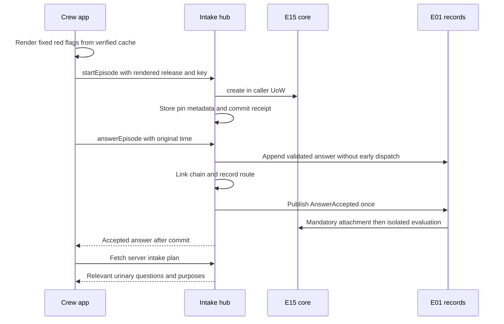
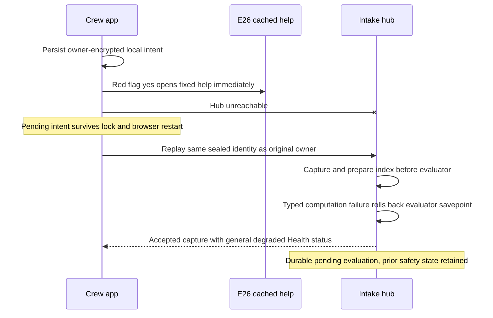

# E04: Guided complaint intake

Technical design. Binding inputs: `AGENTS.md`, `docs/SYSTEM.md`, `docs/DEPLOYMENT.md`,
`docs/requests/COORDINATOR-DECISIONS.md` Part A and `docs/BUILD-CHARTER.md`. Product citations below are relative
to `docs/product/`. S means SYSTEM.md; C means CONTRACTS.md. All implementation tests are planned, not run.
Pending contracts are in `docs/requests/E04.md`; a proposed interface is not a production agreement.

## 1. Scope

Deliver E04-01 complaint routing/shared fields, E04-02 authored family-specific optional forms, and E04-03 onset,
negation and append-only corrections (brief `tdd/E04.md`, backlog.json E04-01/02/03). Own the intake application
of C2 Answer provenance, C5 start/answer intents, C9 privacy, C11 questionnaire checks and C19 concern projection.
Owns CONTRACTS sections 1 and 7 for intake provenance and symptom-region behavior; shared implementations and other
objects retain their S4.2 owners.

Requirements: R04, R05, R07 (intake applicability, not the measurement gate). Contributions: R02, R06, R15, R20,
R24, R25, R28, R31, R43. Scenarios: V09, V12, V14, V15, V16, V17, V25, V26, V35, V36, V40, V43, V50, V61;
D05, D07, D14. Flows: UC01 concern entry, UC08 steps 1 to 3, UC16 model-off recording.

E04 authors intake content through E03, including usable capture for every assessment family and independently
checked route/missing-data expectations. It does not claim diagnostic coverage from family membership (VALIDATION 4).
E15-core owns Episode creation, concern/onset, revision, state and timeline; E01 owns immutable Answers. E11 owns
urgency and inference gating, E26 fixed help, E03 profile/configuration files, E02 consent, E22 participation and
E05/E27 measurement feasibility. No device, model or ground-link read is required for intake.

### 1.1 Rule trace

Each row identifies an applicable normative sentence, its implementation and planned evidence. C2 objects not owned
by intake, measurement workflows in C3/4 and plan/participation derivations remain with their S4.2 owners.

| Source line / rule | Design section | Test ID |
|---|---|---|
| PRD.md:480 R04 progressive relevant intake | 3, 8 | T-E04-011, T-E04-060 |
| PRD.md:481 R05 four presence states, blank not negative | 3 | T-E04-001, T-E04-003 |
| PRD.md:483 R07 context/capability/consent | 3, 10; E05/E27 own acquisition gate | T-E04-041, T-E04-042 |
| PRD.md:198 narrative or area, fixed red flags first | 4, 6, 7 | T-E04-080, T-E04-091 |
| CONTRACTS.md:7 synthetic identity never presenter, no guessed association | 3, 4 | T-E04-040, T-E04-042 |
| CONTRACTS.md:9 preserve original/observed/received times and onset precision | 3.1 | T-E04-030, T-E04-031 |
| CONTRACTS.md:13 no sentinel; correction links without erasure | 3, 5 | T-E04-001, T-E04-020 |
| CONTRACTS.md:25 Answer version, presence, sensitivity, supersession | 3, 8 | T-E04-002, T-E04-062 |
| CONTRACTS.md:68 identity and roles from session only | 4, 10 | T-E04-042 |
| CONTRACTS.md:188 journal author only, never prompts/indexes/exports/events | 10 | T-E04-070 |
| CONTRACTS.md:203 concurrency and reconnect, D17 task distinction | 4, 5 | T-E04-022, T-E04-044 |
| CONTRACTS.md:210 durable idempotency, overridden by D6 | 4, 7 | T-E04-043, T-E04-097 |
| CONTRACTS.md:214 rendered Config-Release mismatch | 4, 6, 8.1 | T-E04-064 |
| CONTRACTS.md:220 ErrorEnvelope, documented codes, configured words, never message | 6, 7 | T-E04-080 |
| CONTRACTS.md:265 human answers sequential, controller proposals | 3, 10 | T-E04-071 |
| CONTRACTS.md:267 controller scope, no model urgency or chart writes | 10 | T-E04-071 |
| CONTRACTS.md:269 new answer makes concurrent model output stale | 4; E13 owns stale guard | T-E04-051 |
| CONTRACTS.md:299 symptom region default/person selection | 3 | T-E04-033 |
| CONTRACTS.md:318 absent/unknown/declined words only, no mark | 7 | T-E04-098 |
| CONTRACTS.md:308 region not guessed; invalid value rejected | 3 | T-E04-033 |
| CONTRACTS.md:309 band never stored as body_region | 3 | T-E04-033 |
| CONTRACTS.md:310 optional laterality in words | 3, 7 | T-E04-033, T-E04-095 |
| CONTRACTS.md:311 mark derived, never stored/chosen by model | 7 | T-E04-098 |
| CONTRACTS.md:414 SIM never enters LIVE | 3, 10 | T-E04-040 |
| CONTRACTS.md:416 no private data in evaluation screenshots | 10, 12 | T-E04-070 |
| CONTRACTS.md:419 urgent response cannot wait on optional parts | 4, 9 | T-E04-050, T-E04-092 |
| CONTRACTS.md:425 completion independent of optional/private outcomes | 4; E15/E22 own completion | T-E04-099 |
| CONTRACTS.md:426 personal participation owner only | 7, 10 | T-E04-094, T-E04-099 |
| CONTRACTS.md:433 encryption, namespaces and restore consistency | 5, 9 | T-E04-044, T-E04-097 |
| CONTRACTS.md:439 no hardcoded content | 7, 8 | T-E04-093, T-E04-100 |
| CONTRACTS.md:441 allowed client constants; keys never display words | 7 | T-E04-093 |
| CONTRACTS.md:518 raw-byte version hash, display version not identity | 8 | T-E04-064 |
| CONTRACTS.md:521 pins, D1 overrides warning removal clearing | 8.1 | T-E04-064 |
| CONTRACTS.md:527 invalid release rejected, no downgraded finding | 8 | T-E04-063 |
| CONTRACTS.md:536 question/flow references | 8 | T-E04-063 |
| CONTRACTS.md:541 templates use allowed placeholders only | 8 | T-E04-063 |
| CONTRACTS.md:548 hub templates, configured unknown on missing value | 7, 8 | T-E04-093 |
| CONTRACTS.md:983 scoped event delivery, no other person's participation | 4, 10 | T-E04-070, T-E04-042 |
| CONTRACTS.md:1018 hub computes state/labels; refetch after activation | 6, 7 | T-E04-096 |
| CONTRACTS.md:1045 first help question before network | 7, 9 | T-E04-092 |
| CONTRACTS.md:1046 model/link absence changes no capture behavior | 9 | T-E04-050 |
| CONTRACTS.md:1080 session is sole identity/role source | 4, 10 | T-E04-042 |
| CONTRACTS.md:1092 x-roles enforced | 6 | T-E04-080 |
| CONTRACTS.md:1108 one hub command atomically commits state/audit/outbox | 4 | T-E04-044 |
| CONTRACTS.md:1109 injected time, observed-time ordering | 3.1 | T-E04-031 |
| CONTRACTS.md:1110 deterministic rendering/derived IDs | 3, 4; S5.1 | T-E04-012 |
| CONTRACTS.md:1111 revision/ETag owned by Episode provider | 4, 6 | T-E04-080 |
| CONTRACTS.md:1112 no model/network/ground wait, D17 internal tasks | 4, 9 | T-E04-050 |
| CONTRACTS.md:1113 missing words/numbers require configuration | 8, 11 | T-E04-100 |

## 2. Seams

Hard dependencies are E01, E02, E03, E23 and E15-core (S9); E10 is optional. Read provider designs E01, E02, E03,
E10, E11, E12, E13, E15, E20, E23 and E26 before binding these rows. S5 prevails over retired signatures in older
providers. Missing record, offline and episode declarations are R-E04-7/9/11, not consumer-local replacements.
All imports across modules end at `application.ports` (S6.4); the composition root late-binds reverse consumers.

| Name | Provider epic | Consumer epics | Signature or payload with types | SYSTEM section / status |
|---|---|---|---|---|
| Identifier allocation | E01 | E04 | IdFactory.new(prefix: str) -> str; derived(prefix: str, *parts: str) -> str | 5.1, exact declarations |
| Time and mission labels | E01 | E04 | Clock, TimeInput, NormalizedTime, ClockCorrections, MissionClock | 5.2/5.3, exact declarations |
| Units and errors | E01 | E04 | Quantity, Unit, UnitRegistry, ProblemError, FieldError, StorageUnavailable | 5.4/5.5 |
| Release readers and checks | E01 | E04 | ConfigReleaseReader.active/release; ConfigReader.document; ReleaseCheck.check(candidate) -> tuple[Finding, ...] | 5.6 |
| UoW and snapshots | E01 | E04 | UnitOfWorkFactory.begin, ReadSnapshotFactory.snapshot; uow.publish/audit/replicate/savepoint | 5.7 |
| Durable commands | E01 | E04 | CommandIdentity, IdempotencyStore, ResultVisibility, CommandReceipts | 5.8, exact methods |
| Recovery and registration | E01 | E04 | EvaluationIsolation.run/retry/pending, TaskQueue, HubSettings.integer/quantity/boolean/text; ModuleRegistry | 5.10.1/5.10.2/5.11/5.12 |
| Session and grants | E02 | E04 | SessionContext; ConsentQueries.allows(view, *, subject_person_id: str, recipient: str, scope: tuple[str, str]) -> bool | 5.7/8.3; E02 2, field binding pending R-E04-7 |
| Mission facts | E23 | E04 | MissionStatePort.current(uow: UnitOfWork or ReadSnapshot or None = None) -> MissionFacts or None | 4.4/8.5; E23 4.2; pass caller snapshot |
| Record capture/query/event | E01 | E04, E11, E15 | AnswerQuery, append types and AnswerAccepted including immutable answer, episode/mission and time/release references | 4.2/8.6; E01 2 record consolidation pending R-E04-11 |
| Episode core (proposed EpisodePort) | E15-core | E04 | create(uow, draft: NewEpisode) -> EpisodeRef; facts(uow, episode_id: str) -> EpisodeFact or None; record_route/view use provider declarations | 4.4/8.1; R-E04-7 canonical export pending; no EpisodeKernel alias |
| IntakeQueries | E04 | E12, E13 | allowed_question_ids(uow: UnitOfWork, episode_id: str) -> frozenset[str]; next_question_ids(uow: UnitOfWork, episode_id: str) -> tuple[str, ...] | 4.2; E12 2, E13 4.2; authorized patient-bound work only |
| Historical sensitivity | E04 | E15 | QuestionSensitivity.is_restricted(questionnaire_version: str, question_id: str) -> bool | 8.1; E15 4.2; unavailable metadata denies disclosure before this boolean is used |
| Missing questions | E04 | E15 | IntakeGaps.not_answered(uow: UnitOfWork, episode_id: str) -> tuple[str, ...] | 8.1; E15 4.2; bounded current plan |
| Allowed human reply | E04 | E13 | Same AnswerConcern command as HTTP, with SessionContext, pin, TimeInput, supersedes and CommandIdentity | 8.6; choice-only provider proposal incomplete, R-E04-9 |
| Offline documents/commands | E20 | E04 | DocumentStore and DurableCommandQueue.enqueue/drain/lock/quarantine use E20 client agreement; immutable dependency keys | 4.4/8.3/8.6; E20 4/7; R-E04-9 pending |
| Immediate help | E26 | E04 client | openHelpSession via generated HelpSessionCreate; entry.kind red_flag requires Episode ref_id; before identity use button/self | 8.1; E26 3/6; no invented ref_id |
| Red-flag backup | E11 | E04 integration | AnswerAccepted classification and E26 engine help effect; no direct E04 urgency command | 8.1/8.6; E11 3.2/4; historical fallback forbidden by S5.6 |
| Family/source validation | E10 or E01 offline equivalents | E04 checks | ConditionRegistryPort.condition_status(condition_id); SourceRegistryPort.resolve_many(source_ids, extra=()) -> ResolutionReport or RegistryUnavailable | 5.12/8.1; E10 4; family reference retention R-E04-5 |

E04 publishes no new public Event type. `config.release_activated` carries ConfigRelease under C18/S5.7;
its consumer refetches configuration and views. E15's proposed episode event is not assumed approved. E04 does not
call E22: E15 owns the concern/update completion seam, bound after providers register (S9).

## 3. Domain model

Generated enums preserve C11 presence, region, laterality and complete LIVE/REPLAY/SIM vocabulary. New EpisodeCreate
accepts only LIVE/SIM as its schema specifies; historical REPLAY remains readable and labeled, never a new completion.
Wire Answer nullability is preserved, including value, unit, body_region, laterality and supersedes. At the boundary,
map duration values into S5.4 Quantity with UCUM; other scalar answers retain their generated type. No local enums,
AnswerCommand/AnswerFact/ValidAnswer record DTOs or Session type duplicate the pending E01 declarations.

`IntakeCatalog` is immutable, keyed by release ID and raw questionnaire/reference hashes. `Route` contains nullable
module ID, basis pending/answer/fallback/conflict and nullable area-answer reference. `QuestionPlan` has ordered
eligible, next and not-answered IDs plus red_flags_complete. `ChainRow` is an internal index row described in section 5,
not a shared Answer. Answer validation returns the E01 typed append input or a typed ProblemError.

| Decision / invariant | Behavior | Tests |
|---|---|---|
| I1 explicit absence | Blank, skip, timeout, normal measurement, free text and model output create no absent answer. No choice/scale/duration default | T-E04-001/003/090 |
| I2 total routing | No area answer means pending; present routing choice selects its validated module; unknown/declined selects fallback. Absent/malformed choices reject. Conflicting heads give conflict, not an arbitrary route | T-E04-012/013 |
| I3 ordered planning | Required pinned red flags first, then area, shared and relevant module questions; stable first-occurrence deduplication. Red flags have no environment, sensitivity or ask_if suppression | T-E04-010/063 |
| I4 relevance | New questions pass explicit environment, module, ask_if and object/field authorization. Restricted questions require current configured relevance, purpose and decline option; never shared by default | T-E04-011/012/041 |
| I5 historical correction | Correction history is separate from current eligibility. A previously answered hidden question can be corrected with its original definition/version, explicit supersedes and current field access. Never reoffer it as a new assistant question | T-E04-014/020/064 |
| I6 no erasure | Same patient/episode/question and current head required for authoritative correction. Append replaces a head, never old content; divergent imported branches remain visible and unresolved | T-E04-021/022/065 |
| I7 provenance | Actor from SessionContext; mission/person/origin partition validated before write. Times preserved, no receive-time freshness substitution | T-E04-030/040/042 |
| I8 safety independence | No model/device/link/help persistence precondition on capture or cached help. Missing red flags or pending safety evaluation blocks inference; no failed evaluation lowers safety | T-E04-050/051/066 |
| I9 fail-closed metadata | Every question has dictionary classification, scalar component if needed and provenance. Missing/mismatched historical metadata makes it unavailable, never clinical by default | T-E04-062/064 |
| I10 no clinical telemetry | General audit/logs/metrics contain opaque references and operational codes only, never question/presence/route pairs, symptom counts or text | T-E04-070 |

Kind rules: choice/presence requires a configured choice ID with exactly matching presence and no unit. Scale requires
a finite integer in its configured inclusive bounds. Duration requires a finite nonnegative Quantity with the exact
configured unit; no heuristic conversion. Text is a bounded self-report string under R-E04-1. Unknown/declined on
scale/duration/text has null value and no unit. Explicit absence is available only through an authored choice.
Structured report/examination fields use E05/E09, never an intake string promoted to a confirmed finding.

Region comes from the question default when omitted, or the person's explicit fixed-set choice including null.
Laterality is optional and requires a region; invalid/band regions reject. No region is inferred from narrative.
One area is active per concern; an unrelated complaint starts another Episode. Keyword/model routing was rejected
because negation is ambiguous and deterministic intake must work without inference (PRD 4.3/9).

### 3.1 Time

Use S5.2 Clock/ClockCorrections and one `uow.now` per command; S5.3 provides versioned mission labels for E15/E22.
Preserve original answered_at/onset, source clock, segment, capture revision, normalization revision/uncertainty,
original offset where known, entered time and received time internally. The closed wire body lacks this provenance;
shared boundary binding is R-E04-9/11. An unmapped device time stays unknown, never guessed from receipt.

A clock-ahead answer or onset is captured with visibly uncertain/future timing, not rejected merely for exceeding
receipt time, clamped or overwritten. Onset precision is exact/hour/day/unknown, with at null exactly for unknown;
omitted onset maps to `{at: null, precision: unknown}`. Hour/day represent approximate stated time, not rounded
stored data or invented precision. A correction is E15's attributed onset history, under the same time policy.

Causal supersedes and committed sequence determine head/history order, never received_at then ID. Delayed or duplicate
input cannot overwrite newer state or clear a later warning. D3 freshness uses normalized observation time with its
uncertainty; unknown/future/regressed times cannot clear safety state. No intake clinical deadline exists. Shared
retry/lease timers are elapsed (S5.10); corrections recompute their anchors, while absolute consent expiry and stated
onset instants do not shift. Test forward/backward jumps, equal raw times in different segments, delayed red flags,
mission-day boundaries and restart. D14's REPLAY sensor freshness exception does not turn an Answer into LIVE data.

## 4. Application layer

Both commands authenticate, enforce operation roles/current object access, construct S5.8 identity binding operation,
normalized target, semantic parameters including rendered pin/origin, and keyed clinical-body fingerprint. Lookup is
before mutable preconditions and repeated inside the UoW; authorize stored-result visibility before replay. D6 handles
24-hour cache expiry with its exact accepted_command receipt, never re-execution. No private body in the ledger.

| Command | Unit of work and order | Crash / error boundary |
|---|---|---|
| StartConcern (`startEpisode`) | S5.7 begin with SessionContext actor/identity. Verify subject, mission/current environment, origin and rendered release. Validate entry/onset. E15-core create owns public concern/onset; insert intake_concern pin metadata, E15 completion intent, reference-only audit/replication and receipt; return authorized Episode after commit | Before commit none accepted; after commit all references/pins/core/receipt survive. Lost response reuses key. Storage/audit/ledger failures roll back all, visible unsaved |
| AnswerConcern (`answerEpisode`) | Same UoW. Read Episode home/patient/mission/origin and pinned catalog. Validate current eligible question or explicit historical correction, rendered release, value/unit/region and expected head. Append through E01 without early dispatch, link intake_chain and update route through EpisodePort, then publish AnswerAccepted once. Mandatory episode attachment precedes registered isolated evaluators. Record receipt/audit/replication and commit | Producer rejection commits no Answer. Typed evaluator failure commits valid capture plus E01 pending marker/retry/reference-only fault audit; safety unchanged. Storage/I/O/integrity/auth/config/input errors abort everything. R-E04-11 must settle append/dispatch binding before integration |
| GetIntakePlan / history | S5.7 ReadSnapshot, current object/field grant, historical metadata and bounded heads/page; server computes plan and correction eligibility | No mutation; missing metadata denies disclosure. No substitute client calculation |
| Rebuild chain | S5.10.1 internal task with immutable source checkpoint, paged causal staging and one S5.7 index-generation publication, R-E04-11 | No public Job kind. Partial generation never served; restart resumes or discards staging, old validated generation remains |

AnswerAccepted carries the exact provider payload, not a second E04 event. E11/E15/E13 reactions use S5.7 stable
FIFO handler ordering and S5.10.2 EvaluationIsolation for computation only. E04 index/route preparation is a mandatory
producer step, not an evaluator whose failure could be hidden. No arbitrary handler-name order may make a subscriber
observe an unlinked answer. E15 mandatory attachment failure aborts; its derived computations use D13. E13 continuations
are durable postcommit work; no inference call holds the writer. A pending safety evaluator prevents a new model turn.
Public Health.status supplies a general configured degraded notice; do not invent evaluation fields before approval.





The second diagram requires R-E04-9's dependency binding when no Episode ID exists. Fixed help itself is already
independent. A permanent computation failure exhausts bounded automatic attempts but leaves pending work visible;
operator retry keeps the same completion_id. Test marker/audit/commit failure as storage failure, not degraded success.

## 5. Adapters

E04 owns `intake_concern` and `intake_chain` per S4.2. E15 retains the public concern and onset, with no competing
copy in E04. All tables are STRICT; migrations use S5.7/S7.2 expand then contract. Software rollback does not drop
accepted data or E01/E15 tables. No feature-local migration, ledger, sync or clock implementation.

| Table | Columns / constraints / indexes |
|---|---|
| intake_concern | episode_id PK; patient_id, mission_id, origin_mode, home_node_id, config_release_id, questionnaire_version, families_version, dictionary_version, required_red_flag_ids, active_chain_generation; validated IDs/hashes, bounded configured lists. No narrative or onset duplication |
| intake_chain | generation, answer_id, episode_id, question_id, nullable supersedes, commit/causal reference, branch status, is_head (0/1) and nullable historical release reference. PK generation/answer_id; indexes generation/episode/question/is_head and generation/supersedes. Derivable metadata only, no answer values/presence/received-time ordering |

Authoritative append checks current head at the home hub inside its single writer UoW. Concurrent corrections:
exactly one accepts; the other gets INVALID_VALUE at /supersedes with current_state null and refetches. Replication
uses S5.7.1 authorized projections, never applies replica data as commands or authoritative clinical rows. A unique
successor/root/head constraint must not destroy accepted divergent branches during import/rebuild.

Causal rebuild reads bounded E01 pages at a stable checkpoint, processes parents before children, and retains
competing children. Missing parent leaves the generation pending and visibly unavailable; a cycle or changed
same-ID payload is integrity failure. Duplicate identical import is a no-op. No wall-time sort chooses a winner.
A validated complete generation replaces the active index atomically; source changes require checkpoint reconciliation
under R-E04-11. Historical records are mission-long, never deleted to fit an interactive bound. Conflict blocks new
routing/guidance, preserves both records and existing safety state; resolution API remains off pending that request.

Configuration parsing/validation happens at startup or bounded historical loading through S5.6; cache eviction never
deletes retained documents. Intake has no model/device/transport client. In-process queries still have bounded rows,
bytes and an execution deadline; SQLite busy timeout alone is insufficient (section 11).

## 6. API

Base operations are copied exactly from `api/openapi.yaml`; pending additions are separately identified below.
Generated models parse boundaries, then map to domain/kernel types; no shared hand-written wire types.

| operationId | Method/path | Request / response | Contracted errors |
|---|---|---|---|
| startEpisode | POST /v1/episodes | EpisodeCreate / 201 Episode, Location; response Config-Release and correlation header | 400 MALFORMED_REQUEST; 401 UNAUTHENTICATED; 403 UNAUTHORIZED_SCOPE; 409 DUPLICATE_COMMAND; 415 UNSUPPORTED_MEDIA_TYPE; 422 ORIGIN_MISMATCH; default INTERNAL_ERROR |
| answerEpisode | POST /v1/episodes/{episode_id}/answers | AnswerCreate / 201 Answer, Location; response Config-Release and correlation header | Same base errors plus 404 NOT_FOUND; 422 IDENTITY_MISMATCH, INVALID_VALUE |

Both require Idempotency-Key and crew/crew_medical_officer role, with the authenticated patient as writer; an officer
cannot answer for another patient. Answers have no If-Match; explicit supersedes is their concurrency check. Episode
ETag is E15 getEpisode's revision; startEpisode's base response does not declare an ETag. Existing-object denial is
UNAUTHORIZED_SCOPE under S8.3 before clinical fields/conflict details; genuinely absent IDs return NOT_FOUND with
no clinical metadata. Role, missing grant and forbidden field checks apply to every response and replay.

Pending R-E04-4 documents required errors; base 422 ORIGIN_MISMATCH does not authorize INVALID_VALUE on create.
C5's Config-Release active mismatch rule is enforced, never ignored. No historical/red-flag exception is assumed
approved: R-E04-10 requests it. Until accepted, mismatched commands stay unaccepted/queued with their original pin;
no active-version relabel or automatic key replacement. New entry without an explicit header uses the snapshot's
active release under the base contract; E04 clients always send the rendered pin.

Area-only entry needs R-E04-1 plus R-E04-2 and the entry change in R-E04-12. No narrative is synthesized from an area
label. Omitted onset already maps to unknown (3.1). Proposed getEpisodeIntake and listEpisodeAnswerHistory in
R-E04-2 are delivery prerequisites, not existing operationIds. No client-routed interim ships.

Schema-valid answer correction rejection, HTTP 422 (message is safe configured developer text, never clinical):

```json
{"code":"INVALID_VALUE","message":"Invalid input","retryable":false,
 "field_errors":[{"field":"/supersedes","code":"not_current","message":"Invalid input"}],
 "correlation_id":"corr_intake_1","current_state":null,"supported_alternative":null}
```

Accepted base request example: `{"concern_text":"A concern","origin_mode":"SIM"}` with omitted onset; an answer
example is `{"question_id":"red_chest","presence":"unknown","value":"not_sure","answered_at":"2026-11-14T12:00:00Z"}`.
These are labeled SIM contract examples, not default production data; tests load configured IDs rather than literal
clinical inputs. D5 uses ErrorEnvelope on wire and reference-only RFC 9457 logs (S5.5); field_errors is an array of
JSON-pointer entries. D6's authorized accepted_command is the sole effective duplicate receipt exception to null
current_state; mismatch/ordinary validation never carries an Answer or Episode there.

## 7. User interface

Use E03's shell, BodyFigure, accessibility and medical-surface gate. Text, hints, purpose, notice, precision and
presence words come from validated questionnaires/ui-copy, never TS literals. Server views own all routing,
eligibility, correction eligibility, labels and unanswered state (C19). Responses remain memory-only P2 views.

| Component / binding | Behavior and states |
|---|---|
| Concern entry, startEpisode | Narrative or selected area after R-E04-12; optional onset defaults unknown. Loading, unsaved, queued, accepted, rejected, offline, unavailable and timing-uncertain are distinct |
| Fixed red flags, cached verified questionnaires and E26 entry | Display all required red flags together before any response/model request, with no narrative/save/sign-in precondition on fixed help. Yes opens the configured cached flow first; unknown remains unknown and visibly offers help; declined stays declined |
| Module flow, proposed getEpisodeIntake | One server-selected question at a time; purpose and decline option on relevant sensitive questions. Empty/unanswered never means absent. Missing/stale historical metadata is unavailable, never replaced with current wording |
| Correction history, proposed listEpisodeAnswerHistory | Explicit original version and supersedes; rerouted/hidden historical questions remain here only with current field permission; conflict shows both authorized branches |
| Optional assistant | Receives only server next-question IDs after E11 gating. Stopped/unavailable continues deterministic order; human answer uses the ordinary command path |

Show LIVE/REPLAY/SIM and original time/uncertainty on every relevant answer. D07/V50 uses E03's hollow symptom ring
for present only; absent/unknown/declined have words and no ring. Never turn a report into a measurement dot. No
participation UI on concern/history/shared-care surfaces (D14). Keyboard, focus, screen reader purpose and non-color
presence states are tested (V36). No preselected choice, scale thumb or duration value.

Use E20's encrypted owner-partitioned command journal (S8.6, DEPLOYMENT 5.5). Lock/sign-out/expiry/revocation/owner
switch removes plaintext, keys, rendered views and pending render callbacks before station/another owner appears;
it retains ciphertext and immutable keys. A new owner/officer cannot decrypt or replay it. Owner restart/unlock
and current hub authorization are separate checks. Quota/full disk refuses new queue admission visibly before any
claim of durability; existing commands are never silently discarded. Lost response and several-week retry use D6.
R-E04-9 blocks dependency replay until shared create-ID recovery is tested. No P2 view is persisted to bridge that gap.

On activation, refetch configuration and server views; open work retains its pins. Poll/refetch after commands and
on reconnect within named bounds, without assuming an undeclared episode event. No cache computation of eligibility
when the hub is down: fixed emergency content and owner-encrypted unaccepted intents remain available.

## 8. Configuration

Read questionnaires.json, ui-copy.json, responder-flows.json for flow validation, and environment-profiles.json for
explicit environment applicability, all through S5.6 ReleaseHandle/ConfigReader. Retained assessment-families.json
and input-dictionary.json hashes are R-E04-5. Schemas are their C11 `config-*.schema.json` files; extensions/content
are R-E04-1/3/5. Source IDs resolve under the full loader inventory, including E01 offline equivalents if E10 is absent.
All module/question/component content has provenance. Part A Q23 fixes the package location. Q1/Q7/Q18 and A3 change
the visible clinical-review notice to "not clinically reviewed"; review absence alone never blocks runtime use.
Withdrawn content, absent source/purpose/applicability or rejected validation still blocks it.

E04 authors forms, E03 owns their file. The following is the requested configuration authoring map, not runtime
constants. Each family also needs its own optional-input component manifest from assessment-families.json, not just
membership in this table. Shared fields are onset, severity, function, progression and prior_episode with explicit
classification. Proposed scalar component capture preserves unknown/declined; profile facts remain owned by E03.

| Area | Family IDs | Concrete form fields/components, in addition to shared fields |
|---|---|---|
| heart_chest | rhythm, acs, cardiac, vte, shock, vascular | associated_symptoms chest/breathing/fainting/swelling, duration, site/laterality, triggers exertion, medications/conditions; persistent palpitations choice opens help per E11 request 6 |
| breathing | resp, airway, lung, allergy | associated_symptoms cough/sputum/obstruction/swelling, triggers/contact/exposure, duration; no SpO2 inference from answers |
| head_nerves | headache, neuro, neuropathy, neurochronic, vestibular, orthostatic | last_known_well at/precision components, triggers position/movement, associated_symptoms weakness/speech/vision/nausea, site/laterality, gravity transition context |
| eyes | eye, sans | associated_symptoms acuity change/pain/flashes/near-far difficulty, laterality, trauma_mechanism, exposure description; existing reports linked through E09 |
| ear_nose_mouth | ent, hearing, dental | site, progression sudden/gradual, associated_symptoms obstruction/discharge/swallowing/swelling/tinnitus, trauma_mechanism, noise/pressure exposure description |
| stomach_bowel | gi, abdomen, chronicgi, liver, hydration | stool_pattern/urine_pattern scalar descriptions, vomiting_count, appetite, associated_symptoms bleeding/jaundice, triggers meals/fluids, medications; pregnancy_possibility when configured relevant |
| urinary | uti, bladder, stones, renal | urine_pattern pain/frequency/retention/last void/changes, site flank, associated_symptoms fever/edema, triggers fluids, prior_episode stones, medications, relevant_anatomy; pregnancy_possibility only with configured relevance |
| reproductive | repro | relevant_anatomy, bleeding_context, menstrual_context, pregnancy_possibility scalar self-report components, pain/site, medications, all with purpose and decline |
| skin_burns | skin, thermal | site, progression, associated_symptoms itch/pain/fever, trauma_mechanism, exposure route/duration/affected area |
| injury_bones_joints | injury, fracture, msk, bone, rheum | trauma_mechanism, site/laterality, function, associated_symptoms swelling/numbness/weakness, triggers loading, medications/conditions and nutrition history |
| sleep_mood | sleep, behavior | sleep timing/duration/awakenings, triggers schedule/light/caffeine, restricted behavioral symptom_duration/functional_change/support_preference components; no journal input or diagnostic score |
| exposure | toxic, pressure, radiation, dust, overdose | suit_event; chemical/dust/coexposure scalar descriptions, route/duration, substance/amount when known with explicit unit, location/shielding, associated_symptoms; measured dose/profile series remain E05/E09 |
| whole_body | sepsis, endocrine, hematology, cancer, palliative | associated_symptoms infection/confusion/bleeding/fatigue, urine_pattern description, conditions/medications, person_goal, function, prior reports via E09 |
| general | other | chief_concern, onset, function, person_goal and prior report links; no diagnostic exclusion |

The content manifest distinguishes each family's optional inputs, answer components and rights; an unavailable typed
report remains unavailable rather than a self-report surrogate. R-E04-5 requires independent source checking of
route and missing-data goldens. A family without these forms fails delivery even if structural coverage passes.
No clinical numeric threshold is invented here; persistent palpitations uses an explicit reported persistence choice,
not a duration guessed in code. Relevance can include reproductive questions in urinary/abdominal complaints;
sensitivity is a privacy classification, not a categorical clinical exclusion (UX-DESIGN 6).

| Loader check | Reject candidate when |
|---|---|
| I-C1 coverage | Duplicate/unknown module/question/choice/family IDs, missing family capture components, wrong reference hashes, unreachable nonfallback module or missing single fallback covering other |
| I-C2 total route | Area is not choice; module action lacks present presence/valid target; unknown/declined carries a target; absent area choice exists; required kind fields disagree |
| I-C3 safety reachability | A required red flag has any ask_if, restricted classification, partial environment set or missing required question/help mapping. All fixed red flags always reachable independently of area/relevance |
| I-C4 classification | Missing field/component/sensitivity/purpose/provenance, unknown dictionary mapping, clinical classification of restricted data, private_journal use, restricted shared/area/red-flag placement, or absent decline option |
| I-C5 kinds | Choice presence null/inconsistent, missing unknown/declined choices including red flags, invalid scale, missing/incompatible UCUM duration unit, nonfinite value or unbounded text definition |
| I-C6 dependency | ask_if references missing question/choice, an ineligible cross-module prerequisite, or a cycle. Validate a bounded iterative DAG; no recursive evaluator. Earlier shared/module prerequisite only |
| I-C7 references | Invalid environment/region, missing flow/source/template placeholder, rejected/withdrawn eligible content, or review label/source/rights inconsistent with Part A |
| I-C8 resources | Any section 11 size/count bound exceeded; reject before activation, never truncate the catalog or skip another loader check |

T-E04-100 changes a question label/purpose in a scratch release and proves the screen/server output changes without
code; it does not edit a safety mapping, routing action, classification or level. Separate invalid-candidate tests
prove every check retains the last good release. Fixtures come from configuration; golden expectations come from
independent source checks, not from reading the same expected-routing table as the implementation.

### 8.1 Activation effects

| Document/reference | Existing work and removal behavior |
|---|---|
| questionnaires and family/dictionary references | New episodes pin the new release. Open episodes keep their original red-flag requirement, route definitions and classification; historical corrections keep the answer's exact version. A removed question remains in retained history. No active-document fallback; R-E04-10 resolves the wire exception |
| ui-copy | Open work retains its notice/purpose/precision words with the release; global shell may use current copy. Missing pinned text shows unavailable using verified shell copy, never a literal or misleading current label |
| responder-flows | Existing help keeps its own E26 pin. An old answer's flow mapping is not remapped by activation; E11/E26 handle entry under S8.1 |
| environment-profiles | Definition content stays pinned; current confirmed physical environment comes from E23 in the request snapshot. Recheck applicability against that environment without changing the historical question. Missing environment facts forbid contextual new questions, never fixed help |

S5.6 validation failure rejects activation and keeps the last good release. Rollback is another activation, not a
rewrite of history. D1 keeps active warnings at their original definition; intake activation never clears/lowers
warnings, changes stock or reschedules clinical work. Pending evaluations retain original release/time/version.
No stock or intake clinical schedule exists to migrate. Test changed wording, removal, rollback, delayed submission,
unknown historical classification and activation during an open red-flag sequence (T-E04-064).

## 9. Deployment and fallbacks

| DEPLOYMENT tier | E04 behavior |
|---|---|
| T0 one laptop/webcam | Complete authenticated intake on laptop, no camera dependency; station exposes fixed help before personal sign-in |
| T1 crew laptops/station | Same home hub and private authenticated flow; station only P0/P1/fixed help |
| T2 tablets/phones | Enrolled browser, owner-encrypted pending commands and verified fixed help; offline queue protocol in section 7 |
| T3 medical kit | Optional measurement path E05; no intake dependency |
| T4 habitat feeds | No exposure inferred from habitat/REPLAY values; missing feeds change no intake safety entry |
| T5 integration node | No intake dependency or vehicle write |
| T6 rover/peer hubs | New local concerns have their own home hub. Existing remote Episode stays read-only; corrections require its home writer. Authorized replica branches retained, never auto merged (5, R-E04-11) |
| T7 ground | No intake link read; only separately approved E16/E29 snapshots can leave; SIM never sends a real external message |

Model stopped: configured questions continue, assistant state labeled. Device/camera absent: manual/report paths
remain with their owners, no fabricated value. Hub down: verified fixed help plus visible unsaved owner intents;
full routing waits for hub. Laptop loss: E20/E01 verified restore and E26 printed cards until recovery, reporting
backup cutoff and unresolved receipt gaps (DEPLOYMENT 4.2.1/7.5). Restore never resurrects old grants or reexecutes
an unreconciled queued key.

| Critical path | Primary | Independent backup / fail safe | Test |
|---|---|---|---|
| Red flag to help | Client opens E26's cached configured flow before save | E11's deterministic hub classification and durable engine effect when client disappears; E26 printed cards if screen fails. Unknown remains unknown and offers help | T-E04-004/092; E11 T-E11-022 |
| Honest durable capture | E01 atomic capture/ledger | Encrypted client command retained on hub/storage failure; verified backup/recovery for accepted records. Unsaved is never accepted | T-E04-044/097 |
| Privacy | Server object/field checks | Owner-partitioned encrypted queue plus lock clearing. Missing identity/grant means deny, fixed help remains | T-E04-042/096/097 |

## 10. Safety, security and privacy

S8.3/S8.4 and D9 govern every HTTP view, error, receipt, cache, event, export, sync and backup path. The patient reads
own records. Ordinary officers, acting officers and helpers require explicit object/field/purpose sharing for concern
text, answers and route/history metadata; status or help membership is not chart access. The existing emergency
exception is only E26's limited, labeled, audited open-session SubjectSummary, ending on leave/close. No new general
break-glass permission is introduced. Incapacitated/absent crew receive fixed help and authorized manual capture,
not another person's forged self-report.

Historical metadata unavailable means field withheld and history/correction unavailable, even to a previously shared
reader. Missing grant denies by default. Concern narrative itself is protected independently of restricted question
filtering. Journal/private reports never enter intake context, prompts, indexes, audit, metrics or general caches.
Clinical replication uses only S5.7.1 projections with current recipient grants; no raw audit export. intake_concern/
chain recovery declarations are reference-only, export_projection None until a permitted projection is registered.

Audit event names are internal: intake.concern_started, intake.answer_recorded, intake.command_refused. S5.9 hashes
all stored fields. Allowlist refs to opaque Episode/Answer/receipt and outcome codes only. Exclude question ID,
presence, selected area/module, flow, body region, values and text from general audit/metrics and exception logging;
these can reconstruct symptoms. Authorized clinical records retain their proper fields, not a duplicate clinical log.

The assistant may propose an ID from current authorized next questions; it cannot answer, correct, select an area,
mark a red flag or mutate safety. E12 rejects invented/historical-hidden IDs and E13 uses the ordinary authenticated
human command path only after an explicit person action. No model proposal substitutes for consent/relevance.
Harm controls I1 to I10 cover false negatives, suppressed red flags, misattribution, fabricated values, leaked sensitive
facts, lost history and stale evaluation; section 12 names the tests. No numerical/clinical-validation claim follows
from an engineering pass. Unreviewed sourced content carries the Part A label; unknown applicability stays off.

### 10.1 Failure and edge cases

| AGENTS section 6 case | Behavior | Test |
|---|---|---|
| Crash/power loss at each command step | Whole UoW or none; lost response replays original receipt, no partial chain/route/episode | T-E04-044 |
| Duplicate/retried submissions | Full identity includes operation/target/pin/body; late matching receipt only, changed target conflicts | T-E04-043/097 |
| Clock jumps/mission boundaries | Preserve original time/provenance, causal ordering; uncertain time cannot clear; completion uses S5.3/E15 | T-E04-030/031/099 |
| Disk full | Storage failure aborts, queue retained, unsaved notice and fixed help; marker failure is not successful capture | T-E04-066/097 |
| Corrupt/missing configuration | Reject candidate, retain last good; missing historical metadata unavailable, no silent fallback | T-E04-062/063/064 |
| Partial/implausible/disagreeing readings | Intake never averages/creates measurements. Missing self-report stays unknown; invalid quantity rejected; branches/conflicts retained | T-E04-001/032/033/065 |
| Concurrent client edits | One current authoritative correction wins; rejected attempt remains unaccepted; imports keep accepted branches | T-E04-022/065 |
| Long ground outage/backlog | Intake never reads link; local durable command recovery after weeks, no duplicate/external SIM send | T-E04-040/050/097 |
| Incapacitated/absent person | No forged concern answers; fixed help/limited E26 panel/manual authorized measurement | T-E04-042/092 |
| Privacy between crew | Per-object/per-field grants on every output; lock/owner change fences plaintext and queued replay | T-E04-042/070/096/097 |

## 11. Performance and resources

Register bounded SettingSpec descriptors through S5.11/5.12; all values below are proposed operational ceilings,
not domain content or request-code defaults. Module keys have minimum 1 unless a stated lower bound applies. These
bounds limit admission/work per pass, never delete mission-long accepted data. Wrong/missing settings fail startup.

| Resource | Hub setting name | Ceiling / enforcement |
|---|---|---|
| Input/response bytes | commands.max_bytes, intake.response_max_bytes | 64 KiB / 1 MiB; boundary rejects excess, no truncation |
| Narrative/text component | intake.concern_text_max_chars, intake.text_max_chars | 2000 / 2000 chars; contract propagation R-E04-4 |
| Questionnaire/reference parse bytes | intake.catalog_max_bytes, intake.reference_max_bytes | 4 MiB / 4 MiB each; pre-parse check |
| Catalog questions/modules/choices | intake.max_questions, intake.max_modules, intake.max_choices_per_question | 1024 / 128 / 128; activation validation |
| Questions/module, dependencies, per-view heads | intake.max_questions_per_module, intake.max_dependencies, intake.max_heads | 128 / 2048 / 1024; total/iterative work bounded |
| Historical/config cache | intake.catalog_cache_entries | 8; raw archives retained by E01, no pin eviction from storage |
| History/rebuild pages | intake.history_page_size, intake.rebuild_batch_size | 200 / 200; stable checkpoint, no full-history query |
| Interactive query/command deadline | intake.query_timeout_ms, intake.command_timeout_ms | 250 ms / 2000 ms; E01 execution cancellation binding R-E04-11 |
| Activation parse deadline | intake.parse_timeout_ms | 2000 ms; reject candidate before publication |
| SQLite calls | storage.busy_timeout_ms, storage.max_rows, storage.max_statement_bytes | S5.11 validated provider ceilings; rows per E04 call at most 200 or bounded heads 1024; no unbounded query |
| Bus/evaluator work | event_bus.max_events, evaluation.retry_max, evaluation.retry_backoff_ms, evaluation.page_size | S5.11 registered finite provider limits; each recovery page at most 200; exhausted markers remain pending |
| Internal rebuild task | tasks.max_pending, tasks.claim_batch, tasks.max_attempts, tasks.lease_ms | S5.10.1/5.11 provider ceilings; one active rebuild per source partition, bounded batches yield between transactions |
| Client admission/replay | intake.client_queue_max_entries, intake.client_queue_max_bytes, intake.client_retry_max | 1024 / 16 MiB / 5 automatic attempts per drain; ciphertext retained at limit |
| Client call/backoff/refetch | intake.client_timeout_ms, intake.client_backoff_max_ms, intake.client_refetch_ms | 5000 ms / 30000 ms / 10000 ms; no tight retry/poll loop |

S5.11 shared keys are not given conflicting E04 defaults; startup requires their finite registered provider maxima.
R-E04-9 integrates client bounds into E20's shared queue, never a duplicate E04 queue. Query timeout must bound
execution, not just lock wait. Test maximum combined document/heads/history sizes and concurrent telemetry/model load.
Targets: start p95 100 ms, answer 60 ms, plan 40 ms, parse 200 ms; record measured results rather than claim achieved.
Total hub stays within S3's 768 MB/2 cores on the 16 GB laptop. Cached help first screen stays within 500 ms under
load. Rebuild/evaluation yields after each bounded page; no mission-long writer lock or optional worker call.

## 12. Test plan

Hermetic unit/integration tests inject S5 clocks/IDs, no devices/network. LIVE/REPLAY/SIM use the same adapters inward.
Fixtures load versioned configuration; structural property tests use generated opaque catalogs. Clinical goldens are
independently checked against cited family/source material under R-E04-5. Every test carries marker e04 and its trace;
UI scenarios live under eval/scenarios/e04. External benchmark scores and clinician validation are separate evidence.

| Test ID | Level | Proves / trace |
|---|---|---|
| T-E04-001 | property | All command sequences preserve explicit absence, no blank/default/sentinel; I1, R05 |
| T-E04-002 | unit/contract | Unknown/declined retain type/value/null semantics, never no; R05, V12 |
| T-E04-003 | integration | Blank generates no record, server not_answered list is exact; R05, E04-03 |
| T-E04-004 | end to end | Red flag yes opens help before save; unknown recorded and visible help offer, no model call; V61 |
| T-E04-010 | unit | Required red flags first/unconditional; ineligible new question rejected; I3 |
| T-E04-011 | integration/golden | Urinary relevant form, unrelated sensitive field hidden, relevant reproductive/anatomy field offered with purpose/decline; E04-01, R04 |
| T-E04-012 | property | Total routing, deterministic bounded planning, relevance/privacy under every valid catalog; I2/I4 |
| T-E04-013 | unit | Unknown/declined area fallback, blank pending, invalid absent rejected; R04 |
| T-E04-014 | integration | Reroute and prerequisite correction hide new dependent questions but preserve authorized historical correction with original definition; I5 |
| T-E04-020 | integration | Supersedes preserves prior answer and versions, no overwrite; E04-03, R06 |
| T-E04-021 | property | Missing/wrong-patient/question/nonhead supersedes rejects atomically; I6 |
| T-E04-022 | integration | Two same-home clients race: one append commits, other 422/null and refetch; I6 |
| T-E04-023 | integration | Red flag corrected to present raises E11 signal without lowering prior urgency; R15 |
| T-E04-030 | integration | Late answer/onset retains source time, precision, receive time and uncertain timing; V14 |
| T-E04-031 | property/integration | Onset omitted/unknown, malformed precision; forward/backward jumps, distinct segments, future tablet, delayed queued red flag and day boundary; I7 |
| T-E04-032 | property | Duration UCUM/dimension/unit/value validation, ambiguous unit held without guessing; V15 |
| T-E04-033 | property | Every answer/catalog parser rejects nonfinite/overbound values, invalid regions/laterality/kinds; R05/R06 |
| T-E04-040 | end to end | Namespace/origin rejection plus explicit SIM/REPLAY display and zero real external messages in urgent SIM scenario; V09/V40 |
| T-E04-041 | integration | Microgravity excludes standing provocation; unknown environment fails closed for contextual questions, fixed help remains; R07/V17 |
| T-E04-042 | integration | Owner allowed; other crew/unconsented officer/acting/helper/station denied; explicit partial grant returns only fields. Exercise HTTP, errors, receipt, event/cache/sync/export paths; R02/V25 |
| T-E04-043 | integration | Identical key once, changed target/body/pin conflicts, no duplicate episode/completion/answer; R25/V16 |
| T-E04-044 | fault integration | Kill before/after append, link, route, mandatory attachment, audit, replication, ledger and commit/response; restart has whole state or none; R25/V35 |
| T-E04-050 | end to end | Full deterministic intake with model stopped, no devices or ground, identical intake with link up/down; R15/UC16 |
| T-E04-051 | integration | Missing red flag or pending evaluator prevents inference; new accepted answer invalidates older model snapshot; D05/R28 |
| T-E04-060 | contract/golden | Every family has usable optional inputs/components, not just membership; independent route and missing-data outcomes; E04-02 |
| T-E04-061 | contract | Every kind can record unknown/declined including each required red flag; E04-02/V12 |
| T-E04-062 | contract/security | Omitted mappings, downgraded classification, missing historical dictionary and journal mapping fail closed; I9/R20 |
| T-E04-063 | property/contract | Every I-C check fails on crafted candidate with pointer; cycles/unsafe gates/routing holes/max counts rejected, last good retained; R43 |
| T-E04-064 | integration | Changed wording/removed red flag/rollback/delayed pin/historical correction use exact version or explicit mismatch, never active fallback; I5/I9 |
| T-E04-065 | fault integration | Clock-regressed causal rebuild, child before parent, duplicate import, two accepted disconnected branches retained, source checkpoint change and atomic publication; I6 |
| T-E04-066 | fault integration | Permanent typed evaluator failure commits pending capture; every forbidden error class and marker/audit/disk/commit fault aborts; restart/older retry cannot lower newer warning; D13 |
| T-E04-070 | security integration | Journal canary absent from prompts/retrieval/exports/logs; concern/answer canaries absent general telemetry; reconstructable question/presence/route pairs absent audit/metrics; R20/V26 |
| T-E04-071 | contract/security | E12/E13 cannot propose hidden/historical IDs, answer or mutate safety; explicit human replies take all ordinary command checks; R28 |
| T-E04-080 | contract | Base and accepted effective schemas/examples, documented codes/headers, ErrorEnvelope/nulls/JSON pointers, area-only vs narrative, Schemathesis over intake operations; R04/E04-01 |
| T-E04-090 | component | No default choices/scale/duration; R05 |
| T-E04-091 | end to end | Red flags at once from verified cache before any response/model, including area-only and unknown onset; D05 |
| T-E04-092 | end to end | Stop hub/model and fixed help still opens within 500 ms, independent engine backup when client disappears; R15/V61 |
| T-E04-093 | component | Modified configured label/purpose changes screen, no UI literal or notice substitution; R43 |
| T-E04-094 | end to end | No streak/patch/goal/celebration on concern/history/shared care; R31/D14 |
| T-E04-095 | end to end | Keyboard/screen-reader/non-color complete flow and interpret unknown/failure; R24/V36 |
| T-E04-096 | end to end | Lock clears plaintext/callbacks before owner switch, ciphertext persists; server-only routing, no cached client eligibility; R02 |
| T-E04-097 | fault end to end, e04 | Queue/browser restart, wrong/new owner, revoked grant, lost create response, weeks-late accepted receipt, changed target rejection, disk/quota and offline help correlation; R25/V16/V35 |
| T-E04-098 | component/end to end | Present symptom hollow ring even beside dot; unknown/declined/absent no mark; D07/V50 |
| T-E04-099 | integration with E15/E22 | Concern/update counts once, day boundary/correction uses S5.3; no outcome/private content affects completion or leaks; V43 |
| T-E04-100 | integration | Scratch copy label/purpose edit changes output without safety mapping edit; invalid candidate retains last good; R43 |
| T-E04-101 | load/integration | Maximum catalog/choices/heads/history under simultaneous model/sensor load respects deadlines, memory, help budget and yielding; S5.11 |

Safety decisions I1/I3/I4/I6/I8/I9 require full condition coverage and mutation testing (answer validation, planning,
routing, classification and supersession), complexity at most 15 per function. Domain/application branch coverage
at least 95%. Any escaped unauthorized action, fabricated record or private exposure blocks promotion (VALIDATION 7).

### 12.1 Acceptance matrix

| Requirement / scenario / work package | Tests |
|---|---|
| E04-01, R04 | T-E04-011, T-E04-013, T-E04-080, T-E04-091 |
| E04-02 | T-E04-060, T-E04-061, T-E04-062 |
| E04-03, R05, R06 | T-E04-001, T-E04-003, T-E04-014, T-E04-020, T-E04-031 |
| R07, V17 | T-E04-041; acquisition portion owned by E05/E27, not claimed here |
| R02, V25 | T-E04-042, T-E04-096, T-E04-097 |
| R15, V61 | T-E04-004, T-E04-023, T-E04-050, T-E04-092 |
| R20, V26 | T-E04-062, T-E04-070 |
| R24, V36 | T-E04-095 |
| R25, V16, V35 | T-E04-043, T-E04-044, T-E04-066, T-E04-097 |
| R28 | T-E04-051, T-E04-071 |
| R31, V43, D14 | T-E04-094, T-E04-099 |
| R43 | T-E04-063, T-E04-093, T-E04-100 |
| V09, V40 | T-E04-040 |
| V12 | T-E04-002, T-E04-061 |
| V14 | T-E04-030, T-E04-031 |
| V15 | T-E04-032 |
| V50, D07 | T-E04-098 |
| D05 | T-E04-051, T-E04-091 |
| D17 (demo insight contribution only) | T-E04-051, T-E04-071 enforce no intake safety mutation; E13 T-E13-070/073 own the insight behavior |

## 13. File ownership

This revision edits only docs/tdd/E04.md, docs/requests/E04.md and docs/tdd/reviews/E04.conformance.md.
Implementation owns the following exact paths; brace alternatives enumerate individual files, not shared ownership:

```text
hub/src/crew_health/intake/{__init__,module,cli}.py
hub/src/crew_health/intake/architecture.toml
hub/src/crew_health/intake/domain/{__init__,catalog,routing,question_plan,answer_rules,supersession,sensitivity,onset_rules,loader_checks,errors}.py
hub/src/crew_health/intake/application/{__init__,ports,use_cases,queries,bridge}.py
hub/src/crew_health/intake/adapters/{__init__,sqlite_concern,sqlite_chain,catalog_source,rebuild}.py
hub/src/crew_health/intake/adapters/migrations/0001_intake.sql
hub/src/crew_health/intake/api/{__init__,router,errors}.py
hub/tests/intake/{__init__,conftest,builders,test_domain,test_catalog,test_commands,test_faults,test_privacy,test_contracts,test_load}.py
hub/tests/intake/golden/family-capture.json
ui/crew/src/features/intake/{ConcernEntry,RedFlags,IntakeQuestions,CorrectionHistory}.vue
ui/crew/src/features/intake/{index,routes,store,intake.test}.ts
eval/scenarios/e04/{test_intake,test_offline,test_privacy}.py
```

`module.py` registers ports, settings, checks, prefixes, internal task and late bindings through S5.12; no shared
composition-root or dependency file edits. S6.4 discovers import contracts. Prefixes for local entities use S5.1;
Episode/Answer IDs remain provider-owned. No E04 replica projection until its explicit registration is approved.
Read-only: product package, contracts/api, provider application ports, E03 questionnaires/ui-copy and shared E20
offline module. No edits to engine validator, pharmacy, provider schemas/configuration or AI-USE-LOG.md in this run.

## 14. Requests and open questions

All exact proposals, target, reason, interim and status are in `docs/requests/E04.md`:
R-E04-1 configuration, R-E04-2 projection/history, R-E04-3 words, R-E04-4 errors, R-E04-5 authored forms/references,
R-E04-6 profile ownership (answered), R-E04-7 episode binding, R-E04-8 content ownership (answered), R-E04-9 offline/
human-reply binding, R-E04-10 historical submissions, R-E04-11 record/chain recovery, R-E04-12 area-only entry.
R-E04-13 tracks lint support for the pending canonical seam. Its descriptive proposed row makes no provider-availability claim; manual seam verification remains mandatory.
No open user product question. No acceptance is removed because a dependency is pending.

## 15. Build plan

| Step | Work / done criterion |
|---|---|
| 1 | Settle R-E04-1/2/4/7/9/10/11/12 provider/contracts; generated effective types and seam tests agree. No production fake or invented protocol |
| 2 | Author full forms, component manifests, copy and independent goldens via R-E04-3/5; T-E04-060/061/062/063 green |
| 3 | Domain/parser/property rules, S5.6 checks and historical pin handling; T-E04-001 to 041 and 064 green |
| 4 | Register module, UoW capture/chain/dispatch/isolation/recovery and durable replay; T-E04-042 to 066/097 green |
| 5 | Generated API and server projection; T-E04-070/071/080 green, no undocumented errors |
| 6 | E03/E20/E26 UI integration, model-off and SIM trials; T-E04-090 to 101 green; full evidence and independent review resolved |

Design gate now: `.venv/bin/python scripts/design_lint.py docs/tdd/E04.md`.
Implementation gates use S6.2 standalone hub commands until workspace approval; never the engine-owned validator:

```sh
uv run --project hub python scripts/validate_hub.py corpus
uv run --project hub python scripts/validate_hub.py interfaces generated trace safety
uv run --project hub mypy --strict hub/src/crew_health/intake
uv run --project hub ruff check hub/src/crew_health/intake hub/tests/intake eval/scenarios/e04
uv run --project hub ruff format --check hub/src/crew_health/intake hub/tests/intake eval/scenarios/e04
uv run --project hub python -m crew_health.app.import_contracts --output .cache/e04-imports.ini
uv run --project hub lint-imports --config .cache/e04-imports.ini
uv run --project hub pytest -q hub/tests/contracts hub/tests/intake --cov=crew_health.intake.domain --cov=crew_health.intake.application --cov-branch --cov-fail-under=95
uv run --project hub python scripts/validate_hub.py mutations
pnpm -C ui/crew typecheck
pnpm -C ui/crew lint
pnpm -C ui/crew test -- src/features/intake/intake.test.ts
uv run --project hub pytest -q eval/scenarios/e04 -m e04
```

E01/E21 supply the shared mutation, safety-condition coverage, complexity, traceability and Playwright gates from
S12/charter 4/8. Resolve missing runner bindings before implementation hand-in; no claimed pass from an absent tool
or marker selecting no tests. The validator entry point is E01 section 15's planned `scripts/validate_hub.py`, absent in this checkout; its absence blocks implementation hand-in.
Fixes rerun the full hub suite. This document's design lint is separate from those
unrun implementation/CI gates. AI run logging remains with the coordinator because this task limits writable files.
