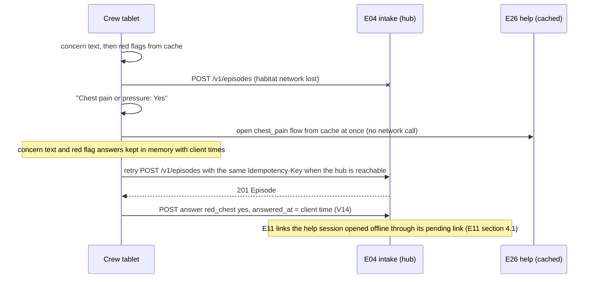

# E04: Guided complaint intake

Technical design for epic E04. Inputs: the brief (`tdd/E04.md` in the planning package), PRD.md sections 2, 3, 4.1,
4.3, 7, 8 (R04, R05, R07), 9 and 11, USE-CASES.md section 1 and UC08, UX-DESIGN.md sections 4 and 6, CONTRACTS.md
sections 1 to 5, 7, 9, 11, 17, 18, 19 and 20, LLM-ARCHITECTURE.md sections 2, 4 and 5, `api/openapi.yaml`
(`startEpisode`, `answerEpisode`), `api/schemas/episode.schema.json`, `answer.schema.json`,
`config-questionnaires.schema.json`, `requests.schema.json` (`EpisodeCreate`, `AnswerCreate`),
`api/examples/config/questionnaires.example.json`, `api/examples/clinical/episode.json`, `api/examples/check/answer.json`,
the package files `assessment-families.json` (51 families) and `input-dictionary.json` (156 fields with a sensitivity
class), VALIDATION.md (V09, V12, V14, V15, V16, V17, V25, V26, V36, V40, D05, D07, D14), the work packages E04-01 to
E04-03 in `backlog.json`, `docs/BUILD-CHARTER.md`, `AGENTS.md`, and the sibling designs `docs/tdd/E11.md` and
`docs/tdd/E26.md`. The research files `research/medical-systems-standards.md` and `research/surface-mobility-comms.md`
of the build package inform the deployment section. `docs/SYSTEM.md` and `docs/DEPLOYMENT.md` are written in
parallel; points that depend on them are marked and listed in section 14.

Status: design. Every test named here is planned; none has run. Clinical content (which questions exist, which area
routes to which module, which questions are restricted, which choice opens which help flow) is an unreviewed draft
that the team writes into configuration and a clinician must review before live guidance. This epic builds the
mechanism and authors none of that content.

## 1. Scope

**What E04 is.** The deterministic intake of a concern ("I feel unwell"): the person's own words, the onset with its
precision, the three red flags first, then a complaint area that routes to one intake module, then that module's
questions, one at a time, each answerable as present, absent, unknown or declined, each correctable without erasing
the earlier answer. It works entirely from `questionnaires.json` with the language model stopped, every device absent
and the ground link down. The model, when it runs, can only choose among configured questions (section 10).

**Work packages.**

| Story | Delivers | Acceptance (brief) |
|---|---|---|
| E04-01 | Complaint routing and shared episode fields: concern text, onset, red flags, area answer, routing to a module, shared questions | A urinary complaint routes to the urinary module; private fields of other modules are never offered |
| E04-02 | Family-specific optional forms: one module per complaint area, mapped to assessment families, with a fallback; every question offers unknown and declined | Every one of the 51 assessment families has a capture route and unknown and declined states (a loader check proves it) |
| E04-03 | Onset, negation and correction handling | Blank is not negative; a changed answer supersedes the prior answer, which is kept |

**Requirements.** R04 (progressive intake across families), R05 (present, absent, unknown, declined), R07 (the intake
part: questions gated by environment and by sensitivity; the request gate itself is E11 and E27). Contributes to R02
(restricted questions hidden from roles without consent, enforced in E15's visibility filter), R15 (red flags without
the model), R28 (the model cannot create answers).

**Validation scenarios.** V12 (declined retained), V14 (late answer keeps its time), V15 (ambiguous unit held), V16
(duplicate command), V17 (intake part: no standing question in microgravity), V25 (cross patient write refused), V26
(journal canary absent from intake logs), V36 (keyboard only, non color), V40 (SIM stays SIM). **Demo assertions.**
D05 (red flags answered before the first model request; with the model stopped they still appear), D07 (a present
symptom is a hollow ring, never a dot), D14 (no participation element on the concern screens). **Use cases.** UC08
steps 1 to 3, UC01 step 1 ("something feels wrong" opens a concern), UC16.

**Decisions this design settles** (brief: "Map symptom modules to assessment families and sensitive-field rules").

| # | Decision | Selected | Alternatives rejected, and the evidence |
|---|---|---|---|
| DE04-1 | How a complaint is routed without the model | The person answers a configured **area question** (a choice question whose choices name an intake module). Routing is the current answer to that question; rerouting is a correction of it. Unknown or declined routes to the fallback module | Keyword matching on free text (negation "no burning when I pee" routes wrong; PRD 9: "Narrative screening is imperfect"; CONTRACTS 7: "A region is never guessed from free text"); model classification as the only route (fails with the model stopped, UC16) |
| DE04-2 | Modules against assessment families | One module per complaint area; each module lists `family_ids`; every family of `assessment-families.json` appears in at least one module; exactly one fallback module covers family `other`. A loader check proves coverage against the file by hash | One module per family (51 areas on one screen, unusable; 12 families have no ICL row); routing by condition (a person does not know the condition) |
| DE04-3 | Sensitive-field rule | A question is `clinical` or `restricted`. A restricted question is offered only inside a module that lists it in `restricted_question_ids`, always with a declined choice and its reason shown; it is never in the shared set. A question whose `field_id` is `restricted` in `input-dictionary.json` cannot be declared `clinical` (loader). `private_journal` fields can never be a question | A per screen hide flag in the client (CONTRACTS 11: no client logic over content); asking every restricted field up front (PRD 4.1 asks to explain why, and UX-DESIGN 6 asks for "when relevant") |
| DE04-4 | Negation and blank | Absent exists only when the person picks a choice whose configured presence is `absent`. A question offered and not answered leaves no Answer record and is shown as "not answered". Nothing (a skip, a timeout, a normal measurement, free text, the model) creates an absent answer. Scales and durations have no default value | Treating skipped as no (R05 forbids); preselected "No" buttons or a slider thumb at a default position (fabricates a value) |
| DE04-5 | Correction | An answer names the answer it `supersedes`. Per episode and question the chain is linear: one root, each answer superseded at most once, enforced by two unique constraints in one transaction. A new answer to a question that already has a current answer must name it | Overwrite in place (CONTRACTS 1: corrections link, never erase); parallel heads (two "current" answers to one question) |
| DE04-6 | Onset | `EpisodeCreate.onset` with `precision` `exact`, `hour`, `day` or `unknown`; `at` is null exactly when precision is `unknown`; `at` is never later than the hub receive time; stored as given and only displayed at its precision. A correction is an episode action owned by E15 that keeps the old value | Rounding the stored value (alters the person's data); a future onset clamped to now (fabrication) |
| DE04-7 | Where the episode lives | The Episode aggregate (identity, concern, onset, revision, state, timeline) is E15's module `episodes`. E04 creates it through E15's kernel port and never writes episode tables. E15 builds that kernel first, in E04's wave (request R-E04-7) | Two modules writing one table (no single owner of the revision); E04 owning the episode (E11 and E26 already designed against E15 as owner) |
| DE04-8 | Shared fields | A short `shared_question_ids` set asked for every concern, drawn from the input dictionary's episode group (severity, progression, function, prior episode). Its basis is the ISS medical checklist's "Assess nature of problem" step (symptom, intensity, duration, what makes it worse or better, medications taken, effect on performance) read in `research/medical-systems-standards.md` section 3.3 (source RS08). Medications taken is restricted and therefore asked inside modules, never in the shared set | A long common history form (UX-DESIGN 4: "Onset, effect on tasks, fixed urgent questions, relevant follow-ups") |
| DE04-9 | One area per concern | An episode has one routed module at a time; a second unrelated complaint is a second episode | Several modules in one episode (multiplies restricted exposure and blurs the episode's plan) |

**Not delivered here** (owner): the Episode record, its states, timeline, follow-up, reviews and resolution (E15);
Answer storage and the `AnswerAccepted` event (E01 records); urgency and the pre-inference gate (E11); Someone needs
help and its offline cache (E26); measurement requests and capability gaps (E05); the kit gate (E27); assessments
(E13); the daily check, the profile (allergies, medicines, prior conditions) and `config/questionnaires.json` as a
file (E03); consent grants (E02); participation (E22).

## 2. Dependencies and seams

| Seam | Direction | Mechanism | Owner |
|---|---|---|---|
| Unit of work, migrations, audit, idempotency store, clock, IDs, settings | E04 uses | `UnitOfWork`, `AuditLog.append`, `Clock.now()`, `IdGenerator.new(prefix)`, `HubSettings` | E01 |
| In-transaction domain event bus | E04 publishes nothing of its own; it causes `AnswerAccepted` through E01 | `DomainEventBus` | E01 (per SYSTEM.md) |
| Active configuration release | E04 reads | `ConfigReleaseReader.active()`, `.document("questionnaires")`, `.document("ui-copy")`, reference files `assessment-families.json` and `input-dictionary.json` | E01 |
| Session, roles, person namespace origin | E04 reads | `Session` (person_id, roles, kind), `PersonDirectory.origin_mode(person_id) -> OriginMode` | E02, E01 |
| Answer storage | E04 writes | `AnswerStore.append(uow, AnswerRecord) -> Answer` (publishes `AnswerAccepted` in the transaction), `.get`, `.for_episode` | E01 records |
| Episode kernel | E04 calls | `EpisodeKernel.create`, `.facts`, `.record_route`, `.view` (section 4.2) | E15 |
| Active environment | E04 reads | `MissionStatePort.active_environment_id(uow)` | E23 |
| Intake facts for episodes | E04 provides | `IntakeFactsForEpisodes` satisfying E15's `QuestionSensitivity` and `IntakeGaps` protocols (section 4.2) | E04 (consumer E15) |
| Allowed questions for the model | E04 provides | `IntakeQueries.allowed_question_ids`, `.next_question_ids` | E04 (consumers E12 for `propose_question`, E13) |
| Red flag urgency | E11 subscribes to `AnswerAccepted`; E04 only records answers | event | E11 |
| Opening help from a red flag | The crew app opens E26's cached flow; E04 records the answer | client navigation, `POST /v1/help-sessions` | E26 |
| Concern counted as the day's check | E22 subscribes to `EpisodeCreated` (E15) and `AnswerAccepted` with an `episode_id` (E01) | events | E22 |
| Configuration loader checks | E04 contributes pure check functions I1 to I9 (section 8) | function registry in the loader | E01 (loader), E04 (checks) |

Who depends on E04: E15 (sensitivity and unanswered questions), E11 (answers carry the red flags), E12 and E13 (the
configured question set the model may propose), E22 (concern counts), E21 (scenarios act 4).

## 3. Domain model

Pure code in `crew_health/intake/domain/`: no I/O, no clock reads, no framework imports.

### 3.1 Catalog (parsed once per configuration release)

```python
class Presence(StrEnum):
    PRESENT = "present"; ABSENT = "absent"; UNKNOWN = "unknown"; DECLINED = "declined"

class Sensitivity(StrEnum):
    CLINICAL = "clinical"; RESTRICTED = "restricted"

class QuestionKind(StrEnum):            # questionnaires.json kinds used by intake
    PRESENCE = "presence"; SCALE = "scale"; DURATION = "duration"; CHOICE = "choice"

@dataclass(frozen=True, slots=True)
class Choice:
    choice_id: str
    presence: Presence | None
    opens: Literal["concern", "help_flow", "correction", "intake_module"] | None
    flow_id: str | None
    module_id: str | None                     # only on the area question (R-E04-1)

@dataclass(frozen=True, slots=True)
class Question:
    question_id: str
    kind: QuestionKind
    choices: tuple[Choice, ...]
    scale: tuple[int, int] | None             # (min, max) inclusive
    unit: str | None                          # UCUM code for duration
    body_region: BodyRegion | None
    sensitivity: Sensitivity                  # default clinical (R-E04-1)
    field_id: str | None                      # input-dictionary.json field (R-E04-1)
    environments: frozenset[EnvironmentId] | None   # None: every environment (R-E04-1)
    ask_if: AskIf | None                      # (R-E04-1)

@dataclass(frozen=True, slots=True)
class AskIf:
    question_id: str
    choice_ids: frozenset[str]

@dataclass(frozen=True, slots=True)
class IntakeModule:
    module_id: str
    family_ids: frozenset[str]
    question_ids: tuple[str, ...]             # asked in this order
    restricted_question_ids: frozenset[str]   # subset of question_ids
    body_regions: tuple[BodyRegion, ...]
    review_state: Literal["unreviewed", "reviewed", "rejected"]

@dataclass(frozen=True, slots=True)
class IntakeCatalog:
    questionnaire_version: str                # SHA-256 of questionnaires.json
    families_version: str                     # SHA-256 of assessment-families.json the loader checked
    questions: Mapping[str, Question]
    red_flag_ids: tuple[str, ...]             # red_flags.question_ids
    area_question_id: str
    shared_question_ids: tuple[str, ...]
    modules: Mapping[str, IntakeModule]       # rejected modules are left out at parse time
    fallback_module_id: str
```

`IntakeCatalog.parse(questionnaires: ParsedDocument, families: ParsedReference, dictionary: ParsedReference)` builds
it after the loader checks pass (section 8). It is immutable and cached per release ID.

### 3.2 Routing

```python
@dataclass(frozen=True, slots=True)
class Route:
    module_id: str | None                     # None while the area question has no current answer
    basis: Literal["answer", "fallback", "pending"]
    area_answer_id: str | None

def route(catalog: IntakeCatalog, area_head: AnswerFact | None) -> Route
```

| Current answer to the area question | Route |
|---|---|
| none (blank) | `Route(None, "pending", None)`: only red flags and the shared set are offered |
| present, choice with `module_id` m, module m active | `Route(m, "answer", id)` |
| unknown or declined | `Route(fallback, "fallback", id)` |
| choice whose module is `rejected` or missing in this release | `Route(fallback, "fallback", id)` and an audit event `intake.route_fallback_missing_module` |

### 3.3 Question plan

```python
def question_plan(catalog: IntakeCatalog, route: Route, heads: Mapping[str, AnswerFact],
                  environment_id: EnvironmentId) -> QuestionPlan

@dataclass(frozen=True, slots=True)
class QuestionPlan:
    offered_ids: tuple[str, ...]      # every question this episode may record, in display order
    next_ids: tuple[str, ...]         # offered, applicable now, without a current answer
    not_answered_ids: tuple[str, ...] # offered and blank (shown as "not answered", never "no")
    red_flags_complete: bool          # every red flag has a current answer in any presence
```

Order and membership, deterministic:

1. The red flags, in `red_flags.question_ids` order, always first and always offered.
2. The area question.
3. `shared_question_ids` in order.
4. The routed module's `question_ids` in order (restricted ones included only from this module's list).
5. A question is left out when its `environments` does not include the active environment (V17: a standing question
   is not asked in microgravity), or when its `ask_if` question has no current answer whose choice is in
   `ask_if.choice_ids` (an unknown or declined gate matches only when the configuration lists that choice).
6. Duplicates keep their first position.

The offered set is the only set `answerEpisode` accepts (INV-E04-03). A question already answered stays offered, so
a correction is always possible even after rerouting; its old answers stay on the episode (INV-E04-05).

### 3.4 Answer rules

```python
def validate_answer(q: Question, cmd: AnswerCommand) -> ValidAnswer   # raises InvalidAnswer(field, code)
```

| Kind | `presence` | `value` | `unit` |
|---|---|---|---|
| `presence`, `choice` | equals the presence of the chosen choice | the choice ID (string); must be one of the question's choices | must be absent |
| `scale` | `present` with an integer `value` in `[min, max]`; or `unknown` or `declined` with `value` null | as stated | absent |
| `duration` | `present` with a number `value` ≥ 0 (finite, not NaN); or `unknown` or `declined` with `value` null | as stated | equals the question's `unit` exactly when present; no conversion |
| any | `absent` is accepted only from a choice whose configured presence is `absent` | | |

`body_region` is the question's default when the command omits it; a person may set another region of the fixed set
(CONTRACTS 7), or `null`. `laterality` is accepted only with a non-null region. A `choice` with `opens: help_flow`
records like any other answer: opening help is the client's immediate action and E11's urgency signal, never a
precondition of recording (INV-E04-08).

### 3.5 Supersession

```python
def check_supersession(chain: ChainFacts, cmd: AnswerCommand) -> None   # raises InvalidAnswer
```

`ChainFacts` is the current head per question for the episode. Rules: with no head, `supersedes` must be null; with a
head h, `supersedes` must equal h; the superseded answer must be on the same episode, question and patient. The two
database constraints of section 5 repeat these rules so a concurrent writer cannot fork the chain.

### 3.6 Invariants

| ID | Invariant | Test |
|---|---|---|
| INV-E04-01 | An `absent` answer exists only when the person selected a choice whose configured presence is `absent` | T-E04-001, T-E04-002 |
| INV-E04-02 | A blank question produces no Answer; its display is "not answered" | T-E04-003 |
| INV-E04-03 | Only questions in the episode's offered set are recorded | T-E04-010 |
| INV-E04-04 | A restricted question is offered only from the routed module's restricted list | T-E04-011, T-E04-012 |
| INV-E04-05 | A correction never deletes or edits the superseded answer; per episode and question the chain is linear | T-E04-020, T-E04-021, T-E04-022 |
| INV-E04-06 | `answered_at` and `onset.at` are never later than the hub receive time and are stored as given | T-E04-030, T-E04-031 |
| INV-E04-07 | An answer's origin equals its episode's origin, which equals the patient namespace origin | T-E04-040 |
| INV-E04-08 | Recording an answer never waits for the model, a device, the ground link or a help session | T-E04-050 |
| INV-E04-09 | Every family of the referenced `assessment-families.json` has a module; every intake choice question offers an unknown and a declined choice | T-E04-060, T-E04-061 |
| INV-E04-10 | No intake log line, audit event or metric contains concern text, answer values or choice labels | T-E04-070 |

## 4. Application layer

### 4.1 Use cases (`crew_health/intake/application/use_cases.py`)

| ID | Use case | Input | Output | Errors | Idempotency |
|---|---|---|---|---|---|
| UC-I1 | `StartConcern` | `Session`, `EpisodeCreate`, `Idempotency-Key` | Episode (E15 view) | `UNAUTHORIZED_SCOPE` (not a crew person session), `ORIGIN_MISMATCH`, `INVALID_VALUE` (onset rules, concern length; R-E04-4) | E01 idempotency store, key plus body hash; the episode ID is created inside the first execution |
| UC-I2 | `AnswerConcern` | `Session`, `episode_id`, `AnswerCreate`, `Idempotency-Key` | Answer | `NOT_FOUND`, `UNAUTHORIZED_SCOPE` (not the patient), `INVALID_VALUE` (question not offered, value, unit, supersedes, answered_at), `IDENTITY_MISMATCH` (session person changed between the episode and the call) | Same; a replay returns the first Answer |
| UC-I3 | `GetIntakePlan` | `Session`, `episode_id` | `IntakeView` (R-E04-2) | `NOT_FOUND`, `UNAUTHORIZED_SCOPE` | read |
| UC-I4 | `AllowedQuestions` | `uow`, `episode_id`, `Viewer` | `frozenset[str]` and the default next order | none | read |

UC-I1 steps, one transaction:

1. The session is a crew person session (`kind == crew`); the patient is the session person (an incapacitated
   crewmate is helped through Someone needs help, never through another person's concern).
2. `body.origin_mode == PersonDirectory.origin_mode(person_id)`, else `ORIGIN_MISMATCH` (V09, V40; CONTRACTS 9: no
   simulated answer enters LIVE).
3. Onset rules (DE04-6); `concern_text` length within `HubSettings.intake.concern_text_max_chars` until R-E04-4 sets a
   schema bound.
4. `EpisodeKernel.create(uow, NewEpisode(...))` with the active `questionnaire_version` and the red flag IDs pinned
   (E15 publishes `EpisodeCreated`).
5. Audit `intake.concern_started` with IDs only. Commit. Return `EpisodeKernel.view`.

UC-I2 steps, one transaction:

1. Load `EpisodeKernel.facts`; `NOT_FOUND` when absent or invisible; `UNAUTHORIZED_SCOPE` unless the session person is
   the patient (the CMO records findings as observations through E05, never as the patient's answers).
2. Build the catalog for the active release, the heads from `intake_answer_chain`, the route and the plan.
3. The question must be in `plan.offered_ids` (a question removed by a release change returns `INVALID_VALUE` with
   `field_errors[question_id] = "not_offered"`; the client refetches configuration on `config.release_activated`).
4. `validate_answer`, `check_supersession`, `answered_at ≤ now` (`INVALID_VALUE`, `answered_at`).
5. `AnswerStore.append` with `actor` the session person, `origin_mode` the episode's, `questionnaire_version` the
   active one, `received_at` now, `episode_id`. E01 publishes `AnswerAccepted` in the transaction (E11, E15 and E22
   react inside it).
6. Insert the chain row (two unique constraints; a violation rolls the whole transaction back and returns
   `INVALID_VALUE`, `field_errors[supersedes] = "not_current"`).
7. When the question is the area question: `EpisodeKernel.record_route(uow, episode_id, module_id, answer_id, at)`.
8. Audit `intake.answer_recorded` (episode ID, answer ID, question ID, presence; never the value). Commit.

### 4.2 Ports (`crew_health/intake/application/ports.py`)

```python
class EpisodeKernel(Protocol):                      # provided by E15 (episodes.application.kernel)
    def create(self, uow: UnitOfWork, draft: NewEpisode) -> EpisodeRef: ...
    def facts(self, uow: UnitOfWork, episode_id: str) -> EpisodeFact | None: ...
    def record_route(self, uow: UnitOfWork, episode_id: str, module_id: str, area_answer_id: str,
                     at: datetime) -> None: ...
    def view(self, uow: UnitOfWork, viewer: Viewer, episode_id: str) -> EpisodeView: ...

class AnswerStore(Protocol):                        # E01 records
    def append(self, uow: UnitOfWork, record: AnswerRecord) -> Answer: ...      # publishes AnswerAccepted
    def get(self, uow: UnitOfWork, answer_id: str) -> Answer | None: ...
    def for_episode(self, uow: UnitOfWork, episode_id: str) -> Sequence[Answer]: ...

class AnswerChain(Protocol):                        # E04 adapter
    def heads(self, uow: UnitOfWork, episode_id: str) -> Mapping[str, AnswerFact]: ...
    def link(self, uow: UnitOfWork, row: ChainRow) -> None: ...                  # raises ChainConflict

class CatalogSource(Protocol):                      # E04 adapter over ConfigReleaseReader
    def catalog(self, release_id: str) -> IntakeCatalog: ...                    # cached per release

class PersonDirectory(Protocol):                    # E01
    def origin_mode(self, uow: UnitOfWork, person_id: str) -> OriginMode: ...

class MissionStatePort(Protocol):                   # E23
    def active_environment_id(self, uow: UnitOfWork) -> EnvironmentId: ...

# Provided by E04
class IntakeQueries(Protocol):
    def plan(self, uow: UnitOfWork, episode_id: str) -> QuestionPlan: ...
    def allowed_question_ids(self, uow: UnitOfWork, episode_id: str) -> frozenset[str]: ...   # offered minus restricted of other modules
    def next_question_ids(self, uow: UnitOfWork, episode_id: str) -> tuple[str, ...]: ...

class IntakeFactsForEpisodes:                       # satisfies E15's QuestionSensitivity and IntakeGaps
    def is_restricted(self, questionnaire_version: str, question_id: str) -> bool: ...
    def not_answered(self, uow: UnitOfWork, episode_id: str) -> tuple[str, ...]: ...
```

`NewEpisode`, `EpisodeRef`, `EpisodeFact`, `EpisodeView` and `Viewer` are E15's application DTOs; E04 imports
`crew_health.episodes.application.dto` only (import direction intake to episodes; episodes never imports intake,
which is why E15 declares `QuestionSensitivity` and `IntakeGaps` and E04 satisfies them structurally, wired at the
composition root owned by E01).

### 4.3 Events

E04 publishes no domain event of its own. Its effects reach other modules through `AnswerAccepted` (E01, with
`episode_id` and `supersedes`) and `EpisodeCreated` (E15). SSE: none of its own; E15's `episode.changed` (request
R-E15-4) carries the revision. Audit events: `intake.concern_started`, `intake.answer_recorded`,
`intake.answer_refused` (code only), `intake.route_fallback_missing_module`.

### 4.4 Principal success path: a urinary concern with the model stopped (E04-01, R04, D05)

```mermaid
sequenceDiagram
    participant P as Crew app (person's tablet or the laptop)
    participant I as E04 intake (hub)
    participant K as E15 episode kernel
    participant R as E01 answers
    participant U as E11 urgency
    P->>P: "I feel unwell": concern text, onset (precision words from ui-copy)
    P->>P: red flags rendered from cached questionnaires.json (no network wait)
    P->>I: POST /v1/episodes (Idempotency-Key)
    I->>K: create (origin checked, onset checked)
    K-->>I: Episode draft, revision 1 (EpisodeCreated: E22 counts the day)
    P->>I: POST answers red_chest no, red_faint no, red_breath not_sure (client times)
    I->>R: append (AnswerAccepted)
    R->>U: red_breath unknown: "not sure is not a no" (E11 urgency signal)
    P->>I: POST answer concern_area = urinary choice
    I->>K: record_route(urinary)
    P->>I: GET /v1/episodes/{id}/intake (R-E04-2) or render the routed set from cache (interim)
    I-->>P: next: shared set, then urinary questions; restricted relevant_anatomy offered with its reason and "Prefer not to say"
    Note over P,I: menstrual_context (reproductive module) is never offered
```

### 4.5 Failure paths



A second failure path, the correction race: two devices of the same person correct one answer at once. Both pass
the domain check against the same head; the second insert violates `UNIQUE(supersedes)`, its transaction rolls back
(no answer, no event, no audit of a value) and it returns `422 INVALID_VALUE` with `field_errors.supersedes =
"not_current"` and the Episode in `current_state`; the client shows the current answer and offers to correct it.

## 5. Adapters

### 5.1 Storage (`crew_health/intake/adapters/migrations/0001_intake.sql`)

E04 stores no answer content (E01 does). It owns one thin index that makes correction chains linear:

```sql
CREATE TABLE intake_answer_chain (
  answer_id    TEXT PRIMARY KEY,
  episode_id   TEXT NOT NULL,
  question_id  TEXT NOT NULL,
  supersedes   TEXT NULL REFERENCES intake_answer_chain(answer_id),
  presence     TEXT NOT NULL CHECK (presence IN ('present','absent','unknown','declined')),
  answered_at  TEXT NOT NULL,              -- UTC instant with Z, as given
  received_at  TEXT NOT NULL,
  is_head      INTEGER NOT NULL CHECK (is_head IN (0,1))
) STRICT;
CREATE UNIQUE INDEX intake_chain_one_successor ON intake_answer_chain(supersedes) WHERE supersedes IS NOT NULL;
CREATE UNIQUE INDEX intake_chain_one_root ON intake_answer_chain(episode_id, question_id) WHERE supersedes IS NULL;
CREATE UNIQUE INDEX intake_chain_one_head ON intake_answer_chain(episode_id, question_id) WHERE is_head = 1;
CREATE TRIGGER intake_chain_no_delete BEFORE DELETE ON intake_answer_chain
  BEGIN SELECT RAISE(ABORT, 'append only'); END;
CREATE TRIGGER intake_chain_update_only_head BEFORE UPDATE ON intake_answer_chain
  WHEN NEW.answer_id <> OLD.answer_id OR NEW.episode_id <> OLD.episode_id OR NEW.question_id <> OLD.question_id
    OR NEW.supersedes IS NOT OLD.supersedes OR NEW.presence <> OLD.presence OR NEW.answered_at <> OLD.answered_at
    OR NOT (OLD.is_head = 1 AND NEW.is_head = 0)
  BEGIN SELECT RAISE(ABORT, 'only head demotion'); END;
```

`link` demotes the old head and inserts the new row in the same transaction as `AnswerStore.append`. Presence is
stored because E15's gap view and E11's red flag facts read heads without loading values. Rollback of the migration:
the table is additive and derived from E01 answers; `uv run crew-health intake rebuild-chain` rebuilds it from
`AnswerStore.for_episode` (deterministic: order by `received_at`, then answer ID), so dropping it loses nothing.

### 5.2 Configuration adapter

`CatalogSource` reads the active release through `ConfigReleaseReader`, parses `IntakeCatalog` once per release ID
(bounded LRU of 2 entries: the active release and the one an open request rendered from) and keeps it in memory.
Reference files are loaded by the loader with their SHA-256; the catalog refuses to build when `families_version`
differs from the loaded file hash (`CONFIG_INVALID` at activation, never at request time).

### 5.3 External calls

None. E04 calls no model, device, network or ground link. Every port call is an in-process call on the same SQLite
connection inside the unit of work, bounded by the SQLite busy timeout from `HubSettings.storage.busy_timeout_ms`
(E01).

## 6. API

Routers in `crew_health/intake/api/router.py`, mounted by E01's app assembly. Bodies are validated against the
generated Pydantic models of `requests.schema.json`; responses against the response schemas in tests.

| operationId | Method and path | Request | Response | Errors (code, HTTP) | Roles and checks |
|---|---|---|---|---|---|
| `startEpisode` | `POST /v1/episodes` | `EpisodeCreate` | `201 Episode`, `Location`, `ETag` | `MALFORMED_REQUEST` 400, `UNAUTHENTICATED` 401, `UNAUTHORIZED_SCOPE` 403 (station, operator, ground, editor sessions), `DUPLICATE_COMMAND` 409, `UNSUPPORTED_MEDIA_TYPE` 415, `ORIGIN_MISMATCH` 422, `INVALID_VALUE` 422 (onset, concern length; documented after R-E04-4), `INTERNAL_ERROR` 500 | `x-roles` crew, crew_medical_officer; the patient is the session person; `Idempotency-Key` required |
| `answerEpisode` | `POST /v1/episodes/{episode_id}/answers` | `AnswerCreate` | `201 Answer`, `Location` | 400, 401, `UNAUTHORIZED_SCOPE` 403 (not the patient), `NOT_FOUND` 404, `DUPLICATE_COMMAND` 409, 415, `IDENTITY_MISMATCH` 422, `INVALID_VALUE` 422 with `field_errors` keys `question_id` (`not_offered`, `unknown`), `presence`, `value`, `unit`, `body_region`, `laterality`, `supersedes` (`required`, `not_current`, `wrong_question`), `answered_at` (`in_future`) | `x-roles` crew, crew_medical_officer; `Idempotency-Key` required; no `If-Match` (answers are appends; the chain constraint protects corrections) |
| `getEpisodeIntake` (request R-E04-2) | `GET /v1/episodes/{episode_id}/intake` | none | `200 IntakeView` | 401, 403, 404 | patient only |

`Config-Release` on requests: `answerEpisode` validates against the active release whatever the header says; a
question that no longer exists returns `INVALID_VALUE` (`not_offered`), never a silent remap. The episode response
of `startEpisode` is E15's projection, so the two epics share one Episode shape.

The `Episode.answers` example (`api/examples/clinical/episode.json`) and `answer.json` are the contract fixtures for
T-E04-080.

## 7. User interface

Owned: `ui/crew/src/features/intake/` (the "A concern" flow, UX-DESIGN 1.2 and 6), built with E03's shell and design
system. Screens and bindings (CONTRACTS 19, Records and Measurement rows; the concern screen itself is not in the map,
so it binds to the endpoints above):

| Screen part | Loads | Acts | States |
|---|---|---|---|
| Ask: own words and onset | cached `GET /v1/config/questionnaires`, `GET /v1/config/ui-copy` (`intake_words`, `onset_precision_words`, R-E04-3) | `POST /v1/episodes` | typing, sending, offline (kept in memory, retried with the same key), error words from ui-copy `error_messages` |
| Red flags | cached questionnaires `red_flags` (intro, after, three questions) | `POST .../answers`; a choice with `opens: help_flow` navigates to E26's cached flow first, then posts | unanswered, answered, "Not sure is not a no" line (`red_flags.after`), help opened |
| Area | the area question from cache | `POST .../answers` | blank (only shared questions follow), routed, fallback |
| Module questions | `GET /v1/episodes/{id}/intake` (R-E04-2); interim: the routed module's question list from cache in document order | `POST .../answers`, correction with `supersedes` | one question at a time; "Not sure" and "Prefer not to say" always visible; restricted badge with the reason (`hint`) and `intake_words.restricted_note`; "not answered"; "changed from" line for a superseded answer; environment gated questions absent |
| Assistant card | `GET /v1/assistant/status` | none here | running (the assistant may pick the next configured question), stopped (`designed_states.assistant_stopped`; the configured order continues), unavailable |

Rules proven by tests:

- No answer is preselected; scale inputs start unset (no thumb position), durations start empty (DE04-4, T-E04-090).
- The red flag screen renders from the cache before any network response and before any assistant call (D05,
  T-E04-091); a help flow choice opens E26's cached flow before its answer POST resolves (T-E04-092).
- Every visible word comes from questionnaires.json or ui-copy.json; a lint rule (`no-literal-ui-text`, E03's eslint
  config) and a test that renders the flow with a modified questionnaires document prove it (T-E04-093).
- The figure shows a hollow ring for each current `present` symptom answer with a region, and no mark for absent,
  unknown or declined (CONTRACTS 7, D07); the renderer is E03's; E04 passes the answers.
- No streak, patch, crew goal or celebration on any concern screen (D14, T-E04-094).
- Keyboard only: every choice is a button in tab order; presence is shown as a word, never by color alone (V36,
  T-E04-095).
- Privacy on shared devices: the concern screens never render on a `station` session (no crew person), and E02's
  session lock clears the in-memory draft (T-E04-096).

## 8. Configuration

Read: `questionnaires.json` (`questions`, `red_flags`, and the `intake` section of R-E04-1), `ui-copy.json`
(`intake_words`, `onset_precision_words`, `error_messages`, `designed_states`), and the reference files
`assessment-families.json` and `input-dictionary.json`, each pinned by SHA-256 in the release.

**Shape this design needs (request R-E04-1, exact proposal in section 14).** A top level `intake` object in
questionnaires.json:

```json
{
  "intake": {
    "area_question_id": "concern_area",
    "shared_question_ids": ["severity", "progression", "function_effect", "prior_episode"],
    "fallback_module_id": "general",
    "families_version": "<sha256 of assessment-families.json>",
    "modules": [
      {
        "module_id": "urinary",
        "title": "Urinary",
        "family_ids": ["uti", "bladder", "stones", "renal"],
        "question_ids": ["urine_pain", "urine_frequency", "fever_feel", "flank_pain", "relevant_anatomy"],
        "restricted_question_ids": ["relevant_anatomy"],
        "body_regions": ["flank", "abdomen"],
        "source_ids": ["S01"],
        "basis": "team default",
        "review_state": "unreviewed",
        "written_by": null,
        "checked_by": null
      }
    ]
  }
}
```

plus, on each question, optional `sensitivity`, `field_id`, `environments` and `ask_if`, and on each choice an
optional `module_id` with `opens: "intake_module"`. The JSON above shows the shape only; its IDs and texts are
placeholders the team replaces when writing the document.

**Starting map of areas to families** (for the configuration authors; the loader, not this table, is the authority).
It covers all 51 families of `assessment-families.json` exactly once:

| Area module | Families |
|---|---|
| `heart_chest` | rhythm, acs, cardiac, vte, shock, vascular |
| `breathing` | resp, airway, lung, allergy |
| `head_nerves` | headache, neuro, neuropathy, neurochronic, vestibular, orthostatic |
| `eyes` | eye, sans |
| `ear_nose_mouth` | ent, hearing, dental |
| `stomach_bowel` | gi, abdomen, chronicgi, liver, hydration |
| `urinary` | uti, bladder, stones, renal |
| `reproductive` | repro |
| `skin_burns` | skin, thermal |
| `injury_bones_joints` | injury, fracture, msk, bone, rheum |
| `sleep_mood` | sleep, behavior |
| `exposure` | toxic, pressure, radiation, dust, overdose |
| `whole_body` | sepsis, endocrine, hematology, cancer, palliative |
| `general` (fallback) | other |

Restricted questions follow the input dictionary: `relevant_anatomy`, `medications`, `conditions` and every field of
the `reproductive` and `behavioral` groups are restricted; `sleep_mood` and `reproductive` list theirs in
`restricted_question_ids`; `urinary`, `stomach_bowel` and `heart_chest` may list `relevant_anatomy` or `medications`
where the family's `optional_inputs` names them. The persistent palpitations question asked by R-E11-5 ("all the time,
still now" opens Someone needs help) belongs in `heart_chest` as a choice with `opens: help_flow`; the mechanism
supports it and E11 treats it as urgent (DE11-2).

**Loader checks contributed by E04** (pure functions in `intake/domain/loader_checks.py`, registered in E01's loader;
proposed as additions to CONTRACTS 11 in R-E04-5). Each failure names the JSON pointer:

| ID | Check |
|---|---|
| I1 | Every `family_ids` entry exists in `assessment-families.json`; every family of that file appears in at least one active module (coverage, E04-02) |
| I2 | `fallback_module_id` names an active module whose `family_ids` contains `other` |
| I3 | The area question exists, has kind `choice`; each choice either has `opens: intake_module` with an existing `module_id`, or has presence `unknown` or `declined` and no module; every non fallback module is reachable from a choice |
| I4 | Every referenced question exists; `restricted_question_ids` ⊆ the module's `question_ids`; a question with `sensitivity: restricted` appears only in `restricted_question_ids` lists, never in `shared_question_ids`, the red flags or the area question |
| I5 | Every `choice` or `presence` question used by intake has at least one choice with presence `unknown` and one with presence `declined`; scale and duration questions are exempt because the screen always offers both from `intake_words` |
| I6 | `field_id`, when set, exists in `input-dictionary.json`; a field whose dictionary sensitivity is `restricted` is declared `restricted`; a `private_journal` field is rejected |
| I7 | `ask_if.question_id` appears earlier in the same module list or in the shared set, and every `choice_ids` entry exists on it |
| I8 | Red flag questions are in no module; every intake choice with `opens: help_flow` names a `flow_id` that exists in `responder-flows.json` |
| I9 | Each module's `question_ids` count is at most `HubSettings.intake.max_questions_per_module` (an operational bound in E01 settings, not clinical content) |

**Configuration edit test (T-E04-100).** Using the loader on a copy of the example plus a generated `intake` section:
moving a choice's `module_id` from `urinary` to `stomach_bowel`, adding a question to a module, and marking a question
restricted each change the plan served by `GetIntakePlan` with no code change; removing a family from every module
makes activation fail with I1 and the last good release stays active.

Provenance: modules carry `source_ids`, `basis`, `review_state`, `written_by` and `checked_by` like kit-map rows; the
document's `notice` is shown on every concern screen. A module with `review_state: rejected` is left out; with mission
mode LIVE and no reviewed modules, intake still runs (it records reports, it advises nothing) and the notice stays.

## 9. Deployment and fallbacks

Tier names and device inventory are per DEPLOYMENT.md (section 14, R-E04-9). The design does not depend on more than
the laptop: intake is records, configuration and a browser.

| Tier (per DEPLOYMENT.md) | How intake works | Evidence it is real |
|---|---|---|
| Minimum: one laptop and its webcam | Hub and crew app on the laptop. Crew members sign in in turn; the concern screens never render on a `station` session; E02's session lock clears the in-memory draft before the next person. The webcam is not used by intake | ISS precedent: one medical laptop (the Medical Equipment Computer) "Maintain medical records" with store and forward (MS20 in the build research) |
| Laptop plus crew tablets or personal laptops on the habitat network | Each person starts a concern on their own device, which is the private place a private medical conference needs (NASA-STD-3001 V2 7071, read in the build research section 3.4). Red flags render from the device cache; the concern and answers post to the hub; a lost connection keeps them in memory with client times and retries with the same idempotency keys | ISS crews use station laptops and tablets on the station network (SM28, SM41); the Mars Transit Habitat point of departure lists 4 crew tablets, 4 crew laptops and a private medical station (SM22) |
| Private medical station (transit, surface base) | The same crew app on the station computer, signed in as the person; nothing changes in E04 | SM22 |
| Pressurized rover or a second habitat module with its own hub replica | The concern is recorded on the hub in reach. Episode identity, answer IDs and chains must merge across hubs (per DEPLOYMENT.md, R-E04-9): E04's chain index is rebuildable from answers, and E15 owns the merge rule | Rover data "may be stored locally on the PR and downlinked ... as bandwidth allows" (SM24) |
| Ground link via store and forward | Nothing in intake reads the link. The concern leaves only in a handoff a person approves (E16, E29) | EI1 |

Fallbacks (charter section 5):

| Missing part | Behavior | Shown as |
|---|---|---|
| Language model | The whole intake runs in the configured order: red flags, area, shared set, module; nothing waits | `designed_states.assistant_stopped` on the assistant card |
| Camera, devices | Not used by intake; measurement requests that follow are E05's | |
| Habitat sensors | Not used | |
| Ground link | Not read | |
| Crew tablets | The laptop runs the same screens | |
| Hub process (from a tablet) | Red flags and Someone needs help from cache; the concern posts when the hub returns | E26's outbox count; the intake screen says it is waiting to save, with ui-copy words |

Redundancy (AGENTS.md section 2) for the safety relevant part of intake, the red flags:

| Layer | Serves | Test that removes the layer above |
|---|---|---|
| Primary | Hub records the red flag answers; E11 classifies them | T-E04-050 |
| Backup (same data, different code) | The crew app renders the red flags and opens help from its cache with no hub | T-E04-092 (hub stopped) |
| Backup (dissimilar) | E26's printed help cards include the red flag questions and the flows they open, generated from the same documents | E26's T-E26-103 (owned there) |
| Fail safe | An unanswered red flag keeps the episode in `draft` and E11's gate keeps the model from running (`RedFlagsPending`) | T-E04-051 |

## 10. Safety, security and privacy

| ID | Hazard | Cause | Mitigation | Test |
|---|---|---|---|---|
| H1 | A symptom is recorded as "no" that the person never denied | Skip or blank treated as absent; preselected "No"; a model extracting "no fever" from text | DE04-4; absent only from a configured choice; the model cannot write answers (it proposes question IDs only) | T-E04-001, 002, 003, 090 |
| H2 | "Not sure" on a red flag read as no | Presence collapse | Unknown is stored as unknown; E11 treats it as uncertain (DE11-3) | T-E04-004 and E11's T-E11-011 |
| H3 | A red flag answer waits on the network and help is delayed | Help opened after the POST | Client opens E26's cached flow first (T-E04-092); recording never blocks help | T-E04-092 |
| H4 | A private question is shown for an unrelated complaint | Shared set or the wrong module carries it | I4, INV-E04-04; the plan is computed by the hub | T-E04-011, 012 |
| H5 | A corrected answer erases what was first said | Update in place | Append only chain and E01 append only answers | T-E04-020, 021 |
| H6 | A late entry looks fresh | `answered_at` replaced by receive time | Both kept; display uses `answered_at` with the late marker E15 renders | T-E04-030 |
| H7 | A simulated persona's answer enters a LIVE record | Origin from the body unchecked | INV-E04-07 | T-E04-040 |
| H8 | A question that cannot apply here is asked (standing in microgravity) | No environment gate | `environments` on questions | T-E04-041 |
| H9 | Private text leaks to logs | Logging values | INV-E04-10; audit carries IDs, codes and presence only | T-E04-070 |

**Authorization.** Only the patient (a crew person session whose person is the episode's patient) starts a concern
and records its answers. A crew medical officer has no write path into another person's answers. Reading the episode
and its answers by anyone other than the patient follows E15's visibility rules (E15 section 10), which use
`QuestionSensitivity.is_restricted` from E04 to drop restricted answers unless E02 grants the field.

**Private data.** Concern text and answers are clinical data stored by E01 and E15 under E02's at-rest protection
(per DEPLOYMENT.md). The journal is never an intake input and never a question (I6). Metrics are counts and
durations only (`intake_answers_total{presence}`, `intake_route_total{basis}`), with no person ID label.

**What the assistant may do in intake** (enforced in code, not prompts): propose the next question only from
`IntakeQueries.allowed_question_ids` (the offered set minus restricted questions the person has not been offered;
E12 rejects anything else with `MODEL_OUTPUT_REJECTED`); propose the area question; never create, change or supersede
an answer; never answer for the person; never mark a red flag; never reroute. A proposal reaches the screen as a
highlighted configured question; the person answers it like any other.

**Clinical and equipment assumptions, unresolved.** (1) The area list, module questions and restricted set are an
unreviewed draft. (2) Whether a severity scale of 0 to 10 is appropriate in this population is a clinical choice;
PRD 9 forbids presenting it as a validated score (V37). (3) The fallback module records a narrative and function only
and advises nothing. (4) The persistent palpitations duration that counts as "does not go away" is a threshold to be
set by clinical review (UX-DESIGN 6).

## 11. Performance and resources

Budgets on the 16 GB laptop with the model generating in its own process:

| Operation | Budget (p95, hub side) | Bound |
|---|---|---|
| `startEpisode` | 100 ms | one transaction; concern length bounded |
| `answerEpisode` | 60 ms | one transaction; plan computed from the cached catalog |
| `getEpisodeIntake` | 40 ms | questions per module ≤ `max_questions_per_module` (I9) |
| Catalog parse on activation | 200 ms | once per release, LRU of 2 |
| Red flag screen from cache (client) | first paint within E26's 500 ms help budget | no network |

Memory: the catalog for the example plus 14 modules is well under 1 MB. Intake has no background work, no queue and
no thread. It shares the SQLite writer with every module; its transactions hold no lock across any call outside the
unit of work, so a model turn, a camera capture or a forecast never blocks it (they run in other processes).

## 12. Test plan

Fixtures: structural tests use catalogs generated by Hypothesis with opaque IDs (no clinical words); content tests
load the deployment's `config/questionnaires.json` and the package example through the real loader
(`hub/tests/intake/conftest.py` `example_release`, `generated_intake_section`). The generated intake section for the
example is built from `assessment-families.json` by `hub/tests/intake/builders.py` (one module per row of the
starting map in section 8, questions drawn from the example's existing questions), never typed by hand. Markers trace
each test (`@pytest.mark.traces("R05", "V12")`).

Critical paths first:

| Test ID | Level | Proves | Traces to |
|---|---|---|---|
| T-E04-001 | property | For any sequence of commands, an `absent` answer exists only where the command chose a choice configured `absent` | INV-E04-01, R05 |
| T-E04-002 | unit | Choosing "Not sure" stores `unknown`; "Prefer not to say" stores `declined`; neither is shown or exported as no | R05, V12 |
| T-E04-003 | integration | A module with 5 questions, 2 answered: no Answer rows for the 3 blank ones; `IntakeView.not_answered_ids` lists them; E15's projection shows "not answered" | INV-E04-02, R05, E04-03 |
| T-E04-004 | integration | `red_breath` answered `not_sure` reaches E11 as `unknown` in `AnswerAccepted` | H2, V61 |
| T-E04-010 | unit | A question outside the offered set returns `INVALID_VALUE` `not_offered` and writes nothing | INV-E04-03 |
| T-E04-011 | integration | Urinary route: the offered set is red flags, area, shared, urinary questions; `menstrual_context` and every reproductive restricted question are absent; `relevant_anatomy` is offered with its reason | E04-01, R04, INV-E04-04 |
| T-E04-012 | property | For any generated catalog and any route, every offered restricted question belongs to the routed module's restricted list | INV-E04-04, R02 |
| T-E04-013 | unit | Area answered `unknown` or `declined` routes to the fallback; a choice whose module is rejected routes to the fallback and audits it | DE04-1 |
| T-E04-014 | integration | Rerouting by correcting the area answer: the new module's questions are offered; answers to the old module's questions stay on the episode | DE04-1, INV-E04-05 |
| T-E04-020 | integration | A correction with `supersedes` keeps the old answer, links it, moves the head | E04-03, INV-E04-05, R06 |
| T-E04-021 | unit | A second answer to an answered question without `supersedes` returns `required`; naming a non head returns `not_current` | INV-E04-05 |
| T-E04-022 | integration | Two concurrent corrections of one head: exactly one commits; the other returns `not_current` and leaves no trace but a refused audit code | INV-E04-05 |
| T-E04-023 | unit | Correcting a red flag from "no" to "yes" records a new head; E11 sees a new present signal (urgency never lowers, E11) | E04-03, R15 |
| T-E04-030 | integration | An answer with `answered_at` 3 hours before receipt keeps that time; `received_at` is stored separately | V14, INV-E04-06 |
| T-E04-031 | unit | `answered_at` or `onset.at` after the hub receive time returns `INVALID_VALUE`; `precision: unknown` with a non null `at` and a non unknown precision with null `at` return `INVALID_VALUE` | INV-E04-06, DE04-6 |
| T-E04-032 | unit | Duration answer with unit `min` on a question in `h` returns `INVALID_VALUE` `unit`; nothing stored | V15, AGENTS rule 8 |
| T-E04-033 | property | Scale values outside `[min, max]`, non integers, NaN and infinity are refused | R05, AGENTS rule 5 |
| T-E04-040 | integration | A SIM persona session sending `origin_mode: LIVE` gets `ORIGIN_MISMATCH`; answers inherit the episode's origin | V09, V40, INV-E04-07 |
| T-E04-041 | integration | A question with `environments: [lunar_surface, mars_surface]` is not offered on `station_leo` | V17, R07 |
| T-E04-042 | integration | Another crew member's session posting to Mara's episode gets `UNAUTHORIZED_SCOPE`; a CMO session too | V25, R02 |
| T-E04-043 | integration | Same `Idempotency-Key` and body for `startEpisode` twice: one episode, one `EpisodeCreated` (one concern counted); different body: `DUPLICATE_COMMAND` | V16, R25 |
| T-E04-044 | integration | Process killed between the answer append and the commit: on restart there is either the full answer, chain row and events, or none; a retry with the same key returns the same answer | R25, charter 6 |
| T-E04-050 | integration | Model service stopped, devices absent, ground link down: the full concern (start, red flags, area, module) records with no model, device or link call in the trace | INV-E04-08, R15, UC16 |
| T-E04-051 | integration (with E11) | With one red flag unanswered the episode stays `draft` and E11 returns `RedFlagsPending` for a model turn | D05, E11 T-E11-030 |
| T-E04-060 | contract | Loader check I1 on the real `assessment-families.json`: a section missing one family fails with that family's ID; the generated full section passes | E04-02, INV-E04-09 |
| T-E04-061 | contract | I5: removing the declined choice from a module question fails activation | E04-02, INV-E04-09 |
| T-E04-062 | contract | I4, I6: a restricted dictionary field declared clinical, or a restricted question in the shared set, fails; `journal` as a field fails | DE04-3, R20 |
| T-E04-063 | contract | I3, I7, I8, I9 each fail on a crafted document and name the pointer | section 8 |
| T-E04-070 | integration | Canary strings in concern text and answers are absent from logs, audit rows, metrics and outbox payloads | INV-E04-10, V26, R20 |
| T-E04-071 | integration (stub model) | A pinned `propose_question` naming a restricted question of another module, or an unknown ID, is rejected by E12 using `allowed_question_ids`; no answer exists | R17, R28 |
| T-E04-080 | contract | `startEpisode` and `answerEpisode` responses validate against `episode.schema.json` and `answer.schema.json`; Schemathesis run over both operations | contracts |
| T-E04-090 | component (Vitest) | No choice preselected; scale unset; duration empty on first render | DE04-4, H1 |
| T-E04-091 | e2e (Playwright) | With the hub delayed 2 s, the red flags paint from cache before any response; no assistant request precedes the three answers in the hub event log | D05, R15 |
| T-E04-092 | e2e | Hub stopped: "Yes" on chest pain opens the cached chest pain flow; on reconnect the episode and answer post with client times | H3, R15 |
| T-E04-093 | component | Editing a question text and a choice label in the served questionnaires document changes the screen with no code change; lint finds no literal UI text | R43, section 8 |
| T-E04-094 | e2e | No participation element on the concern screens | D14, R31 |
| T-E04-095 | e2e | Keyboard only: complete red flags, area and a module; every presence readable without color | V36, R24 |
| T-E04-096 | e2e | Station session cannot open the concern screen; session lock clears an unsent draft | R02, privacy |
| T-E04-100 | integration | Configuration edits move routing, add a question and change sensitivity with no code change; a coverage break keeps the last good release | R43, section 8 |

Mutation testing (charter section 4) runs on `answer_rules.py`, `routing.py`, `question_plan.py` and
`supersession.py`. Branch coverage of `intake/domain` and `intake/application` is at least 95%.

End to end scenarios contributed to E21's `eval/` under marker `e04`: act 4 concern with the model stopped (D05, D07,
D14), and a urinary concern scenario (E04-01).

## 13. File ownership

Creates and owns:

```
hub/src/crew_health/intake/__init__.py
hub/src/crew_health/intake/domain/{__init__,catalog,routing,question_plan,answer_rules,supersession,
    sensitivity,onset_rules,loader_checks,errors}.py
hub/src/crew_health/intake/application/{__init__,ports,use_cases,queries,bridge}.py
hub/src/crew_health/intake/adapters/{__init__,sqlite_chain,catalog_source,rebuild}.py
hub/src/crew_health/intake/adapters/migrations/0001_intake.sql
hub/src/crew_health/intake/api/{__init__,router,errors}.py
hub/src/crew_health/intake/cli.py                       (crew-health intake rebuild-chain)
hub/tests/intake/**                                     (unit, property, contract, integration)
ui/crew/src/features/intake/**                          (components, store, routes, tests)
importlinter contracts: intake-layers, intake-may-import-episodes-dto-only
    (entries contributed to the repository's import-linter configuration, owned by E01)
```

`onset_rules.py` holds the request level checks of DE04-6; the Onset value object and its history live in E15's
`episodes/domain/onset.py`.

Reads (never edits): `contracts/openapi.yaml`, `contracts/schemas/*`, `config/questionnaires.json` (owned by E03; its
`intake` section is content written under R-E04-8), `config/ui-copy.json`, the reference files
`assessment-families.json`, `input-dictionary.json` and `responder-flows.json` as placed by E01's loader, E01
platform and records ports, E15's `episodes.application.dto` and kernel port, E23's mission state port.

## 14. Open questions and requests

No question needs the user: the package answers the product questions (PRD 4.3, UX-DESIGN 6, CONTRACTS 1 and 7).

Requests:

1. **R-E04-1 Intake shape in questionnaires.json (contract, configuration).** In
   `config-questionnaires.schema.json`: add required top level `intake` with `area_question_id` (config_id),
   `shared_question_ids` (config_id array), `fallback_module_id` (config_id), `families_version` (sha256) and
   `modules[]` (`module_id` config_id, `title` string, `family_ids` string array minItems 1, `question_ids` config_id
   array minItems 1, `restricted_question_ids` config_id array, `body_regions` body_region array, `source_ids`,
   `basis`, `review_state` enum `unreviewed|reviewed|rejected`, `written_by` and `checked_by` string or null, required
   `checked_by` when `reviewed`); on `questions[]` add optional `sensitivity` enum `clinical|restricted` (default
   `clinical`), `field_id` config_id or null, `environments` array of environment_id or null, `ask_if`
   `{question_id, choice_ids[]}` or null; on `choices[]` add optional `module_id` config_id and the `opens` value
   `intake_module`. Update `api/examples/config/questionnaires.example.json` with the area question, the shared set
   and the 14 modules of section 8 built from the existing example questions where they exist. Reason: R04 and E04-01
   and E04-02 have no configured place today; questions must stay in questionnaires.json so
   `Answer.questionnaire_version` pins them. Interim: modules are `question_sets` whose `id` starts with `intake_`;
   the area screen lists them by `title`; no family coverage proof, no sensitivity rule, no environment gate (E04-02
   acceptance cannot be shown until this lands).
2. **R-E04-2 Intake view (contract).** Add `GET /v1/episodes/{episode_id}/intake` (operationId `getEpisodeIntake`,
   tag Check and records, `x-roles: [crew, crew_medical_officer]`, patient only) returning
   `intake-view.schema.json`: `{episode_id, revision, questionnaire_version, config_release_id, red_flags:
   {question_ids, complete, unanswered_ids}, route: {module_id|null, basis: answer|fallback|pending,
   area_answer_id|null}, offered_ids, next_ids, not_answered_ids, answered: [{question_id, answer_id, presence}]}`;
   errors 401, 403 `UNAUTHORIZED_SCOPE`, 404 `NOT_FOUND`. Reason: CONTRACTS 19 forbids the client from computing state;
   the plan (routing, gates, blanks) is state. Interim: the client renders the routed question set in document order
   from cache.
3. **R-E04-3 Words (configuration).** Add to `config-ui-copy.schema.json`: `intake_words`
   `{concern_prompt, concern_hint, onset_prompt, answer_unknown, answer_declined, restricted_note, not_answered,
   changed_from, waiting_to_save}` and `onset_precision_words` `{exact, hour, day, unknown}`. Interim: none; the
   screen cannot ship without them (no literal UI text).
4. **R-E04-4 Episode create and answer errors (contract).** `EpisodeCreate.concern_text` gets `maxLength` 2000;
   `startEpisode` documents `422 INVALID_VALUE` (onset in the future, `at` and `precision` inconsistent, concern too
   long); `answerEpisode` documents `409 STALE_VERSION` for a correction whose `supersedes` is no longer the head, with
   the current head Answer in `current_state`. Reason: DE04-6 and the correction race. Interim: `422 INVALID_VALUE`
   for all of them (the 422 status is documented on both operations).
5. **R-E04-5 Loader checks (contract, CONTRACTS 11).** Add checks I1 to I9 of section 8 to the loader list and to the
   package validator; add `assessment-families.json` as a reference input pinned by SHA-256 in the release (beside the
   three research files and `input-dictionary.json`, which check 9 already reads). Interim: E04's checks run in its
   own tests only.
6. **R-E04-6 Profile facts (seam, to SYSTEM.md).** E26 names E04 as the provider of `ProfileFactsPort` (allergies and
   medicines by name). Those are profile facts captured at first use (PRD 4.1), which E03-01 owns ("profile
   settings"). E04 declines it to keep one owner per fact; proposal: E03 provides `ProfileFactsPort`. Interim: E26
   uses its fake.
7. **R-E04-7 Episode kernel sequencing (to the coordinator).** E15's step 1 (the episode kernel: create, facts,
   record_route, view, `AnswerAccepted` attachment, `EpisodeFacts` for E11) is built in wave S2 alongside E04, ahead
   of the rest of E15 (S3). Reason: E04, E11 and E05 all write or read episodes in S2. Interim: E04 builds against an
   in-memory fake of `EpisodeKernel` in `hub/tests/intake/fakes.py`.
8. **R-E04-8 Content ownership of the intake section (to SYSTEM.md).** `config/questionnaires.json` is owned by E03;
   the `intake` section is clinical content written by stream B. Proposal: E03 keeps the file; stream B edits only
   the `intake` section and its questions through E03's review, and E04's loader checks guard it. Interim: E04 tests
   use generated sections.
9. **R-E04-9 Deployment points (per DEPLOYMENT.md).** Confirm the tier list of section 9; whether a crew device may
   persist an unsent concern draft (encrypted) or only hold it in memory (this design: memory only); whether answer
   and episode IDs carry a hub prefix for multi hub merges (E01 `IdGenerator`), and whether `intake_answer_chain` is
   rebuilt after a merge (this design: yes, from answers).
10. **R-E11-5 accepted as content.** The persistent palpitations question goes into the `heart_chest` module with
    `opens: help_flow`; no mechanism change is needed.

## 15. Build plan

| Step | Work | Done when |
|---|---|---|
| 1 | Domain: catalog parse, routing, question plan, answer rules, supersession, onset rules, invariants | T-E04-001, 002, 010 to 014, 020, 021, 031 to 033 green; 95% branch on `intake/domain` |
| 2 | Loader checks I1 to I9 against the real reference files and generated sections | T-E04-060 to 063 green |
| 3 | Chain table, migration, rebuild command | T-E04-022, 044 green; rebuild reproduces the chain byte for byte |
| 4 | Use cases against fakes of E15's kernel and E01's answer store | T-E04-003, 004, 030, 040 to 043, 050, 070 green |
| 5 | Routers for `startEpisode`, `answerEpisode` (and `getEpisodeIntake` once R-E04-2 is approved) | T-E04-080 green, Schemathesis clean |
| 6 | Integration with the real E15 kernel, E01 records and E11 | T-E04-023, 051, 071 green |
| 7 | Crew app intake feature | T-E04-090 to 096 green |
| 8 | Configuration edit and end to end | T-E04-100 green; E21 `e04` scenarios green with the model stopped |

Gate commands (charter section 8):

```
uv run python scripts/validate_contracts.py
uv run mypy --strict hub/src/crew_health/intake
uv run ruff check . && uv run ruff format --check .
uv run lint-imports
uv run pytest -q hub/tests/intake --cov=crew_health.intake --cov-branch
pnpm -C ui/crew typecheck && pnpm -C ui/crew test
uv run pytest -q eval -m "e04"
```
