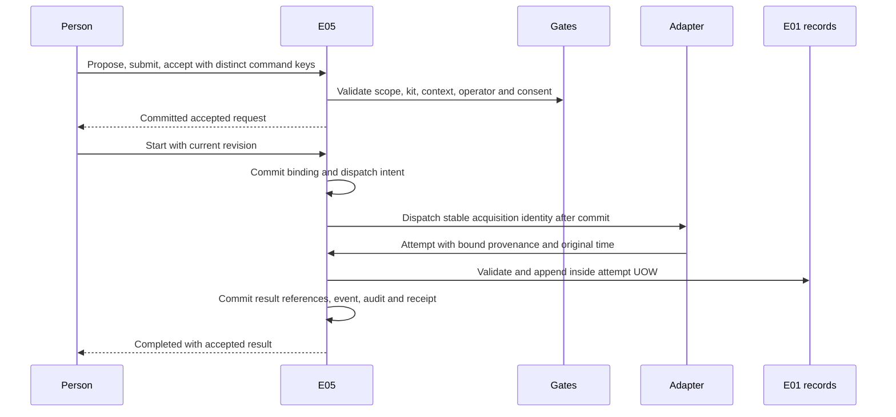
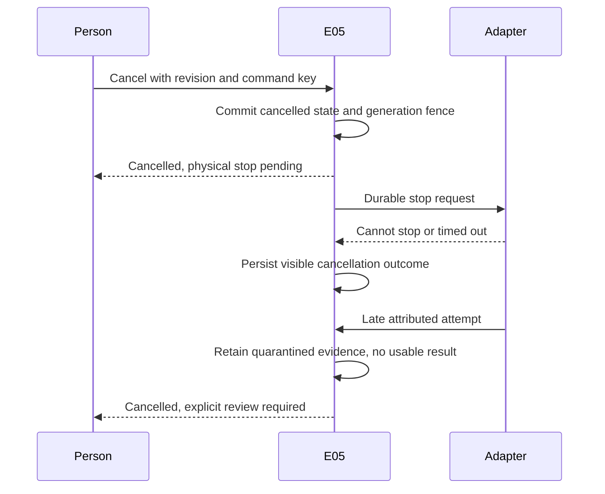

# E05: Capabilities and measurement workflow

Technical design. Binding inputs: `AGENTS.md`, `docs/SYSTEM.md`, `docs/DEPLOYMENT.md`,
`docs/requests/COORDINATOR-DECISIONS.md` Part A and `docs/BUILD-CHARTER.md`. Product references below are relative to
`docs/product/`. Implementation, fault and integration tests are planned evidence, not results already obtained.

## 1. Scope

Deliver E05-01, E05-02 and E05-03; R06, R07 and R08; measurement contributions to V05, V07, V08, V09, V11, V13,
V14, V15, V16, V17, V18, V19, V20, V23, V25, V28, V34, V35, V36, V69, V75, V78 and V85 to V87; D06, D08,
D09, D11, D12 and D30. Flows: UC01, UC02, UC08, UC15, UC16, UC20 and UC22. R25 recovery is shared with E01.

E05 owns CONTRACTS section 4 at its measurement-request boundary; the other state machines in that section are
delegated as traced below. Applicable measurement rules also occur in sections 1, 2, 3, 5, 7, 9, 11, 17 to 21 and 23.
The scope is requests, attempts, capability availability and gaps. E01 owns Observation storage, validation and HTTP
entry; E02 owns identity/consent; E06 camera
quality/selection; E07 devices; E08 band processing; E09 report confirmation; E14 comparisons/baselines; E11 clinical
request eligibility; E27 kit computation; E28 plan alternatives; E30 guided checks. E05 never creates a second records
store, quality engine, kit engine, urgency engine or device driver.

Hard dependencies are E01 and E02 (SYSTEM 9). Optional providers may be absent, but their missing facts never imply
permission. Direct self/verified-officer manual record entry remains E01/E02's independent path. Integration lacking
a settled seam stays unavailable, with its acceptance item open. This does not remove any work package.

### 1.1 Rule trace

One row per applicable normative sentence, plus explicit acceptance rules. Source line numbers are in CONTRACTS.md
unless prefixed PRD.md. Rules owned by other epics are traced here only at E05's boundary.

| Source | Rule | Design section | Test ID |
|---|---|---|---|
| PRD.md:482 R06 | Units and correction provenance | 3, 4 | T-E05-06, T-E05-07 |
| PRD.md:483 R07 | Capability, operator, context and consent | 2, 3, 4 | T-E05-01, T-E05-03 |
| PRD.md:484 R08 | Connected, manual, imported and simulated paths | 4, 9 | T-E05-04, T-E05-10 |
| CONTRACTS.md:7 | Never join by name or face; patient differs from operator | 3, 10 | T-E05-03 |
| CONTRACTS.md:9 | Preserve observation/entry/receipt time; no silent UTC replacement | 3.1 | T-E05-07 |
| CONTRACTS.md:13 sentence 1 | No numerical missing sentinel | 3 | T-E05-04 |
| CONTRACTS.md:13 sentence 4 | Supersession preserves the original | 4 | T-E05-06 |
| CONTRACTS.md:29 | Controller creates gaps; model only proposes | 3, 4 | T-E05-02, T-E05-15 |
| CONTRACTS.md:101 sentence 2 | Actual method, subject and device from adapter | 4, 5 | T-E05-03, T-E05-04 |
| CONTRACTS.md:101 sentence 3 | Failed reading is an attempt/reason, no invented value | 3, 4 | T-E05-04 |
| CONTRACTS.md:109 sentence 2 | Only completed with accepted observations is usable | 3 | T-E05-04 |
| CONTRACTS.md:109 sentence 4 | Retry appends, never rewrites failed history | 3, 4 | T-E05-05 |
| CONTRACTS.md:111 sentence 1 | Helper accepts before necessary details | 6, 10 | T-E05-03, T-E05-12 |
| CONTRACTS.md:111 sentence 2 | Cancel and review late results before use | 3, 4 | T-E05-05 |
| CONTRACTS.md:111 sentence 3 | Device inability to cancel visible | 5, 7 | T-E05-05 |
| CONTRACTS.md:117 | Episode resolution belongs to E15; normal value cannot resolve it | 3, 10 | T-E05-14 |
| CONTRACTS.md:119 | Urgency belongs to E11; no model disposition or local threshold | 4, 10 | T-E05-15 |
| CONTRACTS.md:123 | Daily-check completion belongs to E03/E22; optional readings never change it | 10 | T-E05-14 |
| CONTRACTS.md:129 | Version/purpose eligibility delegated to E10, Q1/Q18 review label applied | 8 | T-E05-09 |
| CONTRACTS.md:135 | Sharing belongs to E16/E29, no onboard wait or receipt as review | 9 | T-E05-10 |
| CONTRACTS.md:141 | No measurement transition waits for ground | 9 | T-E05-10 |
| CONTRACTS.md:210 | Shared idempotency, D6 overrides cache-only retention | 4 | T-E05-08 |
| CONTRACTS.md:211 | Revision required for actions | 4, 6 | T-E05-08 |
| CONTRACTS.md:214 | Configuration precondition | 6, 8.1 | T-E05-09 |
| CONTRACTS.md:218 | Bounded lists, UTC and configured identifiers | 3, 6, 11 | T-E05-11 |
| CONTRACTS.md:220 | Error words from configuration | 6, 7 | T-E05-09 |
| CONTRACTS.md:267 | Injected scope; registry/source/quality/body-region checks | 4, 10 | T-E05-15 |
| CONTRACTS.md:300 | Request body region defaults from registry | 3 | T-E05-01 |
| CONTRACTS.md:303 | Gap body region from missing capability | 3 | T-E05-02 |
| CONTRACTS.md:414 | No SIM result in LIVE | 3, 10 | T-E05-03 |
| CONTRACTS.md:415 | Missing/declined/failed/stale never normal | 3, 7 | T-E05-04, T-E05-07 |
| CONTRACTS.md:416 | Journal excluded from all E05 reads/exits | 10 | T-E05-12 |
| CONTRACTS.md:417 | Camera/forecast never substitutes for required instrument | 3, 9 | T-E05-02, T-E05-14 |
| CONTRACTS.md:418 | Review does not resolve warnings | 4, 10 | T-E05-14 |
| CONTRACTS.md:419 | Urgent response never waits for acquisition | 9 | T-E05-10 |
| CONTRACTS.md:420 | No ground dependency | 9 | T-E05-10 |
| CONTRACTS.md:421 | Historical exposure never inferred | 3.1, 10 | T-E05-07 |
| CONTRACTS.md:422 | Correction lineage retained | 4 | T-E05-06 |
| CONTRACTS.md:424 | Quality is not diagnostic confidence | 3, 7 | T-E05-14 |
| CONTRACTS.md:425 | Values/outcomes never change participation | 4, 10 | T-E05-14 |
| CONTRACTS.md:427 | Fixed region; symptom is not measured | 3, 7 | T-E05-11 |
| CONTRACTS.md:439 | Content from release or backend state | 8 | T-E05-09 |
| CONTRACTS.md:441 | Client constants restricted to vocabulary/layout | 7 | T-E05-09 |
| CONTRACTS.md:443 | Vocabulary keys never display words | 7 | T-E05-09 |
| CONTRACTS.md:518 | Raw-byte hashes identify configuration | 8 | T-E05-09 |
| CONTRACTS.md:521 | Pins and D1 survive activation | 8.1 | T-E05-09 |
| CONTRACTS.md:523 | Example kit rejected in LIVE | 8 | T-E05-09 |
| CONTRACTS.md:527 | Validation rejects invalid release | 8 | T-E05-09 |
| CONTRACTS.md:539 | Kit references and capability uniqueness checked | 8 | T-E05-01, T-E05-09 |
| CONTRACTS.md:548 | Render templates from configuration | 7, 8 | T-E05-09 |
| CONTRACTS.md:950 | Measurement cards independent of model | 7, 9 | T-E05-10 |
| CONTRACTS.md:960 | Failed kit gate creates unavailable request and gap, no task | 4 | T-E05-02 |
| CONTRACTS.md:982 | Event delivery after commit, at least once | 4 | T-E05-08 |
| CONTRACTS.md:983 sentence 1 | Current event scope/role authorization | 10 | T-E05-12 |
| CONTRACTS.md:1080 sentence 2 | Identity never supplied by model/body | 4, 10 | T-E05-03 |
| CONTRACTS.md:1090 | Adapter limited to assigned acquisitions | 5, 6 | T-E05-03 |
| CONTRACTS.md:1108 | State, audit and outbox atomic | 4 | T-E05-08 |
| CONTRACTS.md:1109 | Injected clock | 3.1 | T-E05-07 |
| CONTRACTS.md:1157 | Operator aboard; no ground requirement | 3, 9 | T-E05-01 |
| CONTRACTS.md:1190 | Kit gate before every task | 4 | T-E05-02 |
| CONTRACTS.md:1198 | Persist unavailable and gap before 422 | 4 | T-E05-02, T-E05-08 |
| CONTRACTS.md:1200 | Capability derives from same kit document | 3, 8 | T-E05-01 |
| CONTRACTS.md:1295 | Guided check never confirms or closes gap | 3, 10 | T-E05-14 |
| CONTRACTS.md:1333 | Q8 preserves manual and camera disagreement | 4, 10 | T-E05-14 |
| CONTRACTS.md:1334 | Palpation cannot fulfill ECG or close ring | 3, 10 | T-E05-14 |

## 2. Seams

Canonical SYSTEM signatures are imported verbatim. Rows marked pending are integration requirements, not new agreed
interfaces. Their exact proposals live in `docs/requests/E05.md`; do not implement a compatibility alias or guessed
DTO. Use caller-bound snapshots/UOWs, never a second transaction for a cross-module write.

| Name | Provider epic | Consumer epics | Signature or payload with types | SYSTEM section |
|---|---|---|---|---|
| `IdFactory`, `require_id` | E01 | E05 | `new(prefix: str) -> str`; `derived(prefix: str, *parts: str) -> str`; exact validation function | 5.1 |
| `Clock` | E01 | E05 | `now() -> datetime`; `monotonic_ns() -> int`; `process_epoch() -> str` | 5.2 |
| `ClockSegments`, `ClockSegment` | E01 | E05 | Exact `open(uow, segment)` and `for_sequence(snapshot, *, source_clock_id, sequence)`; TimeInput/ClockCorrection include captured segment_id | 5.2 |
| `ClockCorrections` | E01 | E05 | Exact `apply`, `history`, `normalize`, `elapsed` declarations with `TimeInput`, `NormalizedTime`, `ClockCorrection` | 5.2 |
| `HlcClock` | E01 | E05 | `tick(uow: UnitOfWork) -> Hlc`; `observe(uow: UnitOfWork, remote: Hlc) -> Hlc` | 5.2 |
| `ClockCorrected`, `ClockRegressed` | E01 | E05 | Exact domain-event fields, not public Event types | 5.2 |
| `MissionClock`, `MissionClockVersion`, `MetLabel` | E01 | E05 | Exact `version_at`, `met`, `label`, `mission_day`, `day_bounds` declarations | 5.3 |
| `Unit`, `Quantity`, `WireQuantity`, `UnitRegistry`, `WireUnitConverter` | E01 | E05 | Exact Decimal/UCUM types, `parse`, `convert`, `commensurable`; `PressureContext`, `ConvertedQuantity` | 5.4 |
| `FieldError`, `Problem`, `ProblemError`, `StorageUnavailable`, `to_envelope`, `to_problem` | E01 | E05 | Exact typed errors and mappers; adapters own framework integration | 5.5 |
| `ConfigDocumentView`, `ConfigReleaseReader`, `ConfigReader`, `ReleaseHandle` | E01 | E05 | Exact `active`, `release`, `document`, `version_of`; snapshot-bound immutable views | 5.6 |
| `ReleaseCheck`, `ActivationGuard`, `LoaderCheckRegistry`, `TemplateRenderer` | E01 | E05 | Exact `check`, `render` and registry declarations; `CandidateRelease`, `Finding` | 5.6 |
| `ReleaseActivation`, `ReleaseRevision` | E01 | E05 | Exact `revision(snapshot, release_id)` and `activate(uow, session, *, release_id, expected_etag)` | 5.6 |
| `StorageSession`, `StatementResult`, `SqlValue` | E01 | E05 | Exact `execute` and bounded `rows` declarations | 5.7 |
| `UnitOfWork`, `UnitOfWorkFactory` | E01 | E05 | Exact properties, `publish`, `emit`, `audit`, `schedule`, `cancel_schedule`, `replicate`, `savepoint`, `begin` | 5.7 |
| `ReadSnapshot`, `ReadSnapshotFactory` | E01 | E05 | Exact `connection`, `release`, `now`, `snapshot`; mutation refused | 5.7 |
| `Actor`, `SessionContext`, `DomainEvent`, `DomainEventBus` | E01 | E05 | Exact actor/session fields, `subscribe`, iterative `publish` | 5.7 |
| `Audience`, `AudienceRule`, `EventScope`, `OutboxEvent`, `StoredEvent` | E01 | E05 | Exact immutable fields, mandatory audience; `admits(snapshot, session, audience) -> bool` | 5.7 |
| `OutboxSubscriptions` | E01 | E05 | Exact `register` declaration; effect and cursor in one UOW | 5.7 |
| `ReplicationChange`, `ReplicationRef` | E01 | E05 | Exact change and reference fields, `UnitOfWork.replicate` | 5.7 |
| `CommandIdentity`, `StoredResult`, `AcceptedReceipt`, `CommandPolicy`, `CommandReceipts`, `IdempotencyStore` | E01 | E05 | Exact `command_identity`, `requires_ledger`, `accepted`, `read`, `lookup`, `record` declarations; no caller-set durable flag | 5.8 |
| `PendingCommand`, `CommandIntents`, `CommandResumer` | E01 | E05 | Exact `reserve`, `pending`, `complete`, `resume`; parent intent cannot be acknowledged by its child receipt | 5.8 |
| `ResultVisibility` | E01 | E05 | Exact `authorize` declaration; reauthorization on every replay | 5.8 |
| `AuditEntry`, `AuditEnvelope`, `AuditVerification`, `AuditVerifier`, `audit_bytes`, `audit_hash` | E01 | E05 | Exact envelope fields and `verify(*, expected_head_seq, expected_head_hash)` | 5.9 |
| `Scheduler`, `SchedulerRegistry`, `ScheduledJob`, `AbsoluteDeadline`, `ElapsedDeadline` | E01 | E05 | Exact `replace`, `cancel`, registry and deadline declarations | 5.10 |
| `TaskInput`, `TaskLease`, `TaskResult`, `TaskStatus`, `TaskRegistration` | E01 | E05 | Exact pinned-input, generation, result and public-kind types; no clinical quantities in task metadata | 5.10.1 |
| `TaskQueue`, `TaskRunner`, `TaskHandler`, `JobQueries`, `JobResultRef`, `JobResultProjector` | E01 | E05 | Exact `submit`, `cancel`, `claim`, `progress`, `complete`, `fail`, `recover`, `execute`, `apply`, `discard`, `get`, `result`, `project` declarations; progress is Quantity with UCUM unit 1 | 5.10.1 |
| `EvaluatorComputationFailure`, `EvaluationInput`, `PendingEvaluation`, `Evaluator`, `EvaluationIsolation`, `EvaluatorRegistration` | E01 | E05 | Exact `evaluate`, `run`, `retry`, bounded `pending`; immutable evaluator version and completion identity | 5.10.2 |
| `HealthState`, `HealthSnapshot`, `ComponentHealth` | E01 | E05 | Exact `mark_degraded`, `mark_ok`, `snapshot` | 5.10 |
| `HubSettings`, `SettingSpec` | E01 | E05 | Exact `integer`, `quantity`, `boolean`, `text`; no `get` alias | 5.11 |
| `ModuleRegistry`, `Resolver`, `StartupPhase` | E01 | E05 | Exact 5.12 including provide.requires, local_projection/projection/task/evaluator/private_records/internal_command/command_resumer registrations and `register(registry: ModuleRegistry) -> None`; outside kernel | 5.12, 6 |

Feature seams below distinguish current provider declarations from the pending agreements in R-E05-1/2.

| Boundary | Provider | Consumers | Signature or payload with types and status | SYSTEM section |
|---|---|---|---|---|
| Session and consent | E02 | E05 | `SessionContext`; `ConsentQueries.allows(view, *, subject_person_id: str, recipient: str, scope: tuple[str, str]) -> bool`, current E02 2; field-level binding remains its pending integration | 4.2, 8.3 |
| Episode subject and state | E15 | E05 | `EpisodeFacts.get(uow, episode_id) -> EpisodeFact` or None; `visible_to(uow, episode_id, actor) -> bool`, E15 4.2; existing resolved-episode proposal tracked in R-E05-1 | 4.2, 8.3 |
| Mission and overlays | E23 | E05 through gates | `MissionStatePort.current(uow: Snap | None = None) -> MissionFacts | None`; `OverlayPort.active(person_ids: Collection[str], at: datetime) -> Mapping[str, Sequence[OverlayFact]]`, E23 4.2; always caller-bound | 4.2, 8.5 |
| CapabilityQueries | E05 | E06, E07, E08, E09, E11, E12, E14, E27, E30 | `get(uow, code)` named by E11 2; registry view only, no recursive call to RequestGatePort; complete read/DTO agreement pending R-E05-1 | 4.2, 4.4 |
| KitGate | E27 | E05 | SYSTEM name prevails; E27 4.2 currently declares KitGatePort with keyword capability_code, environment_id and condition_ids returning GateOutcome. Name/type consolidation pending R-E05-1 | 4.2, 4.4, 8.1 |
| KitCapabilitiesPort | E27 | E05 | E27 4.2 `capabilities(conn: SnapshotConn, environment_id: EnvironmentId) -> tuple[KitCapability, ...]`; snapshot type reconciliation pending R-E05-1 | 4.4, 8.1 |
| RequestGatePort | E11 | E05, E12 | `check(uow: UnitOfWork, capability_code: str, subject_id: str, operator_id: str | None) -> GateResult`, E11 4.3; precedence/pin/method facts pending R-E05-1 | 4.2, 8.1 |
| MeasurementCommands / assignment / acquisition | E05 | E01, E02, E06, E07, E08, E09, E30 | SYSTEM supplies owner, not methods; owner-UOW manual link, producer proof and dispatch protocols pending R-E05-2 | 4.2, 8.6 |
| GapProposalPort | E05 | E12 | E05 proposal `record(uow: UnitOfWork, episode_id: str, capability_or_fact: str, consequence: str) -> str`; validate code and actual lack; E12 4.3 requires caller-owned apply UOW, binding pending R-E05-1 and R-E12-11 | 4.4, 11 |
| MeasurementProposalPort | E05 | E12, E13 | E05 proposed create command in R-E05-1; E12 4.3 commits effects only in E13 apply UOW, never speculative acquisition; exact binding pending R-E12-7/R-E12-11 | 4.2, 8.3 |
| MeasurementFacts, GapFacts, CapabilityFactsPort, attempts_not_usable | E05 | E12, E13, E15 | E12 2/R-E12-7 and E15 4.2 read requirements; bounded, authorized projection methods pending R-E05-1 | 4.2, 8.3 |
| InstrumentReadinessPort and person_streams | E05 | E27 | E27 2/4.1 and R27-15/R27-7; unknown readiness never means every packed instrument usable; pending R-E05-1 | 4.4, 8.1 |
| GapPlanPort | E28 | E05 | `plan_for(*, condition_ids: Sequence[str], environment_id: EnvironmentId, subject_person_id: str | None) -> GapPlan | None`, E28 4.2; caller snapshot/pin binding pending R-E05-1 | 8.1, 8.2 |
| measurement_request.changed | E05 | E03, E12, E13, E15, E21 | Exact public Event.data = generated MeasurementRequest; person scope; immutable pin and audience. No public gap or observation event invented | 5.7, 8.3; CONTRACTS 18 |
| Internal request/gap change payloads | E05 | E13, E15 | E15 4.4 and its section 14 event proposal require atomic revision updates; pending R-E05-1; public outbox alone cannot prove atomic episode invalidation | 5.7, 8.6 |

E06, E07, E08, E09, E14 and E30 have no current `docs/tdd/` designs at this handoff. Their product briefs inform the
consumer requirements, but do not constitute provider agreement. E03 7 owns the full MeasurementCard, E04 4 owns
intake, E25 4 owns routine completion, E28 7 owns GapCard, E21 owns the shared demo fixture. E05 mounts/links these
components without claiming their files. E04's older wording that E05 stores observations means E01's record port.

## 3. Domain model

Use generated schemas at boundaries, immutable domain values inside. SYSTEM 5.1 registers `mrq`, `att` and `gap`
prefixes in E05's module; configuration codes are validated config_id values, never synthesized from labels.

Capability is a computed view, not clinical evidence. E27 derives the packed kit half from its pinned document;
E05 intersects it with actual device/readiness facts. Importable reports never make equipment aboard. A disconnected
device readable by eye can offer a separately configured manual method; a lost/broken instrument cannot. Unknown
readiness is unavailable, never a guessed connected state. Environment absence is unknown, not station_leo.
The public list has no patient parameter: it exposes operational capabilities, not a person's overlays or health.
The request gate applies subject-specific context and consent again. Source/context policy gaps are R-E05-5.

Request contains every MeasurementRequest field and internal patient, mission, origin, creation release, source
references, state-transition history and acquisition binding. Nullable episode/operator/consent/body-region fields
stay nullable. Input operator_id may be omitted but cannot be JSON null; the stored operator may be null until
assigned. No subject field is invented on the public create body: visible episode binds subject, otherwise session
person. Source/pathway lineage is internal controller provenance until its public contract is settled.

| From | Trigger | To and invariant |
|---|---|---|
| None | Valid proposal after gates | proposed; no acquisition or result |
| proposed | submit | awaiting_acceptance; only opaque task invitation before helper acceptance |
| awaiting_acceptance | assigned operator accept | accepted after current consent, applicability and operator checks |
| accepted | start | in_progress with one durable acquisition intent; recheck all gates |
| in_progress | Valid successful attempt and accepted result | completed; immutable attempt and accepted observation references |
| in_progress | Failed/rejected attempt with no accepted result | accepted for an explicit start retry; failed history remains. This retry transition needs R-E05-3 approval |
| proposed, awaiting_acceptance, accepted, in_progress | Confirmed loss of capability/context/operator | unavailable with reason and gap where episode exists |
| proposed, awaiting_acceptance | subject or assigned operator decline | declined; no Observation |
| proposed, awaiting_acceptance, accepted, in_progress | authorized cancel | cancelled immediately; physical-stop acknowledgment is independent |
| in_progress | acquisition execution cannot continue | failed; infrastructure failure is not a normal finding |
| terminal state | late authenticated outcome | State unchanged; retain quarantined attempt, never usable automatically |

Completed, unavailable, declined, cancelled and failed are terminal request states. A new clinical request is explicit,
not an automatic loop. Attempt failure and terminal request failure are different. Until R-E05-3 settles retry,
current-schema failure ends failed and another attempt requires a new explicit request; same-request retry acceptance
remains open. No unrecognized action is accepted. A client cannot set state or quality directly.

Invariants: I1 no task before kit/context/operator/consent validation; I2 no acquisition before explicit operator
acceptance and start; I3 completed requires at least one accepted, bound result and no cancellation quarantine;
I4 attempts/observations are append only, including conflicts and supersession; I5 mission/origin/patient partitions
never mix; I6 missing signal has no value; I7 a substitute check cannot address a capability gap; I8 source/method
quality and freshness are independent of acquisition success. Every invariant is tested in section 12.

One request opens at most one gap, linked internally by request ID with a uniqueness constraint. Map kit absence to
no_capability, lost/down device to device_absent, absent operator to operator_absent, wrong context to
context_inapplicable. Consent refusal is not a clinical gap. Consequence is validated decision_affected, not an
invented diagnosis. Region comes from the missing capability. E28 supplies eligible plan/step references in requested
condition order; absent provider gives null plan_id and empty alternatives/step IDs, never fabricated guidance.
No-episode unavailable requests retain their KitCheck with audited no_episode, following existing R27-13. No automatic
open-to-addressed transition exists: imports, a normal pulse, forecasts and guided checks cannot close an ECG gap.
An explicit gap resolution mechanism remains R-E05-7; keep the gap open until authorized evidence can be represented.

### 3.1 Time

SYSTEM 5.2 is the sole normalizer. Persist original observed/started/ended time, source clock/segment/capture revision,
correction provenance and receipt time. E01 maps authenticated capture sequences to segments. Missing segment or
uncertainty makes time unknown, never receipt time. Require a nonnegative normalized attempt duration; uncertain
duration cannot establish freshness. Late results remain recorded with original times. UI ordering is observation
time then immutable ID; recovery paging uses durable append order so a late observation is not skipped.

Freshness follows D3, including the entire uncertainty interval and future/regression restrictions. D14 is E23's
REPLAY-channel exception, not permission to refresh a personal observation by receipt. Replayed attempts cannot
overwrite a newer result or cross origins. Request revision and acquisition generation order workflow events;
wall-clock arrival order cannot revive cancelled/completed work.

Acquisition timeout and retry delays are ElapsedDeadline anchors under SYSTEM 5.10, correction aware and durable.
Consent expiry is an absolute deadline and never shifts. No E05 clinical expiry or repeat cadence is inferred from
expected_duration_seconds. Monotonic duration is valid only in one process epoch. Startup sweeps unfinished work
before ingest; unknown time leaves pending/degraded, never auto-completed. SYSTEM 5.3 labels use the captured mission
clock version, half-open day boundaries and explicit retrospective correction, with no effect on participation.

## 4. Application layer

All use cases use SYSTEM 5.7/5.8. Authenticate and authorize operation before receipt lookup; key covers actor,
operation, target, semantic parameters and keyed private-body fingerprint. Check the receipt before mutable
preconditions and again under IMMEDIATE. Reauthorize its object/fields before replay. No private response bytes in
the cache or ledger. SYSTEM 5.8 CommandPolicy classifies every measurement mutation as durable; no caller opt-out.
After cache expiry an exact authorized replay returns the closed accepted_command receipt, not a reconstructed
clinical snapshot. The client validates kind, key, operation and target; a bare DUPLICATE_COMMAND never means success.
No duplicate-key retry changes its target or release. Non-2xx kit refusal is a committed domain outcome,
returned after successful commit, not an exception that rolls back the request and gap.

Gate order: access and validated binding; code/condition/source references; KitGate; applicability; operator;
method/device readiness; operator consent. This takes E27 4.5's operator-before-device precedence, preserving E11's
checks; the E11 precedence/pin discrepancy is R-E05-1. Recheck at proposal, submit, acceptance and actual start.
An assistant proposal remains scoped to the controller's person and current episode. Check episode state through E15:
resolved/unknown episode cannot receive new work without its explicit reopen path. Consent denial leaves work
unaccepted, not a device gap. Revocation while active cancels further authorization and fences incoming results.

| Command | Unit of work and outputs | Crash boundary and recovery |
|---|---|---|
| createMeasurementRequest / commit-only proposal | Validate gates; insert proposed or unavailable request, optional gap, immutable KitCheck/pins; audit, public event, replication declaration and receipt in caller UOW | Before commit nothing accepted; after commit retry reconstructs authorized outcome, including 422. Model cancellation rolls back proposal with its caller |
| actOnMeasurementRequest submit/accept/decline | Validate current grant, If-Match and transition; increment revision; audit/event/replication/receipt together | No partial acceptance; concurrent revision has one winner |
| actOnMeasurementRequest start | Gates then acquisition binding, generation and durable dispatch intent with request transition in one UOW | Worker called only after commit; persisted intent survives lost response. Ambiguous remote start stays reconciliation pending, never blindly starts again |
| actOnMeasurementRequest cancel | Cancel state, generation fence and durable physical-stop intent; event/audit/receipt together | Logical cancellation persists even if worker is absent or cannot stop; late result retained under quarantine |
| recordAttempt | Authenticate exact assignment; validate sequence, pin, subject, device/method, finite unit-bearing input and quality proof; append attempt; E01 appends observations in this same UOW; update result refs/state only when usable; event/audit/replication/receipt together | All-or-none input validation; storage failure retains adapter queue. Duplicate sequence with same canonical payload reuses attempt, changed payload conflicts. No consumer acknowledgment before commit |
| recordObservation with measurement_request_id | E01 owns HTTP and outer UOW; E05 validates request/accepted operator/partition and supplies completion link in same UOW through R-E05-2 | Record and request cannot disagree after crash; direct unlinked manual capture remains independent of E05 |
| Controller gap proposal | E05 validates injected episode scope, capability code and actual missing evidence; inserts open gap with lineage using caller UOW | No writes in speculative tool phase. A cancelled model turn leaves no gap |
| Startup/recovery/scheduled dispatch | SYSTEM 5.10 generation checks; bounded unfinished-request scan; reconcile worker receipt then persist progress | Never repeat completed generation or invent a result. Failure leaves visible pending work; storage faults abort |

Methods that join another module's transaction take UnitOfWork explicitly and never commit. Exact cross-epic protocols
are proposed in R-E05-1/2; there is no local alternative implementation while they are pending. Manual inputs use
E01's actual validation pipeline, imported inputs require E09 confirmed finding provenance, camera/device inputs
require trusted producer proof, and SIM/REPLAY use the same port behind an explicit profile. An import does not make
the kit capable. Corrections are new E01 records with supersedes; never rewrite an attempt's historical result.

If a cancelled attempt contains a real value, retain it as not usable with original method/operator/time; never put
its ID in result_observation_ids. An explicit review path must validate current grant, units, quality, source and
provenance before producing a new usable record; R-E05-3 defines the missing contract. A free-text reason or forged
context key cannot stand in for review. Until then late values remain quarantined and visible to authorized reviewers.

D13 uses E01's EvaluationIsolation.run/retry and EvaluatorComputationFailure exactly (SYSTEM 5.10.2). Typed computation failure preserves valid input and a
durable evaluation_pending retry under its original observation time/release. Storage, I/O, integrity, configuration,
authorization and input-validation failures abort the whole UOW. E05 does not catch them as an unavailable device.
The request can report durable capture while Health reports evaluation degradation; it never reports safety clearance.





These diagrams describe the required integration after R-E05-2/3. The API before that agreement does not pretend
dispatch or review succeeded.

## 5. Adapters

Only repository adapters touch these tables. SYSTEM 5.7 controls SQL, WAL/FULL, rollback and migrations; SYSTEM 5.9
controls the whole-field hash chain. No local transaction, retry queue, HLC or recovery mechanism.

| Table | Stored data and constraints |
|---|---|
| measurement_request | PK request_id; revision positive; generated state enum; nullable wire fields retained; patient/mission/origin/home-node, release pin and internal source refs; indexes on patient/mission/origin/state/id and episode/id |
| measurement_attempt | PK attempt_id; FK request_id; unique request_id/sequence; authenticated adapter and acquisition generation; canonical keyed fingerprint; original times/provenance, outcome/reason and bounded quality notes; immutable after commit |
| measurement_result | Request/attempt/observation links, usable versus quarantined disposition and review reference; unique link; observations owned by E01, accessed/validated through port, never cross-module SQL |
| measurement_gap | PK gap_id; episode required; schema fields with nullable plan_id/body_region; internal source request, pin and lineage; unique source request where present; index episode/state/gap_id |
| measurement_transition | Append-only request revision, actor/ref, old/new state, cause/attempt ID and time; unique request/revision |
| measurement_acquisition | Binding to request revision/generation, adapter/device/method, subject/mission/origin, pin, consent/action scope, start/cancel intent references and acknowledgment; unique live generation per request; no frame bytes |

Durable external work uses TaskQueue and registered TaskHandler execute/apply/discard exactly (SYSTEM 5.10.1), with
public_kind null and no public measurement Job. Task submission shares the start UOW; execute runs outside it;
apply runs inside the generation-checked completion UOW. E01 owns lease/recovery/retry state. R-E05-2 covers only
the missing physical acquisition receipt and late-evidence handoff. Task cancellation cannot discard a real reading:
preserve validated source evidence through the dedicated recordAttempt quarantine path, while forbidding the cancelled
task from publishing a usable result. No clinical state mutation occurs inside TaskHandler.execute.
A timeout does not prove that a physical measurement stopped or never started. Worker
start/cancel/status calls authenticate, have bounded payloads and timeouts, run outside the writer transaction, and
retry only with the same receipt identity. Health/restart belongs to E20 and the provider process (SYSTEM 3).

Adapters keep their unacknowledged outcome on retryable failure. Sequence is allocated per logical request before
capture and never reused across a restart or adapter change; attempt ID comes from IdFactory. A sequence lower than
the high water can be a delayed unseen result and is retained without rewinding state. Unknown binding never attaches
a value to a patient. Raw frames remain on the capture device and are never retained by E05. Invalid units/malformed
input reject before any write; the producer holds the original for correction, not a guessed conversion.

Migration expands E05 tables and indexes without changing E01 tables. Previous executable reads the expanded schema;
rollback switches code, never drops accepted records, receipts or attempts. Backup/restore is SYSTEM 7.2 and
DEPLOYMENT 4.2/7.5. Restore reconciliation blocks old acquisitions until receipt and generation heads are known.

## 6. API

Use the exact schemas in `api/schemas/`, generated through SYSTEM 6.5/D12. No additional properties or locally extended
enums. All non-2xx responses except 304 use ErrorEnvelope per SYSTEM 5.5/D5. Config-Release and correlation headers
follow CONTRACTS 5; action If-Match is the current request revision, obtained from detail GET.

| operationId | Endpoint | Request and response | Authorization |
|---|---|---|---|
| `listCapabilities` | GET /v1/capabilities | Cursor/limit to items of Capability and page | Contract roles including station/adapter; operational facts only |
| `createMeasurementRequest` | POST /v1/measurement-requests | MeasurementRequestCreate to 201 MeasurementRequest; 422 kit refusal retains recorded current_state | crew or crew_medical_officer plus bound subject/object grant |
| `getMeasurementRequest` | GET /v1/measurement-requests/{request_id} | MeasurementRequest, ETag | Same roles plus exact field access; helper task projection unresolved |
| `actOnMeasurementRequest` | POST /v1/measurement-requests/{request_id}/actions | MeasurementRequestAction to MeasurementRequest | Same roles; per-action actor, Idempotency-Key and If-Match |
| `recordAttempt` | POST /v1/measurement-requests/{request_id}/attempts | AttemptCreate to MeasurementRequest | adapter token plus trusted acquisition binding; Idempotency-Key |

E01 owns recordObservation/getObservation, including manual entry; E05 never mounts these routes. The current attempt
response exposes clinical request fields an adapter should not receive. The current helper GET exposes details before
acceptance and has no minimal invitation view. R-E05-4 requests closed minimal projections; until approved those
integrations stay off rather than filling required fields with redactions or expanding access.

Use operation-declared errors: create includes INVALID_VALUE, CAPABILITY_UNAVAILABLE, CONTEXT_INAPPLICABLE and
KIT_CANNOT_PERFORM; actions include CONSENT_REQUIRED, ACTION_NOT_ALLOWED, INVALID_TRANSITION, STALE_VERSION and
VERSION_REQUIRED; attempts include ADAPTER_NOT_TRUSTED, IDENTITY_MISMATCH, INVALID_UNIT and INVALID_TRANSITION.
All mutations include DUPLICATE_COMMAND; storage failure uses retryable INTERNAL_ERROR. The missing error declarations
for origin/value/configuration/size and late gate failures are R-E05-6; E01 already tracks global configuration mismatch.
No authorization failure includes an unauthorized current_state. Late gate failure with a representable unavailable
state returns the action's 200 state, not a fabricated successful acquisition; no undeclared 422 is emitted.

Concrete contract fixtures are `api/examples/requests/measurement-request.json`,
`api/examples/clinical/measurement-request-pulse.json`, `api/examples/clinical/measurement-request-ecg-blocked.json`
and `api/examples/errors/kit-cannot-perform.json`. They are SIM test inputs only. Run the first through create against
its configured missing ECG: persist unavailable plus episode gap, return its recorded KitCheck and no task.
For pulse, submit then accept then start with each returned revision; a failed attempt has observations empty and a
reason; the next approved retry appends a second attempt. Never seed the completed example as production state.

## 7. User interface

E05 owns the request controls, capability list, attempt history and manual-entry form. Mount E03's MeasurementCard
with purpose and indicator; mount E27's KitCheckLine; link E28's GapCard and E09's report workflow. E03 owns the five
sourced headings (PRD 1.3), shell, body figure and permanent help button. No hardcoded clinical instruction or unit.

| Component | Binding | States and behavior |
|---|---|---|
| CapabilityList | listCapabilities | Loading, empty, available, unavailable, not_applicable, offline/stale inventory; never advertise cached availability as current |
| MeasurementRequestPanel | create/get/actOnMeasurementRequest; measurement_request.changed | All nine request states distinct; show purpose, decision, operator requirement, duration or unknown, KitCheck and alternatives; gate allowed_actions on server |
| AttemptHistory | getMeasurementRequest, authorized E01 observation detail | Failed/rejected reason, accepted result, disagreement, original time/age, late-cancel quarantine and physical-stop uncertainty; no blank-to-zero conversion |
| ManualEntry | E01 recordObservation | Required explicit subject/method/unit/time, source and context; invalid held for correction, pending save, durable acceptance, supersession; never silently attach an old value to a fresh acquisition |

Every value shows LIVE/REPLAY/SIM, actual method and quality. No diagnostic success message follows completed.
Unknown/no signal reads configured not-measured words. Retry preserves history and requires intent. Imports retain
original dates and require E09 confirmation. Preference decline never becomes unavailable or a negative finding.
PRD's Not available action and safe physical-cancel text require R-E05-3/4, not a cancel alias with a misleading label.

Keyboard focus follows server transitions without trapping urgent navigation; labels accompany colors/body marks;
status changes use polite announcements and errors associate with fields. Medical contexts show no participation
reward. UI P2 is memory-only and cleared on sign-out/revocation. E20's encrypted per-person command queue can retain
manual entry while offline, but never queues acquisition start for surprise execution after reconnect. A disconnected
cancel shows locally pending cancellation until acknowledged; do not claim the hardware stopped. SSE reconnect
refetches detail on expired cursor, honors revisions, and cannot replace a newer view with a delayed event.

## 8. Configuration

SYSTEM 5.6 loads immutable release handles; 5.11 keeps operational bounds separate. E05 owns no shared configuration
document. E27 owns kit content and checks 11/12, E01 owns observation policy/unit validation, E03 owns copy. R-E05-5
forwards existing missing applicability/quality content, and R-E05-4 requests UI words. No local default policy.

| Input | Schema / use | Validation and provenance |
|---|---|---|
| kit-map.json | config-kit-map.schema.json via E27 ports | Unique capability/provider/reference checks 1, 2, 11, 12; example forbidden in LIVE; labels, basis and source lineage preserved |
| indicator-catalog.json | config-indicator-catalog.schema.json | Units/display only, check 9; cannot substitute for acquisition plausibility or quality criteria |
| ui-copy.json | config-ui-copy.schema.json | Vocabulary, missing/error/state words and templates, check 13; unsupported keys never receive code literals |
| environment-profiles.json | config-environment-profiles.schema.json via E23 | Active environment and mission-clock context, check 7; no environment guessed when absent |
| onboard-plans.json | config-onboard-plans.schema.json via E28 | Pin and eligibility checked by E28/E27-guidance; all checks 14/15 retained |
| Accepted D12 unit mapping | SYSTEM 5.4/5.6 effective release | Original quantity plus UCUM Quantity and conversion provenance; no unversioned aliases |

Every loader check still executes under SYSTEM 5.12, including when its usual provider is absent. Schema/reference/
provenance failures reject activation atomically and leave last good release. Q1/Q7/Q18 permit sourced eligible
content labeled not clinically reviewed; withdrawal, invalid sources, purpose, context and simulation-only restrictions
remain blocking. T-E05-09 changes a label in a scratch kit document and proves list/card content changes without code,
then removes an instrument and proves the kit gate changes. It edits no safety mapping or shipped configuration.

### 8.1 Activation effects

| Input | New work | Open requests, attempts and scheduled work |
|---|---|---|
| Kit/applicability/observation policy | New validated release | Keep creation/evaluation pins. Recheck actual current environment, device, operator and consent before execution. A removed definition does not rewrite history or turn unavailable into completed; contradictory live applicability prevents start |
| Indicator catalog / unit mapping | New display/conversion policy | Preserve recorded canonical/original units and mapping version; no retrospective reinterpretation; existing attempt validates under its capture pin |
| UI copy | New screens use new pin | Open request keeps its copy pin for state explanation; current global fault notice remains available |
| Environment profiles / mission clock | Confirmed current environment through E23 | Recheck equipment/context, never move old readings to the new environment; relative deadlines recompute through SYSTEM 5.2/5.10, absolute consent expiry stays fixed |
| Onboard plans | New gap suggestions use eligible current plan | Existing references/pins retained; E28 rechecks execution availability; no automatic gap closure |

E05 changes no warning, stock balance or routine completion on activation. D1 keeps active warnings pinned and
never lowered; no E05 mutation spends stock. Invalid candidate never changes a timer. E01 owns correction and
activation transactions. Receipt replay precedes current-release mismatch; actual new acquisition must resolve the
pin-aware gate agreement in R-E05-1. Pending agreement disables the affected start, not configuration validation.

## 9. Deployment and fallbacks

| Tier / failure | Primary | Independent backup and fail-safe state |
|---|---|---|
| T0 laptop/webcam | E05 workflow with local E06 worker | Camera absent/poor signal: E01 direct manual entry; no value when unmeasured. Model/link absent does not change safety paths |
| T1 browsers/station | Personal authenticated request UI | Shared laptop; station sees no clinical request. Disconnected browser shows stale/pending rather than accepted |
| T2 tablets | Same hub UI | Laptop; tablet is not a record owner or implicit camera worker |
| T3 kit devices | Trusted E07/E08 acquisition | Device readable by eye: separately configured manual method; broken/absent instrument: unavailable gap |
| T4 habitat feeds | E23 reads independent of E05 | No inference of personal exposure or acquisition success from habitat data |
| T5 integration node | Read-only source adapters | Local manual path; vehicle commands never exposed |
| T6 hubs | Local home hub owns each request | One hub interim; no automatic clinical request merge. Missing projection contract keeps measurement sync off under R-E05-8 |
| T7 ground | Approved E16/E29 summaries only | Onboard care continues; E05 never reads GroundLinkQuery or waits on an acknowledgment |
| E11/E27 or mission facts absent | Full deterministic gate | Unknown prerequisites prevent acquisition. Direct E01/E02 manual care and cached E26 help remain usable |
| Hub/storage unavailable | Durable hub record | Encrypted pending manual command or human/printed procedure through E20/E26; visible not recorded, never falsely acknowledged |

Critical paths have dissimilar checks: adapter identity plus E05 assignment and E01 validation; device acquisition plus
human manual recording; event delivery plus authenticated detail refetch; durable capture plus shared restart/restore.
T-E05-03/08/10 remove each primary. Help never waits for a sample, saving, sign-in, model, device or link.

## 10. Safety, security and privacy

| Hazard | Mitigation | Test |
|---|---|---|
| Plausible value on wrong person | Explicit E02 binding, generation/adapter/device checks, no facial identity or model override | T-E05-03 |
| Unsupported test or clinical reassurance | Kit and context gates, per-method quality, no diagnostic inference, open gap | T-E05-01, T-E05-02, T-E05-14 |
| Lost/duplicated reading | Shared atomic UOW/ledger; append-only attempts; exact receipt recovery | T-E05-08 |
| Cancelled reading becomes current | Generation fence, quarantine and explicit authorized review | T-E05-05 |
| Stale or conflicting sources silently selected | Observation-time freshness; retain both sources with conflict; E06/E14 selection rationale | T-E05-07, T-E05-14 |
| Helper/adapter acquires full chart | Per-object and leaf-field grant, minimal task/adapter projections; missing answer denies | T-E05-12 |

P2 request reason/decision/attempt notes never enter logs, exception details or response caches. Audit contains IDs,
codes and state changes only; private body fingerprints use SYSTEM 5.8 HMAC. No journal/report source bytes are read.
Consent covers the particular subject, operator, purpose, action and fields, checked again on reads, writes, event
delivery, receipt replay and every export. Accepted task is not general chart access; help membership and officer
status alone do not confer it. Full contracted events are withheld if a recipient lacks any required field, not
partially invented. Adapter response minimization is a blocking contract request, not a grant to read the whole request.

E01/E02's verified-officer manual capture for an incapacitated subject remains available without E05 or new consent;
this capture grants no later chart read. A helper lacking a grant gets fixed help and the existing limited help panel,
not a clinical request dump. Ground receives only approved snapshots. Local backups, peer projections, exports and
UI caches obey SYSTEM 8.3 and DEPLOYMENT 4/5, never a special offline exception.

The assistant may propose a validated request or gap only during committed effect application. It cannot accept,
start, submit attempts, choose a patient from text, assign itself operator, confirm an import, review a late value,
address a gap, or mutate warning/urgency state. E30's valid manual and camera observations both survive disagreement
under Q8; retry remains incomplete, no skill success or gap closure. Drill samples never enter E05 clinical ingestion.

### 10.1 Failure and edge cases

| Case from AGENTS section 6 | Behavior | Test ID |
|---|---|---|
| Crash/power loss at every command step | Before commit no acceptance; after commit same receipt, event and references; recover dispatch without second physical start | T-E05-08 |
| Duplicate/retried submissions | Full actor/operation/target/body identity and request/sequence checks; no duplicate gap/attempt | T-E05-08 |
| Clock jumps/mission boundaries | Segment-aware original time, immutable labels, relative timers shift, absolute consent expiry does not | T-E05-07 |
| Disk full | Rollback, retryable storage error, keep producer/client queue, no false success | T-E05-08 |
| Corrupt/missing configuration | Reject candidate, last good pin; unknown policy leaves acquisition/acceptance unavailable | T-E05-09 |
| Partial/implausible/disagreeing readings | Per-capability attempts; accept usable pulse without fabricated breathing; retain real rejected/conflicting values and reasons | T-E05-04, T-E05-14 |
| Concurrent clients | Revision CAS and generation fence; cancellation wins against later use, stale accept/start rejected | T-E05-05, T-E05-08 |
| Long link outage/backlog | No ground dependency; durable receipts survive cache age, consent checked before any later delivery | T-E05-08, T-E05-10, T-E05-12 |
| Incapacitated/absent crew | No guessed subject/acceptance; recheck operator; direct officer manual care and fixed help remain available | T-E05-03, T-E05-10 |
| Privacy between crew | Owner or explicit task fields only; revocation invalidates reads/events/replays and client memory | T-E05-12 |

Also test zero as measured zero, negatives against the sourced code-specific policy, empty observations on success,
maximum body/list sizes, incompatible changed units, changed device/method and revoked consent between start/result.
No general positivity rule is substituted for an indicator's range. A successful transport with no accepted values
cannot complete a request.

## 11. Performance and resources

Register descriptors through SYSTEM 5.11/5.12. Proposed E05 operational ceilings below are engineering bounds, not
clinical durations or hidden configuration. Validate startup types/minima/maxima; values are selected in hub settings
with basis and to_be_set_by. Unknown descriptor/value prevents the affected optional integration starting. Shared
settings retain E01's registered caps rather than a second local definition.

| Work bounded | Hub setting | Limit / behavior |
|---|---|---|
| API page | measurement.page_size | 1 to 200 items, default 50 per CONTRACTS 5 |
| Registry/fact batch | measurement.max_capabilities | 1 to 1024 entries; reject oversized release or bounded query, never truncate |
| Request embedded attempts | measurement.max_attempts | 1 to 64 per request; before additional capture require explicit new request, preserve all prior attempts; contract approval R-E05-6 |
| Attempt observation list | measurement.max_observations | 1 to 32; whole boundary validates before write; no truncation |
| Text/notes/context | measurement.max_text_bytes, measurement.max_notes, measurement.max_context_entries | 1 to 8192 bytes per field; 1 to 64 notes and 1 to 64 context entries; whole envelope also bounded |
| HTTP command/read response | commands.max_bytes, measurement.max_response_bytes | Shared command descriptor; response cap 1 to 1048576 bytes, overflow explicit; no partial request history |
| Inflight acquisition | measurement.max_inflight | 1 to 32 per hub; capacity refusal precedes hardware start |
| Recovery page | measurement.recovery_batch | 1 to 200, append cursor and snapshot high water |
| Worker call/health | workers.camera.timeout_ms, workers.camera.health_ms | SYSTEM 3/5.11 descriptors, no unbounded call |
| Worker retries/restarts | workers.camera.restart_max, workers.camera.restart_window_ms, workers.camera.backoff_max_ms | SYSTEM 3/5.11; supervisor owns policy; exhausted worker unavailable |
| Acquisition task retries and leases | tasks.max_attempts, tasks.retry_backoff_ms, tasks.lease_ms, tasks.claim_batch, tasks.max_pending, tasks.max_input_bytes, tasks.max_result_bytes | SYSTEM 5.10.1/5.11 registered bounds; stable physical identity, no repeat start if receipt unknown |
| Acquisition elapsed timeout | measurement.acquisition_timeout_ms | 1 to 600000 ms; operational fault deadline, never a clinical measurement duration |
| Reconciliation/cancellation queue | scheduler.max_jobs, scheduler.batch_size, scheduler.retry_max, scheduler.retry_backoff_ms | Shared durable scheduler bounds; exhaustion visible pending, never dropped |
| Storage/event/cache | storage.busy_timeout_ms, storage.max_rows, storage.max_statement_bytes, event_bus.max_events, events.page_size, commands.cache_entries | Exact E01 descriptors; no E05 clinical cache or unbounded scan |
| Replication/backup | sync.page_entries, sync.pending_max, sync.max_bytes, sync.retry_max, sync.timeout_ms, backup.timeout_ms | Shared limits, no E05 transport or backup loop |

Device/band worker-specific descriptor names and caps require provider registration under R-E05-2; those
integrations stay off until timeout, health, retry and restart bounds are registered. Camera keys above do not
implicitly configure other workers.

E05 resides inside SYSTEM 3's 768 MB hub budget. Engineering target: bounded local registry/detail under 150 ms p95,
command commit under 250 ms p95 on the reference laptop, excluding acquisition. Measure in T-E05-13; these are
proposed performance targets, not achieved results. UI help still meets its separate 500 ms target under acquisition
load. Work per request is bounded by registered lists; no frame buffers in hub. Recovery uses bounded scheduler pages
and yields between transactions. In-process callbacks remain statically bounded with no external I/O. E01's R-E01-21 still tracks the writer watchdog;
hard callback-deadline acceptance remains open until that shared binding exists. Never use a local thread timeout
that permits a transaction to mutate after returning.

## 12. Test plan

All tests use injected IDs/time, kernel fakes and versioned configuration fixtures. No network/devices/wall clock in
unit/integration tests. Real hardware acceptance is marked separately. Clinical policy golden cases require independent
source-checked expected outcomes, alongside config-rendering tests; missing policy is an open gate, not a tuned pass.

| Test ID | Level | Proof | Trace |
|---|---|---|---|
| T-E05-01 | unit, property, integration | Registry/provider join, unknown readiness, environment/overlay exclusions, operator/consent combinations, no not_in_kit promotion; gate ordering | R07, E05-01, V11, V17, I1 |
| T-E05-02 | contract, integration, end to end | Missing ECG/eye/dosimeter paths persist unavailable/gap and form links; missing episode audited; no task; E27 real gate and E28 plan integration | R07, R08, V18, V19, V20, V28, V78, D06, D12, D30, I7 |
| T-E05-03 | property, integration | Every actor/action/subject/adapter/device/generation/origin combination; remove gateway check and E05 still denies; incapacitated subject independent manual path | R06, R07, V08, V09, V25, D09, I2, I5 |
| T-E05-04 | property, integration | Every legal/illegal transition; failed/rejected/partial outcomes; no accepted result before acceptance; no fabricated value; all methods/origins | R08, E05-02, V05, V11, V23, V34, D08, D11, I3, I6, I8 |
| T-E05-05 | integration, fault, end to end | Cancel before/after dispatch/result commit, lost stop ACK, cannot-cancel device, explicit late review, retry appends history; missing contract tests stay not_run | V13, I2, I3, I4 |
| T-E05-06 | property, contract, integration | Unit conversion via E01, incompatible/ambiguous units, finite/zero/negative boundaries, method quality proof, supersession and source lineage | R06, E05-03, V15, I4, I8 |
| T-E05-07 | property, integration | Old observed time entered now, raw equal times in different clock segments, late/reordered sequences, mission boundaries, forward/backward jumps and timer classes | R06, E05-03, V14, I5, I8 |
| T-E05-08 | fault, integration | Kill before/after each mutation/commit/worker receipt; disk full/integrity error; changed target under same key; retry after cache expiry; restore and outbox cursor recovery | R25, V16, V35, I4 |
| T-E05-09 | contract, integration, UI | Scratch content edit changes API/UI without code; all loader checks, invalid release rejected, activation/removal during capture retains pins and warnings | V75, R07, I1 |
| T-E05-10 | end to end, fault | Native T0 with model, devices, ground and tablets removed; manual record entry/help still work, unknown gate blocks unsupported acquisition | R08, V69, I1, I6 |
| T-E05-11 | contract, property, UI | Closed generated schemas/errors, every enum/null field, fixed region, keyboard/no-color, all list/text/capacity bounds and overflow | V36, R06, R08 |
| T-E05-12 | integration, end to end | Crew A/B, helper before/after acceptance, revoked grant between every exit, adapter receipt minimization, logs/cache/export/sync canaries | V25, R06, I5 |
| T-E05-13 | performance, integration | Bounded resource/load evidence, interactive latency during recovery, worker failure isolation | R08, charter 6 |
| T-E05-14 | integration, end to end | E06/E14 conflict/source selection and independent observations; Q8 disagree retry; no gap closure/diagnosis/skill award; drill not stored | V07, V85, V86, V87, D09, D11, D12, I4, I7 |
| T-E05-15 | integration | E12/E13 commit-only request/gap creation, source validation, stale/cancelled turn leaves no writes, model cannot accept or supply a value | D06, D30, V23, V34, I1, I2 |

### 12.1 Acceptance matrix

Each shared scenario below covers E05's part; the named provider integration is required for its full result. Fakes
never substitute for real-provider acceptance. E21 owns the demo fixture and full scenario aggregation.

| Obligation | Test ID | Acceptance boundary |
|---|---|---|
| E05-01 | T-E05-01, T-E05-02, T-E05-09 | Device absent/wrong gravity prevents acquisition; pending applicability policy blocks greenlight |
| E05-02 | T-E05-03, T-E05-04, T-E05-05, T-E05-10 | Distinct outcomes and acceptance, manual fallback; pending lifecycle/adapter seams block greenlight |
| E05-03 | T-E05-06, T-E05-07, T-E05-14 | Invalid unit, original late time, conflicts retained |
| R06 | T-E05-03, T-E05-06, T-E05-07, T-E05-12 | E01 record and E02 identity integration |
| R07 | T-E05-01, T-E05-02, T-E05-09, T-E05-15 | E11/E27 gates in production transaction |
| R08 | T-E05-04, T-E05-10, T-E05-11 | E06/E07/E08/E09 producers plus manual adapter |
| R25, V16, V35 | T-E05-08 | E01 shared receipt/recovery plus unfinished E05 work |
| V05, V11, V23, V34 | T-E05-04, T-E05-15 | Failed and partial capture, no invented support |
| V07, V85, V86, V87 | T-E05-14 | E06/E14/E30; Q8 supersedes discard-on-disagreement |
| V08, V09, V25 | T-E05-03, T-E05-12 | E02 trusted pairing, partition and access |
| V13 | T-E05-05 | Cancel, late quarantine, explicit review |
| V14 | T-E05-07 | Original observation time and freshness |
| V15 | T-E05-06 | E01 unit/quality policy |
| V17 | T-E05-01 | Configured context exclusion, no standing test in microgravity |
| V18, V19, V20, V28, V78 | T-E05-02 | Unresolved gaps; E15/E28 integration |
| V36 | T-E05-11 | Accessible request/manual flow |
| V69 | T-E05-10 | Optional parts absent |
| V75 | T-E05-09 | No hardcoded content |
| D06 | T-E05-02, T-E05-15 | Attributable reason/decision and configured region |
| D08, D11 | T-E05-04, T-E05-14 | Failed attempt kept, never supporting evidence |
| D09 | T-E05-03, T-E05-14 | E06 actual selector rationale and separate LIVE presenter |
| D12, D30 | T-E05-02, T-E05-14, T-E05-15 | ECG gap/form links persist through substitute check |

## 13. File ownership

This assignment changes only the first three files. Future implementation files are reserved here; no shared
directory is claimed. Add further exact paths through a design revision before implementation.

| Owned file | Purpose |
|---|---|
| `docs/tdd/E05.md` | Design |
| `docs/requests/E05.md` | Canonical requests |
| `docs/tdd/reviews/E05.conformance.md` | Last-written conformance evidence |
| `hub/src/crew_health/measurement/__init__.py` | Empty package initializer |
| `hub/src/crew_health/measurement/module.py` | Registration, IDs, settings and audiences |
| `hub/src/crew_health/measurement/domain/__init__.py` | Empty initializer |
| `hub/src/crew_health/measurement/domain/model.py` | Pure request, attempt and gap invariants |
| `hub/src/crew_health/measurement/domain/errors.py` | Typed domain failures |
| `hub/src/crew_health/measurement/application/__init__.py` | Empty initializer |
| `hub/src/crew_health/measurement/application/ports.py` | Approved ports only |
| `hub/src/crew_health/measurement/application/commands.py` | Request/attempt UOW use cases |
| `hub/src/crew_health/measurement/application/queries.py` | Authorized bounded projections |
| `hub/src/crew_health/measurement/application/recovery.py` | Shared scheduler handlers |
| `hub/src/crew_health/measurement/adapters/__init__.py` | Empty initializer |
| `hub/src/crew_health/measurement/adapters/repository.py` | Owned SQL |
| `hub/src/crew_health/measurement/adapters/acquisition.py` | Approved worker protocol binding |
| `hub/src/crew_health/measurement/adapters/migrations/0001_measurement.sql` | Additive schema |
| `hub/src/crew_health/measurement/api/__init__.py` | Empty initializer |
| `hub/src/crew_health/measurement/api/router.py` | Five contracted operations |
| `hub/tests/measurement/conftest.py` | Config-derived fixtures and fake clock |
| `hub/tests/measurement/test_capabilities.py` | T-E05-01/02/09 |
| `hub/tests/measurement/test_workflow.py` | T-E05-03/04/05/15 |
| `hub/tests/measurement/test_records.py` | T-E05-06/07/14 |
| `hub/tests/measurement/test_durability.py` | T-E05-08 |
| `hub/tests/measurement/test_boundaries.py` | T-E05-11/12/13 |
| `ui/crew/src/features/measurement/CapabilityList.vue` | Capability view |
| `ui/crew/src/features/measurement/MeasurementRequestPanel.vue` | Request controls |
| `ui/crew/src/features/measurement/AttemptHistory.vue` | Attributed attempt view |
| `ui/crew/src/features/measurement/ManualEntry.vue` | E01 manual API client |
| `ui/crew/src/features/measurement/measurement.test.ts` | Content/accessibility/permission tests |
| `eval/scenarios/E05/test_measurement.py` | Full E05 integration scenarios |

Read only: the product package, generated contracts, shared kernel, E02 consent/identity, E03 MeasurementCard/shell,
E11/E27 gate ports, E15 episode facts, E23 mission facts, E28 plan facts, producer ports and E21 demo fixture.
No E05 ownership of shared config, AI-USE-LOG.md, router assembly, records tables, worker code or pharmacy files.

## 14. Requests and open questions

Canonical entries: [docs/requests/E05.md](../requests/E05.md), R-E05-1 through R-E05-8. They consolidate existing
requests and distinguish proposals from settled SYSTEM mechanisms. No additional proposal or interim lives here.

## 15. Build plan

1. Resolve the blocking shared contracts in section 14 with their providers, publish SYSTEM/effective schemas and
   refresh consumer tests. Done when names, fields, pins, transaction owner and visibility projections agree.
2. Implement pure registry overlay/state invariants and config validators, tests first. Done when T-E05-01/02/04/09
   pass; missing policy remains explicitly unavailable, not a passing acquisition acceptance.
3. Implement authorized UOW commands and E01 record linkage. Done when T-E05-03/06/07/08/12 pass under crash/retry.
4. Integrate E06/E07/E08/E09 acquisition, cancellation and imported proof against real ports. Done when
   T-E05-05/10/14 pass with distinct failures and no unaccepted result; fake results alone do not qualify.
5. Add UI through owned components and E03/E27/E28 slots, then E12/E13/E15 and E30 consumers. Done when
   T-E05-11/15 and the E21-owned fixture assertions pass in model-stopped mode where permitted.
6. Run gates below, independent design/build review, fault and native deployment evidence. All findings resolved
   with evidence before implementation greenlight. Coordinator records this AI run in AI-USE-LOG.md because the
   requested edit scope excludes it; this design's conformance record cannot substitute for that log or review.

Design gate now:

```sh
.venv/bin/python scripts/design_lint.py docs/tdd/E05.md
```

Implementation gates, run when the owned packages exist:

```sh
uv run --project hub python scripts/validate_hub.py interfaces generated trace safety
uv run --project hub mypy --strict hub/src/crew_health/measurement
uv run --project hub ruff check hub/src/crew_health/measurement hub/tests/measurement eval/scenarios/E05
uv run --project hub ruff format --check hub/src/crew_health/measurement hub/tests/measurement eval/scenarios/E05
uv run --project hub python -m crew_health.app.import_contracts --output .cache/e05-imports.ini
uv run --project hub lint-imports --config .cache/e05-imports.ini
uv run --project hub pytest -q hub/tests/measurement --cov=crew_health.measurement --cov-branch --cov-fail-under=95
uv run --project hub python scripts/validate_hub.py mutations
pnpm -C ui/crew typecheck
pnpm -C ui/crew test
uv run --project hub pytest -q eval/scenarios/E05/test_measurement.py
```

The eval command selects the file containing every E05 end-to-end row, without an unregistered marker filter.
CI also runs generated-schema contract tests, traceability, mutation/full-condition coverage for acceptance,
authorization/cancellation/durability decisions and complexity at most 15 per safety function (charter 8, SYSTEM 12).
Unit/property/integration suites are hermetic; hardware tests report device and policy versions. Local design lint
does not prove CI, software verification, model validation, clinical validation or mission acceptance.
