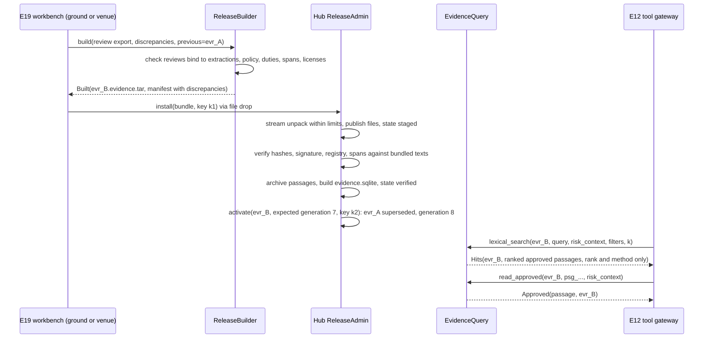
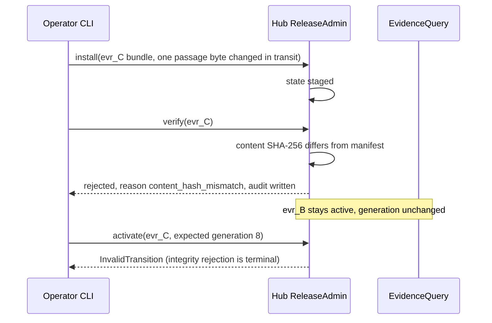

# E10: NASA registry and evidence database

Technical design for epic E10. Inputs: the brief (`tdd/E10.md` in the planning package), PRD.md (sections 2, 9, 10,
11; R13, R21), USE-CASES.md (rules 2, 5 and 7), CONTRACTS.md (sections 1 to 5, 9, 10, 11, 18 to 20), `api/openapi.yaml`
(`getEvidencePassage`), LLM-ARCHITECTURE.md (sections 3 to 5, ADR-02, ADR-10), RESEARCH-ANNEX.md, NASA-SOURCES.md,
VALIDATION.md, the E10 work packages in `backlog.json`, and `docs/BUILD-CHARTER.md`. `docs/SYSTEM.md` and
`docs/DEPLOYMENT.md` were not yet written; every point that depends on them is marked "per DEPLOYMENT.md" or "per
SYSTEM.md" and listed in section 14. Package paths below are relative to ``
(the "package"); audit paths are relative to `the neighboring NASA condition audit directory` (the
"audit"). Every test named here is planned until it runs.

Product owner decisions applied here (coordinator, binding): clinician review is pending, so content ships labeled not
clinically reviewed, the review step stays in the workflow and blocks nothing at runtime; NASA documents ship in full,
every other source ships metadata only (title, citation, link, content hash) until redistribution permission is
documented.

## 1. Scope

### Delivers

| Story | What E10 delivers | Acceptance (backlog) |
|---|---|---|
| E10-01 | The condition and source **registry**: the 911 inventory rows of HRP-48036 Rev B (S01) imported with provenance into `knowledge/registry/registry.json`, the 119 active ICL 1.0 v3.2 conditions with their NASA page, family and indicative workup, the 6 removed or split ICL rows as history, and one canonical record per source ID merged from every source list in the package | 119 active entries preserved; overlapping inventories not counted as unique diseases |
| E10-02 | The deduplicated **research catalog** (3,432 recovered URLs plus every registered source) in the research store, the review stages and per-use approval states of CONTRACTS section 4 "Evidence and model releases", immutable extractions, completeness and license records, and the release policy that decides which states and kinds can reach which use | Summary-only and superseded items cannot enter approved retrieval silently |
| E10-03 | The **evidence release**: a deterministic, hashed, optionally signed, self-verifying bundle of approved passages (with tables intact), the extracted texts they are cut from, the pathway cards of the 119 conditions, source, provenance and license records and passage history; its installer, verifier, activation, rollback and pruning on the hub; the lineage archive; the query primitives; `GET /v1/evidence/passages/{passage_id}` | Every approved citation resolves to an immutable source span and a license record |

Requirements: **R13** (each active condition resolves to its NASA page and authored pathway status), **R21**
(superseded guidance excluded from active retrieval, discoverable in history; shared with E19, which owns the editor
workflow).

Validation scenarios supported: **V23** (the passage half: a cited passage ID that is not approved in the pinned release
for the use does not resolve as approved), **V24** (a superseded source that contradicts a current one is recorded as a
discrepancy and never returned as current), **V26** (journal canary absent from every knowledge store, index and E10
log), **V33** (benchmark items and rubrics absent from every knowledge store and index). Demo assertions supported:
**D10** (every supporting passage ID resolves to an approved passage), **D28** and **D32** (the denominator "of 119" is
the registry's active count; E27 computes the states and plan counts).

CONTRACTS section 9 invariants owned here: "No source correction or record correction erases lineage" (for sources),
"No benchmark answer/rubric is accessible to the evaluated model or its retrieval tools" (store side), "No private
journal enters ... search indexes" (store side), "No inferred diagnostic probability is derived from retrieval
similarity" (the query primitives expose ranks only). CONTRACTS section 11 loader checks 2 (source IDs resolve) and 11
(kit-map `condition_id` exists in the 119) are served by E10 ports; the loader itself is E01's.

### Does not deliver

| Not here | Owner |
|---|---|
| Discovery (Exa), capture and extraction runs, SourceReview and ClaimReview records, the editor workflow and UI, release promotion orchestration, the documentation release, `GET` and `POST /v1/research/sources` | E19 |
| Fusion of lexical and dense candidates, reranking, candidate counts, context budgets, the `search_evidence`, `read_source_passage`, `get_pathway` and `explain_step` tools and their ToolResult envelope | E12 (tuned by E17) |
| Evaluation of pathway steps and decision rules, equipment and operator checks (pathway engine) | E11 |
| Kit map states, plan counts, the "[P] of 119" line and the How we know panel | E27, E28 |
| The configuration loader, its 16 checks and release activation | E01 (E10 supplies the resolvers for checks 2 and 11) |
| The evaluation vault (development cases, holdouts, rubrics) | E18 |
| Any screen | E10 has no UI (section 7) |

## 2. Dependencies and seams

| Seam | Direction | Mechanism | Owner |
|---|---|---|---|
| Storage kernel, migrations, data directory, backup | E10 uses | E01 platform ports (`StorageKernel`, `MigrationRunner`, `Settings.data_dir`) per SYSTEM.md | E01 |
| Clock | E10 uses | E01 `Clock.now() -> datetime` (UTC, injected); used for timestamps and key expiry only, never for ordering | E01 |
| Audit trail | E10 uses | E01 `AuditPort.append(event_type, actor, refs, safe_metadata)` in the same transaction as the state change | E01 |
| Active configuration release | E10 uses | E01 `ConfigReader.document(name) -> ConfigDocumentView` for `kit-map`, `onboard-plans`, `skills-catalog`, `environment-hazards`, `routine-schedule`, `responder-flows`; consumes `config.release_activated` to refresh its merged source view and pathway status cache | E01 |
| Sessions and roles | E10 uses | E02 `require_roles(*roles)` FastAPI dependency; `Session.actor` | E02 |
| Error envelope | E10 uses | E01 `ProblemError(code, field_errors=..., current_state=...)` mapped to RFC 9457 and CONTRACTS section 5 codes | E01 |
| Loader check 2 (source IDs) and check 11 (condition IDs) | E01 uses E10 | `SourceRegistryPort.resolve_many`, `ConditionRegistryPort.condition_status`; injected at app assembly so the module graph has no cycle | E10 provides |
| Citation lines (`citation.text` "rendered by the hub from source titles") | E23, E24, E25, E26, E27, E28 use E10 | `SourceRegistryPort.summary(source_id)` | E10 provides |
| Retrieval primitives and pinned passage reads | E12, E13 use E10 | `EvidenceQueryPort` (4.1); E12 fuses and reranks; E13 validates cited passage IDs with `read_approved(release_id, passage_id, use)` | E10 provides |
| Pathway cards (the pathway of a condition at a pinned release, E11 DE11-8 and R-E11-15) | E11, E12, E27 use E10 | `EvidenceQueryPort.pathway_card(release_id, condition_id)` and `read_approved(release_id, passage_id, None)` (request 14.11) | E10 owns card shape, content and review state; E11 owns evaluation and the LIVE gate |
| Condition registry | E04 (family routing), E11, E12, E27 use E10 | `ConditionRegistryPort` | E10 provides |
| Research catalog, review export and release building | E19 uses E10 | `ResearchCatalogPort`, `ReleaseBuilderPort` (input: the review export of 3.5), `ReleaseAdminPort` | E10 provides |
| Embedding runtime (dense retrieval only) | E10 uses | `EmbeddingPort` over a llama.cpp `llama-server --embedding` instance whose model E17 pins | E17 (settings), E20 (process) |
| Uplink of a release bundle to a flight hub | E10 uses | interim: file drop; target: ground link transport per DEPLOYMENT.md (request 14.8) | E29 |

Events: CONTRACTS section 18 has no evidence event. E10 publishes none and writes audit events only (request 14.3 adds
`evidence.release_activated`). E10 consumes `config.release_activated`.

## 3. Domain model

Pure code in `hub/src/crew_health/knowledge/domain/`, no I/O, no framework imports.

### 3.1 Identifiers

| Type | Format | Derivation |
|---|---|---|
| `SourceId` | `^(EV\|RT\|RS\|SK\|S\|C\|N\|L)\d{2}$` (common.schema `source_id`) | Declared by package documents or assigned by E19 |
| `ConditionId` | `^ICL[1-9][0-9]{0,2}$` (config-onboard-plans `scope.condition_id`) | From the inventory file |
| `EntryId` | `^(ICL\|MCL\|PFCL\|ARCL\|RCL)[1-9][0-9]{0,2}$` | From the inventory files (the 792 matrix uses `ARC` and `PFC` prefixes in `source_entry_id`; the importer maps by `source_inventory` to the audit IDs `ARCL`, `PFCL`, keeping the matrix ID as `matrix_entry_id`) |
| `CatalogItemId` | `cat_` + 16 hex of SHA-256 of the normalized URL | Deterministic |
| `DocumentVersionId` | `dv_` + 16 hex of SHA-256 of `"{catalog_item_id}:{content_sha256}"` | Deterministic; same item and bytes, same ID |
| `ExtractionId` | `ex_` + 16 hex of SHA-256 of `"{document_version_id}:{text_sha256}"` | Deterministic; a different extracted text is a different extraction. The extractor name and version are recorded, not hashed: two extractors producing identical text produce the same citable text |
| `PassageId` | `psg_` + 16 hex of SHA-256 of `"{extraction_id}:{char_start}:{char_end}"` | Deterministic; immutable text, since the extraction fixes it. No source ID inside, so adding an alias (3.3) never changes a passage ID |
| `ReleaseId` | `evr_` + 16 hex of SHA-256 of the canonical manifest body (5.4) | Content addressed |
| `LicenseId` | `lic_` + lowercase snake case | Assigned by the editor who records it |

All match common.schema `id` (`^[A-Za-z0-9][A-Za-z0-9_.:-]{0,127}$`).

### 3.2 Registry (E10-01)

```python
class InventoryKind(StrEnum):      # keys of knowledge/inputs/inventories.json, never display words
    ...                            # values loaded from data; the enum is generated at build from the inputs schema

@dataclass(frozen=True, slots=True)
class Inventory:
    inventory_id: str              # "icl_1_0_v3_2", "master_candidate", "pfcl", "arcl", "rcl", "icl_version_history"
    label: str                     # from inventories.json
    file_ref: InputRef             # path and SHA-256 from knowledge/inputs/manifest.json
    expected_rows: int             # from inventories.json, with S01 page provenance
    counted_in_total: bool         # false for icl_version_history (history, not a 912th row)
    source_id: SourceId            # "S01"

@dataclass(frozen=True, slots=True)
class InventoryMembership:
    entry_id: EntryId
    inventory_id: str
    title_as_published: str
    pdf_page: int | None
    source_url: str                          # with its #page= locator, verbatim
    published_mapping_raw: str | None        # RCL "mapped_to_as_published", verbatim
    published_mapping_target: EntryId | None # parsed prefix of published_mapping_raw, or None if unparseable
    title_match_target: ConditionId | None   # the matrix "active_match" (normalized title match)
    planning_family: str | None              # key of assessment-families.json
    mapping_status: str                      # verbatim
    row_sha256: str                          # SHA-256 of the canonical source row

class ConditionStatus(StrEnum):
    ACTIVE = "active"; REMOVED_OR_SPLIT = "removed_or_split"

@dataclass(frozen=True, slots=True)
class Condition:
    condition_id: ConditionId
    status: ConditionStatus
    name: str                      # condition-assessments-119 "condition", verbatim
    family: str | None
    nasa_page_url: str             # "nasa_membership_source", with #page=
    pdf_page: int
    workup_source_ids: tuple[SourceId, ...]
    workup_review_required: bool   # true when the input holds the sentinel "PLANNING_REVIEW_REQUIRED"
    assessment: AssessmentEntry | None   # the 13 text fields of the 119 entry, verbatim; None for removed rows
    worked_entry: bool

class SourceKind(StrEnum):         # internal vocabulary of knowledge/schemas/release-policy.schema.json
    UNCLASSIFIED = "unclassified"; STANDARD = "standard"; OPERATIONAL_REQUIREMENT = "operational_requirement"
    TECHNICAL_BRIEF = "technical_brief"; CLINICAL_FINDINGS_FORM = "clinical_findings_form"
    MODEL_DOCUMENTATION = "model_documentation"; EVIDENCE_REPORT = "evidence_report"
    CLINICAL_GUIDELINE = "clinical_guideline"; FIRST_AID_GUIDANCE = "first_aid_guidance"
    PRIMARY_STUDY = "primary_study"; DATASET = "dataset"; DEVICE_MANUAL = "device_manual"
    SECONDARY_COMMENTARY = "secondary_commentary"; BENCHMARK_OR_TOOL_DOC = "benchmark_or_tool_doc"

@dataclass(frozen=True, slots=True)
class Source:
    source_id: SourceId
    canonical_url: NormalizedUrl
    document_key: CatalogItemId    # shared by every source ID declared for the same normalized URL
    titles: tuple[str, ...]        # every title it was declared under, first is the display title
    date_text: str | None          # as the source states it; never inferred from a URL folder
    access_text: str | None
    saved_as: str | None
    is_nasa: bool                  # from the declaring file (NASA-SOURCES tables, S01, N rows); decides 3.5 license default
    kind: SourceKind               # unclassified until an E19 technical check classifies it
    declared_in: tuple[InputRef, ...]   # every file and row that declares it

@dataclass(frozen=True, slots=True)
class RegistrySnapshot:
    registry_version: str          # SHA-256 of the canonical body
    inventories: tuple[Inventory, ...]
    memberships: tuple[InventoryMembership, ...]
    conditions: tuple[Condition, ...]
    families: tuple[Family, ...]
    sources: tuple[Source, ...]
    counts: RegistryCounts

@dataclass(frozen=True, slots=True)
class RegistryCounts:              # every count is labeled; there is no "unique diseases" field
    memberships_total: int
    memberships_by_inventory: Mapping[str, int]
    active_conditions: int
    history_removed_or_split: int
    linked_by_published_mapping: int
    linked_by_title_match: int
    distinct_normalized_titles: int            # labeled "titles, not diseases"
    workup_review_required: int
```

`build_registry(inputs: RegistryInputs) -> RegistrySnapshot | RegistryBuildFailure` is a pure function. Tests compute
every count from the inputs, never from literals (section 12).

Real data the builder must handle, found in the inputs:

- RCL rows carry a published consolidation target that differs from the title match: 57 of 66 have
  `mapped_to_as_published`; for 56 of them the published target is not the title match (RCL2 "Allergic rhinitis" maps
  to ICL82 with no title match; RCL7 maps to PFCL1, a proposed future entry). The two fields are stored separately.
- The ICL version history (125 rows) lists 6 removed or split IDs, among them ICL36 (lunar dust exposure). ICL36 is
  resolvable with status `removed_or_split` and is never active, so a kit-map row for it fails loader check 11.
- ICL IDs are not contiguous (they run to ICL123).
- 92 of the 119 entries hold the sentinel `PLANNING_REVIEW_REQUIRED` in `workup_source_ids`, which is not a source ID.
- The same source ID is declared in several files with differently worded titles (C25 "Rev D" and "Revision D"; SK01
  in both onboard-plans and skills-catalog): one record, both titles kept.
- One document carries several source IDs: "A document used in more than one of them has one ID in each"
  (NASA-SOURCES "NASA documents behind the habitat"), for example EV01 and RT03, or EV12, RT10 and RS51. Each ID stays
  a separate `Source` with the same `document_key`; content is deduplicated by document, declarations are not.

### 3.3 Research catalog, extractions and review (E10-02)

```python
class Completeness(StrEnum):
    UNASSESSED = "unassessed"           # nobody assessed the captured bytes yet
    FULL = "full"
    PARTIAL = "partial"                 # truncated fetch, partial page
    SUMMARY_ONLY = "summary_only"       # a fetch summary, an abstract or a search snippet
    CATALOG_ONLY = "catalog_only"       # a link in a catalog or a search hit, never read
    INACCESSIBLE = "inaccessible"       # fetch failed or access blocked

class ReviewStage(StrEnum):             # CONTRACTS section 4 order, monotonic per version
    DISCOVERED = "discovered"; CAPTURED = "captured"; EXTRACTED = "extracted"
    TECHNICALLY_CHECKED = "technically_checked"; CLINICALLY_REVIEWED = "clinically_reviewed"

class UseStatus(StrEnum):               # per (document version, use): "Approval belongs to a version and purpose"
    APPROVED = "approved"; SUPERSEDED = "superseded"; WITHDRAWN = "withdrawn"

@dataclass(frozen=True, slots=True)
class CatalogItem:
    catalog_item_id: CatalogItemId
    normalized_url: NormalizedUrl
    locator: str | None            # "#page=105" kept apart from the identity
    original_urls: tuple[str, ...]
    titles: tuple[str, ...]
    source_ids: tuple[SourceId, ...]   # every registered alias, sorted; empty for unregistered items
    provenance: tuple[CatalogProvenance, ...]   # every imported row: origin, stage, location, context, file SHA-256, row index
    catalog_ceiling: Completeness  # strongest completeness the catalog rows support without bytes (5.2)
    title_url_mismatch: bool       # a title naming one document over a URL naming another
    revision: int

@dataclass(frozen=True, slots=True)
class DocumentVersion:
    document_version_id: DocumentVersionId
    catalog_item_id: CatalogItemId
    content_sha256: str
    media_type: str
    byte_size: int
    retrieved_at: datetime          # UTC
    retrieval_method: str           # key of stage-map.json capture_methods
    capture_ceiling: Completeness   # set at capture from the method and capture facts (5.2), audited with the capture
    completeness: Completeness      # unassessed until assess_completeness; never above capture_ceiling
    publication_date_text: str | None
    publication_date_iso: date | None
    date_precision: Literal["day", "month", "year", "unknown"]
    revision_label: str | None      # "Rev D", as printed
    supersedes: DocumentVersionId | None
    stage: ReviewStage
    withdrawn: WithdrawalRef | None # version level: every use withdrawn, no new approval
    use_status: Mapping[AllowedUse, UseStatus]
    revision: int

@dataclass(frozen=True, slots=True)
class Extraction:                   # immutable; never edited, never deleted
    extraction_id: ExtractionId
    document_version_id: DocumentVersionId
    text_sha256: str                # of the extracted text with page markers; the text is a blob
    extractor: str                  # name and version, for example "pypdf 5.1.0"
    page_count: int | None
    created_by: ActorRef
    created_at: datetime
```

Review stage edges (pure table `STAGE_EDGES`; E19 drives them, E10 enforces them; every edge is one command with its
`expected_revision`, its audit event and its review record):

| From | To | Guard (all must hold) |
|---|---|---|
| discovered | captured | A blob whose SHA-256 matches; `capture_ceiling` set from the method and capture facts in the same transaction |
| captured | captured | `assess_completeness`: an editor records `completeness` with the capture facts as evidence, never above `capture_ceiling`, bound to `content_sha256`; a later assessment supersedes the earlier one |
| captured | extracted | The effective assessment is `full` or `partial`; an Extraction whose text parses into pages |
| extracted, technically_checked, clinically_reviewed | same | A new Extraction with a different text hash. Earlier extractions, their candidates, reviews and passages are kept; reviews bound to an earlier extraction never count for the new one |
| extracted | technically_checked | A passing technical check naming one extraction: reviewer other than its extractor; `completeness_confirmed` equal to or below the assessment; `kind` other than `unclassified`; a passing license check |
| technically_checked | clinically_reviewed | A clinical review naming one extraction, with an attestation, by an actor other than its extractor. Allowed at any time, including after uses were approved |

Use status edges (per document version and use):

| From | To | Guard |
|---|---|---|
| (none) | approved | A use approval naming an extraction and spans; the reviews of that same extraction satisfy the policy row of that use (3.5) |
| approved | superseded | A later version of the same item (or an editor-linked item) is approved for the same use, or an editor links `supersedes` for that use |
| approved | withdrawn | An editor action with a reason, for that use |
| any | withdrawn (every use) | Version withdrawal by an editor with a reason; the version accepts no new approval |

Display state for lists (`display_state(version) -> DisplayState`, deterministic): `withdrawn` if the version is
withdrawn; else `approved` if any use is approved; else `superseded` if any use is superseded; else the review stage.
The per-use map always travels with it, so "approved for risk_context, superseded for limit_basis" stays visible.

Completeness is decided twice, both audited and revision checked: mechanically at capture (`capture_ceiling`: a search
summary is `summary_only`, an Exa contents fetch or a transfer stopped at its byte limit is `partial`), then by an
editor's `assess_completeness` before extraction, which is the step E19 3.3 calls "Assess completeness" (any editor,
`AssessmentAboveCeiling` above the ceiling). Summary-only, catalog-only and inaccessible captures therefore never
extract, whoever asks. The technical checker confirms completeness again with the text in hand and may only lower it.
Transitions, assessments and use status changes are append-only facts.

### 3.4 Passages, licenses and pathway cards (E10-03)

```python
class AllowedUse(StrEnum):           # evidence-passage.schema.json, fixed
    RISK_CONTEXT = "risk_context"; PATIENT_INSTRUCTION = "patient_instruction"
    ROUTINE_BASIS = "routine_basis"; LIMIT_BASIS = "limit_basis"

@dataclass(frozen=True, slots=True)
class Span:
    extraction_id: ExtractionId
    char_start: int                  # code points into the extracted text, page markers excluded
    char_end: int
    page_start: int | None           # None for a page-less HTML capture
    page_end: int | None
    section_path: tuple[str, ...]
    text_sha256: str

@dataclass(frozen=True, slots=True)
class Applicability:                 # unknown stays unknown; nothing is inferred
    evidence_type: str | None
    population: str | None
    mission_phase: str | None
    gravity_context: Literal["earth", "microgravity", "partial_gravity", "any", "unknown"]

@dataclass(frozen=True, slots=True)
class Passage:
    passage_id: PassageId
    source_ids: tuple[SourceId, ...] # every alias of the document, sorted; the served source_id is the first
    span: Span
    text: str                        # the original span text, never NFKC-normalized (units, superscripts, minus signs)
    table_context: str | None        # the header row(s) that travel with a table row
    applicability: Applicability
    allowed_uses: frozenset[AllowedUse]
    clinical_review: Literal["licensed_clinician", "not_clinically_reviewed"]   # from the review chain
    license_id: LicenseId
    conflicts_with: tuple[PassageId, ...]
    supersedes: tuple[PassageId, ...]

class LicenseKind(StrEnum):
    NASA_PUBLIC_DOMAIN = "nasa_public_domain"         # full text
    PERMISSION_DOCUMENTED = "permission_documented"   # full text; basis_url and determined_by required
    METADATA_ONLY = "metadata_only"                   # title, citation, link, content hash; no text, no passage

@dataclass(frozen=True, slots=True)
class LicenseRecord:
    license_id: LicenseId
    kind: LicenseKind
    attribution_text: str | None
    basis_url: str | None
    determined_by: ActorRef
    determined_at: datetime

@dataclass(frozen=True, slots=True)
class PathwayCard:                   # one per active condition, verbatim from condition-assessments-119.json
    condition_id: ConditionId
    card_sha256: str                 # of the canonical card body; with the release ID, the pathway's version
    family: str | None
    assessment: AssessmentEntry
    workup_source_ids: tuple[SourceId, ...]
    workup_review_required: bool
    review_state: Literal["unreviewed", "reviewed"]   # reviewed only through the pathway_card policy row (3.5)
    clinical_review: Literal["licensed_clinician", "not_clinically_reviewed"]
    supporting_passage_ids: tuple[PassageId, ...]   # passages of its workup sources in this release, any status
```

A **pathway card** is the pathway of one condition at one pinned release, which is how E11 reads it (E11 DE11-8,
R-E11-15). It holds the indicative workup as published ("condition-specific protocol and thresholds require review") and
no steps, decision rules, equipment or operator fields: equipment comes from the kit-map row and operators from E31,
both read by E11. E10 guarantees only that `review_state` is `reviewed` when a licensed clinician attested; E11 decides
what that allows, and its rule makes every unreviewed card `simulation_only`, refused in LIVE (E11 3.6). Without a
clinician every card stays `unreviewed`, which is backlog E11-02 "draft pathway remains visibly simulation-only".

Segmentation is a pure function: `segment(text: ExtractedText, params: SegmentationParams) -> tuple[PassageCandidate, ...]`.
Boundaries at page markers (`=== page N ===`, the format of the package's saved texts and of E19's extractor) and
blank-line blocks; a block with at least `params.table_min_lines` consecutive lines containing `|` or two runs of two
or more spaces is a table, is never split, and its first line is copied into `table_context` of every candidate cut
from it; candidates merge up to `params.max_words`, never end below `params.min_words` unless the section ends, with
`params.overlap_words` of overlap. All four numbers come from `release-policy.json` `segmentation` (tuning hypotheses,
LLM-ARCHITECTURE section 3). Approvals may also name manual spans of the same extraction.

### 3.5 Release policy, review export and approvals

`knowledge/policy/release-policy.json` (schema `knowledge/schemas/release-policy.schema.json`) is a build input, not
one of the 18 runtime configuration documents. Its first version, every value labeled `"basis": "team default"` except
where a source is named:

| Use | Required stages | Attestation | Completeness | Source kinds allowed | Basis |
|---|---|---|---|---|---|
| `risk_context` | technically_checked | none | full, or partial with `partial_acknowledged` | every kind except `secondary_commentary`, `benchmark_or_tool_doc`, `unclassified` | team default |
| `limit_basis` | technically_checked | none | full | `standard`, `operational_requirement`, `technical_brief` | team default; NASA-SOURCES section 4 "cite the requirement" |
| `routine_basis` | technically_checked | none | full | `standard`, `operational_requirement`, `technical_brief`, `clinical_guideline` | team default |
| `patient_instruction` | technically_checked, clinically_reviewed | `licensed_clinician` | full | `clinical_guideline`, `first_aid_guidance`, `device_manual` | team default; CliFFs excluded because "the forms model a physician aboard" (NASA-SOURCES S13 row), briefs excluded because they "do not give medical recommendations for individuals" (NASA-SOURCES section 4, S12) |
| `pathway_card` (sets `review_state: reviewed`) | a clinical review of the card body | `licensed_clinician` | not applicable | not applicable | team default; backlog E11-02 "draft pathway remains visibly simulation-only" |

License rules (`license_rules`, from the product owner decision): `full_text_kinds` is `nasa_public_domain` and
`permission_documented`; every other kind is metadata only. The registry's `is_nasa` gives the default license
`nasa_public_domain`; every non-NASA source defaults to `metadata_only` until an editor records
`permission_documented` with a `basis_url`. A metadata-only source contributes its title, citation, link and the
`content_sha256` of its captured version to the release, never text and never a passage.

Clinical review label (product owner decision): every passage and pathway card carries `clinical_review`, which is
`licensed_clinician` only when its chain holds a `licensed_clinician` attestation and `not_clinically_reviewed`
otherwise. The label is served (request 14.1) and nothing at runtime waits for review; uses whose policy row requires a
licensed clinician stay empty until one attests, and consumers fall back to their configured steps (section 10).

Separation of duties is mechanism, not policy: the technical checker, the clinical reviewer and the approver are each a
different actor from the extractor.

The **review export** is the only way review evidence reaches E10 (E19 writes it from its records; S0 curation writes
the same format by hand into `knowledge/curation/`). Schema `knowledge/schemas/review-export.schema.json`:

```python
@dataclass(frozen=True, slots=True)
class ReviewDigest:                  # one E19 CompletenessAssessment, license record or effective SourceReview head
    review_id: str
    kind: Literal["completeness_assessment", "license_check", "technical_check", "clinical_review"]
    reviewer: ActorRef
    verdict: Literal["pass", "fail"]
    content_sha256: str              # the captured bytes judged (every kind)
    extraction_id: ExtractionId | None   # the exact text reviewed (technical_check, clinical_review); else None
    text_sha256: str | None
    completeness: Completeness | None    # assessed, or confirmed by the technical check
    source_kind: SourceKind | None
    license_id: LicenseId | None
    applicability: Applicability | None
    attestation: Literal["licensed_clinician", "team_member_not_clinician"] | None
    at: datetime

@dataclass(frozen=True, slots=True)
class ApprovalInput:
    approval_id: str
    target: ExtractionTarget | PathwayCardTarget
        # ExtractionTarget(document_version_id, extraction_id, text_sha256)
        # PathwayCardTarget(condition_id, card_sha256)
    spans: tuple[Span, ...]          # empty unless the target is an extraction
    uses: frozenset[AllowedUse | Literal["pathway_card"]]
    partial_acknowledged: bool
    extracted_by: ActorRef
    reviews: tuple[ReviewDigest, ...]
    approved_by: ActorRef
    approved_at: datetime
    supersedes: tuple[tuple[DocumentVersionId, AllowedUse], ...]
    withdraws: frozenset[AllowedUse]
    reason: str | None

@dataclass(frozen=True, slots=True)
class DiscrepancyInput:              # one DISCREPANCY ClaimReview of E19 (V24)
    claim_review_id: str
    superseded_passage_id: PassageId
    current_passage_id: PassageId
    relation: Literal["contradicts", "revises"]
    reviewer: ActorRef
    at: datetime
```

The builder re-verifies the whole chain: every review names the target's `content_sha256`, and every technical check
and clinical review its `extraction_id` and `text_sha256` (`review_extraction_mismatch` otherwise), every span lies inside that extraction's text and hashes to its
`text_sha256`, the policy row of each use holds on those reviews, and separation of duties holds. Discrepancies are
copied into the manifest and are readable on every hub through `EvidenceQueryPort.discrepancies`; `Built` returns them
to E19, whose review surface lists them.

### 3.6 Evidence release and its state machine on a hub

```python
@dataclass(frozen=True, slots=True)
class ReleaseManifest:
    format_version: int              # 1
    release_id: ReleaseId
    previous_release_id: ReleaseId | None
    created_at: datetime
    created_by: ActorRef
    builder_version: str
    registry_version: str
    policy_sha256: str
    content_sha256: str              # of content.jsonl.gz decompressed bytes
    content_bytes: int               # decompressed, checked while streaming
    texts: tuple[TextMember, ...]    # text_sha256, compressed and decompressed sizes
    counts: ReleaseCounts            # passages per use, history rows, pathway cards, sources, licenses
    embedding: EmbeddingPin | None   # model_id, model_sha256, dims, vectors_sha256
    discrepancies: tuple[Discrepancy, ...]
    approvals: tuple[ApprovalDigest, ...]   # approval_id, target, uses, approver; no free text

class ReleaseState(StrEnum):
    STAGED = "staged"; VERIFIED = "verified"; ACTIVE = "active"; SUPERSEDED = "superseded"; REJECTED = "rejected"
```

| From | To | Trigger | Guard |
|---|---|---|---|
| (none) | staged | `install` | Bundle within `knowledge-limits.json`; members exactly the allowed names; files published (5.6) |
| staged | verified | `verify` | Manifest body hashes to `release_id`; content, text and vector hashes match; a valid Ed25519 signature by the configured release key (required in LIVE, as AGENTS.md section 3 requires signed update bundles; in SIM and REPLAY a missing key is allowed and the release is recorded `unsigned`); `registry_version` equals the hub's registry; every passage and history line passes INV-E10-11; archive has no conflicting passage body; index built and published |
| staged, verified | rejected | `verify` failure or operator action | Reason recorded; integrity reasons are terminal for that release ID |
| rejected (reason `registry_mismatch` or `signature_key_missing`) | staged | `install` again | The hub's registry or key changed; the failure was environmental |
| verified | active | `activate(release_id, expected_generation)` | One transaction: pointer generation matches; the current active becomes superseded |
| superseded | active | `rollback(to_release_id, expected_generation)` | Files present and the index re-verifies |
| active | superseded | Another activation or rollback | Same transaction |

The **active pointer** is one row `(release_id, generation)`; every activation and rollback increments `generation`,
and ordering everywhere follows `generation` and the transition `seq`, never timestamps. At most one release is active.
No transition deletes a row; the transition log is append-only. Pruning removes a release's files, never its rows, its
archived passages or its memberships (5.1).

### 3.7 Invariants

| ID | Invariant |
|---|---|
| INV-E10-01 | The registry holds exactly the rows of the inventories listed in `inventories.json` with `expected_rows` each; a count mismatch fails the build |
| INV-E10-02 | No count, field, label or API output names inventory rows or titles as "unique diseases"; every count carries its label |
| INV-E10-03 | Every active condition resolves to `nasa_page_url` with a `#page=` locator and to a pathway status (R13) |
| INV-E10-04 | A removed or split ICL is never active |
| INV-E10-05 | `published_mapping_target` and `title_match_target` are separate and never merged |
| INV-E10-06 | One source ID maps to one canonical URL; a conflict fails the build naming both declarations. One URL may carry several source IDs, all resolving to one document and its passages, which retrieval returns once |
| INV-E10-07 | Catalog identity is the normalized URL; two items are never merged by title; a title and URL naming different documents sets `title_url_mismatch` |
| INV-E10-08 | Only `full`, or `partial` with `partial_acknowledged`, assessed before extraction and confirmed by a technical check yields a passage; a capture whose ceiling is `summary_only`, `catalog_only` or `inaccessible` is never extracted (E10-02) |
| INV-E10-09 | A passage enters a release for use U only with an approval whose reviews of that exact extraction satisfy the policy row for U and separation of duties |
| INV-E10-10 | Superseded and withdrawn passages are never returned by search, source lookups or context expansion; history reads return them with their status (R21) |
| INV-E10-11 | Every passage and history line in a release resolves, inside the bundle, to its extraction text whose slice `[char_start, char_end)` hashes to `text_sha256`, to its document version's provenance (`content_sha256`) and to a license record of a full-text kind (E10-03) |
| INV-E10-12 | Passage IDs, release content and the bundle bytes are a deterministic function of the inputs and the clock |
| INV-E10-13 | A bundle with a hash, signature or registry mismatch never becomes verified; the active release is unchanged |
| INV-E10-14 | At most one active release; activation and rollback are atomic, generation-checked and logged |
| INV-E10-15 | Query primitives expose rank and method, never a score that could read as a probability or confidence |
| INV-E10-16 | No patient, journal, participation or evaluation-vault content is in the research store, a release, an index or an E10 log line |
| INV-E10-17 | A metadata-only source gives no text and no passage |
| INV-E10-18 | Registry lookups need no network, model or disk I/O after start and never raise into a caller's safety path |
| INV-E10-19 | A release built under an edited `release-policy.json` changes which passages and uses it holds, with no code change |
| INV-E10-20 | An applicability filter never widens: a passage with an unknown field passes only when the filter allows unknown for it |
| INV-E10-21 | An extraction's text never changes; reviews and approvals bind to one extraction ID |
| INV-E10-22 | Approval, supersession and withdrawal are per document version and use |
| INV-E10-23 | A read pinned to release R answers from R's files only; it never substitutes another release's passages or statuses |
| INV-E10-24 | Lineage survives rollback, branching and pruning: every passage ever installed stays readable in history with its span, license and memberships |
| INV-E10-25 | Every bound on input size, query, retry, batch, cache and subprocess comes from `knowledge-limits.json` |

## 4. Application layer

`hub/src/crew_health/knowledge/application/`. Every use case takes an `ActorRef` from the session (never from a body),
runs in one transaction with its audit event, and is idempotent as stated in 4.3.

### 4.1 Ports provided to other modules

```python
class SourceRegistryPort(Protocol):
    def registry_version(self) -> str | RegistryUnavailable: ...
    def summary(self, source_id: str) -> SourceSummary | SourceUnknown | RegistryUnavailable: ...
    def resolve_many(
        self, source_ids: Iterable[str], extra: Sequence[DeclaredSource] = ()
    ) -> ResolutionReport | RegistryUnavailable: ...   # resolved, unknown, conflicts (same ID, different URL)

class ConditionRegistryPort(Protocol):
    def active_ids(self) -> frozenset[ConditionId] | RegistryUnavailable: ...
    def condition_status(self, condition_id: str) -> Active | RemovedOrSplit | UnknownCondition | RegistryUnavailable: ...
    def get(self, condition_id: str) -> Condition | UnknownCondition | RegistryUnavailable: ...
    def memberships(self, condition_id: ConditionId) -> tuple[InventoryMembership, ...] | RegistryUnavailable: ...
    def aliases(self, condition_id: ConditionId) -> tuple[str, ...] | RegistryUnavailable: ...   # for query expansion
    def resolve(self, condition_id: ConditionId) -> ConditionResolution | UnknownCondition | RegistryUnavailable: ...
    def counts(self) -> RegistryCounts | RegistryUnavailable: ...

@dataclass(frozen=True, slots=True)
class ConditionResolution:            # R13: NASA page and authored pathway status
    condition: Condition
    nasa_page_url: str
    cliff_url: str | None             # active kit-map row "cliff_url"
    kit_row_review_state: Literal["unreviewed", "reviewed", "rejected"] | None
    plan_id: str | None               # active kit-map row "plan_id"
    plan_written_for: Literal["condition", "family", "flow"] | None   # active onboard-plans
    plan_review_state: Literal["unreviewed", "reviewed", "rejected"] | None
    pathway_card_review_state: Literal["unreviewed", "reviewed"] | None
    config_release_id: str | None
    evidence_release_id: ReleaseId | None

SearchResult = (Hits            # release_id, items: tuple[RankedPassage, ...] (passage, rank, method)
              | NoMatch          # release_id: the index ran and nothing matched
              | NoActiveRelease
              | ReleaseUnavailable   # release_id, reason: "pruned" | "files_missing" | "index_invalid" | "unknown_release"
              | IndexUnavailable     # release_id, method: "lexical" | "dense", reason
              | QueryRejected)       # reason: "too_long" | "k_out_of_range" | "limits_invalid"

class EvidenceQueryPort(Protocol):
    def active_release(self) -> ActivePointer | NoActiveRelease: ...           # release_id, generation
    def read_approved(self, release_id: ReleaseId, passage_id: str, use: AllowedUse | None) -> ApprovedRead: ...
        # Approved(passage, release_id) | NotApprovedForUse(release_id, allowed_uses)
        # | InReleaseHistory(passage, release_id, status: superseded | withdrawn, superseded_by)
        # | NotInRelease(release_id) | ReleaseUnavailable(release_id, reason)
    def inspect_history(self, passage_id: str) -> HistoryRead: ...
        # Archived(passage, memberships: tuple[Membership(release_id, generation_seen, uses, status), ...])
        # | KnownUnapproved | UnknownPassage
    def passages_for_sources(self, release_id: ReleaseId, source_ids: Sequence[SourceId], use: AllowedUse,
                             filters: ApplicabilityFilter, limit: int) -> SearchResult: ...
    def lexical_search(self, release_id: ReleaseId, query: str, use: AllowedUse, filters: ApplicabilityFilter,
                       mode: Literal["stemmed", "exact"], k: int) -> SearchResult: ...
    def dense_search(self, release_id: ReleaseId, query: str, use: AllowedUse, filters: ApplicabilityFilter,
                     k: int) -> SearchResult: ...
    def expand_context(self, release_id: ReleaseId, passage_id: PassageId, use: AllowedUse,
                       filters: ApplicabilityFilter, neighbors: int) -> SearchResult: ...
    def pathway_card(self, release_id: ReleaseId, condition_id: ConditionId) -> PathwayCard | CardAbsent | ReleaseUnavailable: ...
    def discrepancies(self, release_id: ReleaseId) -> tuple[Discrepancy, ...] | ReleaseUnavailable: ...
```

Retrieval semantics, identical for every primitive:

- **Release.** Every call names a release. Callers that need a stable answer (E13 assessments) pass the release they
  pinned; others pass `active_release().release_id`. Files of a release are immutable, so a pinned read is answered
  only from that release (INV-E10-23); a pruned or missing release returns `ReleaseUnavailable`, never another release's
  data.
- **Use.** A passage qualifies only if `passage_use` holds `(passage_id, use)` in that release.
  `read_approved(..., use=None)` is the inspection form: it returns `Approved` with every allowed use and lets the
  caller decide; E13 and E12 always pass a use.
- **Applicability.** `ApplicabilityFilter` holds, per field (`gravity_context`, `mission_phase`, `population`,
  `evidence_type`), an allowed set or "any", and an `allow_unknown` flag per field. A passage passes when every field is
  in its allowed set, or is unknown and that field allows unknown. Filters only narrow (INV-E10-20).
- **Context expansion.** `expand_context` returns the passage and at most `neighbors` passages on each side (capped by
  `query.expand_neighbors_max`) from the same release, same extraction and same `section_path`, each one approved for
  `use` and passing `filters`, ordered by `char_start`. It returns passage texts only, never text between passages, so
  it never exposes unapproved or unlicensed text.
- **Aliases.** `source_ids` are resolved through the release's alias table to documents; a passage is returned once,
  whichever alias asked.

```python
class ResearchCatalogPort(Protocol):  # used by E19 and the build scripts only
    def upsert_item(self, url: str, title: str | None, provenance: CatalogProvenance, actor: ActorRef) -> CatalogItem: ...
    def register_source(self, item_id: CatalogItemId, source_id: SourceId, actor: ActorRef,
                        expected_revision: int) -> CatalogItem: ...          # adds an alias; never moves one
    def store_capture(self, item_id: CatalogItemId, content: bytes, media_type: str, method: str,
                      facts: CaptureFacts, retrieved_at: datetime, actor: ActorRef) -> DocumentVersion: ...
        # sets capture_ceiling; CaptureFacts: complete transfer or stopped at a byte limit, page count
    def assess_completeness(self, dv_id: DocumentVersionId, completeness: Completeness, evidence: CaptureFacts,
                            actor: ActorRef, expected_revision: int) -> DocumentVersion: ...   # AssessmentAboveCeiling
    def record_extraction(self, dv_id: DocumentVersionId, text: ExtractedText, extractor: str, actor: ActorRef,
                          expected_revision: int) -> tuple[Extraction, tuple[PassageCandidate, ...]]: ...
    def advance_stage(self, dv_id: DocumentVersionId, to: ReviewStage, review: ReviewDigest, actor: ActorRef,
                      expected_revision: int) -> DocumentVersion: ...
    def set_use_status(self, dv_id: DocumentVersionId, use: AllowedUse, to: UseStatus, ref: ApprovalRef | ReasonRef,
                       actor: ActorRef, expected_revision: int) -> DocumentVersion: ...
    def withdraw_version(self, dv_id: DocumentVersionId, reason: str, actor: ActorRef,
                         expected_revision: int) -> DocumentVersion: ...
    def item(self, item_id: CatalogItemId) -> CatalogItem | None: ...
    def items(self, cursor: str | None, limit: int, filters: CatalogFilter) -> Page[CatalogItem]: ...
    def versions(self, item_id: CatalogItemId) -> tuple[DocumentVersion, ...]: ...
    def extractions(self, dv_id: DocumentVersionId) -> tuple[Extraction, ...]: ...
    def text(self, extraction_id: ExtractionId) -> ExtractedText: ...
    def record_license(self, record: LicenseRecord) -> LicenseRecord: ...

class ReleaseBuilderPort(Protocol):
    def build(self, approvals: Sequence[ApprovalInput], discrepancies: Sequence[DiscrepancyInput],
              previous: ReleaseId | None, actor: ActorRef, out_dir: Path, embed: bool) -> ReleaseBuildResult: ...
        # Built(bundle_path, manifest) | BuildRejected(findings: approval or claim review ID, rule, message)

class ReleaseAdminPort(Protocol):
    def install(self, bundle_path: Path, actor: ActorRef, command: CommandKey) -> ReleaseRecord: ...
    def verify(self, release_id: ReleaseId, actor: ActorRef, command: CommandKey) -> ReleaseRecord: ...
    def activate(self, release_id: ReleaseId, actor: ActorRef, reason: str, expected_generation: int,
                 command: CommandKey) -> ActivePointer: ...
    def rollback(self, to_release_id: ReleaseId, actor: ActorRef, reason: str, expected_generation: int,
                 command: CommandKey) -> ActivePointer: ...
    def prune(self, actor: ActorRef, command: CommandKey) -> PruneReport: ...
    def list(self) -> tuple[ReleaseRecord, ...]: ...
```

`CommandKey` is `(idempotency_key, payload_sha256)`; E19 passes its HTTP `Idempotency-Key`, and the CLI generates one
per invocation, prints it and accepts `--idempotency-key` to retry.

### 4.2 Ports E10 requires (adapters in section 5)

```python
class RegistryFile(Protocol):
    def load(self) -> RegistrySnapshot: ...            # raises RegistryUnavailable; never a partial snapshot
class ReleaseRepository(Protocol):                    # hub database
    def get(self, release_id: ReleaseId) -> ReleaseRecord | None: ...
    def pointer(self) -> ActivePointer | NoActiveRelease: ...
    def save_transition(self, record: ReleaseRecord, transition: ReleaseTransition, expected_revision: int) -> ReleaseRecord: ...
    def move_pointer(self, to: ReleaseId, expected_generation: int, transition: ReleaseTransition) -> ActivePointer: ...
    def command_result(self, key: CommandKey) -> CommandOutcome | None: ...   # raises DuplicateCommand on payload mismatch
class LineageArchive(Protocol):                       # hub database, never pruned
    def archive(self, release_id: ReleaseId, passages: Iterable[ArchivedPassage]) -> None: ...   # raises ArchiveConflict
    def history(self, passage_id: str) -> HistoryRead: ...
class ReleaseFiles(Protocol):                         # bundle on disk, built index
    def unpack(self, bundle_path: Path, limits: BundleLimits, deadline_s: float) -> UnpackedBundle: ...
    def build_index(self, unpacked: UnpackedBundle, deadline_s: float) -> IndexFile: ...
    def open_reader(self, release_id: ReleaseId) -> ReleaseReader | ReleaseUnavailable: ...
    def remove(self, release_id: ReleaseId) -> None: ...
class CatalogRepository(Protocol): ...                # research store, mirrors ResearchCatalogPort persistence
class BlobStore(Protocol):
    def put(self, content: bytes) -> str: ...          # returns SHA-256; durable publication of 5.6
    def get(self, sha256: str) -> bytes | BlobMissing: ...   # verifies the hash on read
class EmbeddingPort(Protocol):
    def model_pin(self) -> EmbeddingPin | None: ...
    def embed(self, texts: Sequence[str], timeout_s: float) -> tuple[tuple[float, ...], ...]: ...   # raises EmbeddingUnavailable
class SignatureVerifier(Protocol):
    def verify(self, message: bytes, signature: bytes) -> bool: ...
class LimitsSource(Protocol):
    def current(self) -> KnowledgeLimits | LimitsInvalid: ...   # validated at start, last good kept
class Clock(Protocol): ...; class AuditPort(Protocol): ...; class ConfigReader(Protocol): ...   # E01
```

### 4.3 Use cases

| Use case | Input | Output | Errors | Idempotency |
|---|---|---|---|---|
| `BuildRegistry` (build script) | `knowledge/inputs/manifest.json` | `registry.json` | `InputHashMismatch`, `RowCountMismatch`, `SourceConflict`, `UnknownFamily`, `UnparseableMapping` (warning, kept raw) | Input hashes |
| `ImportCatalog` (build script) | audit `all-sources.csv`, `new-nasa-sources.csv`, registry sources, `stage-map.json` | catalog items with provenance and aliases | `InputHashMismatch` | Normalized URL |
| `ImportPackageCaptures` (build script) | package `research/**`, `sources/*.json`, audit `sources/*.pdf` with manifest hashes | DocumentVersions `captured`, `capture_ceiling` from the method | `BlobHashMismatch`, `StorageFull` | Content SHA-256 |
| `AssessCompleteness` (E19 editor, or S0 curation) | version, completeness, capture facts, expected revision | DocumentVersion with `completeness` | `AssessmentAboveCeiling`, `StaleVersion` | Expected revision; E19 holds the HTTP `Idempotency-Key` |
| `BuildRelease` | review export (approvals, discrepancies), previous release, policy, registry, embedding flag | bundle and manifest, or findings | `BuildRejected` with findings | Manifest body hash |
| `InstallRelease` | bundle path, command key | ReleaseRecord `staged` | `BundleTooLarge`, `BundleMembersInvalid`, `StorageFull`, `StorageIOError`, `InstallTimeout`, `AdminBusy`, `DuplicateCommand` | Command key; a second install of a staged or later release returns its record |
| `VerifyRelease` | release ID, command key | `verified` or `rejected` | `ReleaseHashMismatch`, `SignatureInvalid`, `SignatureKeyMissing`, `RegistryMismatch`, `SpanHashMismatch`, `ArchiveConflict`, `ArchiveFull`, `StorageFull`, `InstallTimeout` | Command key; verifying a verified release rebuilds and re-checks its index without a state change |
| `ActivateRelease` | release ID, reason, expected generation, command key | pointer | `InvalidTransition`, `StaleVersion` (current pointer in `current_state`), `ReleaseFilesMissing`, `DuplicateCommand` | Command key; activating the active release with the current generation is a no-op |
| `RollbackRelease` | target release ID, reason, expected generation, command key | pointer | same as activate | Command key |
| `PruneReleases` | command key | removed release IDs | none | Command key |
| `ReadPassage` | passage ID, optional release and use | `ApprovedRead` or `HistoryRead` | none (absence is a value) | Read |
| `ResolveCondition` | condition ID | `ConditionResolution` | `UnknownCondition`, `RegistryUnavailable` | Read |

Concurrency and retries: install, verify, activate, rollback and prune take an exclusive file lock
`<data_dir>/knowledge/.admin.lock` (timeout `admin.lock_timeout_s`, then `AdminBusy`) for file work. Correctness does
not rest on the lock: activate and rollback move the pointer with
`UPDATE knowledge_active SET release_id=?, generation=generation+1 WHERE id=1 AND generation=?`, so of two clients
holding the same generation one wins and the other gets `StaleVersion` with the current pointer, whatever their targets.
Every admin command first looks up its `CommandKey` in `knowledge_command`: the same key and payload hash return the
stored first result without executing (also after another activation happened in between); the same key with another
payload is `DuplicateCommand` (409 `DUPLICATE_COMMAND`, CONTRACTS section 5 "Idempotency-Key"). Keys are kept
`admin.command_key_retention_h` (24, from that CONTRACTS row); a retry after expiry still cannot act twice, because
its expected generation is stale. Readers hold a read-only connection to the release they started with.

### 4.4 Events and audit

Published events: none (request 14.3). Audit event types written through E01: `knowledge.release_staged`,
`knowledge.release_verified`, `knowledge.release_rejected`, `knowledge.release_activated`,
`knowledge.release_rolled_back`, `knowledge.release_pruned`, `knowledge.catalog_transition`,
`knowledge.use_status_changed`, `knowledge.completeness_assessed`, `knowledge.extraction_recorded`,
`knowledge.blob_quarantined`, `knowledge.registry_loaded`, `knowledge.limits_rejected`. Safe metadata only: IDs, counts, hashes, generations, reasons
from a code list; never passage text, query text or anything derived from a query.

### 4.5 Principal success path



### 4.6 Failure path



## 5. Adapters

### 5.1 Stores

| Store | Location | Holds | Owner |
|---|---|---|---|
| Hub database | E01 storage kernel (per SYSTEM.md) | `knowledge_release`, `knowledge_release_transition`, `knowledge_active`, `knowledge_command`, `knowledge_passage_archive`, `knowledge_release_member` | E10 tables |
| Research store | `<data_dir>/knowledge/research.sqlite`, separate file (LLM-ARCHITECTURE section 3: research archive kept apart from the approved bundle, the evaluation vault and the chart) | `catalog_*` tables (E10) and `workbench_*` tables (E19) | Split by table prefix |
| Blobs | `<data_dir>/knowledge/blobs/<first two hex>/<sha256>` | Captured bytes, extracted texts (also those installed from bundles), write once, mode 0640 | E10 |
| Installed releases | `<data_dir>/knowledge/releases/<release_id>/`: bundle members and `evidence.sqlite` (built locally, read only) | One directory per release | E10 |
| Registry | `knowledge/registry/registry.json` in the repository, shipped with the hub | RegistrySnapshot | E10 |
| Limits | `knowledge/policy/knowledge-limits.json`, shipped; last good copy in `<data_dir>/knowledge/limits.last-good.json` | KnowledgeLimits | E10 |

All SQLite files: `STRICT` tables, `foreign_keys=ON`; the research store uses WAL; release indexes are opened
`mode=ro&immutable=1`.

Hub database tables:

```sql
CREATE TABLE knowledge_release (
  release_id TEXT PRIMARY KEY CHECK (release_id GLOB 'evr_[0-9a-f]*' AND length(release_id) = 20),
  state TEXT NOT NULL CHECK (state IN ('staged','verified','active','superseded','rejected')),
  manifest_sha256 TEXT NOT NULL CHECK (length(manifest_sha256) = 64),
  previous_release_id TEXT,
  registry_version TEXT NOT NULL,
  signed INTEGER NOT NULL CHECK (signed IN (0,1)),
  files_present INTEGER NOT NULL CHECK (files_present IN (0,1)),
  index_sha256 TEXT,
  rejected_reason TEXT CHECK (rejected_reason IS NULL OR rejected_reason IN
    ('content_hash_mismatch','manifest_hash_mismatch','text_hash_mismatch','vector_invalid','signature_invalid',
     'signature_key_missing','registry_mismatch','span_hash_mismatch','archive_conflict','bundle_members_invalid',
     'operator')),
  revision INTEGER NOT NULL DEFAULT 1
) STRICT;
CREATE UNIQUE INDEX knowledge_release_one_active ON knowledge_release(state) WHERE state = 'active';
CREATE TABLE knowledge_release_transition (
  seq INTEGER PRIMARY KEY AUTOINCREMENT,
  release_id TEXT NOT NULL REFERENCES knowledge_release(release_id),
  from_state TEXT, to_state TEXT NOT NULL, generation INTEGER,
  actor_kind TEXT NOT NULL, actor_id TEXT NOT NULL,
  reason TEXT, at TEXT NOT NULL, correlation_id TEXT
) STRICT;
CREATE TABLE knowledge_active (
  id INTEGER PRIMARY KEY CHECK (id = 1),
  release_id TEXT REFERENCES knowledge_release(release_id),
  generation INTEGER NOT NULL
) STRICT;
CREATE TABLE knowledge_command (
  idempotency_key TEXT PRIMARY KEY, command TEXT NOT NULL, payload_sha256 TEXT NOT NULL,
  outcome TEXT NOT NULL, at TEXT NOT NULL
) STRICT;
CREATE TABLE knowledge_passage_archive (
  passage_id TEXT PRIMARY KEY, extraction_id TEXT NOT NULL, text_sha256 TEXT NOT NULL,
  body TEXT NOT NULL, body_sha256 TEXT NOT NULL      -- the full passage record: span, text, sources, license, applicability
) STRICT;
CREATE TABLE knowledge_release_member (
  release_id TEXT NOT NULL REFERENCES knowledge_release(release_id),
  passage_id TEXT NOT NULL REFERENCES knowledge_passage_archive(passage_id),
  uses TEXT NOT NULL, status TEXT NOT NULL CHECK (status IN ('approved','superseded','withdrawn')),
  PRIMARY KEY (release_id, passage_id)
) STRICT, WITHOUT ROWID;
-- update and delete triggers abort on knowledge_release_transition, knowledge_passage_archive, knowledge_release_member
```

The archive is filled at verify, in the transaction that marks the release `verified`: an existing `passage_id` must
have an identical `body_sha256` (`archive_conflict` otherwise). History reads (`inspect_history`) use only the archive
and memberships, so they do not depend on the active pointer, survive rollback and branching, and survive pruning.
Pruning (`retention.keep_releases`, never the active release, its previous release or a release with an open reader)
removes the release directory and sets `files_present = 0`; archive rows, memberships and extraction texts stay.
Installing the same bundle again restores the files. A pinned read of a pruned release is `ReleaseUnavailable("pruned")`.
A verify that would take the archive past `archive.max_passages` fails `ArchiveFull` before any row is written; the
release stays `staged` and the active release is unchanged.

Research store tables (E10 part): `catalog_item` (`catalog_item_id` PK, `normalized_url` UNIQUE, `titles` JSON,
`original_urls` JSON, `catalog_ceiling`, `title_url_mismatch`, `revision`), `catalog_source_alias` (`source_id` PK,
`catalog_item_id` NOT NULL; several IDs per item, one item per ID), `catalog_provenance` (one row per imported row:
origin, stage, location, context, `input_sha256`, `row_index`), `document_version` (fields of 3.3, UNIQUE
(`catalog_item_id`, `content_sha256`)), `extraction` (fields of 3.3, UNIQUE (`document_version_id`, `text_sha256`)),
`stage_transition` and `use_status_transition` (append-only, same triggers, each with `extraction_id`, `review_id` or
`approval_id`, actor, reason), `passage_candidate` (`candidate_id`, `extraction_id`, `char_start`, `char_end`,
`page_start`, `page_end`, `section_path` JSON, `table_context`, `text_sha256`, `origin` `auto|manual`,
`segmentation_sha256`), `license_record`. Migrations run through E01's runner as `knowledge/0001_research_store.sql`
and `knowledge/0001_releases.sql`; rollback of a migration is a forward migration, and release directories are never
rewritten by a migration.

### 5.2 Import mappings (real inputs)

`knowledge/inputs/stage-map.json` holds two maps, each row with its basis:

- `catalog_stages`: the ten stage labels of the 3,432 rows of audit `all-sources.csv`, verbatim, with their row counts
  and a `catalog_ceiling`. Every label maps to `catalog_only` except "Fetch summary recovered; not independent
  verification" (`summary_only`), "Exa fetched text (may be truncated)" (`partial`) and "Fetch failed"
  (`inaccessible`). A row has several stages; the ceiling is the strongest one. Import never promotes a ceiling.
- `capture_methods`: the capture ceiling per method: `package_saved_text`, `audit_pdf`, `http_fetch` and `file_import`
  are `full` (lowered to `partial` when the capture facts say the transfer stopped at a byte limit, as E19 3.3 does);
  `exa_contents` is `partial`; `exa_summary` is `summary_only`. A DocumentVersion exists only where bytes
  exist (package `research/**/*.txt`, package `sources/*.json`, audit `sources/*.pdf`), and starts `captured` with
  `completeness: unassessed` and its method's ceiling.

URL normalization (`domain/urls.py`, conservative per LLM-ARCHITECTURE section 3): lowercase scheme and host, drop the
default port, drop `utm_*` and `fbclid` parameters, decode percent-escapes of unreserved characters only, keep path case
and trailing slash, move `#page=N` into `locator` and drop other fragments. Two URLs that differ after this stay two
items. Example from the inputs: "Abdominal Injury CliFF (2023)" links `abdominal-wall-hernia-cliff-2023.pdf`; the item
sets `title_url_mismatch` when a declared title's significant words are absent from the URL slug.

### 5.3 Release index (`evidence.sqlite`, built on the hub at verify)

```sql
CREATE TABLE passage (passage_id TEXT PRIMARY KEY, extraction_id TEXT NOT NULL, document_key TEXT NOT NULL,
  served_source_id TEXT NOT NULL, char_start INTEGER NOT NULL, char_end INTEGER NOT NULL, page_start INTEGER,
  page_end INTEGER, section_path TEXT NOT NULL, text TEXT NOT NULL, table_context TEXT, text_sha256 TEXT NOT NULL,
  evidence_type TEXT, population TEXT, mission_phase TEXT, gravity_context TEXT NOT NULL,
  clinical_review TEXT NOT NULL, license_id TEXT NOT NULL REFERENCES license(license_id),
  status TEXT NOT NULL CHECK (status IN ('approved','superseded','withdrawn')),
  conflicts_with TEXT NOT NULL, supersedes TEXT NOT NULL, superseded_by TEXT) STRICT;
CREATE TABLE passage_use (passage_id TEXT NOT NULL REFERENCES passage(passage_id), use TEXT NOT NULL,
  PRIMARY KEY (passage_id, use)) STRICT, WITHOUT ROWID;            -- approved rows only
CREATE VIRTUAL TABLE passage_fts_stem USING fts5(text, table_context, content='passage', content_rowid='rowid',
  tokenize='porter unicode61 remove_diacritics 2');
CREATE VIRTUAL TABLE passage_fts_exact USING fts5(text, content='passage', content_rowid='rowid',
  tokenize="unicode61 remove_diacritics 0 tokenchars '._/-'");
CREATE TABLE source (source_id TEXT PRIMARY KEY, document_key TEXT NOT NULL, body TEXT NOT NULL) STRICT;
CREATE TABLE document_version (document_version_id TEXT PRIMARY KEY, body TEXT NOT NULL) STRICT;   -- provenance
CREATE TABLE extraction (extraction_id TEXT PRIMARY KEY, document_version_id TEXT NOT NULL, text_sha256 TEXT NOT NULL) STRICT;
CREATE TABLE license (license_id TEXT PRIMARY KEY, body TEXT NOT NULL) STRICT;
CREATE TABLE pathway_card (condition_id TEXT PRIMARY KEY, card_sha256 TEXT NOT NULL, body TEXT NOT NULL) STRICT;
CREATE TABLE discrepancy (claim_review_id TEXT PRIMARY KEY, body TEXT NOT NULL) STRICT;
CREATE TABLE alias (condition_id TEXT NOT NULL, alias TEXT NOT NULL, PRIMARY KEY (condition_id, alias)) STRICT;
-- dense, only when the manifest has an embedding pin and sqlite-vec loads:
CREATE VIRTUAL TABLE passage_vec USING vec0(passage_rowid INTEGER PRIMARY KEY, embedding float[<dims>]);
```

Search and source lookups join `passage_use`, so superseded and withdrawn rows (the release's history lines) are
readable by ID and never retrieved. FTS indexes see a NFKC and casefolded copy of the text through the external content
rows; the served `text` stays original. Query bounds come from `knowledge-limits.json` `query`; FTS5 special characters
are escaped by quoting every token.

### 5.4 Bundle format

`<release_id>.evidence.tar` (ustar, members sorted, mtime 0, uid and gid 0, mode 0644):

- `manifest.json` and optional `manifest.sig` (Ed25519 over the manifest bytes);
- `content.jsonl.gz` (gzip, mtime 0; one JSON object per line, keys sorted, lines ordered by kind then ID; kinds
  `source`, `source_alias`, `license`, `document_version` (provenance: item, URLs, `content_sha256`, media type,
  `retrieved_at`, method), `extraction`, `condition_alias`, `pathway_card`, `discrepancy`,
  `passage` (approved in this release, with uses) and `history` (every passage of the lineage that is superseded or
  withdrawn, with its full span, license, status, last approving release and successor));
- `texts/<text_sha256>.txt.gz`, one per extraction cited by a `passage` or `history` line (full-text licenses only, so
  NASA texts and documented permissions);
- optional `vectors.f32` (little-endian float32, rows in `passage_id` order).

`release_id = "evr_" + sha256(canonical_json(manifest without release_id))[:16]`. Schemas:
`knowledge/schemas/evidence-content.schema.json` per line kind, `knowledge/schemas/release-manifest.schema.json`. A
bundle carries everything verification needs, so an empty, disconnected hub installs and verifies it without the
research store or the network; original captured bytes stay in the ground archive, addressed by the `content_sha256`
the bundle records.

Parsing is streaming and bounded by `knowledge-limits.json` `bundle`: tar members must be regular files with names in
the allowed set (no links, devices, directories, absolute paths or `..`), each within `max_member_bytes`; gzip is
decompressed in chunks with a running byte counter stopped at `max_content_bytes` and at the manifest's declared size;
`content.jsonl` is read line by line, each line at most `max_line_bytes`, parsed with a nesting depth check
(`max_json_depth`) and validated against its kind's schema before the next; texts are checked against their declared
size and hash; `vectors.f32` must be exactly `count x dims x 4` bytes with `dims` inside `vectors.dims_min` to
`vectors.dims_max`, every value finite. Unpacking and index building run in a child process with `RLIMIT_AS`
`install.rlimit_as_bytes`, niceness `install.niceness` and a wall deadline `install.deadline_s`; at the deadline the
parent kills it, removes its staging directory and returns `InstallTimeout`.

### 5.5 External calls

| Call | Adapter | Timeout | Retries | Bound |
|---|---|---|---|---|
| Embedding a query (dense search) | `adapters/llama_embeddings.py`: `POST {CREW_HEALTH_EMBEDDINGS_URL}/v1/embeddings` via `httpx` | `embedding.query_timeout_s` | 0 (the result is `IndexUnavailable("dense")`) | One text per query |
| Embedding at build (workbench host) | same | `embedding.build_timeout_s` per batch | `embedding.build_retries`, backoff `embedding.build_backoff_s` | `embedding.batch_size` |
| Installer child process | `adapters/bundle.py` | `install.deadline_s` | 0 | `install.rlimit_as_bytes` |
| Signature check | `adapters/ed25519.py` (`cryptography`) | local | none | Manifest at most `bundle.max_manifest_bytes` |
| sqlite-vec load | `sqlite3.Connection.load_extension` | local | none | Absent or failing: dense answers `IndexUnavailable("dense", "extension_unavailable")` |

The embedding model pin (model ID, file SHA-256, dimensions) is set by E17 and checked at start against the active
release's `embedding`; a mismatch makes dense answer `IndexUnavailable("dense", "pin_mismatch")` for that release.

### 5.6 File publication and recovery

The database is the source of truth; files are published before the row that names them commits, and start-up
reconciles the rest.

- **Blob and text writes.** Write to `<data_dir>/knowledge/tmp/<random>`, `fsync`, recompute the SHA-256, then
  `os.link` to the hash path (fails if it exists, never overwrites), `fsync` the directory, unlink the temporary file. If
  the hash path exists, its bytes are verified: equal is done; different (a torn earlier write or disk damage) is moved
  to `knowledge/quarantine/` with an audit event, then linked again.
- **Install.** Stream into `releases/.staging/<nonce>/`, `fsync` every file and the directory, rename to
  `releases/<release_id>/`, `fsync` `releases/`, then commit the `staged` row.
- **Verify.** Build `evidence.sqlite.tmp`, `fsync`, rename, `fsync`, then commit `verified` with `index_sha256` and the
  archive rows in one transaction.
- **Start-up reconciliation.** Remove `tmp/` and `releases/.staging/`; remove release directories without a row
  (crash before commit; the retry is a new install); a row whose directory or index is missing or fails `index_sha256`
  gets `files_present = 0` and its reader returns `ReleaseUnavailable`. If that release is the active one, the hub
  reports knowledge `degraded` and serves no evidence (never another release's text) until an operator re-verifies,
  reinstalls or rolls back.
- **Disk full and I/O errors.** `ENOSPC` and `EIO` are caught at every write and mapped to `StorageFull` and
  `StorageIOError`; the partial file or directory is removed; the active release and pointer are unchanged; a retry
  after space is freed succeeds. Install refuses to start when free space is below `install.free_space_factor` times the
  manifest's declared decompressed size.
- **Corrupt documents.** A `registry.json` failing its hash or schema gives `RegistryUnavailable` (section 9). An invalid
  `knowledge-limits.json` is rejected with an audit event and the last good copy stays; with no last good copy, admin
  commands and query primitives answer `QueryRejected("limits_invalid")` while registry ports keep working.
- **Clock.** No ordering uses timestamps: releases order by `generation` and `seq`; key expiry is the only clock use, and
  a jump only shortens or lengthens retention (section 4.3 makes an expired key harmless).

## 6. API

| operationId | Method and path | Roles (x-roles) | Owner |
|---|---|---|---|
| `getEvidencePassage` | `GET /v1/evidence/passages/{passage_id}` | crew, crew_medical_officer, ground, operator, station, adapter, editor | E10 |

The contract takes no release or use selector, so the interim resolves against the active release (CONTRACTS section 4
"Read evidence": "Only allowed release and use"); request 14.12 adds `release_id` and `use` query parameters, after
which a pinned read answers only from that release and a use outside `allowed_uses` returns `422
SOURCE_NOT_APPROVED`.

| Lookup result | Response |
|---|---|
| Approved in the active release | `200` EvidencePassage `{passage_id, source_id, release_id, text, allowed_uses, status: "approved"}`, `release_id` the active release |
| In the archive, not approved in the active release | `200` with `status` from the newest membership by `generation` (`withdrawn` if withdrawn, otherwise `superseded`), `allowed_uses` as last approved, `release_id` that release (R21: discoverable in history, also after rollback) |
| A candidate in this hub's research store, never archived | `422 SOURCE_NOT_APPROVED` |
| Unknown, or no active release and no archive row | `404 NOT_FOUND` |
| Active release files unavailable | `404 NOT_FOUND` (the operation declares no `503`; request 14.12), health `degraded`; never another release's text |
| `passage_id` fails the `id` pattern | `400 MALFORMED_REQUEST` |
| No session | `401 UNAUTHENTICATED`; a role outside x-roles: `403 UNAUTHORIZED_SCOPE` |

`Config-Release` and `X-Correlation-Id` response headers come from E01 middleware. GET only, so no idempotency key or
If-Match. The response for a fixture passage has the shape of `api/examples/clinical/evidence-passage.json`; its text is
whatever span fixture `fx_release_min` approves, never typed.

The richer passage fields (all source IDs, span, license, clinical review label, provenance) are not in the contract
and are not served (request 14.1); E12 and E13 read them through `EvidenceQueryPort`. Registry, condition and release
endpoints are requests 14.2 and 14.3; until they land the registry report and release administration are CLI commands
(section 15).

## 7. User interface

None. E10 has no screen. Passages are shown by the screens that cite them (E13 assessment, E25 task "why", E28 plan
"why"); the release administration is an operator CLI until request 14.3 lands; the editor workspace is E19's. Proof
that no content lives in client code: E10 owns no file under `ui/`, and the words a consumer needs for evidence states
come from ui-copy (request 14.4).

## 8. Configuration

| Document | Read for | Fields |
|---|---|---|
| `kit-map` (active release) | `ConditionResolution` | `conditions[].condition_id`, `cliff_url`, `plan_id`, `review_state` |
| `onboard-plans` | `ConditionResolution`; extra sources | `plans[].plan_id`, `written_for`, `review_state`, `scope.condition_id`; `sources[]` |
| `skills-catalog` | Extra sources | `sources[]` |
| `environment-hazards`, `routine-schedule`, `responder-flows` | Extra sources for `resolve_many` | `sources[]` (`id`, `title`, `url`, `date`, `access`, `saved_as`) |

E10's own documents, each with a schema in `knowledge/schemas/` and validated by `scripts/validate_contracts.py`
(request 14.10):

| File | Holds | Provenance |
|---|---|---|
| `knowledge/inputs/manifest.json` | Every input file: logical name, origin root (`package` or `audit`), relative path, SHA-256, parser | SHA-256 of each copy; a guard test recomputes them |
| `knowledge/inputs/inventories.json` | The six inventories: ID, label, file, expected rows, counted in total, source ID, PDF pages | S01 page numbers |
| `knowledge/inputs/stage-map.json` | `catalog_stages` and `capture_methods` (5.2) | team default per row |
| `knowledge/policy/release-policy.json` | Use rules, kind rules, `license_rules`, segmentation | each row `basis` and `source_ids` |
| `knowledge/policy/knowledge-limits.json` | `bundle` (`max_compressed_bytes` 512 MB, `max_content_bytes` 1 GB, `max_members` 5,000, `max_member_bytes` 256 MB, `max_lines` 200,000, `max_line_bytes` 256 KB, `max_json_depth` 16, `max_passage_chars` 8,000, `max_manifest_bytes` 1 MB), `vectors` (`dims_min` 64, `dims_max` 4,096), `query` (`max_chars` 1,000, `k_max` 50, `limit_max` 50, `expand_neighbors_max` 3), `embedding` (`query_timeout_s` 2, `build_timeout_s` 30, `build_retries` 2, `build_backoff_s` [2, 8], `batch_size` 64), `install` (`deadline_s` 300, `rlimit_as_bytes` 2 GB, `niceness` 10, `free_space_factor` 3), `admin` (`lock_timeout_s` 10, `command_key_retention_h` 24), `readers` (`lru_max` 3, `mmap_bytes` 64 MB), `retention` (`keep_releases` 5), `archive` (`max_passages` 1,000,000) | every value `basis: team default` except `command_key_retention_h` (CONTRACTS section 5 "Keys are kept 24 hours"); request 14.7 |
| `knowledge/registry/registry.json` | The generated RegistrySnapshot | `registry_version` and every row's `declared_in` |
| `knowledge/curation/approvals/*.jsonl`, `knowledge/curation/discrepancies/*.jsonl` | S0 hand-curated review export (3.5); E19 writes the same format later | actors, times, review records |

Loader checks on E10's documents: schema; input hashes; inventory row counts; family keys exist in
`assessment-families.json`; every `workup_source_ids` entry is a resolvable source ID or the declared sentinel; policy
kinds, uses and license kinds are in the vocabulary; every limit is positive and finite, and each minimum is below its
maximum.

No-hardcoded-data proof: T-E10-31 (policy edit changes the release), T-E10-32 (an inventory's `expected_rows` edit fails
the build), T-E10-33 (a kit-map `plan_id` edit changes `ConditionResolution`), T-E10-34 (a stage-map edit changes
ceilings), T-E10-56 (a limits edit changes accepted bounds).

## 9. Deployment and fallbacks

DEPLOYMENT.md is not written yet; the tiers below assume the charter's model.

| Tier | Where E10 runs | Evidence on the hub | Retrieval | Updates |
|---|---|---|---|---|
| Minimum: one laptop and its webcam | In the hub process | Registry always (shipped with the hub); the active release if one was installed | Lexical (FTS5) only unless an embedding runtime is running | CLI install from a file path |
| Crew: laptop hub plus crew tablets | Hub only; tablets hold no evidence and read passages over the API | Same | Same | Same |
| Full: plus the local model and its embedding runtime | Hub, plus a separate `llama-server --embedding` process (E17 pins the model, E20 runs it) | Same | Lexical and dense; E12 fuses | Same |
| Several hubs in one mission, per DEPLOYMENT.md | Each hub installs and activates releases on its own | Content-addressed, self-verifying bundles verify identically on every hub; each bundle's `history` lines give a hub that never saw an older release its lineage | Per hub | One bundle carried to each hub |
| Ground (workbench, release authority) | E19 workbench host on Earth or at the venue | The research store, original captures and every release built | Not served to crew | Builds releases; signs them when a key is configured |

Releases reach a flight hub as files, by removable media or a ground link transport (request 14.8). A partial transfer
never becomes verified. Nothing on board waits for a release: the hub keeps its active one, or none.

Degraded modes, each a typed result (4.1) with its mapping:

| Missing part | Result | E01 health | API | Consumers |
|---|---|---|---|---|
| Language model | none: E10 never calls the model | | | |
| Embedding runtime, sqlite-vec, or pin mismatch | `IndexUnavailable("dense", reason)` | knowledge `ok`, dense listed off | | E12 continues lexical and lists the limitation |
| FTS5 not loadable | `IndexUnavailable("lexical", reason)`; reads by ID, source lookups and cards still work | `degraded` | | E12 says no search is available |
| No active evidence release | `NoActiveRelease` | `ok`, no release | passage `404` unless archived | "No supported guidance in this build" (request 14.4) |
| Active release files missing or index invalid | `ReleaseUnavailable` | `degraded` | see section 6 | same fail-safe words |
| Index ran, nothing matched | `NoMatch` | | | "no supported passage" stated explicitly |
| Registry missing or failing its hash | `RegistryUnavailable` | `degraded` | | `summary` callers render ui-copy `designed_states.unknown`; loader checks 2 and 11 report `registry_unavailable`, so a new configuration release cannot activate while the active one keeps running |
| Limits document invalid with no last good | `QueryRejected("limits_invalid")` | `degraded` | | as no release |
| Ground link down, devices absent | none | | | |

E10 is on no critical path of charter section 6. Where its output reaches one, the backup is named (AGENTS.md section
2): citation titles have the registry snapshot as primary and the ui-copy `unknown` word as fail-safe; retrieval has
dense plus lexical as primary, lexical alone as dissimilar backup, and "No supported guidance in this build" as the
fail-safe state; a release has the verified active release as primary and the previous verified release (rollback) as
backup.

Safety functions (Someone needs help, warnings, routine, records) call E10 only for citation titles through
`SourceRegistryPort.summary`, an in-memory lookup with no I/O, no model and no network (INV-E10-18); a missing title
renders as ui-copy `designed_states.unknown` and never blocks. T-E10-03 and T-E10-58 measure it with the model stopped,
the release store absent and the registry unavailable.

## 10. Safety, security and privacy

| Hazard | Cause | Mitigation | Test |
|---|---|---|---|
| Superseded or withdrawn guidance shown as current | Old version kept in the index | `passage_use` holds approved rows only; served status | T-E10-10, T-E10-11 |
| A search snippet or summary treated as a source | Catalog rows or summaries imported as evidence | Capture ceiling refuses extraction; technical check assesses completeness | T-E10-08, T-E10-09, T-E10-50 |
| A citation that points at text that does not say it | Re-extraction changes text under a span | Immutable extraction IDs; reviews bound to one extraction; span hash checked at build and verify | T-E10-12, T-E10-46 |
| A pinned assessment reads another release's evidence | Activation or rollback during inference | Every read names its release; no fallback to another release | T-E10-16, T-E10-48 |
| A use approved without its review | Approval stored per document | Per version and use status; policy checked per use on the reviews of one extraction | T-E10-24, T-E10-49 |
| Lost citation history | Rollback or pruning | Lineage archive independent of the pointer; pruning keeps rows | T-E10-52 |
| An unreviewed pathway card guiding LIVE care | Indicative workup treated as a reviewed protocol | `review_state: reviewed` only with a licensed clinician attestation on the exact card hash; E11 refuses unreviewed cards in LIVE | T-E10-59 |
| Retrieval similarity read as clinical confidence | Score exposed | Rank and method only | T-E10-15 |
| Earth guidance transferred to another gravity | Applicability lost | `gravity_context` kept, unknown never widened, `patient_instruction` requires clinical review | T-E10-20 |
| Inventory overcount ("911 diseases") | Summing inventories | Labeled counts; no unique-disease field | T-E10-02 |
| A removed condition treated as active (ICL36 lunar dust) | Joining by title | Status from the version history | T-E10-04 |
| Tampered, truncated or hostile bundle | Transfer error or attack | Hashes, signature, bounded streaming parser, staged until verified | T-E10-13, T-E10-55 |
| Private data in the corpus or logs | A path from records; query text in logs | No read path (import-linter), builder input allowlist, no query-derived log content, canaries over stores and logs | T-E10-17, T-E10-18 |
| Benchmark leakage into retrieval | Vault files as inputs | Builder refuses paths under the E18 vault root; canary | T-E10-19 |
| Copyright breach in an offline bundle or public repo | Text of a non-NASA source | Metadata only unless permission is documented | T-E10-21 |
| Prompt injection inside a passage | Hostile document text | Passages are data; E10 strips control characters and stores no instructions; E12 marks them untrusted | T-E10-22 |

Authorization: `getEvidencePassage` is open to the roles in x-roles; it carries no patient scope. Release administration
(CLI until request 14.3) requires an `operator` or `editor` session token, validated through E02; the actor in every
audit event comes from that session. The research store is reachable only through E19's editor endpoints and CLI.
Private data: E10 stores none; its tables have no person, patient or journal column (T-E10-17).

Observability: routine logs carry release IDs, generations, counts, durations, result kinds and method; never query
text, passage text or any value derived from a query (no hash, length or token count, since a hash of a predictable
query can be reversed by guessing). E10 defines no diagnostic query logging; if one is needed it is a request to E01
for a privileged log with explicit retention and access limits (CONTRACTS section 2). T-E10-18 inspects captured log
output.

The assistant: E10 gives the controller nothing it can write; a model can only read approved passages through E12
tools.

Clinical and equipment assumptions, named: no evidence passage or pathway card has had review by a licensed clinician.
Per the product owner decision, risk, limit and routine passages and the 119 pathway cards ship labeled
`not_clinically_reviewed`, and pathway cards stay `review_state: unreviewed`; `patient_instruction` passages and
reviewed cards remain empty until a licensed clinician attests, because their policy rows require it, and consumers use their
configured, labeled steps meanwhile, so nothing at runtime waits on review (question 14.13). The applicability of Earth
clinical sources to microgravity and partial gravity is unknown unless a reviewer records it.

## 11. Performance and resources

Budgets on the 16 GB laptop, measured by T-E10-40 to T-E10-43 on the frozen fixture and a 10,000 passage synthetic
release built from repeated real spans:

| Operation | Budget |
|---|---|
| Registry load at start | at most 300 ms, at most 20 MB resident |
| `SourceRegistryPort.summary` | at most 50 microseconds p99 |
| `GET /v1/evidence/passages/{id}` | at most 15 ms p95 end to end on the hub |
| `lexical_search`, k 50, 10,000 passages | at most 25 ms p95 |
| `dense_search`, 10,000 x 384 dimensions, brute force | at most 40 ms p95 plus the embedding call |
| Verify and index a 10,000 passage release | at most 20 s, in the installer child process, killed at `install.deadline_s` |

Memory bounds come from `knowledge-limits.json` (`readers`, `install.rlimit_as_bytes`); the parser holds one line and one
decompression chunk at a time. Installation never runs on the request path; help, warnings and record entry do not touch
the research store or release files.

## 12. Test plan

Critical paths first. Levels: U unit, P property (Hypothesis), C contract, I integration, E end to end, F fault
injection. Fixtures live in `hub/tests/knowledge/fixtures/` and are built by a fixture script from `knowledge/inputs/`:
approvals reference real spans of the saved package texts by offsets, so passage texts are cut from the sources, never
typed. Named fixtures: `fx_registry_package`, `fx_release_min` (approved spans of C23, C25 and RS01 for `risk_context`,
one newer C25 span superseding an older one), `fx_release_aliases` (EV01 and RT03, EV12, RT10 and RS51), `fx_bundle_tampered`,
`fx_summary_only` (a capture by `exa_summary`), `fx_reextracted` (one document with two extractions whose text differs
at the same offsets), `fx_cliff_mismatch`, `fx_icl36_history`, `fx_pathway_card_shared` (the ICL10 card, shared with E11), and the canaries `fx_journal_canary` (E03) and
`fx_vault_canary` (E18). The demo fixture `fixtures/demo-mara-fd19` (E21) only references a release built this way.
Fault tests run against a fake filesystem layer that can raise `ENOSPC` and `EIO` at any named write, and a process
harness that kills the installer at named points.

| Test ID | Level | What it proves | Traces to |
|---|---|---|---|
| T-E10-01 | I | The registry built from the inputs has the counted memberships per inventory, the active conditions and the history rows of `inventories.json`, each equal to a recount of the input files | E10-01, INV-E10-01 |
| T-E10-02 | U | `RegistryCounts` and every serializer expose no field or label matching `unique.*disease`; distinct titles are labeled "titles, not diseases" | INV-E10-02, PRD section 2 |
| T-E10-03 | I | With the model stopped, no release installed and the research store absent, `summary("C25")` answers within budget and a missing ID returns `SourceUnknown` without raising | INV-E10-18, charter section 1 rule 2 |
| T-E10-04 | U | `condition_status("ICL36")` is `RemovedOrSplit`; the six history IDs are never in `active_ids()` | INV-E10-04 |
| T-E10-05 | U | For every RCL row, `published_mapping_target` and `title_match_target` equal the parsed input fields; RCL2 and RCL7 keep their published targets | INV-E10-05 |
| T-E10-06 | U | Two declarations of one source ID with different normalized URLs fail the build naming both files; the same ID with different titles keeps both titles | INV-E10-06 |
| T-E10-07 | P | URL normalization is idempotent; URLs differing in path case or significant query stay distinct; the "Abdominal Injury CliFF (2023)" row sets `title_url_mismatch` | INV-E10-07 |
| T-E10-08 | U | An assessment above the ceiling is `AssessmentAboveCeiling`; extraction is refused while `unassessed` and for an assessment of `summary_only`, `catalog_only` or `inaccessible`; a `full` ceiling assessed `full` extracts; a technical check confirming above the assessment cannot pass; a stale `expected_revision` is `StaleVersion` | INV-E10-08, E10-02 |
| T-E10-09 | U | A `partial` approval without `partial_acknowledged` is rejected by the builder | INV-E10-08 |
| T-E10-10 | I | After approving a newer version for the same use, the next release returns only the new passage from search, `passages_for_sources` and `expand_context`; the old ID reads with status `superseded` | INV-E10-10, R21 |
| T-E10-11 | C | `GET /v1/evidence/passages/{id}` returns 200 approved, 200 superseded, 422 `SOURCE_NOT_APPROVED`, 404 and 400 for the lookup cases, each validated against `evidence-passage.schema.json` and `error.schema.json` | R21, V23, D10 |
| T-E10-12 | P | For random spans of saved texts, a passage builds only when the span hash matches; one changed byte in a bundled text makes verify reject with `span_hash_mismatch` or `text_hash_mismatch` | INV-E10-11, E10-03 |
| T-E10-13 | I | A bundle with one changed content byte, one changed manifest byte, a bad signature or another registry version is rejected; the active release, generation and search results are unchanged | INV-E10-13 |
| T-E10-13b | I | In LIVE with no release key, a valid bundle is rejected `signature_key_missing` and can be re-verified after a key is configured; in SIM it verifies and is recorded unsigned | AGENTS.md section 3 |
| T-E10-14 | F | Activation and rollback are atomic: a crash between the two state updates leaves exactly one active release and a consistent generation | INV-E10-14 |
| T-E10-15 | U | `RankedPassage` has no float field; search orders by rank only | INV-E10-15 |
| T-E10-16 | I | A reader pinned to release A keeps returning A's passages after B is activated | INV-E10-23 |
| T-E10-17 | U | No table in the research store, the hub archive or `evidence.sqlite` has a column named like `patient`, `person`, `journal`, `observation` or `participation`; import-linter forbids `knowledge` importing `records`, `checks`, `episodes`, `participation` | INV-E10-16 |
| T-E10-18 | E | Journal canary: a canary written to the journal (E03 fixture) is absent from the research store, every release file, both FTS indexes, the hub archive and all captured E10 log and audit output after canary queries run, including any hash of the canary | V26, R20 |
| T-E10-19 | E | Benchmark canary: a canary rubric line in the E18 vault fixture is absent from every release; the builder refuses an input path under the vault root | V33 |
| T-E10-20 | P | For any applicability filter, the result set is a subset of the unfiltered set; an unknown field passes only when allowed for that field | INV-E10-20 |
| T-E10-21 | U | A non-NASA source without documented permission ships as metadata only (title, citation, link, content hash) and an approval of its spans is rejected; a NASA source ships text; `permission_documented` without `basis_url` is rejected | INV-E10-17 |
| T-E10-22 | U | Control characters are stripped at extraction; instruction-like text is stored verbatim as data | Section 10 |
| T-E10-23 | U | Separation of duties: an approval where the checker, reviewer or approver equals the extractor is rejected | INV-E10-09 |
| T-E10-24 | U | Each policy row: a `technical_brief` approval for `patient_instruction` is rejected; a `clinical_guideline` with a `team_member_not_clinician` attestation is rejected for `patient_instruction` and accepted for `risk_context` with label `not_clinically_reviewed` | INV-E10-09, section 3.5 |
| T-E10-25 | P | Building the same approvals with the same clock twice gives byte-identical bundles and the same release and passage IDs | INV-E10-12 |
| T-E10-26 | U | Segmentation keeps every table intact with its header in `table_context`, respects the word bounds and maps page markers to pages | E10-03, LLM-ARCHITECTURE section 3 |
| T-E10-27 | U | The served passage text equals the original span (superscripts, minus signs, units unchanged) while the FTS copy is NFKC folded | Section 5.3 |
| T-E10-28 | I | Every active condition's `ConditionResolution` has a NASA page URL with `#page=` and the plan and card fields from the active configuration and release; ICL10 resolves to `plan_icl10` | R13, INV-E10-03 |
| T-E10-29 | I | `resolve_many` with the example configuration documents resolves every source ID they use and reports an unknown ID | Loader check 2 |
| T-E10-30 | I | Loader check 11 through `condition_status`: the example kit map passes; a row for ICL36 fails; with the registry unavailable the check reports `registry_unavailable` | Loader check 11, D28 |
| T-E10-31 | I | Removing `technical_brief` from `risk_context` kinds in `release-policy.json` removes those passages from the next release with no code change | INV-E10-19, charter rule 1 |
| T-E10-32 | I | Editing an inventory's `expected_rows` fails the registry build naming the inventory | Charter rule 1 |
| T-E10-33 | I | Editing a kit-map row's `plan_id` in a new configuration release changes its `ConditionResolution` after `config.release_activated` | Charter rule 1, R13 |
| T-E10-34 | I | Editing `stage-map.json` changes catalog and capture ceilings | Charter rule 1 |
| T-E10-35 | I | V24: a discrepancy in the review export appears in the manifest, in `discrepancies(release_id)` and in `Built`; search returns only the current passage; both read by ID with their statuses | V24 |
| T-E10-36 | I | Restore from an E01 backup: the active release re-verifies; if its files are missing the hub reports degraded and serves no other release's text | CONTRACTS section 10 |
| T-E10-37 | I | Installing the same bundle twice returns the same record; activating the active release with the current generation adds no transition | Idempotency |
| T-E10-38 | F | An install killed mid-unpack leaves no row; start-up removes the staging and orphan directories; the retried install succeeds | Section 5.6 |
| T-E10-39 | U | Input guard: every file in `knowledge/inputs/` hashes to its manifest value | Charter section 3 rule 3 |
| T-E10-40 to 43 | I | Performance budgets of section 11 | Section 11 |
| T-E10-44 | I | With the embedding runtime stopped, `dense_search` returns `IndexUnavailable("dense")` within `embedding.query_timeout_s` and lexical search is unaffected | Section 9 |
| T-E10-45 | U | The sentinel `PLANNING_REVIEW_REQUIRED` becomes `workup_review_required: true` and never a source ID | Section 3.2 |
| T-E10-46 | P | `fx_reextracted`: the corrected extraction gets a new extraction ID and new passage IDs at the same offsets; the old extraction, its candidates, reviews and archived passages remain; an approval of the new extraction carrying reviews of the old one is rejected `review_extraction_mismatch` | INV-E10-21, E10-03 |
| T-E10-47 | I | An empty data directory with no research store and networking disabled installs, verifies and activates `fx_release_min`; every passage and history line verifies against bundled texts; a bundle missing one text member is rejected | INV-E10-11 |
| T-E10-48 | P | `read_approved(A, p, use)` returns `NotInRelease` for a passage only in B, `NotApprovedForUse` for a use outside its set, and is unchanged by activating B; `expand_context` never returns a passage outside the release, use, filter, extraction or section, and never text between passages | INV-E10-23, CONTRACTS section 4 "Read evidence" |
| T-E10-49 | P | Per-use state machine: a version approved for `risk_context` and `limit_basis` superseded for one use stays approved for the other; a clinical review added after `risk_context` approval then allows a `patient_instruction` approval; withdrawing one use leaves the others; `display_state` is a pure function of the facts | INV-E10-22 |
| T-E10-50 | E | Capture to release: imported capture, ceiling from method, completeness assessment, extraction, technical check, license check, approval, build, install, read by ID; a `fx_summary_only` capture is refused at extraction and absent from the release | E10-02, E10-03 |
| T-E10-51 | I | `fx_release_aliases`: EV01 and RT03 resolve to one document; `passages_for_sources` with either returns the same passage IDs; a search returns each passage once; superseding the document supersedes it under every alias; registering a new alias changes no passage ID | INV-E10-06 |
| T-E10-52 | I | A then B then rollback to A: a B-only passage reads `superseded` with release B in history; a pinned read on A returns A's records; a branch C built from A keeps its own lineage; pruning B keeps its history readable and makes a pinned read on B `ReleaseUnavailable("pruned")`; reinstalling B restores it | INV-E10-24, R21 |
| T-E10-53 | I | Two activations of different targets with the same expected generation: one wins, one `StaleVersion`; the same for rollback against activation; a retry of the first command's key after another activation returns the first result and changes nothing; the same key with another payload is `DuplicateCommand` | CONTRACTS section 5, INV-E10-14 |
| T-E10-54 | F | Kill at every publication boundary of 5.6 then restart: state is consistent and a retry succeeds; `ENOSPC` and `EIO` at unpack, blob write and index build give `StorageFull` or `StorageIOError` with the active release unchanged; a torn blob at a hash path is quarantined and rewritten; a corrupt `registry.json` gives `RegistryUnavailable`; the clock jumped back and forward between activations leaves ordering by generation | AGENTS.md section 4 faults |
| T-E10-55 | P | Bundle parser under random tar, gzip and JSON mutation raises only typed errors; a gzip bomb stops at `max_content_bytes` with bounded memory; link, device, absolute and `..` members, over-deep JSON, non-finite or wrong-size vectors are rejected; the installer child is killed at its deadline | INV-E10-25 |
| T-E10-56 | I | Lowering `query.k_max` in `knowledge-limits.json` changes the accepted `k` with no code change; an invalid limits file is rejected and the last good stays | INV-E10-25, charter rule 1 |
| T-E10-57 | U | Builder: a review naming another extraction or text hash is rejected; a discrepancy naming a passage absent from the release is rejected; S0 curation files and an E19 export of the same records build identical releases | Section 3.5 |
| T-E10-58 | I | Each degraded result is distinct and mapped: `NoActiveRelease`, `ReleaseUnavailable`, `IndexUnavailable` (lexical and dense), `NoMatch`, `RegistryUnavailable`, `QueryRejected`; with the registry unavailable `summary` still answers within budget | Section 9, PRD section 11 "Recovery" |
| T-E10-59 | U | A `pathway_card` approval without a `licensed_clinician` attestation, or naming another `card_sha256`, is rejected and the card stays `unreviewed`; with one it reads `reviewed` in that release only; `fx_pathway_card_shared` validates against the card schema E11's fakes load | Section 3.4, backlog E11-02 |

Markers: `@pytest.mark.req("R13")`, `@pytest.mark.req("R21")`, `@pytest.mark.scenario("V24")` and so on, as the
traceability matrix of the charter expects.

## 13. File ownership

Creates and owns:

- `hub/src/crew_health/knowledge/__init__.py`
- `hub/src/crew_health/knowledge/domain/`: `ids.py`, `urls.py`, `registry.py`, `catalog.py`, `review.py`,
  `extraction.py`, `passage.py`, `license.py`, `segmentation.py`, `policy.py`, `limits.py`, `release.py`, `results.py`,
  `errors.py`
- `hub/src/crew_health/knowledge/application/`: `ports.py`, `registry_service.py`, `catalog_service.py`,
  `release_builder.py`, `release_admin.py`, `evidence_query.py`, `condition_resolution.py`
- `hub/src/crew_health/knowledge/adapters/`: `registry_file.py`, `limits_file.py`, `sqlite_release_repo.py`,
  `sqlite_lineage_archive.py`, `sqlite_catalog_repo.py`, `blob_store.py`, `bundle.py`, `release_index.py`,
  `llama_embeddings.py`, `ed25519.py`, `migrations/0001_releases.sql`, `migrations/0001_research_store.sql`
- `hub/src/crew_health/knowledge/api/`: `passages.py` (router), `cli.py` (`crew-health-knowledge` entry point)
- `hub/tests/knowledge/**`
- `knowledge/inputs/manifest.json`, `knowledge/inputs/inventories.json`, `knowledge/inputs/stage-map.json`,
  `knowledge/inputs/package/**`, `knowledge/inputs/audit/**`
- `knowledge/policy/release-policy.json`, `knowledge/policy/knowledge-limits.json`
- `knowledge/schemas/`: `inputs-manifest.schema.json`, `inventories.schema.json`, `stage-map.schema.json`,
  `release-policy.schema.json`, `knowledge-limits.schema.json`, `registry.schema.json`, `review-export.schema.json`,
  `evidence-content.schema.json`, `release-manifest.schema.json`
- `knowledge/registry/registry.json`
- `knowledge/curation/approvals/*.jsonl`, `knowledge/curation/discrepancies/*.jsonl`
- `knowledge/scripts/`: `sync_inputs.py`, `build_registry.py`, `import_catalog.py`, `import_captures.py`,
  `build_release.py`

Every path is an exact file or an E10-only directory; nothing else under `knowledge/` is E10's. Not owned: E19's
`knowledge/workbench/**` (E19 section 13), which E10 never reads. A change to a schema both epics use (the review
export) goes through `docs/requests/`.

Reads, never edits: the package files listed in `knowledge/inputs/manifest.json`, the audit inventory CSVs, PDFs and
catalogs, `contracts/` copies, E01 and E02 ports, the active configuration documents.

## 14. Open questions and requests

1. **Request (contracts): extend EvidencePassage.** Add optional properties to `api/schemas/evidence-passage.schema.json`:
   `source_ids` (array of source_id, every alias), `source_title` (string), `document_version_id`, `extraction_id`
   (id), `page_start` and `page_end` (integer or null), `section` (string or null), `text_sha256` (sha256),
   `license_id` (id), `clinical_review` (`licensed_clinician` | `not_clinically_reviewed`), `superseded_by` (id or
   null), `applicability` (`{evidence_type, population, mission_phase, gravity_context}`, string or null). Reason:
   E10-03 requires every citation to resolve to an immutable span and license, and the product owner requires the
   not-clinically-reviewed label. Interim: served fields stay the contract's; E12 and E13 read the rest through
   `EvidenceQueryPort`.
2. **Request (contracts): condition registry endpoints.** `GET /v1/conditions` (ConditionEntry list,
   `?status=active|removed_or_split|all`, cursor, limit), `GET /v1/conditions/{condition_id}` returning ConditionEntry
   (the fields of `ConditionResolution` plus memberships), `GET /v1/conditions/counts` returning RegistryCounts, all
   roles of `getEvidencePassage`. Reason: R13 has no endpoint. Interim: `crew-health-knowledge registry report --json`
   and the ports.
3. **Request (contracts): evidence release administration and event.** `GET /v1/evidence/releases`,
   `GET /v1/evidence/releases/{release_id}` (EvidenceRelease: the `knowledge_release` columns plus manifest counts,
   embedding and discrepancies), `GET /v1/evidence/active` (`{release_id, generation}` as ETag), `POST
   /v1/evidence/releases` (multipart bundle, roles operator and editor, `PAYLOAD_TOO_LARGE` over
   `bundle.max_compressed_bytes`), `POST /v1/evidence/releases/{release_id}/verify`, `POST
   /v1/evidence/releases/{release_id}/activate` and `POST /v1/evidence/rollback` (`If-Match` on the generation,
   `Idempotency-Key`, body `{reason}` or `{to_release_id, reason}`), job kind `evidence_release_install`, event
   `evidence.release_activated` (data EvidenceRelease, scope crew, ground, operator), and `evidence_release_id` in
   Health. Interim: CLI with an operator or editor session token, `--expected-generation` required.
4. **Request (ui-copy owner, per SYSTEM.md): evidence words.** `designed_states.no_supported_guidance` ("No supported
   guidance in this build", UX-DESIGN section 7), `designed_states.source_missing`, `evidence_status_words`
   `{approved, superseded, withdrawn}` and `clinical_review_words` `{licensed_clinician, not_clinically_reviewed}`.
   Interim: consumers use `designed_states.unknown`.
5. **Request (contracts, low priority): source ID width.** Widen common.schema `source_id` to
   `^(EV|RT|RS|SK|S|C|N|L)\d{2,3}$`. Reason: two digits allow 99 sources per prefix. Interim: E19 allocates within two
   digits and refuses when a prefix is full.
6. **Request (CONTRACTS section 11, loader check 2 wording):** resolve source IDs through the E10 source registry plus
   each document's own `sources[]` plus the active evidence release's sources. Reason: N IDs are used by configuration
   but check 2 names only C rows. Interim: E10's resolver does this.
7. **Request (CONTRACTS section 11 and E01 settings): knowledge limits.** Add `knowledge-limits` to the configuration
   documents with the shape of `knowledge/schemas/knowledge-limits.schema.json` (section 8 fields), loader checks
   "positive, finite, minimum below maximum", activated with the configuration release. Settings keys:
   `CREW_HEALTH_KNOWLEDGE_DIR`, `CREW_HEALTH_EMBEDDINGS_URL` (unset means dense off), `CREW_HEALTH_RELEASE_PUBKEY`
   (unset allowed only in SIM and REPLAY; in LIVE every bundle is rejected `signature_key_missing`). Reason: CONTRACTS
   section 20 "add it to a document and its schema, then to the loader checks". Interim: E10 loads its shipped,
   versioned file with last good semantics (5.6).
8. **Request (E29, per DEPLOYMENT.md): uplink of content bundles.** A ground-to-hub file transport over the
   store-and-forward adapters, delivering to `<data_dir>/inbox/` and calling `ReleaseAdminPort.install` with a key
   derived from the bundle hash. Interim: an operator copies the bundle and runs `crew-health-knowledge install <path>`.
9. **Seam to confirm in SYSTEM.md:** E10 provides query primitives (lexical, dense, by source, context expansion,
   pathway card) and pinned reads; E12 owns fusion, reranking, budgets and the tools; E11 owns evaluation of pathway
   cards. The research store is one file shared by E10 (`catalog_*`) and E19 (`workbench_*`).
10. **Request (F-04 skeleton owner):** `scripts/validate_contracts.py` also validates `knowledge/**/*.json` against
    `knowledge/schemas/`; dependencies `httpx`, `cryptography`, `sqlite-vec` (optional extra `dense`).
11. **Seam with E11 (supports E11 R-E11-15): the pathway is the pathway card at a pinned release.** Ownership: E10
    owns the `PathwayCard` shape (an application port type plus kind `pathway_card` of
    `knowledge/schemas/evidence-content.schema.json`), its content (verbatim from condition-assessments-119.json) and its
    `review_state`, which only a `licensed_clinician` attestation on the exact `card_sha256` sets to `reviewed`; E19
    records that review; E11 owns evaluation, equipment and operator checks and the LIVE refusal of unreviewed cards.
    No package document defines executable steps or decision rules, so no PathwayVersion content kind exists; adding
    one is a contracts request with its own policy row. Requests to E11: call `pathway_card(release_id, condition_id)`
    (E11 already names it) and `read_approved(release_id, passage_id, None)` instead of `.get_passage(passage_id)`, whose
    `InReleaseHistory` gives the superseded or withdrawn status E11 lists as a discrepancy; load its fakes from
    `fx_pathway_card_shared`, built by E10's fixture script. Interim: every card is `unreviewed`.
12. **Request (contracts): pinned passage reads.** Add optional query parameters `release_id` (id) and `use`
    (AllowedUse) to `getEvidencePassage`: with `release_id` the answer comes from that release only (`404 NOT_FOUND`
    when absent from it, `503` with a degraded code when its files are pruned or missing); with `use` a passage not
    approved for that use returns `422 SOURCE_NOT_APPROVED`. Also confirm the status code for "active release files
    unavailable". Interim: active release, no use filter, `404` when the active release is unavailable.
13. **USER (follow-up to the clinician decision):** With no licensed clinician, this design keeps `patient_instruction`
    passages and reviewed pathway cards empty (policy rows in `release-policy.json`) while risk, limit and routine passages
    and pathway cards ship labeled not clinically reviewed. Confirm, or say whether `patient_instruction` should also
    ship labeled; that is a one-line policy edit.
14. **Request (E19): one review export and one vocabulary.** (a) Promotion writes the review export of 3.5: each
    `UseApproval` with the `ReviewDigest`s of its completeness assessment, license record, technical check and
    clinical review heads (E19 already binds them to `content_sha256` and `text_sha256`; add the `extraction_id`), and
    one `DiscrepancyInput` per DISCREPANCY ClaimReview. (b) `AssessCompleteness`, extraction and use status changes call
    `assess_completeness`, `record_extraction` and `set_use_status`, so E10 enforces the same guards. (c) License rule
    L1 uses E10's `LicenseKind`: full text only for `nasa_public_domain` and `permission_documented` with a
    `basis_url`, per the product owner decision ("NASA documents ship in full"); a non-NASA government source is
    metadata only until permission is documented. Interim: S0 curation files carry these fields by hand, and E10's
    builder rejects any other license kind.
15. Decided here (no user input needed): source hierarchy and allowed uses (section 3.5, from NASA-SOURCES section 4);
    inventory memberships frozen to the five counted inventories plus the version history; identity by normalized URL
    with source ID aliases; review stages plus per-use approval status (section 3.3) with separation of duties as code.
    Copyright: decided by the product owner (section 3.5 license rules).

## 15. Build plan

| Step | Work | Done when |
|---|---|---|
| 1 | `knowledge/inputs` sync script, manifest with hashes, `inventories.json`, `stage-map.json`, `knowledge-limits.json`, schemas | T-E10-39, 56 green; validator passes |
| 2 | Domain: IDs, URL normalization, registry builder, counts, typed results | T-E10-01, 02, 04 to 07, 45 green |
| 3 | `registry.json` generated and committed; registry ports with the in-memory loader; resolvers wired into E01's loader checks 2 and 11 | T-E10-03, 29, 30, 58 (registry part) green |
| 4 | Research store migrations, catalog import with aliases, captures with ceilings, extractions, stage and use status machines | T-E10-08, 17, 34, 46, 49, 51 (catalog part) green |
| 5 | Segmentation, licenses, release policy, review export, S0 curation for the demo sources (C23, C25, C15, C09, C14, S12, the RS and SK sources the plans cite), builder and bundle | T-E10-09, 12, 21 to 27, 31, 57, 59 green |
| 6 | Durable publication, installer child process, verifier, lineage archive, index builder, pointer, command keys, activation, rollback, pruning, CLI | T-E10-13, 13b, 14, 16, 36 to 38, 47, 52 to 55 green |
| 7 | Query primitives, pinned reads, context expansion, `getEvidencePassage`, `ConditionResolution` | T-E10-10, 11, 15, 20, 28, 33, 35, 48, 50, 51, 58 green; Schemathesis on the operation |
| 8 | Optional dense path (sqlite-vec, embeddings) | T-E10-44 green; dense absent gives `IndexUnavailable` |
| 9 | Canaries and performance | T-E10-18, 19, 40 to 43 green |

Gate commands (charter section 8):

```
uv run python scripts/validate_contracts.py
uv run mypy --strict hub/src/crew_health/knowledge knowledge/scripts
uv run ruff check . && uv run ruff format --check .
uv run lint-imports
uv run pytest -q hub/tests/knowledge --cov=crew_health.knowledge --cov-branch
uv run pytest -q eval -m "V23 or V24 or V26 or V33 or D10"
```
