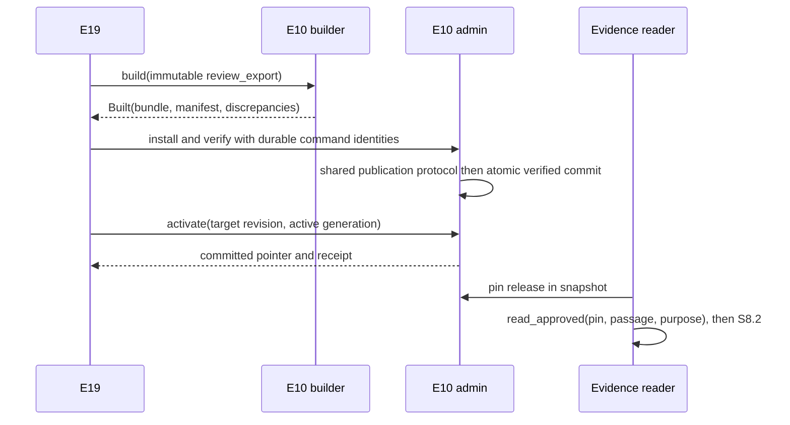
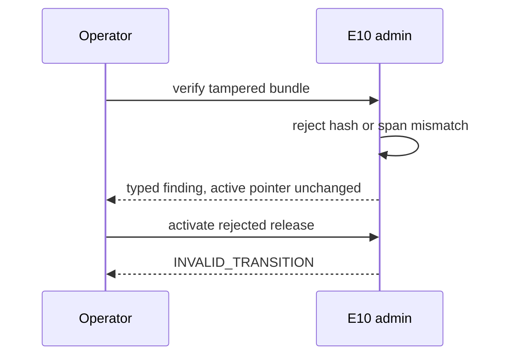

# E10: NASA registry and evidence database

Technical design for E10. Binding inputs: `AGENTS.md`, `docs/SYSTEM.md`, `docs/DEPLOYMENT.md`,
`docs/requests/COORDINATOR-DECISIONS.md` Part A and `docs/BUILD-CHARTER.md`. S below means SYSTEM.md;
C means `docs/product/CONTRACTS.md`. Other product paths are relative to `docs/product/`.
All tests below are planned evidence, not executed results. Requests are in `docs/requests/E10.md`.

## 1. Scope

| Work package | Delivery | Acceptance source |
|---|---|---|
| E10-01 | Versioned inventory memberships, active condition registry, source declarations and aliases | `tdd/E10.md`, `backlog.json:394`: preserve the 119 active entries among 911 inventory rows without claiming unique diseases |
| E10-02 | Deduplicated research catalog; immutable captures and extractions; completeness, license and per-purpose states | `backlog.json:408`: summaries and superseded material cannot silently enter eligible retrieval |
| E10-03 | Passage, table and pathway-card bundles; offline verification, history, release administration and retrieval primitives | `backlog.json:422`: each eligible citation resolves to its immutable span and license |

E10 owns CONTRACTS section 9 source/retrieval/isolation invariants and the evidence-release subsection of C4;
it applies the shared C5/C10/C11/C18/C20 rules traced below.

Delivers R13 and R21; contributes the evidence portions of V23, V24, V26, V33, D10, D28 and D32.
UC08 and UC19 consume its citations and registry. R20 applies to corpus and logging isolation.
Discovery, network capture, extraction execution and review authoring belong to E19; retrieval fusion, reranking and
context budgets to E12; model pins to E17; pathway evaluation to E11; kit and plan counts to E27/E28.
E10 does not acquire measurements, diagnose, change safety state, author executable treatment steps or own a UI.

### 1.1 Rule trace

Each row cites the applicable sentence, including the shared invariants E10 must preserve. Review requirements use
the effective contract overlay in Part A, A1 and Q1/Q18, not an unrecorded waiver of the base package.

| Source sentence | Decision here | Test |
|---|---|---|
| `PRD.md:489` R13 | 3.2, 8: source page and authored status from pinned inputs | T-E10-28 |
| `PRD.md:497` R21 | 3.3, 5: per-use history survives pointer changes | T-E10-10, T-E10-52 |
| `CONTRACTS.md:72` access control sentence | 6, 10: public corpus separated from clinical objects | T-E10-17, T-E10-18 |
| `CONTRACTS.md:72` audit references rather than private content | 10: reference-only logs | T-E10-18 |
| `CONTRACTS.md:72` privileged diagnostic-log access/retention | 10: no query diagnostics enabled | T-E10-18 |
| `CONTRACTS.md:127` release stages, Q1/Q18 overlay | 3.3: technical/source eligibility distinct from clinical review | T-E10-24, T-E10-50 |
| `CONTRACTS.md:129` branching review status | 3.3: purpose-specific approvals | T-E10-49 |
| `CONTRACTS.md:129` approval belongs to version and purpose | 3.3, 5: exact extraction and use keys | T-E10-46, T-E10-49 |
| `CONTRACTS.md:129` release pins and non-overwrite | 3.4, 5: immutable release snapshots | T-E10-16, T-E10-52 |
| `CONTRACTS.md:141` no onboard ground dependency | 9: offline registry, retrieval and human fallback | T-E10-03, T-E10-44 |
| `CONTRACTS.md:145` session identity and client IDs | 4, 6: authenticated SessionContext | T-E10-60 |
| `CONTRACTS.md:166` only allowed release and use | 4.1, 6: explicit pin and purpose, no inspection shortcut | T-E10-48, T-E10-11 |
| `CONTRACTS.md:203` mutating command key and expected version | 4.2: S5.7/S5.8 | T-E10-53 |
| `CONTRACTS.md:203` optimistic concurrency | 4.2: compare target revision and pointer generation | T-E10-53 |
| `CONTRACTS.md:203` long operations return job/progress | 4.2: background preparation; HTTP job extension pending | T-E10-54 |
| `CONTRACTS.md:203` refresh reconnects rather than restarts work | 4.2: same durable command identity | T-E10-37 |
| `CONTRACTS.md:210` command keys, D6 overlay | 4.2: durable ledger includes target and parameters | T-E10-53 |
| `CONTRACTS.md:211` expected version | 4.2: revision and pointer generation | T-E10-53 |
| `CONTRACTS.md:218` bounded paginated list envelope | 4.1, 11 | T-E10-55 |
| `CONTRACTS.md:218` UTC Z times | 3.1 | T-E10-60 |
| `CONTRACTS.md:218` opaque IDs and configured keys | 3, 8 | T-E10-60 |
| `CONTRACTS.md:220` error envelope | 6: S5.5 mapping | T-E10-11 |
| `CONTRACTS.md:248` source rejection for release/use, Q18 | 3.3, 4.1 | T-E10-24, T-E10-48 |
| `CONTRACTS.md:410` participation never enters retrieval | 10: no participation read port | T-E10-17, T-E10-18 |
| `CONTRACTS.md:414` no simulated patient data in LIVE | 10: fixtures only through explicit profile | T-E10-17 |
| `CONTRACTS.md:415` no failed/stale input as normal | 9: unavailable is explicit, no sample fallback | T-E10-58 |
| `CONTRACTS.md:416` journal exclusion | 10: corpus, logs and exports | T-E10-18 |
| `CONTRACTS.md:417` experimental estimates are not instruments | 3.4: cards cannot authorize measurements | T-E10-59 |
| `CONTRACTS.md:418` review is not resolution | 8.1: E10 never clears warnings | T-E10-61 |
| `CONTRACTS.md:419` urgent response cannot wait | 9: title lookup is optional | T-E10-03, T-E10-58 |
| `CONTRACTS.md:420` ground never blocks onboard work | 9: missing update keeps last valid release | T-E10-47 |
| `CONTRACTS.md:421` historical cabin data is not exposure | 10: no clinical or habitat ingestion | T-E10-17 |
| `CONTRACTS.md:422` no source correction erases lineage | 3.3, 5: append-only artifact and membership archive | T-E10-46, T-E10-52 |
| `CONTRACTS.md:423` no benchmark access | 10: input allowlist and vault denial | T-E10-19 |
| `CONTRACTS.md:424` no diagnostic probability from similarity | 4.1: ranks and method only | T-E10-15 |
| `CONTRACTS.md:425` no health outcomes affect participation | 10: no participation write port | T-E10-17 |
| `CONTRACTS.md:426` per-person participation stays private | 10: absent from every store and exit | T-E10-18 |
| `CONTRACTS.md:427` fixed body regions and symptoms | 3.4: no body-region interpretation in E10 | T-E10-59 |
| `CONTRACTS.md:433` encrypted access and evidence-consistent restore | 5, 9, 10: S7.2 and deployment restore | T-E10-36 |
| `CONTRACTS.md:439` hub/client content from configuration | 8: versioned inputs, no code content | T-E10-31 |
| `CONTRACTS.md:441` client hardcoding exceptions only | 7: no E10 client content | T-E10-31 |
| `CONTRACTS.md:448` unsourced values stay open; sourced copies checked | 3.2, 8: unknown remains null | T-E10-29, T-E10-45 |
| `CONTRACTS.md:527` loader rejects any failed check | 8: unavailable resolver is a finding | T-E10-30 |
| `CONTRACTS.md:530` source resolution check 2 | 8: registry plus candidate declarations | T-E10-29 |
| `CONTRACTS.md:539` active condition check 11 | 3.2, 8 | T-E10-30 |
| `CONTRACTS.md:542` saved form quote and RTDC check 14 | 4.1: exact pinned page verification | T-E10-62 |
| `CONTRACTS.md:982` committed event order and deduplication | 4.3, 8.1: S5.7 cursor | T-E10-61 |
| `CONTRACTS.md:983` event audience | 4.3: no new wire event | T-E10-60 |
| `CONTRACTS.md:1080` identity only from session | 4, 6 | T-E10-60 |
| `CONTRACTS.md:1092` operation roles | 6: exact x-roles | T-E10-11 |
| `CONTRACTS.md:1108` one command and post-commit events | 4.2: S5.7; separate-store gap is R-E10-16 | T-E10-54 |
| `CONTRACTS.md:1109` injected clock and observed time | 3.1 | T-E10-54 |
| `CONTRACTS.md:1110` deterministic rendering and IDs | 3, 8 | T-E10-25 |
| `CONTRACTS.md:1111` revisions and ETags | 4.2, 6 | T-E10-53 |
| `CONTRACTS.md:1112` no model/network/ground waits | 9, 11 | T-E10-44 |
| `CONTRACTS.md:1113` configuration rather than hardcoding, D7 | 8, 11: content versus operational settings | T-E10-31, T-E10-56 |

## 2. Seams

S9: E01 is the hard dependency; E17, E19 and E29 add capability. All shared types and mechanisms are imported,
not copied. The current provider designs were checked at their seam, application, ownership and request sections.
S4.4/S8.1 override older E19 shared-store wording and older E11 clinical-review gates. E29 has no current design;
transport is limited to DEPLOYMENT 4.6/7.6, with no invented E29 call.

| Seam | Owner | Consumer | Signature or payload with types | Authority |
|---|---|---|---|---|
| `IdFactory` | E01 | E10 | `new(prefix: str) -> str`; `derived(prefix: str, *parts: str) -> str` | S5.1 |
| `Clock` | E01 | E10 | `now() -> datetime`; `monotonic_ns() -> int`; `process_epoch() -> str` | S5.2 |
| `MissionClock` | E01 | E10 | `label(at: datetime, *, version: int | None = None) -> tuple[str, int]` | S5.3 |
| `Quantity` | E01 | E10 | Exact Decimal/UCUM value type | S5.4 |
| `UnitRegistry` | E01 | E10 | Exact parse/convert/commensurable declarations | S5.4 |
| `ProblemError` | E01 | E10 | Exact typed error and S5.5 mapper inputs | S5.5 |
| `StorageUnavailable` | E01 | E10 | Exact bounded cause enum | S5.5 |
| `UnitOfWorkFactory` | E01 | E10 | Exact S5.7 begin declaration, including Actor, CommandIdentity and context-manager result | S5.7 |
| `ReadSnapshotFactory` | E01 | E10 | `snapshot() -> AbstractContextManager[ReadSnapshot]` | S5.7 |
| `AuditEntry` | E01 | E10 | Exact full-field envelope passed to `uow.audit(entry: AuditEntry) -> None` | S5.9 |
| `IdempotencyStore` | E01 | E10 | Exact lookup/record declarations with UnitOfWork, CommandIdentity and StoredResult | S5.8 |
| `ResultVisibility` | E01 | E10 | Exact authorize declaration with ReadSnapshot or UnitOfWork, SessionContext, identity and result | S5.8 |
| `ConfigReleaseReader` | E01 | E10 | `active() -> ReleaseHandle`; `release(release_id: str) -> ReleaseHandle` | S5.6 |
| `ConfigReader` | E01 | E10 | `document(name: ConfigName, version: str | None = None) -> ConfigDocumentView` | S5.6 |
| `LoaderCheckRegistry` | E01 | E10 | `register(check: ReleaseCheck) -> None` | S5.6 |
| Catalog storage and durable artifacts | E01/E20 | E10 | No current shared callable contract; dependent writes unavailable | S4.4, S5.7; R-E10-16 |
| `HealthState` | E01 | E10 | Exact mark_degraded/mark_ok/snapshot declarations | S5.10 |
| `HubSettings` | E01 | E10 | Exact integer/quantity/boolean/text declarations | S5.11 |
| `ModuleRegistry` | E01 | E10 | Exact S5.12 declarations; settings and providers registered in E10 module manifest | S5.12 |
| `config.release_activated` | E01 | E10 | `StoredEvent` with ConfigRelease data; durable subscription cursor | C18, S5.7 |
| Session and operation guard | E02 | E10 | `require_roles(operation_id: str)` returns session dependency; trusted SessionContext exactly S5.7 | Current E02 2/4 and E01 R-E01-18; binding pending R-E10-21 |
| `SourceRegistryPort` | E10 | E01, E19, E23, E24, E25, E26, E27, E28 | `summary(source_id: str) -> SourceSummary | SourceUnknown | RegistryUnavailable`; `resolve_many(source_ids: Sequence[str], extra: Sequence[DeclaredSource] = ()) -> ResolutionReport | RegistryUnavailable` | S4.2, S8.1; 4.1 |
| `ConditionRegistryPort` | E10 | E01, E04, E11, E12, E19, E27 | `condition_status(condition_id: str) -> Active | RemovedOrSplit | UnknownCondition | RegistryUnavailable`; remaining reads in 4.1 | S4.3, S8.1 |
| `EvidenceQueryPort` | E10 | E11, E12, E13, E19, E27 | Explicit release/purpose primitives in 4.1 | S8.1 |
| `ResearchCatalogPort` | E10 | E19 | Catalog-owned commands and queries in 4.2; no shared connection | S4.4, S8.1 |
| `ReleaseBuilderPort` | E10 | E19 | `build(review_export: ReviewExport) -> ReleaseBuildResult` | S8.1; 3.3 |
| `ReleaseAdminPort` | E10 | E19 | `install`, `verify`, `activate`, `rollback`, `prune`, `list`: 4.2 | S8.1, S11 |
| `FormTextPort` | E10 | E27, E28, E33 | `quote_on_page(source_id: str, page: int, quote: str) -> bool`; `pages(source_id: str) -> Sequence[FormPage] | None` | E27 2, E28 4.1, E33 4.1; S11; R-E10-17 |
| `EvidencePassagePort` | E10 | E28 | `passages(source_ids: Sequence[str], release_id: str) -> Sequence[Passage]` | E28 4.1; R-E10-17 |
| Content facts for guidance | E10 | E27 | Adapter to consumer-owned `ContentFacts`; S8.2 fact fields, no local eligibility rule | S8.2; R-E10-17 |
| `ModelReleaseReader.embedding_pin` | E17 | E10 | `embedding_pin() -> EmbeddingPin(model_id, revision, sha256, dims)` | E17 2, 4.2; S3 |
| Heavy-work scheduling | E20 | E10 | Current provider proposal is R-E20-7; no settled permit/status contract consumed | E20 2/3; S3; R-E10-19 |
| Evidence install CLI | E10 | E20 | `crew-health-knowledge install <bundle>`; signed `<release_id>.evidence.tar` | E20 2; 5, 6 |
| Signed inbound evidence bundle | E29 transport | E10 | File in inbox; transport never activates it | DEPLOYMENT 4.6, 7.6; S11 |

No E10 import of a ground-link state reader. E12 owns fusion/reranking; E11 owns evaluation; E27 owns the single
eligibility rule. Pending adapter shapes in R-E10-17 are not treated as settled signatures.

## 3. Domain model

Pure domain code has no I/O. S5.1 supplies identifiers; register prefixes `cat`, `dv`, `ex`, `psg`, `evr`, `lic` in
`module.py`. Declared source and condition IDs retain the package patterns. Derived IDs use `IdFactory.derived`
on normalized URL for catalog, catalog ID plus original hash for document version, document ID plus extraction
format version plus text hash plus page-map hash for extraction, and extraction ID plus half-open offsets for passage.
Release ID derives from the canonical manifest body hash, excluding its own ID and signature. Do not truncate hashes
locally or concatenate ambiguous separator strings. Full hashes are retained and verified independently of IDs.

### 3.1 Time

Use S5.2 `Clock` and `uow.now`; preserve retrieval, extraction, review and original publication times separately.
Unknown publication time stays null with precision unknown, never guessed from URL folders. Release timestamps are
provenance, not freshness or version ordering. Order by committed sequence, object revision and activation generation;
delayed exports, events or retries cannot overwrite newer heads. The same export, fixed build time and pins yield
identical bytes. Mission labels, when requested by a CLI, use S5.3; a mission-day boundary changes no evidence identity.

External-call and installer timeouts are elapsed durations, monotonic within one process epoch. Durable retry delays
use S5.10 ElapsedDeadline and S5.2 correction history; no E10 absolute business deadline exists. S5.8 owns command
cache expiry; clock jumps never expire durable identity. Correction tests cover forward/backward jumps, restart and
mission boundaries. E10 creates no observations; downstream freshness follows S5.2 and D3/D14 in its owning epic.

### 3.2 Registry

`RegistrySnapshot` pins the input manifest, inventory definitions, memberships, conditions, families and sources.
Each membership retains inventory ID, published title, page and URL, original row hash, published mapping raw/parsed,
and title-match mapping separately. Preserve matrix `ARC`/`PFC` IDs alongside mapped `ARCL`/`PFCL` inventory IDs.
No title match rewrites a NASA mapping. Counts distinguish memberships, active conditions, history and distinct titles.

`Condition` retains its noncontiguous ICL ID, active or removed/split status, NASA page locator, nullable family,
verbatim assessment fields, workup source IDs and `workup_review_required`. The declared planning sentinel is a flag,
never a source ID. Removed/split entries resolve in history and fail active-condition validation.
`ConditionResolution` joins one pinned configuration/evidence pair: condition, NASA page, nullable form URL, plan ID,
written-for category, kit/plan/card review status and both release IDs. Missing plan data stays missing.

`Source` preserves each declared source ID, all titles and declaring input references, nullable date/access/saved path,
NASA classification and a shared catalog document key. Same ID with conflicting URLs fails validation. Different
source IDs for one normalized URL remain aliases, including EV01/RT03 and EV12/RT10/RS51. A query returns each
passage once; adding an alias cannot change its text identity. SourceSummary includes title, URL, date_text,
access_text and saved_as; unknown values remain null internally.

### 3.3 Catalog, immutable text and review export

Normalize URLs conservatively: lowercase scheme/host, remove default port and configured tracking parameters,
decode only unreserved escapes, preserve path case, slash and significant query; retain original URL and page locator.
Never merge by title; title/URL mismatch is a review finding. Catalog completeness describes discovery provenance,
not the completeness of a later capture. The catalog retains every input row and its source hash.

A DocumentVersion fixes captured bytes, content hash, media type, method and retrieval facts. A CaptureAssessment
is an editor-authored, revision-checked fact bound to that hash. Capture ceiling comes from validated method/facts:
complete local/file/HTTP capture can be full, truncation partial, search summary summary_only, failed fetch inaccessible.
Assessment cannot exceed that ceiling. Only assessed full or partial captures can extract. Technical review may lower
completeness but cannot raise it. Catalog-only and summary-only items never become passage text through a status edit.

An Extraction fixes original text, page-map coordinates, format version and hashes; extractor identity/version and
author/time are provenance. Any changed text or page mapping creates a new extraction. Earlier extractions, reviews
and citations remain. Span offsets count Unicode code points in the canonical extracted body, excluding page markers;
page-map ranges bind marker-free text to pages. Span hash is distinct from whole-extraction text hash.

Review export is immutable, schema-validated, bounded and content hashed. S8.1's `ReviewExport` contains:

| Field | Type and required content |
|---|---|
| Identity/pins | Export ID/hash, format version, effective-contract and decision-overlay hashes, registry and policy hashes, previous release ID or null, fixed build timestamp, attributed author, embedding pin or null |
| Targets | Exact document/content/extraction/text/page-map hashes or condition/card hash; captured author and method; license record and completeness assessment |
| Source reviews | E19 review IDs, kind, target hashes, reviewer, verdict including fail/revoked, attestation or null, time, supersedes-review ID or null, audited receipt references |
| Approvals | E19 approval ID/revision, exact target/spans, one purpose per row, approver/time, partial acknowledgment, pinned review and license IDs, ordered per-use supersession/withdrawal events |
| Claims/discrepancies | Claim ID/revision hash, author, source spans, qualification, directed previous/current spans, relation contradicts or revises, full claim review heads and supersession references |
| Build inputs | Content-addressed artifact references, source aliases and card records; output is a builder-owned artifact reference, never a caller-selected filesystem path |

E19 alone records authoritative reviews. S0 curation uses the identical export schema and attribution rules, not a
trusted bypass. Builder checks full target equality and review-chain closure; no omitted fail/revoked head may be
replaced with a passing summary. Multiple heads use E19 3.2 dominance: fail/revoked wins. Claim unsupported,
contradicted or revoked heads cannot support guidance. Discrepancy review may attest a contradiction as a relation;
this does not approve the superseded source. Source, technical and license checks remain required under Q1/Q18.
Every effective technical checker, clinical reviewer when present, and approver differs from the extractor; claim
reviewer differs from claim author. Missing audit receipts or unresolved E19 effects block promotion, not help.

Approval status is keyed by immutable target, extraction/span and purpose, never just document or passage.
An eligible approval can become superseded or withdrawn for one use while another remains eligible. Supersession
is explicit, by version relation and purpose, never publication date, title similarity or arrival order. Later clinical
review is allowed after any technical approval and affects a new release's label only. Version withdrawal denies every
use. Every state change appends lineage and a reason; immutable releases remain unchanged.

Display status includes the complete per-use map. Version withdrawal wins; otherwise any in-force approval displays
approved; when all prior approvals are superseded display superseded; otherwise use the furthest in-force review
stage. A withdrawn single use does not imply withdrawal of all uses. Scalar display status never authorizes retrieval.

Release policy is versioned content with provenance, not safety control. Full-text rights are required for every text
artifact. Q2 permits NASA full text and non-NASA metadata only until permission is documented; license kinds are
nasa_public_domain, permission_documented and metadata_only. Permission pins a basis and actor/time. Metadata-only
releases contain title, citation, link and known content hash only; no extracted text, passage or vector from that source.
Do not infer permission from government-looking URLs or an obsolete E19 license enum.

Purpose rules retain technical check, source type, completeness and applicability. Risk context permits acknowledged
partial text; routine/limit basis and patient instructions require full text. Modeling CliFFs, standards and technical
briefs are not patient instructions merely because they are NASA sources. The policy's patient-instruction kinds are
clinical_guideline, first_aid_guidance and device_manual. Q1/Q18 remove clinical sign-off as a gate for every use,
including patient_instruction and pathway_card. Keep the review workflow and attestations. Map a valid licensed-clinician
attestation to `clinically_reviewed`, otherwise `not_clinically_reviewed`, exactly S8.2's internal vocabulary.
A clinical-review absence alone never causes simulation_only, rejection or an empty patient-instruction collection.

### 3.4 Passages, cards and release invariants

A PassageArtifact is immutable extraction ID, offsets, span hash, original text and table context. Segmentation uses
versioned min/max/overlap word counts and table rules from release-policy; keep tables with headers, never silently
truncate an oversized table. Reject for authoring or use an explicitly reviewed manual span. Unicode normalization is
for a separate search representation only; display/citation bytes stay as extracted. Control-character sanitization,
if needed, happens before extraction identity and is recorded as a transformation, never during an immutable read.

ReleaseMembership adds release ID, artifact ID, document provenance, aliases, license snapshot, applicability,
clinical-review label, supersession links and a status for each allowed use. These fields may differ between releases
without colliding with the immutable text archive. Search considers status for the requested use only. A withdrawn
or superseded purpose cannot be retrieved as current; historical inspection shows its actual status in each release.

PathwayCard pins the condition's indicative assessment, workup sources, content hash, supporting passage references,
purpose eligibility, provenance, applicability, authored/draft state, explicit simulation-only designation and clinical
review label. It has no invented executable steps or thresholds. A planning sentinel or missing source support cannot
be relabeled as an authored protocol. Authored, sourced, purpose-eligible applicable content may be used without
clinical sign-off; genuinely draft or simulation-only content stays in SIM. E11 evaluates cards with the kit/operator
checks and S8.2. REPLAY cannot execute simulation-only content. Evidence availability is never an equipment or
operator grant. No card declares a condition confirmed, a gap closed or a warning resolved.

Release lifecycle is staged, verified, active, superseded or rejected. Verification validates every hash, schema,
signature, source, license, review export, purpose, span and registry relation before publication. Signed updates and
local confirmation follow DEPLOYMENT 7.6 in every operational profile; unsigned fixtures are confined to an explicit
SIM/eval profile and cannot activate as LIVE or REPLAY. Reject invalid candidates and retain the last valid release.
A new release or rollback changes the active pointer, not existing release contents or open-work pins.

| Transition | Guard and retained state |
|---|---|
| absent to staged | Durable complete artifact and valid admission; no active effect |
| staged to verified | All checks succeed; immutable archive/memberships and verified state commit together |
| staged to rejected | Validation failure recorded; active release unchanged |
| rejected to staged | Corrected environmental prerequisite such as missing key; identical bytes revalidated; integrity conflict never overwritten |
| verified to active | Expected target revision and active generation match; previous active becomes superseded atomically |
| superseded to active | Explicit rollback, same checks, artifacts verified, both revisions match |
| active to superseded | Only inside another activation/rollback transaction |

Missing/corrupt files are an availability fault independent of lifecycle, not a fake terminal rejection. Reinstall or
index rebuild restores identical artifacts through the shared recovery protocol; no pointer switch happens implicitly.

| Invariant | Test |
|---|---|
| I1: exact inventory membership and separate mappings/count labels | T-E10-01, T-E10-02, T-E10-04, T-E10-05 |
| I2: stable source aliases, extraction and passage identities | T-E10-06, T-E10-46, T-E10-51 |
| I3: completeness, rights, exact review target and purpose remain mandatory | T-E10-08, T-E10-09, T-E10-21, T-E10-23, T-E10-24, T-E10-57 |
| I4: clinical review is a label independent of eligibility | T-E10-24, T-E10-59 |
| I5: pinned reads and immutable history survive activation, branches and rollback | T-E10-16, T-E10-48, T-E10-52 |
| I6: validation failure never changes the active release or safety state | T-E10-13, T-E10-54, T-E10-61 |
| I7: no clinical/private/evaluation data, similarity probabilities or query-derived logs | T-E10-15, T-E10-17, T-E10-18, T-E10-19 |
| I8: every parser, query and worker is bounded; unavailable differs from no match | T-E10-55, T-E10-56, T-E10-58 |

## 4. Application layer

Only authenticated editor commands mutate the catalog; editor/operator commands administer releases. Identity comes
from S5.7 SessionContext, never an export's claimed actor. Export authorship is provenance, not authorization.
Read-only registry construction can run from validated local inputs with E01 alone.

### 4.1 Reads and typed results

Services are bound to one S5.7 ReadSnapshot or caller UnitOfWork and its validated configuration/evidence pins at
construction. They never open a second snapshot during a composed read. Sequence results use the bounds in 11;
history and catalog listings are cursor pages. Typed unknowns carry safe codes and references, not clinical text.

```python
class EvidenceQueryPort(Protocol):
    def active_release(self) -> ActivePointer | NoActiveRelease: ...
    def read_approved(self, release_id: str, passage_id: str, use: AllowedUse) -> ApprovedRead: ...
    def inspect_history(self, passage_id: str, cursor: str | None, limit: int) -> HistoryRead: ...
    def passages_for_sources(self, release_id: str, source_ids: Sequence[str], use: AllowedUse,
                             filters: ApplicabilityFilter, limit: int) -> SearchResult: ...
    def lexical_search(self, release_id: str, query: str, use: AllowedUse,
                       filters: ApplicabilityFilter, mode: SearchMode, k: int) -> SearchResult: ...
    def dense_search(self, release_id: str, query: str, use: AllowedUse,
                     filters: ApplicabilityFilter, k: int) -> SearchResult: ...
    def expand_context(self, release_id: str, passage_id: str, use: AllowedUse,
                       filters: ApplicabilityFilter, neighbors: int) -> SearchResult: ...
    def pathway_card(self, release_id: str, condition_id: str) -> CardRead: ...
    def discrepancies(self, release_id: str, cursor: str | None, limit: int) -> DiscrepancyPage: ...
```

AllowedUse is the generated EvidencePassage allowed_uses item enum, all four values. SearchMode is internal exact or
stemmed. `ApprovedRead` distinguishes Eligible(passage, release, purpose), NotApprovedForUse, InReleaseHistory,
NotInRelease and ReleaseUnavailable. Legacy method name `read_approved` means source/purpose eligible under S8.1;
no `use=None` shortcut exists. A content-only read is not a guidance decision: callers must apply S8.2 to its exact
content hash, origin, environment, equipment, stock, skills and operator before showing actionable guidance.

SearchResult distinguishes Hits(release_id, ranked items), NoMatch(release_id), NoActiveRelease,
ReleaseUnavailable(release_id, reason), IndexUnavailable(release_id, method, reason) and QueryRejected(reason).
Ranks and method are exposed, not raw similarity or inferred confidence. NoMatch means a valid index ran.
Missing/corrupt indexes never return NoMatch. RegistryUnavailable differs from UnknownCondition and SourceUnknown;
loader checks report unavailable as failure, while optional title callers render configured unknown.

Every primitive uses only its explicit release. No active-release fallback, including for a missing/pruned pin.
Filters contain allowed values and an explicit allow_unknown for each applicability field; conjunction only narrows.
An unconstrained research filter may allow unknown, but a clinical caller cannot turn unknown into applicability.
Context expansion returns the anchor and bounded eligible neighbors in the same extraction and section, each passing
the same use/filter checks. Never copy gaps or an entire parent section containing unapproved adjacent text.
Historical inspection returns immutable artifacts and paged exact membership snapshots; it cannot authorize guidance.

ConditionRegistryPort also supplies `active_ids()`, `get(condition_id)`, `memberships(condition_id)`,
`aliases(condition_id)`, `counts()` and `resolve(condition_id)`, returning the 3.2 types or RegistryUnavailable.
SourceRegistryPort returns source summaries and bounded ResolutionReport(resolved, unknown, conflicts); candidate
`extra` declarations are checked against the whole candidate, never a mixture with newer active configuration.

FormTextPort adapters are bound to a manifest-pinned saved extraction. `pages` returns bounded FormPage(page, text)
records or None for absent text; corrupt content raises a typed error. `quote_on_page` returns true only for the exact
quote on that page; false is a validation failure, not permission to skip the quote check. E28's EvidencePassagePort
adapter uses its pinned source set and patient_instruction purpose, with applicability still checked by S8.2.
R-E10-17 asks for the missing binding/fact-protocol agreement; until settled these adapters return unavailable and
quote-dependent activation fails. No reader opens `docs/product/` at runtime.

### 4.2 Commands and unit of work

Catalog commands require the secondary-store provider requested in R-E10-16; release state uses the hub factory. Both use
S5.7 and S5.8 CommandIdentity, not an E10 command table or ResearchTx. Identity binds authenticated actor, operation,
target, complete validated parameters including expected revision/pin, and body fingerprint; `durable=True` for accepted
mutations. CLI persists and accepts the same key for retries. Current role/result visibility is checked before replay.
D6 keeps the mission-life receipt after the 24-hour cache; a matching late retry returns the authorized durable-duplicate
result rather than re-executing. Reuse on a different target is DUPLICATE_COMMAND.

| Command and input | Unit of work, result and crash boundary |
|---|---|
| Catalog upsert/register source: URL, declaration/provenance, expected revision | Catalog UoW: item/alias/provenance, revision, durable receipt and pending audit reference; alias conflict rejects. Publication/relay depend on R-E10-16 |
| Record license: target hash, rights kind, permission basis, expected revision | Catalog UoW appends immutable license version and reference-only audit/receipt; Q2 rights cannot be broadened by enum translation |
| Store capture: bounded artifact reference, media type, retrieval method/facts/time | Verify durable original first; catalog UoW records immutable version and ceiling with command receipt. No acknowledged row may reference partial bytes |
| Assess completeness: document ID, assessment evidence, expected revision | Catalog UoW appends assessment bound to original hash; above-ceiling/stale rejects; crash before commit changes nothing |
| Record extraction: document ID, durable text/page-map references, extractor identity/version, expected revision | Catalog UoW adds immutable extraction and candidates; no mutation of old text/reviews; artifact durability prerequisite |
| Advance technical/review stage, set use status, withdraw version: exact review/export reference, reason, expected revision | Catalog UoW validates current review heads and appends target/use transitions; a review reference is not an idempotency key |
| Build release: ReviewExport | Read immutable inputs; verify chain and produce artifact in background. No active state mutation. Built returns manifest, artifact reference and discrepancies; BuildRejected returns attributable findings |
| Install: signed artifact reference, command | Background preparation; hub UoW commits staged release, provenance, receipt and S5.9 audit only after durable artifact publication |
| Verify: release ID, expected revision, command | Bounded background verification/index build; hub UoW commits verified state, archive/memberships, audit and receipt together. Capacity/integrity failure leaves active state untouched |
| Activate/rollback: target ID, reason, expected target revision, expected active generation, command | Hub UoW rechecks verified artifacts and both revisions, moves pointer/state, audits and stores receipt atomically; concurrent different targets cannot both win |
| Prune: expected active generation, bounded selection, command | Only rebuildable index/cache files eligible. Archive, originals, texts and membership records are retained; durable deletion/reconciliation is delegated to R-E10-16 |

ReleaseAdminPort command signatures take the inputs above plus SessionContext and CommandIdentity and return typed
ReleaseRecord, ActivePointer or PruneReport. `list(cursor, limit) -> Page[ReleaseRecord]` is snapshot-only.
The command DTOs below are E10-owned schema-validated inputs with the fields in the command table. IDs are str,
existing-object revisions are positive int and generations nonnegative int under D8; instants are aware datetime.
Artifact references carry SHA-256 and
bounded byte counts, and free text/arrays have section 11 limits. Existing-object revisions are required; creation
uses explicit absence. No DTO carries an actor supplied by the client. Each command receives authenticated context
and a complete kernel identity; a pending proposal below cannot be wired to a legacy consumer silently.

```python
class ResearchCatalogPort(Protocol):
    def upsert_item(self, session: SessionContext, command: CommandIdentity,
                    request: ItemUpsert) -> CatalogItem: ...
    def register_source(self, session: SessionContext, command: CommandIdentity,
                        request: SourceRegistration) -> CatalogItem: ...
    def store_capture(self, session: SessionContext, command: CommandIdentity,
                      request: CaptureInput) -> DocumentVersion: ...
    def assess_completeness(self, session: SessionContext, command: CommandIdentity,
                            request: CompletenessInput) -> DocumentVersion: ...
    def record_extraction(self, session: SessionContext, command: CommandIdentity,
                          request: ExtractionInput) -> Extraction: ...
    def advance_stage(self, session: SessionContext, command: CommandIdentity,
                      request: StageInput) -> DocumentVersion: ...
    def set_use_status(self, session: SessionContext, command: CommandIdentity,
                       request: UseStatusInput) -> DocumentVersion: ...
    def withdraw_version(self, session: SessionContext, command: CommandIdentity,
                         request: WithdrawalInput) -> DocumentVersion: ...
    def record_license(self, session: SessionContext, command: CommandIdentity,
                       request: LicenseInput) -> LicenseRecord: ...
    def item(self, item_id: str) -> CatalogItem | None: ...
    def items(self, cursor: str | None, limit: int) -> Page[CatalogItem]: ...
    def versions(self, item_id: str, cursor: str | None, limit: int) -> Page[DocumentVersion]: ...
    def extractions(self, dv_id: str, cursor: str | None, limit: int) -> Page[Extraction]: ...
    def text(self, extraction_id: str, cursor: str | None, limit: int) -> Page[TextBlock]: ...

class ReleaseAdminPort(Protocol):
    def install(self, session: SessionContext, command: CommandIdentity,
                request: InstallInput) -> ReleaseRecord: ...
    def verify(self, session: SessionContext, command: CommandIdentity,
               request: VerifyInput) -> ReleaseRecord: ...
    def activate(self, session: SessionContext, command: CommandIdentity,
                 request: ActivationInput) -> ActivePointer: ...
    def rollback(self, session: SessionContext, command: CommandIdentity,
                 request: ActivationInput) -> ActivePointer: ...
    def prune(self, session: SessionContext, command: CommandIdentity,
              request: PruneInput) -> PruneReport: ...
    def list(self, cursor: str | None, limit: int) -> Page[ReleaseRecord]: ...
```

The application factory is the transaction owner for these entry points; callers never pass their own connection.
Worker-backed commands return only after their named commit when invoked by a CLI/background orchestrator; HTTP
job submission remains off until R-E10-03 defines it. E19 persists its own pending action and invokes E10 separately,
using the same durable identity; completion and promotion are gated by the shared protocol. Exact cross-store
completion is pending R-E10-16; no implicit E19 transaction, nested commit, ad hoc relay or success acknowledgment is permitted meanwhile.

S5.7 owns replication declarations and transaction effects; public artifacts travel as signed bundles under
DEPLOYMENT 4.4, not auto-merged database rows. R-E10-16 covers secondary-store receipts and local-only artifact
metadata declarations. Storage, I/O, integrity, authorization and validation failures propagate; D13 computation
isolation cannot convert a failed evidence validation into accepted content.

### 4.3 Events and flows

Published CONTRACTS 18 events: None. Evidence events remain requested in R-E10-03.
Consume only `config.release_activated` through S5.7 OutboxSubscriptions: receipt and cache invalidation commit with
the cursor; an older or duplicate sequence never installs an older view. Cache misses reconstruct from pinned inputs.
Audit through S5.9 holds reference IDs, artifact hashes, revisions, generations and safe reason codes only. No local
hash chain. External catalog audit requires the shared provider and completion rule requested in R-E10-16.





## 5. Adapters

| Store | Tables/artifacts and constraints |
|---|---|
| E10 catalog secondary store | Item with unique normalized URL; source_alias keyed by source ID to item; provenance keyed by input hash/row; document_version unique by item/content hash; immutable extraction keyed by extraction ID; completeness/review/use transition history; license versions with immutable basis/actor/time and expected revision on replacement. Nullable metadata stays nullable. No E19 tables or joins |
| Hub release state | knowledge_release(release_id, manifest_hash, registry_hash, state, revision, file_state, transport provenance); knowledge_active(singleton, release_id nullable, generation); append-only knowledge_release_transition ordered by committed sequence |
| Hub lineage | knowledge_passage_artifact(passage_id, extraction_id, offsets, text_hash, immutable_body_hash); knowledge_release_member(release_id, passage_id, membership_hash, snapshot); knowledge_release_use(release_id, passage_id, use, status, approval_ref, successor_ref nullable). Composite keys include purpose; append-only triggers protect every historical row |
| Immutable files | Content-addressed original bytes, canonical extracted text, page maps, manifests, licenses, review exports and per-release metadata under the E10 data root; catalogs under `research/`, separate from E19 workbench |
| Rebuildable index | Per-release SQLite FTS5 exact/stemmed indexes over separate normalized search text; passage lookup keeps original text. Per-use status joins; source aliases deduplicate by artifact ID. Optional sqlite-vec indexes keyed by release, passage and embedding pin |

All database access, SQL bounds, migrations and backups use S5.7, S7.2 and E01 section 5. Expand then contract, with the
previous software still reading new schema; rollback never drops tables or reverts accepted records. No module-level
mutable cache. Reader leases hold immutable pins; prune cannot remove their indexes. History rows and referenced
artifacts are never pruned; configured capacity rejects a new install before growth, not by erasing old citations.
Index eviction makes search unavailable until rebuilt; it never makes archived text unavailable or substitutes another
release. Reinstallation restores the exact manifest and content. Activation order does not fabricate a membership:
a B-only passage stays absent from A after rollback, while history still reports B's original statuses.

The signed `<release_id>.evidence.tar` bundle uses deterministic ustar, sorted regular-file members, canonical JSON and gzip with fixed transport
metadata. Manifest hashes every member, byte count, registry/policy/overlay pin and embedding pin. Members include
originals by content hash where redistribution is allowed, extracted texts and page maps for every current/historical
passage, document provenance, sources/aliases, license records, review export, cards, per-use membership and discrepancy
records. Metadata-only sources contribute no original, extracted text or vector. Missing originals are explicitly
unavailable; a saved-text capture may be its own original but cannot claim to be the PDF. Q24 defers missing NASA
fetches to later, individually paced acquisition; no bulk download or runtime network repair.

A fresh disconnected hub verifies solely from the supplied bundle and its installed trust keys/registry. No workbench
store or web access is required. Hash-verifying the span also verifies its extraction/page map and full-text license.
A release includes the historical artifacts and exact memberships needed by its lineage, not just their IDs.

Archive parser: reject duplicate/unknown paths, absolute paths, traversal, links, devices and other nonregular members;
validate compressed, per-member and cumulative decompressed sizes while streaming; bound JSON bytes, depth, line and
record counts before allocation. Validate counts across kinds and manifests; finite vectors must have exactly the
pinned dimensions and byte count, checked before multiplication/allocation. No partial index becomes queryable.

Cross-platform durable publication, crash reconciliation, audit forwarding and reference barriers must use the shared
provider requested in R-E10-16, not the old local fsync/rename algorithm. Required outcomes: no torn hash path,
accepted references durable before acknowledgment, safe retry after disk-full/interruption, conflicting hash quarantine,
backup/restore reconciliation and no automatic switch to another release on corruption. Until that provider is settled,
mutable install/catalog operations are unavailable; immutable registry construction and pure bundle verification remain
usable. Tests must inject faults at every provider publication boundary on Windows, macOS and Linux.

Embedding is an optional background retrieval/build job. Current E20 sections 2/3 defer its work-permit protocol
to R-E20-7. R-E10-19 joins that request; no retired WorkerRuntime API is consumed. Until settled, dense is unavailable
and lexical works. After agreement, read E17's embedding_pin, verify model/revision/hash/dimensions, acquire and release
the provider's permit, and call the authenticated local embedding endpoint with a deadline. Preemption, permit expiry
or unavailable pin produces IndexUnavailable(dense); lexical continues. Never launch a model directly, fetch weights
at runtime, or expose worker ports outside DEPLOYMENT 7.3's boundary.

## 6. API

| operationId | Method/path | Request and success schema | Roles |
|---|---|---|---|
| `getEvidencePassage` | `GET /v1/evidence/passages/{passage_id}` | Contract id path parameter; EvidencePassage | crew, crew_medical_officer, ground, operator, station, adapter, editor |

Use the generated base/effective schemas and E02 operation guard. GET has no command key or If-Match. Standard
Config-Release and X-Correlation-Id headers come from E01. EvidencePassage's six required fields are passage_id,
source_id, release_id, text, allowed_uses and status; no undeclared JSON fields. It lacks release/use selectors,
per-purpose history and clinical-review metadata. R-E10-01/R-E10-12 request these exact gaps. Until resolved, the
text-producing HTTP feature is off with SOURCE_NOT_APPROVED; it must not return active unfiltered text for a pinned
clinical citation. This is a representation/selection gap, never a requirement to obtain clinical sign-off. Typed
internal reads still carry purpose, provenance and the S8.2 label. API acceptance remains explicitly pending.

| Condition | ErrorEnvelope response |
|---|---|
| Invalid ID, unauthenticated, role denied | 400 MALFORMED_REQUEST, 401 UNAUTHENTICATED, 403 UNAUTHORIZED_SCOPE respectively |
| Unknown passage or absent from the selected release once selectors land | 404 NOT_FOUND |
| Wrong use, draft/withdrawn content, or unavailable safe wire representation | 422 SOURCE_NOT_APPROVED |
| Storage/index corruption or unavailable release files | 500 INTERNAL_ERROR, retryable, via the operation's declared default response and S5.5; health degraded |

The OpenAPI default already permits INTERNAL_ERROR; unavailable files are not disguised as 404. The eventual 200
projection chooses the requested purpose's status and exact release, with historical inspection explicitly separate.
HTTP clinical display stays off until it can show the required label and preserve immutable text. CLI administration
has identical session, revision and command identity checks. No uncontracted release/registry endpoint or event ships.

## 7. User interface

None. Consumer screens render served configuration words and the exact review label beside guidance. Loading,
no match, unavailable index/registry, offline, history, explicit SIM/REPLAY and unsupported applicability remain distinct.
Unknown is not safe or normal. R-E10-04 covers missing words; a missing label disables that display rather than silently
showing unreviewed text without it. E10 owns no client labels or screens.

## 8. Configuration

Read all runtime documents through S5.6 ReleaseHandle, with schema and the complete registered loader-check inventory.
D12 preserves verbatim base contracts and separately signed decision overlays; pending E10 requests never enter them.

| Input | Schema/check and provenance |
|---|---|
| kit-map, onboard-plans | Their C11 schemas; condition and plan-resolution fields, source lists and reviewed status; exact release pin |
| skills-catalog, environment-hazards, routine-schedule, responder-flows | C11 schemas; source declarations only; no copied clinical engines |
| ui-copy | C11 schema; configured state/review words and unknown fallback; R-E10-04 for missing keys |
| inputs manifest, inventories, stage-map | E10 schemas; repository-relative file names, hashes, parser and origin, row counts, S01 page provenance; capture-method ceilings backed by actual facts |
| release-policy | E10 schema; source hierarchy, completeness/use rules, segmentation, tracking-parameter rules and licensing; basis, source IDs and responsible author |
| registry, review-export, release manifest/content | E10 schemas; source/condition identity, counts, exact target and artifact hashes, licenses, review provenance and base/overlay versions |

Register source/condition validators for C11 checks 2 and 11 under S5.12. Unknown/conflicting source, invalid active
condition, missing registry or corrupt input rejects the candidate; no validation downgrade. E01's offline equivalents
cover E10 absence, not a skipped check. Form page absence fails the quote-dependent check 14. Every required input
missing from the repository is reported under R-E10-18, never replaced by sample data or an assumed manifest hash.

T-E10-31 edits a sourced display title/label only and proves the next release changes content without code or safety
mapping edits. T-E10-32 rejects an incorrect inventory count; T-E10-33 checks plan projection pinning. Operational
limits are solely HubSettings (11); no knowledge-limits configuration document or private last-good loader remains.

### 8.1 Activation effects

| Input activated or removed | Effect |
|---|---|
| kit-map/onboard-plans | New resolutions use the new validated pin; open sessions/runs retain both old configuration and evidence pins; removed definitions render missing only for new work |
| skills-catalog/environment-hazards/routine-schedule/responder-flows | New source-summary views use new declarations; historical citations retain old source snapshots; E10 does not recompute warning, routine or stock state |
| ui-copy | New views use new words; pinned sessions keep their copy version and mandatory review labels |
| E10 registry/policy/review export/evidence bundle | Validate before activation; immutable previous artifacts remain readable; new queries pin the new release. Review or alias changes affect only new membership snapshots |
| Hub settings | S5.11 startup validation; invalid values reject activation/startup, never a silent fallback to unbounded work |

D1: no activation, rollback, source withdrawal or changed definition clears/lowers an active warning; warnings keep
their original definition. Stock is untouched and cannot become negative. E10 has no clinical scheduled work; a retry
job retains its target/export/pins. Duplicate/delayed config events only invalidate current caches once, under S5.7.

## 9. Deployment and fallbacks

| Tier | Behavior |
|---|---|
| T0 | Registry, lexical retrieval, history and configured human path on one laptop/webcam; no network/model/device requirement; native Windows, macOS and Linux |
| T1/T2 | More browsers use the same hub; clients do not become evidence authorities |
| T3/T4/T5 | Devices/feeds add no E10 requirement; their readings never enter the evidence corpus |
| T6 | Each site's hub independently verifies and locally activates signed bundles; no merge or remote pointer overwrite; disconnected rover retains its pins |
| T7 | Signed inbox bundle via DEPLOYMENT 4.6/7.6; ground arrival never activates; transport outage retains last valid local content |

| Failure | Primary, independent backup and fail-safe |
|---|---|
| Dense unavailable | Hybrid primitives; lexical backup; NoMatch or explicit unsupported result if lexical lacks support |
| FTS unavailable | Search primary; exact ID/source/card reads remain; IndexUnavailable(lexical), never a false empty hit set |
| No release or damaged release | Verified active artifact primary; operator-selected previous verified bundle backup; ReleaseUnavailable and human path, never silent fallback for a pinned read |
| Registry unavailable | In-memory validated titles primary; configured unknown title backup; help, warnings and capture stay available; new activation fails source/condition validation |
| Hub/laptop failure | Shared recovery and signed local backup under S7.2; cached/printed help and plan procedures while restoring |

HealthState marks real faults degraded using S5.10. Missing optional dense service is a reported capability limitation.
All title reads are bounded in-memory operations and return typed unknowns promptly. Removing E10, model, devices and
ground cannot block emergency entry, rules, routine misses or durable manual capture. No ground clinician is required.

## 10. Safety, security and privacy

Hazards and mitigations: wrong text identity (I2), wrong purpose or applicability (I3), hidden review uncertainty (I4),
stale release substitution (I5), failed publication reported successful (I6), private/benchmark leakage (I7), and
resource exhaustion disguised as no evidence (I8). Tests are in 12. Do not change thresholds or safety mappings to
make a release pass. Draft/unattributed/withdrawn content stays ineligible; clinical-review absence alone does not.

No read/import path from a patient chart, journal, private report, participation store or evaluation vault. Input roots
are explicit public-source allowlists resolved against symlink escape; private attachments never become global corpus
content. All exit paths, including files, bundles, backups, logs and caches, follow S8.3 and DEPLOYMENT 4/5.
A helper or medical officer role grants no chart access through this public endpoint. Research notes and command
reasons are not ordinary log fields. Query text exists only in bounded call memory; no persistent query cache.
Routine logs/audit contain no query text, query hash, length, token count or other query-derived fingerprint. This
stricter omission satisfies S8.3 without needing its salted diagnostic option. Canary tests inspect logs as well as stores.

The assistant has read-only E12 tools and no catalog/release command authority. Passage text is untrusted data, never
instructions; preserve source text and let E12 frame it. Corpus eligibility says nothing about clinical validation or
mission acceptance. Q1/Q18 labels remain visible; Earth-to-space applicability is unknown unless explicitly sourced.

### 10.1 Failure and edge cases

| AGENTS.md section 6 case | E10 behavior | Test |
|---|---|---|
| Crash or power loss at every command step | Shared UoW/receipt plus required artifact protocol; never acknowledge a dangling artifact reference | T-E10-14, T-E10-38, T-E10-54 |
| Duplicate/retried submissions | Same complete identity never reruns, including after cache expiry; changed target conflicts | T-E10-37, T-E10-53 |
| Clock jumps and mission boundaries | Committed sequence/revisions order releases; elapsed timeout correction, no publication-date freshness | T-E10-54 |
| Disk full | Typed StorageUnavailable; no validation bypass or partial activation; retry after recovery | T-E10-54 |
| Corrupt/missing configuration | Reject candidate and retain last good; missing mandatory resolver stops activation | T-E10-13, T-E10-30, T-E10-56 |
| Partial, implausible or disagreeing readings | No sensor ingestion; analogous partial captures rejected/acknowledged per purpose, discrepancies retained, finite vector checks | T-E10-09, T-E10-35, T-E10-55 |
| Concurrent edits from two clients | Expected object revision and active generation; one winner; immutable export cannot absorb later reviews | T-E10-49, T-E10-53 |
| Long ground outage/backlog | Local content remains usable; bounded inbound admission, no dropped accepted lineage, no automatic activation | T-E10-47, T-E10-54 |
| Incapacitated/absent crewmate | No individual or ground approval needed for fixed help; unavailable reviewer affects label only | T-E10-03, T-E10-24, T-E10-59 |
| Privacy between crew | No patient import path; per-operation authorization; no query-derived stores/logs | T-E10-17, T-E10-18, T-E10-60 |

## 11. Performance and resources

All entries register SettingSpec with type, unit, minimum, maximum and basis under S5.11. Values below are operational
ceilings, seeded as team defaults pending laptop measurement, never domain content. Positive integers unless stated;
bytes use UCUM By and durations ms or s via Quantity. Minimum 1 except retries/neighbors (0). Lower deployment
settings are permitted; a larger value requires a validated descriptor change. Cross-field bounds are checked at start.

| Hub setting | Maximum/constraint |
|---|---|
| knowledge.bundle.max_compressed_bytes | 536870912 By |
| knowledge.bundle.max_total_expanded_bytes | 1073741824 By across every member, including originals and texts |
| knowledge.bundle.max_member_bytes, knowledge.capture.max_bytes | 268435456 By each |
| knowledge.bundle.max_members, knowledge.bundle.max_records | 5000 members; 200000 records |
| knowledge.bundle.max_line_bytes, knowledge.bundle.max_manifest_bytes | 262144 By; 1048576 By |
| knowledge.bundle.max_json_depth, knowledge.io.chunk_bytes | 16 levels; 65536 By |
| knowledge.passage.max_chars, knowledge.registry.max_rows | 8000 code points; 100000 rows |
| knowledge.vectors.max_dims | 4096 finite dimensionless components; exact E17 dimension pin, no guessed minimum |
| knowledge.query.max_chars, knowledge.query.k_max, knowledge.query.limit_max | 1000 code points; 50 results; 200 page rows |
| knowledge.query.expand_neighbors_max, knowledge.query.max_source_ids | 3 each side; 200 IDs |
| knowledge.query.timeout_ms, knowledge.registry.lookup_timeout_ms | 250 ms SQL read budget; 10 ms optional in-memory lookup budget |
| knowledge.forms.max_pages, knowledge.forms.max_page_bytes | 1000 pages; 262144 By each, with total bounded by max_member_bytes |
| knowledge.review.max_records, knowledge.review.max_chain_depth | 200000 records; 1000 links; iterative traversal only |
| knowledge.catalog.page_size, knowledge.catalog.max_rows | 200 rows/page; 1000000 retained rows, refuse growth before limit |
| knowledge.archive.max_passages, knowledge.archive.max_memberships, knowledge.archive.max_bytes | 1000000; 4000000; 10737418240 By; refuse admission rather than delete history |
| knowledge.readers.max_open, knowledge.readers.mmap_bytes | 3 readers; 67108864 By per reader; leased readers are not evicted |
| knowledge.cache.max_entries, knowledge.retention.keep_indexes | 1000 public entries; 5 rebuildable indexes, preserve active and leased indexes |
| knowledge.admin.max_pending, knowledge.admin.batch_size | 8 jobs; 200 records per staging/recovery batch; active-pointer commit is never chunked |
| knowledge.install.deadline_ms, knowledge.install.rss_bytes | 300000 ms; 536870912 By on T0; defer when whole-system admission fails |
| knowledge.install.cancel_timeout_ms, knowledge.install.min_free_bytes | 2000 ms; 1073741824 By plus declared output footprint |
| knowledge.embedding.query_timeout_ms, knowledge.embedding.build_timeout_ms | 2000 ms; 30000 ms per batch |
| knowledge.embedding.build_retries, knowledge.embedding.batch_size | 2 retries; 64 texts; query retries fixed at zero |
| knowledge.embedding.retry_backoff_ms, knowledge.embedding.acquire_timeout_ms | 8000 ms elapsed; 2000 ms; shared scheduler/runtime enforce |
| storage.max_rows, storage.max_statement_bytes, storage.busy_timeout_ms | S5.11 provider limits also apply; effective read batch is the smaller bound |
| scheduler.max_jobs, scheduler.batch_size, scheduler.retry_max, scheduler.retry_backoff_ms | S5.10/5.11 provider limits; exhausted work stays visible pending |
| workers.embedding.timeout_ms, workers.embedding.rss_mb, workers.embedding.health_ms | S3/S5.11 provider limits; embedding RSS at most 768 MB; supervisor health/restart policy |
| backup.timeout_ms, backup.keep, logs.max_bytes, registry.startup_timeout_ms | S5.11 provider limits; no E10 override of backup/retention/startup mechanisms |

No request allocates the entire catalog, lineage, text corpus or vector matrix. Large work streams in bounded jobs;
SQLite reads are bounded/deadlined and text pages loaded on demand. E20 controls worker priority/admission so help and
capture meet S8.7 under combined load; installer work can be cancelled and never runs inside a long hub transaction.
Reference measurements: registry load <=300 ms/20 MB, summary p99 <=50 microseconds, passage p95 <=15 ms, lexical
p95 <=25 ms at 10000 passages, dense compute <=40 ms plus embedding call, verification <=20 s at that fixture size.
These are test targets, not established measurements or acceptance exemptions.

## 12. Test plan

Fixtures live only under `fixtures/knowledge/` and `eval/scenarios/e10/`, selected explicitly. Generate source spans,
licenses, tables and inventory expectations from hash-pinned real inputs/configuration; never type clinical content.
An independent source checklist checks registry counts/page locators and golden eligibility cases, so parsing and
expected clinical-use decisions are not both inferred from the same policy. Hermetic tests inject clock/IDs/filesystem,
use no network or real devices, and run with the model stopped. Shared contract fixtures cover E11/E12/E13/E19 and
form consumers; unavailable pending seams are tested as unavailable, never marked accepted via permissive fakes.

| Test ID | Level | Proof and trace |
|---|---|---|
| T-E10-01 | integration | Inventory counts/rows match manifest and independent S01 checklist; E10-01, I1 |
| T-E10-02 | unit | Counts never claim unique diseases; E10-01, I1 |
| T-E10-03 | integration | Model/devices/link absent, title lookup unavailable or bounded; help/capture proceed; C9, UC16 |
| T-E10-04 | unit | Removed/split ICL IDs are resolvable history, never active; R13 |
| T-E10-05 | unit | Published and title-match mappings stay separate; I1 |
| T-E10-06 | unit | Alias conflicts fail; all declarations retained; I2 |
| T-E10-07 | property | URL normalization idempotent, preserves meaningful distinctions; E10-02 |
| T-E10-08 | unit | Completeness assessment precedes extraction; ceiling and revision enforced; I3 |
| T-E10-09 | unit | Partial without explicit purpose permission/acknowledgment rejected; I3 |
| T-E10-10 | integration | Per-use superseded/withdrawn content absent from current searches and expansion; R21 |
| T-E10-11 | contract | Exact operation roles/error/default mapping; disabled unsafe HTTP success; eventual explicit-pin response schema and labels after requests; V23, D10 |
| T-E10-12 | property | Span bounds, Unicode offsets, page-map/extraction hashes and licenses verify; E10-03 |
| T-E10-13 | integration | Tampered member/signature/registry rejects with prior active state intact; I6 |
| T-E10-13b | integration | Signed operational artifacts; explicit unsigned SIM fixture never promoted to LIVE/REPLAY; I6 |
| T-E10-14 | fault | Kill each activation/rollback commit boundary; one coherent pointer and receipt; I6 |
| T-E10-15 | unit | Rank/method only, no diagnostic probabilities; C9 |
| T-E10-16 | integration | Activation during assessment preserves A's exact purpose/status/pin; I5 |
| T-E10-17 | architecture | No corpus reads or writes involving clinical/private/participation stores; explicit profile fences; I7 |
| T-E10-18 | end to end | Journal/crew canaries absent from catalog, bundles, archive, indexes, logs, audit, E10 backup projections and exports including query fingerprints; V26, R20 |
| T-E10-19 | end to end | Holdout/rubric canaries and symlink escapes rejected; V33 |
| T-E10-20 | property | Filters only narrow; unknown applicability cannot enable clinical guidance; I3 |
| T-E10-21 | unit | Q2 NASA originals/text preserved; other sources metadata only until permission; no vectors leak text; I3 |
| T-E10-22 | unit | Embedded instructions remain inert data, transformations precede identity; V22 |
| T-E10-23 | unit | Review/author separation and audit-receipt completeness; I3 |
| T-E10-24 | unit | Q18 full eligible patient_instruction works without clinician; modeling/brief/unknown purpose still rejected; I3, I4 |
| T-E10-25 | property | Identical pinned export/time yields byte-identical IDs/bundle; C20 |
| T-E10-26 | property | Table headers travel with rows, oversized blocks fail explicitly, no silent truncation; E10-03 |
| T-E10-27 | unit | Original symbols/units preserved in served text, search folding separate; E10-03 |
| T-E10-28 | integration | Every active condition resolves to NASA page and honest authored status; R13, D28, D32 |
| T-E10-29 | integration | Candidate source check resolves or rejects unknown/conflicting declarations; C11 check 2 |
| T-E10-30 | integration | Active-condition check and unavailable registry both enforced; C11 check 11, D28 |
| T-E10-31 | integration | Edit a versioned source title/label without code or safety-mapping change; new view changes; C11 |
| T-E10-32 | unit | Bad inventory expected count rejects; E10-01 |
| T-E10-33 | integration | Plan projection changes only for new configuration pin; R13 |
| T-E10-34 | unit | Capture facts bound ceilings; unsupported method/map fails validation; I3 |
| T-E10-35 | integration | Contradiction export reaches Built and paged discrepancy reader/E19 review surface; V24 |
| T-E10-36 | fault | Shared backup restores archive, membership, audit and receipts; missing artifacts visible, new incarnation; C10 |
| T-E10-37 | integration | Duplicate install returns durable original outcome, not a second install; D6 |
| T-E10-38 | fault | Interrupted publication has no successful receipt; retry reconciles through shared provider; I6 |
| T-E10-39 | unit | Input manifest guards repository-relative copies and hash mismatch/missing input; E10-01 |
| T-E10-40, T-E10-41, T-E10-42, T-E10-43 | integration | Registry, passage, search, build budgets respectively under S8.7 load; I8 |
| T-E10-44 | integration | Worker preempted/stopped/pin mismatch yields typed dense failure and lexical backup; I8 |
| T-E10-45 | unit | Planning sentinel remains flag, not source or clinical support; R13 |
| T-E10-46 | property | Re-extract same offsets with changed text/page map: new identity, old citations preserved, old review rejected for new extraction; I2 |
| T-E10-47 | integration | Empty disconnected hub verifies full/current/history artifacts; missing member rejects; Q24 missing source remains unavailable; E10-03 |
| T-E10-48 | property | Wrong release/use denied; expansion never exposes unapproved neighbor or gap; V23, D10 |
| T-E10-49 | property | Per-use supersession/withdrawal, added clinical review and SQL round trip preserve independent states; R21 |
| T-E10-50 | end to end | Capture, assess, extract, check, approve, build and read; summary-only path fails before extraction; E10-02 |
| T-E10-51 | integration | Every alias resolves once; new alias/review label changes membership, not immutable body identity; I2 |
| T-E10-52 | integration | A, B, rollback A, branch C, index prune/rebuild and restore: B-only history remains accurate, pinned A never substitutes B; R21 |
| T-E10-53 | integration | Different-target/rollback races; same key with different resource conflicts; late matching retry after 24 h never reruns; permission revoked before replay denies; D6 |
| T-E10-54 | fault | Each publication/store boundary, disk full, EIO, corrupt files, forward/back clock jumps and mission boundary; no success with missing artifact; I6 |
| T-E10-55 | property | Archive/JSON/page/review parsers: zero, negative, empty, maximum, over-limit, bomb, duplicate member, nonfinite/incorrect vectors and cancelled subprocess; I8 |
| T-E10-56 | integration | Registered HubSettings bound edit takes effect; invalid bounds rejected; no code/default escape; D7 |
| T-E10-57 | contract | E19/S0 identical export validates complete review/claim heads and exact hashes; mismatches/omissions reject; V24 |
| T-E10-58 | integration | NoMatch, NoActiveRelease, ReleaseUnavailable, IndexUnavailable, QueryRejected and RegistryUnavailable map distinctly and promptly; I8 |
| T-E10-59 | contract | Eligible unreviewed card carries label in LIVE; actual draft/SIM content refused in LIVE/REPLAY; missing source/purpose/operator/equipment still fails S8.2; E11 seam |
| T-E10-60 | contract | Session roles, malicious actor body, command target identity, nullability, generated ID patterns and safe errors; C5/C20 |
| T-E10-61 | integration | Activation/withdrawal changes no warning level, stock or open-session pins; duplicate/old event cannot roll views backward; D1 |
| T-E10-62 | contract | Saved form exact page/quote and RTDC inputs; missing/hash-corrupt text fails loader check, never returns fabricated verification; C11 check 14 |

### 12.1 Acceptance matrix

| Acceptance | Tests and dependency |
|---|---|
| E10-01 | T-E10-01, 02, 04, 05, 28, 39; R-E10-18 blocks missing-input coverage claims |
| E10-02 | T-E10-07, 08, 09, 46, 49, 50, 51, 57; R-E10-16/14 block mutable integration until agreed |
| E10-03 | T-E10-12, 13, 21, 26, 27, 47, 48, 52, 54; R-E10-16 durability and R-E10-01/12 API success remain open |
| R13 | T-E10-01, 04, 28, 30, 33, 45 |
| R21 | T-E10-10, 16, 35, 49, 52 |
| R20 | T-E10-17, 18 |
| V23 | T-E10-11, 48; E13 checks accepted observations separately |
| V24 | T-E10-10, 35, 52, 57 |
| V26 | T-E10-17, 18 |
| V33 | T-E10-19 |
| D10 | T-E10-11, 48; assessment integration consumes same pin and purpose |
| D28 | T-E10-28, 30; registry denominator only, full kit states owned by consumer |
| D32 | T-E10-28, 33; registry/plan identity only, full plan counts owned by consumer |
| V22 | T-E10-22; E12 treats text as untrusted |

## 13. File ownership

Creates and owns exact paths below. Brace lists expand to filenames, not shared directory claims.

- `hub/src/crew_health/knowledge/__init__.py`
- `hub/src/crew_health/knowledge/module.py`
- `hub/src/crew_health/knowledge/architecture.toml`
- `hub/src/crew_health/knowledge/domain/{registry,catalog,review,extraction,passage,license,segmentation,policy,release,results,errors,urls}.py`
- `hub/src/crew_health/knowledge/application/{ports,registry_service,catalog_service,release_builder,release_admin,evidence_query,condition_resolution,form_text}.py`
- `hub/src/crew_health/knowledge/adapters/{registry_file,sqlite_release_repo,sqlite_lineage_archive,sqlite_catalog_repo,bundle,release_index,llama_embeddings,ed25519,guidance_facts}.py`
- `hub/src/crew_health/knowledge/adapters/migrations/{0001_knowledge_catalog,0002_knowledge_releases}.sql`
- `hub/src/crew_health/knowledge/api/{passages,cli}.py`
- `hub/tests/knowledge/{test_registry,test_catalog,test_review,test_passage,test_bundle,test_release_admin,test_queries,test_privacy,test_bounds,test_contracts,test_faults,test_performance}.py`
- `fixtures/knowledge/{manifest,shared-pathway-card,shared-review-export,source-checklist}.json`
- `eval/scenarios/e10/{test_evidence,test_registry,test_privacy}.py`
- `knowledge/inputs/{manifest,inventories,stage-map}.json`
- `knowledge/inputs/package/{condition-assessments-119.json,condition-assessments-119.csv,expanded-inventory-assessments-792.csv,assessment-families.json,sources.csv,NASA-SOURCES.md,RESEARCH-ANNEX.md}`
- `knowledge/policy/release-policy.json`
- `knowledge/schemas/{inputs-manifest,inventories,stage-map,release-policy,registry,review-export,evidence-content,release-manifest}.schema.json`
- `knowledge/registry/registry.json`
- `knowledge/curation/{review-export,discrepancies}.jsonl`
- `knowledge/scripts/{sync_inputs,build_registry,import_catalog,import_captures,build_release,validate}.py`
- `docs/tdd/E10.md`
- `docs/requests/E10.md`
- `docs/tdd/reviews/E10.conformance.md`

Reads only: product files listed above, base/effective generated contracts, E01/E02 application ports, E17 model pins,
E20 runtime ports, pinned configuration and public source artifacts enumerated by the input manifest. Additional saved
form/inventory filenames require the exact manifest in R-E10-18 before ownership is extended. E19 exclusively owns
`knowledge/workbench/` and `docs/research/`; E10 reads exports through ports and never its tables. No `knowledge/docs/`
tree. Shared schema and source-width changes remain requests; this revision edits only its three assigned documents.

## 14. Requests and open questions

Canonical entries only: `docs/requests/E10.md` R-E10-01, R-E10-02, R-E10-03, R-E10-04, R-E10-05, R-E10-06,
R-E10-07, R-E10-08, R-E10-09, R-E10-10, R-E10-11, R-E10-12, R-E10-13, R-E10-14, R-E10-16, R-E10-17,
R-E10-18, R-E10-19, R-E10-20, R-E10-21. Settled entries record their controlling decision; they are not new approval requests.

## 15. Build plan

1. Confirm the source manifest and pending shared adapters/protocols before enabling dependent writes; preserve
   unavailable states meanwhile. Done: R-E10-14/16/17/18/19/21 resolved or clearly blocked acceptance remains reported.
2. Build pure registry, URL/parser, identity and review models against kernel fakes. Done: T-E10-01 to 09, 23 to 27,
   39, 45, 46, 49 and 55 pass, with independent source checklist.
3. Add ports, registered checks/settings, immutable stores and source aliases using E01 mechanisms. Done:
   T-E10-28 to 34, 50, 51, 56, 57, 60 and 62 pass with real provider integration.
4. Add bundle builder/verifier and shared publication/restore integration. Done: T-E10-12 to 14, 36 to 38, 47,
   52 to 54 and 61 pass, including every crash boundary and disk-full cases on supported platforms.
5. Add retrieval, optional dense worker and API after contract resolution. Done: T-E10-10, 11, 15, 16, 20, 35,
   44, 48, 58 and 59 pass; no permissive fake substitutes for a missing eligibility provider.
6. Run privacy, end-to-end, performance and independent review. Done: T-E10-17 to 19 and 40 to 43 pass;
   resolved review, green CI, no open acceptance gaps and AI-use log entry recorded by the coordinator.

Design gate for this revision:

```sh
.venv/bin/python scripts/design_lint.py docs/tdd/E10.md
```

Implementation gates, using S6.1/S6.2 hub workspace and validator ownership:

```sh
uv run --project hub python scripts/validate_hub.py
uv run --project hub python knowledge/scripts/validate.py
uv run --project hub mypy --strict hub/src/crew_health/knowledge knowledge/scripts
uv run --project hub ruff check hub/src/crew_health/knowledge hub/tests/knowledge knowledge/scripts eval/scenarios/e10
uv run --project hub ruff format --check hub/src/crew_health/knowledge hub/tests/knowledge knowledge/scripts eval/scenarios/e10
uv run --project hub python -m crew_health.app.import_contracts --output /tmp/e10-imports.toml
uv run --project hub lint-imports --config /tmp/e10-imports.toml
uv run --project hub pytest -q hub/tests/knowledge --cov=crew_health.knowledge.domain --cov=crew_health.knowledge.application --cov-branch --cov-fail-under=95
uv run --project hub pytest -q eval/scenarios/e10
```

The scenario suite maps every ID in 12.1 through the repository's registered trace markers; no selection expression
silently omits D28/D32 or their consumer integration. Runtime gates are not claimed run during this documentation-only
revision. Do not edit the engine's validator, configuration or tests to pass E10's gates.
