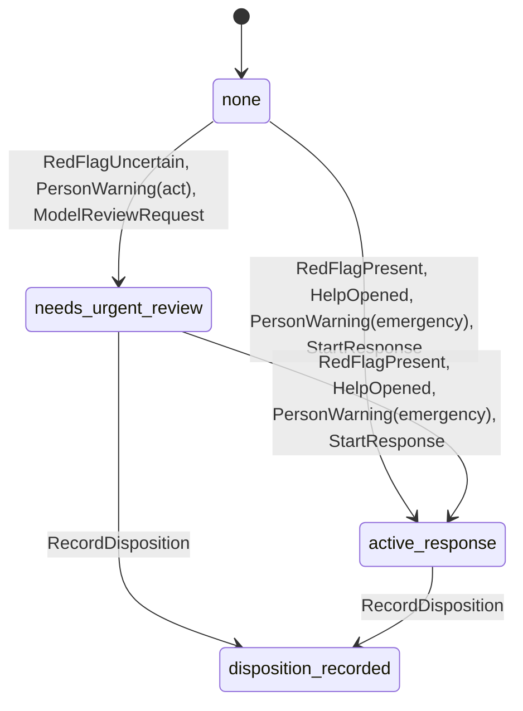

# E11: Urgent handling and pathway engine

Technical design for epic E11. Inputs: the brief (`tdd/E11.md` in the planning package), PRD.md (sections 3, 4.3, 9,
10, 11), USE-CASES.md (UC08, UC09, UC10, UC16), CONTRACTS.md (sections 1 to 6, 9, 11, 16 to 21, 24), LLM-ARCHITECTURE.md
(sections 2 and 5), `api/openapi.yaml`, the schemas named below, VALIDATION.md, `backlog.json` and
`docs/BUILD-CHARTER.md`. `docs/SYSTEM.md` and `docs/DEPLOYMENT.md` do not exist yet; points that depend on them are in
section 14.

Status: design. Every test named here is planned; none has run. Clinical content (which questions are red flags, which
flow each opens, flow levels, dispositions, pathway cards, kit rows) is an unreviewed team draft and needs clinician
review before live guidance. E11 carries that content; it authors none of it.

## 1. Scope

**What E11 is.** The deterministic safety controller of LLM-ARCHITECTURE section 2 ("Deterministic urgent and policy
checks"): it decides, without the model, the network, a device or the ground, that something is urgent, opens help for
it, and keeps it urgent until an authorized person on board records a disposition (CONTRACTS 4, "Urgency is a separate
state machine"). Four parts:

1. **Urgent signals:** classify answers, help sessions, person warnings and model review requests (3.2).
2. **Urgency state machine** per episode, in cycles, with durable effects: open help on a red flag yes, cancel model
   turns (3.4, 4.2).
3. **Pre-inference gate and stale guard** for the assistant (3.5).
4. **Pathway evaluation and request gate:** a pathway card's review status and, per confirming test, the capability,
   context, operator and consent checks (3.6, 3.7).

**Work packages.** E11-01 (model-independent urgent entry), E11-02 (reviewed pathway execution), E11-03 (escalation
and resolution semantics). **Requirements.** R07, R15, R28. Validation scenarios, demo assertions and use cases: E11's
exact contribution to each, and the owner of the complete acceptance test, are in the traceability table of section 12.

**Decisions** (brief checklist):

| # | Decision | Selected | Rejected and why |
|---|---|---|---|
| DE11-1 | Boundaries | E11 owns urgency (the brief lists `UrgentState` as E11's shared entity; E15 and E26 depend on E11 in `backlog.json`). E26 owns help sessions and both `openHelpSession` and its alias `createUrgentEvent` (one handler, E26 section 6). E04 asks the red flags; E15 owns the Episode and renders urgency; E10 owns pathway cards; E05 owns capabilities and measurement requests; E27 owns the kit gate | E11 owning the alias router (two owners of one handler); E15 consuming help events for urgency (two owners of one invariant) |
| DE11-2 | `entry.ref_id` of a `red_flag` help session | The Episode ID, as E26 already validates it (E26 section 6). The package defines only the `plan_step` meaning (CONTRACTS 22, "`ref_id` the run") | The Answer ID (the answer may not exist on the hub yet, and `AnswerCreate` carries no client ID) |
| DE11-3 | Where urgent rules come from | Configuration only: questionnaire choices with `opens: help_flow`, `red_flags.question_ids`, help-presentation `red_flag_flows`, warning definitions at `act` or `emergency` | Thresholds or keyword lists in code |
| DE11-4 | Escalation | Monotonic within a cycle; no transition reads an observation count, so a repeat is never a prerequisite; "not sure" and "declined" on a red flag are never a no | Waiting for a confirming repeat (V03) |
| DE11-5 | Resolution | Only the `record_disposition` command, bound to the cycle and revision the officer reviewed, ends a cycle. Closing a help session never changes urgency | Disposition through help close (anyone may close; the close has no cycle binding and an optional note) |
| DE11-6 | Who may record a disposition | A crew medical officer who is not the patient; or, when every officer is unavailable, the acting medical officer: the crew member E31 assigned the `medical_officer` role who accepted it (coordinator interim decision; Q-E11-1) | Waiting for a formal role holder (a dead end, the larger hazard) |
| DE11-7 | Effects | Opening help and cancelling turns are durable effect rows written in the transaction that raised urgency, run after commit by a bounded runner and again after a restart; model output is also checked against the urgency revision before display | A best-effort call after commit (lost on a crash) |
| DE11-8 | Pathways | Read-only evaluation of E10's `PathwayCard` at the pinned evidence release plus the kit-map condition row. No pathway rule changes urgency in this release (no package source has one) | Inventing a `PathwayVersion` shape with executable decision rules |

**Not delivered here** (owner): help sessions, both help endpoints, help screens and offline help cache (E26); asking
the red flags (E04); the Episode record, its screens and resolution (E15); the warnings engine (E24); measurement
requests and capabilities (E05); the kit gate (E27); evidence releases and pathway cards (E10); tools (E12); the
assistant controller (E13); the role engine (E31); the end-to-end scenarios (E21).

## 2. Dependencies and seams

| Seam | Direction | Mechanism | Owner |
|---|---|---|---|
| Unit of work, audit, idempotency, clock, IDs | E11 uses | E01 platform ports | E01 |
| Answer accepted | E11 handles inside the answer transaction | `AnswerAccepted(answer: AnswerRecord, episode_id, mission_id)` in-transaction domain event | E01 records |
| Help session changes | E11 consumes after commit | `help.session_changed` (HelpSession) from E01's durable outbox subscription (at least once, commit order, cursor per subscriber; R-E11-10) | E26 publishes |
| Person warnings | E11 consumes after commit | `warning.raised` (Warning) from the same subscription | E24 |
| Open help for a red flag yes | E11 calls (effect runner) | Interim: E26 `OpenHelpSession.execute(actor=patient, body, idempotency_key)`; target: `HelpEntryPort.open_from_red_flag(...)` (R-E11-4) | E26 |
| Cancel turns | E11 calls (effect runner) | `AssistantTurnControl.cancel_episode_turns(episode_id, reason) -> None`, must return within `effect_call_timeout_ms` | E13 |
| Episode facts and visibility | E11 reads | `EpisodeFacts.get(uow, episode_id)`, `.visible_to(uow, episode_id, actor)`, `.episode_of(uow, kind, ref_id)` | E15 |
| Configuration by version | E11 reads | `ConfigReader.document(name, version=None)`: questionnaires, help-presentation, kit-map, role-rules | E01 |
| Roster, overlays, mission mode | E11 reads | `RosterPort.crew(at)` (with `medical_officer_rank`), `OverlayPort.active(person_id, at)`, `MissionStatePort.mission_mode()`, `.active_environment_id()` | E02, E23 |
| Medical officer assignments | E11 reads | `RoleQueryPort.medical_officer_assignments(subject_person_id) -> Sequence[RoleAssignment]` (help sessions and plan runs) | E31 |
| Capabilities and kit check | E11 reads | `CapabilityQueries.get(uow, code)`, `KitGate.check(uow, code, environment_id)` | E05, E27 |
| Consent | E11 reads | `ConsentQueries.allows(uow, subject_id, recipient_id, scope) -> bool` | E02 |
| Pathway cards and passages | E11 reads | `EvidenceQueryPort.pathway_card(release_id, condition_id)`, `.get_passage(passage_id)` (E10 section 4) | E10 |
| Urgency for the Episode | E11 provides | `UrgencyQueries` (4.3) | consumers E15, E13 |
| Model review and gate | E11 provides | `UrgencyCommands.request_review_from_model`, `InferenceGate.before_turn`, `.still_valid` | consumer E13 |
| Request gate and pathways | E11 provides | `RequestGatePort.check`, `PathwayQueries.get_pathway` | consumers E05, E12 |

## 3. Domain model

Pure code in `crew_health/pathways/domain/`: no I/O, no clock reads, no framework imports.

### 3.1 Urgency types

`UrgencyState` (`none`, `needs_urgent_review`, `active_response`, `disposition_recorded`; rank 0, 1, 2,
terminal). `Disposition` is the HelpAction close enum (words from help-presentation `disposition_words`).

`UrgentCycle` (entity, a bounded summary): `episode_id`, `cycle >= 1`, `patient_id`, `mission_id`, `origin_mode`,
`state`, `revision`, `opened_at`, `signal_count`, `last_signal_at`, `linked_help_session_ids` (at most
`max_linked_sessions` held; the rest are paged), `disposition: DispositionRecord | None`. Signal history is never
loaded into the entity; it is read in pages (4.3). An episode's urgency is its latest cycle's state, or `none`.

`DispositionRecord`: `disposition`, `rationale` (non-empty after trim), `by: PersonRef`, `authority:
"crew_medical_officer" | "acting_medical_officer"`, `role_assignment_id` (required when acting), `at`.

### 3.2 Signals and classification

Raising signals: `RedFlagPresent(answer_id, question_id, flow_id, at)`, `RedFlagUncertain(answer_id, question_id,
reason, at)`, `HelpOpened(help_session_id, entry_kind, level, at)`, `PersonWarning(warning_id, level, at)`,
`ModelReviewRequest(conversation_id, turn_id, model_release_id, at)`, `StartResponse(actor, at)`. Record-only signal:
`HelpClosed(help_session_id, disposition, at)` (same state, history only). Terminal: `RecordDisposition(record,
cycle, cycle_revision)`.

No signal type exists for an acknowledgment, a review event, a normal observation, a repeat measurement, a forecast, a
ground receipt or reply, or a model statement that something is fine (INV-E11-03).

**Classification** `classify(answer, questionnaires_at_version, help_presentation) -> (UrgentSignal | None,
ClassificationNote)` is total. The document is the one named by `answer.questionnaire_version`; when E01 cannot supply
that version, the active one is used and the note records `version_fallback` (audited). With `Q` the answer's question
in that document and `C` the choice whose `id == answer.value`:

| Case | Red flag question (`Q.id` in `red_flags.question_ids`) | Any other question |
|---|---|---|
| `C` exists, `C.presence == answer.presence`, `C.opens == help_flow` | `RedFlagPresent(C.flow_id)` | `RedFlagPresent(C.flow_id)` |
| `C` exists and consistent, presence `unknown` or `declined` | `RedFlagUncertain(reason=not_sure)` | none |
| `C` exists and consistent, presence `absent` | none | none |
| Presence `present`, `C` missing (null or unknown value) | `RedFlagPresent(red_flag_flows[Q.id])`, note `classified_by_presence` | none, note `unclassified` |
| `C` exists but `C.presence != answer.presence` | `RedFlagUncertain(reason=contradictory)` | none, note `contradictory` |
| `Q` missing from the document | `RedFlagUncertain(reason=unknown_question)` if `answer.question_id` is in the active red flag list, else none | none |

A red flag answer therefore yields "no signal" only for a consistent `absent` choice. The record boundary (E01 or E04)
should already reject inconsistent answers with `INVALID_VALUE` (R-E11-10); the classifier stays total and fail safe
regardless, and never alters the stored answer. An answer keeps the classification of the version it was given under:
a later release that changes a flow mapping never reclassifies it.

### 3.3 Authority

`authority.officer_for(session, cycle, facts: AuthorityFacts) -> AuthorizedOfficer` raises `NotAuthorized(reason)`
otherwise. `AuthorityFacts` (read by the use case at command time): roster with ranks, active overlays, and the
patient's `medical_officer` RoleAssignments from E31.

1. The session person is the patient: refused (`is_patient`).
2. `"crew_medical_officer" in session.roles`: authority `crew_medical_officer`.
3. Acting medical officer, all of: every roster person with a `medical_officer_rank` is unavailable now (the patient,
   or in an active `eva` or `sleep` overlay: E31's `officer_is_subject`, `officer_on_eva`, `officer_asleep`); and the
   session person holds a `medical_officer` RoleAssignment with `state` `accepted`, `replaced_by_id` null, whose help
   session has `subject.person_id` equal to the patient (linked to this cycle or opened at or after the cycle opened)
   or whose plan run belongs to this episode. Authority `acting_medical_officer`, `role_assignment_id` recorded.
4. Otherwise refused (`not_officer`, or `officer_available` when rule 3 failed only because an officer is available).

`AssistantContext` has no conversion to any actor type; no command takes one.

### 3.4 State machine



`transition(cycle | None, signal, ctx) -> TransitionResult(cycle, signal_row, effects)`:

| Current | Signal | Result |
|---|---|---|
| none, or `disposition_recorded` | raising | New cycle `n + 1` at the signal's target (an episode can return to open, CONTRACTS 4) |
| none, or `disposition_recorded` | `HelpClosed`, `RecordDisposition` | `InvalidTransition` (a `HelpClosed` here is only audited) |
| review or active | raising at same or lower target, `ModelReviewRequest`, `HelpClosed` | Same state; signal appended; revision + 1 |
| `needs_urgent_review` | target `active_response` | `active_response`; revision + 1 |
| review or active | `RecordDisposition` with `cycle` and `cycle_revision` equal to the current ones | `disposition_recorded` |
| review or active | `RecordDisposition` naming another cycle or revision | `StaleUrgency` (409 `STALE_VERSION` with the current Episode) |

Effects: entry into `active_response` emits `CancelEpisodeTurns`; `RedFlagPresent` emits `OpenHelpForRedFlag` unless the
cycle already has a linked `red_flag` help session for that episode (then the effect is recorded `skipped`).
Targets: `RedFlagPresent`, `HelpOpened`, `StartResponse` give `active_response`; `RedFlagUncertain`,
`ModelReviewRequest` give `needs_urgent_review`; `PersonWarning` `act` gives review, `emergency` gives active.

Every signal appended increments the cycle revision, so any new fact invalidates a disposition form opened before it.
Each signal stores its own time (`at`: the client time of an answer, the hub open time of a session) and the hub time it
was recorded; order inside a cycle is commit order (`seq`), never `at`, and no transition reads either time, so clock
skew and clock corrections cannot change urgency (CONTRACTS 1).

### 3.5 Pre-inference gate and stale guard

`before_turn(ctx, facts, cycle, red_flag_ids) -> GateDecision`, first match:

| # | When | Decision | E13 does |
|---|---|---|---|
| 1 | Context is not `episode` | `Proceed(token=None)` | Runs it (help context turns are guarded by E26's `HelpTurnGuardPort`) |
| 2 | Episode facts missing, or `ctx.person_id != facts.patient_id` | `Refused(reason)` | Does not start; shows the Someone needs help button |
| 3 | State `active_response` | `Interrupted(help_session_ids)` (possibly empty while the open effect is pending) | Does not start; points to the help session or the button |
| 4 | A red flag question lacks an accepted answer in any presence | `RedFlagsPending(missing)` | Does not start (D05) |
| 5 | Otherwise | `Proceed(token=UrgencyToken(cycle, cycle_revision), urgent_review_pending)` | Runs; the review notice stays visible |

`still_valid(token, cycle) -> bool` is true only when the cycle and its revision are unchanged. E13 calls it before it
displays or applies any model output; false marks the output stale (CONTRACTS 6, "mark output stale and regenerate or
require review"). This is the backup for a lost or late cancel, and it closes both races: a signal committed before
the gate reads gives rule 3; a signal committed after it gives `still_valid == False`.

### 3.6 Pathway evaluation (E11-02)

The package supplies a pathway as E10's `PathwayCard` (E10 section 3.4: condition, assessment text, workup sources,
`review_state`, `supporting_passage_ids`) plus the kit-map condition row (`confirming_tests[]` with `instruments`,
`review_state`, `plan_id`). `evaluate(card, row, passages, gates, mission_mode) -> PathwayEvaluation`:

- **No supported pathway** when the card or the row is missing or the row is `rejected`.
- **Discrepancies:** each `supporting_passage_id` whose passage in the pinned release is missing, `superseded` or
  `withdrawn` is listed `{passage_id, status}` for review (V24). The pinned release is the only release consulted; no
  replacement is selected across releases (CONTRACTS 4, "publication does not overwrite earlier release contents").
- **Status `approved`** only when the card and the row are `reviewed`, there are no discrepancies, and at least one
  supporting passage is `approved` with `patient_instruction` in `allowed_uses` (the evidence-passage vocabulary).
  Otherwise `simulation_only`.
- **Guidance:** in mission mode `LIVE` a `simulation_only` evaluation carries `guidance_refused: SOURCE_NOT_APPROVED`
  and no card text; in `SIM` or `REPLAY` it is served with `simulation_only: true` and the simulation label.
- **Tests:** per confirming test, `runnable` when every instrument is aboard and every capability those instruments
  provide passes the request gate (3.7) for the subject; a test with no instrument is `report_or_exam` and gets only
  the operator check of its condition's capability, if any. Each test carries its `GateResult`.

Evaluation is a read (`get_pathway` has `"effect": "read"` in tool-catalog.json). Its only consequence is through
other commands: a runnable test can be proposed as a measurement request, which E05 gates again.

### 3.7 Request gate (R07)

`check(cap: CapabilityFact, kit: KitCheck, ctx: RequestContext) -> GateResult`, fixed order, first failure wins:

| # | Check | Reason | API error (E05 raises) | CapabilityGap reason |
|---|---|---|---|---|
| 1 | `kit.can` | `no_capability` | `KIT_CANNOT_PERFORM` | `no_capability` |
| 2 | Active environment not in `cap.context_exclusions.environment_ids` and no active subject overlay in `cap.context_exclusions.overlays` (kit-map field, R-E11-8) | `context_inapplicable` | `CONTEXT_INAPPLICABLE` | `context_inapplicable` |
| 3 | Capability status (table below) | as below | as below | as below |
| 4 | Operator (below) | `operator_absent` | `CAPABILITY_UNAVAILABLE` | `operator_absent` |
| 5 | Consent when the operator is not the subject | `consent_missing` | `CONSENT_REQUIRED` | none; the request waits |

Status truth table (Capability `status`, `unavailable_reason`):

| status / reason | Gate result |
|---|---|
| `available` | pass |
| `not_applicable`, or `unavailable` + `context_inapplicable` | `context_inapplicable` |
| `unavailable` + `not_in_kit` | `no_capability` (check 1 normally catches it first) |
| `unavailable` + `device_absent` or `adapter_down` | `device_absent`; when `cap.methods` contains `manual_instrument` and `kit.can`, `supported_alternative` = the same capability by `manual_instrument` (a reading taken by hand and entered) |
| `unavailable` + `operator_absent` | `operator_absent` |
| `unavailable` + null reason | `device_absent`, audited `reason_missing` |

Operator predicate (eligible: on the roster, not in an active `eva` overlay): `self`: the operator is the subject;
`operator_id` null or equal to the subject. `crewmate`: `operator_id` null means "to be assigned" and passes when at
least one eligible person other than the subject exists; a named operator must be eligible and not the subject.
`crew_medical_officer`: an eligible, non-subject person with the session role or the acting authority of 3.3 rule 3.
Consent predicate: `ConsentQueries.allows(subject, operator, scope=("measurement", capability_code))`; a null
operator defers the check to assignment.

E05 runs the gate at propose, at operator acceptance and immediately before acquisition starts; a failure at the
later points moves the request to `unavailable` with the reason (operator departure, consent revocation, adapter
failure). The gate never waits and never invents a substitute beyond the manual method above; E28 owns "check it
another way".

### 3.8 Cross-record checks

Client and model IDs are never authorization (CONTRACTS 5). Every entry point checks:

| Entry | Checks | On failure |
|---|---|---|
| `AnswerAccepted` | `answer.actor` is the patient; answer origin = episode origin; same mission | Typed error aborts the answer transaction (E01 maps to `IDENTITY_MISMATCH` or `ORIGIN_MISMATCH`); audit |
| `help.session_changed` with `ref_id` | Kind `red_flag` → Episode; `plan_step` → the run's episode (`episode_of`); `warning` → the warning's evidence episode. The session's `subject.person_id` equals the patient; same mission; mission mode at open equals the episode's origin | No link and no signal; audit `urgency.link_refused`; the help session is never affected |
| `warning.raised` | Scope `person`, `raised_by` rule, level `act` or `emergency`; `person_id` equals the patient of the episode its evidence resolves to | No signal; audit |
| Model review | The episode is taken only from `AssistantContext` (no separate ID parameter); context kind `episode`; context person equals the patient | `ScopeMismatch`; audit; no signal |
| Commands (R-E11-1) | Session person; `EpisodeFacts.visible_to` (E15 sharing and consent); authority (3.3); same mission | `404 NOT_FOUND` when not visible; `403 ACTION_NOT_ALLOWED` otherwise |

### 3.9 Invariants

| ID | Invariant | Tests |
|---|---|---|
| INV-E11-01 | Within a cycle the urgency rank never decreases | T-E11-001, 002 |
| INV-E11-02 | Only a `RecordDisposition` from an `AuthorizedOfficer`, bound to the current cycle revision, reaches `disposition_recorded` | T-E11-003 to 005, 013, 014, 017 |
| INV-E11-03 | No acknowledgment, review, observation, repeat, forecast, ground reply, help close or model output lowers or closes urgency | T-E11-006 to 008, 016 |
| INV-E11-04 | The model can only move `none` to `needs_urgent_review` | T-E11-009, 010 |
| INV-E11-05 | A red flag answer yields no signal only for a consistent `absent` choice | T-E11-011, 018 |
| INV-E11-06 | No transition depends on the model, a device, the network or the ground | T-E11-020, 032 |
| INV-E11-07 | Every `RedFlagPresent` leads to exactly one open help session for the patient, through the client or the effect | T-E11-022 to 025 |
| INV-E11-08 | No first model turn of a concern starts before its red flags have answers, and no model output is shown after the urgency revision it was produced under changed | T-E11-028 to 031 |
| INV-E11-09 | A signal's subject, mission and origin equal its episode's | T-E11-012, 062 |
| INV-E11-10 | A pathway not approved for `patient_instruction` is never served as live guidance in `LIVE` | T-E11-040 to 044 |
| INV-E11-11 | A request the gate refuses never reaches a person as a task | T-E11-050 to 053 |
| INV-E11-12 | Signals, links and dispositions are append only | T-E11-060 |

## 4. Application layer

### 4.1 Use cases

| ID | Use case | Input | Output | Errors | Idempotency |
|---|---|---|---|---|---|
| UC-U1 | `OnAnswerAccepted` (in the answer transaction) | `uow`, `AnswerAccepted` | Signal, transition, effect rows | `IdentityMismatch`, `OriginMismatch`, `StorageBusy`, `StorageUnavailable` | `UNIQUE (episode_id, kind, ref_id)` with the answer ID |
| UC-U2 | `OnHelpSessionChanged` (outbox) | `uow`, HelpSession | Open: link plus `HelpOpened`. Closed: `HelpClosed` record. Refused link: audit | storage errors (event redelivered) | `(episode_id, kind, help_session_id)` |
| UC-U3 | `OnPersonWarningRaised` (outbox) | `uow`, Warning | Signal and transition, or nothing | storage errors | `(episode_id, kind, warning_id)` |
| UC-U4 | `RequestReviewFromModel` | `uow`, `AssistantContext` | State | `ScopeMismatch` | `(episode_id, kind, turn_id)` |
| UC-U5 | `StartResponse` (R-E11-1) | session, `episode_id`, If-Match | Episode | `UNAUTHORIZED_SCOPE`, `INVALID_TRANSITION`, `STALE_VERSION`, `VERSION_REQUIRED` | E01 key store |
| UC-U6 | `RecordDisposition` (R-E11-1) | session, `episode_id`, `cycle`, `cycle_revision`, `disposition`, `rationale`, If-Match | Episode | `NOT_FOUND`, `ACTION_NOT_ALLOWED`, `INVALID_TRANSITION`, `STALE_VERSION`, `INVALID_VALUE`, `VERSION_REQUIRED` | E01 key store |
| UC-U7 | `BeforeTurn`, `StillValid` | `uow`, `TurnContext` or token | `GateDecision`, bool | none | read |
| UC-U8 | `GateRequest` | `uow`, code, subject, operator | `GateResult` | none | read |
| UC-U9 | `GetPathway` | `uow`, condition ID, `PathwayContext` (subject, mission mode, environment, evidence release from the controller scope) | `PathwayEvaluation` | none (refusal is a field) | read |
| UC-U10 | `RunEffects` (background) | batch | Effects done, retried or failed | none raised; each failure audited | effect ID |

UC-U6 runs in one `BEGIN IMMEDIATE` transaction: load the latest cycle, check If-Match on the Episode revision and
`cycle`/`cycle_revision` on the cycle, read `AuthorityFacts`, check authority, append the disposition signal, update the
cycle, audit, outbox. Both interleavings with a new signal are defined: signal first gives `409 STALE_VERSION` with the
current Episode (the officer reviews the new signal and resubmits); disposition first means the later signal opens
cycle `n + 1` and help as usual.

### 4.2 Durable effects and failure points

Effects are rows in `pathways_effect`, written in the same transaction as the signal (CONTRACTS 20, "One command is one
transaction"). `effect_id` is deterministic (`open_help:{episode}:{answer}`, `cancel:{episode}:{cycle}:{seq}`) and is
the idempotency key sent to E26. The runner is one bounded worker in the hub process: it takes at most
`effect_batch_size` due rows, calls the port outside any write transaction with `effect_call_timeout_ms`, and marks the
row `done`, or retries after `effect_retry_backoff_seconds` up to `effect_max_attempts`, then `failed` (audited, health
check degraded, row kept). It also runs at startup, so a crash between commit and delivery loses nothing. The help it
opens converges with a client-opened session through E26's one open session per subject rule (E26 I-H4, "Second press").

| Failure point | Outcome | Recovery |
|---|---|---|
| Crash or power loss before the answer transaction commits | Nothing accepted; the client shows the answer as unsaved; its cached help flow already runs (E26) | Retry with the same Idempotency-Key replays the whole transaction once |
| Crash after commit, before effects run | Answer, signal, audit, outbox and effect rows durable | Runner at startup |
| Disk full (`SQLITE_FULL`) or I/O error | Rollback; `StorageUnavailable`, `500 INTERNAL_ERROR`, `retryable: true`; health check `storage_degraded` | Client keeps the item queued |
| Lock wait beyond E01's busy deadline | `StorageBusy`, `500 INTERNAL_ERROR`, `retryable: true` | Retry |
| E26 or E13 port fails or times out | Effect retried, then `failed`; urgency stays raised and visible; the stale guard still blocks model output | Operator sees the degraded health check |
| Hub clock jumps | Stored times as given; order by `seq`; no transition reads time | None needed |
| Corrupt or invalid configuration activation | E01 rejects it and the last good release stays active; classification uses the answer's own version | None needed |

Typed errors (`pathways/domain/errors.py`): `NotAuthorized`, `InvalidTransition`, `StaleUrgency`, `ScopeMismatch`,
`IdentityMismatch`, `OriginMismatch`, `StorageBusy`, `StorageUnavailable`; mapped to the CONTRACTS 5 codes above.

### 4.3 Ports (`crew_health/pathways/application/ports.py`)

Required ports are the section 2 rows; each is a `Protocol` with the signature given there. Provided:

```python
class UrgencyQueries(Protocol):
    def summary(self, uow: UnitOfWork, episode_id: str) -> UrgencySummary: ...      # state, cycle, revision, disposition, link count
    def signals(self, uow: UnitOfWork, episode_id: str, cycle: int, after_seq: int, limit: int) -> SignalPage: ...  # limit <= 200
    def blocks_resolution(self, uow: UnitOfWork, episode_id: str) -> bool: ...      # True in review or active

class UrgencyCommands(Protocol):
    def request_review_from_model(self, uow: UnitOfWork, ctx: AssistantContext) -> UrgencyState: ...
    def start_response(self, session: Session, episode_id: str, *, if_match: int, idempotency_key: str) -> EpisodeView: ...
    def record_disposition(self, session: Session, episode_id: str, cycle: int, cycle_revision: int,
                           disposition: Disposition, rationale: str, *, if_match: int, idempotency_key: str) -> EpisodeView: ...

class InferenceGate(Protocol):
    def before_turn(self, uow: UnitOfWork, ctx: TurnContext) -> GateDecision: ...
    def still_valid(self, uow: UnitOfWork, token: UrgencyToken) -> bool: ...

class RequestGatePort(Protocol):
    def check(self, uow: UnitOfWork, capability_code: str, subject_id: str, operator_id: str | None) -> GateResult: ...

class PathwayQueries(Protocol):
    def get_pathway(self, uow: UnitOfWork, condition_id: str, ctx: PathwayContext) -> PathwayEvaluation: ...
```

### 4.4 Events

In-transaction domain event `UrgencyChanged(episode_id, cycle, revision, from_state, to_state, signal_kind, at)`:
E15 bumps the Episode revision in the same transaction; E29 adds a catch-up line. Audit events (IDs and codes only,
never answer, note or model text): `urgency.signal`, `urgency.link_refused`, `urgency.signal_refused`,
`urgency.disposition_recorded` (with `authority` and `role_assignment_id`), `urgency.disposition_refused`,
`urgency.classification_note`, `urgency.effect_failed`, `pathway.guidance_refused`, `request_gate.refused`.

### 4.5 Principal success path: a red flag yes with the model stopped (UC08 step 2, V61, D05)

```mermaid
sequenceDiagram
    participant P as Crew app
    participant Rec as E01 records
    participant U as E11 urgency
    participant R as E11 effect runner
    participant H as E26 help
    P->>P: cached red flags; "Chest pain: Yes"; cached chest_pain flow shown (no network)
    P->>Rec: POST /v1/episodes/{id}/answers
    Rec->>U: AnswerAccepted (same transaction)
    U->>U: RedFlagPresent; cycle 1 active_response; effects open_help, cancel
    Rec-->>P: 201 (answer, signal, effects, audit, outbox committed together)
    R->>H: open for the patient, entry red_flag, ref_id episode, flow chest_pain, key open_help:ep:ans
    P->>H: POST /v1/help-sessions (same subject): E26 returns the same open session
    H-->>U: help.session_changed (outbox): link and HelpOpened appended
```

### 4.6 Failure path: the client disappears after the answer commits, and the hub restarts

```mermaid
sequenceDiagram
    participant P as Crew tablet
    participant Rec as E01 records
    participant U as E11 urgency
    participant R as E11 effect runner
    participant H as E26 help
    P->>Rec: answer "Yes" committed with effect row open_help (pending)
    P-xP: tablet battery dies before it posts the help session
    Note over R: hub process killed before the runner ran
    R->>R: startup: pending open_help found
    R->>H: open with key open_help:ep:ans (idempotent on a second restart)
    H-->>U: help.session_changed: link; broadcast reaches every crew screen
```

## 5. Adapters

### 5.1 Storage (SQLite STRICT, `pathways/adapters/migrations/0001_pathways.sql`)

```sql
CREATE TABLE pathways_urgent_signal (
  episode_id TEXT NOT NULL, cycle INTEGER NOT NULL, seq INTEGER NOT NULL CHECK (seq >= 1),
  kind TEXT NOT NULL CHECK (kind IN ('red_flag_present','red_flag_uncertain','help_opened','help_closed',
    'person_warning','model_review','start_response','record_disposition')),
  ref_id TEXT NOT NULL, from_state TEXT NOT NULL, to_state TEXT NOT NULL,
  actor_json TEXT NOT NULL CHECK (json_valid(actor_json)), at TEXT NOT NULL, recorded_at TEXT NOT NULL,
  config_release_id TEXT NOT NULL,
  PRIMARY KEY (episode_id, cycle, seq), UNIQUE (episode_id, kind, ref_id),
  FOREIGN KEY (episode_id, cycle) REFERENCES pathways_urgent_cycle(episode_id, cycle) DEFERRABLE INITIALLY DEFERRED
) STRICT;

CREATE TABLE pathways_urgent_cycle (
  episode_id TEXT NOT NULL, cycle INTEGER NOT NULL CHECK (cycle >= 1),
  patient_id TEXT NOT NULL, mission_id TEXT NOT NULL,
  origin_mode TEXT NOT NULL CHECK (origin_mode IN ('LIVE','REPLAY','SIM')),
  state TEXT NOT NULL CHECK (state IN ('needs_urgent_review','active_response','disposition_recorded')),
  revision INTEGER NOT NULL, signal_count INTEGER NOT NULL, opened_at TEXT NOT NULL, updated_at TEXT NOT NULL,
  disposition TEXT CHECK (disposition IS NULL OR disposition IN
    ('resolved_on_board','handed_to_crew_medical_officer','ground_consulted','false_alarm','other')),
  rationale TEXT, disposed_by_json TEXT, authority TEXT, role_assignment_id TEXT, disposed_at TEXT,
  CHECK ((state = 'disposition_recorded') = (disposition IS NOT NULL)),
  -- coalesce: a NULL inside a CHECK would pass it
  CHECK (state <> 'disposition_recorded' OR coalesce((
    length(trim(rationale)) > 0 AND disposed_at IS NOT NULL AND json_valid(disposed_by_json)
    AND json_extract(disposed_by_json, '$.kind') = 'person'
    AND length(json_extract(disposed_by_json, '$.id')) > 0
    AND json_extract(disposed_by_json, '$.id') <> patient_id
    AND (authority = 'crew_medical_officer' OR (authority = 'acting_medical_officer' AND role_assignment_id IS NOT NULL))), 0)),
  PRIMARY KEY (episode_id, cycle)
) STRICT;
```

Triggers and the remaining tables (the signal is written before its cycle row or update; the foreign key is
deferred):

```sql
CREATE TRIGGER pathways_signal_seq BEFORE INSERT ON pathways_urgent_signal
WHEN NEW.seq <> 1 + coalesce((SELECT max(seq) FROM pathways_urgent_signal
                              WHERE episode_id = NEW.episode_id AND cycle = NEW.cycle), 0)
BEGIN SELECT RAISE(ABORT, 'signal seq must be contiguous'); END;
CREATE TRIGGER pathways_signal_no_update BEFORE UPDATE ON pathways_urgent_signal
BEGIN SELECT RAISE(ABORT, 'signals are append only'); END;
CREATE TRIGGER pathways_signal_no_delete BEFORE DELETE ON pathways_urgent_signal
BEGIN SELECT RAISE(ABORT, 'signals are append only'); END;
CREATE TRIGGER pathways_cycle_no_delete BEFORE DELETE ON pathways_urgent_cycle
BEGIN SELECT RAISE(ABORT, 'cycles are append only'); END;
CREATE TRIGGER pathways_cycle_open BEFORE INSERT ON pathways_urgent_cycle
WHEN NEW.revision <> 1 OR NEW.signal_count <> 1 OR NEW.state = 'disposition_recorded'
  OR NOT EXISTS (SELECT 1 FROM pathways_urgent_signal s WHERE s.episode_id = NEW.episode_id
                 AND s.cycle = NEW.cycle AND s.seq = 1 AND s.to_state = NEW.state)
  OR (NEW.cycle > 1 AND coalesce((SELECT state FROM pathways_urgent_cycle WHERE episode_id = NEW.episode_id
                                  AND cycle + 1 = NEW.cycle), '') <> 'disposition_recorded')
BEGIN SELECT RAISE(ABORT, 'a cycle opens with its first signal after the previous disposition'); END;
CREATE TRIGGER pathways_cycle_change BEFORE UPDATE ON pathways_urgent_cycle
WHEN OLD.state = 'disposition_recorded'
  OR NEW.episode_id <> OLD.episode_id OR NEW.cycle <> OLD.cycle OR NEW.patient_id <> OLD.patient_id
  OR NEW.origin_mode <> OLD.origin_mode OR NEW.mission_id <> OLD.mission_id
  OR NEW.revision <> OLD.revision + 1 OR NEW.signal_count <> OLD.signal_count + 1
  OR (OLD.state = 'active_response' AND NEW.state = 'needs_urgent_review')
  OR NOT EXISTS (SELECT 1 FROM pathways_urgent_signal s WHERE s.episode_id = NEW.episode_id
                 AND s.cycle = NEW.cycle AND s.seq = NEW.signal_count
                 AND s.from_state = OLD.state AND s.to_state = NEW.state
                 AND (NEW.state <> 'disposition_recorded' OR (s.kind = 'record_disposition'
                      AND json_extract(s.actor_json, '$.id') = json_extract(NEW.disposed_by_json, '$.id'))))
BEGIN SELECT RAISE(ABORT, 'urgency is monotonic, recorded with its signal, and final after disposition'); END;
CREATE TABLE pathways_urgent_link (
  episode_id TEXT NOT NULL, cycle INTEGER NOT NULL, help_session_id TEXT NOT NULL, entry_kind TEXT NOT NULL,
  linked_at TEXT NOT NULL, PRIMARY KEY (episode_id, help_session_id)
) STRICT;
CREATE TRIGGER pathways_link_no_update BEFORE UPDATE ON pathways_urgent_link
BEGIN SELECT RAISE(ABORT, 'links are append only'); END;
CREATE TRIGGER pathways_link_no_delete BEFORE DELETE ON pathways_urgent_link
BEGIN SELECT RAISE(ABORT, 'links are append only'); END;
CREATE TABLE pathways_effect (
  effect_id TEXT PRIMARY KEY, kind TEXT NOT NULL CHECK (kind IN ('open_help','cancel_turns')),
  episode_id TEXT NOT NULL, cycle INTEGER NOT NULL, payload_json TEXT NOT NULL CHECK (json_valid(payload_json)),
  state TEXT NOT NULL CHECK (state IN ('pending','done','skipped','failed')),
  attempts INTEGER NOT NULL CHECK (attempts >= 0), next_attempt_at TEXT NOT NULL, last_error_code TEXT,
  created_at TEXT NOT NULL, updated_at TEXT NOT NULL
) STRICT;
CREATE INDEX pathways_effect_due ON pathways_effect(state, next_attempt_at);
```

Rollback: additive migration; no foreign key into another module's tables. The DDL and triggers above were
executed in SQLite 3.54 against the review's counterexample (`active_response` to `disposition_recorded` with an empty
rationale, actor `{}` and no signal): it aborts, as do the other T-E11-060 cases; a valid disposition, a same-state
append and a new cycle after a disposition commit.

**What the database safeguard detects** (a writer that bypasses the domain): rank decreases, any change after a
disposition, deletion or editing of history, revision or count skips, a state change without a matching signal, a
disposition with an empty rationale, a non-person or empty actor, the patient as actor, an acting disposition without
its assignment, and a disposition without its signal. **What it cannot detect:** whether the actor really held the role
or the assignment at that moment, and a fully fabricated but well-formed signal and cycle pair written with direct file
access. Those are covered by the domain authority check and by the hash-chained audit trail (E01).

### 5.2 Other adapters

`evidence_pathway_reader.py` maps E10's `PathwayCard` and passages into domain types through E10's application port.
`role_reader.py` maps E31 RoleAssignments. No device, model or network client exists in this module; import-linter
contract `pathways-no-io-clients` forbids `httpx`, `bleak`, `cv2` and other modules' adapters.

## 6. API

E11 owns no operation in the current contract. `openHelpSession` and `createUrgentEvent` are E26's (DE11-1); urgency is
read through `getEpisode` (`urgency_state`, E15). After R-E11-1 is approved, E11 adds `pathways/api/urgency.py` for
`actOnEpisodeUrgency` (`POST /v1/episodes/{episode_id}/urgency`): roles `crew` and `crew_medical_officer`
(authority is checked per 3.3, so an acting officer with the `crew` role passes), required `Idempotency-Key` and
`If-Match`, errors as UC-U5 and UC-U6 plus 400, 401, 415, 428. The pathway engine and the request gate have no HTTP
endpoint; they serve E12's `get_pathway` tool and E05.

## 7. User interface

None owned. E11 decides; others render from hub state and configuration:

| Screen (owner) | What it shows from E11 |
|---|---|
| Concern red flags (E04) | Words and choices from questionnaires.json; a yes opens the cached flow named by the choice's `flow_id`; not sure shows `red_flags.after` and the Someone needs help offer |
| Episode and records (E15) | Urgency state, cycle, signal kinds with their own and received times, disposition with actor and authority ("acting" when so), all words from ui-copy (R-E11-7); the urgency actions from the Episode's `allowed_actions` (R-E11-1); stale and offline labels when a refresh fails |
| Assistant card (E13) | `RedFlagsPending`, `Interrupted`, `Refused` and stale output states |
| Plan and pathway views (E28, E13) | The simulation label and listed discrepancies |

Keeping an open screen current: the contract has no episode event (CONTRACTS 18). Until R-E11-3 is approved, E15's
episode screen refetches `GET /v1/episodes/{id}` every `episode_refresh_seconds` while visible, and shows "as of" with
the stale label when a refetch fails (R-E11-13). Active response always also reaches every crew screen through E26's
`help.broadcast_changed`, since every red flag yes now opens help on the hub.

## 8. Configuration

| Document | Fields read | Owner |
|---|---|---|
| `questionnaires.json` (by version) | `red_flags.question_ids`, `questions[].choices[]` (`id`, `presence`, `opens`, `flow_id`) | E04 |
| `help-presentation.json` | `red_flag_flows`, `disposition_words` | E26 |
| `warning-rules.json` | through E24's warnings | E24 |
| `kit-map.json` | `capabilities[]` (with `context_exclusions` after R-E11-8), `instruments[]`, `kits`, `conditions[]` | E27 |
| `role-rules.json` | the `medical_officer` role (fixed role ID in its schema) | E31 |
| Runtime limits (R-E11-9) | `effect_batch_size`, `effect_call_timeout_ms`, `effect_retry_backoff_seconds`, `effect_max_attempts`, `effect_queue_alarm_depth`, `max_linked_sessions`, `episode_refresh_seconds` | E01 |

E11 owns no document and adds no loader check (loader check 10 already ties `red_flag_flows` to responder-flows). Every
signal stores `config_release_id`; every evaluation names the evidence release. Configuration edits change behavior
with no code change: T-E11-070 (`red_faint` yes `opens` null: a yes no longer opens help; not sure still raises
review), T-E11-071 (a new question with `opens: help_flow` raises `active_response`), T-E11-072 (changing
`red_flags.question_ids` changes the gate's set), T-E11-073 (a `context_exclusions` entry changes the request gate).

## 9. Deployment and fallbacks

| Tier | Behavior |
|---|---|
| One laptop and its webcam, model stopped, no devices, link down | Everything here works: classification, urgency, help opening effect, gate, request gate (devices absent, manual alternatives), pathway evaluation from the release on disk |
| Laptop plus tablets | Clients cache questionnaires and help-presentation by version and open the flow locally; the hub records urgency and opens help on receipt |
| Hub unreachable from a client | The client runs the cached flow and queues the episode, answers and session with their keys and client times; on reconnect the hub opens or joins one session (4.2) |
| Several hubs | One hub per episode until R-E11-14 |
| Ground | Never a step: nothing here reads the link |

Fallbacks: model stopped (gate unaffected; E13 fails the turn with `MODEL_UNAVAILABLE`), devices absent (gate
`device_absent` with the manual alternative; no urgent path needs a measurement), ground link down (no change), tablets
absent (the laptop is complete).

| Critical path | Primary | Independent backup | Fail safe | Test removing the primary |
|---|---|---|---|---|
| A red flag yes opens help | Client opens the cached flow from `choices[].opens` before any network call | Dissimilar: hub classification plus the durable open effect | Help open; urgency raised | T-E11-021 (hub stopped), T-E11-022 (client gone after commit) |
| Urgency is not closed silently | Domain authority and transition | SQLite constraints and triggers (5.1) | Urgency stays open and visible | T-E11-060 |
| No model output after urgency changed | Cancel effect | Dissimilar: `still_valid` revision check before display | Output stale | T-E11-028 |
| The model cannot change urgency beyond review | No actor conversion from `AssistantContext` | E12 forbidden output filter, E13 controller | Rejected with audit | T-E11-009, 010 |

## 10. Safety, security and privacy

| ID | Hazard | Mitigation | Test |
|---|---|---|---|
| H1 | An urgent concern waits for the model, a repeat, a device or the ground | No transition reads them; effects are asynchronous | T-E11-007, 020, 027, 032 |
| H2 | Urgency closed by a normal value, an acknowledgment, a help close or the model | No signal can express it; only an authorized, revision-bound disposition | T-E11-003 to 010, 016, 017 |
| H3 | "Not sure" or a malformed answer treated as no | Total classifier; only a consistent `absent` choice is no | T-E11-011, 018 |
| H4 | The patient closes their own urgency | Authority excludes the patient | T-E11-004 |
| H5 | Nobody can disposition when both officers are away | Acting medical officer (3.3 rule 3) | T-E11-013 |
| H6 | An acting holder dispositions while an officer is available | Availability rechecked at command time | T-E11-014 |
| H7 | A disposition covers a signal the officer never saw | Cycle and revision binding | T-E11-017 |
| H8 | A SIM signal or another person's record raises or closes urgency | Cross-record checks (3.8) | T-E11-012, 062 |
| H9 | A red flag yes without help because the client vanished | Durable open effect | T-E11-022, 023 |
| H10 | Unreviewed pathway text shown as live guidance | Review status, LIVE refusal, label | T-E11-040 to 044 |
| H11 | A measurement that does not apply here is requested | Request gate with context exclusions | T-E11-050 to 053 |
| H12 | Private text leaks through urgency logs | Audit holds IDs and codes only | T-E11-063 |

Authorization is 3.3 and 3.8; identity and roles come only from the session (E02). The assistant may request a review
and recommend pressing Someone needs help; it may not raise `active_response`, record or imply a disposition, close a
help session or change a gate result.

Unresolved clinical and equipment assumptions: the three red flags, their flows and the flow levels are team defaults;
the disposition list is the help close vocabulary; no pathway card or kit row is reviewed, so every evaluation is
`simulation_only`; no capability has a context exclusion until R-E11-8; the palpitations question does not exist
(R-E11-6); acting officer authority is an interim decision (Q-E11-1).

## 11. Performance and resources

| Budget (M3, 16 GB) | Target | Test |
|---|---|---|
| Classification plus transition inside the answer transaction | p95 at most 2 ms | T-E11-080 |
| `openHelpSession` (E26 handler, E11 effects present) under a streaming turn, a camera capture and a 1,000 reading ingest | p95 at most 200 ms server time | T-E11-081 |
| `BeforeTurn` and `still_valid` | p95 at most 2 ms each | T-E11-082 |
| Pathway evaluation, 20 tests | p95 at most 5 ms | T-E11-083 |
| Burst of 1,000 signals on one cycle | Constant memory per request (summary plus a page of at most 200); no history dropped | T-E11-084 |

Bounds: signal pages at most 200 (CONTRACTS 5 list limit); linked sessions held at most `max_linked_sessions`; the
effect runner holds one batch and one call at a time; the effect queue never drops a row, and above
`effect_queue_alarm_depth` pending rows the health check reports degraded. Signal growth is bounded by the inputs
(one per answer, session, warning or turn, deduplicated). No write transaction is held across a port call; the model
and camera run in other processes.

## 12. Test plan

Fixtures load the example questionnaires, help-presentation, warning-rules, kit-map and role-rules through the real
loader (`hub/tests/pathways/conftest.py`); E10 fakes serve pathway cards copied from condition-assessments-119.json.
Each test carries a pytest marker for its trace.

| Test ID | Level | Proves | Traces to |
|---|---|---|---|
| T-E11-001 | property | Any signal sequence: rank never decreases within a cycle | INV-01, E11-03 |
| T-E11-002 | unit | Every row of the transition table | INV-01 |
| T-E11-003 | unit | Officer disposition stores actor, authority, rationale | INV-02 |
| T-E11-004 | unit | Patient holding the officer role is refused | H4 |
| T-E11-005 | unit | Crew without role or grant is refused | INV-02 |
| T-E11-006 | unit | Acknowledged and reviewed episode keeps urgency | V04 (urgency part) |
| T-E11-007 | integration | A concerning first reading raises an `emergency` person warning (E24 fake from warning-rules) and urgency rises with no repeat; a pending repeat request changes nothing | V03, E11-03 |
| T-E11-008 | unit | No handler exists for forecast, ground reply or acknowledgment events | V32, INV-03 |
| T-E11-009 | unit | Model review: none to review; otherwise no change | INV-04, R28 |
| T-E11-010 | integration (stub model) | No tool, port or endpoint takes the assistant to a disposition; urgency unchanged after a pinned "resolved" turn | R28 |
| T-E11-011 | unit | `not_sure` and `declined` give `RedFlagUncertain` | V61, INV-05 |
| T-E11-012 | unit | SIM signal on a LIVE episode refused and audited | V40 (origin part), INV-09 |
| T-E11-013 | unit | Both officers unavailable (patient, walk): accepted `medical_officer` holder records an acting disposition with the assignment ID | DE11-6, H5 |
| T-E11-014 | unit | Acting refused when an officer is available, the assignment is replaced, or only proposed | H6 |
| T-E11-015 | integration | Urgency without any help session: disposition by command | E11-03 |
| T-E11-016 | integration | Help closed by a crewmate, with and without a note: urgency unchanged; a later officer disposition succeeds | E11-03, INV-03 |
| T-E11-017 | integration | Both interleavings of a new red flag and a disposition (4.1) | H7, CONTRACTS 5 |
| T-E11-018 | property | Classifier over random presence, value, choice and version: no signal only for a consistent `absent` choice | INV-05 |
| T-E11-019 | unit | Classification under the answer's version; missing version falls back with a note; a later mapping change does not reclassify | 3.2 |
| T-E11-020 | integration | `createUrgentEvent` and `openHelpSession` (real E26 handler) with the model stopped, a fake capture and a streaming turn: 201 in budget, no model call | E11-01, R15, V01 and D15 (hub side) |
| T-E11-021 | e2e | Hub stopped: cached flow on a red flag yes; replay links on reconnect | R15, V61 |
| T-E11-022 | integration | Client gone after the answer commits: the effect opens the session and it is linked | E11-01, INV-07 |
| T-E11-023 | integration | Kill the hub after commit, before the runner; restart twice: exactly one session | INV-07, AGENTS rule 6 |
| T-E11-024 | integration | Client session and hub effect: one session, one link | INV-07 |
| T-E11-025 | integration | Arrival orders: session before answer, answer before session, answer after the session closed (no new session) | INV-07 |
| T-E11-026 | integration | Outage over 24 hours: the answer resent after key expiry yields a second answer and signal, one session, same state | CONTRACTS 5 |
| T-E11-027 | integration | Entering `active_response` queues cancel; a 30 s blocking fake times out, is retried, bounded, audited | V27 (cancel part) |
| T-E11-028 | integration | Kill after commit, before cancel delivery: delivered on restart; output produced under the old revision is refused by `still_valid` | V27, INV-08 |
| T-E11-029 | unit | Gate versus signal races, both orders | INV-08 |
| T-E11-030 | integration (stub model) | No model request before all red flags have answers; event log order | D05, INV-08 |
| T-E11-031 | unit | Gate precedence including missing facts and person mismatch | 3.5 |
| T-E11-032 | integration | Ground link down and up: identical urgency outcomes | INV-06 |
| T-E11-040 | unit | Unreviewed card in LIVE: `guidance_refused: SOURCE_NOT_APPROVED`, no text | E11-02, INV-10 |
| T-E11-041 | unit | Same card in SIM: `simulation_only: true` | E11-02 |
| T-E11-042 | unit | Cited passage superseded, withdrawn or missing: discrepancy listed, not approved | V24 |
| T-E11-043 | unit | Test needing an officer while both are on a walk and no grant: `operator_absent` | E11-02 |
| T-E11-044 | unit | Only `risk_context` passages: not approved | INV-10 |
| T-E11-045 | integration | E11-02 end to end: accepted complaint answer, `get_pathway` through an E12 stub, runnable test proposed and passed by the E05 fake; a non-runnable one becomes a CapabilityGap | E11-02 |
| T-E11-050 | integration | Orthostatic capability excluded on `station_leo`: `context_inapplicable`, gap, no task (blocked until R-E11-8) | V17, R07, INV-11 |
| T-E11-051 | property | Gate result equals the status truth table and order for any input | R07 |
| T-E11-052 | integration | Camera pulse passes the gate; ECG fails at check 1 | D30 and V78 (gate part) |
| T-E11-053 | unit | Revalidation: operator leaves on a walk, consent revoked, adapter down with manual alternative named | R07 |
| T-E11-060 | integration (SQLite) | Direct SQL: rank decrease, change after disposition, empty rationale, actor `{}`, patient or assistant actor, no disposition signal, acting without assignment, revision or count skip, history edit or delete: all abort | INV-12 |
| T-E11-061 | integration | Same answer replayed: one signal | V16 |
| T-E11-062 | integration | Cross-person `ref_id`, mismatched model context, unauthorized and non-visible officer | INV-09, CONTRACTS 5 |
| T-E11-063 | integration | Audit rows contain no concern, answer, note or model text | H12, V26 (E11 part) |
| T-E11-064 | integration (fault) | Against the real E01 unit of work: kill before commit, `SQLITE_FULL`, busy deadline, clock jump back, corrupt questionnaires activation | AGENTS section 4, PRD 11 recovery |
| T-E11-065 | integration | A second client showing the episode sees an urgency change within `episode_refresh_seconds` | H2 display |
| T-E11-070 to 073 | integration | Section 8 configuration edits | AGENTS rule 1 |
| T-E11-080 to 084 | benchmark | Section 11 budgets | PRD 10 |

Mutation testing on `urgency.py`, `red_flags.py`, `authority.py`, `inference_gate.py`, `request_gate.py`.

**Traceability: E11's part and the owner of the full acceptance test** (E21 owns the `eval/` scenarios):

| Item | E11 proves | Remainder and owner |
|---|---|---|
| V01, D15 | Hub path has no model call (T-E11-020) | 500 ms first screen on the client: E26 |
| V03 | No repeat prerequisite (T-E11-007) | Repeat proposal wording: E13 |
| V04 | Acknowledgment keeps urgency (T-E11-006) | Attribution on screen: E15 |
| V17 | Context gate (T-E11-050) | Gap shown and review offered: E05, E15 |
| V24 | Discrepancy listed (T-E11-042) | Shown for review: E13 |
| V27 | Cancel and stale guard (T-E11-027, 028) | Incomplete assessment visible: E13 |
| V32 | No lowering handler (T-E11-008) | Forecast view: E18 |
| V40 | Origin check (T-E11-012) | No real external message sent: E16, E29 |
| V61 | Classification and hub open (T-E11-011, 022) | Screen flow: E04, E26 |
| D05 | Gate order (T-E11-030) | Rendered questions: E04 |
| D06, D30, V78 | Gate result (T-E11-052) | Request record with reason and region: E05, E13 |
| R28 | Model cannot close urgency (T-E11-009, 010) | Other R28 clauses: E12, E13 |

D25 is not an E11 claim (it is E26-02 and E13). The gate command `pytest -m e11` runs every test above, and E21's
scenario marker `e11` runs the eval remainders.

## 13. File ownership

```
hub/src/crew_health/pathways/__init__.py
hub/src/crew_health/pathways/domain/{__init__,urgency,signals,authority,red_flags,inference_gate,
    pathway,request_gate,cross_checks,errors}.py
hub/src/crew_health/pathways/application/{__init__,ports,use_cases,subscriptions,effects,events}.py
hub/src/crew_health/pathways/adapters/{__init__,sqlite_repository,effect_runner,evidence_pathway_reader,role_reader}.py
hub/src/crew_health/pathways/adapters/migrations/0001_pathways.sql
hub/src/crew_health/pathways/api/{__init__,urgency}.py     (router only after R-E11-1)
hub/tests/pathways/**
importlinter contracts pathways-layers, pathways-no-io-clients (entries in E01's configuration)
```

Reads, never edits: `contracts/**`, the configuration documents of section 8, the application ports of E01, E02, E05,
E10, E13, E15, E23, E24, E26, E27 and E31. E11 no longer creates `pathways/api/urgent_events.py`.

## 14. Open questions and requests

Each request below is to be filed in `docs/requests/E11.md` with the coordinator.

**Q-E11-1 (USER, pending; interim decided by the coordinator).** Acting medical officer authority. Interim: when both
medical officers are unavailable, the crew member E31 assigns `medical_officer` who accepts it acts as medical officer
and may record urgency dispositions; the record shows them as acting and the audit names the assignment (3.3 rule 3).
The contract lacks the acting state; R-E11-2 adds it.

1. **R-E11-1 Urgency command (prerequisite of E11's greenlight).** Add `POST /v1/episodes/{episode_id}/urgency`,
   `operationId: actOnEpisodeUrgency`, tag Check and records, `x-roles: [crew, crew_medical_officer]`, headers
   `Idempotency-Key`, `If-Match` (Episode revision), request `$defs/UrgencyAction`: `{action: "start_response" |
   "record_disposition", cycle: integer >= 1, cycle_revision: integer >= 1, disposition: <HelpAction close enum>,
   rationale: string minLength 1}`, with `cycle`, `cycle_revision`, `disposition`, `rationale` required for
   `record_disposition`, `additionalProperties: false`; response `200 Episode`; errors 400 `MALFORMED_REQUEST`, 401,
   403 `ACTION_NOT_ALLOWED`, `UNAUTHORIZED_SCOPE`, 404 `NOT_FOUND`, 409 `INVALID_TRANSITION`, `STALE_VERSION`,
   `DUPLICATE_COMMAND`, 415, 422 `INVALID_VALUE`, 428 `VERSION_REQUIRED`. Add `start_urgent_response` and
   `record_urgent_disposition` to Episode `allowed_actions`, listed for a session that passes 3.3. Reason: CONTRACTS 4
   needs an authorized person to record disposition and rationale, and help close cannot (DE11-5). Interim: nothing
   closes urgency; it stays raised and visible (fail safe), and E11 is not greenlit.
2. **R-E11-2 Urgency detail on the Episode.** Add optional `urgency: {cycle, revision, since, signals_count,
   help_session_ids, disposition: null | {disposition, rationale, by: actor, authority: "crew_medical_officer" |
   "acting_medical_officer", role_assignment_id: id | null, at}}` to `episode.schema.json`. Reason: V04 attribution,
   the acting state, and the revision R-E11-1 binds to. Interim: `urgency_state` only; the cycle and revision come
   from `current_state` of a `STALE_VERSION`.
3. **R-E11-3 Episode event.** Add `episode.changed` (data Episode; scope person, also delivered to
   `crew_medical_officer` sessions for which the episode is visible) to CONTRACTS 18 and the Records row of CONTRACTS
   19. Interim: R-E11-13 refresh.
4. **R-E11-4 Seam agreement with E26 (blocks parallel build of E11 and E26).** (a) E26 owns `openHelpSession` and
   `createUrgentEvent` (already so in E26 section 6). (b) `red_flag` `ref_id` is the Episode ID (already so in E26).
   (c) E26 section 2, row "Episode urgency on a red-flag entry": the consumer is E11, not E15. (d) Add
   `HelpEntryPort.open_from_red_flag(episode_id, answer_id, subject_person_id, flow_id, client_time, idempotency_key)
   -> str`, mirroring `open_from_plan_step`, opener `engine`, subject the patient, joining an open session per I-H4.
   Interim: E11's runner calls `OpenHelpSession` with the patient as actor and `subject.kind` `self`.
5. **R-E11-5 CONTRACTS 16 `ref_id` meanings.** Document: `red_flag` the Episode, `warning` the Warning, `plan_step` the
   PlanRun, others null. Interim: as stated.
6. **R-E11-6 Persistent palpitations question (to E04).** A questionnaires.json question for a racing heart that does
   not go away, with a choice `opens: help_flow` and a `flow_id`, basis team default. Reason: UC08. Interim: none.
7. **R-E11-7 Words (ui-copy).** `urgency_words` per state, `urgency_authority_words` (`acting_medical_officer`),
   `pathway_words.simulation_only`, `pathway_words.discrepancy`. Interim: the state codes are not rendered as text by
   E11; E15 and E13 block on these keys.
8. **R-E11-8 Clinical applicability (to E27, package schema change).** Add to `config-kit-map.schema.json`
   `capabilities[]` an optional `context_exclusions: {environment_ids: [environment_id], overlays: [overlay], basis,
   source_ids}` (unique items), with loader checks that every environment and overlay exists, and an orthostatic
   capability excluded on microgravity environments, basis team default until a clinician sets it. Reason: CONTRACTS
   21 derives `applicable_environments` from kit presence only, so R07's microgravity rule has no source. Interim:
   check 2 passes everything not excluded; V17 is reported failing until this lands.
9. **R-E11-9 Runtime limits (to E01).** Hold the section 8 runtime limits in E01's hub settings document with `basis`
   and validation; team defaults: batch 20, call timeout 2,000 ms, backoff 5 s, attempts 10, alarm depth 100, linked
   sessions 20, episode refresh 10 s. Interim: E01's settings port serves these named keys.
10. **R-E11-10 E01 and E04 seams.** A durable outbox subscription for in-process consumers (cursor per subscriber, at
    least once, commit order); `ConfigReader.document(name, version)` for every version ever activated; answers to
    red flag questions exempt from `CONFIG_VERSION_MISMATCH` as help actions are; the answer boundary rejects a value
    that is not a choice ID or whose choice presence differs (`INVALID_VALUE`). Interim: E11 classifies totally (3.2).
11. **R-E11-11 E02.** Session role `crew_medical_officer` for roster ranks 1 and 2 (PRD section 3 role table: "the second
    takes the role when the first is the patient or away"); `ConsentQueries.allows` with scope `("measurement",
    capability_code)`. Interim: as stated.
12. **R-E11-12 E13.** Call `still_valid` before displaying or applying model output; `cancel_episode_turns` returns
    without waiting. Interim: E11 tests against fakes.
13. **R-E11-13 E15.** Render urgency and its actions (section 7), refresh while visible, implement `visible_to` and
    use `blocks_resolution`. Interim: none; E15 depends on E11.
14. **R-E11-14 Multi-site urgency** (per DEPLOYMENT.md when written). Interim: one hub per episode.
15. **R-E11-15 Shared entity names.** The brief lists `PathwayVersion` and `DecisionRule`; the package has no schema
    for either. Proposal: CONTRACTS 2 states that a pathway version is E10's pathway card at a pinned evidence release
    and that urgent decision rules are questionnaire choices with `opens: help_flow` and warning definitions. Interim:
    as designed (DE11-8).

## 15. Build plan

| Step | Work | Done when |
|---|---|---|
| 0 | R-E11-4 agreed with E26 and filed; R-E11-1 approved | Coordinator records both |
| 1 | Types, signals, classification, authority, transition table | T-E11-001 to 019 green; 95% branch on domain |
| 2 | SQLite store, triggers, effect table | T-E11-060, 061 green |
| 3 | Subscriptions, effect runner, model review, fault handling | T-E11-022 to 029, 032, 062 to 064 green with E13, E15, E24, E26, E31 fakes and the real E01 unit of work |
| 4 | Inference gate and stale guard | T-E11-028 to 031 green |
| 5 | Urgency router (after R-E11-1) | T-E11-015 to 017 green; Schemathesis against the updated contract |
| 6 | Request gate | T-E11-050 to 053 green (050 after R-E11-8) |
| 7 | Pathway evaluation | T-E11-040 to 045 green on E10 fakes |
| 8 | Integration with E26, E04 and E15 | T-E11-020, 021, 065 green; E21 `e11` scenarios green |

```
uv run python scripts/validate_contracts.py
uv run mypy --strict hub/src/crew_health/pathways
uv run ruff check . && uv run ruff format --check .
uv run lint-imports
uv run pytest -q hub/tests/pathways -m e11 --cov=crew_health.pathways --cov-branch
uv run pytest -q eval -m "e11"
```
