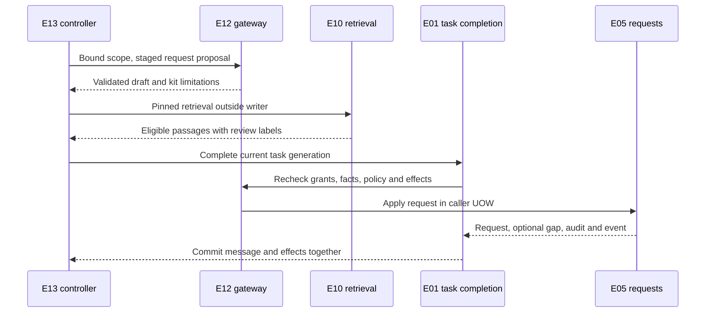

# E12: Retrieval and typed tool gateway

Technical design for E12. Binding inputs: `AGENTS.md`, `docs/SYSTEM.md`, `docs/DEPLOYMENT.md`,
`docs/requests/COORDINATOR-DECISIONS.md` Part A and `docs/BUILD-CHARTER.md`. S means SYSTEM.md;
C means `docs/product/CONTRACTS.md`. Other product references below are relative to `docs/product/`.
Tests are planned evidence, not executed results. Requests live in `docs/requests/E12.md`.

## 1. Scope

| Work package | Delivery |
|---|---|
| E12-01 | Stage-scoped typed gateway, argument validation, denial audit and output-policy checks |
| E12-02 | Fusion, optional reranking, applicability filtering and bounded citation expansion over E10 primitives |
| E12-03 | Deterministic authorized context, support classification and allowlisted calculations |

E12 owns CONTRACTS sections 6, 9 and 17 for tool/context enforcement; E13 owns the controller, public
operations and insight lifecycle. Delivers R16, R17, R21; contributes R20, R23, R28, R45 and R56. Integration scope:
V10, V22, V23, V24, V25, V26, V27, V28, V30, V33, V34, V63, V65, V78, V84; D06, D10, D11, D25, D30.
Use cases: UC08, UC10, UC11, UC16, UC20 and UC22. Sections 12 and 12.1 retain acceptance blocked by unresolved seams.

E10 owns corpus, indexes, releases and search primitives; E17 owns model artifacts, prompts and tuning; E13 owns
turns, verification and persistence; E05 owns requests and gaps; E27 owns guidance eligibility; E28 owns plan
semantics; E24 owns warnings; E26 owns fixed help; E30 owns guided checks; E31 owns readiness and roles.
E12 neither acquires nor accepts a measurement, changes safety state, approves sharing, nor computes a medicine dose.

### 1.1 Rule trace

Rows identify individual normative sentences in the owned sections and relevant shared rules. Q1/Q7/Q18 and D12
apply through the effective contract, not a local waiver. Q23 applies to all epics; Part A names no other Q decision
specifically for E12. Provider decisions Q2, Q4, Q8, Q11/Q14/Q16 and Q26 are preserved at their boundaries.

| Source sentence | Implementation section | Test |
|---|---|---|
| PRD.md:492 R16 | 3, 4.2: typed support and pinned citations | T-E12-020, T-E12-030 |
| PRD.md:493 R17 | 4.1: deny unknown, unauthorized and unsupported calls | T-E12-001, T-E12-003 |
| PRD.md:496 R20 | 3, 10: no journal or private-report read path | T-E12-040 |
| PRD.md:497 R21 | 4.2: purpose-specific immutable history | T-E12-035 |
| PRD.md:499 R23 | 4.2, 10: dev manifest isolated from holdout | T-E12-042 |
| PRD.md:504 R28 | 4.3: proposals require controller and human boundaries | T-E12-013 |
| PRD.md:521 R45 | 4.3: unavailable request plus gap, never a task | T-E12-011 |
| PRD.md:532 R56 | 4.4: pinned authored steps; no model doses | T-E12-050, T-E12-060 |
| CONTRACTS.md:265 one structured action per turn | 4.1, 6: six generated ModelAction alternatives | T-E12-002 |
| CONTRACTS.md:265 independent reads, sequential acquisition/answers | 4.1, 4.3: bounded reads, proposals only | T-E12-013 |
| CONTRACTS.md:265 proposal reason and decision affected | 4.3: validate complete request before apply | T-E12-011 |
| CONTRACTS.md:265 onboard review never waits for ground | 4.3, 9 | T-E12-070 |
| CONTRACTS.md:267 injected subject and episode | 3, 4.1 | T-E12-001 |
| CONTRACTS.md:267 capability/source/quality/access/body-region checks | 3, 4.1, 4.4 | T-E12-002, T-E12-020, T-E12-030 |
| CONTRACTS.md:267 no urgency, diagnosis, extraction acceptance or handoff approval | 4.3, 10 | T-E12-006, T-E12-013 |
| CONTRACTS.md:269 pin state revision and mark material changes stale | 4.3 | T-E12-014 |
| CONTRACTS.md:269 never apply to unseen evidence | 4.3 | T-E12-014 |
| CONTRACTS.md:414 SIM cannot enter LIVE | 3, 10 | T-E12-021 |
| CONTRACTS.md:415 unavailable/declined/failed/stale are not normal | 3 | T-E12-020 |
| CONTRACTS.md:416 journal excluded from every inference/evaluation exit | 10 | T-E12-040 |
| CONTRACTS.md:417 forecast/camera cannot replace required instrument | 3, 4.3 | T-E12-020, T-E12-011 |
| CONTRACTS.md:418 warning review is not resolution | 4.4, 8.1 | T-E12-051 |
| CONTRACTS.md:419 urgent response never waits | 9 | T-E12-070 |
| CONTRACTS.md:420 no onboard ground dependency | 9 | T-E12-070 |
| CONTRACTS.md:420 messages/handoffs are logs sent when possible | 4.3 | T-E12-006 |
| CONTRACTS.md:421 historical cabin data not personal exposure | 3, 4.4 | T-E12-021 |
| CONTRACTS.md:422 corrections preserve lineage | 3, 4.2 | T-E12-035 |
| CONTRACTS.md:423 benchmark answers/rubrics inaccessible | 10 | T-E12-042 |
| CONTRACTS.md:424 no probability from similarity/confidence | 4.2 | T-E12-032 |
| CONTRACTS.md:425 no participation effects from values/outcomes | 10 | T-E12-006 |
| CONTRACTS.md:426 private participation remains private | 10 | T-E12-040 |
| CONTRACTS.md:427 fixed regions; symptom not measurement | 4.4 | T-E12-002 |
| CONTRACTS.md:950 local pinned model identity | 8, 9: consume E17 pins | T-E12-065 |
| CONTRACTS.md:950 status and optional model | 6, 9: E13 status, independent safety | T-E12-070 |
| CONTRACTS.md:950 stopping model stops nothing else | 9 | T-E12-070 |
| CONTRACTS.md:954 conversation model/config pins | 8.1 | T-E12-065 |
| CONTRACTS.md:954 immediate acceptance and streaming | 4.3, 6: E13 with S5.10.1 | T-E12-013 |
| CONTRACTS.md:954 one turn per conversation | 4.3: E13 state and task generation | T-E12-014 |
| CONTRACTS.md:954 cancel running turn | 4.3 | T-E12-013 |
| CONTRACTS.md:956 own records, no journal/participation/other person | 3, 10 | T-E12-003, T-E12-040 |
| CONTRACTS.md:956 one section 6 action | 4.1 | T-E12-002 |
| CONTRACTS.md:958 schema and at most one repair | 4.1, 6 | T-E12-002 |
| CONTRACTS.md:959 capability/source/region/question/step validation | 4.1, 4.4 | T-E12-015, T-E12-050 |
| CONTRACTS.md:960 unavailable kit persists request and gap, no task | 4.3 | T-E12-011 |
| CONTRACTS.md:961 all forbidden-output rules before display | 4.4, 8 | T-E12-060, T-E12-063 |
| CONTRACTS.md:961 reject with notice | 4.4, 6 | T-E12-060 |
| CONTRACTS.md:962 iteration/time bounds | 11 | T-E12-005 |
| CONTRACTS.md:962 model unavailable notice | 6, 9 | T-E12-070 |
| CONTRACTS.md:966 own-record insight topic | 3, 10 | T-E12-021 |
| CONTRACTS.md:966 only info/watch and existing routine item | 4.4: E13/E24 own effects | T-E12-051 |
| CONTRACTS.md:966 nothing else from insight | 4.4 | T-E12-006 |
| CONTRACTS.md:968 invalid insight stores nothing | 4.3, 4.4 | T-E12-051 |
| CONTRACTS.md:970 own observation/answer/check/routine evidence | 3 | T-E12-021 |
| CONTRACTS.md:971 no habitat, REPLAY or other-person evidence | 3, 4.4 | T-E12-021 |
| CONTRACTS.md:971 habitat never personal evidence | 3 | T-E12-021 |
| CONTRACTS.md:972 habitat facts separate | 3, 4.4 | T-E12-021 |
| CONTRACTS.md:972 model supplies reading ID; hub renders text | 4.4 | T-E12-021 |
| CONTRACTS.md:972 no exposure claim in title/text/why | 4.4 | T-E12-062 |
| CONTRACTS.md:973 info/watch bound | 4.4 | T-E12-051 |
| CONTRACTS.md:975 person dismisses own insight warning only | 4.4: no gateway warning mutation | T-E12-051 |
| CONTRACTS.md:975 insight event to person only | 4.3, 10: E13 audience | T-E12-040 |
| CONTRACTS.md:7, 9, 11, 13 identities, time, origin, missingness | 3, 3.1 | T-E12-020, T-E12-021 |
| CONTRACTS.md:109, 111 failed/cancelled acquisition | 3: metadata without failed value | T-E12-020 |
| CONTRACTS.md:129 release/version/purpose, Q1/Q18 | 4.2, 8.1 | T-E12-030, T-E12-065 |
| CONTRACTS.md:203, 210 command identity, D6 | 4.3: S5.8 | T-E12-014 |
| CONTRACTS.md:220 error envelope, D5 | 6: S5.5 | T-E12-004 |
| CONTRACTS.md:410 participation excluded from model | 10 | T-E12-040 |
| CONTRACTS.md:439, 527 content and rejecting validation | 8 | T-E12-063, T-E12-064 |
| CONTRACTS.md:521 activation, D1 | 8.1 | T-E12-065 |
| CONTRACTS.md:786 warning authority | 4.4 | T-E12-051 |
| CONTRACTS.md:1108 to 1114 shared implementation rules, D4/D7/D13 | 3.1, 4.3, 5, 8, 11 | T-E12-014, T-E12-067 |
| CONTRACTS.md:1134, 1462 substitute check, Q8 | 3: preserve both sources, no diagnostic support or gap closure | T-E12-022 |
| CONTRACTS.md:1460 medicine/step restriction, Q11/Q14 | 4.4: no assistant dose, E32 independent | T-E12-060 |

## 2. Seams

Hard dependencies are S9's E01, E02, E10 and E27-guidance. Optional providers add tools; missing facts return typed
unavailable, never optimistic defaults. Current designs checked: E01, E02, E03, E04, E10, E11, E13, E15, E17,
E23, E24, E26, E27, E28, E30 and E31. E05, E09, E14 and E16 have no design file. Their brief is not an agreed port.
S4.2/4.4/8.1/8.2 override legacy names and rules in those designs. Cross-module imports use application ports only.

| Seam | Owner | Consumer | Signature or payload with types | Authority/status |
|---|---|---|---|---|
| Shared IDs | E01 | E12 | IdFactory.new and derived, require_id, exact declarations | S5.1; no local ID algorithm |
| Shared time | E01 | E12 | Clock, ClockCorrections, TimeInput, MissionClock, exact declarations | S5.2, 5.3 |
| Shared quantities/errors | E01 | E12 | Quantity, UnitRegistry, WireUnitConverter, ProblemError, StorageUnavailable | S5.4, 5.5; D5/D12 |
| Shared configuration | E01 | E12 | ConfigReleaseReader, ConfigReader, ReleaseHandle, ReleaseCheck, TemplateRenderer | S5.6 |
| Shared transaction/audit | E01 | E12 | UnitOfWork, ReadSnapshot, factories, AuditEntry | S5.7, 5.9 |
| Shared command/result | E01 | E12 | CommandIdentity, IdempotencyStore, ResultVisibility | S5.8; E13 owns turn identity |
| Shared tasks/settings/assembly | E01 | E12 | TaskLease/TaskResult via E13; HubSettings, SettingSpec, ModuleRegistry | S5.10.1, 5.11, 5.12 |
| Session, roster, grants | E02 | E12 | SessionContext; RosterPort.members() -> Sequence[RosterMember]; ConsentQueries.allows(view, *, subject_person_id: str, recipient: str, scope: tuple[str, str]) -> bool | S4.4, 8.3; E02 2/3.3; field binding pending R-E12-7 |
| Tool execution | E12 | E13 | ToolGateway.execute(uow: UnitOfWork, scope: ToolScope, call: ToolCall) -> ToolResult | S4.3; E13 2/4; short local stage only, R-E12-12 |
| Context | E12 | E13, E17 | ContextBuilderPort.build(uow: UnitOfWork, scope: ToolScope, phase: Phase, budget: ContextBudget) -> ContextSnapshot | S4.3; E13 2/4, E17 2 |
| Output policy | E12 | E13 | OutputPolicyPort.check(fields: Sequence[TextField], scope: ToolScope, turn: TurnData) -> PolicyVerdict | E13 2/4; no write |
| Effects | E12 | E13 | EffectApplier.apply(uow: UnitOfWork, scope: ToolScope, effects: Sequence[PendingEffect], idempotency_prefix: str) -> AppliedEffects | E13 2/4; caller transaction, R-E12-11 |
| Handler registration | E12 | E28 | ToolRegistry.register(name: str, handler: ToolHandler) -> None; handler(name: str) -> ToolHandler or None; ToolHandler.handle(uow: UnitOfWork, scope: ToolScope, arguments: Mapping[str, JsonValue], deadline: Deadline) -> HandlerOutcome | E28 2/4.4; no safety module imports tools, binding R-E12-12 |
| Evidence reads | E10 | E12 | EvidenceQueryPort explicit release/use signatures in E10 4.1, used in 4.2 below | S8.1/S11; no get_passage alias |
| Condition aliases/status | E10 | E12 | ConditionRegistryPort.condition_status(condition_id: str) -> Active or RemovedOrSplit or UnknownCondition or RegistryUnavailable; aliases(condition_id: str) returns E10 3.2/4.1 types | S4.3, 8.1; E10 2/4.1, source version retained |
| Guidance decision | E27 | E12 | GuidanceEligibility.evaluate(snapshot: ReadSnapshot, request: GuidanceRequest) -> GuidanceDecision | Exact S8.2; missing provider facts are Unknown |
| Model release data | E17 | E12 | ModelReleaseReader.tool_catalog(model_release_id: str) -> ToolCatalog; retrieval_settings(model_release_id: str) -> RetrievalSettings; context_settings(model_release_id: str) -> ContextSettings | E17 4.2; S4.3 |
| Episode identity/revision | E15 | E12 | EpisodeFacts.get(uow: UnitOfWork, episode_id: str) -> EpisodeFact or None; visible_to(uow: UnitOfWork, episode_id: str, actor: Actor) -> bool | S4.2/S11, E15 4.2; extended context pending R-E12-7 |
| Profile facts | E03 | E12 | ProfileFactsPort.allergies_and_medicines(person_id: str) -> ProfileFacts | S4.4, E03 4.4; snapshot/grant binding R-E12-7 |
| Allowed questions | E04 | E12 | IntakeQueries.allowed_question_ids(uow: UnitOfWork, episode_id: str) -> frozenset[str] | S4.2; E04 4.2 |
| Request feasibility | E11 | E12 | RequestGatePort.check(uow: UnitOfWork, capability_code: str, subject_id: str, operator_id: str or None) -> GateResult | S4.2; E11 4.3 |
| Pathway evaluation | E11 | E12 | PathwayQueries.get_pathway(uow: UnitOfWork, condition_id: str, ctx: PathwayContext) -> PathwayEvaluation | S8.1; E11 4.3, subject/source/eligibility rechecks |
| Review proposal | E11 | E12 | UrgencyCommands.request_review_from_model(uow: UnitOfWork, ctx: AssistantContext) -> UrgencyState | E11 4.3; caller commit, R-E12-11 |
| Place facts | E23 | E12 | EnvironmentFacts.place_facts(uow: Snap, start: datetime, end: datetime) -> Sequence[PlaceFact]; Snap is UnitOfWork or ReadSnapshot | S8.2; E23 4.2; never personal evidence |
| Warning proposal guard | E24 | E12 | AssistantWarningGuard.propose_level(uow: UnitOfWork, ctx: AssistantContext, level: Level, topic_id: str or None) -> Rejected or Allowed; propose_action(uow: UnitOfWork, ctx: AssistantContext, warning_id: str, action: str) -> Rejected | S4.2; E24 4.2; E13 owns insight writes |
| Help-turn guard | E26 | E13 | HelpTurnGuardPort.check(help_session_id: str, candidate: AssistantCandidate) -> GuardResult | E26 4.2; E12 result cannot bypass E13 guard |
| Plan tools | E28 | E12 | get_plan, choose_plan_step, explain_step through the E12 handler contract; rejection reasons E28 4.4 | S8.2; no plan action or stock write |
| Clinical reads/proposals not yet bound | E01, E05, E09, E14, E16, E30, E31 | E12 | No invented signature; required projections and transactions in R-E12-7/R-E12-11 | S4.2/4.4; E05 owns GapProposalPort, E30 guided checks |

E12 publishes and consumes no C18 event. E13 and each effect owner emit their contracted events with S5.7 audiences.
No observation, tool-denial or evidence-update wire event is invented. Audit records use S5.9, not an AuditPort clone.
Pending seams are not compatible just because a fake implements them; real integration remains an acceptance gate.
ToolHandler retains its static name and read/compute/proposal effect classification. Deadline is a compatibility
alias for S5.10 ElapsedDeadline, not a local clock or timeout mechanism. HandlerOutcome retains the existing
HandlerOk, HandlerNoResult, HandlerUnavailable and HandlerRejected variants; R-E12-2/12 settles the controller
result/effect binding before enabling proposals or external handlers.

## 3. Domain model

Pure frozen values use S5.1 IDs, S5.4 Quantity and generated enums, including every LIVE/REPLAY/SIM and quality value.
Boundary codecs use S6.5 base/effective schemas. Preserve every nullable field, including episode, operator, consent,
body region, source observation time and optional model identity. Never fill null with a sentinel or invented ID.

| Internal value | Decision and invariant |
|---|---|
| ToolScope | Controller-built SessionContext, subject, mission/origin, optional episode/help/plan reference, turn/conversation, config/evidence/model pins, phase and source revision. Model arguments cannot set any of these. Current grants are rechecked, not cached as a frozenset of purposes (I1) |
| ToolCall | Bounded parsed name, call ID and closed arguments; runtime types/schema supplied by pinned E17 catalog. Name is data matched to a static handler registry, never an import or executable (I2) |
| ToolResult | LLM-ARCHITECTURE 4 fields: tool_call_id, status, data, provenance_ids, observed_at, generated_at, limitations, error_code. Internal statuses remain ok, no_result, unavailable, declined, stale, conflicting, not_aboard, denied, error. Status is not diagnostic certainty (I3) |
| SupportItem | Typed reference, exact release/content hash when applicable, permitted uses, quality, origin, original/corrected observation time, and exclusion reason. Separate finding, hypothesis and gap-closure eligibility; a boolean alone cannot grant all three (I3) |
| ContextSnapshot | Ordered bounded sections, typed support references, source revisions/pins and omitted-section metadata. Private fingerprint uses S5.8 keyed identity; never a plaintext clinical hash in logs. No independent snapshot-version counter (I4) |
| PendingEffect | Controller-held proposal associated with original turn/call identity; typed arguments, references and preflight facts. It is not an accepted record. Read/compute handlers cannot return effects (I5) |

Failed, rejected, uncertain, not_assessed, cancelled or declined acquisitions contribute attempt/status/reason metadata
only, with no failed numerical value in any context or tool result. Completed requests still need accepted,
authorized observations. Unknown freshness never means current. Conflicting accepted readings retain both sources
and their units/times; do not average, select silently, interpolate gaps or hide contradictions to fit a budget.
Missing inputs remain missing; accepted zero is a real value. Report source text and extraction drafts are excluded;
only explicitly confirmed, authorized clinical findings can enter through their record owner (S5.8.1).

Habitat facts stay in a separate place-facts section and never support a personal conclusion, even in LIVE. REPLAY
retains its original date; origin partitions never mix. A crewmate_palpation observation can be described as an
attributed finding but never hypothesis support, confirmation/exclusion or gap closure; unchecked results cannot
be cited as support. Q8 retains valid manual and available camera observations plus disagreement and retry status.
E12 excludes unusable values from inference without deleting any source record (I3).

Context includes relevant authorized answers with all presence states, explicit negatives, unknowns, red flags,
accepted observations, attempt metadata, capabilities and unresolved gaps. No journal, participation, private reports,
other person's records or evaluation targets. Configured required sections, red flags, explicit negatives and material
contradictions cannot be dropped. If they alone exceed the bound, stop incomplete before inference; never truncate
them or exceed the budget. No model summarization of authoritative facts (I4).

### 3.1 Time

Use S5.2 Clock, TimeInput and ClockCorrections; generated_at is the captured snapshot/UOW time, not observed_at.
Freshness uses corrected observation time and uncertainty, never arrival. Retain entered/received times as provenance.
Personal freshness policy is not present in the current indicator catalog; R-E12-7 joins the existing provider gap.
Until a trusted freshness result exists, mark it unknown and prohibit use as current support. Do not invent windows.
D14 changes only E23's REPLAY channel liveness; it never makes a historical reading personal exposure.

Tool deadlines, task leases and retries are elapsed durations under S5.2/5.10; use monotonic time only within the
same process epoch. Corrections recompute durable elapsed anchors. Consent expiry and any provider appointment/expiry
instant are absolute and do not move. E12 creates no clinical deadlines. Mission labels use S5.3 and retained opaque
clock versions; mission-day changes do not repartition an observation by arrival time. Forward/backward jumps,
unknown segments and correction revisions invalidate affected staged context until rebuilt. Older or duplicate
results cannot replace newer source revisions or clear safety state (I6).

## 4. Application layer

### 4.1 Gateway and context

The public protocol names and signatures are in section 2. E12 adds no shared kernel protocol. UOW-only provider
reads execute as bounded local preflight, without external calls. S5.10.1 execute handles external work outside writes;
the snapshot-bound retrieval/handler binding is pending R-E12-12. Never hold SQLite's writer across embedding or
model inference. E13 owns one active task generation and turn budget; E12 verifies the supplied generation/context.

Order: authenticate current session; check phase exposure and static handler allowlist; enforce call/byte/depth budgets;
parse closed arguments; authorize every referenced object and selected field; validate origin/pins; run domain/output
checks; invoke the bounded handler; classify support and validate its result; commit the safe audit before releasing it.
Tool-call IDs are not authority or command keys. Repeated read calls consume budget and can be denied without a
response cache. No private cross-turn cache. Invalid calls consume budget too; E13 applies at most one schema repair.

Unknown tool, out-of-stage, malformed schema, arbitrary SQL/code/HTTP/path request and unbound handler have distinct
safe reasons. Cross-subject scope, policy or handler rejection ends the turn with MODEL_OUTPUT_REJECTED. Ordinary
unavailability is explicit. Storage/I/O/integrity/auth/config/input-validation errors propagate through S5.5; a broad
fallback wrapper cannot turn them into no_result or accepted work. All denials and executions audit allowlisted
tool name, call/turn references, status and reason only; raw arguments, text and guessable hashes are excluded (I2).

Search accepts bounded literal natural-language questions, not SQL, paths, URLs, shell or provider query syntax.
Parameterize FTS and escape it as literal terms. Check normalized roster names and actual known record IDs, not the
generic opaque-ID regex, which would reject ordinary words. The model cannot widen environment/purpose filters.
Generalization must remove private details before retrieval; a query containing record text/identifiers or whose
public scope cannot be established is denied, never sent to a worker. The exact bounded query boundary is R-E12-2;
it stays off without validation, not replaced with a regex claim of complete de-identification.

### 4.2 Retrieval and calculations

Select hybrid reciprocal-rank fusion over E10's exact and stemmed lexical lists and optional dense list. Lexical-only
is the dissimilar fallback; dense-only loses exact names and IDs. Benchmark lexical, dense, hybrid and optional
reranking on the same permitted dev set before choosing settings. E17 pins k_rrf and ranking parameters; operational
ceilings are section 11. Score is the sum of reciprocal (k_rrf + rank), with passage-ID tie break. It never becomes
clinical confidence. No fabricated minimum result count.

1. Bind E10 to the same snapshot and explicit evidence pin; resolve condition status/aliases without changing IDs.
2. Call lexical_search(release_id, query, use, filters, mode, k) for exact and stemmed; optional dense_search with
   the same pin/use/filters. E10's typed IndexUnavailable(dense) permits lexical fallback with a configured notice.
   Storage/integrity errors fail loudly. NoMatch differs from NoActiveRelease, ReleaseUnavailable and IndexUnavailable.
3. Deduplicate by passage ID, fuse ranks, preserve contradictory versions and discrepancy references. Apply S8.2
   GuidanceEligibility to exact hashes, purpose, origin, environment and requirements; unknown facts prohibit guidance.
   Q1/Q18 permit eligible not_clinically_reviewed content with its visible label. Source/purpose approval, rights,
   pin and withdrawal checks remain mandatory. Q2 metadata-only material supplies no text or vectors.
4. Optional reranking changes order only within eligible candidates and cannot restore rejected content. An absent
   pinned reranker is reported; no unpinned replacement. E17's artifact/adapter agreement is part of R-E12-12.
5. Select intact passages within token, byte and final-count bounds. Expand citations only through E10
   expand_context(release_id, passage_id, use, filters, neighbors); recheck each neighbor and the final budget.
   Never copy a whole parent containing unapproved gaps. Keep table headers/rows together or omit with a reason.
6. Read citations through read_approved(release_id, passage_id, use). InReleaseHistory is non-supporting history;
   NotApprovedForUse, NotInRelease and ReleaseUnavailable cannot authorize a claim. Historical inspection uses
   inspect_history with cursor/limit; discrepancies remain visible for review, never blended into current guidance.

No supported selection after a successful search returns no_result with a configured no-supported-passage limitation.
Failure to run a valid search returns unavailable/error, never an empty success. Text remains untrusted data, not
instructions; injection tests exercise attempted actions, not just a wrapper flag. A citation proves identity, not
semantic entailment: E13's claim-support verifier must check support and contradictions before publication (I7).

Token counting uses the exact pinned tokenizer and complete serialization including wrappers and special tokens.
The old UTF-8-byte fallback is removed: it does not prove a bound for every template/tokenizer. Missing tokenizer
disables model-context construction; fixed/manual flows still work. No clinical truncation to satisfy allocation.

compare_observations delegates to E14's validated method/version with Quantity inputs; no E14 design is present,
so it remains unavailable pending R-E12-7. calculate_validated_metric remains unavailable pending R-E12-9, not an
arbitrary calculator. After agreement it rejects missing inputs, incompatible units, out-of-domain values and partial
scores; input/lot/unit changes require recomputation. E12-03 calculation acceptance remains open.

The benchmark CLI consumes a manifest-allowlisted E18 dev partition only, including resolved real paths, file hashes
and split identity; symlinks and adjacent holdout files cannot widen it. No clinical composition has a vault/file port.
Report recall@k, ndcg@k, support precision, no-answer accuracy, applicability failures and latency for each method;
failures stay in denominators. E17 owns tuning; no weight training or clinical-validity claim.

### 4.3 Commands, proposals and units of work

S5.7/5.8/5.9/5.10.1 own transactions, durable identity, audits, tasks and recovery. E12 owns no replacement ledger,
queue or commit. Effect providers join E13's apply transaction; autonomous provider commits are incompatible and
remain unavailable under R-E12-11. Model calls produce drafts only. Human acceptance starts acquisition separately.

| Command/stage | Transaction owner and atomic boundary | Crash, retry and concurrency |
|---|---|---|
| Turn admission/context preflight | E13: source references, pins, task input, command identity, audit; E12 contributes bounded validated context | Before commit no accepted task. After commit S5.10.1 recovers the same task/generation; no local replay of model text |
| Tool read/proposal preflight | Short local read and safe audit stage; no clinical effect. External retrieval executes outside writer | Crash leaves no request/gap/review. Audit-storage failure fails the call; E13 discards uncommitted output |
| Accept request_measurement | E13 task completion UOW; E05 validates capability, subject/consent, origin, E11 request gate, E27 KitGate, reason and decision_affected; creates request and any gap with audit, command identity, replication and measurement_request.changed | All or nothing; kit cannot means committed unavailable request plus gap and kit text, never a task. Missing decision_affected cannot be filled from reason. D06/D30/V78 stay blocked until E05 binding |
| Accept gap/review/handoff/guided-check proposal | Same E13 UOW, through owner port: E05 GapProposalPort; E11 UrgencyCommands; E16 draft; E30 guided-check proposal with E31 role facts | No approval, send, dose, assignment, acquisition or accepted reading. If the owner cannot join the UOW, that proposal is off. Review requests cannot disposition urgency |
| Publish accepted assistant result | E13 rechecks live session, object/field grants, source revisions, urgency token, task generation, all pins, policy and S8.2; applies effects, result, audit/outbox/replication atomically | Changed material facts produce stale/rejected result, no effects. A changed kit result is used only if E05's unavailable request/gap and final limitations validate together; otherwise abort and rebuild |
| Cancel, timeout or late completion | E13 delegates generation fencing to S5.10.1 | No effect from rejected/stale/cancelled/expired generation. Crash before commit rolls everything back; after commit lost reply reuses S5.8 receipt without repeating effects |

Command identity includes actor, operation, target, parameters/pins and keyed private-body fingerprint. E13's
idempotency_prefix argument identifies the originating turn intent; it does not authorize a new effect ledger or
concatenated-key algorithm. R-E12-11 resolves internal command classification with E01. Replays after 24 hours use
the mission-life receipt and current ResultVisibility. Same key on another target conflicts; revoked access reveals
neither stored body nor result reference. D13 is no excuse to accept invalid output: only producer evaluation uses
S5.10.2's typed computation isolation. Storage, I/O, integrity or validation failure aborts the whole command (I5).



```mermaid
sequenceDiagram
    participant C as E13 controller
    participant G as E12 gateway
    participant O as Record owner
    C->>G: Observation reference outside authorized subject
    G->>O: Check object and field grant
    O-->>G: Denied without private fields
    G-->>C: Denial and reference-only audit for caller commit
    G-->>C: MODEL_OUTPUT_REJECTED
    Note over C,G: No handler execution or clinical effects; show configured notice
```

### 4.4 Output policy and tool families

Every string field, including nested proposal arguments and final prose, passes the policy before storage/display.
E13 must buffer unsafe token text; a stream is not an exemption. Amount detection uses the E01 application-port
contract requested in R-E12-4, never an import of config.domain. No local medicine dictionary.

| Rule/tool family | Enforcement |
|---|---|
| dose | Reject model-authored dose amounts and medicine wording outside pinned allowed procedure content. Help uses E26's stricter guard. Q11/Q14 permit E32's independent deterministic dose proposals, never an assistant calculator or confirmation |
| level_above_watch | Hard domain prohibition on act/emergency and every action on rule/sensor warnings; E24 AssistantWarningGuard validates. Allowed policy levels can narrow authority, never expand it. E13 alone routes eligible insights to E24 |
| replay_as_exposure | Typed claim support excludes all habitat references and REPLAY patient support. Separate habitat text is rendered by the hub. Unstructured prose that cannot be validated against those restrictions is rejected, including a claim without an explicit reading ID |
| invented_threshold | A measured number in turn data is not permission to invent a threshold. Require exact sourced configured rule/step text and typed Quantity provenance for threshold claims; observation descriptions use their own units/times. Unsupported or unclassifiable numerical claims reject |
| help_flow | E13 requires E26 HelpTurnGuardPort before publication; fixed steps retain order, text and immediate availability. Guard absent means optional help assistant off |
| propose_question | E04 allowed_question_ids and pinned questionnaire choices; configured question text only, no restricted-module question or model-written replacement |
| get_pathway, plan tools | E11 evaluates E10 pathway_card; E28 validates active-plan membership, because-answer scope, runnable step and authored text. S8.2 adds source/purpose/origin/environment/operator checks. No step_done or supply-use call |
| report/profile/environment/readiness | Current owner projection only; confirmed clinical findings, names-only medicines/allergies, separate place facts, skills/reasons without health data. No private report text or another person's chart |

Unknown policy IDs reject configuration. Required safety rules cannot be removed through a configuration edit.
A pattern check alone does not establish semantic safety; ambiguous output fails closed. Request R-E12-4 covers
shared text-policy binding; R-E12-5 covers required configured notices. Neither is permission to skip a validator.

## 5. Adapters

E12 owns no database table, migration, independent audit chain or persistent result cache. E13 stores its authorized
turn records; record owners retain clinical lineage under S7.1/7.2. Raw private arguments/prompts/results stay out of
generic caches, task payloads, logs and replication. Missing E13 storage binding is R-E12-12, not an E12 table.

Static handler registration, compiled closed JSON Schema validators and verified tokenizer load through S5.12 before
serving. E10 owns FTS5/sqlite-vec and embedding transport; E12 never opens their files or starts a model process.
Provider codecs validate results including finite quantities, all enums, nullability and bounded arrays. Use application
port adapters for all providers; no raw SQL across modules. Software/schema rollback follows S6.5 and DEPLOYMENT 7.4,
with additive migrations by the owner and retained pins, never removal of accepted records.

## 6. API

None owned by E12. E13 owns openConversation, sendMessage, streamConversation, cancelTurn, startAssessment and
getAssessment; E10 owns getEvidencePassage. Generated ModelAction, AssistantMessage, Assessment and ErrorEnvelope
are the wire boundary. No ToolResult or internal support-use field is added to closed JSON. The six ModelAction
alternatives remain unchanged; stop_incomplete is already one, not a new endpoint. E01 owns public Jobs; conversation
turns are internal tasks under S5.10.1 and retain turn_id/streamConversation/cancelTurn.

S5.5 maps typed errors to the closed ErrorEnvelope; RFC 9457 is the sanitized log view. E13 preserves authentication
and consent errors from the user's operation; a model's forbidden reference becomes MODEL_OUTPUT_REJECTED with a
safe notice, never another person's identity or data in current_state. Infrastructure faults remain INTERNAL_ERROR,
not MODEL_TIMEOUT or no_result. MODEL_TIMEOUT describes actual turn timeout; MODEL_UNAVAILABLE describes the model.

The base evidence_ref enum lacks passage; R-E12-1 joins E10's explicit-pin/purpose citation representation request.
Do not hide citations in an internal table and claim D10. Passage-dependent clinical publication remains off until
the accepted schema and E10 reader can expose exact pin, purpose and review label. Other safe typed operations remain.

## 7. User interface

None. E13 renders configured loading, empty/no-result, rejected, unavailable, stale, offline and origin states with
words, not color alone. Source age, conflict and clinical-review label travel to that renderer. Limits/reasons come
from pinned ui-copy or owner-generated kit text. Missing required words block the affected display (R-E12-5).

## 8. Configuration

S5.6/S6.5 own atomic validation, provenance and effective-contract overlays. No pending request enters D12's overlay.

| Input | Reads and validation |
|---|---|
| assistant-policy.json | Generated schema; allowed levels, forbidden-output IDs and declared loop/time policy. Required safety rules enforced in code; unknown/missing mechanisms reject. Operational caps come from HubSettings under D7, conservatively intersected with existing stricter policy fields |
| ui-copy.json | Required limitation/error/review/origin words and templates; C11 check 13. Missing required keys reject the candidate; no skipped check |
| indicator-catalog.json | Labels, displayed units, baseline methods and provenance. It has no freshness field or metric registry; do not pretend otherwise |
| questionnaires.json | Pinned question text/choices through E04 and S5.6; C11 checks 8/13 |
| E17 model release | Hash-pinned catalog, descriptions, exposure sets, context order/token budgets, tokenizer and retrieval parameters; closed schemas compile at startup, scope fields forbidden, bounds cross-checked with section 11 |
| E10 evidence release; provider guidance content | Exact source/hash/purpose/pins; S8.2 eligibility and Q1/Q18 review label. No E12 copy of kit/plan/skill/stock engines |

Each input retains source IDs, basis, responsible author and exact version as its schema requires. Unknown provenance
rejects, never becomes a team default in code. T-E12-064 edits a sourced display label in a scratch release and proves
output changes without a code or safety-mapping edit. Hub-bound tests change operational settings separately.

### 8.1 Activation effects

| Activated/removed input | Effect on existing work |
|---|---|
| assistant-policy, ui-copy, indicator-catalog, questionnaires | Conversations/open work keep their S5.6 pins. New work uses the validated release; missing pinned bytes fail visibly. No reinterpretation of stored answers or currentness from new arrival time |
| Model catalog/context/retrieval/tokenizer | Existing conversation retains exact model artifacts; missing artifact is unavailable. No substitute model, tokenizer or exposure set mid-turn |
| Evidence release | Explicit old pin remains immutable, new search uses new pin. E10 distinguishes eligible membership, history and withdrawal; no active-pointer fallback. Revalidate guidance before publication |
| Kit/plan/skills/roles/stock through providers | Open plan/session content remains pinned; current location, resources, grants and operator eligibility are rechecked under S8.2 before an action proposal. Stock never changes from retrieval |

Any validation failure rejects the candidate and keeps the last good release. D8 activation belongs to editor/operator,
not an assistant. D1 retains active warning definitions even if withdrawn; E12 never clears/lowers one. No scheduled
work is created by E12; E13's task pins persist under S5.10.1. Delayed activation events cannot reset turn or provider
state. Q1/Q7/Q18 remove clinical sign-off as a runtime gate while preserving authored/source/purpose checks (I8).

## 9. Deployment and fallbacks

E12 is a hub module under S3/4.3. T0 uses the laptop alone; model off means no gateway calls and all safety/manual
flows remain. T1 station/laptop browsers and T2 tablets are clients only. T3 devices add inputs through owners; T4
habitat feeds and T5 integration nodes add labeled place facts. T6 runs a gateway per local hub with installed model;
no remote-record query or automatic clinical merge. T7 adds approved transport, never a gateway/ground-link reader.
Native/container worker authentication and resource admission follow DEPLOYMENT 7.3, not E12 launch logic.

| Critical path | Primary | Independent backup and fail-safe state | Test |
|---|---|---|---|
| Unauthorized action/data | Gateway scope and field validation | Owner domain authorization, even with gateway check removed; reject without effects or leaked fields | T-E12-008 |
| Grounded support | Typed references and eligibility | E13 verifier and owner revalidation; reject/stop incomplete on absent support | T-E12-020, T-E12-030 |
| Useful retrieval | Hybrid | Lexical when dense unavailable, with label; no valid index means unavailable and configured human path | T-E12-033, T-E12-034 |
| Durable proposal effect | E13 atomic task apply | S5.8 receipt and S7.2 restore/reconciliation; no accepted claim while storage fails | T-E12-014 |
| Safety while assistant fails | Deterministic help/rules/capture | Signed cached steps and printed cards owned by E26/E20; fixed help does not wait for auth, saving, devices, model or ground | T-E12-070 |

Missing optional provider gives unavailable for its tool. Missing model/tokenizer/eligibility never triggers sample
data. Missing dense permits lexical only; missing source/mandatory validation does not permit unsafe guidance.

## 10. Safety, security and privacy

S8.3 authorization is per object, field and purpose at read, worker handoff and publication. C17 restricts model
context to the session person's own records; a medical-officer role, helper assignment or SubjectSummary access
does not grant inference on another crew member. A help assistant may explain validated public steps without that
person's chart. Incapacity never blocks fixed help or independently authorized manual capture. Q4/Q16 action authority
and Q11/Q14 medicine authority do not widen E12 record access.

No journal/private-report/participation/ground-link/evaluation-vault port exists in the clinical gateway. P2 data is
owner-session memory or its owning authorized store, never a generic cache; sign-out/revocation cancels private work.
All exports, backups, files, events and sync use owning-module S8.3 projections, not full tool traces. Allowlisted
IDs/codes only in audits/logs; no raw queries, prompts, clinical text, exception objects or unsalted text hashes.
Private fingerprints, if needed for command identity, come from S5.8's provider, not an E12 secret store.

### 10.1 Failure and edge cases

| Case | E12 behavior | Test |
|---|---|---|
| Crash/power loss at every command step | No accepted effect before shared commit; after it exact receipt, no second effect; stale task generation discarded | T-E12-013, T-E12-014 |
| Duplicate/retried submissions | Full S5.8 identity, different target conflicts; late matching retry reauthorizes, no private response cache | T-E12-014 |
| Clock jumps/mission boundary | S5.2 corrections, elapsed leases versus absolute grants; unknown time disallows current support; original dates retained | T-E12-023 |
| Disk full/locked/corrupt store | Fail command loudly with no acceptance or fabricated no-result; independent help continues | T-E12-014, T-E12-034 |
| Missing/corrupt configuration | Reject activation, last good retained; missing pin unavailable, no validation downgrade | T-E12-063, T-E12-065 |
| Partial/implausible/disagreeing readings | Metadata-only failures; provider range/saturation/stuck/rate checks retained; accepted conflicts kept separately; no gap fill | T-E12-020, T-E12-022 |
| Concurrent clients | E13 one turn, task generation/revision check; changed answer/grant/kit invalidates staged effects | T-E12-014 |
| Long ground outage/backlog | No ground dependency or E12 backlog; local facts/pins only; approved transport backlog stays with its owner | T-E12-070 |
| Incapacitated/absent crew | No invented consent/operator; no private inference for helper; fixed help and manual path remain | T-E12-008, T-E12-070 |
| Privacy between crew | Owner plus field-purpose projection and revocation on delivery; no other-person IDs in errors | T-E12-003, T-E12-040 |
| Zero/negative/empty/maximum/changed unit | Zero kept, nonfinite/invalid units reject, missing inputs remain missing, bounded parser refuses overflow; calculators recompute or unavailable | T-E12-005, T-E12-024 |

## 11. Performance and resources

Register every descriptor via S5.11/S5.12 in E12's module. Positive integers unless stated; bytes use By, durations
ms via Quantity. These maxima are operational team ceilings for the reference laptop, to be measured in T-E12-090,
not clinical defaults. Deployment can lower them. E17 tuning values and legacy assistant-policy caps must fit these
bounds; use the smaller effective bound. Missing/invalid settings prevent optional gateway startup, not hub safety.

| Hub setting | Limit/constraint |
|---|---|
| tools.max_calls_per_turn, tools.max_effects_per_turn | 32 calls, 8 effects; policy max_iterations can be stricter; one final ModelAction |
| tools.max_argument_bytes, tools.max_result_bytes | 8192 By arguments, 262144 By result including provenance |
| tools.max_json_depth, tools.max_array_items, tools.max_string_chars | 16 levels, 50 items per array, 2000 code points; bound total bytes before parsing |
| tools.max_handlers, tools.max_schema_bytes | 64 static handlers; 262144 By per schema; no remote schema refs |
| tools.query.max_chars, tools.query.max_terms, tools.query.max_filters | 300 characters, 50 terms, 50 filter items; empty query refused |
| tools.retrieval.k_max, tools.retrieval.candidates_max | 50 per primitive, 150 total across three lists |
| tools.retrieval.final_max, tools.retrieval.neighbors_max, tools.retrieval.max_expansions | 8 final passages, 3 neighbors per side, 8 anchors; all expanded text inside total byte/token bounds |
| tools.context.max_sections, tools.context.max_items, tools.context.max_bytes | 16 sections, 200 total items, 262144 By; required facts over limit stop incomplete |
| tools.context.max_tokens, tools.retrieval.max_tokens | 32768 and 8192 tokens; complete prompt plus output reserve must fit E17's verified context |
| tools.timeout_ms, tools.turn_timeout_ms, tools.rerank.timeout_ms | 10000, 300000, 2000 ms; intersect policy and remaining task lease |
| tools.external_retries, tools.private_cache_entries | 0; retries belong to shared task runner, no private gateway cache |
| tools.max_concurrent_calls, tools.rss_bytes | 1 active call per gateway, 52428800 By gateway budget; no local waiting queue |
| tools.bench.max_queries, tools.bench.timeout_ms | 500 dev queries, 300000 ms run deadline; unresolved records counted as failures |
| knowledge.query.timeout_ms, knowledge.embedding.query_timeout_ms | E10 limits 250 and 2000 ms; no E12 transport retry |
| storage.max_rows, storage.max_statement_bytes, storage.busy_timeout_ms | S5.11 limits additionally cap each local call; no full-table scan |
| scheduler.max_jobs, scheduler.batch_size, scheduler.retry_max, scheduler.retry_backoff_ms | Shared provider limits only; E13 task registration, no E12 retry loop |
| workers.embedding.timeout_ms, workers.embedding.rss_mb, registry.startup_timeout_ms, logs.max_bytes | S3/S5.11 provider ceilings; E12 cannot expand them |

All walks over schemas, fields, sections, results and denied calls have count plus total-byte bounds; no recursive
runtime traversal. FTS results and expansion cannot escape budgets by pagination. Context/prompt overhead counts.
E10 retains its own storage/cache limits; no E12 persistent cache. Measure gateway overhead p95 <=5 ms, lexical
<=150 ms, hybrid <=2.3 s, context <=200 ms on S8.7's M3 16 GB reference. These are targets, not measurements.
S3 supervisor admission pauses forecast while the model serves; help/capture keep priority. Never load a second
heavy model merely for reranking without an agreed permit and measured combined memory envelope.

## 12. Test plan

Tests use kernel clocks/IDs and schema-valid configuration/evidence fixtures under explicit demo/eval profiles, never
production sample fallback. Clinical expectations come from an independently checked source checklist, not the same
document used to derive inputs. Hermetic suites use no network/devices/wall clock; reference benchmarks are marked.
New defects get a failing regression test first and the full hub suite reruns after fixes. Provider fakes prove local
policy only; tests for unresolved seams are reported blocked, never claimed as real acceptance.

| Test ID | Level | Proof and trace |
|---|---|---|
| T-E12-001 | property | Closed schemas, controller scope injection, arbitrary query/code/URL/path rejection and ordinary literal query allowed; I1/I2, R17 |
| T-E12-002 | contract | Six ModelAction variants, exact enums/nullability/ID patterns, body-region repair versus invalid stored region, one repair; R17 |
| T-E12-003 | integration | Cross-person reference refused before handler, no identity/field leak, role/task not chart grant; V25, I1 |
| T-E12-004 | fault | Every denial reason audited once with allowlisted fields; audit failure cannot return accepted result; sanitized ErrorEnvelope; I2 |
| T-E12-005 | property | Call/byte/depth/list/page/timeout limits including repeated invalid calls, zero/negative/max/overflow settings; I2, V27 |
| T-E12-006 | architecture | Registry cannot send/approve/accept/assign/change warnings/dose or access ground/participation; R28 |
| T-E12-008 | integration | Remove gateway check with test double; owner still denies subject/field/action; unconsented incapacitated chart not inferred; I1 |
| T-E12-011 | integration | Allowed request includes reason/decision/capability; unavailable kit commits request plus gap/form link, no task; R45, D06, D30, V78 |
| T-E12-013 | fault | Rejected/cancelled/timeout/stale turns leave zero proposal effects at every task boundary; late worker cannot resurrect; I5 |
| T-E12-014 | fault | Crash/disk-full at each apply/commit/ACK; concurrent answer/kit/grant; late retry beyond cache, changed target, restore; atomic receipt/result/effects; I5/I6, V30 |
| T-E12-015 | integration | Restricted/unknown question denied; only current allowed configured question/choices rendered; R17 |
| T-E12-020 | property/integration | Failed values absent from all context/results; accepted quality/units/currentness and correct source; contradictions retained; R16, V23, D11 |
| T-E12-021 | integration | Origin partitions, explicit negatives/unknown/declined; habitat and REPLAY never personal support or exposure prose; V10, I3 |
| T-E12-022 | integration | Q8 manual/camera disagreements retained by provider, retry incomplete; crewmate/unchecked finding never hypothesis support or gap closure; EI8 |
| T-E12-023 | fault | Same raw time in two clock segments, correction/jumps/restart, future/unknown/stale, mission boundary and D14 looping replay; I6 |
| T-E12-024 | property | Calculator unavailable without registry; complete inputs/units/domain boundaries, independent golden cases and changed-input recomputation when enabled; E12-03 |
| T-E12-030 | integration | Exact pin/purpose/hash/rights/applicability, eligible unreviewed label, true draft/SIM/withdrawn exclusion; R21, V23, D10 |
| T-E12-031 | unit | Valid no-match distinct from unavailable/index/corrupt pin and too-small budget; V28, V34 |
| T-E12-032 | property | Stable rank-only fusion, tie order, no confidence, candidate permutations; E12-02 |
| T-E12-033 | integration | Dense unavailable/preempted: lexical plus configured label, no broad swallowed exception; I7 |
| T-E12-034 | fault | Missing/corrupt release/index/tokenizer and I/O error: visible unavailable/error, never no_match/sample/current-pin substitute; I7 |
| T-E12-035 | integration | Old/new contradictory versions visible as exact history, no active support from history or unapproved neighbors; V24 |
| T-E12-036 | adversarial integration | PDF instructions try scope escalation, data export and draft writes; validators refuse and owners unchanged; V22 |
| T-E12-037 | property | Intact table/expansion budget and full template token count, no required-fact truncation; E12-02 |
| T-E12-040 | end to end | Journal/private-report/other-crew/participation canaries absent from prompts, query, logs, audit, cache, SSE, export/backup/sync projections; revocation during inference; R20, V26 |
| T-E12-042 | integration | Adjacent holdout, rubric, traversal and symlink denied by dev manifest and clinical composition; R23, V33 |
| T-E12-043 | property | Required facts exceed budget: no inference; negatives/red flags/conflicts never lost; I4 |
| T-E12-050 | integration | E28 rejects wrong plan/step/answer/non-runnable/dose; unchanged authored steps; R56, V84 |
| T-E12-051 | integration | act/emergency/clear/ack/resolve denied; valid insight only through E13/E24; warning state unchanged on rejection; V65 |
| T-E12-060 | property/integration | Shared amount/medicine policy, nested fields, ambiguous prose and E26 guard reject before tokens/display; R56, V63, D25 |
| T-E12-062 | adversarial integration | Existing measured number reused as invented threshold and habitat claim without cited ID both refused; V34, I3 |
| T-E12-063 | integration | Missing/unknown safety rule, invalid provenance/schema/loader check rejects candidate; last good remains; I8 |
| T-E12-064 | integration | Sourced label edit changes served text without code/safety-map edit; missing required notices reject; C11 |
| T-E12-065 | integration | Config/model/evidence activation/rollback/removal keeps pins, warnings, stock, task generation; Q1/Q18 label independent of eligibility; I8 |
| T-E12-067 | integration | Registered setting edit changes bound; invalid descriptor refuses startup; D7 |
| T-E12-070 | end to end | Model/gateway/dense/devices/link absent; help/rules/routine/manual capture still work, fixed/cached/printed backups; UC16 |
| T-E12-080 | unit/benchmark | Exact dev metrics, common denominators and failures for lexical/dense/hybrid/rerank; E12-02 |
| T-E12-090 | marked reference | Latency, memory, cancellation under combined S8.7 load; no fabricated performance result |

### 12.1 Acceptance matrix

| Acceptance | Tests and remaining integration dependency |
|---|---|
| E12-01 | T-E12-001, T-E12-002, T-E12-003, T-E12-004, T-E12-005; R-E12-2/7/12 |
| E12-02 | T-E12-030, T-E12-031, T-E12-032, T-E12-033, T-E12-035, T-E12-037, T-E12-080; R-E12-1/5/12 |
| E12-03 | T-E12-020, T-E12-024, T-E12-040, T-E12-042, T-E12-043; R-E12-7/9 |
| R16 | T-E12-020, T-E12-030, T-E12-035; E13 verifier and citation wire gap |
| R17 | T-E12-001, T-E12-003, T-E12-004, T-E12-005, T-E12-015 |
| R21 | T-E12-030, T-E12-035, T-E12-065 |
| R20 | T-E12-040 |
| R23 | T-E12-042 |
| R28 | T-E12-006, T-E12-013 |
| R45 | T-E12-011, T-E12-014; E05/R-E12-11 |
| R56 | T-E12-050, T-E12-060; R-E12-4 |
| V10 | T-E12-021, T-E12-062 |
| V22 | T-E12-036 |
| V23 | T-E12-020, T-E12-030 |
| V24 | T-E12-035 |
| V25 | T-E12-003, T-E12-008 |
| V26 | T-E12-040 |
| V27 | T-E12-005, T-E12-013 |
| V28 | T-E12-031, T-E12-043 |
| V30 | T-E12-014 |
| V33 | T-E12-042 |
| V34 | T-E12-020, T-E12-031, T-E12-062 |
| V63 | T-E12-060; E26/E13 integration |
| V65 | T-E12-051; E24/E13 integration |
| V78 | T-E12-011; E05 and E16 handoff portion |
| V84 | T-E12-050, T-E12-060 |
| D06 | T-E12-011; real E05 binding required |
| D10 | T-E12-030; R-E12-1 and E13 verification required |
| D11 | T-E12-020 |
| D25 | T-E12-060; E26/E13 display ordering |
| D30 | T-E12-011, T-E12-014; unavailable request/gap and form link required |
| Coordinator D12 (not demo D12) | T-E12-002, T-E12-063; effective schemas and overlays; lint namespace defect R-E12-13 |
| Coordinator D13 (not demo D13) | T-E12-014; storage/validation errors never isolated as optional computation failures; R-E12-13 |

## 13. File ownership

Creates and owns these exact files; brace lists expand to filenames. No shared directories or import-linter central
configuration are claimed. E28 owns plan handlers; E17 owns every model artifact. No E12 migration is needed.

- `hub/src/crew_health/tools/{__init__,module,settings}.py`
- `hub/src/crew_health/tools/architecture.toml`
- `hub/src/crew_health/tools/domain/{__init__,scope,tool_result,phase,denials,support,arguments,output_policy,retrieval,context,errors}.py`
- `hub/src/crew_health/tools/application/{__init__,ports,gateway,retrieval_service,context_builder,policy_service,effects}.py`
- `hub/src/crew_health/tools/adapters/{__init__,registry,jsonschema_validator,token_counter,cli_bench}.py`
- `hub/src/crew_health/tools/adapters/handlers/{__init__,episode,observations,profile,capabilities,pathway,evidence,compare,metrics,environment,reports,forecast,proposals,handoff,roles}.py`
- `hub/tests/tools/{conftest,fakes,test_scope,test_schema,test_gateway,test_effects,test_support,test_time,test_metrics,test_retrieval,test_privacy,test_policy,test_config,test_bounds,test_bench,test_performance}.py`
- `eval/scenarios/e12/{test_tools,test_retrieval,test_privacy,test_fallbacks}.py`
- `fixtures/tools/{manifest,source-checklist}.json`
- `docs/tdd/E12.md`
- `docs/requests/E12.md`
- `docs/tdd/reviews/E12.conformance.md`

Reads only: generated contracts, pinned configuration and E10/E17 artifacts through their ports, the product package,
the provider designs listed in section 2 and their application ports. E01's build discovery registers architecture
rules (S6.4); E12 never edits the engine validator, root project, providers, shared shapes or runtime configuration
owned by others. This revision changes only its three authorized documentation files; AI-use logging is handed to
the coordinator because AI-USE-LOG.md is outside that scope.

## 14. Requests and open questions

Canonical entries: `docs/requests/E12.md`, R-E12-1, R-E12-2, R-E12-3, R-E12-4, R-E12-5, R-E12-6,
R-E12-7, R-E12-8, R-E12-9, R-E12-10, R-E12-11, R-E12-12 and R-E12-13. Settled entries cite their binding authority.
Shared requests already owned elsewhere are referenced there, not re-decided in this design.

## 15. Build plan

1. Resolve pending shared bindings and citation/text representations with the coordinator; keep named acceptance
   gaps explicit. Done: real provider contracts support each enabled handler and no safety check is bypassed.
2. Implement pure scope, parsing, support/context, policy and ranking against kernel fakes. Done: property/contract
   tests pass, source checklist independently checked, required-fact overflow refuses inference.
3. Wire E10 retrieval, E27 guidance, E17 pins and provider-owned record projections. Done: source/purpose/origin,
   failure distinction, privacy and content-edit tests pass with actual providers.
4. Integrate E13 shared task apply and proposal owners. Done: crash/cancel/retry/revocation/concurrency tests pass,
   no clinical effect or text escapes before validation and commit.
5. Run full gates, scenario trace and reference measurements, then independent review. Done: resolved review,
   green CI and coordinator-recorded AI-use row; no blocked acceptance labeled complete.

Design gate for this revision:

```sh
.venv/bin/python scripts/design_lint.py docs/tdd/E12.md
```

Implementation gates use the hub validator and workspace from S6, not the engine's validator:

```sh
uv run --project hub python scripts/validate_hub.py
uv run --project hub mypy --strict hub/src/crew_health/tools
uv run --project hub ruff check hub/src/crew_health/tools hub/tests/tools eval/scenarios/e12
uv run --project hub ruff format --check hub/src/crew_health/tools hub/tests/tools eval/scenarios/e12
uv run --project hub python -m crew_health.app.import_contracts --output e12-imports.tmp.toml
uv run --project hub lint-imports --config e12-imports.tmp.toml
uv run --project hub pytest -q hub/tests/tools --cov=crew_health.tools.domain --cov=crew_health.tools.application --cov-branch --cov-fail-under=95
uv run --project hub pytest -q hub/tests
uv run --project hub pytest -q eval/scenarios/e12
```

All section 12 IDs are registered with the test/trace catalog, with one test per named behavior, not a marker that
selects nothing. Consumer scenarios exercise D06/D10/D11/D25/D30 and all listed V cases. Hardware/reference results
are reported separately; no runtime suite or performance result is claimed by a documentation-only revision.
