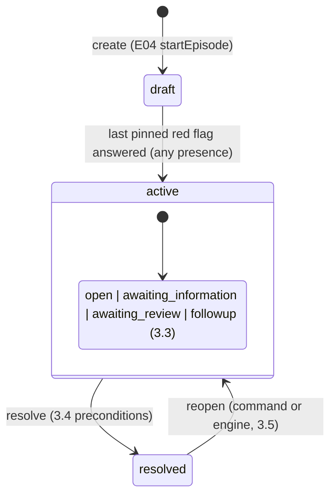

# E15: Episodes, follow-up and clinical review

Technical design for epic E15. Inputs: the brief (`tdd/E15.md` in the planning package), PRD.md sections 3, 4.3, 4.5,
8 (R02, R18, R28) and 9, USE-CASES.md sections 1, 2 and UC08, UC15, UC16, UC22, UC23, UX-DESIGN.md sections 4, 6 and 8,
CONTRACTS.md sections 1 to 5, 6, 9, 10, 11, 16, 18, 19 and 20, LLM-ARCHITECTURE.md sections 4 and 5, `api/openapi.yaml`
(`startEpisode`, `getEpisode`, `answerEpisode`, `recordReview`, `getRecordsView`), `api/schemas/episode.schema.json`,
`clinical-review.schema.json`, `capability-gap.schema.json`, `answer.schema.json`, `assessment.schema.json`,
`records-view.schema.json`, `requests.schema.json` (`EpisodeCreate`, `ReviewCreate`), `api/examples/clinical/episode.json`
and `review.json`, `api/examples/views/records.json`, `api/examples/config/ui-copy.example.json`,
`config-role-rules.schema.json`, VALIDATION.md (V02, V03, V04, V12, V16, V18, V25, V26, V28, V30, V35, V38, V40, V43;
D05, D08, D12, D13, D14, D40, D43 and fixture `demo-mara-fd19`), the work packages E15-01 to E15-03 in `backlog.json`,
`docs/BUILD-CHARTER.md`, `AGENTS.md`, and the sibling designs that call E15: `docs/tdd/E04.md` (episode kernel),
`E11.md` (urgency, `EpisodeFacts`), `E12.md` (`EpisodeFactsPort`), `E22.md` (`CompletionRecorder`), `E26.md`
(`RefCheckPort`), `E28.md` and `E32.md` (`EpisodeReader`). The research file
`research/medical-systems-standards.md` of the build package informs sections 3 and 9. `docs/SYSTEM.md` and
`docs/DEPLOYMENT.md` are written in parallel; points that depend on them are marked and listed in section 14.

Status: design. Every test named here is planned; none has run. The due times for reviews and follow-ups are left
visibly open ("to be set by clinical review") until a clinician sets them; this epic builds the mechanism and authors
no clinical content.

## 1. Scope

**What E15 is.** The Episode aggregate: one concern from "I feel unwell" to its resolution. It owns the episode's
identity, concern words, onset and its corrections, the episode state machine, the revision every screen and command
binds to, the timeline of everything that happened on the episode, acknowledgments, clinical reviews, follow-up tasks
with their owners and due times, resolution with its reason and actor, and reopening. It reads, never writes, what
other modules own (answers, measurement requests, capability gaps, assessments, urgency, help sessions, plan runs,
guided checks, handoffs) and links them to the episode. It works with the language model stopped, every device
absent and the ground link down; nothing in it calls the model, a device or the link.

**Work packages.**

| Story | Delivers | Acceptance (brief) |
|---|---|---|
| E15-01 | Episode kernel (create, facts, route, view), links, the timeline, the state machine and its derivation, gaps on the episode | Measurements, answers and assessments traceable from the episode; an unresolved concern stays open |
| E15-02 | Acknowledgment, review requests, clinical reviews, resolution and reopening, reviewer authority | Reviewed and resolved are separate events with actors and reasons |
| E15-03 | Follow-up tasks (owner, due policy, overdue), onset correction, reaction to corrected records | An overdue task is visible; a corrected record triggers review of the affected assessment |

**Requirements.** R18 (episode state and follow-up ownership: "Reviewed leaves an unresolved concern open with its
remaining task"), R28 (human control: the model cannot resolve, review, acknowledge, close a task or contact anyone).
Contributes to R02 (visibility filter and restricted answers), R06 (corrections supersede), R25 (durable, idempotent
commands), R33 and R31 (a concern counts as the day's check, through E22), R48 (nothing waits for the ground).

**Validation scenarios.** V04 (acknowledge an unresolved episode), V30 (record corrected during inference: the
assessment is marked stale), V02 and V18 (a normal value never resolves a symptom; a gap keeps the rhythm unresolved),
V03 (a repeat never blocks or resolves), V12 (declined kept, restricted withheld), V16 (duplicate command), V25
(cross patient), V26 (journal and private text canary), V28 (honest gaps), V35 (restart), V38 (review attribution),
V40 (SIM stays SIM), V43 (episode update counts). **Demo assertions.** D08 (failed attempt stays visible in the episode
timeline), D12 (gap shown on the episode), D13 and D40 (no episode state waits for the handoff or the ground), D14 (no
participation element), D43 (no read of the ground link). **Use cases.** UC08 steps 5 to 7 (episode side), UC15
(records), UC16, UC22 step 5 (the result lands on the episode), UC23 (reviewer when the officer is the patient).

**Decisions this design settles** (brief: "Define reviewer authority, resolution reasons and due-time policy").

| # | Decision | Selected | Alternatives rejected, and the evidence |
|---|---|---|---|
| DE15-1 | Episode states | `draft` until every red flag pinned at creation has an accepted answer in any presence; then one of the four active states, **derived** from facts by a total function (3.3); `resolved` only by the `resolve` command; reopening returns to the derived active state | Commanded sub-states (a person picks "awaiting review": drifts from the facts, two sources of truth); states driven by the model (R28); resolving from a normal value (CONTRACTS 4: "The app cannot infer medical resolution solely from a normal value") |
| DE15-2 | Acknowledgment and review | Separate append-only records, never state changes. An acknowledgment is "seen" by an officer. A review is an attributed `ClinicalReview`; an on-board review closes the open review task and turns each `unresolved` item into a follow-up task owned by the reviewer, so a reviewed concern stays open with its remaining task (R18) | Review that resolves (CONTRACTS 4: "`acknowledged` and `reviewed` are events, not substitutes for resolved"); a review flag on the episode (no attribution, no history) |
| DE15-3 | Reviewer authority | On board: a session with role `crew_medical_officer` whose person is not the patient; after R-E15-10, also the acting medical officer under E11's rule (E11 3.3 rule 3), through one port so both epics apply one rule. Ground: a `ground` session with E02 consent for the patient; a ground review is recorded and attributed but changes no state, closes no task and opens no task (USE-CASES rule 7; CONTRACTS 4: "no episode state needs one") | Any crew member reviewing (PRD 3 actor table: the officer reviews); ground review closing on-board work (rule 7); a second copy of the officer rule in E15 (two rules diverge) |
| DE15-4 | Resolution reasons | Exactly the three of CONTRACTS 4: `measurement_anomaly_not_reproduced`, `symptoms_reported_resolved`, `clinician_assessed`, each with its own authority and evidence rule (3.4). Common preconditions: no blocking urgency (E11 `blocks_resolution`), no open follow-up task, no plan run still open on the episode | A free text reason (CONTRACTS 4 asks for "a clear distinction" between the three); auto-resolution when a value normalizes (PRD 4.5); resolution that silently cancels open tasks (hides remaining work, R18) |
| DE15-5 | Due-time policy | Per task kind, one policy from the new configuration document `episode-rules.json` (R-E15-7): `none`, `after` (a duration with its UCUM unit), `end_of_mission_day` or `chosen_by_person` within configured bounds. A policy whose duration is not set is `threshold_pending`: the task has no due time and shows "to be set by clinical review". `due_at` is fixed at creation under the release pinned on the task. Overdue is a stored, timestamped notice written when the clock passes `due_at`; it changes no state and no urgency | Due times in code (charter rule 1); recomputing due times on every release (a task's promise changes under the owner); overdue as a level or warning (escalation belongs to E11 and E24, and a late review is not an emergency) |
| DE15-6 | Who owns a task | Every open task has one owner, a roster person. Review task default owner: the roster officer with the lowest `medical_officer_rank` who is not the patient (E02 roster), regardless of overlays (ownership is not presence; a walk makes the task late, which shows). Review item tasks: the reviewer. Custom tasks: chosen by the creator. Reassign is an attributed action; a review task can only be owned by an officer who is not the patient | E31's emergency cascade (it falls through to skill holders who are not reviewers); unowned tasks (R18 asks for ownership) |
| DE15-7 | Linked records | Producers keep their records; E15 keeps a link row per record (`kind`, `ref_id`, last known state) written by in-transaction domain events from the producer (R-E15-9), so the episode revision moves in the same transaction as the change it reflects. Interim: E01's durable outbox subscription to the public events of CONTRACTS 18 | Reading every module at view time to detect change (no revision, no ETag discipline); E15 writing other modules' tables (charter 3.2) |
| DE15-8 | Corrections | A corrected answer or observation linked to the episode writes a durable effect in the correction's transaction. After commit a bounded runner asks E13 which assessments cite the superseded record, marks them stale through E13, opens one review task (source `correction`), and reopens a resolution whose evidence or reviewed assessment cited it. If E13 cannot answer, the runner opens the review task anyway when the episode has any assessment (fail safe: over-review, never under-review) | Recomputing in the producer's transaction (an E13 fault would fail an answer or a measurement); only E13's own snapshot check (it catches stale display, not the review the brief asks for) |
| DE15-9 | Reopening | `resolved` returns to an active state by the `reopen` command (patient or officer) or by the engine on: an accepted answer after resolution, a new urgency cycle, new activity linked (measurement request, assessment, plan run, help session, guided check), an on-board review with unresolved items, or a correction of cited evidence. Each reopen is a record with its reason and cause | A resolved episode that accepts new symptoms silently (CONTRACTS 4: "An episode can return to open when symptoms recur or important evidence changes") |
| DE15-10 | One API surface for episode actions | One command `POST /v1/episodes/{episode_id}/actions` with a discriminated body and `If-Match`, in the style of `actOnWarning` and `actOnPlanRun` (R-E15-1) | One endpoint per action (more surface, the same concurrency token) |

**Not delivered here** (owner): asking the concern, onset, red flags and intake questions (E04); answer and
observation storage, `AnswerAccepted`, `ObservationAccepted` (E01 records); urgency, its disposition and the
pre-inference gate (E11); measurement requests, attempts, capability gaps and their storage (E05); assessments and
their stale and reviewed status (E13); help sessions (E26); plan runs (E28); guided checks (E30); handoffs and the ground
console (E16); the catch-up log (E29); participation (E22); consent grants and the roster (E02); the Records view
projection itself (per SYSTEM.md; E15 supplies its episode rows).

## 2. Dependencies and seams

| Seam | Direction | Mechanism | Owner |
|---|---|---|---|
| Unit of work, migrations, audit, idempotency store, clock, IDs, hub settings, durable outbox subscription, timer | E15 uses | `UnitOfWork` (`BEGIN IMMEDIATE`), `AuditLog.append`, `Clock.now()`, `IdGenerator.new(prefix)`, `HubSettings.get(key)`, `OutboxSubscription` (R-E11-10), `TimerPort.wake_at(key, instant)` | E01 |
| In-transaction domain event bus | E15 subscribes and publishes | `DomainEventBus.subscribe(type, handler)`, `.publish(event)` | E01 |
| Answers | E15 reads and reacts | `AnswerStore.for_episode(uow, episode_id) -> Sequence[Answer]`, `.question_ids_answered(uow, episode_id) -> frozenset[str]`; in-transaction `AnswerAccepted(answer, episode_id, mission_id)` | E01 records |
| Observations | E15 reacts | in-transaction `ObservationAccepted(observation_id, patient_id, episode_id, origin_mode, supersedes, observed_at)` (R-E15-9) | E01 records |
| Episode kernel | E15 provides | `EpisodeKernel.create`, `.facts`, `.record_route`, `.view` (4.2), exactly as E04 section 4.2 calls them | E15 (consumer E04) |
| Question sensitivity and unanswered questions | E15 reads | `QuestionSensitivity.is_restricted`, `IntakeGaps.not_answered` (4.2), satisfied structurally by E04's `IntakeFactsForEpisodes` | E04 |
| Urgency | E15 reads and reacts | `UrgencyQueries.summary`, `.blocks_resolution` (E11 4.3); in-transaction `UrgencyChanged` (E11 4.4, with the signal reference of R-E15-10) | E11 |
| Officer authority | E15 reads | `OfficerAuthority.check(uow, session, patient_id) -> AuthorizedOfficer \| NotAuthorized` (R-E15-10) | E11 |
| Measurement requests and gaps | E15 reads and reacts | `MeasurementFacts.request_states(uow, episode_id)`, `GapFacts.for_episode(uow, episode_id) -> Sequence[CapabilityGap]`; in-transaction `MeasurementRequestChanged`, `CapabilityGapChanged` (R-E15-9) | E05 |
| Assessments | E15 reads, reacts and commands | `AssessmentFacts.ids_for_episode`, `.citing(uow, episode_id, record_ids)`, `AssessmentCommands.mark_stale`, `.mark_reviewed`; in-transaction `AssessmentChanged` (R-E15-12) | E13 |
| Plan runs, guided checks, handoffs, help sessions | E15 reacts | in-transaction `PlanRunChanged` (E28), `GuidedCheckChanged` (E30), `HandoffChanged` (E16) (R-E15-9); help sessions through `UrgencyChanged` signal references | E28, E30, E16, E11 |
| Roster and consent | E15 reads | `RosterPort.crew(at) -> Sequence[CrewMember]` (with `medical_officer_rank`), `ConsentQueries.allows(uow, subject_id, recipient_id, scope) -> bool` | E02 |
| Day labels and mission time | E15 reads | `DayLabelPort.inline_label_at(instant)`, `MissionClock.day_end(instant) -> datetime` | E23, E01 |
| Check completions | E15 calls | `CompletionRecorder.record(uow, basis)` (E22 4) for `concern_reported` and `episode_updated` | E22 |
| Episode facts for urgency, help, plans, medicines, tools | E15 provides | `EpisodeFacts` (E11), `RefCheckPort` (E26), `EpisodeReader` (E28, E32), `EpisodeFactsPort` (E12) (4.2) | E15 |
| Episode rows for Records | E15 provides | `EpisodeRecordsSource.items(uow, person_id, cursor, limit)` | E15 (consumer: Records view owner per SYSTEM.md) |
| Configuration | E15 reads | `ConfigReleaseReader.active()`, `.document("episode-rules")`, `.document("ui-copy")` | E01 loader, E15 checks |
| Episode screen | E15 owns UI | `ui/crew/src/features/episodes/` on E03's shell and design system | E15 |

Who depends on E15: E04 (kernel), E11 (facts, visibility, `episode_of`), E12 (tool facts), E13 (episode facts and
the snapshot revision), E16 and E29 (episode facts for the log), E22 (completions), E26 (ref checks), E28 and E32
(subject and visibility), E21 (scenarios acts 4 and 5).

## 3. Domain model

Pure code in `crew_health/episodes/domain/`: no I/O, no clock reads, no framework imports.

### 3.1 Types

```python
class EpisodeState(StrEnum):
    DRAFT = "draft"; OPEN = "open"; AWAITING_INFORMATION = "awaiting_information"
    AWAITING_REVIEW = "awaiting_review"; FOLLOWUP = "followup"; RESOLVED = "resolved"

ACTIVE: Final = frozenset({OPEN, AWAITING_INFORMATION, AWAITING_REVIEW, FOLLOWUP})

class ResolutionReason(StrEnum):           # CONTRACTS 4, fixed vocabulary
    MEASUREMENT_ANOMALY_NOT_REPRODUCED = "measurement_anomaly_not_reproduced"
    SYMPTOMS_REPORTED_RESOLVED = "symptoms_reported_resolved"
    CLINICIAN_ASSESSED = "clinician_assessed"

class ReopenReason(StrEnum):
    SYMPTOMS_RECURRED = "symptoms_recurred"          # command
    EVIDENCE_CHANGED = "evidence_changed"            # command or engine (correction)
    RECORDED_IN_ERROR = "recorded_in_error"          # command
    ANSWER_AFTER_RESOLUTION = "answer_after_resolution"   # engine
    URGENCY_RAISED = "urgency_raised"                # engine
    NEW_ACTIVITY = "new_activity"                    # engine
    REVIEW_UNRESOLVED = "review_unresolved"          # engine

class TaskKind(StrEnum):
    REVIEW = "review"               # an on-board review is needed; at most one open per episode
    REVIEW_ITEM = "review_item"     # one unresolved item of an on-board review
    CUSTOM = "custom"               # a person's own task

class TaskState(StrEnum):            # episode.schema.json followup_tasks[].state
    OPEN = "open"; DONE = "done"; CANCELLED = "cancelled"

class LinkKind(StrEnum):
    MEASUREMENT_REQUEST = "measurement_request"; CAPABILITY_GAP = "capability_gap"
    ASSESSMENT = "assessment"; HELP_SESSION = "help_session"; PLAN_RUN = "plan_run"
    GUIDED_CHECK = "guided_check"; HANDOFF = "handoff"; OBSERVATION = "observation"

MR_PENDING: Final = frozenset({"proposed", "awaiting_acceptance", "accepted", "in_progress"})   # CONTRACTS 4
PLAN_RUN_OPEN: Final = frozenset({"active", "watching", "escalated"})                           # E28 RunState

class Authority(StrEnum):
    PATIENT = "patient"; CREW_MEDICAL_OFFICER = "crew_medical_officer"
    ACTING_MEDICAL_OFFICER = "acting_medical_officer"; GROUND = "ground"
```

`Onset(at: datetime | None, precision: Literal["exact", "hour", "day", "unknown"])`: `at is None` exactly when
precision is `unknown` (E04 DE04-6). `OnsetRecord(seq, onset, recorded_at, actor, supersedes_seq)`: the history; the
first record is the creation value.

`Episode` (aggregate root, bounded): `episode_id`, `patient_id`, `mission_id`, `origin_mode`, `concern_text`, `onset`,
`state`, `revision >= 1`, `created_at`, `created_by`, `questionnaire_version`, `red_flag_ids: tuple[str, ...]`,
`route_module_id | None`, `config_release_id`, `open_review_task_id | None`, `open_task_count`, `pending_mr_count`,
`open_plan_run_count`, `last_resolution_id | None`. History (timeline, tasks, reviews) is never loaded into the
aggregate; it is read in pages.

`FollowupTask`: `task_id`, `episode_id`, `kind`, `action_text | None` (the person's own words for `custom` and
`review_item`), `action_template_key | None` (for `review`, rendered by the hub from `episode-rules.json`),
`sources: tuple[TaskSource, ...]` (`assessment`, `correction`, `request`, `review`, `person`), `owner: PersonRef`,
`due_at | None`, `due_policy_id`, `due_status: Literal["set", "none", "threshold_pending"]`, `config_release_id`,
`state`, `revision`, `created_at`, `created_by`, `closed: Closure | None` (`at`, `by`, `note | None`,
`review_id | None` when a review closed it, `cancellation_reason | None`), `overdue_noticed_at | None`.

`ClinicalReview` (immutable, CONTRACTS 2): `review_id`, `episode_id`, `reviewer: Actor`, `role`
(`crew_medical_officer` or `ground`), `authority`, `assessment_id | None`, `decisions`, `unresolved`, `signed_at`
(hub time), `episode_revision_seen`.

`Acknowledgment(ack_id, episode_id, by, authority, at, episode_revision_seen)`.

`Resolution(resolution_id, episode_id, reason, rationale | None, by, authority, at, evidence: ResolutionEvidence,
episode_revision_seen)`; `ResolutionEvidence(observation_ids: tuple[str, ...], review_id: str | None)`.

`Reopening(reopen_id, episode_id, resolution_id, reason, by: Actor, at, cause_ref | None)`.

`TimelineEntry(entry_id, episode_id, seq, kind, ref_id, ref_state, occurred_at, recorded_at, actor: Actor | None,
source: Literal["episode", "link", "answer", "urgency"])`.

### 3.2 State machine



`transition(ep, fact) -> Transition(new_state, change: ChangeRecord, effects)` is total over the table:

| From | Fact or command | Result |
|---|---|---|
| none | `Create` | `draft`, revision 1 |
| `draft` | `AnswerLinked` and `pinned_red_flags ⊆ answered_question_ids` | `derive(...)` |
| `draft` | any other fact | `draft`; revision + 1 when the fact changes what the Episode shows |
| active | link, task, review, acknowledgment or answer fact | `derive(...)` (may equal the old state; revision + 1) |
| active | `Resolve` passing 3.4 | `resolved` |
| `resolved` | `Reopen` command, or an engine reopen fact (3.5) | `derive(...)`; a `Reopening` record |
| `resolved` | any other fact (a handoff queued, a gap addressed, an acknowledgment) | `resolved`; revision + 1 |
| `draft` | `Resolve`, `Reopen` | `InvalidTransition` |
| active | `Reopen` | `InvalidTransition` |
| `resolved` | `Resolve` | `InvalidTransition` |

Every accepted fact or command increments `revision` by exactly 1 and writes one `ChangeRecord(revision, kind,
actor, at, from_state, to_state, cause_ref)` (INV-E15-05). No transition reads the ground link, a model output, a
device or an observation value (INV-E15-15).

### 3.3 Derivation of the active state

```python
def derive(open_tasks: Sequence[TaskFact], links: Sequence[LinkFact]) -> EpisodeState
```

First match wins:

| # | Condition | State |
|---|---|---|
| 1 | An open task of kind `review` exists | `awaiting_review` |
| 2 | A `measurement_request` link with `ref_state` in `MR_PENDING` exists | `awaiting_information` |
| 3 | Any other open task exists (`review_item`, `custom`) | `followup` |
| 4 | Otherwise | `open` |

The order puts the human oversight step first: the officer's list filters on `awaiting_review` (PRD 4.5, "the medical
officer reviews it on board"). Capability gaps never change the state: a gap stays `open` forever (a substitute
check never closes it, `capability-gap.schema.json`) and must not hold an episode in a waiting state; it is shown on
the episode and on the timeline instead. A completed measurement never moves an episode to `resolved` (V02, V18).

### 3.4 Resolution rules

`check_resolution(ep, cmd, facts: ResolutionFacts) -> None` raises `ResolutionRefused(code, field)`. `ResolutionFacts`
is read by the use case in the command transaction: urgency `blocks_resolution`, open tasks, open plan runs, current
answer heads with presence, the evidence observations (patient, episode link, quality, observed time), the named
review.

Common preconditions, in order:

| # | Check | Refusal |
|---|---|---|
| C1 | State is active (not `draft`, not `resolved`) | `INVALID_TRANSITION` |
| C2 | E11 `blocks_resolution(episode_id)` is false (urgency `none` or `disposition_recorded`) | `INVALID_TRANSITION`, `field_errors.urgency = "unresolved"` |
| C3 | No open follow-up task (each is completed or cancelled with its reason first) | `INVALID_TRANSITION`, `field_errors.followup_tasks = "open"` |
| C4 | No linked plan run in `PLAN_RUN_OPEN` (the plan runs to its end on board, UC08 step 6) | `INVALID_TRANSITION`, `field_errors.plan_run = "open"` |
| C5 | No linked measurement request in `MR_PENDING` | `INVALID_TRANSITION`, `field_errors.measurement_request = "pending"` |

Per reason:

| Reason | Who may record it | Evidence and rule |
|---|---|---|
| `symptoms_reported_resolved` | The patient only (the person reports their own symptoms) | `rationale` optional (the person's own words). No other evidence. An officer who wants to close for the patient records `clinician_assessed` |
| `clinician_assessed` | An officer under DE15-3 who is not the patient (role `crew_medical_officer`; acting after R-E15-10) | `rationale` required (non-empty after trim). `evidence.review_id` required: an on-board `ClinicalReview` of this episode by the same person, recorded at or after the latest correction review trigger. A ground review never satisfies it |
| `measurement_anomaly_not_reproduced` | The patient or an officer | `rationale` required. `evidence.observation_ids` at least one: each an accepted Observation of the patient, linked to the episode, `observed_at` after the episode's `created_at`. Refused when any current answer head on the episode (red flags included) has presence `present` (`INVALID_VALUE`, `field_errors.reason = "symptoms_present"`): a normal repeat resolves an anomaly, never a reported symptom (PRD 4.5) |

The domain records which evidence it relied on; it never judges whether a value is normal. That judgment is the
person's or the officer's and is attributed to them.

### 3.5 Engine reopen facts

When the episode is `resolved`, these facts reopen it in the same transaction, with actor `engine` and the cause:

| Fact | Reason | Cause reference |
|---|---|---|
| `AnswerAccepted` on the episode | `answer_after_resolution` | the answer ID |
| `UrgencyChanged` opening a new cycle (from `none` or `disposition_recorded`) | `urgency_raised` | the urgency signal reference (R-E15-10) |
| A new link of kind `measurement_request`, `assessment`, `plan_run`, `help_session` or `guided_check` | `new_activity` | the linked record ID |
| An on-board review with at least one `unresolved` item | `review_unresolved` | the review ID |
| A correction effect finds the superseded record in the resolution's evidence, or cited by the assessment its review covered | `evidence_changed` | the correcting record ID |

Every engine reopen moves toward more attention, never less; no engine fact lowers or closes anything.

### 3.6 Follow-up rules

| Action | Allowed actor | Rule |
|---|---|---|
| Open a `review` task | Engine (on a model assessment, on a correction), the patient or an officer (`request_review`) | At most one open `review` task per episode; a further trigger adds a `TaskSource` to the open one and a timeline entry, never a second task |
| Open a `review_item` task | Engine, from an on-board review's `unresolved` items, one task per item | Owner the reviewer; text the item; due per the `review_item` policy |
| Open a `custom` task | The patient (owner: themself) or an officer (owner: any roster person) | `action_text` non-empty after trim, at most `HubSettings episodes.max_task_text_chars`; due per the `custom` policy; at most `episodes.max_open_tasks` open per episode |
| Complete | `custom`, `review_item`: the owner, the patient or an officer. `review`: never by this action; only an on-board review closes it | `note` optional; `evidence_ref` optional (an ID linked to this episode) |
| Cancel | `custom`: creator, owner or officer. `review_item`, `review`: an officer | `cancellation_reason` required (non-empty after trim) |
| Reassign | An officer; the owner of a `custom` task | New owner on the roster; for `review`, an officer by rank who is not the patient (INV-E15-11) |

Due time at creation (`due_policy` from the release pinned on the task):

| Policy kind | `due_at` | `due_status` |
|---|---|---|
| `none` | null | `none` |
| `after` with a duration | `created_at` + duration (UCUM `s`, `min` or `h`, converted once) | `set` |
| `after` with `value: null`, `status: threshold_pending` | null | `threshold_pending` |
| `end_of_mission_day` | `MissionClock.day_end(created_at)` | `set` |
| `chosen_by_person` | the command's `due_at`, which must lie in `[created_at + min, created_at + max]` of the policy | `set`, or `none` when the person leaves it empty |

Overdue: `state == open` and `due_at` set and the clock has passed it; the watcher (5.3) writes the notice once.
`overdue` in the view is true exactly when a notice exists and the task is open (INV-E15-12).

### 3.7 Visibility

`visibility(viewer, episode, facts) -> Visibility` returns `full`, `filtered` (restricted answers withheld) or `none`:

| Viewer | Result |
|---|---|
| Crew session whose person is the patient | `full` |
| Crew session with role `crew_medical_officer`, person not the patient | `filtered`: every restricted answer (E04 `QuestionSensitivity.is_restricted` at the answer's `questionnaire_version`) is withheld unless `ConsentQueries.allows(patient, viewer, ("restricted_answer", question_id))` |
| Acting medical officer (after R-E15-10) while `OfficerAuthority.check` passes | `filtered`, as above |
| `ground` session | `filtered` when `ConsentQueries.allows(patient, "ground", ("episode", "clinical_review"))`, restricted answers per field grant; otherwise refused with `CONSENT_REQUIRED` |
| Any other crew session, `station`, `operator`, `editor`, `adapter` | `none` (`404 NOT_FOUND` for crew; `403 UNAUTHORIZED_SCOPE` for roles outside `x-roles`) |

A withheld answer is never silently dropped from meaning: the view carries the count of withheld answers (R-E15-2;
interim, see section 6). The journal is never part of an episode (CONTRACTS 9).

### 3.8 Invariants

| ID | Invariant | Test |
|---|---|---|
| INV-E15-01 | `resolved` is reached only by `resolve` with an actor, one of the three reasons and its preconditions; no engine, model, observation, acknowledgment or review resolves | T-E15-001, 004, 022 |
| INV-E15-02 | Acknowledgment and review are records, never state changes toward `resolved`; an on-board review closes only the open `review` task | T-E15-002, 003 |
| INV-E15-03 | Resolution requires no blocking urgency, no open task, no open plan run, no pending measurement request | T-E15-007, 008 |
| INV-E15-04 | `measurement_anomaly_not_reproduced` is refused while any current answer head is `present` | T-E15-006 |
| INV-E15-05 | Each change increments `revision` by exactly 1 with one change record, including linked changes | T-E15-009 |
| INV-E15-06 | Timeline, change records, acknowledgments, reviews, resolutions, reopenings and task events are append only | T-E15-010 |
| INV-E15-07 | A ground review changes no state and opens or closes no task | T-E15-011 |
| INV-E15-08 | No actor of kind `assistant` is the actor of any E15 command; the model can only cause a reopen or a review task through deterministic rules on human or engine facts | T-E15-012 |
| INV-E15-09 | A reviewer is never the patient; an on-board review needs officer authority | T-E15-013 |
| INV-E15-10 | Only the viewers of 3.7 read an episode; restricted answers reach an officer or the ground only with consent, and their withholding is counted | T-E15-014 |
| INV-E15-11 | Every open task has one roster owner; a `review` task owner is an officer who is not the patient | T-E15-020 |
| INV-E15-12 | Overdue changes no state and no urgency; it is noticed once per task and shown as a word | T-E15-018, 040 |
| INV-E15-13 | A correction of a record cited by an assessment marks it stale and leaves exactly one open `review` task | T-E15-015, 017 |
| INV-E15-14 | No log line, audit row or metric contains concern text, rationale, task text, review text or answer values | T-E15-030 |
| INV-E15-15 | No E15 transition reads the ground link, waits for a handoff or needs a ground review | T-E15-031 |
| INV-E15-16 | A linked record's origin equals the episode's origin; an episode's origin equals the patient namespace origin | T-E15-032 |
| INV-E15-17 | `draft` ends only when every pinned red flag has an accepted answer, in any presence | T-E15-023 |

## 4. Application layer

### 4.1 Use cases (`crew_health/episodes/application/use_cases.py`)

| ID | Use case | Input | Output | Errors | Idempotency |
|---|---|---|---|---|---|
| UC-E1 | `CreateEpisode` (kernel, called by E04 UC-I1) | `uow`, `NewEpisode` | `EpisodeRef` | `OriginMismatch` | inside E04's idempotent command |
| UC-E2 | `GetEpisode` | `Viewer`, `episode_id` | `EpisodeView` (`episode.schema.json`) | `NOT_FOUND`, `CONSENT_REQUIRED`, `UNAUTHORIZED_SCOPE`, `INTERNAL_ERROR` (`retryable`) when a linked part cannot be read | read |
| UC-E3 | `ActOnEpisode` (R-E15-1) | `Session`, `episode_id`, `EpisodeAction`, `If-Match`, `Idempotency-Key` | `EpisodeView` | `NOT_FOUND`, `UNAUTHORIZED_SCOPE`, `ACTION_NOT_ALLOWED`, `INVALID_TRANSITION`, `STALE_VERSION`, `VERSION_REQUIRED`, `INVALID_VALUE`, `DUPLICATE_COMMAND` | E01 key store, key plus body hash |
| UC-E4 | `RecordReview` (`recordReview`) | `Session`, `episode_id`, `ReviewCreate`, `Idempotency-Key`, `If-Match` after R-E15-6 | `ClinicalReview` | `NOT_FOUND`, `CONSENT_REQUIRED`, `UNAUTHORIZED_SCOPE`, `DUPLICATE_COMMAND`; after R-E15-6 also `ACTION_NOT_ALLOWED`, `STALE_VERSION`, `INVALID_VALUE`, `VERSION_REQUIRED` | same |
| UC-E5 | `GetTimeline` (R-E15-3) | `Viewer`, `episode_id`, `cursor`, `limit <= 200` | `EpisodeTimelinePage` | as UC-E2 | read |
| UC-E6 | `ListEpisodes` (R-E15-5) | `Viewer`, filters `patient_id`, `state`, `cursor`, `limit` | page of `EpisodeSummary` | `UNAUTHORIZED_SCOPE` | read |
| UC-E7 | `ListReviews` (R-E15-6) | `Viewer`, `episode_id`, `cursor`, `limit` | page of `ClinicalReview` | as UC-E2 | read |
| UC-E8 | Domain event handlers (4.4) | `uow`, event | link, timeline, change, effects, completions | storage errors only | unique keys per source event |
| UC-E9 | `RunCorrectionEffects` (background) | batch | effects done, retried or failed | none raised; each failure audited | effect ID |
| UC-E10 | `NoticeOverdue` (timer) | `now` | notices, changes, events | none raised | `UNIQUE(task_id)` on the notice |

`EpisodeAction` (discriminated by `action`, R-E15-1):

| `action` | Body fields | Use case steps beyond the common ones |
|---|---|---|
| `acknowledge` | none | Officer authority, not the patient; append `Acknowledgment` |
| `request_review` | `note?` | Patient or officer; open or extend the `review` task (source `request`) |
| `add_followup` | `action_text`, `owner_person_id?`, `due_at?` | 3.6 |
| `complete_followup` | `task_id`, `task_revision`, `note?`, `evidence_ref?` | 3.6 |
| `cancel_followup` | `task_id`, `task_revision`, `cancellation_reason` | 3.6 |
| `reassign_followup` | `task_id`, `task_revision`, `owner_person_id` | 3.6 |
| `resolve` | `reason`, `rationale?`, `observation_ids?`, `review_id?` | 3.4 |
| `reopen` | `reason` in `symptoms_recurred`, `evidence_changed`, `recorded_in_error`; `note?` | Patient or officer; state `resolved` |
| `correct_onset` | `onset` | Patient only; E04's onset rules (`at` not after now; `at` null exactly for `unknown`); appends an `OnsetRecord` that supersedes the current one; never reopens |

UC-E3 steps, one `BEGIN IMMEDIATE` transaction:

1. Resolve the viewer (3.7); `none` gives `404 NOT_FOUND`. A session of kind other than `crew` gives `403
   UNAUTHORIZED_SCOPE` (E15 commands are crew-only; the ground records reviews only through UC-E4).
2. `If-Match` equals the Episode revision, else `409 STALE_VERSION` with the current Episode in `current_state`; task
   actions also compare `task_revision` (`409 STALE_VERSION`).
3. Read the facts the action needs (urgency, tasks, links, answer heads, roster, authority).
4. Domain check (3.4, 3.6); `ACTION_NOT_ALLOWED` for an actor the matrix refuses, `INVALID_TRANSITION` for a state the
   action does not apply to, `INVALID_VALUE` with `field_errors` for a field.
5. Write the records, the change record, the timeline entry and the Episode row (revision + 1, derived state).
6. Audit `episode.<action>` with IDs, codes and reasons only. Outbox `episode.changed` (R-E15-4). Commit.

UC-E4 steps, one transaction: viewer (3.7); authority (DE15-3); `assessment_id`, when present, must belong to the
episode (`INVALID_VALUE`, interim `404 NOT_FOUND`, see section 6); insert the review with `signed_at = now` and
`episode_revision_seen`; for an on-board review: close the open `review` task (closure `review_id`), open one
`review_item` task per `unresolved` item, call `AssessmentCommands.mark_reviewed(uow, assessment_id, review_id)` when an
assessment is named (E13 decides whether a stale assessment can become reviewed), and reopen a `resolved` episode when
`unresolved` is non-empty (3.5); for a ground review: nothing beyond the record and its timeline entry. Change record,
audit `episode.review_recorded` (role, authority, counts), outbox. Commit.

### 4.2 Ports (`crew_health/episodes/application/ports.py`)

Provided:

```python
class EpisodeKernel(Protocol):                       # consumer E04
    def create(self, uow: UnitOfWork, draft: NewEpisode) -> EpisodeRef: ...
    def facts(self, uow: UnitOfWork, episode_id: str) -> EpisodeFact | None: ...
    def record_route(self, uow: UnitOfWork, episode_id: str, module_id: str, area_answer_id: str,
                     at: datetime) -> None: ...
    def view(self, uow: UnitOfWork, viewer: Viewer, episode_id: str) -> EpisodeView: ...

class EpisodeFacts(Protocol):                        # consumer E11
    def get(self, uow: UnitOfWork, episode_id: str) -> EpisodeFact | None: ...
    def visible_to(self, uow: UnitOfWork, episode_id: str, actor: Actor) -> bool: ...
    def episode_of(self, uow: UnitOfWork, kind: str, ref_id: str) -> str | None: ...   # red_flag: the ID itself if it is an episode; plan_step: the run's episode; else the link table; None when unknown

class EpisodeFactsPort(Protocol):                    # consumer E12
    def facts(self, uow: UnitOfWork, episode_id: str, sections: frozenset[str]) -> EpisodeToolFacts: ...
    def subject_of(self, uow: UnitOfWork, episode_id: str) -> str | None: ...

class RefCheckPort(Protocol):                        # consumer E26 (episode refs)
    def visible(self, ref_id: str, actor: Actor) -> bool: ...

class EpisodeReader(Protocol):                       # consumers E28, E32
    def subject_of(self, episode_id: str) -> str | None: ...
    def visible(self, session: Session, episode_id: str) -> EpisodeRef | None: ...

class EpisodeRecordsSource(Protocol):                # consumer: Records view owner (per SYSTEM.md)
    def items(self, uow: UnitOfWork, person_id: str, cursor: str | None, limit: int) -> Page[RecordsItem]: ...
```

One class, `EpisodeQueries` in `application/queries.py`, implements every read protocol; the composition root (E01)
wires it under each consumer's protocol. Methods without a `uow` open a read-only unit of work and are bounded by the
SQLite busy timeout. `EpisodeFactsPort.facts` serves the sections `concern`, `red_flags`, `answers` (all presence
states; the patient's own context, so nothing is withheld), `gaps_open` (from E05) and `open_tasks`; any other section
is returned as `unavailable` for E12 to fill from its other ports. It never serves journal text, another person's
record or the review text.

DTOs (`application/dto.py`, imported by E04):

```python
@dataclass(frozen=True, slots=True, kw_only=True)
class NewEpisode:
    patient_id: str; mission_id: str; origin_mode: OriginMode; concern_text: str; onset: Onset
    created_by: PersonRef; questionnaire_version: str; red_flag_ids: tuple[str, ...]
    config_release_id: str; received_at: datetime

@dataclass(frozen=True, slots=True)
class EpisodeRef:  episode_id: str; revision: int

@dataclass(frozen=True, slots=True, kw_only=True)
class EpisodeFact:
    episode_id: str; patient_id: str; mission_id: str; origin_mode: OriginMode; state: EpisodeState
    revision: int; questionnaire_version: str; red_flag_ids: tuple[str, ...]
    route_module_id: str | None; created_at: datetime

@dataclass(frozen=True, slots=True)
class Viewer:  kind: SessionKind; person_id: str | None; roles: frozenset[str]
```

Required (consumer-declared; providers per SYSTEM.md):

```python
class QuestionSensitivity(Protocol):                 # E04
    def is_restricted(self, questionnaire_version: str, question_id: str) -> bool: ...
class IntakeGaps(Protocol):                          # E04
    def not_answered(self, uow: UnitOfWork, episode_id: str) -> tuple[str, ...]: ...
class AnswerStore(Protocol):                         # E01 records
    def for_episode(self, uow: UnitOfWork, episode_id: str) -> Sequence[Answer]: ...
    def question_ids_answered(self, uow: UnitOfWork, episode_id: str) -> frozenset[str]: ...
    def heads(self, uow: UnitOfWork, episode_id: str) -> Mapping[str, Answer]: ...   # current answer per question
class ObservationFacts(Protocol):                    # E01 records
    def get(self, uow: UnitOfWork, observation_id: str) -> ObservationFact | None: ...
class UrgencyQueries(Protocol):                      # E11 4.3
    def summary(self, uow: UnitOfWork, episode_id: str) -> UrgencySummary: ...
    def blocks_resolution(self, uow: UnitOfWork, episode_id: str) -> bool: ...
class OfficerAuthority(Protocol):                    # E11, R-E15-10
    def check(self, uow: UnitOfWork, session: Session, patient_id: str) -> AuthorizedOfficer | NotAuthorized: ...
class GapFacts(Protocol):                            # E05
    def for_episode(self, uow: UnitOfWork, episode_id: str) -> Sequence[CapabilityGap]: ...
class AssessmentFacts(Protocol):                     # E13, R-E15-12
    def citing(self, uow: UnitOfWork, episode_id: str, record_ids: Sequence[str]) -> Sequence[str]: ...
class AssessmentCommands(Protocol):                  # E13, R-E15-12
    def mark_stale(self, uow: UnitOfWork, assessment_id: str, cause_ref: str) -> None: ...
    def mark_reviewed(self, uow: UnitOfWork, assessment_id: str, review_id: str) -> None: ...
class RosterPort(Protocol):                          # E02
    def crew(self, at: datetime) -> Sequence[CrewMember]: ...       # person_id, display_name, medical_officer_rank | None
class ConsentQueries(Protocol):                      # E02
    def allows(self, uow: UnitOfWork, subject_id: str, recipient_id: str, scope: tuple[str, str]) -> bool: ...
class CompletionRecorder(Protocol):                  # E22 4
    def record(self, uow: UnitOfWork, basis: CompletionBasis) -> CompletionOutcome: ...
class MissionClock(Protocol):                        # E01
    def day_end(self, instant: datetime) -> datetime: ...
class DayLabelPort(Protocol):                        # E23
    def inline_label_at(self, instant: datetime) -> str: ...
```

### 4.3 Events published

In-transaction domain events (E01 bus): `EpisodeCreated(episode_id, patient_id, mission_id, origin_mode, at)`,
`EpisodeChanged(episode_id, revision, from_state, to_state, change_kind, at)`. Outbox (CONTRACTS 18 after R-E15-4, same
proposal as R-E11-3): `episode.changed`, data the Episode as the receiving session may see it, scope `person` for the
patient and delivered to `crew_medical_officer` sessions for which the episode is visible; never to other crew. Audit
events (IDs, codes, reasons and counts only): `episode.created`, `episode.route_recorded`, `episode.state_changed`,
`episode.acknowledged`, `episode.review_recorded`, `episode.review_task_opened`, `episode.followup_opened`,
`episode.followup_completed`, `episode.followup_cancelled`, `episode.followup_reassigned`, `episode.followup_overdue`,
`episode.resolved`, `episode.reopened`, `episode.onset_corrected`, `episode.link_refused`, `episode.effect_failed`,
`episode.read_withheld` (count of withheld answers per read, never which).

### 4.4 Events consumed (in the producer's transaction)

Each handler is total, touches only E15 tables, calls no other module, and is idempotent by a unique key on its
source. A handler error is a storage error and fails the producer's transaction as any storage error would.

| Event (producer) | E15 does | Unique key |
|---|---|---|
| `AnswerAccepted` with `episode_id` (E01) | Timeline `answer` (or `answer_corrected` when `supersedes`), change; `draft` exit check (INV-E15-17); engine reopen when `resolved`; `CompletionRecorder.record(episode_updated, cause_kind answer, cause_ref answer_id)`; a correction effect row when `supersedes` is set | `(episode_id, 'answer', answer_id)` |
| `ObservationAccepted` with `episode_id` (E01, R-E15-9) | Link `observation`; timeline; correction effect row when `supersedes` is set | `('observation', observation_id)` |
| `UrgencyChanged` (E11) | Timeline `urgency` with state; change; link `help_session` when the signal reference is a help session; engine reopen on a new cycle; `CompletionRecorder.record(episode_updated, cause_kind urgent_event, cause_ref signal reference)` for a `HelpOpened` or `RedFlagPresent` signal | `(episode_id, 'urgency', cycle, cycle_revision)` |
| `MeasurementRequestChanged` (E05) | Link state; timeline entry per state change and per attempt outcome (a failed attempt stays, D08); derive; engine reopen on a new link | `('measurement_request', request_id, state, attempt_id)` |
| `CapabilityGapChanged` (E05) | Link and timeline (D12) | `('capability_gap', gap_id, state)` |
| `AssessmentChanged` (E13) | Link and timeline with `validation_status`; on a new assessment of origin `model`, open or extend the `review` task (source `assessment`) | `('assessment', assessment_id, validation_status)` |
| `PlanRunChanged` (E28), `GuidedCheckChanged` (E30), `HandoffChanged` (E16) | Link state, timeline, derive; engine reopen on a new plan run or guided check | `(kind, ref_id, state)` |

Origin check on every link (INV-E15-16): a record whose origin differs from the episode's is not linked; audit
`episode.link_refused`; the producer's transaction is not failed (the producer validates its own origin rules; E15
must not turn a refused link into a lost measurement).

Interim until R-E15-9 lands: the same handlers run from E01's durable outbox subscription on the public events
`measurement_request.changed`, `plan_run.changed`, `guided_check.checked`, `handoff.changed` (at least once, commit
order, cursor per subscriber), each in its own E15 transaction. The episode revision then moves just after the
producer's commit instead of with it; T-E15-009 runs against both paths.

`CompletionRecorder` calls: `create` records `concern_reported` (`basis_ref` the episode, actor the patient). E22
writes nothing for REPLAY and persists a rejected completion rather than failing, so E15's transaction never fails
because of participation (E22 3.3).

### 4.5 Principal success path: reviewed but not resolved (demo acts 4 and 5, R18, E15-02)

```mermaid
sequenceDiagram
    participant M as Mara (crew app)
    participant I as E04 intake
    participant E as E15 episodes
    participant R as E01 records
    participant A as E13 assessment
    participant O as Ilya (officer)
    M->>I: POST /v1/episodes (concern, onset)
    I->>E: EpisodeKernel.create
    E-->>I: draft, revision 1 (E22 concern_reported)
    M->>I: POST answers red_chest no, red_faint no, red_breath no
    I->>R: append; AnswerAccepted
    R->>E: handler: last pinned red flag answered: state open
    Note over E: E05 links mrq_pulse_1 (awaiting_information), attempt 1 failed kept on timeline, attempt 2 accepted; mrq_ecg_1 unavailable, gap_ecg_1 open
    A->>E: AssessmentChanged(asm_mara_1, draft, origin model)
    E->>E: open review task, owner Ilya (rank 1); state awaiting_review
    Note over O: Ilya on a surface walk until 11:40; the task waits, nothing else does
    O->>E: POST /v1/episodes/epi_mara_racing_1/reviews (11:52, unresolved: rhythm unknown without an ECG)
    E->>E: close review task; open review_item task, owner Ilya; state followup
    E->>A: mark_reviewed(asm_mara_1, rev_1)
    E-->>O: 201 ClinicalReview; episode.changed (revision + 1)
    Note over E: Not resolved: the concern stays open with its remaining task. The handoff stays queued; no state waits for it (D13, D40)
```

### 4.6 Failure paths

A correction after review (E15-03, V30):

```mermaid
sequenceDiagram
    participant M as Mara
    participant I as E04 intake
    participant E as E15 episodes
    participant X as E15 effect runner
    participant A as E13 assessment
    M->>I: POST answer red_faint, supersedes ans_red_faint_1 (now yes)
    I->>E: AnswerAccepted (in the answer transaction): timeline, change, correction effect row
    Note over E: E11 raises urgency in the same transaction (RedFlagPresent); help opens (E11, E26)
    X->>A: citing(epi, [ans_red_faint_1]) gives [asm_mara_1]
    X->>A: mark_stale(asm_mara_1, cause ans_red_faint_2)
    X->>E: open review task (source correction); state awaiting_review
    Note over X: E13 unavailable: retry with backoff; after the last attempt open the review task anyway (episode has an assessment)
```

A resolve refused while urgency is raised: an officer sends `resolve` with `clinician_assessed`; E11
`blocks_resolution` is true (`active_response`); the hub returns `409 INVALID_TRANSITION` with `field_errors.urgency =
"unresolved"` and the Episode in `current_state`; nothing is written except the refused audit code. The officer
records the urgency disposition through E11 first.

A concurrent resolve: two officers send `resolve` with `If-Match: "9"`; the first commits revision 10; the second
gets `409 STALE_VERSION` with the resolved Episode and resolves nothing twice.

## 5. Adapters

### 5.1 Storage (`crew_health/episodes/adapters/migrations/0001_episodes.sql`)

All tables `STRICT`, foreign keys on, times as UTC instants with `Z`.

| Table | Columns | Constraints and indexes |
|---|---|---|
| `episodes_episode` | `episode_id TEXT PK`, `patient_id`, `mission_id`, `origin_mode CHECK IN ('LIVE','REPLAY','SIM')`, `concern_text TEXT NOT NULL CHECK (length(trim(concern_text)) > 0)`, `onset_at TEXT NULL`, `onset_precision CHECK IN ('exact','hour','day','unknown')`, `state CHECK IN (six states)`, `revision INTEGER NOT NULL CHECK (revision >= 1)`, `created_at`, `created_by`, `questionnaire_version`, `red_flag_ids_json`, `route_module_id NULL`, `route_answer_id NULL`, `config_release_id`, `last_resolution_id NULL` | `CHECK ((onset_at IS NULL) = (onset_precision = 'unknown'))`; index `(patient_id, state)`, `(state, created_at)` |
| `episodes_change` | `episode_id`, `revision`, `kind`, `actor_kind`, `actor_id`, `at`, `from_state`, `to_state`, `cause_ref NULL` | PK `(episode_id, revision)`; append only |
| `episodes_onset` | `episode_id`, `seq`, `onset_at NULL`, `onset_precision`, `recorded_at`, `actor_id`, `supersedes_seq NULL` | PK `(episode_id, seq)`; `UNIQUE (episode_id, supersedes_seq)`; append only |
| `episodes_link` | `kind CHECK IN (eight kinds)`, `ref_id`, `episode_id`, `ref_state TEXT NULL`, `origin_mode`, `linked_at`, `updated_at` | PK `(kind, ref_id)` (a record belongs to one episode); index `(episode_id, kind, ref_state)` |
| `episodes_task` | `task_id PK`, `episode_id`, `kind CHECK IN ('review','review_item','custom')`, `action_text NULL`, `action_template_key NULL`, `owner_id`, `due_at NULL`, `due_policy_id`, `due_status CHECK IN ('set','none','threshold_pending')`, `config_release_id`, `state CHECK IN ('open','done','cancelled')`, `revision`, `created_at`, `created_by_kind`, `created_by_id`, `closed_at NULL`, `closed_by NULL`, `close_note NULL`, `closed_by_review_id NULL`, `cancellation_reason NULL` | `CHECK ((kind = 'review') = (action_template_key IS NOT NULL))`; `CHECK ((due_status = 'set') = (due_at IS NOT NULL))`; `CHECK (state <> 'cancelled' OR length(trim(cancellation_reason)) > 0)`; `CHECK (kind <> 'review' OR state <> 'done' OR closed_by_review_id IS NOT NULL)`; partial unique index `(episode_id) WHERE kind = 'review' AND state = 'open'`; index `(owner_id, state)`, `(state, due_at)` |
| `episodes_task_event` | `task_id`, `seq`, `kind`, `actor_kind`, `actor_id`, `at`, `detail_code` | PK `(task_id, seq)`; append only |
| `episodes_task_source` | `task_id`, `source_kind CHECK IN ('assessment','correction','request','review','person')`, `ref_id`, `at` | PK `(task_id, source_kind, ref_id)`; append only |
| `episodes_task_overdue` | `task_id PK`, `due_at`, `noticed_at` | append only |
| `episodes_review` | `review_id PK`, `episode_id`, `reviewer_kind`, `reviewer_id`, `reviewer_display`, `role CHECK IN ('crew_medical_officer','ground')`, `authority`, `assessment_id NULL`, `decisions_json`, `unresolved_json`, `signed_at`, `episode_revision_seen` | `CHECK (reviewer_kind IN ('person','ground'))`; append only |
| `episodes_ack` | `ack_id PK`, `episode_id`, `by_id`, `authority`, `at`, `episode_revision_seen` | append only |
| `episodes_resolution` | `resolution_id PK`, `episode_id`, `reason CHECK IN (three)`, `rationale NULL`, `by_id`, `authority`, `at`, `evidence_json`, `episode_revision_seen` | `CHECK (reason = 'symptoms_reported_resolved' OR length(trim(rationale)) > 0)`; append only |
| `episodes_reopen` | `reopen_id PK`, `episode_id`, `resolution_id UNIQUE`, `reason CHECK IN (seven)`, `actor_kind`, `actor_id`, `at`, `cause_ref NULL` | append only |
| `episodes_timeline` | `entry_id PK`, `episode_id`, `seq`, `kind`, `ref_id`, `ref_state NULL`, `occurred_at`, `recorded_at`, `actor_kind NULL`, `actor_id NULL`, `source`, `dedupe_key` | `UNIQUE (episode_id, seq)`; `UNIQUE (dedupe_key)`; append only |
| `episodes_effect` | `effect_id PK` (`correction:{episode_id}:{record_id}`), `episode_id`, `kind CHECK IN ('correction')`, `record_id`, `superseded_id`, `state CHECK IN ('due','done','failed')`, `attempts`, `next_at`, `last_error_code NULL` | index `(state, next_at)` |

**Database safeguards** (dissimilar backup for writers that bypass the domain): triggers `BEFORE DELETE` on every
table except `episodes_effect` raise `ABORT`; `BEFORE UPDATE` on append-only tables raise `ABORT`; on
`episodes_episode`, an update must set `revision = OLD.revision + 1`, must leave `patient_id`, `mission_id`,
`origin_mode`, `concern_text`, `created_at` and `red_flag_ids_json` unchanged, needs an `episodes_change` row for
`(episode_id, NEW.revision)` with `to_state = NEW.state`, and a change to `state = 'resolved'` needs an
`episodes_resolution` row with `episode_revision_seen = OLD.revision`; a change from `resolved` needs an
`episodes_reopen` row for `OLD.last_resolution_id`. On `episodes_task`, an update may only move `state` from `open`,
`revision` by one, and `owner_id` while open, and needs a matching `episodes_task_event`. **What they cannot detect:**
whether the actor held authority (the domain checks it, and the audit chain of E01 records it), and a fully fabricated
but well formed set of rows written with direct file access.

**Migration and rollback.** Additive; the first migration creates the module. Rolling back a release that changed
derivation rules needs no data change: `uv run crew-health episodes rederive` recomputes every active episode's state
from tasks and links (deterministic, ordered by episode ID) and writes a change record only where the state differs.
Dropping the module loses episode records, so there is no destructive rollback; a schema rollback keeps the tables.

### 5.2 Configuration adapter

`EpisodeRulesSource` parses `episode-rules.json` once per release ID into `EpisodeRules` (bounded LRU of 2), and
renders the `review` task text from `task_templates` with the placeholders of section 8. A task keeps the
`config_release_id` it was created under; its due time and text never change when a later release activates.

### 5.3 Workers and external calls

| Worker | Bound | Behavior |
|---|---|---|
| Correction effect runner | `episodes.effect_batch_size` due rows per pass; one in-process call to E13 per effect, outside any write transaction, with `episodes.effect_call_timeout_ms`; retry after `episodes.effect_retry_backoff_seconds` up to `episodes.effect_max_attempts`, then the fail safe (DE15-8), state `failed`, audit, health check `episodes_effects_degraded` | Runs after each commit that wrote an effect, on a timer and at startup; a crash between commit and run loses nothing |
| Overdue watcher | Arms `TimerPort.wake_at("episodes.overdue", next_due_at)` for the earliest open `due_at`; fallback tick every `episodes.overdue_tick_seconds`; at most `episodes.overdue_batch_size` notices per pass | Writes the notice, a timeline entry (`occurred_at = due_at`), a change record (revision + 1) and `episode.changed` |

No device, model, network or ground link client exists in this module; import-linter contract
`episodes-no-io-clients` forbids `httpx`, `bleak`, `cv2` and other modules' adapters.

## 6. API

Routers in `crew_health/episodes/api/router.py`, mounted by E01's app assembly. Bodies are validated with the
Pydantic models generated from `requests.schema.json`; responses are validated against their schemas in tests.

| operationId | Method and path | Request | Response | Errors (code, HTTP) | Roles and checks |
|---|---|---|---|---|---|
| `startEpisode` | `POST /v1/episodes` | `EpisodeCreate` | `201 Episode` | E04 section 6 | E04 owns the handler; E15 builds the response with `EpisodeKernel.view` |
| `getEpisode` | `GET /v1/episodes/{episode_id}` | none | `200 Episode`, `ETag` (revision) | `MALFORMED_REQUEST` 400, `UNAUTHENTICATED` 401, `CONSENT_REQUIRED` 403 (ground without grant), `UNAUTHORIZED_SCOPE` 403, `NOT_FOUND` 404, `INTERNAL_ERROR` 500 (`retryable: true` when a linked part cannot be read) | `x-roles` crew, crew_medical_officer, ground; 3.7 |
| `recordReview` | `POST /v1/episodes/{episode_id}/reviews` | `ReviewCreate` | `201 ClinicalReview`, `Location` | 400, 401, 403 `CONSENT_REQUIRED`, `UNAUTHORIZED_SCOPE` (the patient, a non officer, no authority), 404 `NOT_FOUND` (not visible, or `assessment_id` not on this episode until R-E15-6), 409 `DUPLICATE_COMMAND`, 415, 500; after R-E15-6 also 403 `ACTION_NOT_ALLOWED`, 409 `STALE_VERSION`, 422 `INVALID_VALUE`, 428 `VERSION_REQUIRED` | `x-roles` crew_medical_officer, ground; `Idempotency-Key` required |
| `actOnEpisode` (R-E15-1) | `POST /v1/episodes/{episode_id}/actions` | `EpisodeAction` | `200 Episode` | 400, 401, 403 `UNAUTHORIZED_SCOPE`, `ACTION_NOT_ALLOWED`, 404, 409 `STALE_VERSION`, `INVALID_TRANSITION`, `DUPLICATE_COMMAND`, 415, 422 `INVALID_VALUE`, 428 `VERSION_REQUIRED`, 500 | `x-roles` crew, crew_medical_officer; `Idempotency-Key`, `If-Match` required |
| `getEpisodeTimeline` (R-E15-3) | `GET /v1/episodes/{episode_id}/timeline` | `cursor`, `limit` | `200 EpisodeTimelinePage` | as `getEpisode` | as `getEpisode` |
| `listEpisodes` (R-E15-5) | `GET /v1/episodes` | `patient_id?`, `state?`, `cursor`, `limit` | `200` list of `EpisodeSummary` | 400, 401, 403 | crew: own only (a `patient_id` naming another person returns `UNAUTHORIZED_SCOPE`); officer: crew episodes, filtered |
| `listReviews` (R-E15-6) | `GET /v1/episodes/{episode_id}/reviews` | `cursor`, `limit` | `200` list of `ClinicalReview` | as `getEpisode` | as `getEpisode` |

**Interim behavior inside the current contract** (until the requests land):

- `getEpisode` serves exactly the fields of `episode.schema.json`. `followup_tasks[]` carries `task_id`, `action` (the
  task text, rendered for `review` tasks), `due_at`, `owner`, `state`. The overdue flag, task kinds, reviews,
  acknowledgments, resolution and the withheld count are not served (no field exists); E15-03's "overdue visible" and
  E15-02's attribution on screen cannot be shown until R-E15-2.
- Restricted answers withheld for an officer are omitted from `answers`; the audit records the count. Until R-E15-2
  adds `withheld_answer_count`, the episode screen shows ui-copy `designed_states.declined` style wording only after
  R-E15-8; before that the omission is invisible to the reader, which is why R-E15-2 is a prerequisite of E15's
  greenlight for officer views.
- `recordReview` returns only the documented codes: a non-officer or the patient gets `403 UNAUTHORIZED_SCOPE`; an
  `assessment_id` not on this episode gets `404 NOT_FOUND`; the review closes tasks created at or before the revision
  current at commit (there is no `If-Match`); `episode_revision_seen` is stored but not served.
- `allowed_actions` lists only keys the client can act on today: `add_answer` (for the patient, in every state; an
  answer after resolution reopens the episode, 3.5), `share` (E16 rule) and the E11 urgency keys after R-E11-1. E15
  action keys appear only after R-E15-1.

`ETag` is the revision on `getEpisode`, `actOnEpisode` and `startEpisode` responses. `Config-Release` on requests is
ignored by E15 actions (they depend on no configuration entity named in the body); `add_followup` uses the active
release's due policy and records its release ID.

Example `actOnEpisode` bodies (contract fixtures for T-E15-033 after R-E15-1):

```json
{"action": "resolve", "reason": "clinician_assessed", "rationale": "Reviewed after the pulse check; plan closed.", "review_id": "rev_2"}
{"action": "add_followup", "action_text": "Recheck pulse at the cameras after the next sleep period", "owner_person_id": "mara"}
{"action": "cancel_followup", "task_id": "tsk_3", "task_revision": 1, "cancellation_reason": "Covered by the plan's watch stage"}
```

## 7. User interface

Owned: `ui/crew/src/features/episodes/` on E03's shell and design system (UX-DESIGN section 4 row "Episode timeline:
Review / schedule follow-up: what changed, who reviewed, unresolved tasks, failed attempts kept; acknowledged, reviewed,
unresolved, resolved with reason").

| Screen part | Loads | Acts | States |
|---|---|---|---|
| Episode head (from Records, from the concern flow, from the officer's list) | `GET /v1/episodes/{id}` | none | state word (`episode_words.state`), urgency word (E11 keys, R-E11-7), origin word on the episode and on every linked record, onset shown at its precision (`onset_precision_words`, R-E04-3), "as of" with the stale label when a refresh fails |
| Timeline | `GET /v1/episodes/{id}/timeline` (R-E15-3) | none | every entry with its kind word, actor, its own time and the hub time when they differ beyond `late_entry_after` (late marker); a failed attempt with its reason, kept (D08); the gap with its dashed ring mark and the form link from the gap record (D12) |
| Follow-up | from the Episode | `actOnEpisode` add, complete, cancel, reassign | open, done, cancelled with reason, due time or "to be set by clinical review" (`designed_states.threshold_pending`), overdue as a word (`episode_words.overdue`), owner name |
| Review (officer) | the Episode, the assessment (E13) | `recordReview`, `acknowledge`, `request_review` | review form with one row per decision (item, `agree`, `disagree`, `needs_more`, `not_assessed` words, rationale) and unresolved items; ground reviews shown as "advice from the ground" (`episode_words.ground_advice`), never as a step |
| Resolve and reopen | the Episode `allowed_actions` and `resolve_reasons` (R-E15-2) | `actOnEpisode` resolve, reopen | the three reasons with their words; the refusal words from ui-copy `error_messages` and the `field_errors` keys (urgency unresolved, tasks open, plan running) |
| Officer's open concerns | `GET /v1/episodes?state=` (R-E15-5) | opens the episode | list rows with the module title (or `episode_words.concern`), state word and overdue count, never the concern text (shared screens) |

Keeping it current: `episode.changed` after R-E15-4; until then the screen refetches every `episode_refresh_seconds`
while visible (E11 R-E11-13, R-E11-9 defaults), and shows the stale label when a refetch fails. Offline (hub
unreachable from a tablet): the last view is shown with "as of" and every action is disabled with the
`designed_states` offline word; Someone needs help stays available from cache (E26).

Rules proven by tests:

- Every visible word comes from `ui-copy.json`, `episode-rules.json` or hub state (`no-literal-ui-text`, E03's eslint
  config; T-E15-038 renders with an edited ui-copy and an edited `episode-rules.json`).
- No streak, patch, crew goal or celebration on any episode, review or follow-up screen (D14, T-E15-039).
- Keyboard only: every action is a button in tab order; state, overdue and review decision are words, never color
  alone (V36, T-E15-040).
- The figure shows a hollow ring per current `present` symptom answer with a region and the gap's dashed ring (E03
  renderer; CONTRACTS 7); a resolved episode draws no ring.
- No "Prepare a summary for medical review" action exists (D36); the log for the ground is E16's.
- The episode screen never renders on a `station` session (T-E15-014).

## 8. Configuration

Read: `episode-rules.json` (new, owned by E15, R-E15-7), `ui-copy.json` (`episode_words` and
`resolution_reason_words`, `reopen_reason_words`, `task_kind_words`, `review_decision_words`, R-E15-8; existing
`designed_states`, `error_messages`, `origin_words`), and E02's roster (not a configuration document).

**Shape (R-E15-7, `config-episode-rules.schema.json`).** The JSON below shows the shape; its values are placeholders
the team replaces, and every duration stays `threshold_pending` until a clinician sets it:

```json
{
  "version": "episode-rules draft",
  "example": false,
  "notice": "Unreviewed draft: needs clinician review before live guidance.",
  "task_policies": {
    "review": "review_on_board",
    "review_item": "review_item_default",
    "custom": "custom_chosen"
  },
  "due_policies": [
    {"policy_id": "review_on_board", "kind": "after", "duration": {"value": null, "unit": "h"},
     "status": "threshold_pending", "to_be_set_by": "clinical review", "basis": "team default", "source_ids": []},
    {"policy_id": "review_item_default", "kind": "end_of_mission_day", "basis": "team default", "source_ids": []},
    {"policy_id": "custom_chosen", "kind": "chosen_by_person",
     "min": {"value": 5, "unit": "min"}, "max": {"value": 30, "unit": "d"}, "basis": "team default", "source_ids": []}
  ],
  "task_templates": {
    "review_assessment": "Review the assessment of {time}",
    "review_correction": "Review again: a record changed at {time}",
    "review_requested": "Review requested at {time}"
  },
  "late_entry_after": {"value": 5, "unit": "min", "basis": "team default"},
  "review_state": "unreviewed",
  "written_by": null,
  "checked_by": null
}
```

Fixed vocabulary in the schema (code, not configuration): task kinds, policy kinds, resolution and reopen reasons,
episode states, the three template keys. Two rules are code invariants and deliberately not configurable, because a
setting could weaken them (AGENTS.md rule 1): a model assessment opens a review task, and a correction of cited
evidence opens a review task.

**Template placeholders** (proposed addition to CONTRACTS 11's table, part of R-E15-7): `{time}` (mission time HH:MM
of the source fact) and `{day_label}` (inline day label of that fact), allowed in `episode-rules.task_templates` only.

**Loader checks contributed by E15** (pure functions in `episodes/domain/loader_checks.py`, registered in E01's
loader; each names the JSON pointer):

| ID | Check |
|---|---|
| EP1 | `task_policies` has exactly the three task kinds, each naming an existing `policy_id` |
| EP2 | `after`: `duration.value > 0` with a UCUM time unit (`s`, `min`, `h`, `d`), or `value: null` with `status: threshold_pending` and `to_be_set_by`; `chosen_by_person`: `0 < min < max`; `none` and `end_of_mission_day` carry no duration |
| EP3 | `task_templates` has the three keys and uses only `{time}` and `{day_label}` (extends loader check 13) |
| EP4 | `late_entry_after.value > 0` with a UCUM time unit |
| EP5 | `review_state: reviewed` names `checked_by` (as loader check 12 does for kit-map rows); with mission mode LIVE and `example: true` the release is rejected (as CONTRACTS 11 does for the kit map) |
| EP6 | ui-copy `episode_words.state` has a word for each of the six states, and the reason, task kind and decision word maps cover their vocabularies |

**Configuration edit test (T-E15-041).** Through the real loader on a generated release: changing `review_on_board`
from pending to `{value: 12, unit: "h"}` gives new review tasks a `due_at` 12 hours after creation while an existing
task keeps `null`; changing `review_assessment` text changes the rendered task text for new tasks; an `after` with a
negative value fails activation with EP2 and the last good release stays active.

Provenance: the document carries `basis`, `source_ids`, `review_state`, `written_by` and `checked_by`; every task
records its `config_release_id`; the `notice` is shown on the follow-up panel.

Hub settings (operational bounds owned by E01, R-E15-13; defaults, not clinical content): `episodes.max_open_tasks`
50, `episodes.max_task_text_chars` 500, `episodes.max_answers_in_view` 2,000 (exceeded: `500 INTERNAL_ERROR` and the
health check, never a truncated list), `episodes.max_links_per_episode` 1,000, `episodes.effect_batch_size` 20,
`episodes.effect_call_timeout_ms` 2,000, `episodes.effect_retry_backoff_seconds` 5, `episodes.effect_max_attempts`
10, `episodes.overdue_tick_seconds` 30, `episodes.overdue_batch_size` 100.

## 9. Deployment and fallbacks

Tier names and node inventory are per DEPLOYMENT.md (R-E15-14). E15 needs only the hub and a browser.

| Tier (per DEPLOYMENT.md) | How episodes work | Evidence it is real |
|---|---|---|
| Minimum: one laptop and its webcam | Hub and crew app on the laptop. The patient and the officer sign in in turn; the officer's list never shows concern text; E02's session lock clears the screen between people. The webcam is used by E05 and E06, not E15 | ISS Medical Equipment Computer: one laptop that maintains medical records with store and forward (build research, medical-systems-standards, MS20) |
| Laptop plus crew tablets or personal laptops on the habitat network | The patient follows the episode on their own device; the officer reviews on theirs (a private place, NASA-STD-3001 V2 7071 in the build research). `episode.changed` reaches only the patient and visible officers | Orion and ISS crew devices on the vehicle network (build research) |
| Private medical station (transit, surface base) | The officer's review and the patient's follow-up use the station signed in as each person | Mars Transit Habitat point of departure, private medical station (SM22) |
| Rover or second module with its own hub replica | An episode lives on the hub where it was created; actions on it are taken there. Merging episodes edited on two hubs is per DEPLOYMENT.md (R-E15-14) | Rover data stored locally and downlinked as bandwidth allows (SM24) |
| Ground link via store and forward | Nothing in E15 reads the link. A ground review arrives as a record (per DEPLOYMENT.md, E16 import path) and changes no state | USE-CASES rule 7; CONTRACTS 4 |

Fallbacks (charter section 5):

| Missing part | Behavior | Shown as |
|---|---|---|
| Language model | Every E15 path runs: states, reviews, tasks, resolution; no review task from a model assessment because none exists | Nothing changes on the episode; the assistant card says stopped (E13) |
| E13 assessment module down | Episode served without new assessments only if the read port answers; a read failure returns `500 INTERNAL_ERROR retryable` (never an empty list, R-E15-2 adds `unavailable_parts`); correction effects fall back to opening the review task | Error words from ui-copy; the review task with source `correction` |
| Camera, devices | Requests end `unavailable` (E05); the gap is linked and shown; the episode stays open | The gap card and the timeline entry |
| Habitat sensors | Not used | |
| Ground link | Not read; reviews happen on board; handoffs stay `queued` and no state waits for them | The ground line (E23); D13 and D40 |
| Crew tablets | The laptop runs the same screens | |
| Hub process (from a tablet) | The last episode view with "as of"; actions disabled; Someone needs help from cache (E26) | `designed_states` offline word |

Redundancy (AGENTS.md section 2) for E15's safety relevant guarantee, "an unresolved concern is never shown as
resolved":

| Layer | Serves | Test that removes the layer above |
|---|---|---|
| Primary | The domain state machine and resolution rules (3.2 to 3.4) | T-E15-001, 004 to 008 |
| Backup (dissimilar) | Database triggers: no `resolved` without a resolution row, no deletion, no history edit | T-E15-010 (direct SQL bypassing the domain) |
| Backup (dissimilar) | E11's urgency is a separate machine that the episode cannot close (E11 INV-E11-03); a resolved episode still shows urgency until its disposition | T-E15-007 |
| Fail safe | In doubt, reopen or open a review task (3.5, DE15-8); a read that cannot be completed fails loud | T-E15-017, 024 |

## 10. Safety, security and privacy

| ID | Hazard | Cause | Mitigation | Test |
|---|---|---|---|---|
| H1 | A concern is shown resolved while symptoms persist | Auto-resolution from a normal value; a review taken as resolution | DE15-1, DE15-2, 3.4 per reason rules; INV-E15-01, 04 | T-E15-001, 004, 006, 022 |
| H2 | A reviewed concern loses its remaining work | Review closes everything | Unresolved items become owned tasks; R18 | T-E15-003 |
| H3 | Urgent state is closed by closing the episode | Episode resolution clearing urgency | C2 requires E11 `blocks_resolution` false; E15 never writes urgency | T-E15-007 |
| H4 | A model assessment is acted on after the facts changed | Correction not propagated | DE15-8; E13 staleness; review task; reopen | T-E15-015 to 017 |
| H5 | The ground blocks or overrides on-board care | Ground review closing tasks or required for a state | INV-E15-07, 15 | T-E15-011, 031 |
| H6 | A private answer reaches the officer or the ground without consent | Visibility by role only | 3.7; restricted answers withheld and counted | T-E15-014 |
| H7 | Another crew member reads an episode | Client supplied IDs trusted | Session identity only; 404 for others | T-E15-014 |
| H8 | A late entry looks current | Receive time replaces its own time | Both stored; late marker | T-E15-021 |
| H9 | A task is forgotten | No owner, no due time | INV-E15-11; due policies; overdue notice | T-E15-018, 020 |
| H10 | The model resolves, reviews or closes a task | Model output treated as a command | INV-E15-08; no command accepts an assistant actor; `AssistantContext` has no conversion to a session | T-E15-012 |
| H11 | Private text leaks to logs | Logging bodies | INV-E15-14 | T-E15-030 |
| H12 | SIM records mix into a LIVE episode | Links without origin check | INV-E15-16 | T-E15-032 |

**Authorization summary.** Reads per 3.7. Commands per 3.4 and 3.6; acknowledgment and review need officer
authority and never the patient; resolution authority depends on the reason; the ground records reviews only, which
are advice. Identity and roles come only from the session (CONTRACTS 20).

**Private data.** Concern text, onset, rationales, task text and review text are clinical data stored in E15's tables
under E02's at-rest protection (per DEPLOYMENT.md). Lists on shared screens show module titles and state words, never
concern text. The journal is never an episode input. Metrics are counts with no person label:
`episodes_by_state{state}`, `episodes_transitions_total{from,to}`, `episodes_tasks_overdue`,
`episodes_effects{state}`, `episodes_withheld_answers_total`.

**What the assistant may do with episodes** (enforced in code): read the episode facts of its own patient through
E12 (`get_episode_context`), propose a question, a measurement or a review (`propose_review` becomes E11's
`request_review_from_model`, which raises urgency to review at most). It cannot acknowledge, review, resolve, reopen,
add, complete, cancel or reassign a task, or correct onset; none of those commands accepts an assistant actor.

**Clinical and equipment assumptions, unresolved.** (1) How soon an on-board review is due, and whether review items
are due by the end of the mission day, are clinical choices left `threshold_pending` or team default. (2) Whether a
patient may close their own concern as `symptoms_reported_resolved` without an officer is a team decision taken here
(yes, when no review is pending, no urgency is raised and no plan runs); a clinician should confirm it. (3) What
counts as a "measurement anomaly" is the person's or the officer's judgment, attributed; the app does not compute it.
(4) Whether every model assessment needs an on-board review (this design: yes) is taken from PRD 4.5.

## 11. Performance and resources

Budgets on the 16 GB laptop with the model generating in its own process (hub side, p95):

| Operation | Budget | Bound |
|---|---|---|
| `getEpisode` | 150 ms | answers ≤ `max_answers_in_view`; links indexed by episode; one E05 and one E11 read |
| `actOnEpisode` | 80 ms | one transaction; facts read by index |
| `recordReview` | 100 ms | unresolved items ≤ `max_open_tasks` |
| In-transaction handler | 5 ms each | single-row writes by unique key |
| `getEpisodeTimeline` page | 60 ms | `limit <= 200`, keyset cursor on `(episode_id, seq)` |
| `listEpisodes` page | 100 ms | index `(patient_id, state)`, `(state, created_at)` |
| Correction runner pass | 20 effects, each call ≤ 2 s | runs outside write transactions |

Memory: the aggregate is a single row plus counters; history is paged; the rules cache holds two releases. Background
work (runner, watcher) holds no lock across any call outside its own short transactions, so a model turn, a camera
capture or a forecast never blocks it, and it yields to interactive commands through SQLite's single writer with the
E01 busy timeout.

## 12. Test plan

Fixtures: structural tests use Hypothesis-generated facts with opaque IDs; content tests load `episode-rules.json`
generated by `hub/tests/episodes/builders.py` from the schema's vocabularies, the package examples `episode.json` and
`review.json` as contract fixtures, and the demo fixture `demo-mara-fd19` acts 4 and 5 through E21. No clinical text is
typed into a test; task and review text in tests are generated tokens. Markers trace each test
(`@pytest.mark.traces("R18", "V04")`).

Critical paths first:

| Test ID | Level | Proves | Traces to |
|---|---|---|---|
| T-E15-001 | property | No sequence of facts and non-resolve commands reaches `resolved`; every `resolved` has a resolution record with a reason and actor | INV-E15-01, R18 |
| T-E15-002 | integration | `acknowledge` by an officer appends an attributed record; state, urgency and tasks unchanged | V04, INV-E15-02 |
| T-E15-003 | integration | On-board review with one unresolved item: review task closed by the review, one `review_item` task owned by the reviewer, state `followup`, not resolved | R18, E15-02, INV-E15-02 |
| T-E15-004 | unit | Reviewed and resolved are separate records with their own actors, times and reasons; a review never sets `resolved` | E15-02, INV-E15-01 |
| T-E15-005 | unit (table) | Resolution authority matrix: each reason against patient, officer, other crew, ground, assistant | DE15-3, DE15-4, R28 |
| T-E15-006 | unit | `measurement_anomaly_not_reproduced` refused with a present answer head (`symptoms_present`), accepted with none and an accepted linked observation after creation; refused with a rejected or unlinked observation | INV-E15-04, V02, PRD 4.5 |
| T-E15-007 | integration (E11 fake and real) | Resolve refused while urgency is review or active; allowed after the disposition; resolving never changes urgency | INV-E15-03, H3, V03 |
| T-E15-008 | unit | Resolve refused with an open task, an open plan run, a pending request | INV-E15-03 |
| T-E15-009 | property | Revision increases by exactly 1 per change with one change record, through commands, in-transaction handlers and the interim outbox path | INV-E15-05 |
| T-E15-010 | integration | Direct SQL: setting `resolved` without a resolution row, deleting a review, editing a timeline row, changing concern text: each aborts | INV-E15-06, redundancy |
| T-E15-011 | integration | A ground review (with consent) is recorded and attributed; state, tasks and assessment status unchanged; unresolved items open no task | INV-E15-07, rule 7 |
| T-E15-012 | integration | No E15 command can be invoked with an assistant actor; a pinned model `request_review` reaches E11 only; the model cannot resolve, review or close a task | INV-E15-08, R28 |
| T-E15-013 | unit | The patient (even with role `crew_medical_officer`) cannot review or acknowledge their own episode; a crew session without the role cannot | INV-E15-09 |
| T-E15-014 | integration | Visibility matrix of 3.7: patient full; officer with a restricted answer withheld and counted, shown with consent; other crew 404; ground without consent 403 `CONSENT_REQUIRED`; station 403; listEpisodes of another person by crew 403 | INV-E15-10, R02, V12, V25 |
| T-E15-015 | integration | Correction of an answer cited by an assessment: E13 fake `mark_stale` called once, one review task (source `correction`), state `awaiting_review` | E15-03, V30, INV-E15-13 |
| T-E15-016 | integration | Correction of an observation in a `clinician_assessed` resolution's evidence reopens with `evidence_changed` and the cause | DE15-9, V30 |
| T-E15-017 | integration | E13 port times out on every attempt: after the last attempt a review task is opened, the effect is `failed`, audited, health degraded | DE15-8, INV-E15-13 |
| T-E15-018 | integration | Clock past `due_at`: one notice, one timeline entry at `due_at`, revision + 1, `overdue` true; state and urgency unchanged; a done task gets no notice | E15-03, INV-E15-12 |
| T-E15-019 | unit | Due policy kinds: `threshold_pending` gives null due and status; `after` converts units once; `chosen_by_person` outside bounds refused | DE15-5, AGENTS rule 8 |
| T-E15-020 | integration | Review task owner: rank 1 officer; rank 2 when rank 1 is the patient; reassign of a review task to a non officer or the patient refused | INV-E15-11, UC23 |
| T-E15-021 | integration | Timeline of a full concern holds answers, a correction, the failed attempt with its reason, the accepted attempt, the gap, the assessment, urgency, a help session, a plan run, a guided check, a handoff, acknowledgment, review, tasks, resolution; late entries keep both times | E15-01, D08, D12, H8 |
| T-E15-022 | integration | An episode with an open gap and an accepted normal observation stays active and is never resolved by an engine | E15-01, V18, V28 |
| T-E15-023 | integration | `draft` until the last pinned red flag is answered (any presence, "not sure" included); one unanswered keeps `draft` | INV-E15-17, D05 |
| T-E15-024 | integration | Engine reopen on an answer after resolution, a new urgency cycle, a new request, an on-board review with unresolved items; each with its reason and cause | DE15-9 |
| T-E15-025 | integration | Two concurrent resolves with the same `If-Match`: one commits, the other `409 STALE_VERSION` with the current Episode | concurrency, CONTRACTS 5 |
| T-E15-026 | integration | Same `Idempotency-Key` and body for `actOnEpisode` and `recordReview`: one record, one event; different body: `DUPLICATE_COMMAND` | V16, R25 |
| T-E15-027 | integration | Process killed inside an answer transaction after E15's handler wrote: on restart either the answer, link, timeline and change all exist or none | R25, V35 |
| T-E15-028 | integration | Effect runner restart resumes due effects; a done effect is not rerun | R25 |
| T-E15-029 | integration (E22 real) | `concern_reported` on create, `episode_updated` per answer and per help opened, none for REPLAY, idempotent on replay | V43, R33 |
| T-E15-030 | integration | Canary strings in concern text, rationale, task text and review text are absent from logs, audit rows and metrics | INV-E15-14, V26 |
| T-E15-031 | integration | Ground link down for the whole run: every E15 path completes; the hub trace shows no ground link read from E15 | INV-E15-15, D40, D43, R48 |
| T-E15-032 | integration | A SIM measurement request on a LIVE episode is not linked and is audited; the producer's transaction still commits | INV-E15-16, V40 |
| T-E15-033 | contract | `getEpisode`, `startEpisode` and `recordReview` responses validate against their schemas; Schemathesis over the three operations | contracts |
| T-E15-034 | contract | `examples/clinical/episode.json` and `review.json` load into the domain and serialize back field for field | contracts |
| T-E15-035 | contract | The `EpisodeKernel` behavior suite shared with E04's fake (`hub/tests/intake/fakes.py`): create, facts, record_route, view | E04 seam |
| T-E15-036 | integration | Model stopped, devices absent, link down: create, answers, review, follow-up and resolution all work | charter rule 2, UC16 |
| T-E15-037 | e2e (E21 `e15`) | Demo acts 4 and 5: `awaiting_review` after the assessment; Ilya's review at 11:52 leaves `followup` with the rhythm item open; the handoff stays `queued` and no episode state waits for it | R18, D13, D40 |
| T-E15-038 | component (Vitest) | Editing ui-copy `episode_words` and `episode-rules.json` templates changes the screen with no code change; lint finds no literal UI text | R43 |
| T-E15-039 | e2e (Playwright) | No participation element on episode, review or follow-up screens | D14, R31 |
| T-E15-040 | e2e | Keyboard only: acknowledge, add, complete and cancel a task, resolve; overdue and states readable without color | V36, R24 |
| T-E15-041 | integration | Configuration edit test of section 8 | R43 |
| T-E15-042 | contract | Loader checks EP1 to EP6 each fail on a crafted document and name the pointer | section 8 |
| T-E15-043 | property | `derive` is total and follows the precedence table for any task and link set | DE15-1 |
| T-E15-044 | integration | `correct_onset` keeps the history; `at` after now or inconsistent with precision refused; never reopens | E15-03, E04 DE04-6 |
| T-E15-045 | integration | `EpisodeFactsPort.facts` serves only its sections, never journal text or another person's record | V26, R20, E12 INV-E12-08 |
| T-E15-046 | contract | Provided read ports (`EpisodeFacts`, `RefCheckPort`, `EpisodeReader`) answer the consumer suites of E11, E26, E28 and E32 | seams |
| T-E15-047 | integration | `listEpisodes`: an officer sees the crew's active episodes with module titles and states, no concern text; a crew member sees only their own | R02 |
| T-E15-048 | unit | A `review` task cannot be completed by `complete_followup`; it can be cancelled only by an officer with a reason | 3.6 |

Mutation testing (charter section 4) runs on `state_machine.py`, `derivation.py`, `resolution.py`, `followup.py` and
`visibility.py`. Branch coverage of `episodes/domain` and `episodes/application` is at least 95%.

End to end scenarios contributed to E21's `eval/` under marker `e15`: acts 4 and 5 episode path (T-E15-037), V04, and a
correction during review (V30).

## 13. File ownership

Creates and owns:

```
hub/src/crew_health/episodes/__init__.py
hub/src/crew_health/episodes/domain/{__init__,types,state_machine,derivation,resolution,followup,due_policy,
    visibility,timeline,onset,loader_checks,errors}.py
hub/src/crew_health/episodes/application/{__init__,dto,ports,use_cases,queries,handlers,effects,overdue}.py
hub/src/crew_health/episodes/adapters/{__init__,sqlite_repo,rules_source,rederive}.py
hub/src/crew_health/episodes/adapters/migrations/0001_episodes.sql
hub/src/crew_health/episodes/api/{__init__,router,errors}.py
hub/src/crew_health/episodes/cli.py                    (crew-health episodes rederive)
hub/tests/episodes/**                                  (unit, property, contract, integration, builders)
ui/crew/src/features/episodes/**                       (components, store, routes, tests)
config/episode-rules.json                              (after R-E15-7)
importlinter contracts: episodes-layers, episodes-no-io-clients
    (entries contributed to the repository's import-linter configuration, owned by E01)
```

`episodes/domain/onset.py` holds the Onset value object and its history, as E04 section 13 expects; E04's
`onset_rules.py` holds only the request level checks.

Reads (never edits): `contracts/openapi.yaml`, `contracts/schemas/*`, `config/ui-copy.json` (E03), the application
ports of E01, E02, E04, E05, E11, E13, E22, E23, E28, E30 and E16.

## 14. Open questions and requests

**Q-E15-1 (USER; same question as Q-E11-1, pending).** May the acting medical officer (when both officers are the
patient, on a walk or asleep, the crew member E31 assigned as medical officer) record clinical reviews and
`clinician_assessed` resolutions, as E11's interim lets them record urgency dispositions? Interim: no. Only sessions
with role `crew_medical_officer` review and resolve as clinician; a review task waits and shows overdue. This is the
fail safe direction for resolution, but it can leave a concern awaiting review for a long time.

Requests (to be filed in `docs/requests/E15.md`):

1. **R-E15-1 Episode actions (contract).** Add `POST /v1/episodes/{episode_id}/actions`, `operationId: actOnEpisode`,
   tag Check and records, `x-roles: [crew, crew_medical_officer]`, headers `Idempotency-Key`, `If-Match`,
   `Config-Release`, request `$defs/EpisodeAction` as the `oneOf` of section 4.1 (each branch `additionalProperties:
   false`; `action_text` and `cancellation_reason` `minLength 1`, `maxLength 500`; `reason` enums as 3.1;
   `observation_ids` array of id; `due_at` instant), response `200 Episode`, errors as section 6. Add to Episode
   `allowed_actions` the keys `acknowledge`, `request_review`, `record_review`, `add_followup`, `resolve`, `reopen`,
   `correct_onset`. Reason: CONTRACTS 4 needs resolution with actor and reason, reopening and acknowledgment; E04
   delegates onset correction here. Interim: none of these actions exists; episodes never resolve (fail safe) and
   E15-02 is not greenlit.
2. **R-E15-2 Episode fields (contract).** Add to `episode.schema.json`: `followup_tasks[]` gains `kind`, `revision`,
   `due_status`, `overdue` (boolean), `created_at`, `created_by` (actor), `sources[]` `{kind, ref_id}`, `closed`
   (`null` or `{at, by, note, review_id, cancellation_reason}`), `allowed_actions`; top level `acknowledgments[]`
   `{ack_id, by, at}`, `review_ids[]`, `resolution` (`null` or `{resolution_id, reason, rationale, by, authority,
   at, evidence: {observation_ids, review_id}}`), `reopenings[]` `{reopen_id, reason, by, at, cause_ref}`,
   `onset_history[]` `{onset, recorded_at, by}`, `withheld_answer_count` (integer ≥ 0), `resolve_reasons[]` (the
   reasons this session may use now), `unavailable_parts[]` (enum `answers`, `capability_gaps`, `assessment_ids`,
   `urgency`), `config_release_id`. Reason: R18 and V04 need attribution on screen; E15-03 needs `overdue`; privacy
   needs the withheld count; fail loud needs `unavailable_parts`. Interim: section 6.
3. **R-E15-3 Timeline (contract).** Add `GET /v1/episodes/{episode_id}/timeline` (`getEpisodeTimeline`, roles as
   `getEpisode`, `cursor`, `limit`), schema `episode-timeline-page.schema.json`: `{episode_id, revision, items:
   [{entry_id, seq, kind, ref_id, state, occurred_at, recorded_at, late, actor, origin_mode, mission_time_text,
   day_label}], next_cursor}` with `kind` enum `created`, `route`, `answer`, `answer_corrected`, `onset_corrected`,
   `red_flags_complete`, `measurement_request`, `attempt`, `observation`, `capability_gap`, `assessment`, `urgency`,
   `help_session`, `plan_run`, `guided_check`, `handoff`, `acknowledged`, `review_requested`, `reviewed`,
   `followup`, `followup_overdue`, `resolved`, `reopened`, `state`. Reason: UX-DESIGN section 4 "Episode timeline",
   D08 ("visible in the episode timeline"), E15-01. Interim: the episode screen shows the Episode's arrays only.
4. **R-E15-4 Episode event (contract; same proposal as R-E11-3).** `episode.changed` (data Episode as visible to the
   receiving session; scope `person`, also delivered to `crew_medical_officer` sessions for which the episode is
   visible) in CONTRACTS 18 and the Records row of CONTRACTS 19. Interim: refresh while visible (section 7).
5. **R-E15-5 Episode list (contract).** Add `GET /v1/episodes` (`listEpisodes`, roles crew and crew_medical_officer,
   query `patient_id`, `state` (repeatable), `cursor`, `limit`), returning `{items: [EpisodeSummary], page}` with
   `EpisodeSummary {episode_id, patient_id, patient_display_name, title, state, urgency_state, origin_mode,
   open_task_count, overdue_task_count, created_at, revision}` (`title` the routed module title or ui-copy
   `episode_words.concern`; never the concern text). Reason: PRD 3 actor table ("the assessment for each open
   concern") and UC23. Interim: the officer reaches episodes only through links (help sessions, plan runs).
6. **R-E15-6 Review contract.** On `recordReview`: add `If-Match` (Episode revision), errors 403
   `ACTION_NOT_ALLOWED`, 409 `STALE_VERSION`, 422 `INVALID_VALUE` (`assessment_id` not on the episode, empty
   rationale), 428 `VERSION_REQUIRED`; add `ReviewCreate.supersedes_review_id` (optional id) for a reviewer's own
   correction; add `ClinicalReview.authority` (`crew_medical_officer`, `acting_medical_officer`, `ground`),
   `episode_revision_seen` and `supersedes_review_id`; add `GET /v1/episodes/{episode_id}/reviews` (`listReviews`).
   Reason: CONTRACTS 5 requires `If-Match` on actions on revisioned objects; the review must bind to what the
   reviewer saw. Interim: section 6.
7. **R-E15-7 New configuration document (contract, CONTRACTS 11).** `episode-rules.json` with schema
   `config-episode-rules.schema.json` as section 8 (`version`, `example`, `notice`, `task_policies`, `due_policies`
   with `kind` enum `none|after|end_of_mission_day|chosen_by_person`, `duration` `{value number or null, unit enum
   s|min|h|d}`, `status` `set|threshold_pending`, `to_be_set_by`, `min`, `max`, `basis`, `source_ids`;
   `task_templates` with the three keys; `late_entry_after`; `review_state`, `written_by`, `checked_by`), editor Team,
   reviewed clinically; ConfigRelease pins it (one more document); loader checks EP1 to EP6; the two placeholders added
   to the template table. Reason: DE15-5, charter rule 1. Interim: E15 runs with every policy `threshold_pending` or
   `none` (no due times), and the review task text from ui-copy `episode_words.review_task` once R-E15-8 lands.
8. **R-E15-8 Words (configuration, to E03 as ui-copy owner).** Add to `config-ui-copy.schema.json`:
   `episode_words` `{state: {six keys}, concern, overdue, due_pending, ground_advice, withheld_answers, acknowledged_by,
   reviewed_by, resolved_by, reopened, review_task, late_entry, timeline: {kind keys}}`, `resolution_reason_words`
   (three), `reopen_reason_words` (seven), `task_kind_words` (three), `task_state_words` (three),
   `review_decision_words` (`agree`, `disagree`, `needs_more`, `not_assessed`), and `error_messages` entries for
   `INVALID_TRANSITION`, `ACTION_NOT_ALLOWED`, `CONSENT_REQUIRED`. Interim: the screen cannot ship these parts without
   the words (no literal UI text).
9. **R-E15-9 Producer domain events (to E01, E05, E13, E16, E28, E30).** In-transaction domain events carrying
   `episode_id`: E01 `ObservationAccepted(observation_id, patient_id, episode_id, origin_mode, quality_status,
   supersedes, observed_at)`; E05 `MeasurementRequestChanged(request_id, episode_id, patient_id, origin_mode, state,
   attempt: {attempt_id, outcome, reason_code} | None, at)` and `CapabilityGapChanged(gap_id, episode_id, state,
   at)`; E13 `AssessmentChanged(assessment_id, episode_id, origin, validation_status, at)`; E28 `PlanRunChanged`,
   E30 `GuidedCheckChanged`, E16 `HandoffChanged` with `(id, episode_id, state, origin_mode, at)`. Reason: DE15-7, the
   episode revision must move with the change. Interim: E01's durable outbox subscription on the public events.
10. **R-E15-10 E11 seams.** (a) Add to `UrgencyChanged` the fields `signal_id` and `signal_ref: {kind:
    "answer"|"help_session"|"warning"|"turn"|"session", id}`, emitted on every cycle revision change. (b) Expose the
    officer rule of E11 3.3 as an application port `OfficerAuthority.check(uow, session, patient_id)` so E15 applies
    the same rule. (c) Confirm `blocks_resolution` is true in `needs_urgent_review` and `active_response` only.
    Reason: one rule for one authority; help sessions and E22 causes need the reference. Interim: (a) help session
    IDs come from `UrgencyQueries` signal pages and the E22 cause reference is `{episode_id}.u{cycle}.{revision}`;
    (b) role `crew_medical_officer` only.
11. **R-E15-11 E22 producers.** E22 section 2 lists E04 as the caller for `concern_reported`; the caller is E15's
    kernel inside the create transaction, and E15 also records `episode_updated` for answers and urgent events.
    Proposal: change the row to "E15 (kernel create, answers, urgent events)". Interim: as designed here; E04 calls
    nothing in E22.
12. **R-E15-12 E13 ports.** `AssessmentFacts.citing(uow, episode_id, record_ids) -> Sequence[str]` (assessments whose
    findings, hypotheses or missing evidence cite any of the IDs), `.ids_for_episode`, `AssessmentCommands.mark_stale(
    uow, assessment_id, cause_ref)` (idempotent), `.mark_reviewed(uow, assessment_id, review_id)` (E13 refuses for a
    stale assessment without failing the review). Reason: E15-03 and DE15-8. Interim: the fail safe of DE15-8.
13. **R-E15-13 E02 and E01.** E02: `ConsentQueries.allows` scopes `("restricted_answer", question_id)` and
    `("episode", "clinical_review")` with recipient `ground`; roster `medical_officer_rank`. E01: the hub settings
    keys of section 8, `TimerPort`, `MissionClock.day_end`, `AnswerStore.heads` and `.question_ids_answered`.
    Interim: E15 tests against fakes.
14. **R-E15-14 Deployment points (per DEPLOYMENT.md).** Confirm the tiers of section 9; how a ground review reaches
    the crew hub (E16 import as a `ground` session record, `signed_at` the ground's time or the arrival time); how
    episodes created on two hubs merge (this design: an episode is single writer on its home hub, IDs carry a hub
    prefix from E01's `IdGenerator`; a conflicting merge opens a review task with source `correction`). Interim: one
    hub per episode.
15. **R-E15-15 To SYSTEM.md.** Confirm module `episodes`, the provided ports of 4.2 and their consumers, the Records
    view owner that consumes `EpisodeRecordsSource`, and that the "What we observed" card is E13's (E28 section 2
    lists "E13 and E15"; E15 owns the timeline and episode head only).
16. **R-E15-16 To E05, E13, E28.** Producers that create work on an episode check `EpisodeFacts.get(...).state`; work
    on a `resolved` episode is allowed and reopens it (3.5), so no producer refuses it. No contract change; this
    records the agreement.

## 15. Build plan

| Step | Work | Done when |
|---|---|---|
| 1 | Kernel first, in E04's wave (R-E04-7): types, `create`, `facts`, `record_route`, `view` with the current schema fields, the `episodes_episode`, `episodes_change`, `episodes_onset` tables and triggers, `AnswerAccepted` handler (draft exit, timeline, E22) | T-E15-023, 029, 033 (startEpisode, getEpisode), 035 green; E04's fake replaced by the real kernel in E04's integration tests |
| 2 | Domain: state machine, derivation, resolution, follow-up, due policy, visibility, invariants | T-E15-001, 004 to 006, 008, 013, 019, 043, 048 green; 95% branch on `episodes/domain` |
| 3 | Storage: links, tasks, reviews, acks, resolutions, reopenings, timeline, effects; database safeguards; `rederive` | T-E15-010, 027 green |
| 4 | Handlers on in-process events and the interim outbox path | T-E15-009, 021, 022, 024, 032 green with fakes of E05, E11, E13, E28 |
| 5 | Use cases: `recordReview`, acknowledgment and the action set behind a feature flag until R-E15-1; correction runner; overdue watcher | T-E15-002, 003, 007, 011, 012, 014 to 018, 020, 025, 026, 028, 030, 031, 036, 044 to 048 green |
| 6 | Configuration: `episode-rules` parsing, loader checks, edit test | T-E15-041, 042 green |
| 7 | API: `getEpisode`, `recordReview` now; `actOnEpisode`, timeline, list, reviews when approved | T-E15-033, 034 green; Schemathesis clean |
| 8 | Crew app episode feature | T-E15-038 to 040 green |
| 9 | Integration with real E04, E11, E22 and E2E | T-E15-037 green in `stub` mode with the model stopped |

Gate commands (charter section 8):

```
uv run python scripts/validate_contracts.py
uv run mypy --strict hub/src/crew_health/episodes
uv run ruff check . && uv run ruff format --check .
uv run lint-imports
uv run pytest -q hub/tests/episodes --cov=crew_health.episodes --cov-branch
pnpm -C ui/crew typecheck && pnpm -C ui/crew test
uv run pytest -q eval -m "e15"
```
