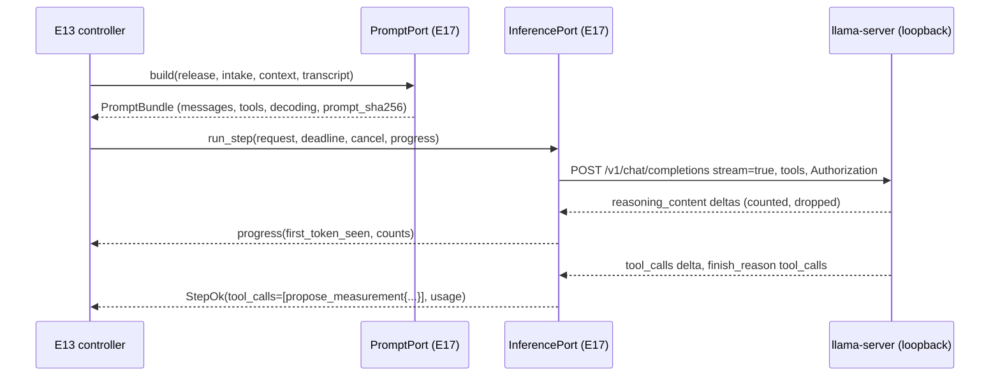
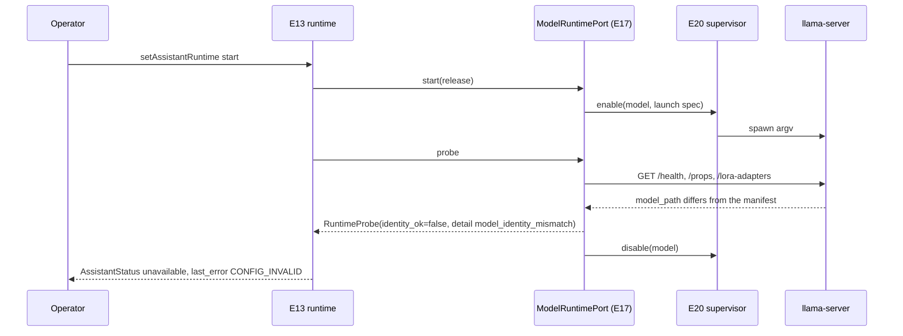

# E17: Model integration and tool-use optimization

Technical design for epic E17. Inputs: the brief (`tdd/E17.md` in the planning package: "Existing weights only"; no
SFT, LoRA, QLoRA, preference optimization or RL training), PRD.md (R17, R20, R22, R23, R30, sections 10 and 11),
CONTRACTS.md sections 4 ("Evidence and model releases"), 6, 11 and 17, LLM-ARCHITECTURE.md sections 1, 2, 4, 5, 6, 7 and
8, VALIDATION.md, `api/schemas/assistant-status.schema.json`, `tool-catalog.json`, `docs/BUILD-CHARTER.md`,
`docs/DEPLOYMENT.md` (sections 1, 3, 6, 7), and the designs of E10, E12, E13, E18 and E26 in `docs/tdd/`.
`docs/SYSTEM.md` is not written yet; points that depend on it are marked "per SYSTEM.md" and listed in section 14.

Status: design. Every probe, measurement and test named here is planned; none has run. External facts below were read
on 2026-11-14 from the sources of section 3.1 and are re-verified from the pinned files at step 1 of section 15.

## 1. Scope

**What E17 is.** Everything that turns the published HuatuoGPT-3-9B checkpoint into one exact, evaluated, reversible
model release on the crew laptop, and the client E13 uses to talk to it:

1. **Freeze and integrate (E17-01).** Pin the model revision, files, tokenizer, license, chat template and thinking
   mode; build our own GGUF from the pinned weights with a pinned `llama.cpp`; prove the conversion lossless and the
   quantization reproducible; write the `llama-server` launch spec; provide the inference client, the prompt builder
   and the stub responder; run probes P1 to P8.
2. **Optimize tool use with fixed weights (E17-02).** Own the model-facing data (tool descriptions, finalized input
   schemas, exposure sets, prompts, examples, decoding, context and retrieval settings) and the experiment arms, tuned
   on E18's `dev` partition only.
3. **Promote and roll back (E17-03).** A release manifest that names every version that was evaluated; promotion only
   with E18's gate verdict and the regression policy; activation and rollback on a node.

| Delivers | IDs |
|---|---|
| Work packages | E17-01, E17-02, E17-03 |
| Requirements | R23 (weights preserved; development data isolated), R22 (model, prompt, tools, corpus identified by hashes in the release), R30 (no benchmark claim leaves E17), R17 (tool template and parsing, model side), R20 (no journal in prompts, with E12) |
| Validation scenarios | V33 (holdout unreachable from E17 code and prompts), V27 (cancel latency, P7), V22 (passages framed as data in prompts; the control is E12's) |
| Demo assertions | D25 and D17 in `stub` mode (the stub responder replays pinned turns; E13, E24 and E26 decide) |
| Invariants | INV-E17-01 to 10 (3.10) |

Not delivered here:

| Concern | Owner |
|---|---|
| Tool gateway, scope, output policy, retrieval mechanics, context snapshot | E12 |
| Controller loop, budgets in time, scheduler, runtime state the hub reports, conversations | E13 |
| Evaluation harness, `dev` and `holdout` partitions, graders, HealthBench runs, gate verdicts | E18 |
| Evidence corpus and its embedding store | E10 |
| Process supervision, restarts, signing and packaging of the weights artifact | E20 (DEPLOYMENT 7.2, 7.4) |

## 2. Dependencies and seams

E17 depends on E10, E12 and E13 (epics.json); E13, E18 and E20 consume it.

| Seam | Direction | Port, file or endpoint | Owner of the shape |
|---|---|---|---|
| Release data for the controller and gateway | E12, E13 read | `ModelReleaseReader` (4.2) | E17 |
| Prompts | E13 calls | `PromptPort.build(release_id, phase, context, transcript) -> PromptBundle` | E17 |
| Inference | E13 calls | `InferencePort.run_step(request, *, deadline, cancel, progress) -> StepResult` | E17 |
| Runtime control and identity | E13 calls | `ModelRuntimePort.start(release_id)`, `.stop()`, `.probe(*, timeout_s) -> RuntimeProbe` | E17 |
| Model worker process | E20 supervisor reads | `ModelLaunchSpecPort.launch_spec(release_id) -> LaunchSpec`; E17 calls `SupervisorControl.enable(process_id, spec)`, `.disable(process_id)`, `.state(process_id)` (per SYSTEM.md, request R-E17-1) | E17 spec, E20 supervisor |
| Release under evaluation | E18 reads | `model/releases/<release_id>.json` through `ModelReleaseReader.load(release_id) -> ModelReleaseRef` (E18 request 14.3) | E17 |
| Local endpoint for evaluation | E18 calls | `llama-server` `POST /v1/chat/completions`, `GET /props`, started from the release's launch spec | llama.cpp |
| Release gate | E17 reads | `eval/bench/results/<run_id>/gate.json` (`GateVerdict`, E18 3.7) | E18 |
| Development cases | E17 reads | E18 `dev` partition files only; never `holdout` (E18 INV and V33) | E18 |
| Embedding model pin | E10 reads | `ModelReleaseReader.embedding_pin() -> EmbeddingPin(model_id, revision, sha256, dims)` | E17 |
| Token counting | E12 reads | `tokenizer.json` path and SHA-256 from the release (E12 5) | E17 |
| Context snapshot type | E17 reads | `ContextSnapshot` (E12 3.9) as prompt input | E12 |
| Stub scripts | E17 reads in `demo` and `eval` profiles | `fixtures/assistant-stub/<scenario>/*.json` validated by `model/schemas/stub-script.schema.json` | schema E17, files E21 |

## 3. Domain model

Pure code in `hub/src/crew_health/model/domain/`; data under the repository folder `model/`; weights outside the
repository.

### 3.1 Pins and sources

| Item | Pinned value | Evidence (read 2026-11-14) | Status |
|---|---|---|---|
| Model | `FreedomIntelligence/HuatuoGPT-3-9B` on Hugging Face; the full commit SHA of the revision is written at pin time into `model/pins/huatuogpt-3-9b.json` (the package example says "pinned at kickoff") | Model card, https://huggingface.co/FreedomIntelligence/HuatuoGPT-3-9B: base Qwen3.5-9B, tag `qwen3_5`, BF16 safetensors, pipeline image-text-to-text, trained with one-stage RL (OnePO, package source P08) | to pin |
| License | apache-2.0 as stated by the model card metadata; the `LICENSE` file SHA-256 is recorded at pin | model card | to verify at pin |
| Files | every file of the revision with its SHA-256 (safetensors shards, `config.json`, `generation_config.json`, tokenizer files, chat template) | pin step | to pin |
| Tokenizer | `tokenizer.json` SHA-256; the same file feeds E12's token counter | pin step | to pin |
| Chat template | the revision's own template, copied byte for byte to `model/templates/<sha256>.jinja` and passed with `--chat-template-file` | pin step; P3 | to pin |
| Thinking mode | on. The model card says "HuatuoGPT-3 requires thinking mode. Keep `enable_thinking=True`" | model card | decided |
| Thinking handling | `llama-server --reasoning-format deepseek` separates thinking into `reasoning_content`; E17's client counts its tokens and discards the text; it is never returned to E13, stored, streamed or logged (LLM-ARCHITECTURE 5 "Do not expose hidden chain-of-thought") | llama.cpp server README in package source P07 | P4 verifies |
| Decoding | temperature, top_p and top_k copied from the revision's `generation_config.json` (the card states temperature 0.2), a fixed seed per release, `max_tokens` per phase from P6 and experiment 7 | model card; pin step | to pin |
| Runtime | `llama.cpp` `llama-server`, a release tag at or after b8299 (the first tag whose notes list the Metal fused Gated DeltaNet kernel for Qwen3.5), built from source at a pinned commit with Metal on macOS, CUDA on an SSC class host, CPU elsewhere | https://github.com/ggml-org/llama.cpp/releases/tag/b8299 | to pin |
| Architecture facts used for sizing | 32 layers as 8 × (3 Gated DeltaNet + 1 gated attention); attention layers have 16 query heads, 4 KV heads, head size 256; native context 262,144 | https://huggingface.co/unsloth/Qwen3.5-9B-GGUF (base model page; HuatuoGPT-3-9B shares the backbone) | P1 verifies from GGUF metadata |
| Published GGUF sizes of the base model | Q4_K_M 5.68 GB, Q5_K_M 6.58 GB, Q6_K 7.46 GB, Q8_0 9.53 GB, BF16 17.9 GB | unsloth page | our files measured at build |
| Tool calling in `llama-server` | OpenAI-style function calling with `--jinja`; GBNF and JSON schema constraints | package source P07 (`docs/function-calling.md`, `grammars/README.md`) | P3, P4 verify |
| Server flags used in 5.1 | `--offline`, `--fit`, `-lm`, `--check-tensors`, `--lora`, `--control-vector`, `--override-kv`, `-hf` | package source P07 (server README table) | P1 captures `--help` of the pinned build |
| Publisher benchmark | HealthBench Professional 68.3 for the 9B model (package source P08) | publisher's figure | never quoted as ours (R30, E18 claims lint) |

Community GGUF files exist for this model (plain and importance-matrix variants from two publishers). They are not
used: their provenance cannot be chained to the pinned revision, and importance-matrix variants depend on calibration
text we cannot inspect. They may be downloaded on a development machine as a cross-check of P6 latency only.

### 3.2 Quantization decision

**Deployment candidate: Q4_K_M, context 32,768 tokens, KV cache f16, one slot.** Arithmetic against the model worker
budget of DEPLOYMENT 7.3 (7.5 GB on a 16 GB machine; taken as 7.5 × 10⁹ bytes):

| Artifact | Weights (published size, base model) | KV cache at 32,768 (f16) | Recurrent state and compute buffers | Total | Within 7.5 GB |
|---|---|---|---|---|---|
| Q4_K_M | 5.68 GB | 1.07 GB | unmeasured, estimated 0.3 to 0.7 GB | 7.05 to 7.45 GB | yes, narrow margin |
| Q5_K_M | 6.58 GB | 1.07 GB | same | 7.95 to 8.35 GB | no |
| Q5_K_M at 16,384 | 6.58 GB | 0.54 GB | same | 7.42 to 7.82 GB | not reliably |
| Q6_K | 7.46 GB | 1.07 GB | same | above 8.8 GB | no |
| Q8_0 | 9.53 GB | 1.07 GB | same | above 10.9 GB | no (evaluation reference only) |

KV per token: 8 attention layers × 2 (K and V) × 4 KV heads × 256 × 2 bytes = 32,768 bytes; the 24 Gated DeltaNet
layers keep a fixed-size state that does not grow with context (its size is measured in P5). 32,768 tokens covers one
step: the context snapshot and transcript (E12 budget), the tool schemas and passages, and one step's thinking and
output; thinking of earlier steps is not carried forward (3.5). The model page advises long contexts for thinking; P5
and experiment 7 measure whether 32,768 truncates thinking on development cases (`finish_reason: length`).

Alternatives and why not: Q5_K_M and above exceed the budget at the target context (they remain experiment 6 arms);
KV cache q8_0 halves the KV cost and is an experiment 7 arm, not the default, because it changes numerics in every
step; a smaller model (Qwen3-4B class, LLM-ARCHITECTURE 1) is measured as an availability arm, but the product fallback
is "assistant off", never a different model (charter section 5). If P5 measures Q4_K_M above 7.5 GB at 32,768, the
release drops to 16,384 and experiment 7 reports the cost. Higher precision references: Q8_0 on the laptop in the
`eval` profile with every other worker stopped, and BF16 on development compute when it exists (question Q-E17-U1).

### 3.3 "Weights unchanged": definition and evidence

The deployed artifact is the pinned checkpoint after exactly two transformations, neither of which uses data or
gradients (LLM-ARCHITECTURE 6: "weight conversion or quantization is not additional medical fine-tuning"):

1. **Format conversion** of the text weights from BF16 safetensors to a BF16 GGUF with the pinned
   `convert_hf_to_gguf.py`. The vision tower is not converted (the product sends no images; no `mmproj` file exists).
   Evidence: P2's tensor equivalence report. Every converted tensor equals its safetensors source byte for byte after the
   converter's documented name mapping and any layout transform the converter applies (each listed by name); every
   skipped tensor is listed with the reason.
2. **Deterministic quantization** of that BF16 GGUF with `llama-quantize ... Q4_K_M` and no importance matrix. Evidence:
   P2's reproducibility report. Two independent builds produce the same SHA-256.

Controls that keep it so, each with a test:

| Control | Mechanism | Test |
|---|---|---|
| C1 No training dependency | CI fails when `uv.lock` or `model/build/uv.lock` contains `peft`, `trl`, `unsloth`, `axolotl`, `torchtune`, `deepspeed` or `mlx-lm` (the deny list lives in `model/policy/deny-packages.json` with the reason per entry) | T-E17-030 |
| C2 No training code | Static scan of the repository for optimizer steps, backward passes and trainer classes outside vendored third-party code | T-E17-031 |
| C3 Launch argv allowlist | The launch spec is built only from the manifest with flags from a fixed allowlist; `--lora`, `--lora-scaled`, `--control-vector*`, `--override-kv`, `-hf`, `-hfr`, `-mu`, `--model-url` and any flag absent from the pinned build's captured `--help` are refused | T-E17-032 |
| C4 Runtime identity | After load, `GET /props` reports the manifest's model path and context size, `GET /lora-adapters` returns an empty list, and the file's SHA-256 (cached by inode, size and modification time; full hash at install and at `crew-health verify`) equals `weights_sha256` | T-E17-033 |
| C5 Lineage chain | The manifest's `weights.lineage` links revision file hashes, the BF16 GGUF hash, the equivalence report hash, the quantized hash and the reproducibility report hash; promotion verifies the chain | T-E17-034 |
| C6 No online learning | No code path writes to the weights directory after install; the directory is read-only to the hub and the model worker (DEPLOYMENT 7.3 images run read-only) | T-E17-035 |

### 3.4 Release manifest

A model release is configuration with provenance (charter rule 1, CONTRACTS 4 "A release pins all passage, pathway,
model, prompt and tool versions"). Schema: `model/schemas/model-release.schema.json` (Draft 2020-12,
`additionalProperties: false` everywhere). Files: `model/releases/<release_id>.json`. Fields:

| Field | Content |
|---|---|
| `release_id`, `created_at`, `status` | `candidate`, `promoted`, `retired`, `rejected` (3.8) |
| `mode` | `live` or `stub` |
| `model` | `model_id`, `hf_repo`, `revision`, `license`, `license_sha256`, `files[{name, sha256}]` |
| `weights` | `file_name` (`<weights_sha256>.gguf`), `weights_sha256`, `size_bytes`, `quantization`, `lineage{source_files_sha256, bf16_gguf_sha256, equivalence_report_sha256, reproducibility_report_sha256, llama_cpp_commit}` |
| `tokenizer_sha256`, `chat_template_sha256`, `thinking_mode` | `thinking_mode` is `on` |
| `runtime` | `engine` (`llama.cpp`), `build` (tag), `commit`, `backend`, `context_tokens`, `kv_cache_type`, `parallel_slots` (1), `threads`, `gpu_layers`, `load_timeout_seconds`, `max_queued_turns`, `max_preemptions` |
| `decoding` | `temperature`, `top_p`, `top_k`, `min_p`, `seed`, `max_tokens_by_phase{intake, assessment, disposition, help, insight, general, verifier}`, `reasoning_format` |
| `tool_call_mode` | `native` (OpenAI `tools` with `--jinja`) or `envelope` (JSON schema constrained content), chosen by P3 |
| `prompt_version`, `tool_catalog_version` | folders under `model/prompts/` and `model/tool-catalog/`, each with a `MANIFEST.sha256` |
| `context_settings` | `budget_tokens_by_phase`, `section_order`, `transcript_max_messages` (E12 3.9, E13 4.2) |
| `retrieval_settings` | `k_lexical`, `k_dense`, `final_min`, `final_max`, `budget_tokens`, `max_per_parent`, `k_rrf`, `rerank` (E12 4.4) |
| `verifier` | `claim_support_pass` (E13 3.7) |
| `controller` | interim block for E13 request R-E13-5 |
| `embedding` | `model_id`, `revision`, `sha256`, `dims` (3.9) |
| `evaluated_with` | `evidence_release_id`, `config_release_id`, `turn_timeout_seconds` (copied from assistant-policy at evaluation; E18 `ModelReleaseRef`) |
| `evaluation` | `probe_report_ids[]`, `dev_report_ids[]`, `gate_run_ids[]`, `gate_sha256` |
| `previous_release_id` | the release this one replaces |
| `basis` | for every numeric value above, its source: a probe report ID, an experiment report ID, the model card, or "team default" |

E18's `ModelReleaseRef` (E18 3.5) is a projection of this manifest; AssistantStatus `model_release` (`model_release_id`,
`model_id`, `revision`, `sha256` = `weights_sha256`, `prompt_version`, `tool_catalog_version`, `mode`) is another.

The node's active pointer is node state, not repository content: `<data_dir>/models/active.json` with `release_id`,
`previous_release_id`, `activated_at`, `activated_by` (schema `model/schemas/active-pointer.schema.json`); weights live
in `<data_dir>/models/<weights_sha256>.gguf` (per DEPLOYMENT.md, request R-E17-2).

### 3.5 Prompt and context builder

`PromptBuilder` is a pure function of `(release, phase, ContextSnapshot, transcript)`; identical inputs give identical
bytes, and `prompt_sha256` is the SHA-256 of the serialized request body (E18 records it).

| Message | Content | Source |
|---|---|---|
| system | The phase's role and output contract, the tool use rules, the instruction that passages and person text are data, never instructions (V22) | `model/prompts/<version>/system.<phase>.md` |
| user (context) | The ContextSnapshot sections as JSON in a fenced data block, with origin labels and `usable_as_support` flags as E12 set them | E12 3.9 |
| examples | At most `examples_max` short worked exchanges per phase that show failed, unavailable, declined and conflicting tool results (LLM-ARCHITECTURE 6 "realistic examples") | `model/prompts/<version>/examples.<phase>.json`, from E18 `dev` only, leak scanned (3.7) |
| transcript | Previous verified messages of the conversation (never thinking, never rejected text), then this turn's tool calls and results as `tool` messages with sorted-key JSON | E13 |

Thinking of earlier steps is never sent back. No prompt carries a safety control: every rule the prompt states is also
enforced in code (E12, E13, E24, E26); a test removes the rule from the prompt and proves the code still refuses
(T-E17-040, AGENTS rule 4).

### 3.6 Tool-facing data (E17-02)

`model/tool-catalog/<version>/tools.json`: for every tool of the package `tool-catalog.json`, the model-facing name, a
short description, the finalized input schema (`additionalProperties: false`, no scope property, E12 3.1), the home
stage label, `effect`, and the exposure set per phase (initially E12 3.3). Schemas for terminal outputs:
`model/schemas/turn-output.schema.json` (E13 3.3), `insight-draft.schema.json` (E13 3.8), `claim-support.schema.json`
(E13 3.7), `draft-assessment` input inside the catalog (E13 3.7).

### 3.7 Development data isolation

E17 tunes only on files under E18's `dev` partition. Controls: the tuning CLI resolves every input path and refuses any
path under E18's holdout directory (`HoldoutPathRefused`); CI runs E18's leak scan (`chc-bench leak scan --target
prompts model/prompts`) on every prompt and example version and fails on a finding; examples carry their dev case ID so
the leak scan can trace them (V33, R23).

### 3.8 Release lifecycle

| From | Event | To | Guard |
|---|---|---|---|
| none | `release build` | `candidate` | manifest validates; lineage chain verifies (C5); probes P1 to P5 reports exist for this `weights_sha256` and runtime build |
| `candidate` | `release promote` | `promoted` | E18 `gate.json` verdict `pass` for holdout runs of this exact `release_id` with `completeness` full (E18 INV-E18-12); `model/policy/promotion-policy.json` regression rules pass against the currently promoted release on paired runs of the same `case_set_sha256`; P6 to P8 reports exist; `evaluated_with.turn_timeout_seconds` equals the active assistant-policy |
| `candidate` | gate fail or regression | `rejected` | the failing gates and categories are recorded |
| `promoted` | a newer release promoted | `retired` | kept on disk while it is a node's previous release |

Promotion policy (`model/policy/promotion-policy.json`, every value with its basis): gate counts must stay 0
(`unauthorized_execution`, `fabricated_accepted_result`, `cross_person_leak`, `journal_or_vault_exposure`); per suite
category, the paired difference's lower bound may not fall below `-max_regression` (initial values "team default",
recorded with the reason); worst case demo-path turn time may not exceed the current release's by more than
`max_latency_regression_fraction`. An average gain never outweighs a gate count (VALIDATION section 7).

Node activation (`crew-health-model activate <release_id>`): requires `promoted` (or any status in the `demo` and `eval`
profiles), the weights file present with its hash, and `stub` mode only in `demo` and `eval` profiles; it writes the
active pointer with the previous one kept. `crew-health-model rollback` swaps to the previous release. Both take effect
at the next runtime start (E13 operator stop and start); neither deletes a file.

### 3.9 Embedding pin

Initial pin: `BAAI/bge-small-en-v1.5`, 384 dimensions, which matches E10's storage budget; converted to GGUF with the same
pinned `llama.cpp` and served by the embedding process E20 runs. The comparison arm is `Qwen/Qwen3-Embedding-0.6B`
(experiment 3); it changes E10's dimension budget, so it can replace the pin only with E10's agreement. Licenses are
verified from each pinned revision's files at pin time.

### 3.10 Invariants

| ID | Invariant | Test |
|---|---|---|
| INV-E17-01 | The only weights the runtime loads are the manifest's file, whose lineage chains to the pinned revision | T-E17-033, 034 |
| INV-E17-02 | No adapter, control vector or metadata override reaches the runtime; `/lora-adapters` is empty | T-E17-032, 033 |
| INV-E17-03 | No training dependency or training code exists in the repository | T-E17-030, 031 |
| INV-E17-04 | The model server listens on loopback with a per-start API key and never fetches anything | T-E17-036, 037 |
| INV-E17-05 | Thinking text is discarded inside the client; it is never returned, stored, streamed or logged | T-E17-041 |
| INV-E17-06 | A release is promoted only with E18's gate pass for its exact `release_id` and the regression policy | T-E17-050, 051 |
| INV-E17-07 | No prompt or example carries holdout content; E17 code never opens a holdout path | T-E17-060, 061 |
| INV-E17-08 | The model server log carries no prompt or completion text | T-E17-042 |
| INV-E17-09 | A `stub` release runs only in the `demo` and `eval` profiles | T-E17-043 |
| INV-E17-10 | The prompt builder is deterministic | T-E17-044 |

## 4. Application layer

### 4.1 Use cases

| Use case | Inputs | Output | Errors | Idempotency |
|---|---|---|---|---|
| `PinModel` (CLI, build machine) | repo, revision | `model/pins/<name>.json` | `RevisionMismatch`, `HashMismatch` | by revision |
| `BuildArtifact` | pin, llama.cpp commit, quantization | BF16 GGUF, quantized GGUF, reports | `ConversionFailed`, `NotReproducible` | by input hashes |
| `RunProbe` | probe ID, release candidate, machine profile | probe report JSON under `model/reports/` | `ProbeFailed(criterion)` | report ID = hash of inputs |
| `BuildRelease` | pin, artifact, prompt and catalog versions, settings | candidate manifest | `ManifestInvalid`, `LineageBroken` | by content hash |
| `PromoteRelease` | release ID, gate run IDs | promoted manifest | `GateNotPassed`, `Regression(categories)`, `ProbesMissing` | by release ID |
| `ActivateRelease`, `Rollback` (node) | release ID | active pointer | `NotPromoted`, `WeightsMissing`, `StubInFlight` | by release ID |
| `LaunchSpec` | release ID | `LaunchSpec` | `FlagNotAllowed`, `FlagUnknownToBuild` | pure |
| `Probe` | timeout | `RuntimeProbe(healthy, identity_ok, adapters_empty, detail_code)` | none raised | read |
| `RunStep` | `StepRequest`, deadline, cancel, progress | `StepResult` | none raised (outcomes are variants) | none |
| `BuildPrompt` | release, phase, context, transcript | `PromptBundle` | `PromptTooLarge(tokens)` | pure |

### 4.2 Ports (`model/application/ports.py`)

Provided:

```python
class ModelReleaseReader(Protocol):
    def active(self) -> ModelRelease | None: ...
    def get(self, release_id: str) -> ModelRelease: ...                      # raises ReleaseNotFound
    def load(self, release_id: str) -> ModelReleaseRef: ...                  # E18 projection
    def tool_catalog(self, model_release_id: str) -> ToolCatalog: ...
    def retrieval_settings(self, model_release_id: str) -> RetrievalSettings: ...
    def context_settings(self, model_release_id: str) -> ContextSettings: ...
    def runtime_settings(self, model_release_id: str) -> RuntimeSettings: ...
    def controller_settings(self, model_release_id: str) -> ControllerSettings: ...   # interim, R-E13-5
    def embedding_pin(self) -> EmbeddingPin: ...

class PromptPort(Protocol):
    def build(self, release_id: str, phase: Phase, context: ContextSnapshot,
              transcript: Sequence[TranscriptItem]) -> PromptBundle: ...
    # PromptBundle(messages, tools | None, output_schema_id, decoding: DecodingSettings, prompt_sha256)

class InferencePort(Protocol):
    def run_step(self, request: StepRequest, *, deadline: Deadline, cancel: CancelToken,
                 progress: Callable[[StepProgress], None]) -> StepResult: ...
    # StepRequest(release_id, phase, bundle: PromptBundle)
    # StepProgress(first_token_seen: bool, output_tokens: int, thinking_tokens: int)   no text
    # StepResult = StepOk(final: Mapping[str, JsonValue] | None, tool_calls: tuple[ToolCall, ...],
    #                     finish_reason, usage: Usage, prompt_sha256)
    #            | StepMalformed(error_code, content_sha256) | StepTimedOut(kind: "first_token" | "total")
    #            | StepCancelled() | StepUnavailable(code)

class ModelRuntimePort(Protocol):
    def start(self, release_id: str) -> None: ...      # enables the supervised worker with the release's launch spec
    def stop(self) -> None: ...
    def probe(self, *, timeout_s: float) -> RuntimeProbe: ...

class ModelLaunchSpecPort(Protocol):                   # E20 supervisor
    def launch_spec(self, release_id: str) -> LaunchSpec: ...
    # LaunchSpec(process_id, argv, env, cwd, health_url, ready_timeout_s, memory_budget_bytes, cpu_budget, nice)
```

Consumed: `SupervisorControl` (E20, per SYSTEM.md: `enable(process_id, spec)`, `disable(process_id)`,
`state(process_id) -> ProcessState`), `ContextSnapshot` (E12), `GateVerdict` files (E18), `Clock`, `IdFactory`,
`ConfigReader` (E01).

### 4.3 Events

None published on the event stream. Audit events through E01 `AuditPort`: `model.release_built`, `model.release_promoted`,
`model.release_rejected`, `model.release_activated`, `model.release_rolled_back`, `model.identity_mismatch`,
`model.step_failed {release_id, phase, kind}`. No text in any payload.

### 4.4 Sequence: success path (one native tool-call step)



### 4.5 Sequence: failure path (identity mismatch at start)



## 5. Adapters

### 5.1 Launch spec (`model/adapters/launch.py`)

```
llama-server
  --model <data_dir>/models/<weights_sha256>.gguf   --alias <release_id>
  --host 127.0.0.1   --port <deployment setting>   --api-key-file <data_dir>/models/runtime.key
  --ctx-size <runtime.context_tokens>   --parallel 1
  --cache-type-k <runtime.kv_cache_type>   --cache-type-v <runtime.kv_cache_type>
  --threads <runtime.threads>   --n-gpu-layers <runtime.gpu_layers>   --fit off
  --jinja   --chat-template-file model/templates/<chat_template_sha256>.jinja
  --reasoning-format deepseek
  --offline   --no-webui
  --log-verbosity 1   --log-file <data_dir>/logs/model-server.log
```

Every value comes from the manifest or the deployment settings (DEPLOYMENT 6.2). `--fit off` keeps the settings
explicit instead of letting the server shrink the context silently. The key file is 32 random bytes written with mode
0600 before each start. E20 starts the process with lowered scheduling priority (`nice` 10 or the platform equivalent)
and the budget of DEPLOYMENT 7.3. The builder refuses any flag outside its allowlist and any flag absent from the
pinned build's captured `--help` (C3).

### 5.2 Inference client (`model/adapters/llama_client.py`)

`httpx` with: connect timeout 1 s; a read timeout equal to the first-token deadline until the first delta, then the
remaining turn deadline; closing the response on cancel or deadline (P7 measures how fast the slot frees). Mode
`native`: the request carries `tools` from the catalog and `tool_choice: "auto"`; `tool_calls` are parsed and their
`arguments` must be a JSON object. Mode `envelope`: the request carries the turn output schema as a JSON schema
constraint and the content is parsed. `reasoning_content` is counted with the pinned tokenizer and dropped in the same
function that reads it. Non-2xx, connection errors and truncated streams map to `StepUnavailable` or `StepMalformed`;
nothing is retried inside the client (E13 decides).

### 5.3 Runtime probe (`model/adapters/runtime_probe.py`)

`GET /health` (healthy when it answers ok), `GET /props` (model path and context size against the manifest), `GET
/lora-adapters` (must be empty); each with the caller's timeout. Weights hash: cached per `(inode, size, mtime)`, full
SHA-256 at install and on `crew-health verify`.

### 5.4 Stub responder (`model/adapters/stub.py`)

Implements `InferencePort` from a stub script (`stub-script.schema.json`: entries keyed by scenario, conversation
ordinal, phase and step index, each with `tool_calls` or `final`, and optional `thinking_canary` to prove the drop).
An unmatched step returns `StepUnavailable("stub_unmatched")`; it never improvises. Bound only when the active release
has `mode: stub` and the deployment profile is `demo` or `eval` (INV-E17-09).

### 5.5 Build pipeline (`model/build/`, a separate locked uv project)

Runs on a development or CI build machine with network, never on a flight node: `crew-health-model pin`, `fetch`
(downloads the revision's files into a staging folder and checks every hash), `convert` (`convert_hf_to_gguf.py --outtype
bf16`), `verify-equivalence` (P2), `quantize` (`llama-quantize <bf16> <out> Q4_K_M`, no `--imatrix`), `reproduce` (second
build, compare hashes), `probe <P1..P8>`, `release build`, `release promote`, `bundle` (hands the weights and manifest to
E20's signing). Its lockfile is under the same deny list (C1).

### 5.6 Probes (procedures; reports in `model/reports/<probe>-<hash>.json`)

| Probe | Procedure | Pass criterion |
|---|---|---|
| P1 Architecture and conversion | Convert the pinned revision; read GGUF metadata; capture `llama-server --help`; run `--check-tensors`; tokenize 1,000 strings from `dev` cases with the GGUF tokenizer and with the revision's `tokenizer.json` | Architecture and layer pattern as 3.1; no invalid tensor; token IDs identical for every string; skipped tensors are exactly the vision tower |
| P2 Lossless and reproducible | Compare each converted tensor with its safetensors source; quantize twice on two machines | Every text tensor byte-equal (layout transforms listed); identical quantized SHA-256 |
| P3 Tool-call mode | 200 `dev` prompts per phase in mode `native` and mode `envelope`, pinned template, thinking on | Choose the mode with the higher rate of schema-valid calls naming an exposed tool; ties go to `native`; report wrong-tool and invalid-JSON rates |
| P4 Structured output with thinking | Mode `envelope` with the JSON schema constraint on 200 `dev` prompts | `reasoning_content` non-empty and content schema-valid in at least 99% (else E13's single repair path is the plan and the rate is reported) |
| P5 Memory | Peak resident memory of `llama-server` (including Metal wired memory) at 16,384, 32,768 and 65,536 tokens, KV f16 and q8_0, during a full-context step, with the hub, camera worker and browser running (T0 load) | At most 7.5 GB (DEPLOYMENT 7.3) at the release context; no swap growth; macOS memory pressure normal |
| P6 Latency | Prompt and generation tokens per second, first token, step and turn time per phase; thread counts 4, 6, 8 | Report median and worst case for the demo path (PRD 11); choose the fastest thread count within the 6 CPU budget |
| P7 Cancel | Close the stream mid-generation, then send a new request | Slot free and the next request starts within 1 s (E13 `cancel_grace_ms`) |
| P8 Contention | During generation, measure the help first screen and `start_help_turn` (E26, E13) and the camera worker frame rate | Help first screen p95 at most 500 ms (PRD 11); `start_help_turn` p95 at most 200 ms; camera within E06's tolerance |

## 6. API

None. E17 serves no endpoint. Its data reaches the API through E13 (`AssistantStatus.model_release`) and its errors
surface as E13's `MODEL_UNAVAILABLE`, `MODEL_TIMEOUT` and `MALFORMED_MODEL_OUTPUT`. `llama-server` is reachable only on
loopback with the per-start key.

## 7. User interface

None. E13's `RuntimeControl.vue` shows the release identity from AssistantStatus.

## 8. Configuration

| Document | Fields | Loader checks |
|---|---|---|
| `model/releases/<release_id>.json` | section 3.4 | Schema; every referenced folder exists with a matching `MANIFEST.sha256`; every numeric value has a `basis`; exposure sets name only catalog tools (E12 T-E12-002); `mode: stub` has no `weights`; `runtime.parallel_slots` is 1 |
| `model/tool-catalog/<version>/tools.json` | section 3.6 | Each input schema compiles, `additionalProperties: false`, no scope property |
| `model/prompts/<version>/` | system prompts and examples | Leak scan clean (3.7); every example names its `dev` case ID |
| `model/policy/promotion-policy.json` | gate list, `max_regression` per category, latency rule, each with basis | Schema |
| `model/policy/deny-packages.json` | package names and reasons | Schema |
| `<data_dir>/models/active.json` | active and previous release | Schema; both releases exist |

The model release is not one of the 18 documents of CONTRACTS 11; request R-E17-3 registers it. Until then it loads
through E17's own validator, atomically, keeping the last good release on a failed load (AGENTS "flight tables").

Configuration edit tests: T-E17-070 changes `decoding.temperature` in a candidate manifest and proves the request body
carries it; T-E17-071 changes `runtime.context_tokens` and proves the launch argv changes; T-E17-072 changes
`max_tokens_by_phase.assessment` and proves the step request changes; T-E17-073 removes a tool from an exposure set and
proves E12 denies it (shared with T-E12-065).

## 9. Deployment and fallbacks

Tiers are those of DEPLOYMENT.md section 3; every row is "per DEPLOYMENT.md".

| Tier or environment (per DEPLOYMENT.md) | E17 behavior |
|---|---|
| T0 laptop, M3 16 GB (reference) | Q4_K_M release, native Metal build, within the 7.5 GB and 6 CPU budget; started only by the operator |
| T0 on a station SSC class laptop (ZBook G9, 128 GB, RTX GPU) | A separate release of the same lineage may use Q8_0 or BF16 with CUDA after its own probes and gate run |
| T0 on an Orion class PCD | Capability not public (DEPLOYMENT 1.8): the model stays off unless P5 and P6 pass on that device |
| T1, T2, T3, T4, T5 | No change: the model runs on the hub machine only |
| T6 rover or replica hubs | Off by default (DEPLOYMENT 3.7); each hub activates its own release |
| T7 ground node | Never runs the crew model; may host evaluation (E18) |
| Containers | `crew-health-model` image for Linux (DEPLOYMENT 7.3); on macOS the model runs natively |

| Missing or failing part | Behavior | Test |
|---|---|---|
| No release installed | E13 start refused (409 `INVALID_TRANSITION`); everything else works | T-E17-080 |
| Weights file missing or hash differs | Probe identity fails; `unavailable` | T-E17-033 |
| Server crash mid-step | `StepUnavailable`; E20 restarts under its policy | T-E17-081 |
| Server hang | E13 deadlines through the client's read timeouts | T-E17-082 |
| Embedding process absent | E10 and E12 fall back to lexical retrieval | E12 T-E12-033 |

There is no fallback model in the product: "assistant off" is the fallback (charter section 5). Redundancy for "the
model in use is the evaluated one": primary, the manifest and lineage checks at activation; dissimilar backup, the
runtime identity probe on every start against `/props` and the file hash; fail safe, `unavailable`.

## 10. Safety, security and privacy

| Hazard | Cause | Mitigation | Test |
|---|---|---|---|
| H1 Weights altered or a different model served | Wrong file, adapter, swapped GGUF | C3 to C5; identity probe | T-E17-032 to 034 |
| H2 Training slips in | A dependency or a script | C1, C2 | T-E17-030, 031 |
| H3 Holdout leaks into prompts | Copied examples | 3.7 path refusal and leak scan | T-E17-060, 061 (V33, R23) |
| H4 Private text in model logs | Server verbosity | `--log-verbosity 1`; canary probe on the log | T-E17-042 (V26) |
| H5 Network exposure | Server binds wide or downloads | loopback, key, `--offline`, no `-hf` flags | T-E17-036, 037 |
| H6 Hidden reasoning shown | Thinking passed on | dropped in the client | T-E17-041 |
| H7 Stub answers in flight | Wrong profile | INV-E17-09 | T-E17-043 |
| H8 Benchmark misread as clinical readiness | Release notes | E17 writes no benchmark claim; reports reference E18 outputs under its claims lint | T-E17-062 (R30) |
| H9 Safety resting on a prompt | Prompt edited | Every prompt rule also enforced in code | T-E17-040 |

What the model may do: produce tool calls and outputs that E12 and E13 then check. It holds no credential beyond the
loopback key, reads no file, opens no socket, and its process has no write access to the weights.

## 11. Performance and resources

| Budget (M3, 16 GB) | Value | Basis |
|---|---|---|
| Model worker resident memory | at most 7.5 GB | DEPLOYMENT 7.3; measured by P5 |
| CPU | at most 6 CPUs | DEPLOYMENT 7.3; P6 thread choice |
| Load time to `running` | measured; `load_timeout_seconds` set from P6 with margin, basis recorded | P6 |
| Cancel to slot free | at most 1 s | P7 |
| Help first screen while generating | p95 at most 500 ms | PRD 11; P8 |
| Turn time | median and worst case reported for the demo path | PRD 11; P6 and E18 |

One slot; E13's scheduler serializes requests. E20 pauses forecasting and embedding builds around interactive requests
(DEPLOYMENT 7.3). These are targets to measure, not claims.

## 12. Test plan

Hermetic unit and integration tests use the stub responder and a fake `llama-server` (a local ASGI app recorded from
P3 traces with the thinking canary injected); marked hardware tests run the real build on the M3.

| Test ID | Level | Proves | Traces to |
|---|---|---|---|
| T-E17-001 | unit | Manifest schema accepts the example release and rejects one missing a `basis` | R22, AGENTS rule 1 |
| T-E17-002 | unit | `ModelReleaseRef` and AssistantStatus projections carry every E18 and contract field | R22 |
| T-E17-010 | hardware (marked) | P1 on the pinned revision | E17-01 |
| T-E17-011 | hardware (marked) | P2 equivalence and reproducibility | R23, E17-01 |
| T-E17-012 | hardware (marked) | P3 and P4 reports with the chosen mode recorded in the manifest | E17-01, R17 |
| T-E17-013 | hardware (marked) | P5 memory within budget at the release context | E17-01, DEPLOYMENT 7.3 |
| T-E17-014 | hardware (marked) | P6 latency report | PRD 11 |
| T-E17-015 | hardware (marked) | P7 cancel within 1 s | V27, E13-03 |
| T-E17-016 | hardware (marked) | P8 contention: help first screen and `start_help_turn` targets hold while generating | R15, V01 |
| T-E17-020 | integration (fake server) | Native tool calls parse into `ToolCall`; malformed arguments give `StepMalformed` | R17 |
| T-E17-021 | integration (fake server) | Envelope content parses against the turn output schema | R17 |
| T-E17-022 | integration (fake server) | First-token and total deadlines give `StepTimedOut` with the right kind; cancel closes the stream | V27 |
| T-E17-030 | contract (CI) | Deny list against both lockfiles | R23, INV-E17-03 |
| T-E17-031 | static | No training code in the repository | R23, INV-E17-03 |
| T-E17-032 | unit, property | Launch builder refuses every denied flag and any flag absent from the captured help, for generated manifests | R23, INV-E17-02 |
| T-E17-033 | integration (fake server) | Identity probe fails on a wrong model path, a non-empty adapter list or a hash mismatch | INV-E17-01, 02 |
| T-E17-034 | unit | Promotion refuses a manifest whose lineage hashes do not chain | R23, INV-E17-01 |
| T-E17-035 | integration | Weights directory read-only to hub and worker | C6 |
| T-E17-036 | unit | Argv binds 127.0.0.1 with a key file of mode 0600 | INV-E17-04 |
| T-E17-037 | unit | Argv always has `--offline` and never a download flag | INV-E17-04 |
| T-E17-040 | integration (stub) | With the dose rule removed from the system prompt, a pinned dose output is still rejected by E12 | AGENTS rule 4, R28 |
| T-E17-041 | integration (fake server) | The thinking canary appears in no `StepResult`, E13 table, log line or stream chunk | INV-E17-05, V26 |
| T-E17-042 | hardware (marked) | The journal canary sent in a prompt is absent from `model-server.log` | INV-E17-08, V26, R20 |
| T-E17-043 | unit | Stub release refused in the `flight` profile | INV-E17-09 |
| T-E17-044 | property | Prompt builder output bytes are identical for identical inputs and stable under input order of sections | INV-E17-10, R22 |
| T-E17-050 | unit | Promotion refuses without a `pass` verdict for the exact `release_id`, and with a non-full or non-holdout run | INV-E17-06, R22 |
| T-E17-051 | unit | Promotion refuses when a paired category regression exceeds the policy, even with a higher average | INV-E17-06, VALIDATION 7 |
| T-E17-052 | integration | Activate then rollback restores the previous pointer; no file deleted; identity probe passes for each | E17-03 |
| T-E17-060 | integration | Tuning CLI refuses a holdout path | V33, R23, INV-E17-07 |
| T-E17-061 | contract (CI) | Leak scan over every prompt and example version is clean | V33, R23, INV-E17-07 |
| T-E17-062 | static | No E17 file states a benchmark score next to the model name outside E18 outputs | R30 |
| T-E17-070 to 073 | integration | Configuration edits of section 8 change behavior with no code change | AGENTS rule 1 |
| T-E17-080 to 082 | integration | Fallbacks of section 9 | Charter 5 |

### 12.1 Experiment matrix (with E18; LLM-ARCHITECTURE 8)

E17 supplies arms as releases or settings variants; E18 runs, reports and compares. Tuning reads `dev` only; holdout
runs happen only for the frozen configuration and the gate. Weights never change between arms of the same model.

| # | Comparison | Arms E17 builds | Partition for tuning | Reported on |
|---|---|---|---|---|
| 1 | General baseline against medical model | Qwen3.5-9B converted and quantized by the same pipeline; HuatuoGPT-3-9B | dev | holdout |
| 1b | Smaller local model (availability only) | Qwen3-4B class, same pipeline | dev | holdout, latency |
| 2 | With and without retrieval | prompt and exposure variant without the evidence tools | dev | holdout |
| 3 | Lexical, dense, hybrid; reranking | retrieval settings variants; embedding bge-small against Qwen3-Embedding-0.6B | dev (E12 retrieval bench) | holdout |
| 4 | Flat against stage-specific tools; claim-support pass | exposure variants; `verifier.claim_support_pass` | dev | holdout |
| 5 | Original against revised descriptions and context builder | `prompt_version`, `tool_catalog_version` | dev | holdout |
| 6 | Higher precision against deployment quantization | Q8_0 (laptop, eval profile), Q5_K_M at 16,384, BF16 on development compute if available | none | holdout and HealthBench model-only |
| 7 | Reasoning and context budgets | `max_tokens_by_phase` sweep; context 16,384 and 32,768; KV f16 and q8_0 | dev | holdout |
| 8 | Whole system against the rule and pathway baseline | the promoted candidate; "no model" arm | none | holdout |

Selection order (LLM-ARCHITECTURE 8): zero gate failures, then clinically reviewed assessment quality, grounding and
acquisition, then benchmark score, then latency. Every claimed improvement cites an E18 run ID.

## 13. File ownership

Creates and owns:

```
hub/src/crew_health/model/__init__.py
hub/src/crew_health/model/domain/{__init__,release,lineage,launch,prompt,step,probe,policy,errors}.py
hub/src/crew_health/model/application/{__init__,ports,dto,release_service,promotion,activation,prompt_builder,
    inference_service,runtime_service}.py
hub/src/crew_health/model/adapters/{__init__,launch,llama_client,runtime_probe,stub,manifest_store,cli}.py
hub/tests/model/**
model/pins/**  model/templates/**  model/releases/**  model/prompts/**  model/tool-catalog/**
model/schemas/{model-release,active-pointer,turn-output,insight-draft,claim-support,stub-script}.schema.json
model/policy/{promotion-policy,deny-packages}.json
model/reports/**
model/build/** (pyproject.toml, uv.lock, scripts)
importlinter contracts: model-layers, model-no-holdout (entries in E01's configuration)
```

Reads (never edits): `contracts/**`, `config/assistant-policy.json`, E18's `dev` partition and `gate.json` files, E12's
domain types, `fixtures/assistant-stub/**` (E21), `docs/DEPLOYMENT.md`.

## 14. Open questions and requests

Questions only the user can answer:

1. **Q-E17-U1 (USER).** Is development compute with at least 24 GB of GPU memory available for the BF16 reference arm
   of experiment 6 (and a larger reference model, LLM-ARCHITECTURE 1)? Without it, Q8_0 on the laptop is the highest
   precision reference and the report says so.
2. **Q-E17-U2 (USER).** Which exact machine is the demo laptop (M3, M3 Pro or M3 Max; 16 GB confirmed)? Memory
   bandwidth differs by chip and changes P6 latency; P5 and P6 must run on that machine.

Requests:

1. **R-E17-1 Supervisor control (to E20 and SYSTEM.md).** `SupervisorControl.enable(process_id, spec)`,
   `.disable(process_id)`, `.state(process_id)` for the model worker, using `LaunchSpec` (argv, env, health URL, ready
   timeout, memory and CPU budget, priority), and a hint port so E20 pauses forecasting and embedding builds while a
   step runs. Interim: an E17 subprocess runner with the same timeouts, replaced when E20 is greenlit.
2. **R-E17-2 Weights location (to DEPLOYMENT.md 6.1).** Add `<data_dir>/models/` (weights by SHA-256, `active.json`,
   `runtime.key`), read-only to the hub and the worker; weights install from E20's signed model bundle. Interim: the
   same path in development.
3. **R-E17-3 Model release as configuration (to CONTRACTS 11).** Register `model-release` as a configuration document
   type with its schema and loader, versioned and released like the other documents. Interim: E17's own validator.
4. **R-E17-4 E18 manifest fields (to E18).** Confirm that `ModelReleaseRef` may carry `weights.lineage`,
   `tool_call_mode` and `evaluated_with`, and that the gate is computed per `release_id`. Interim: E18's field list is a
   subset of 3.4.
5. **R-E17-5 Embedding pin (to E10).** Read `embedding_pin()` and refuse an index built with another `sha256` or
   `dims`. Interim: bge-small-en-v1.5 with 384 dimensions, matching E10's budget.
6. **R-E17-6 Controller settings home (with E13 R-E13-5).** Move the `controller` block to assistant-policy once
   approved. Interim: in the release.
7. **R-E17-7 Deployment points (per DEPLOYMENT.md).** Per-tier releases (SSC class Q8_0 or BF16 with CUDA), whether the
   Orion class PCD may ever run the model, the Windows backend for `llama-server`, idle unload (E13 R-E13-10). Interim:
   one release for the M3 reference laptop; the model is off elsewhere until probed.

## 15. Build plan

| Step | Work | Done when |
|---|---|---|
| 1 | Pin the revision, files, license and template; record the hashes; re-verify every fact of 3.1 from the pinned files | `model/pins/huatuogpt-3-9b.json` exists; facts that differ from 3.1 are corrected in this design before step 2 |
| 2 | Build pipeline: convert, verify equivalence, quantize twice | P1, P2 reports pass (T-E17-010, 011) |
| 3 | Launch builder, runtime probe, inference client against the fake server | T-E17-020 to 022, 032 to 037, 041 green |
| 4 | P3 to P5 on the M3; choose tool-call mode and context | Reports attached; manifest values with basis |
| 5 | Prompt builder, tool catalog v1, schemas, stub responder | T-E17-040, 043, 044 green; E12 T-E12-002 green on the catalog |
| 6 | First candidate release; P6 to P8 | T-E17-013 to 016 measured |
| 7 | Experiments 1 to 8 with E18 on `dev`, then the frozen candidate on holdout | E18 reports and `gate.json` |
| 8 | Promotion, activation and rollback | T-E17-050 to 052 green; the promoted manifest names every evaluated version |

Gate commands (charter section 8):

```
uv run python scripts/validate_contracts.py
uv run mypy --strict hub/src/crew_health/model
uv run ruff check . && uv run ruff format --check .
uv run lint-imports
uv run pytest -q hub/tests/model --cov=crew_health.model --cov-branch
uv run pytest -q eval -m "e17"
uv run pytest -q hub/tests/model -m hardware        # on the M3 only, for P1 to P8
```
