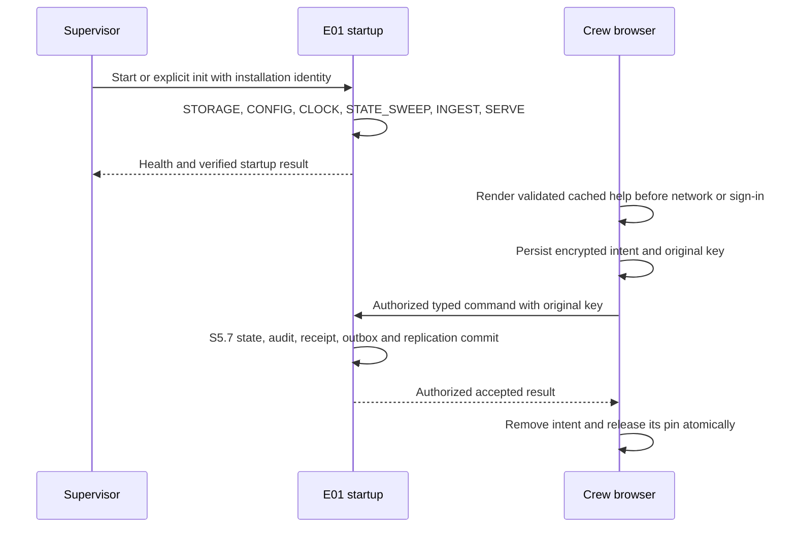

# E20: Accessibility, resilience and packaging

Technical design for E20. Binding inputs: `AGENTS.md`, `docs/SYSTEM.md`, `docs/DEPLOYMENT.md` and
`docs/requests/COORDINATOR-DECISIONS.md` Part A. Product paths below are relative to `docs/product/`;
S means SYSTEM, C means CONTRACTS, and DEP means DEPLOYMENT. Implementation evidence is planned until executed.
Pending shared interfaces are recorded in `docs/requests/E20.md`; they are not authorized substitutes for S5.

## 1. Scope

| Work package | Deliverable | Acceptance ownership |
|---|---|---|
| E20-01 | Accessible responsive flow suite over the built crew app | R24, V36; E03 owns screen fixes |
| E20-02 | Supervisor, offline mechanisms and fault/contention evidence | R25; V01, V16, V27, V35, V69, V97; D15, D41 |
| E20-03 | Native offline artifacts, compose profiles, CI, operator runbook and recovery orchestration | R26 packaging declarations; E21 supplies observed capability evidence |
| E20-04 | Body region menu, lock announcement, non-color marks, reduced motion and gradient contrast checks | R24, UX-DESIGN 1.10, 1.11 and 12 |

E01 owns storage, initialization, migrations, backup/restore, recovery fencing, audit, settings, health and assembly.
E02 owns credentials, consent and private keys. E03 owns shell, copy and design tokens. E26 owns help content/replay;
E28 owns plan rendering and clinical actions. E20's cache supports R62 without taking those domains. E17 owns model
releases, launch specifications and runtime identity; E13 continues to use E17's ModelRuntimePort. E10 owns evidence
install/validation. No new clinical engine, safety transition, endpoint or replacement transaction is introduced.
Use cases exercised here: UC01, UC02, UC09, UC10, UC15, UC16, UC17 and UC21.

### 1.1 Rule trace

E20 owns CONTRACTS section 10 at the packaging and recovery integration boundary; E01/E02 own its storage and keys.
The C11/C19 client cache clauses below are shared integration obligations; other clauses remain provider-owned.
One row represents one source sentence; D decisions qualify superseded package wording.

| Source line and obligation | Implementation | Test |
|---|---|---|
| PRD.md:500 R24 accessible, understandable operation | 7 | T-E20-041, T-E20-042, T-E20-048 |
| PRD.md:501 R25 accepted data survives; incomplete requests explicit | 4, 9 | T-E20-037, T-E20-038 |
| PRD.md:502 R26 all nine components represented with modes | 5 | T-E20-050 |
| PRD.md:538 R62 cached plans, teach steps and help with version | 7 | T-E20-035 |
| CONTRACTS.md:431 deletion includes separate store/backups; no immediate external-erasure promise | 4.2, 10; S7.4 overrides historical key copies | T-E20-017 |
| CONTRACTS.md:433 sensitive files and backups encrypted | 4.2, 5; S7.2, DEP 5.4 | T-E20-015 |
| CONTRACTS.md:433 localhost default | 5 | T-E20-030 |
| CONTRACTS.md:433 LAN console requires auth, encryption and explicit enabling | 5 | T-E20-030, T-E20-053 |
| CONTRACTS.md:433 offline is not access control | 7.2, 10 | T-E20-057 |
| CONTRACTS.md:433 export/restore tests cover schema, patient namespaces and evidence releases | 4.2, 12 | T-E20-014 |
| CONTRACTS.md:439 hub engines read content from releases, never code | 8 | T-E20-032, T-E20-049 |
| CONTRACTS.md:441 only the listed vocabulary/layout/cached content exceptions | 7, 8 | T-E20-032, T-E20-041 |
| CONTRACTS.md:518 raw bytes determine document versions | 5.2, 7.1 | T-E20-031 |
| CONTRACTS.md:521 activation and open help/plan pins; warning removal superseded by D1 | 8.1 | T-E20-033 |
| CONTRACTS.md:522 fetch/cache by version and refetch on activation | 7.1; raw transport request R-E20-10 | T-E20-031, T-E20-033 |
| CONTRACTS.md:523 example kit cannot activate in LIVE | 8, S5.6 | T-E20-032 |
| CONTRACTS.md:527 any loader failure rejects candidate | 8, S5.6 | T-E20-032 |
| CONTRACTS.md:1045 first help question from cache without a network call | 7.1 | T-E20-035, T-E20-036 |
| CONTRACTS.md:1046 no screen depends on model or ground | 9 | T-E20-039, T-E20-040 |
| CONTRACTS.md:210 command identity, qualified by D6 | 7.2, S5.8 | T-E20-037, T-E20-057 |
| CONTRACTS.md:220 client renders configured error words, never message | 6, 7 | T-E20-043 |
| CONTRACTS.md:1108 atomic state/audit/outbox; D4 private barrier | 4, S5.7 and 5.8.1 | T-E20-016, T-E20-037 |
| CONTRACTS.md:1109 injected clock and observation time | 3.1 | T-E20-023 |
| CONTRACTS.md:1112 long work never blocks on model/network/ground | 3, 4 | T-E20-036, T-E20-039 |
| CONTRACTS.md:1113 absent content goes through configuration, not code; D7 bounds exception | 8, 11 | T-E20-029, T-E20-032 |

## 2. Seams

Hard dependency: E01, per S9. Optional providers add capability; their absence is explicit in section 9.
The consumed table uses E01's declaration inventory and references S5 for complete signatures, including
keyword-only parameters, defaults and return types. Inventory cells name related family members, not extra methods
on each type. S5 prevails over abbreviated provider prose. No direct access to another module's tables or adapters.

| Name | Provider epic | Consumer epics | Signature or payload | Authority |
|---|---|---|---|---|
| `IdFactory` | E01 | E20 | `new(prefix: str) -> str`; `derived(prefix: str, *parts: str) -> str`; exact validation function | S5.1 |
| `Clock` | E01 | E20 | `now() -> datetime`; `monotonic_ns() -> int`; `process_epoch() -> str` | S5.2 |
| `MissionClock` | E01 | E20 | Exact `version_at`, `met`, `label`, `mission_day`, `day_bounds` declarations | S5.3, use keyword version |
| `Quantity` | E01 | E20 | Exact Decimal/UCUM types, `parse`, `convert`, `commensurable`; `PressureContext`, `ConvertedQuantity` | S5.4 |
| `ProblemError` | E01 | E20 | Exact typed errors and mappers; adapters own framework integration | S5.5 |
| `ConfigReleaseReader` | E01 | E20 | Exact `active`, `release`, `document`, `version_of`; snapshot-bound immutable views | S5.6 |
| `ConfigReader` | E01 | E20 | Exact `active`, `release`, `document`, `version_of`; snapshot-bound immutable views | S5.6 |
| `LoaderCheckRegistry` | E01 | E20 | register(check: ReleaseCheck) -> None; register_guard(guard: ActivationGuard) -> None | S5.6 |
| `UnitOfWorkFactory` | E01 | E20 | Exact properties, `publish`, `emit`, `audit`, `schedule`, `cancel_schedule`, `replicate`, `savepoint`, `begin` | S5.7 |
| `ReadSnapshotFactory` | E01 | E20 | Exact `connection`, `release`, `now`, `snapshot`; mutation refused | S5.7 |
| `OutboxSubscriptions` | E01 | E20 | Exact `register` declaration; effect and cursor in one UOW | S5.7 |
| `config.release_activated` | E01 | E20 | StoredEvent envelope, data ConfigRelease; no local event shape | S5.7, C18; durable subscriber owns artifact intent/cursor transaction |
| `CommandIdentity` | E01 | E20 | Exact `command_identity`, `lookup`, `record` declarations | S5.8 |
| `AuditVerifier` | E01 | E20 | Exact envelope fields and `verify(*, expected_head_seq, expected_head_hash)` | S5.9; no from_seq variant |
| `HealthState` | E01 | E20 | Exact `mark_degraded`, `mark_ok`, `snapshot` | S5.10 |
| `HubSettings` | E01 | E20 | Exact `integer`, `quantity`, `boolean`, `text`; no `get` alias | S5.11 |
| `ModuleRegistry` | E01 | E20 | All declarations of 5.12; `register(registry: ModuleRegistry) -> None` outside kernel | S5.12 |
| `create_app` | E01 | E20 | create_app(settings) -> FastAPI, via E01 application entry point | S4.2; E01 sections 2 and 4 |
| Platform CLI | E01 | E20 | init, verify, backup, restore, migrate, release; provider manifest/report | E01 2, 4 and 5; S5.8.1, S7.2; R-E20-3, R-E20-13 to R-E20-15 |
| Current vault recovery | E02 through E01 restore | E20 | current generation and deletion receipts; no E20 key or cipher interface | S7.4, DEP 7.5; E02 5; recovery authorization binding R-E20-9 |
| `ModelLaunchSpecPort.launch_spec` | E17 | E20 | launch_spec(release_id: str) -> LaunchSpec; fields exactly E17 4.2 | S3; E17 2, 3.4, 4.2 and 5.1 |
| Evidence install | E10 | E20 | crew-health-knowledge install <bundle>; signed <release_id>.evidence.tar, E10 schemas | S8.1, DEP 7.4; E10 5.4; never rename it .chknow |
| Crew shell | E03 | E20 | route registry, RegionMenu, BodyFigure, Mark and sessionLock; E03 7.1 to 7.3 | S4.4, S8.3; R-E20-4 |
| Scenario runner | E21 | E20 | chc-harness ci --job scenarios; --job e2e; explicit demo fixture | S6.2, S8.7; E21 5.2, 8 and request 14; R-E20-12 |

| Name | Provider epic | Consumer epics | Signature or payload | Authority |
|---|---|---|---|---|
| `SupervisorControl` | E20 | E17 | enable(process_id, spec), disable(process_id), state(process_id) -> ProcessState; E17 LaunchSpec unchanged | S3; E17 4.2; shared lifecycle types/handshake pending R-E20-7 |
| `DocumentStore` | E20 | E03, E26, E28 | docs: put/get/active/lastGood/retain/release, exact proposal R-E20-4 | S4.4, S8.3; versioned config bytes only |
| `DurableCommandQueue` | E20 | E03 | queue: enqueue/drain/lock/quarantine, exact proposal R-E20-4 | S8.6, DEP 5.5 |
| Help bootstrap and static shell | E20 | E03, E26 | exact-byte bundle and generated emergency markup; 5.2 | S4.4, S8.2; E26 5.2 |
| Plan document cache | E20 | E28 | five pinned configuration documents, opaque retention references, no clinical PlanRun persistence | S4.4, S8.3; E28 7's E29 cache attribution is superseded |
| ReleaseManifest | E20 | E21 | signed software manifest with packaged components, modes and hashes; 5.1 | DEP 7.4; E21 components.json remains the component catalog |

Workers use their provider's health/ingest boundary, not a fabricated common JSON response. S3 lists E06, E07, E08,
E14 and E29, but their design files are absent here; provider-specific lifecycle integration is pending R-E20-7.
E23's habitat adapter is covered by its current design section 5. Read worker manifests only after those contracts
exist. Diagnostics downlink awaits R-E20-8. Do not import GroundLinkQuery into E20 (S6.4).

## 3. Domain model

Supervisor decisions are pure: process generation, desired state, observed health, bounded restart attempt and
injected time produce spawn/stop/probe actions. States are stopped, starting, running, backoff, unavailable and unknown.
Optional hardware absence is unavailable with its provider's reason; it is not a crash loop. Hub and groundlink
restart indefinitely at the bounded S3 rate. No setting can permit abandoning the hub or preempting safety work.

Heavy work is serialized by default (PRD 10). Interactive inference pauses forecast and embedding builds; query
embedding may run before inference, then unload if memory requires. On the 16 GB reference machine model and forecast
are never resident together, including starting/stopping overlap. A stop is complete only after process exit and
resource release. Camera and adapters keep their own limits. Help, warnings, routine and capture never acquire a
heavy-work permit. Native and container runtimes apply the same admission rule; a healthy service is not a permit.
Until R-E20-7 exists, conflicting heavy services are disabled before startup, with visible provider fallbacks.

| Invariant | Mechanism | Test |
|---|---|---|
| I1 bounded restart, hub never abandoned | S3, settings 11; stable-run reset | T-E20-001, T-E20-002 |
| I2 no heavy-worker overlap or safety preemption | admission above; confirmed stop before grant | T-E20-005, T-E20-036 |
| I3 no success without durable provider acknowledgment | S5.7, 5.8 and 5.8.1; section 4 | T-E20-037 |
| I4 no private content in logs, assets or response caches | S8.3; sections 5 and 7 | T-E20-018, T-E20-034 |
| I5 no missing pin silently replaced or evicted | section 7.1 | T-E20-033 |
| I6 no unverified or empty static help publication | section 5.2 | T-E20-031, T-E20-035 |
| I7 assistant cannot change safety state | process control has no clinical command authority | T-E20-039, T-E20-052 |

ReleaseManifest and RecoveryReport are internal artifact types, not additions to Health JSON. RecoveryReport contains
an S5.1 ID, operation/checkpoint references, S5.2 UTC times, software/configuration versions, allowlisted check codes,
verified recovery cutoff and unresolved gaps. It does not infer that a backup contains everything accepted afterward.
No new backup schema, private cipher, migration state machine or replication counter lives in E20.

### 3.1 Time

Use S5.2 Clock and S5.3 MissionClock, injected. Backoff, probes, boot guard, leases, queue retry and idle unload are
relative durations measured monotonically within one process epoch. Recovered elapsed work uses S5.10 anchors and
S5.2 corrections; never compare monotonic counters across epochs. Absolute certificate expiry and signed artifact
expiry remain fixed instants. E01 schedules backup intervals through S5.10, including correction handling.
Queue capture preserves original observation/client time, clock version, uncertainty and LIVE/REPLAY/SIM partition.
Drain order is persisted sequence/dependency order, not corrected wall time. A clock correction neither rewrites an
intent nor creates a new key. Unknown time stays unknown and prevents freshness/clearing claims. Late events cannot
replace a newer release selection or safety state; duplicate event sequence is a no-op. Mission-day boundaries are
interpreted by the owning hub module, never reassigned to the queue's replay day (D3; T-E20-023). E23 alone applies
D14's advancing-window REPLAY freshness exception; E20 does not recompute it or use it to clear LIVE warnings.

## 4. Application layer

### 4.1 Commands and commit boundaries

| Command | Inputs/result | Unit of work and crash behavior |
|---|---|---|
| Run supervisor | validated settings and signed launch inventory -> process statuses | OS ownership in 5; no clinical UoW. Restart reconciles every child before launch. Status loss means unknown |
| Init | explicit new installation -> E01 init receipt | E01 STORAGE through SERVE (S5.12); R-E20-15. No read-only precheck ahead of initialization; missing established stores are faults |
| Doctor/verify | installed artifact/data identity -> bounded checks | E01 read/verification entry points; no mutation. Timeout, missing validator or hash mismatch is failure, never skipped-success |
| Backup | reason -> E01 paired manifest | S5.8.1 journal/backup barrier and S7.2. E20 only invokes provider; no second scheduler or snapshot engine |
| Restore/golden | paired backup and current recovery evidence -> E01 report | E01 fenced recovery, DEP 4.2.1 and 7.5; exclusive maintenance required by R-E20-13; no old-object writes until reconciled |
| Install/rollback software | signed artifact -> operation receipt | Stage and verify without touching serving data; E01 maintenance owns backup, migration, switch and resume. R-E20-13 and R-E20-14 block unsafe switching |
| Enable/disable worker | E17 LaunchSpec and attributed runtime command -> status | E13/E17 own command acknowledgment/audit; external start/stop after their intent commit. Duplicate desired state is harmless; R-E20-7 defines reconciliation |
| Queue enqueue/drain | generated typed intent -> local receipt/hub result | IndexedDB commit precedes queued indication. Hub command uses S5.7/5.8 with original identity; section 7.2. Local queue receipt never means hub acceptance |
| Build emergency artifacts | accepted ReleaseHandle -> immutable artifact set | Durable subscription records only desired release intent and cursor in one E01 UoW; file build outside transaction; verified pointer publication and completion receipt via shared maintenance/publication mechanism R-E20-13 |
| Record diagnostic receipt | report ID/hash -> stored reference | S5.7 UoW with S5.8 identity, S5.9 audit and declared replication projection. Retry ingests once; disk/I/O failure aborts, not a swallowed diagnostic success |
| Print check card | pinned questionnaires/ui-copy -> self-contained HTML | ReadSnapshot only; no clinical record or prefilled unmeasured estimate. Missing content is an explicit failure |

S5.1 IDs, S5.4 Quantity, S5.5 errors, S5.6 release loading and S5.12 assembly are used unchanged. There is no local
idempotency store, audit hash or migration runner. E20 emits no C18 public event. It consumes config.release_activated
with the exact S5.7 envelope; E13 owns assistant.status_changed. No external call occurs inside a hub transaction.

### 4.2 Recovery and install admission

Automated replacement is unavailable until R-E20-13's E01 maintenance protocol exists. A free lock at one instant
is insufficient. The supervisor and every writer must honor the same durable fence through backup, migrations,
replacement and verified startup; a supervisor restart cannot revoke it. A crash at any recorded phase resumes
E01 recovery before serving. Tests stop power before/after each rename, pointer update and phase receipt, with
concurrent application submissions and CLI starts. No command restores a pre-install backup to recover software.

Use the paired manifest and crash matrix of S5.8.1 and checks in S7.2, including live hub/private references,
watermark, audit head, durable deduplication, incarnation/custody, schema and configuration/evidence hashes. Verify
patient/mission/origin namespaces and referenced evidence availability before claiming recovery. Missing evidence
stays unavailable; no different release fills its place. Rotation follows verification, never merely two successful
SQLite checks. Current revocation evidence outranks an old backup. Golden media contain no vault secrets (S7.4).
With a current recovery vault, retained entries decrypt only for their owner and deleted entries remain deleted;
without current keys or revocation evidence, private access stays unavailable. Credential recovery belongs to E02.

Software rollback changes code only and keeps every record, audit head and deduplication identity. It requires the
previous version to accept the actual expanded schema. E01 5 admits signed, certified expansions; R-E20-14
tracks the remaining compatibility-manifest binding; until then schema-changing installs are blocked and rollback is same-schema
only. An initialized installation missing a database cannot silently become a pristine one (R-E20-15).

### 4.3 Success and interrupted-command paths



```mermaid
sequenceDiagram
  participant B as Browser queue
  participant H as Hub
  participant S as Supervisor
  B->>H: Observation with key K
  H--xB: Crash or lost response near commit
  B->>B: Keep K pending; cached help; not recorded yet
  S->>H: Restart through E01 recovery and verification
  alt Verified and no maintenance fence
    B->>H: Same actor, target, parameters, body and K
    H-->>B: Original result or authorized durable receipt
  else Integrity fault or incomplete recovery
    H-->>B: Degraded health and typed failure
    B->>B: Retain K; static/printed help; reconciliation visible
  end
```

## 5. Adapters

Native and container connectivity is exactly DEP 7.3: native loopback with protected per-service credentials;
Linux internal bridge with service DNS and authenticated private worker listeners; only the hub published to host
loopback. LAN requires explicit enabling, TLS 1.3 and enrollment. Test browser-to-hub and hub-to-worker requests,
not just self-probes. Native Metal/camera use DEP's supervised socket gateway only after its connectivity test passes;
otherwise macOS full runs wholly native. No container-runtime socket or public worker port is mounted/exposed.

Process ownership is recorded before launch in a service-account-protected launch intent: random generation/nonce,
expected executable hash, OS account and process-group/job identity. After spawn record the kernel creation identity
and PID; PID alone is never authority. Children carry the launch nonce; reconciliation checks it through protected
OS process metadata plus executable/account/start identity. Recover the spawn-before-receipt gap by bounded enumeration
of that launch generation within supervisor.max_processes, using OS group/job membership rather than a full-system
process scan. Terminate all positively identified orphan children before replacements, not just the hub.
Invalidate all old permits. Never signal a reused PID or unrelated process; an ambiguous occupant blocks that launch
with a visible fault and operator recovery. R-E20-7 covers authenticated external-worker reconciliation. Test every
child alive, a reused PID, stale roster, missing spawn receipt and supervisor death during reconciliation.

Use OS supervision from DEP 7.2: systemd watchdog, launchd KeepAlive and Windows service. Camera permissions are
verified per target; if a service account cannot capture, its provider uses a separately supervised interactive
worker or reports unavailable and manual entry remains. Do not claim camera support from a hub service smoke test.
Only systemd's specified watchdog proves hang restart; other platforms' hang limitations appear in the runbook.

Crash files use a fresh IdFactory.new("crash") ID restricted by the file adapter to its generated safe ASCII form,
not the process name. Exclusive creation retries only within the configured bound; the process identifier stays
inside the report. No colon, separator, Windows reserved basename or user path enters filenames. Reports contain
codes, IDs, version hashes and bounded frame locations only; no raw stderr, request, prompt, exception message,
traceback locals or full object serialization. Crash report write failure is visible and does not stop hub restart.

### 5.1 Offline software and model artifacts

Use DEP 7.4's native signed bootstrap, relocatable Python 3.14, uv, complete locked wheelhouse (including pharmacy),
built apps, native libraries, service files, SBOM/licenses and prerequisites manifest. No preinstalled Python, Node,
compiler, cache or network is assumed. Local development uses uv and pnpm; installed clients need neither Node nor
pnpm. Targets: Windows x86_64, Linux x86_64 and macOS arm64; another architecture is supported only after its artifact
passes target CI. Minimum OS/glibc/browser versions are pinned in the prerequisites manifest, checked by doctor,
not extrapolated from a developer machine. Native Metal launch is a required Apple-runner test.

ReleaseManifest binds software/platform/source identity, every member's relative path/size/hash, Python/uv/native
runtime pins, lock hashes, base/effective contract and overlay hashes, module inventory, migration compatibility,
model/evidence artifact hashes and E21 component IDs with packaged acquisition modes. Declared modes are not observed
LIVE capability. Signing verifies raw manifest bytes against a provisioned trusted key; never trust a key bundled
inside an untrusted update. Test keys are confined to eval profiles and cannot authorize flight installation.
No mission key is assumed available; an unprovisioned deployment cannot install an update.

Archive parser rejects absolute/drive/parent paths, links/devices, duplicate or case-colliding names, Windows reserved
names, unlisted/missing files, unexpected permissions and size/hash mismatches, before publication. Stream decoding
with the section 11 byte/member/depth limits. Reproducibility compares normalized unsigned payloads and the complete
manifest from two clean builds; signing metadata is reported separately. Bootstrap uses bundled uv with the locked
offline wheelhouse as DEP 7.4 prescribes; staging failure leaves the current version unchanged.

Model artifacts contain E17 model/releases/<release_id>.json and exactly the weights, template, tokenizer, prompts,
tool catalog and runtime binaries/libraries it pins. E20 verifies envelope signature and all member hashes; E17
validates promotion/lineage/identity and builds argv. Use runtime.threads, context_tokens, parallel_slots and backend
from that launch specification; never recompute thread count. Health, props and empty adapter checks must all pass
before E17 reports ready. Model files stage content-addressed; active model changes belong to E17. No download flag,
automatic alternate model or SIM/stub fallback in flight. E10 installs its signed evidence.tar through its own validator.

### 5.2 Emergency artifact publication

Build from ConfigDocumentView.raw of one E01-validated release, preserving its exact bytes as base64 (R-E20-10).
Check manifest digest, raw-byte versions, effective schemas, all loader checks, provenance and emergency entry links
before parsing for use. Parsing/serialization is never the version hash. Self-contained shell markup is generated
from that same release's start question, choices, fixed button labels and review notice. Its independent signed asset
hash is pinned with the shell, so corrupting configuration caches cannot remove the static first screen.
Publishing a shell without complete valid static entry is forbidden. Keep the previous verified shell on failure;
with no verified shell use printed vehicle procedures, show installation failure and accept no clinical mutations.

Index, service worker, bootstrap and static entry are one immutable artifact generation. Publication uses the shared
file lifecycle requested in R-E20-13; E20 never builds another crash-recovery transaction. Old tabs keep their asset
and configuration generations. Do not force skipWaiting/clients.claim while open work references them. A service
worker is promoted only after its complete asset set validates; cleanup honors live references and the byte cap.
Static assets contain no personal state and use a self-only CSP with a hashed boot guard, no external fonts/scripts.

## 6. API

None owned. Consume getHealth (Health), getConfigIndex (ConfigIndex), getConfigDocument (ConfigDocument),
getEvents (Event/EventPage) and generated command operations under their existing roles. setAssistantRuntime
(AssistantRuntimeAction -> AssistantStatus, operator only) remains E13's and delegates to E17, not a new E20 route.
S5.5 supplies ErrorEnvelope on the wire and sanitized RFC 9457 logs. Preserve nullable fields and the complete
LIVE/REPLAY/SIM enums. getHealth remains unauthenticated and reveals no records; degraded details stay internal
until the central health contract changes. Static recovery serves no reads from a database whose integrity failed.
An unavailable mutation returns the existing retryable INTERNAL_ERROR envelope, never a false success.

Concrete contract examples: api/examples/views/health.json, api/examples/configuration/index.json,
api/examples/configuration/document-sensor-catalog.json and api/examples/requests/answer.json, validated against
the effective schemas. Raw static transport is R-E20-10, not an invented getConfigDocument query parameter or JSON
field. D8 ETags remain headers on release administration; no revision is added to ConfigRelease JSON.

## 7. User interface

### 7.1 Documents, static help and active plans

E20 exposes docs/queue through the interface in R-E20-4. Register offline assets, load active then last-good then
bootstrap, then static shell and printed cards, as E26 5.2 requires. Prepare the parsed fixed entry before enabling
the help control; a press never awaits IndexedDB, a network call, storage success, sign-in, a model or role proposal.
The boot guard exposes the independently verified static entry when app mount or bundle validation fails; noscript
renders the same words. Static controls do not pretend to call crew, send ground messages or save records.

DocumentStore commits immutable raw documents, verified bundle and pointer atomically in IndexedDB. Durable opaque
retention references protect active/last-good, open help and plan document pins, queued intents and old live tabs.
Register a pin before reporting a session resumable or an intent queued; release only when no consumer needs it.
Evict only unreferenced versions. Under quota or byte/reference limits reject the new cache write visibly, keep the
old complete generation and all protected pins, and never claim offline availability for uncached work. No age-based
expiry removes an unsent command or referenced release. Unknown closed-state after a crash retains the reference.

Cache onboard-plans, skills-catalog, role-rules, kit-map and ui-copy by the active run's pins, not merely the newest
release. E28 renders configuration text and version when disconnected, with clinical actions disabled except help;
no stored P2 run, subject summary, doses, operators or clinical completion state is reconstructed from configuration.
An already open owner-session view may retain its P2 state in memory until lock; after browser restart only public
pinned steps are available until authorization. Offline equipment/operator/stock eligibility is unknown, not doable.
Corrupting active, last-good and bootstrap together must still expose static help (T-E20-035).

### 7.2 General durable command queue

The queue handles typed answerDailyCheck, submitDailyCheck and recordObservation intents. E03 reaction tests
require its accepted generated operation and explicit queue adapter under R-E20-4; never disguise a reaction-test
payload as recordObservation. Other durable operations of S8.6 require their owner's explicit adapter/authorization before use.
E26 retains its separate reference-only help replay. Journal/private reports, report payloads, assistant prompts,
notes and other P3 operations never enter this queue. P2 response views are never persisted.

Intent identity includes UUIDv7 key, operation, canonical path IDs, semantic headers/parameters (including If-Match,
release and origin), body, actor, device, mission and source clock provenance. Encrypt each intent with AES-GCM and
fresh nonce under a non-extractable WebCrypto key; authenticate its partition/key/schema as associated data.
Partition by site, mission, origin, actor and device. API-generated input validation precedes storage; quantity units
and nullable values survive unchanged. Quota failure leaves an explicit unsaved in-memory intent, not a queued claim.

A signed-in owner's session is required to unlock/drain their partition. Lock, sign-out, 401 and account switch
cancel draining, clear decrypted buffers and ignore late responses from the old session epoch. Keep encrypted pending
commands; revocation quarantines them without granting an officer access. One drain per partition, bounded batch and
retries; serialize dependencies so submission waits for its answers. Multiple tabs use IndexedDB atomic claims;
a crash reclaims the same intent, and duplicate sends still use the identical key. Different clients rely on the hub
revision/command rules, never a client merge of clinical records.

Matching 2xx or a verified authorized D6 durable receipt after 24 hours means accepted. A generic 409 is not proof:
identity mismatch stays conflict; absent or unauthorized receipt stays reconciliation. No new key after a timeout.
STALE_VERSION, CONFIG_VERSION_MISMATCH, closed session and invalid transition stop dependent replay and keep the
original intent for explicit resolution. Refetching may aid review but cannot mutate its body/pin under the old key.
If the server proves nonacceptance and the owner chooses a changed action, that is a new intent/key linked locally
to the rejected one; R-E20-4 reconciles E03 7.3's incompatible same-key re-post wording with S5.8.
Retryable storage/network failures keep pending data. Success removes encrypted intent and its retention reference
atomically; store no response body. Bounds limit admission and retry rate, never silently discard pending work.

### 7.3 Accessibility

Test every built route in loading, empty, error, stale, offline, LIVE, REPLAY, SIM, unavailable and assistant-stopped
states using E21's explicit fixture. Missing state coverage fails the route inventory check. Use axe plus keyboard
and screen-reader task review, not automated scans alone. Check visible focus, named controls, linked/announced
errors with entered data retained, units beside numbers, explicit unknown/declined answers, and non-color words.
Every body region is reachable through RegionMenu, locks announce via aria-live, every mark remains distinguishable
in grayscale, and reduced motion makes the figure still and disables transitions. Hover information is reachable
by focus/click; no critical action requires dragging.

Measure contrast at every text position on each gradient and viewport using the actual rendered background with
text hidden, compositing opacity without averaging away low-contrast pixels. Thresholds come from the sourced test
policy: UX 1.11 requires 4.5:1 below 24 px and 3:1 for big numbers. Numerical reference pairs independently verify the
contrast algorithm; changing a safety/contrast threshold to pass is forbidden. Q17 keeps the reference theme default,
with a configured, default-off flight readability theme requiring ink-3 at least 6:1 and a short clock on narrow
screens. Test both themes, selector activation and invalid-theme rejection. Required contrast/task failures cannot
be waived; the optional theme remains unavailable until its schema/copy is implemented (R-E20-5).

## 8. Configuration

Read the pinned responder-flows, help-presentation, ui-copy, questionnaires, onboard-plans, skills-catalog, role-rules
and kit-map documents with their corresponding config-*.schema.json schemas. Use S5.6 and all 16 C11 checks plus
registered semantic checks/guards, including required offline equivalents when providers are absent (S5.12).
Never downgrade a missing check to a warning in SIM/REPLAY. Provenance, source hashes, applicability, origin and
purpose are mandatory. Q1/Q7/Q18 make clinical review a visible label, not an outside approval gate; they do not
permit withdrawn, unsupported or unsourced guidance. D12 pins base/effective/overlay identity. Pending requests do
not enter the effective overlay. E20 adds no clinical source, threshold or setting that weakens a safety invariant.

T-E20-032 edits a nonclinical label, validates/activates and proves static/client content changes without code;
T-E20-049 changes a question label on the printed card, preserving its semantics. D15 permits sourced scratch
threshold tests in their owning modules; E20 never edits safety levels or authority mappings. CLI messages and accessibility
policy have versioned schemas/provenance, not inline strings. Missing words/theme fields go to R-E20-5. Operational
bounds are S5.11 settings, registered in owned module manifests; there is no supervisor-settings.json.

### 8.1 Activation effects

| Document | Open work and removed definitions | New work and other state |
|---|---|---|
| responder-flows, help-presentation, ui-copy | Open help and queued actions retain all pins and labels; missing active definitions do not overwrite pinned steps | Build/validate new emergency artifacts, then publish a complete generation; failure keeps last-good and shows stale-content fault |
| onboard-plans, skills-catalog, role-rules, kit-map, ui-copy | Open plan document references survive eviction; removed definition never substitutes new text into old state | E28/E27 evaluate current eligibility; E20 cannot set runnable, consume stock or invent authority |
| questionnaires, ui-copy | Queued answers and printed sheets keep the rendered release; conflict handled in 7.2 | New cards/check content uses the accepted release; missing estimates remain unknown |
| Q17 presentation extension | Existing release assets retain their tokens; no partial theme application | Explicit validated selection only; default reference theme unchanged |

No E20 activation clears/lowers warnings (D1), makes stock negative or rewrites scheduled clinical work. Warning
pins and withdrawal display belong to E24; clinical schedules to their owners using S5.10. Artifact jobs are
idempotent by release/hash and observe activation sequence, so a delayed event cannot roll the published pointer back.
Invalid configuration keeps the last good release. Software rollback also preserves all open-work pins.

## 9. Deployment and fallbacks

| Tier/decision | E20 choice, alternative and failure behavior |
|---|---|
| T0 packaging | Native uv from checkout (uv run --project hub crew-health), installed bundled launcher aboard; containers-only and frozen monolith rejected per DEP 7.1/7.4 because target native libraries and offline prerequisites must be verifiable |
| T1/T2 local network | Explicit enrolled TLS listener per DEP 3.2/3.3, no automatic LAN or multicast discovery; client loss leaves hub records intact; laptop remains the complete station |
| T3 devices | Supervise only provider-validated adapters; absent devices mean manual entry, never synthetic values |
| T4/T5 feeds | Read-only adapter input; LIVE/REPLAY/SIM labeled; stale/offline readings never current; no vehicle control |
| T6 multiple hubs | Separate directories/identities; E01 handles sync, custody fencing and restore incarnation; no timeout promotion or E20 merge |
| T7 ground | E29 transport optional; accepted messages stay queued; local diagnostic downlink pending R-E20-8 |
| Containers | DEP 7.3 minimal, crew, full, ground; same resource admission; full native on macOS if gateway test fails |
| Supported devices | DEP 7.4 target artifacts and manifest prerequisites; required R1 Apple M3 16 GB, Windows R2 when available; tablets/cameras/GPUs not present are not measured |
| Model scheduling | Serialized heavy work, stop/park background providers around interaction; always-resident and probe-only admission rejected (PRD 10) |

| Critical path | Primary | Independent backup | Fail-safe and primary-removal test |
|---|---|---|---|
| Help | Valid in-memory/cached entry | Independently hashed static markup, then printed E26 vehicle cards | Fixed guidance with source/version/review label and no false saved state; T-E20-035, T-E20-036 |
| Accepted records | E01 FULL commit and durable receipts | Same-key encrypted client retry; verified paired backup on separate medium | Pending/reconciliation with verified cutoff, no fabricated acceptance; T-E20-014, T-E20-037 |
| Process availability | E20 restart after E01 checks | OS manager; browser cache and printed cards | Degraded health and no corrupt-store records; T-E20-022, T-E20-028 |
| Record entry | Crew app on laptop | Printed questionnaire card generated from same release | Blank stays unanswered; later attributed manual capture; T-E20-049 |
| Private recovery | Current local vault | Current mutable recovery device participating in deletion receipts | No verified keys means unavailable private data, never stale restore; T-E20-017 |
| Configuration | Verified active release and assets | Last-good signed release, static/printed entry | Reject invalid candidate; T-E20-032 |
| Optional workers | Camera, devices, model, embedding, forecast | Manual entry, fixed flows, lexical retrieval, deterministic baselines | Missing capability labeled by owner; T-E20-039, T-E20-040 |

A same-disk folder is not a golden backup. Physical loss without a surviving current copy cannot recover post-cutoff
records; the runbook states the gap. No deployment depends on a USB medium, tablet, clinician or ground response to
open help. Numerical verification, model validation, clinical validation and mission acceptance remain separate;
Q17 does not make the default theme NASA-STD-3001 compliant. No glove or untested platform usability claim.

## 10. Safety, security and privacy

Apply S8.2 to guidance and S8.3/8.4 to every object/field, event, cache, export and recovery projection. Missing grant
means no access; a station or help session is not a chart grant (D9). Do not persist P2 views or any P3 content.
Encrypted pending P2 commands are the narrow DEP 5.5 exception, isolated as in 7.2, never response caching.
Measurements keep methods, origins, units and disagreement; no averaging, interpolation or successful placeholder.
The assistant has no install, restore, permission, warning or queue-rewrite authority. Optional process failures
cannot swallow a storage/I/O/integrity error; D13 computation-only isolation belongs to the producing module.

### 10.1 Failure and edge cases

| Case from AGENTS section 6 | E20 behavior | Test |
|---|---|---|
| Crash/power loss at each command step | Provider UoW or maintenance recovery; exact identity retained, all children reconciled | T-E20-007, T-E20-022, T-E20-037 |
| Duplicate/retried submissions | Same identity, including target; post-24-hour authorized receipt, no reexecution | T-E20-057 |
| Clock jumps and mission boundaries | S5.2/5.3/5.10, captured provenance preserved; no replay-day substitution | T-E20-023 |
| Disk full | Loud failure, no accepted claim; keep queue, verified backups and pins; E01 reserve policy | T-E20-016, T-E20-054 |
| Corrupt/missing configuration | Reject publication/activation, last-good then static/printed entry | T-E20-031, T-E20-032, T-E20-035 |
| Partial/implausible/disagreeing readings | Provider validation; both real sources retained with conflict, no invented normal result | T-E20-039 |
| Concurrent clients | Original identities and provider revisions, explicit conflict; no clinical auto-merge | T-E20-057 |
| Long ground outage/backlog | Onboard operation unchanged; bounded transport attempts and durable local queues | T-E20-039, T-E20-057 |
| Incapacitated/absent crew | Fixed pre-auth help; authenticated helpers get only permitted projection | T-E20-036, T-E20-034 |
| Privacy between crew | Lock/switch/revocation wipes views, fences drain and quarantines original partition | T-E20-034, T-E20-057 |

Additional hazards: forged bundles (T-E20-024), PID reuse/unmanaged children (T-E20-022), empty static help
(T-E20-035), lost private keys (T-E20-017), a model logging prompts (T-E20-019), and hidden contrast failures
(T-E20-047). Failures are findings, not reasons to weaken their tests.

## 11. Performance and resources

All runtime bounds below register through S5.11/5.12, with type, unit, minimum, maximum, basis and to_be_set_by.
Values not already fixed by S3 are proposed engineering ceilings for the reference deployment, not clinical defaults;
measure and provision them before the related optional feature starts. No missing value silently falls back in code.
Counts are integers; time/memory crossing module ports use Quantity with UCUM ms, s or By. Literal algorithm constants
such as hash widths and enum sizes carry no clinical meaning and have asserted bounds.

| Hub setting name | Limit/validation | Basis and exhaustion behavior |
|---|---|---|
| workers.<name>.health_ms, timeout_ms, restart_max, restart_window_ms, backoff_max_ms, rss_mb, cpus | S3 per-process seeds; positive, maxima 60000 ms probe/backoff, 600000 ms window, 100 attempts/window; model readiness separately bounded | S3/DEP 7.3; hub backoff cap 30000 ms, never gives up; per-attempt rate bound is not finite lifetime |
| supervisor.max_processes, supervisor.tick_ms | 1 to 32; 50 to 1000 ms | bounded inventory and health iteration; S3 supervisor RSS 64 MB |
| workers.<name>.stop_grace_ms, stable_run_ms, idle_unload_ms | 1 to 30000; 1 to 600000; 1 to 600000 ms | operational descriptors; stopped worker resources verified before replacement |
| runtime.max_outstanding, runtime.max_message_bytes, runtime.work_max_ms | 1 to 32; 1 to 65536 By; 1 to 600000 ms | R-E20-7 control/permit admission; timeout refuses optional work |
| verify.timeout_ms, verify.audit_tail_entries | 1 to 60000 ms; 1 to 10000 entries | timeout fails startup; full audit checkpoint verification remains required for restore |
| install.step_timeout_ms, install.health_window_ms, install.keep_versions | 1 to 600000 ms; 1 to 120000 ms; 2 to 4 | rollback-compatible current/previous are protected; refuse new stage if capacity insufficient |
| install.max_archive_bytes, install.max_expanded_bytes, install.max_member_bytes, install.max_members, install.max_json_depth | 64 GiBy; 128 GiBy; 32 GiBy; 100000; 32, each positive with byte values registered in By | signed software/weights size ceilings; streaming refusal, never allocate entire artifact |
| backup.interval_minutes, backup.keep, backup.timeout_ms | 1 to 1440 min; 1 to 100; 1 to 300000 ms | E01 11 descriptors unchanged; never rotate an unverified pair |
| logs.keep_days, logs.max_bytes | 1 to 365 d; 1 to 104857600 By | E01 11 descriptors unchanged; no clinical data in logs |
| crash.max_report_bytes, crash.max_files, crash.id_retry_max | positive; at most 64 KiBy, 200 files, 3 attempts | undelivered reports protected; saturation visible, new verbose reports refused |
| client.bundles_kept, client.cache_max_bytes, client.max_pin_refs, client.bundle_max_bytes | 0 to 2 extra unreferenced bundles; 64 MiBy; 2048; 16 MiBy | E26 5.2 plus measured capacity; protected pins cannot be evicted |
| client.journal_max_entries, client.queue_max_bytes, client.command_max_bytes, client.drain_batch | 1 to 500; 16 MiBy; 64 KiBy; 1 to 20 | DEP 5.5; reject admission with unsaved state, no TTL deletion |
| client.retry_initial_s, client.retry_max_s, client.retry_attempts_per_epoch | 1 to 30 s, initial <= max; max <= 30 s; 1 to 10 attempts | E26 5.4; exhaustion waits for explicit retry or a new reachable epoch |
| client.request_timeout_ms, client.claim_timeout_ms | 1 to 30000 ms; 1 to 60000 ms, claim exceeds request deadline | client retries retain same identity; startup expires old-epoch claims conservatively |
| appserve.boot_guard_ms, appserve.keep_releases, appserve.build_timeout_ms | 1 to 500 ms; 2 to 32; 1 to 60000 ms | first entry within PRD target, old referenced assets protected; failure blocks publication |
| storage.max_rows, storage.max_statement_bytes, storage.busy_timeout_ms, commands.max_bytes, scheduler.batch_size, scheduler.retry_max, registry.startup_timeout_ms | E01 registered bounds per S5.11 | used through E01 ports only; no E20 override |

No unbounded cache, archive member, subprocess, network call, retry burst or diagnostic scan is admitted. End-to-end
help latency is at most 500 ms p95 under SYSTEM 8.7's combined load, measured on the deployment artifact. Keep the
hub/camera/adapters within S3 budgets; model/forecast residency exclusion holds even with ample RAM when required by
the reference profile. Record peak total RSS, swap growth, thermal behavior, startup and restart time. Backup fairness
is E01's bounded barrier, not a promise that simultaneous snapshots never block writers.

## 12. Test plan

All tests are planned. Use injected Clock/IdFactory and E01 bounded fakes; unit/integration tests have no network,
real device or wall-clock dependency. Process/VM/browser tests are explicitly integration/e2e and use isolated local
services. Fixtures live in fixtures or eval, loaded only by explicit profile; clinical content comes from pinned
configuration. Golden medical expectations are provider-owned independent source checks, not self-derived values.
Every pytest row registers marker e20 and its R/V/D/invariant traces. No empty selection can pass a gate.

| ID | Level | Proves | Trace | Marker |
|---|---|---|---|---|
| T-E20-001 | property | bounded backoff under zero/maximum attempts, stable reset, deterministic exit sequences | I1 | e20 |
| T-E20-002 | property | hub never abandoned; malformed settings cannot weaken that rule | R25, I1 | e20 |
| T-E20-004 | integration | provider health timeout, unplug/absence, isolated restart and labeled manual fallback | R25 | e20 |
| T-E20-005 | property | no overlapping heavy residency, no safety preemption, stale permit refused | I2 | e20 |
| T-E20-007 | fault | concurrent writes and power loss at every maintenance phase, rename and pointer switch | R25, R-E20-13 | e20 |
| T-E20-014 | integration | paired restore: schema, namespaces, every private reference, evidence pins, cutoff, incarnation and deduplication; backup at seq 80 versus receipt 100 | R25, C10 | e20 |
| T-E20-015 | platform integration | clean replacement-machine/golden recovery with current recovery material and no network; missing credentials/private keys explicit | C10, DEP 7.5 | e20 |
| T-E20-016 | fault | backup during journal writes/deletions at every barrier boundary; both stores verify; disk full/corrupt pair never rotates good copy | D4, R25 | e20 |
| T-E20-017 | fault | back up A/B, delete A, restore with current vault: A deleted, B owner-readable; stale/missing vault and offline replica fail closed; person deletion and interrupted deletion | S7.4 | e20 |
| T-E20-018 | integration | canaries absent from crash, logs, errors, assets and diagnostic bundles; Windows adapter colon names produce safe files | I4, C10 | e20 |
| T-E20-019 | integration | model prints prompt/exception canaries; no raw stderr, locals or request text retained | I4 | e20 |
| T-E20-020 | contract integration | E17 LaunchSpec/control, pinned threads/context/slots, weights identity, empty adapters, signed model install and missing runtime | E20-03 | e20 |
| T-E20-022 | platform fault | all workers alive, kill supervisor, reconcile every child; PID reuse, unrecorded spawn, stale generation, repeated reconciliation; no duplicate/uncontrolled process | R25 | e20 |
| T-E20-023 | fault | forward/backward corrections, unknown time, mission boundary, queue restart, elapsed versus absolute deadlines and delayed/duplicate events | D3, S5.2 | e20 |
| T-E20-024 | property and integration | software/model/archive parser fuzzing: traversal, duplicates, case collisions, decompression bounds, corruption and forged signatures | E20-03 | e20 |
| T-E20-025 | platform integration | real new migration, accepted new-version record, rollback preserving record/receipt/audit; unsupported compatibility refuses before switch | R25, R-E20-14 | e20 |
| T-E20-026 | platform CI | two clean builds match normalized payload/manifests; complete pins/SBOM/prerequisites | E20-03 | e20 |
| T-E20-028 | platform CI | pristine install, interrupted init, missing established database, upgrade/rollback in empty-cache network-disabled VM; bundled Python/uv/native dependencies and Metal startup | R25, E20-03 | e20 |
| T-E20-029 | integration | configured CLI label changes with no code; malformed copy rejected | AGENTS 1 | e20 |
| T-E20-030 | integration | native loopback default, explicit LAN TLS/enrollment, wrong certificate and expiry fail closed | C10 | e20 |
| T-E20-031 | property and integration | exact noncanonical bytes survive bootstrap transport; whitespace/escape/order changes are real version changes; corruption and forged/self-only digest refused | I6, C11 | e20 |
| T-E20-032 | integration | label edit changes output without rebuild; invalid/missing checks in every origin reject; last-good retained; example LIVE rejected | C11, D12 | e20 |
| T-E20-033 | integration | activations beyond retention limit preserve old open help/plan/queue pins through restart; quota full; definition removed; no warning lowering or negative stock | I5, D1 | e20 |
| T-E20-034 | browser adversarial | no API response cached, no P3 persisted, no P2 view after lock; station never sees clinical plan/run or subject data | I4, D9 | e20 |
| T-E20-035 | e2e | stop hub: first help and active plan/teach steps show pinned version; restart browser with public pins only; corrupt active/last-good/bootstrap together and static entry survives | V97, R62, I6 | e20 |
| T-E20-036 | e2e and reference | actual native and full profiles: inference/camera/forecast contention, record capture and verify, stopped model/link, help p95 <= 500 ms and no model call; roles below steps | E20-02, V01, D15, D41 | e20 |
| T-E20-037 | fault | kill before/after commit and response, concurrent retry, duplicate adapter batch, target/key mismatch and post-24-hour duplicate; exactly one accepted record | R25, V16 | e20 |
| T-E20-038 | e2e | restart between accepted reading and UI update; record retained, incomplete request explicit, event cursor recovery including expired cursor | R25, V35 | e20 |
| T-E20-039 | e2e | whole injected mission day with model stopped: check, routine/misses, rule/sensor warnings, fixed help, records and sharing work; no insight, stopped card; devices/link absent; bad/disagreeing inputs preserved | V69, UC16 | e20 |
| T-E20-040 | e2e | long inference and malformed output separately: cancel and urgent controls work, incomplete assessment visible, no fabricated finding; use real E13/E17 interfaces | V27 | e20 |
| T-E20-041 | browser | every route/state responsive and axe checks, no required-criterion waiver | R24, E20-01 | e20 |
| T-E20-042 | browser and task review | keyboard-only check/routine/help, focus order/visibility, no trap/drag dependency | R24, V36 | e20 |
| T-E20-043 | browser | accessible labels, units, unknown/declined and announced errors from ui-copy; entered values survive | R24 | e20 |
| T-E20-044 | browser | every generated body region reachable; lock title announced, pressed state and hover parity | E20-04 | e20 |
| T-E20-045 | browser/task review | grayscale marks and words remain distinguishable | E20-04 | e20 |
| T-E20-046 | browser | reduced motion stills figure, removes sweep/transitions without hiding content | E20-04 | e20 |
| T-E20-047 | property and browser | independent contrast pairs; every gradient text position in every viewport; Q17 default-off selection, ink-3 >= 6:1 and narrow clock | E20-04, Q17 | e20 |
| T-E20-048 | task review | non-color origin, unavailable/normal, acknowledged/cleared, reviewed/resolved and unknown interpretation | V36, R24 | e20 |
| T-E20-049 | integration/task review | remove app; complete printed check from pinned question/copy content, edits change label; no fabricated estimate | AGENTS 2, E03 9.3 | e20 |
| T-E20-050 | contract integration | manifest contains all nine E21 original component IDs plus expansions, hashes/modes/hardware/limitations; E21 compares observed evidence without promoting declarations to LIVE | R26 | e20 |
| T-E20-052 | architecture | no safety dependency on runtime/model; assistant lacks warning transition authority; workers never open hub/private databases | I7 | e20 |
| T-E20-053 | profile CI | minimal/crew/full/ground cross-process calls, tokens/DNS, no worker host exposure; macOS gateway or wholly native fallback; service restart and target camera permissions | DEP 7.2/7.3 | e20 |
| T-E20-054 | fault | sized disk full: capture not accepted, queue retained, backup/publication fail loud, static help available and diagnostics saturation visible | R25 | e20 |
| T-E20-055 | integration | bounded hub settings edit changes process behavior; invalid file/unknown key fails startup, no third source | D7 | e20 |
| T-E20-057 | property, browser and integration | queue parser, encrypt/partition/pins, quota, restart, account switch, revoked access, lost response, concurrent tabs/clients, dependencies and every conflict/receipt branch | D6, R25, S8.3 | e20 |

Runtime and publication parsers also fuzz nonfinite values, empty/null/maximum fields, oversized/deep JSON and invalid
UTF-8. Coverage is 95% branch for owned domain/application code; full condition coverage and complexity <= 15 for
safety-relevant admission, cache integrity and durability decisions. Mutation analysis covers each critical path; every surviving non-equivalent mutant is a defect,
and equivalence requires independent evidence. Stubs prove isolated behavior, never actual provider integration or clinical validity.

### 12.1 Acceptance matrix

| Requirement/scenario/work package | Test and full criterion |
|---|---|
| R24 | T-E20-041, T-E20-042, T-E20-043, T-E20-048: accessible task completion and understandable non-color states |
| R25 | T-E20-007, T-E20-014, T-E20-025, T-E20-028, T-E20-037, T-E20-038, T-E20-057: durability, recovery and explicit incomplete work |
| R26 | T-E20-026, T-E20-050: packaged pins plus E21 observed capability evidence for all nine modules |
| R62, V97 | T-E20-035: first help and active plan/teach text with pinned release, hub stopped |
| V01, D15 | T-E20-036: fixed first screen and steps, model stopped, <= 500 ms, no intervening model call |
| D41 | T-E20-036: link down and model stopped, <= 500 ms, roles below fixed steps |
| V16 | T-E20-037, T-E20-057: device sequence duplicate and durable command retry |
| V27 | T-E20-040: long and malformed inference, usable cancel/urgent controls, visible incomplete assessment |
| V35 | T-E20-038: accepted record and UI event cursor recovery |
| V36 | T-E20-042, T-E20-048: keyboard completion and no-color failure/unknown interpretation |
| V69 | T-E20-039: every listed function works for a whole mission day, no insight, stopped card |
| E20-01 | T-E20-041, T-E20-042, T-E20-043, T-E20-047, T-E20-048: keyboard, focus, contrast, labels and errors |
| E20-02 | T-E20-035, T-E20-036, T-E20-037, T-E20-054, T-E20-057: offline/overload cannot block help or corrupt records |
| E20-03 | T-E20-020, T-E20-025, T-E20-026, T-E20-028, T-E20-050, T-E20-053: dependencies/model/corpus/hardware pins, reproducible clean install and runbook walkthrough |
| E20-04 | T-E20-044, T-E20-045, T-E20-046, T-E20-047: every body menu/lock/mark/motion/contrast clause |
| Q17 | T-E20-047: default reference look, configurable flight readability, narrow clock and explicit claim deviation |

## 13. File ownership

This revision edits only docs/tdd/E20.md, docs/requests/E20.md and docs/tdd/reviews/E20.conformance.md.
Implementation paths below are exact E20 files; provider files are read-only. New paths require an ownership update
before implementation, not a claim on a shared directory. CLI module registration is pending R-E20-3.

```text
hub/src/crew_health/supervisor/module.py
hub/src/crew_health/supervisor/domain/process.py
hub/src/crew_health/supervisor/domain/admission.py
hub/src/crew_health/supervisor/application/ports.py
hub/src/crew_health/supervisor/application/run.py
hub/src/crew_health/supervisor/adapters/processes.py
hub/src/crew_health/supervisor/adapters/health.py
hub/src/crew_health/supervisor/adapters/ownership.py
hub/src/crew_health/supervisor/adapters/diagnostics.py
hub/src/crew_health/supervisor/settings.py
hub/src/crew_health/cli/main.py
hub/src/crew_health/cli/__main__.py
hub/src/crew_health/install/module.py
hub/src/crew_health/install/domain/manifest.py
hub/src/crew_health/install/application/install.py
hub/src/crew_health/install/adapters/archive.py
hub/src/crew_health/install/cli.py
hub/src/crew_health/install/settings.py
hub/src/crew_health/appserve/module.py
hub/src/crew_health/appserve/application/artifacts.py
hub/src/crew_health/appserve/adapters/static.py
hub/src/crew_health/appserve/settings.py
hub/src/crew_health/printing/cli.py
hub/src/crew_health/printing/check_card.py
hub/tests/supervisor/test_process.py
hub/tests/supervisor/test_ownership.py
hub/tests/install/test_bundle.py
hub/tests/appserve/test_artifacts.py
hub/tests/printing/test_check_card.py
ui/crew/src/offline/index.ts
ui/crew/src/offline/sw.ts
ui/crew/src/offline/register.ts
ui/crew/src/offline/docStore.ts
ui/crew/src/offline/bootstrap.ts
ui/crew/src/offline/queue.ts
ui/crew/src/offline/hubWatch.ts
ui/crew/src/offline/offline.test.ts
ui/crew/e2e/a11y/accessibility.spec.ts
ui/crew/e2e/a11y/contrast.spec.ts
ui/crew/e2e/a11y/contrast.ts
ui/crew/e2e/a11y/policy.json
ui/crew/e2e/a11y/policy.schema.json
ui/crew/e2e/a11y/playwright.a11y.config.ts
ui/crew/e2e/resilience/recovery.spec.ts
ui/crew/e2e/resilience/playwright.resilience.config.ts
packaging/build.py
packaging/manifest.schema.json
packaging/prerequisites.schema.json
packaging/bootstrap.py
packaging/offline-bundle.schema.json
packaging/recovery-report.schema.json
packaging/crash-report.schema.json
packaging/cli-copy.json
packaging/cli-copy.schema.json
packaging/settings.json
packaging/keys/mission-software.pub.json
packaging/README.md
deploy/compose.yaml
deploy/images/hub/Containerfile
deploy/images/camera/Containerfile
deploy/images/adapters/Containerfile
deploy/images/model/Containerfile
deploy/images/embedding/Containerfile
deploy/images/forecast/Containerfile
deploy/images/groundlink/Containerfile
deploy/images/ground/Containerfile
deploy/service/crew-health.service
deploy/service/local.crew-health.supervisor.plist
deploy/service/crew-health-windows-service.py
eval/scenarios/e20/test_resilience.py
eval/scenarios/e20/test_packaging.py
eval/scenarios/e20/worker_stub.py
eval/scenarios/e20/load-profile.json
eval/reference/e20.json
.github/workflows/contracts.yml
.github/workflows/lint.yml
.github/workflows/hub-tests.yml
.github/workflows/property.yml
.github/workflows/faults.yml
.github/workflows/ui-tests.yml
.github/workflows/contract-tests.yml
.github/workflows/eval-scenarios.yml
.github/workflows/e2e.yml
.github/workflows/traceability.yml
.github/workflows/mutation.yml
.github/workflows/supply-chain.yml
.github/workflows/images.yml
.github/workflows/bundle.yml
docs/runbook.md
```

Read-only inputs: package contracts/schemas/examples, generated contracts, E01 application/kernel ports, E02 identity
client lifecycle, E03 shell/design, E10 evidence artifacts, E17 release schema/spec, E21 fixture/harness/component
catalog, E26 help replay and E28 plan renderer. E20 owns no platform/identity/clinical migrations or pharmacy code.

## 14. Requests and open questions

Canonical entries: [docs/requests/E20.md](../requests/E20.md). R-E20-1, R-E20-2, R-E20-6 and R-E20-11 are answered by
shared policy. Pending integration: R-E20-3, R-E20-4, R-E20-5, R-E20-7, R-E20-8, R-E20-9, R-E20-10 and R-E20-12.
Shared mechanism bindings addressed to the coordinator: R-E20-13, R-E20-14 and R-E20-15.
Gate declaration reconciliation is R-E20-16. Their acceptance-preserving
interims and exact proposals live only there. Q17 is settled, not a new question. No user answer is required here.

## 15. Build plan

1. Resolve shared maintenance, migration compatibility, initialization and CLI seams with E01; greenlight their
   crash matrices before enabling install/restore switching. Build supervisor/fallback tests against kernel fakes.
2. Implement signed bootstrap/static entry and versioned store; agree client interface and raw-byte transport;
   run T-E20-031 to T-E20-035 and T-E20-057 before integrating E03/E26/E28. No clinical state cache.
3. Wire provider launch specifications and resource admission; pass real native/container connectivity and ownership
   recovery tests. Missing worker contracts block their integration, not the manual/fixed-flow station.
4. Package every target with uv/pnpm lock pins and native prerequisites; run clean install, upgrade and compatible
   rollback with network disabled and empty caches. Runbook walkthrough must reproduce recovery on a replacement host.
5. Run accessibility/task review, fault suite and SYSTEM 8.7 reference measurements, then independent build review.
   E21 records unrun/missing hardware or provider evidence plainly. No full acceptance while any required gate is blocked.

Design gate (run for this revision):

```sh
.venv/bin/python scripts/design_lint.py docs/tdd/E20.md
```

Implementation gates use the installed uv/pnpm toolchain and SYSTEM 6.2's standalone hub interim. Each command must
collect the section 12 tests it claims; missing paths/dependencies are failures or explicit blocked gates, never green.

```sh
uv run python scripts/validate_contracts.py
uv run --project hub python scripts/validate_hub.py interfaces generated trace safety
uv run --project hub ruff check hub/src/crew_health/supervisor hub/src/crew_health/install hub/src/crew_health/appserve hub/src/crew_health/cli hub/src/crew_health/printing packaging
uv run --project hub ruff format --check hub/src/crew_health/supervisor hub/src/crew_health/install hub/src/crew_health/appserve hub/src/crew_health/cli hub/src/crew_health/printing packaging
uv run --project hub mypy --strict hub/src/crew_health/supervisor hub/src/crew_health/install hub/src/crew_health/appserve hub/src/crew_health/cli hub/src/crew_health/printing
uv run --project hub lint-imports
uv run --project hub pytest -q hub/tests/supervisor hub/tests/install hub/tests/appserve hub/tests/printing --cov --cov-branch
pnpm -C ui/crew typecheck
pnpm -C ui/crew test -- src/offline
pnpm -C ui/crew exec eslint src/offline e2e/a11y e2e/resilience
pnpm -C ui/crew exec prettier --check src/offline e2e/a11y e2e/resilience
pnpm -C ui/crew exec playwright test -c e2e/a11y/playwright.a11y.config.ts
pnpm -C ui/crew exec playwright test -c e2e/resilience/playwright.resilience.config.ts
uv run --project hub pytest -q eval/scenarios/e20 -m e20
uv run --project eval/harness chc-harness ci --job scenarios
uv run --project eval/harness chc-harness ci --job e2e
```

DEP 8 workflows additionally enforce effective contract/codegen checks, Schemathesis, property tests, traceability,
mutation, dependency/license/SBOM gates, every image/profile and each offline target artifact. Run the full suite after
any implementation bug fix. Independent review and AI-USE-LOG recording remain coordinator hand-in obligations;
the three-file scope of this revision excludes that log. Runtime, CI and hardware evidence are not claimed by a
passing document lint.
