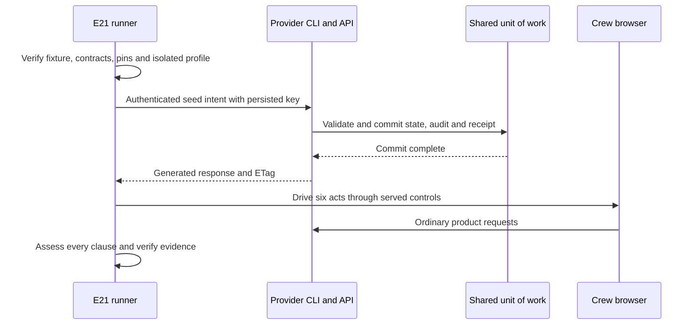
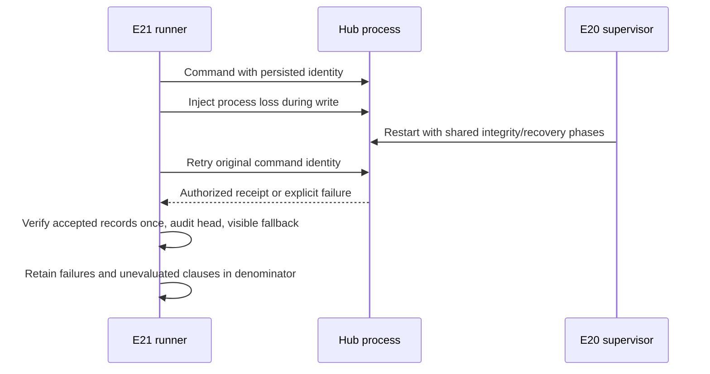

# E21: Integration, evidence and demonstration

Technical design for E21. Binding inputs: `AGENTS.md`, `docs/SYSTEM.md`, `docs/DEPLOYMENT.md` and
`docs/requests/COORDINATOR-DECISIONS.md` Part A. S means SYSTEM, C means CONTRACTS and DEP means DEPLOYMENT.
Product references below are relative to `docs/product/`. All implementation and measurement evidence is planned
until executed. Pending interfaces are tracked in `docs/requests/E21.md`, never treated as working integrations.

## 1. Scope

| Work package | Deliverable | Acceptance |
|---|---|---|
| E21-01 | Scenario runner in `eval/runner/`, frozen `demo-mara-fd19`, six-act checks, walking skeleton and cross-module fault tests | LIVE, REPLAY, SIM and unavailable paths distinguished |
| E21-02 | Hashed run reports, result panel and limitations with complete denominators | Failed, rejected, withheld and unrun cases retained; publisher scores never presented as ours |
| E21-03 | Capability manifest, checkpoint evidence and presentation sources | All nine original components and expanded modules trace to backlog and evidence |

R22, R26, R27 and R30 are E21's requirements. E21 runs D01 to D44 and registers V01 to V98; provider epics own
their product scenarios. V75/V98 scanning and the cross-module tests below are E21 mechanisms. The six acts exercise
UC01, UC03, UC04, UC06, UC08, UC10, UC11, UC12, UC14, UC19, UC20, UC21, UC22 and UC23; no new clinical flow is defined.
S9 makes E01/E02 hard dependencies; each provider scenario starts when its actual dependencies are available.

E18 owns benchmark execution, independent grading, holdout isolation and claims lint. E27 owns venue collection and
the How we know screen. E19 owns research/review artifacts. E20 owns packaging, workflows and supervision. The runner
neither implements clinical behavior nor writes provider tables. It does not own `eval/harness/` (S4.3, S6.1).

### 1.1 Rule trace

E21 owns CONTRACTS section 9 integration verification; providers own its product implementation. Other shared
integration obligations are the evaluation/export sentences of C10,
C11's content rule, C18 delivery and C20's transaction/validation rules; the providers retain implementation ownership.
Each row identifies one source sentence or invariant. All other provider rules remain selected through the V registry,
including C28's EI1 to EI12. Part A supersessions are recorded alongside the original assertion, never silently erased.

| Source line and obligation | Design section | Test ID |
|---|---|---|
| PRD.md:498 R22 run identity includes dataset/model/prompt/tools/corpus/grader/results | 3, 4 | T-E21-02 |
| PRD.md:502 R26 all nine components have observed acquisition modes | 3, 12.1 | T-E21-07 |
| PRD.md:503 R27 denominators, failures, refusals and experimental status | 3, 10 | T-E21-01, T-E21-08 |
| PRD.md:506 R30 benchmark separate from clinical readiness | 10 | T-E21-08 |
| CONTRACTS.md:7 synthetic patient never equals live presenter | 5, 10 | T-E21-03 |
| CONTRACTS.md:9 delayed arrival cannot replace observation time | 3.1 | SC-03 |
| CONTRACTS.md:13 missing input never becomes a sentinel observation | 5, 10 | SC-06 |
| CONTRACTS.md:414 no SIM result in LIVE | 5 | T-E21-03 |
| CONTRACTS.md:415 no failed/unavailable/stale finding presented as normal | 7, 10 | SC-03, SC-06 |
| CONTRACTS.md:416 no journal in prompts, indexes, evaluation screenshots or exports | 10 | SC-05 |
| CONTRACTS.md:417 no experimental estimate replaces a required instrument | 10 | SC-06 |
| CONTRACTS.md:418 acknowledgment is not medical resolution | 8.1 | SC-02 |
| CONTRACTS.md:419 urgent response independent of model, sample and ground | 9 | SC-01, SC-10 |
| CONTRACTS.md:420 no onboard flow waits on ground | 9 | SC-09, T-E21-10 |
| CONTRACTS.md:421 historical cabin series is not personal exposure | 5 | T-E21-03, D16 |
| CONTRACTS.md:422 corrections preserve lineage | 4 | SC-04 |
| CONTRACTS.md:423 benchmark target inaccessible to evaluated model/tools | 5, 10 | T-E21-06 |
| CONTRACTS.md:424 similarity/confidence never becomes diagnostic probability | 10 | SC-06 |
| CONTRACTS.md:425 outcomes do not change participation | 8 | T-E21-11 |
| CONTRACTS.md:426 personal participation remains private | 10 | SC-05, T-E21-11 |
| CONTRACTS.md:427 fixed body regions; symptom is not measurement | 7 | D04, D07, D39 |
| CONTRACTS.md:431 no immediate-erasure promise for external exports | 10 | SC-05 |
| CONTRACTS.md:433 export/restore covers schema, namespaces and release consistency | 4, 9 | SC-04, SC-05 |
| CONTRACTS.md:439 content comes from configuration, never code | 7, 8 | SC-08 |
| CONTRACTS.md:441 client exceptions restricted to the enumerated cases | 7 | SC-08 |
| CONTRACTS.md:443 fixed vocabulary keys never used as display words | 7 | SC-08 |
| CONTRACTS.md:448 unknown values stay open; sourced copies checked | 8 | SC-08 |
| CONTRACTS.md:982 duplicate event sequence ignored | 3.1, 6 | T-E21-05 |
| CONTRACTS.md:983 person events visible only to authorized person | 6, 10; S8.3 narrows all scopes | SC-05 |
| CONTRACTS.md:1108 state/audit/outbox commit together; events after commit | 4 | SC-04 |
| CONTRACTS.md:1109 injected clock, observation-time windows | 3.1 | SC-03 |
| CONTRACTS.md:1110 deterministic rendering and derived occurrence IDs | 3, 5 | T-E21-04 |
| CONTRACTS.md:1111 revision and ETag on changes | 4, 6 | T-E21-05 |
| CONTRACTS.md:1112 no model/network/ground blocking | 4, 9; S5.10.1 distinguishes tasks and public Jobs | SC-10 |
| CONTRACTS.md:1113 no numbers or words hardcoded | 8, 11 | SC-08 |
| CONTRACTS.md:1118 package vectors reproduced exactly | 5, 12 | T-E21-04 |

## 2. Seams

Read the current designs named below before implementing their boundary. E01, E02, E03, E13, E17, E18, E19, E20,
E23, E27 and E31 provide the surfaces cited here. Missing designs for E05, E06, E07, E08, E09, E14, E16 and E29
are recorded in R-E21-4. S5/S8 override older signatures in provider prose. No undocumented test hook is presumed.

| Name | Provider epic | Consumer epics | Signature or payload | Authority |
|---|---|---|---|---|
| `IdFactory`, `require_id` | E01 | E21 | `new(prefix: str) -> str`; `derived(prefix: str, *parts: str) -> str`; exact validation function | 5.1 |
| `Clock` | E01 | E21 | `now() -> datetime`; `monotonic_ns() -> int`; `process_epoch() -> str` | 5.2 |
| `MissionClock`, `MissionClockVersion`, `MetLabel` | E01 | E21 | Exact `version_at`, `met`, `label`, `mission_day`, `day_bounds` declarations | 5.3 |
| `Unit`, `Quantity`, `WireQuantity`, `UnitRegistry`, `WireUnitConverter` | E01 | E21 | Exact Decimal/UCUM types, `parse`, `convert`, `commensurable`; `PressureContext`, `ConvertedQuantity` | 5.4 |
| `FieldError`, `Problem`, `ProblemError`, `StorageUnavailable`, `to_envelope`, `to_problem` | E01 | E21 | Exact typed errors and mappers; adapters own framework integration | 5.5 |
| `ConfigDocumentView`, `ConfigReleaseReader`, `ConfigReader`, `ReleaseHandle` | E01 | E21 | Exact `active`, `release`, `document`, `version_of`; snapshot-bound immutable views | 5.6 |
| `UnitOfWork`, `UnitOfWorkFactory` | E01 | E21 | Exact properties, `publish`, `emit`, `audit`, `schedule`, `cancel_schedule`, `replicate`, `savepoint`, `begin` | 5.7 |
| `ReadSnapshot`, `ReadSnapshotFactory` | E01 | E21 | Exact `connection`, `release`, `now`, `snapshot`; mutation refused | 5.7 |
| `CommandIdentity`, `StoredResult`, `AcceptedReceipt`, `CommandPolicy`, `CommandReceipts`, `IdempotencyStore` | E01 | E21 | Exact `command_identity`, `requires_ledger`, `accepted`, `read`, `lookup`, `record` declarations; no caller-set durable flag | 5.8 |
| `ResultVisibility` | E01 | E21 | Exact `authorize` declaration; reauthorization on every replay | 5.8 |
| `AuditEntry`, `AuditEnvelope`, `AuditVerification`, `AuditVerifier`, `audit_bytes`, `audit_hash` | E01 | E21 | Exact envelope fields and `verify(*, expected_head_seq, expected_head_hash)` | 5.9 |
| `Scheduler`, `SchedulerRegistry`, `ScheduledJob`, `AbsoluteDeadline`, `ElapsedDeadline` | E01 | E21 | Exact `replace`, `cancel`, registry and deadline declarations | 5.10 |
| `HubSettings`, `SettingSpec` | E01 | E21 | Exact `integer`, `quantity`, `boolean`, `text`; no `get` alias | 5.11 |
| Native CLI and ReleaseManifest | E20 | E21 | `crew-health run`, `doctor`, `verify`, `backup`, `restore`; signed packaged components/modes/hashes | DEP7; E20 2, 5.1 |
| Mission initialization | E23 | E21 | `crew-health mission init --mission-id <id> --mode <mode> --environment <id> [--planned-length-days <n>]` | E23 3.3; S4.2 |
| Habitat feed CLI | E23 | E21 | `crew-health adapters replay --feed <file> [--feed-id <id>]`; `crew-health adapters sim --feed <file>` | E23 5.2, 5.3; S3 |
| Skills import | E31 | E21 | `crew-health skills import-preflight --file <path>`; preflight.schema.json | E31 5.5; S8.4 |
| Stub script | E21 | E17 | E17 stub-script.schema.json: scenario, conversation ordinal, phase, step index; tool_calls or final | E17 5.4; path binding R-E21-1 |
| Runtime controls | E13 | E21 | `getAssistantStatus`, `setAssistantRuntime`, generated AssistantStatus/AssistantRuntimeAction | E13 6; S3, S5.10.1 |
| `freeze_tree`, `verify_tree` | E18 | E21 | `freeze_tree(root: Path, *, include: Sequence[str], exclude: Sequence[str]) -> FrozenManifest`; `verify_tree(root: Path, manifest: FrozenManifest) -> Sequence[FreezeFinding]` | E18 2, 4.3; R-E21-1 |
| Benchmark artifacts | E18 | E21 | run_manifest.json, case_results.jsonl, aggregate.json, privacy_scan.json, REPORT.md under `eval/bench/results/<run_id>/`; E18 schemas | E18 6.3; S4.3 |
| Claims/leak lint | E18 | E21 | `chc-bench lint claims FILE...`; `chc-bench leak scan --target KIND PATH...` | E18 6.2 |
| Review status | E19 | E21 | `docs/research/pointers.json` to release-specific review-status.json and coverage.json; version/count/status/pins | E19 3.7; S8.1 |
| Venue aggregates | E27 | E21 | `eval/results/venue-study.json`, validated with `eval/venue_study/result.schema.json` | E27 5.4 |
| Result panel | E21 | E27 | R27-7 metric fields: metric_id, status, value/unit, denominators, failures, artifact path/hash, run_id, measured_at | E27 6, request R27-7; R-E21-5 |
| Crew UI | E03 | E21 | Existing routes, accessible names from served copy, body marks from served region/state | E03 7; S4.4; no required new DOM attributes |
| Scenario CLI | E21 | E20 | `chc-harness ci --job scenarios`; `chc-harness ci --job e2e`; explicit fixture and model mode | E20 2; S8.7, S8.8; R-E21-1 |
| `EvalHubLauncher.start` | E21 | E18 | `start(profile: str) -> RunningHub` | E18 2; R-E21-2 |
| `HubClient.call` | E21 | E18 | E18 parameter names: operation_id, path_params, query, body, idempotency_key, session, timeout; timeout is Quantity; generated request/response types | E18 2; R-E18-8; R-E21-1 |
| `SeedLoader.load` | E21 | E18 | `load(steps: Sequence[SeedStep], ctx: SeedContext) -> SeedResult` | E18 2; R-E21-1 |
| `SimMeasurementAdapter.post_attempt` | E21 | E18 | `post_attempt(request_id: str, outcome: SimAttemptOutcome, *, session: SessionToken) -> AttemptRef`; numeric outcome is Quantity | E18 2; R-E21-4 |
| `ModelGate.mark`, `ModelCallLog.requests_between` | E21 | E18 | `mark(label: str) -> int`; `requests_between(start_mark: int, end_mark: int) -> Sequence[RecordedRequest]` | E18 2; R-E21-3 |
| Evaluation marker and demo exclusion | E21 | E18 | Marker fields kind, run_id, fixture_id, created_at; shared model exclusion pending path agreement | E18 2; R-E21-1 |

Public HTTP seams use the generated operation signatures, not application-port declarations:

| operationId | Provider epic | Consumer epics | Request and response | Authority |
|---|---|---|---|---|
| `createSession` | E02 | E21 | SessionCreate to Session | E02 6, C20; section 6 below |
| `getContext` | E23 | E21 | No body to Context | D16; E23 6.1 |
| `getEvents` | E01 | E21 | Cursor/Accept parameters to EventPage or SSE Event | C18, S5.7, S8.3 |

R-E21-1 records the shared evaluation interfaces S does not yet define. This table preserves existing provider names;
it does not authorize invented DTOs or unresolved bindings. Every scenario calls the effective generated API for the
product behavior it checks. E21 publishes no hub events and imports no provider implementation or private table.

## 3. Domain model

EvaluationReport, CapabilityManifest and DemoRun are local evidence artifacts, not new hub resources. The package
brief names them but supplies no wire schema. Their schema agreement is R-E21-1. Pure verdict computation uses:

| Entity/invariant | Decision | Test |
|---|---|---|
| I1 Run identity | Fresh S5.1 ID per execution; a separate full input fingerprint groups reproducible attempts. Repeated inputs never overwrite an earlier run | T-E21-02 |
| I2 Complete accounting | One result per registered clause; fail dominates error, then partial, then not_run; pass requires every clause executed and passed. Empty sets cannot pass | T-E21-01 |
| I3 Evidence identity | Pin build artifacts, base/effective contract and overlay hashes, fixture, configuration, evidence, model/prompt/tools, grader, seed, settings, OS/runtime, hardware and runner version | T-E21-02 |
| I4 Modes | Model mode stopped/stub/live is independent of origin LIVE/REPLAY/SIM. Imported is an acquisition method, unavailable a capability state | T-E21-03 |
| I5 Valid metric | Measured requires a verified compatible artifact and denominator; absent evidence has null value and not_measured_yet. A corrupt hash is an integrity failure, not missing evidence | T-E21-07 |
| I6 Honest status | Numerical verification, model validation, clinical validation and mission acceptance are separate. Neither stub execution nor a packaged component proves live operation | T-E21-07, T-E21-08 |

Registry clauses carry source section/line, requirement, work package, owner, test node, checkpoint, model/hardware
preconditions and expected evidence kinds. Retain all V01 to V98 and D01 to D44 even when unbuilt. Reasons distinguish
not_built, missing_provider, missing_hardware, requires_model, awaiting_request, dependency_failed and not_selected.
Every report counts all statuses and publishes selected/total denominators. Aggregate metrics retain the source
analysis method, confidence interval, participant/window/pair units of analysis and exclusions; an unavailable interval
is explicitly uncomputed, never invented. E18/E27 own their statistical computation. A required unrun clause prevents full
acceptance. Expected fault refusals pass only when the scenario's specified refusal and fallback both occur.

Run lifecycle: planned, preparing, running, assessing, completed, aborted or invalidated. Completed means every
clause has a verdict, not that it passed. An interrupted run remains incomplete; it is never inferred successful from
existing files. A new attempt gets a new ID. A post-run hash mismatch invalidates evidence. Local report generation
is separate from external publication, which needs the user's authorized release workflow (VALIDATION 8).

### 3.1 Time

Use S5.2 Clock/TimeInput/corrections and S5.3 MissionClock, including captured clock version and segment. No local
Clock, offset clock, wall-time restart trick or scheduler-drain API. S5.10 defines elapsed retries/dwells and absolute
contacts/expiry; corrections move elapsed deadlines with their anchors and leave absolute deadlines unchanged.
S5.10.1 task leases use the same correction rules. Unknown time cannot prove freshness or safety clearing.

LIVE/SIM freshness uses corrected observed_at, not arrival (D3). REPLAY uses D14's receive reference only when the
accepted observation advances window end E; windows and display retain original dataset dates. Repeated, late or
looped rows never refresh a channel or clear a newer warning. Test duplicate timestamps in distinct clock segments,
forward/backward jumps, restart and mission-day boundaries. Ordering of API events uses persisted seq with duplicate
suppression; seq is not a substitute for observation time or evidence of a model request. Cross-process order needs
the recorder correlation in R-E21-3. Latency uses monotonic time within one process epoch and is a Quantity in ms;
never subtract monotonic counters across a restart. Deterministic time advancement awaits R-E21-2.

## 4. Application layer

No E21 hub command, table, migration or local transaction manager. Each seed action is an ordinary authenticated
provider command. BuildFixture is a sequence of committed commands, not one transaction across all providers.
Persist the S8.6 command intent before sending; use S5.8 operation, target, semantic parameters and body identity.
Use the provider's returned ETag verbatim. A stale revision is surfaced, never silently retried with a fresh ETag.

| Command/use case | Unit of work and crash evidence | Recovery |
|---|---|---|
| PrepareFixture | Verify all input hashes/profile before provisioning. E02 roster/token commands and E23 mission init each use S5.7; E23 loads demo channels in its mission-init transaction | Incomplete preparation cannot enter running; inspect provider receipts, never seed directly into SQL |
| Seed/API mutation | Provider S5.7 commits state, command identity, audit, outbox, schedules and replication together. Public events after commit | Retry same intent under S5.8, including after 24 hours; changed resource/body conflicts; current grant checked before replay |
| Journal/report canaries | S5.8.1 PrivateRecordCoordinator (D4/D18): seal source/draft version, hub reference and receipt barrier; private bodies excluded from runner command journal | Crash tests at every phase, deletion racing extraction and confirmation; confirmed clinical records remain append only with deleted-source provenance |
| Activate scratch release | S5.6 validation/guards and D8 ETag compare in activation UoW | Missing/stale token rejected; rollback is another activation generation; retain old work pins |
| RunDemo/RunScenarios | E21 schedules bounded external calls outside hub transactions; provider S5.10.1 owns long tasks and cancellation | On cancellation stop scheduling, retain provider command receipts, count remaining clauses unrun; late task result cannot become accepted evidence |
| ResetDemo | Fresh isolated data directory and repeat validated seed. For restore tests, invoke E20/E01 paired backup/restore and current vault checks | Never copy SQLite/WAL files, reset counters or restore keys; S7.2, S7.4 and DEP4.2/7.5 fencing apply |
| BuildReport/BuildPanel | Read compatible verified artifacts; no hub transaction and no product mutation. Shared evidence commit/publication mechanism pending R-E21-1 | Until resolved, durable report publication is off; interrupted or partial exports cannot become checkpoint evidence |

D13 fault tests distinguish EvaluatorComputationFailure from storage, I/O, integrity, authorization and validation
errors through S5.10.2/S8.6. The former preserves input plus pending marker/retry/audit and degraded health; the latter
aborts the command. Older recovery cannot lower newer warnings. No isolation wrapper converts all exceptions into
pending success. Hash-chain tests include every field, timestamp, sequence and trusted head (S5.9). Migration and
software rollback tests use DEP7.4 expand-before-contract behavior, never data rollback to erase accepted commands.





## 5. Adapters

The default rig launches a new native T0 demo hub through E20; CI also exercises minimal compose under DEP7.3/8.
Only the runner-created data root, its marker, pinned node identity, loopback URL and explicit demo profile can be
mutated. Before each mutation recheck target identity and profile; a marker alone is not authorization. Refuse symlink
escapes, arbitrary existing roots and flight hubs. Empty bootstrap before getContext is available uses the owned local
provisioning boundary in R-E21-2, never an HTTP bypass. Fixture credentials are generated for that isolated hub,
not committed reusable secrets. LIVE presenter capture is separately consented and routed by E02 to its own namespace;
SIM seeds cannot write that patient. Absent binding disables capture, never redirects it to Mara.

Adopt E23's feeds schema, demo channel registry and CLI. Fixture holds byte copies of
`docs/product/nasa-data/habitat-environment/eda_rr1_telemetry.csv` and `docs/product/nasa-data/radiation/radlab_dostel_sample.csv` with source hashes;
runtime adapters read fixture copies, not package files. Preserve original observation times, pressure context and
origin. SIM uses the same adapter ingest path. E31's preflight file passes its schema and roster/catalog/time checks.
Do not substitute direct accepted observations for a missing camera quality gate or band pipeline (R-E21-4).

E17's stub responder is the sole stub implementation. It rejects unmatched steps and binds only to explicit stub
release/profile. No cue-order fallback, new model header or shell-command setting. Stopped mode records attempted
calls, not just successful completions; a negative call assertion requires an installed verified recorder (R-E21-3).
E18's freeze library checks fixture bytes before execution and before reporting. E18's holdout vault, rubrics and
adjacent target files are inaccessible to hub/model processes; E21 passes visible seed data only (T-E21-06).

Frozen seed data cites VALIDATION 3 and C20 vectors, including mission epoch, crew history, replay windows, contact
schedule and act ordering. Seed the Q15/D10 goal opt-ins prospectively before the historical contributions, with
owner-authenticated consent actions; never insert totals. Compute kit/plan counts from the pinned release. Freeze
versions, not expected clinical conclusions. Independently checked C20 vectors provide numerical oracles; tests that
read expected thresholds from the tested document prove rendering only. Surface day 4 remains required (R-E21-7).

Parse every response, event, seed and external artifact using generated effective schemas or the owning provider's
closed schema. Preserve nullable fields and complete enums. HTTP retries, process waits, event pages, scan buffers,
file sizes and model logs are bounded by section 11. Fault injection kills a process, never a thread with live DB
handles. Recovery, health and restart policy stay with E20/S3. No test-only production branch.

## 6. API

None provided. The registry validates every operationId, route, body, response status and error against the effective
OpenAPI generated by S6.5/D12. It does not keep a handwritten copy of all operations. Core bindings are:

| operationId | Request/schema reference | Response/schema reference | Role and concurrency |
|---|---|---|---|
| `createSession` | requests.schema.json SessionCreate | session.schema.json | E02 authentication, never trust body roles |
| `getHealth` | None | health.schema.json | Public liveness only, no invented component fields |
| `getContext` | None | context.schema.json | Effective x-roles; E23 owns composition |
| `getEvents` | Contract cursor/Accept parameters | event.schema.json, event-page.schema.json | Current object/field audience; duplicate seq ignored |
| `recordObservation` | requests.schema.json ObservationCreate | observation.schema.json | Crew/officer/adapter plus subject grant and trusted assignment |
| `recordAttempt` | requests.schema.json AttemptCreate | measurement-request.schema.json | Adapter only, trusted acquisition identity |
| `getConfigRelease` | Contract release_id | config-release.schema.json | Editor/operator; obtain D8 ETag |
| `activateConfigRelease` | No body; release_id, If-Match | config-release.schema.json | Editor/operator, Idempotency-Key and D8 ETag |
| `demoSetGroundLink` | requests.schema.json GroundLinkDemoSwitch | ground-link.schema.json | Operator and explicit demo/mode gate |
| `setAssistantRuntime` | requests.schema.json AssistantRuntimeAction | assistant-status.schema.json | Operator |

Other act operations resolve from the frozen registry to generated schemas, with their exact effective x-roles and
headers. Wire errors are ErrorEnvelope (S5.5/D5), including UNAUTHORIZED_SCOPE, never an invented FORBIDDEN code or
RFC 9457 body. Unknown errors fail evidence collection with sanitized diagnostics. Cursor expiry reloads authorized
views, then resumes; absent events are not fabricated. Public event names and payloads come from C18, including
help.session_changed and participation.streak_changed. CheckCompletion is not an invented public event. Model turns
use streamConversation/cancelTurn rather than inventing a public Job kind (S5.10.1/D17).

## 7. User interface

None owned. Playwright drives the real crew app using accessible controls and API-served copy. The runner proves
loading, empty, error, stale, offline, LIVE, REPLAY, SIM, unavailable and assistant-stopped states; origin and age are
checked separately. DOM evidence and API records agree; sanitized DOM captures contain no private text. No journal
screenshots. Missing selectors or unavailable screens produce unrun evidence, never a weaker assertion.

V75/V98 scan source and built assets against configuration content; the scan includes dynamic labels, thresholds,
cadences, steps, effects, citations, environments, sensors, plans, skills, roles, supplies and link text. Allow only
C11's enumerated code vocabulary/layout and hash-matching configuration assets. Seeded leak tests prove the scan.
Provider configuration-edit tests additionally prove content changes without a client rebuild.

Q17: retain the reference design as the default. E03/E20's optional configured flight readability theme is off by
default and requires ink-3 contrast at least 6:1 and a short clock on narrow screens. Test default/selected themes,
configuration activation, narrow viewports and invalid-theme rejection through E20's accessibility suite. Neither
Q17 nor a passing contrast check establishes default NASA-STD-3001 compliance. State the deviation in the capability
manifest, limitations and presentation claims. Pending theme implementation stays unavailable, not silently defaulted.

## 8. Configuration

No product configuration owned. The fixture pins all C11 release documents plus D12 unit mappings and decision-overlay
version; S5.6 performs schema, provenance, semantic checks and guards before activation. E21 reads configuration
through generated APIs/pinned artifacts, never imports content literals into executable code.

Evaluation content consists of the registry, clause/precondition definitions, component catalog, fixture steps,
claim/metric references and link-comparison field allowlist. Each has version, schema, source section/line, basis,
source_ids/to_be_set_by where applicable, and a hash in the run manifest. R-E21-1 addresses its shared loading/schema
boundary; this is separate from operational HubSettings. Reject invalid input before starting a run.

T-E21-12 edits a nonclinical component label in a scratch catalog and verifies changed manifest text without a code
change. SC-08 changes a sourced threshold consistently in scratch environment-hazards and sensor-limits (D15), and
a configured step in its owner document. Preserve warning levels, allowed raisers/clearers and all loader checks.
Never lower the help latency requirement, tolerance, contrast rule or pass threshold to obtain a pass.

Q1/Q7/Q18: eligible sourced/hash-pinned content displays not clinically reviewed without requiring clinician sign-off;
withdrawn, missing-source, wrong-purpose, wrong-origin and inapplicable guidance still fails closed under S8.2.
Q8: preserve manual and available camera observations on disagreement, with methods/origin; retry does not complete
a plan step or close a gap. Q5/Q6: consenting adult team members, sourced consent copy, no manikin means SIM rehearsal
and no CPR quality claim. Q4/Q14/Q16 authority and Q11 engine gates remain provider checks, not E21 shortcuts.
Q19 leaves a supply threshold inactive until configured; the fixture's value is SIM with team-default provenance.
Q25's internal OSCE evidence retains its E18 labels and is never a NASA accuracy result.

### 8.1 Activation effects

| Documents/read dependency | Required effect and evidence |
|---|---|
| All effective release documents and unit mapping | Invalid candidate rejected, last good active; D8 ETag/generation checked. No missing semantic check becomes a warning or a success |
| warning-rules, sensor-limits, environment-hazards, sensor-catalog | D1 pins active definitions; edit/removal cannot lower/clear; withdrawn definition shown. D3/D14 freshness retained; new evaluations use new release |
| responder-flows, help-presentation, ui-copy | Open help keeps its pins; new sessions use active versions; cached fixed entry remains available before authentication/save |
| onboard-plans, skills-catalog, role-rules, kit-map, ui-copy | Open plan/guided work keeps its pins and eligibility; no new amount, skill or role silently changes open work |
| kit-map stock/supply content | Activation cannot create negative stock or reinterpret accepted uses; null remains unknown, never zero |
| routine-schedule, routine-rules, environment-profiles, questionnaires | Existing facts retained, schedules reconciled through S5.10; elapsed versus absolute timers kept distinct; no completed job rerun |
| participation-rules and goal consent | D10 opt-in/default-off/revocation applies to both totals, caches and exports; rebuild never includes nonconsenting people |
| indicator-catalog, assistant-policy and model/evidence pins | New work uses new version; in-flight work keeps pins or becomes explicitly stale; no silent substitution of evidence/model |
| E21 evaluation documents | Freeze per run; edit creates another version/run. No in-place change to an executing fixture or earlier verdict |

## 9. Deployment and fallbacks

| Tier | E21 evidence and degradation |
|---|---|
| T0 | Required native laptop/webcam run, plus model stopped, camera absent and ground down. Manual capture and fixed help remain usable |
| T1 | Second browser/station loss cannot lose hub-accepted state; station receives operational projection only |
| T2 | Enrolled tablet disconnect/rejoin and owner-partitioned queued command replay; laptop remains complete |
| T3 | Devices add actual adapter evidence; absence is unavailable/manual, never simulated LIVE |
| T4 | E23 REPLAY/SIM feeds with visible dates/source; stale/quiet feed and conflict tests |
| T5 | Read-only integration feed; no vehicle write or claim of untested vehicle connectivity |
| T6 | Two isolated hubs on one laptop, fenced restore/transfer and authorized projections per S5.7.1/S8.5; no multiwriter clinical merge |
| T7 | Approved local queues, delayed/outage/duplicate receipts; D11 expiry retains snapshot, renewal checks consent. Missing lifetime disables BPv7 only |

The reference envelope is S8.7: M3 16 GB, actual Windows laptop when available, capsule tablet not measured. Record
machine/build/versions, RSS including browser/OS, latency, camera refusals, thermal run and recovery under combined
load. Model and forecast are not resident together; report absence and missing hardware. CI is not live hardware
validation. DEP8 workflow and offline-install gates remain E20's; E21 supplies scenario evidence.

| Critical path (charter 6) | Primary | Independent backup | Fail safe/test |
|---|---|---|---|
| Immediate help | Served fixed flow | Signed cached/static entry, then configured printed card | Visible fault; SC-01 removes hub/model, SC-10 |
| Warning authority | Deterministic domain checks | Role/tool boundary and vehicle procedure | Model cannot change safety state; SC-02 |
| Fresh readings | Adapter/time/quality checks | Manual reading with origin/time, conflict retained | Unknown/not measured; SC-03 |
| Durable capture | S5.7 commit and receipt | S5.8 replay; S7.2 verified paired restore | Not recorded yet until accepted; SC-04 |
| Privacy | Object/field grant | Recipient projection and cache exclusion | Denied, no data; SC-05 |
| Tool/measurement integrity | Typed tools and adapter validation | Domain preconditions and manual capture | Unavailable gap; SC-06 |
| Routine misses | S5.10 scheduler | Persisted facts reconciled after restart; printed checklist | Miss visible, no credit invented; SC-07 |
| Configuration | Validated release | Last good release and pinned emergency cache | Invalid candidate refused; SC-08 |
| Complete ground log | Approved outbox | Same approved snapshot via file transport after reconnect | Pending, never delivered by assumption; SC-09 |

Optional assistant, embedding and forecast failure leaves deterministic flows and baselines; absent camera/devices
leave manual entry; absent tablets leave the laptop. SC-10 removes model, devices and link together. A previous run
may be shown with its original build/mode/date, never relabeled current. Demo failure remains a finding; a stub
recording is labeled and cannot satisfy the required clean live run or any live-only clause.

## 10. Safety, security and privacy

Hazards of E21 are contaminated real records, false pass reports, leaked private data and unsupported claims.
T-E21-03 enforces isolated roots/namespaces; T-E21-01/02 enforce complete verified evidence; SC-05 enforces S8.3 on
HTTP, SSE, stored-result replay, offline cache, replication, files, exports, ground and logs. Test revoked consent
between queue, materialization and send. Help membership and acting/officer rank never grant general chart access;
station is denied clinical plan lists/details (D9), while fixed entry works without sign-in or saving.

Evidence is allowlisted codes, modes, counts, compatible hashes and opaque references. No journal/report body,
credential, raw prompt/completion, real-person identifier or measurement enters public artifacts or diagnostic logs.
Private content checks run in bounded authorized memory using synthetic canaries; no prompt log is a private-store
replacement. Sensitive fingerprints use S5.8 keyed HMAC, not guessable hashes. The E27 study owns consent, raw rows
and retention; E21 consumes eligible aggregates only. Missing consent or reviewer evidence is unknown, never consent
or clinical validation. Current vault revocation governs old backups; delivered approved snapshots cannot be recalled.

Claims lint covers reports, panel labels, manifest, limitations, walkthrough and presentation sources. Numerical
verification and model validation can be measured here; clinical validation and mission acceptance are not earned by
this suite. Retain Q17's deviation, experimental camera/forecast status, internal OSCE labeling and E18 benchmark
track labels/denominators. One executed unauthorized action, fabricated accepted result, cross-patient leak or journal
exposure blocks promotion under VALIDATION 7, even if aggregate scores improve. No external publication by this CLI.

### 10.1 Failure and edge cases

| AGENTS section 6 case | E21 behavior | Test |
|---|---|---|
| Crash/power loss at each command step | Inject before/after commit, receipt, private seal/reference/ack and report commit; reconcile receipts, mark incomplete evidence | SC-04, T-E21-02 |
| Duplicate/retried submission | Same intent once, different target/body conflicts; beyond cache window uses durable receipt and current access | SC-04 |
| Clock jumps/mission boundaries | Shared correction/version; old observation cannot clear newer warning; no duplicate completed timer | SC-03, SC-07 |
| Disk full | No swallowed storage error or false acceptance; retain queued intent, cached help, failed evidence run | SC-04, SC-10 |
| Corrupt/missing configuration | Candidate refused, last good/pinned content retained; no freeze with missing hashes | SC-08, T-E21-04 |
| Partial/implausible/disagreeing readings | Range, saturation, stuck and rate checks; preserve conflicts; no NaN/infinity/default measurement | SC-03, SC-06 |
| Concurrent clients | Same-subject help joins once, ETags conflict, no duplicate use or credit | SC-04, T-E21-05 |
| Long ground outage/backlog | Bound queue/contact work without deleting approved payloads; consent and duplicate receipt checks after recovery | SC-09 |
| Incapacitated/absent crew | Fixed entry without auth; helper summary limited, subject/EVA exclusions and acting authority preserved | SC-10, D24, D37, D41 |
| Privacy between crew | Adversarial read/replay/export matrix; missing audience denies; revoked grant removes cached delivery | SC-05 |
| Zero/negative/empty/maximum and changed lot/unit | Empty evidence cannot pass; reject invalid quantities; retain null; E32 recomputes proposal and caps under current context | T-E21-01, SC-06 |

## 11. Performance and resources

Every bound is read through S5.11 HubSettings with schema type/minimum/maximum and provenance. The E21 entries below
are proposed operational descriptor limits, not medical thresholds; R-E21-1 addresses registration outside the hub.
Missing/invalid descriptors stop the runner. Smaller configured values are allowed and bound exhaustion fails visibly,
never silently truncates evidence. Defaults are recorded as team defaults to be set by the integration owner.

| Hub setting name | Permitted limit | Applies to |
|---|---|---|
| `runner.max_scenarios` | 1 to 4096 | Registry items/collected cases |
| `runner.max_clauses_per_item` | 1 to 256 | Clause lists and result construction |
| `runner.max_steps` | 1 to 10000 | Seed/script commands per run |
| `runner.max_events` | 1 to 100000 | Total event evidence; pages also obey events.page_size |
| `runner.max_files` | 1 to 20000 | Freeze/scan/artifact traversal; reject symlink escape |
| `runner.max_file_bytes` | 1 to 16777216 byte | Streaming input limit per file |
| `runner.max_artifact_bytes` | 1 to 268435456 byte | Total evidence admission per run |
| `runner.max_model_records` | 1 to 10000 | Recorder entries; raw text not persisted |
| `runner.http_timeout_ms`, `runner.ui_timeout_ms` | 1 to 30000 ms | Every API/browser call |
| `runner.process_timeout_ms` | 1 to 120000 ms | Startup, shutdown and child commands |
| `runner.run_timeout_ms` | 1 to 7200000 ms | Whole run, thermal measurement included |
| `runner.poll_ms`, `runner.max_polls` | 1 to 1000 ms; 1 to 10000 | Health/readiness waits bounded by both count and deadline |
| `runner.retry_max`, `runner.retry_backoff_ms` | 0 to 3; 1 to 5000 ms | Runner transport retries; same persisted intent |
| `runner.parallel_runs` | 1 | Shared laptop/model exclusion; no concurrent heavy evaluation |
| `runner.max_scan_chunk_bytes` | 1 to 65536 byte | Streaming scan/read buffer, not whole-tree allocation |
| `commands.max_bytes`, `events.page_size`, `storage.max_rows` | E01 registered maxima, with generated contract maxima also enforced | Hub commands and query pages |
| `workers.<name>.timeout_ms`, `workers.<name>.restart_max`, `workers.<name>.restart_window_ms` | S3/S5.11 validated provider descriptors | Worker calls/restarts; never a second E21 supervisor |
| `backup.timeout_ms`, `sync.max_bytes`, `sync.pending_max`, `bundle.max_bytes`, `bundle.max_inflight` | S5.11 validated provider descriptors | Restore, replica and transport fault tests |

Help first screen remains at most 500 ms for each required demo press (PRD11); also report S8.7 p95 under combined
load. No mutable runner pass budget replaces that requirement. Use S3/S8.7 resource settings, measured total memory
and 30-minute thermal/swap evidence. Report assistant median/worst latency; no invented accuracy/performance score.
Process concurrency and one-page streaming keep background analysis away from interactive safety work.

## 12. Test plan

All rows below are planned. Marker `e21` selects every E21 test; specialized markers demo, cross and skeleton add
subsets, never remove cases from the report denominator. Scenario discovery validates unique IDs, collected node IDs
and markers against the frozen registry. No test-only hub behavior; process fault tests use the shipped composition.
Unit/integration tests are hermetic with injected clock/IDs and simulated adapters; hardware tests are explicit.

| Test ID | Level | Proves / trace | Markers |
|---|---|---|---|
| T-E21-01 | property/unit | Verdict algebra, empty/missing/withheld cases, denominators and no partial pass; I2, R27 | e21 |
| T-E21-02 | integration/fault | Unique execution identity, hashes/pins, report interruption/corruption, retention of failures; I1/I3, R22 | e21 |
| T-E21-03 | integration | Profile/root/namespace gates, origin vs model mode, presenter isolation and historical non-exposure; I4, V09/V10/V47 | e21 |
| T-E21-04 | contract/integration | Freeze tampering, seed reproducibility, independently checked C20 vectors, full start state including day label; R22 | e21 |
| T-E21-05 | contract/integration | Generated API status/errors/ETags/nullability/enums, event duplicate/expiry/audience handling; C18/C20 | e21 |
| T-E21-06 | integration | E17 stub matching, no fallback, recorder completeness and E18 target isolation; R22/R30, D05/D15/D23 | e21 |
| T-E21-07 | integration | Artifact hash mismatch fails, no evidence gives null, nine original and expanded component traces; I5/I6, R26/R27, V80 | e21 |
| T-E21-08 | integration | Claims lint and forbidden claim fixtures, Q17 deviation, benchmark labels/denominators, release gate; R30 | e21 |
| T-E21-09 | e2e/hardware | S8.7 envelope and E20 both-theme/narrow-clock evidence, native/compose profile truth; Q17, R26/R27 | e21 |
| T-E21-10 | integration/static | Same inputs/clock with link up/delayed/down; exact permitted presentation differences plus authorized read trace; D34/D43, V81 | e21 |
| T-E21-11 | integration | Goal default off, prospective opt-ins, revocation, recomputed totals and value-independent completion; D10/Q15, D03 | e21 |
| T-E21-12 | property/integration | Evaluation schema parser bounds, catalog-label edit without code change, source/built scanner planted leaks; R22, V75/V98 | e21 |
| SC-01 | e2e | Help under load and without hub/auth/storage/model, cached/static/printed fallback; charter critical path, V01/V97 | e21 |
| SC-02 | integration/e2e | Model raise/clear/lower denied; pinned warning removal, acknowledgment distinct from clearing; D1, V56/V65 | e21 |
| SC-03 | property/integration | D3/D14 time, stale/quiet/looped replay, quality/conflict invariants and corrected segments; V14/V70/V72 | e21 |
| SC-04 | fault/integration | Commit/receipt/restore phases, replay beyond cache, target mismatch, disk full, D4/D6/D13/D18, migration rollback; V16/V35 | e21 |
| SC-05 | integration/e2e | Cross-object/field consent at every exit, D9, private deletion/restore and canaries; V25/V26/V64 | e21 |
| SC-06 | property/integration | No unauthorized tool/fabricated value; unavailable device, dimensional limits and changed lot; V11/V15/V23 | e21 |
| SC-07 | property/integration | Misses/history intact, corrected clocks, duplicate/concurrent callbacks and ownership fencing; V46/V53/V67 | e21 |
| SC-08 | integration/static | Valid scratch activation/content edit, invalid rollback, pinned work and stock invariants; D1/D8/D12/D15, V75/V98 | e21 |
| SC-09 | integration/fault | Long-outage approved log complete once, expiry/renewal/consent, ground replies nonblocking; D11, V29/V68/V93/V95 | e21 |
| SC-10 | e2e | Model/devices/link absent together; capture, fixed help, warnings and routine work; storm Emergency and awake routing; D2/Q9, V58/V69/V74 | e21 |
| W1.1, W1.2, W1.3, W1.4, W1.5, W1.6 | e2e | S8.8 walking skeleton: startup, manual capture, process loss, access denial, RR-1 warning and offline help | e21 |
| W2.1, W2.2, W2.3, W2.4 | e2e/hardware | S8.8 real model then off, camera success/refusal, private journal and daily completion | e21 |

Mutation testing targets verdict, denominator, privacy/export and promotion decisions with no surviving mutant that
turns missing/failed evidence into a pass. Clinical golden cases remain provider-owned and independently sourced;
configuration-derived rendering tests never replace them. Any regression gets a failing test first and full-suite rerun.

### 12.1 Acceptance matrix

Each D row maps to the test named test_Dxx in `eval/scenarios/demo/test_demo.py`. Every clause of VALIDATION 3 is checked;
this table identifies evidence, not a shorter replacement specification. CP membership comes from KICKOFF 4/S10.
A missing rig/provider leaves that clause unrun. In particular SIM camera success cannot pass D09's LIVE clause.

| Acceptance ID | Test/evidence |
|---|---|
| E21-01 | D01 to D44, SC-01 to SC-10, W1.1 to W2.4, T-E21-03/04/05/06/09/10/12 |
| E21-02 | T-E21-01/02/07/08, complete scenario report and provider results |
| E21-03 | T-E21-07/08/09, manifest/backlog/evidence links and generated presentation |
| R22 | T-E21-02/04/05/06/12 |
| R26 | T-E21-03/07/09 |
| R27 | T-E21-01/02/07/08 |
| R30 | T-E21-06/08 |
| V01 | SC-01, SC-10, test_D15, test_D23; fixed help without model |
| V75 | SC-08, T-E21-12; threshold/step/environment edits plus source/built scan |
| V98 | SC-08, T-E21-12; plan/skill/role/supply/link scan |
| D01 | test_D01: Source words, original replay date, no personal exposure/measurement region |
| D02 | test_D02: Separate linked band estimate and confirmation, neither overwritten |
| D03 | test_D03: One completion; streak and both goal totals computed with prospective D10 consent; variant counts unchanged |
| D04 | test_D04: Each specified region/anchor and no CO2 measurement region |
| D05 | test_D05: Fixed questions answered before model invocation; repeat stopped |
| D06 | test_D06: MeasurementRequest reason, decision and registered capability/region |
| D07 | test_D07: Symptom ring and no accepted-measurement dot before capture |
| D08 | test_D08: Real failed acquisition, reason retained, no value observation, timeline visible |
| D09 | test_D09: LIVE camera/operator/selector/disagreement evidence, separate namespace; SIM counts unchanged |
| D10 | test_D10: All assessment sections; every supporting ID resolves to eligible evidence |
| D11 | test_D11: Failed attempt in timeline, absent from every support list |
| D12 | test_D12: ECG gap/dashed mark remains; no normal-rhythm/exclusion claim |
| D13 | test_D13: Approved hash-pinned handoff queued for contact, simulator label, no journal or onboard wait |
| D14 | test_D14: Participation absent from every listed concern/care screen |
| D15 | test_D15: Stopped-model first screen within 500 ms, verified zero model call |
| D16 | test_D16: Complete replay warning provenance/causation, head effect, routine changes and no personal exposure |
| D17 | test_D17: Insight limited to watch and SIM evidence; advice creates no task; malicious stub rejected without changing warning |
| D18 | test_D18: Confirmed environment/source, all screens changed, no station value current on Moon; surface day 4 precondition retained |
| D19 | test_D19: One airlock warning, level/provenance/effects/cleaning, no model cause |
| D20 | test_D20: Walkers' per_eva checks and area-wide temporary cadence, reason/source/end |
| D21 | test_D21: Plain task/equipment/steps/region/cadence, Q1 review label, unavailable reason with no value |
| D22 | test_D22: Air safety before subject selection |
| D23 | test_D23: Pinned eye-injury path, ordered choices/steps and logged ticks, zero model call |
| D24 | test_D24: Limited latest summary with sources/times, audited reads, denied after close; no chart/journal access |
| D25 | test_D25: Restarted assistant after fixed steps, single question, citations and unchanged order; forbidden medicine stub rejected |
| D26 | test_D26: Preview/approval/hash/contact queue and continued ticks, simulator identity, no journal |
| D27 | test_D27: No participation on listed surfaces; every value has source word |
| D28 | test_D28: Every condition state counted once by server; same counts on card/view/panel |
| D29 | test_D29: What-if changes expected conditions and writes no record/event/kit change; removal restores counts |
| D30 | test_D30: Pulse kit check; stub ECG request refused before display, persistent gap/form link |
| D31 | test_D31: Moon kit list and states/counts recomputed |
| D32 | test_D32: Server plan count equal on card/view/panel at same release |
| D33 | test_D33: Confirmed switch, SIM link down with configured next contact/planned gap |
| D34 | test_D34: Up/down response equality outside exact ground presentation allowlist; delayed variant in V81 |
| D35 | test_D35: No warning caused by planned gap |
| D36 | test_D36: Gap/form link, no obsolete medical-review-summary action |
| D37 | test_D37: Role reason and subject/EVA exclusions; unavailable officers not proposed |
| D38 | test_D38: Beat times, catalog computation, manual operator/subject/origin; Q8 disagreement preserved and retry incomplete |
| D39 | test_D39: Dashed gap beside measured dot; no rhythm exclusion |
| D40 | test_D40: ICL10 stages ordered, ground last and nonblocking, approved handoff queued |
| D41 | test_D41: Model stopped/link down first screen within 500 ms; role rows after steps |
| D42 | test_D42: Approved preview queue/contact and subsequent uninterrupted ticks |
| D43 | test_D43: Runtime read trace plus S6.4 import rule; only ground-silence evaluation, catch-up/ground and Habitat readers allowed |
| D44 | test_D44: No participation or practice reward on plan/teach/role/help screens |

The V registry also has one executable alias per scenario. `test_Vxx` invokes the registered provider node and
records its exact collected node ID; it never reimplements that provider's work or passes on registry presence alone.
These aliases are collected by the runner plugin with marker e21. Missing owners/nodes remain unrun and block the
corresponding built-epic gate. V75/V98 additionally select E21's scanner.

| Validation scenario | Executable test alias | Required source/extra evidence |
|---|---|---|
| V01 | test_V01 | VALIDATION 2 V01; SC-01, SC-10 |
| V02 | test_V02 | VALIDATION 2 V02; Provider evidence |
| V03 | test_V03 | VALIDATION 2 V03; Provider evidence |
| V04 | test_V04 | VALIDATION 2 V04; Provider evidence |
| V05 | test_V05 | VALIDATION 2 V05; Provider evidence |
| V06 | test_V06 | VALIDATION 2 V06; Provider evidence |
| V07 | test_V07 | VALIDATION 2 V07; Provider evidence |
| V08 | test_V08 | VALIDATION 2 V08; Provider evidence |
| V09 | test_V09 | VALIDATION 2 V09; T-E21-03 |
| V10 | test_V10 | VALIDATION 2 V10; Provider evidence |
| V11 | test_V11 | VALIDATION 2 V11; Provider evidence |
| V12 | test_V12 | VALIDATION 2 V12; Provider evidence |
| V13 | test_V13 | VALIDATION 2 V13; Provider evidence |
| V14 | test_V14 | VALIDATION 2 V14; SC-03 |
| V15 | test_V15 | VALIDATION 2 V15; Provider evidence |
| V16 | test_V16 | VALIDATION 2 V16; SC-04 |
| V17 | test_V17 | VALIDATION 2 V17; Provider evidence |
| V18 | test_V18 | VALIDATION 2 V18; Provider evidence |
| V19 | test_V19 | VALIDATION 2 V19; Provider evidence |
| V20 | test_V20 | VALIDATION 2 V20; Provider evidence |
| V21 | test_V21 | VALIDATION 2 V21; Provider evidence |
| V22 | test_V22 | VALIDATION 2 V22; Provider evidence |
| V23 | test_V23 | VALIDATION 2 V23; Provider evidence |
| V24 | test_V24 | VALIDATION 2 V24; Provider evidence |
| V25 | test_V25 | VALIDATION 2 V25; SC-05 |
| V26 | test_V26 | VALIDATION 2 V26; SC-05 |
| V27 | test_V27 | VALIDATION 2 V27; Provider evidence |
| V28 | test_V28 | VALIDATION 2 V28; Provider evidence |
| V29 | test_V29 | VALIDATION 2 V29; SC-09 |
| V30 | test_V30 | VALIDATION 2 V30; Provider evidence |
| V31 | test_V31 | VALIDATION 2 V31; Provider evidence |
| V32 | test_V32 | VALIDATION 2 V32; Provider evidence |
| V33 | test_V33 | VALIDATION 2 V33; Provider evidence |
| V34 | test_V34 | VALIDATION 2 V34; Provider evidence |
| V35 | test_V35 | VALIDATION 2 V35; SC-04 |
| V36 | test_V36 | VALIDATION 2 V36; Provider evidence |
| V37 | test_V37 | VALIDATION 2 V37; Provider evidence |
| V38 | test_V38 | VALIDATION 2 V38; Provider evidence |
| V39 | test_V39 | VALIDATION 2 V39; Provider evidence |
| V40 | test_V40 | VALIDATION 2 V40; Provider evidence |
| V41 | test_V41 | VALIDATION 2 V41; Provider evidence |
| V42 | test_V42 | VALIDATION 2 V42; Provider evidence |
| V43 | test_V43 | VALIDATION 2 V43; Provider evidence |
| V44 | test_V44 | VALIDATION 2 V44; Provider evidence |
| V45 | test_V45 | VALIDATION 2 V45; Provider evidence |
| V46 | test_V46 | VALIDATION 2 V46; Provider evidence |
| V47 | test_V47 | VALIDATION 2 V47; T-E21-03 |
| V48 | test_V48 | VALIDATION 2 V48; Provider evidence |
| V49 | test_V49 | VALIDATION 2 V49; Provider evidence |
| V50 | test_V50 | VALIDATION 2 V50; Provider evidence |
| V51 | test_V51 | VALIDATION 2 V51; Provider evidence |
| V52 | test_V52 | VALIDATION 2 V52; Provider evidence |
| V53 | test_V53 | VALIDATION 2 V53; Provider evidence |
| V54 | test_V54 | VALIDATION 2 V54; Provider evidence |
| V55 | test_V55 | VALIDATION 2 V55; Provider evidence |
| V56 | test_V56 | VALIDATION 2 V56; SC-02 |
| V57 | test_V57 | VALIDATION 2 V57; Provider evidence |
| V58 | test_V58 | VALIDATION 2 V58; SC-10; D2 |
| V59 | test_V59 | VALIDATION 2 V59; Provider evidence |
| V60 | test_V60 | VALIDATION 2 V60; Provider evidence |
| V61 | test_V61 | VALIDATION 2 V61; Provider evidence |
| V62 | test_V62 | VALIDATION 2 V62; Provider evidence |
| V63 | test_V63 | VALIDATION 2 V63; Provider evidence |
| V64 | test_V64 | VALIDATION 2 V64; SC-05 |
| V65 | test_V65 | VALIDATION 2 V65; SC-02 |
| V66 | test_V66 | VALIDATION 2 V66; Provider evidence |
| V67 | test_V67 | VALIDATION 2 V67; Provider evidence |
| V68 | test_V68 | VALIDATION 2 V68; Provider evidence |
| V69 | test_V69 | VALIDATION 2 V69; SC-10 |
| V70 | test_V70 | VALIDATION 2 V70; SC-03 |
| V71 | test_V71 | VALIDATION 2 V71; Provider evidence |
| V72 | test_V72 | VALIDATION 2 V72; SC-03 |
| V73 | test_V73 | VALIDATION 2 V73; Provider evidence |
| V74 | test_V74 | VALIDATION 2 V74; SC-10; D2/Q9 |
| V75 | test_V75 | VALIDATION 2 V75; SC-08, T-E21-12 |
| V76 | test_V76 | VALIDATION 2 V76; Provider evidence |
| V77 | test_V77 | VALIDATION 2 V77; Provider evidence |
| V78 | test_V78 | VALIDATION 2 V78; Provider evidence |
| V79 | test_V79 | VALIDATION 2 V79; Provider evidence |
| V80 | test_V80 | VALIDATION 2 V80; T-E21-07; pending E27 API |
| V81 | test_V81 | VALIDATION 2 V81; T-E21-10 |
| V82 | test_V82 | VALIDATION 2 V82; Provider evidence |
| V83 | test_V83 | VALIDATION 2 V83; Provider evidence |
| V84 | test_V84 | VALIDATION 2 V84; Provider evidence |
| V85 | test_V85 | VALIDATION 2 V85; Provider evidence |
| V86 | test_V86 | VALIDATION 2 V86; Q8/S8.1; preserve both observations |
| V87 | test_V87 | VALIDATION 2 V87; Provider evidence |
| V88 | test_V88 | VALIDATION 2 V88; Provider evidence |
| V89 | test_V89 | VALIDATION 2 V89; Provider evidence |
| V90 | test_V90 | VALIDATION 2 V90; Provider evidence |
| V91 | test_V91 | VALIDATION 2 V91; Provider evidence |
| V92 | test_V92 | VALIDATION 2 V92; Provider evidence |
| V93 | test_V93 | VALIDATION 2 V93; SC-09 |
| V94 | test_V94 | VALIDATION 2 V94; Provider evidence |
| V95 | test_V95 | VALIDATION 2 V95; SC-09 |
| V96 | test_V96 | VALIDATION 2 V96; Provider evidence |
| V97 | test_V97 | VALIDATION 2 V97; SC-01 |
| V98 | test_V98 | VALIDATION 2 V98; SC-08, T-E21-12 |

V01 to V98 each retain their own registry row, provider test node and result; none is satisfied by merely having a
registry entry. The runner collects provider folders without editing them and rejects missing/duplicate IDs for built
epics. Independent holdout variants remain E18's. Effective assertions record A3 supersessions, especially V74 (D2/Q9),
V86 (Q8), D21 (Q1), D03 (D10), and guided-check/medicine restrictions (Q8/Q11/Q14). D43 is read with C26/EI1's existing
ground-silence exception, not a ban on the warning module's legitimate silence rule. R-E21-6 tracks runtime evidence.
At each checkpoint run frozen stub coverage; before recording run live and report every failure. The CP4/freeze clean
live requirement remains open if any required live clause is unrun or fails; a partial/stub run cannot replace it.

## 13. File ownership

Exact implementation paths proposed below are E21-owned under S4.3/S6.1. This revision edits only the final three
E21 design/request/conformance files. No shared directory or provider file is claimed.

```text
eval/runner/pyproject.toml
eval/runner/src/crew_health_harness/__init__.py
eval/runner/src/crew_health_harness/domain/verdicts.py
eval/runner/src/crew_health_harness/domain/registry.py
eval/runner/src/crew_health_harness/domain/manifest.py
eval/runner/src/crew_health_harness/application/run.py
eval/runner/src/crew_health_harness/application/report.py
eval/runner/src/crew_health_harness/adapters/hub_client.py
eval/runner/src/crew_health_harness/adapters/launcher.py
eval/runner/src/crew_health_harness/adapters/seed.py
eval/runner/src/crew_health_harness/adapters/model_recorder.py
eval/runner/src/crew_health_harness/adapters/ui_driver.py
eval/runner/src/crew_health_harness/adapters/scanner.py
eval/runner/src/crew_health_harness/pytest_plugin.py
eval/runner/src/crew_health_harness/cli.py
eval/runner/config/registry.json
eval/runner/config/components.json
eval/runner/config/evidence-policy.json
eval/runner/config/runner-settings.json
eval/runner/schemas/registry.schema.json
eval/runner/schemas/components.schema.json
eval/runner/schemas/evidence-policy.schema.json
eval/runner/schemas/runner-settings.schema.json
eval/runner/schemas/run-manifest.schema.json
eval/runner/schemas/case-results.schema.json
eval/runner/schemas/result-panel.schema.json
eval/runner/tests/test_verdicts.py
eval/runner/tests/test_registry.py
eval/runner/tests/test_identity.py
eval/runner/tests/test_boundary.py
eval/runner/tests/test_evidence.py
eval/runner/tests/test_claims.py
eval/runner/tests/test_config.py
eval/runner/tests/test_profiles.py
eval/scenarios/conftest.py
eval/scenarios/registry.json
eval/scenarios/demo/test_demo.py
eval/scenarios/cross/test_critical_paths.py
eval/scenarios/skeleton/test_walking_skeleton.py
fixtures/demo-mara-fd19/fixture.json
fixtures/demo-mara-fd19/mission.json
fixtures/demo-mara-fd19/history/completions.json
fixtures/demo-mara-fd19/persona/answers.json
fixtures/demo-mara-fd19/profile/preflight.json
fixtures/demo-mara-fd19/sensors/feeds.json
fixtures/demo-mara-fd19/sensors/sensor-channels.json
fixtures/demo-mara-fd19/sensors/eda_rr1_telemetry.csv
fixtures/demo-mara-fd19/sensors/radlab_dostel_sample.csv
fixtures/demo-mara-fd19/sensors/sim-readings.csv
fixtures/demo-mara-fd19/stub/responses.json
fixtures/demo-mara-fd19/script/act-1.json
fixtures/demo-mara-fd19/script/act-2.json
fixtures/demo-mara-fd19/script/act-3.json
fixtures/demo-mara-fd19/script/act-4.json
fixtures/demo-mara-fd19/script/act-5.json
fixtures/demo-mara-fd19/script/act-6.json
fixtures/demo-mara-fd19/script/faults.json
fixtures/demo-mara-fd19/assertions.json
fixtures/demo-mara-fd19/checkpoints.json
fixtures/demo-mara-fd19/variants.json
fixtures/demo-mara-fd19/FROZEN.sha256
eval/results/result-panel.json
eval/results/capability-manifest.json
eval/results/traceability.json
CHECKPOINTS.md
docs/capability-manifest.md
docs/limitations.md
docs/decisions.md
docs/walkthrough.md
docs/submission/project.md
docs/submission/video-script.md
docs/tdd/E21.md
docs/requests/E21.md
docs/tdd/reviews/E21.conformance.md
```

Generated run files are `eval/runner/runs/<run_id>/run_manifest.json`, `case_results.jsonl`, `aggregate.json`,
`privacy_scan.json` and `REPORT.md`; reference measurements use `eval/reference/<run_id>/measurements.json`.
These are artifacts, not a claim to the whole results/reference tree. `eval/results/venue-study.json` remains E27's.
Reads only: package, guarded/generated contracts, release artifacts, provider designs/ports, provider scenario files,
E18 benchmark/freeze files, E19 release pointers and E20 signed manifest. No pharmacy/config/engine edit.

## 14. Requests and open questions

Canonical entries with exact proposals, reasons and acceptance-preserving interims: [docs/requests/E21.md](../requests/E21.md).
R-E21-1 (coordinator: evaluation contracts, artifact mechanism and runner paths), R-E21-2 (coordinator: fixture bootstrap,
clock/fault composition), R-E21-3 (coordinator: model invocation evidence), R-E21-4 (coordinator: missing provider
boundaries), R-E21-5 (coordinator: result-panel handoff), R-E21-6 (coordinator: ground read evidence), R-E21-7
(coordinator: frozen environment-day precondition), R-E21-8 (coordinator: AI-use record handoff).

## 15. Build plan

1. Agree outstanding shared seams, then implement pure verdict/registry/parser tests and schemas. Done when
   T-E21-01/02/12 pass and no required boundary is invented. Reuse provider implementations, never fork mechanisms.
2. Wire isolated launch/provisioning, generated client and seed with E01/E02/E20/E23. Run S8.8 W1 at its checkpoints;
   each failed/missing dependency is visible. Done when actual provider tests and W1 evidence pass.
3. Freeze six acts, references, stub scripts and all clauses; run each newly buildable provider scenario immediately.
   Done when T-E21-03/04/05/06 and the selected D clauses pass with complete denominators.
4. Exercise SC-01 to SC-10 including all AGENTS failure rows, configuration changes and privacy exits. Done when
   critical gates pass, not merely when failures have been filed.
5. Integrate verified E18/E19/E27/E20 artifacts, claims and both themes. Done when T-E21-07/08/09/10/11 pass and
   all nine original components plus expanded modules have truthful evidence or explicit open acceptance.
6. Measure reference hardware, run all D clauses in stub and live as required, resolve independent review, record AI
   use through the coordinator, and require E20 CI green. No greenlight while a required gate/evidence request is open.

Design gate now: `.venv/bin/python scripts/design_lint.py docs/tdd/E21.md`.
Implementation gates below use the proposed standalone runner project pending R-E21-1, preserving S6.2's workspace
interim. A missing command/test is a blocked gate, not a passing empty selection. E20 runs DEP8 repository gates;
engine contract validation remains separate from hub validation (S6.1).

```sh
uv run --project hub python scripts/validate_hub.py
uv run python scripts/validate_contracts.py
uv run --project eval/runner mypy --strict eval/runner/src
uv run --project eval/runner ruff check eval/runner
uv run --project eval/runner ruff format --check eval/runner
uv run --project eval/runner lint-imports
uv run --project eval/runner pytest -q eval/runner/tests --cov=crew_health_harness.domain --cov=crew_health_harness.application --cov-branch --cov-fail-under=95
uv run --project eval/runner pytest -q eval/scenarios -m e21 --chc-model stub --chc-rig ci
uv run --project eval/runner chc-harness fixture verify
uv run --project eval/runner chc-harness ci --job scenarios
uv run --project eval/runner chc-harness ci --job e2e
uv run --project eval/runner chc-harness scan client
uv run --project eval/runner chc-harness report --check
uv run --project eval/bench chc-bench lint claims docs/submission eval/results CHECKPOINTS.md docs/capability-manifest.md docs/limitations.md docs/walkthrough.md
```

Before recording, also run the demo marker with `--chc-model live --chc-rig table_min` on the frozen build; preserve
hardware-dependent unrun clauses. E18's paired rules-only/system runs and venue aggregates retain their own gates.
SC-10 runs stopped separately; a stub-only command never proves it. Each command's selected node list is part of the
traceability artifact. Implementation evidence, CI, independent review and live measurements are not claimed here.
