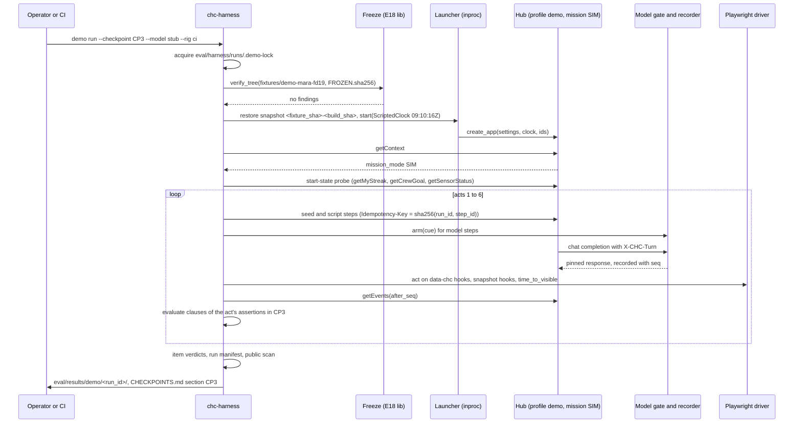

# E21: Integration, evidence and demonstration

Technical design for epic E21. Inputs: the brief (`tdd/E21.md` in the planning package), PRD.md (sections 1.5, 5, 8
rows R22, R26, R27, R30, and 11), VALIDATION.md (sections 2, 3, 7 and 8), KICKOFF.md (sections 4 to 7), PITCH.md,
CONTRACTS.md, `api/openapi.yaml`, `backlog.json` (E21-01 to E21-03), `docs/BUILD-CHARTER.md`, `docs/DEPLOYMENT.md`,
AGENTS.md, and the designs that name an E21 seam (E03, E04, E10, E11, E18, E19, E22, E24 to E28, E30 to E33).
`docs/SYSTEM.md` does not exist yet; every value this design would take from it is marked and listed in section 14.

E21 owns two things the rest of the build leans on: the **scenario harness** that runs every validation scenario,
every demo assertion and every charter critical path end to end against a real hub, and the **frozen demo fixture**
`demo-mara-fd19`. Around them it owns the published evidence: the run artifacts, `CHECKPOINTS.md`, the result panel data,
the capability manifest and the submission text. The governing rule: every scenario runs in CI against the hub, with the
model stopped wherever the scenario allows, and anything the harness could not run is shown as not run, never as a pass.

## 1. Scope

### 1.1 Work packages

| Story | Delivers | Acceptance (backlog.json) |
|---|---|---|
| E21-01 | The harness package `crew_health_harness` (launchers, hub client, seed loader, SIM adapters, model gate with call recorder, UI driver, scenario registry and runner); the fixture `fixtures/demo-mara-fd19/` with its seed, scripts, pinned stub responses, link variants and freeze; the D01 to D44 checks; the cross-module scenarios SC-01 to SC-10 for charter section 6; the client content scanner for V75 and V98 | Live, replay, simulation and unavailable paths clearly shown |
| E21-02 | Run artifacts per VALIDATION section 8, `CHECKPOINTS.md`, `eval/results/result-panel.json` (schema owned here, rendered by E27), the denominators and not-run lists, `docs/limitations.md` | Denominators and withheld or unrun cases included; no publisher score presented as ours |
| E21-03 | The capability manifest (`eval/results/capability-manifest.json` and `docs/capability-manifest.md`), `traceability.json`, `docs/decisions.md`, `docs/walkthrough.md`, the submission package `docs/submission/**` built from measured values | Nine original modules plus expanded architecture trace to evidence and backlog |

### 1.2 Requirements, scenarios, assertions

- **R22** (reproducible evaluation): every harness run has a `run_id` derived from the build, fixture, configuration
  release, model release, stub set and harness version hashes (section 3.6).
- **R26** (nine original modules represented): the capability manifest names the observed acquisition modes (LIVE,
  IMPORTED, REPLAY, SIM, unavailable) per component, computed from the run (INV-E21-07).
- **R27** (honest results): denominators, failures, rejected readings, not-run cases and experimental status in every
  published artifact (INV-E21-02, INV-E21-08).
- **R30** (benchmark separate from clinical readiness): the submission and result panel carry E18's numbers only under
  their E18 labels and pass E18's claims lint (section 10).
- **D01 to D44**: E21 owns the fixture, the checks and their verdicts. The behavior each assertion checks is owned by
  the epic that builds it (section 2.3). Table in section 12.3.
- **V01 to V98**: E21 owns the registry and the runner. Each scenario's test lives in its owner epic's folder
  (section 13.2); unassigned scenarios are proposed in section 14.13. E21 itself owns the mechanism of the V75 and V98
  client scan (E24, E25, E26, E28 and E32 supply their configuration edits).
- **Charter section 6 critical paths**: one E21 end to end scenario each, SC-01 to SC-10 (section 12.4).
- **UC**: E21 drives the use cases of the six acts (PRD section 1.5); it adds none.

### 1.3 Not delivered here

| Not here | Owner |
|---|---|
| Any product behavior the assertions check (records, rules, warnings, routine, help, plans, kit map, assistant) | The building epic (section 2.3) |
| HealthBench, the product suites over the vault, experiment 8, the claims lint and the freeze library | E18 |
| Content review states and the research workbench | E19 |
| CI workflow files, packaging, compose profiles, the supervisor | E20 |
| The How we know panel and the kit map numbers on screen | E27 (renders `result-panel.json`) |
| The crew app screens and their test hooks | E03 (request 14.6) |
| The venue study and its raw data | E27-05 (E21 publishes its hashed artifact) |
| Pushing anything to a public place | Nobody until the user authorizes it (question 14.2; USER-QUESTIONS Q12) |

## 2. Dependencies and seams

### 2.1 What E21 consumes

| Seam | Kind | Exact surface | Owner |
|---|---|---|---|
| Hub application factory with injected clock and IDs | Python, in process | `crew_health.app.create_app(settings: HubSettings, *, clock: Clock, ids: IdSource) -> FastAPI` and `Scheduler.run_due(now: datetime) -> int` (request 14.3) | E01 |
| Hub native command | Process | `uv run crew-health run` with `CREW_HEALTH_DATA_DIR` and `<data_dir>/crew-health.toml` `profile = "demo"` (DEPLOYMENT section 6) | E20 |
| Mission bootstrap | CLI | `crew-health mission init --file <mission.json>` (request 14.4) | E01, E02 |
| Integrity and restore | CLI | `crew-health verify` (DEPLOYMENT 7.1) | E20, E01 |
| Public API | HTTP | Every operation in `api/openapi.yaml`, schemas validated per response; list in section 6 | All |
| Event stream | HTTP | `getEvents` (`GET /v1/events`, strictly increasing `seq`) | E01 |
| Ground link demo switch | HTTP | `demoSetGroundLink` (`POST /v1/demo/ground-link`, role operator, served only in mission mode SIM or REPLAY) | E29 |
| Model runtime | HTTP | `getAssistantStatus`, `setAssistantRuntime`; hub settings `model.base_url` and `model.upstream_command` (request 14.8) | E17, E13 |
| Model turn header | HTTP header on hub to model requests | `X-CHC-Turn` (request 14.8) | E12, E13, E17 |
| SIM camera source | Worker setting | Camera worker frame source `sim:<clip path>` with origin SIM (request 14.7) | E06 |
| REPLAY and SIM habitat feeds | Adapter entry point | `crew-health adapters replay` (request 14.9); interim `ingestReadings` with the REPLAY adapter token | E23 |
| Band SIM feed | Adapter entry point | E08 SIM adapter (request 14.9); interim `recordObservation` with the SIM adapter token | E08 |
| Test hooks in the DOM | HTML attributes | `data-chc-*` (request 14.6) | E03 |
| GroundLink read trace | Hub trace file | request 14.12 | E29 |
| Freeze library | Python | `crew_health_bench.freeze.freeze_tree`, `verify_tree`, `FrozenManifest` (E18 section 4.2) | E18 |
| Claims lint | CLI | `uv run chc-bench lint claims <paths>` | E18 |
| Benchmark results | Files | `eval/bench/results/<run_id>/{run_manifest.json, aggregate.json, case_results.public.jsonl, REPORT.md}` | E18 |
| Canaries | Python fixtures | `fx_journal_canary` (`hub/tests/fixtures/journal_canary.py`, E03), `fx_vault_canary` (E10) | E03, E10 |
| Review states | File or API | request 14.17 | E19 |
| Preflight import | CLI | `crew-health skills import-preflight` with `fixtures/demo-mara-fd19/profile/` (E31) | E31 |

### 2.2 What E21 provides

| Seam | Kind | Exact surface | Consumers |
|---|---|---|---|
| Evaluation hub | Python | `EvalHubLauncher.start(profile: str) -> RunningHub` (section 4.2) | E18, every epic's scenarios |
| Hub client | Python | `HubClient.call(...)` (section 4.2) | E18, scenario authors |
| Seed loader and format | Python, JSON | `SeedLoader.load(steps, ctx) -> SeedResult`; `SeedStep` union (section 3.4) | E18 (visible parts), scenario authors |
| SIM measurement adapter | Python | `SimMeasurementAdapter.post_attempt(...)` | E18, E30 |
| Model call recorder | Python | `ModelCallLog.requests_between(start_mark, end_mark) -> Sequence[RecordedRequest]` (E18 section 4.3 signature) | E18, D05, D15, D23, D41 |
| Demo lock | File | `eval/harness/runs/.demo-lock` (JSON: `run_id`, `pid`, `started_at`) | E18 refuses to start while held |
| Evaluation marker | File | `<data_dir>/.chc-eval-marker.json` (section 5.3) | E18 INV-E18-10 |
| Scenario runner and markers | pytest | `eval/scenarios/conftest.py` registers `demo`, `cp1` to `cp4`, `freeze`, `cross`, `v01` to `v98`, `d01` to `d44`, `e01` to `e33` from `registry.json` | Every epic's scenarios |
| Snapshot reset | CLI | `chc-harness demo reset` | E22 (Q-E22-2), the presenter |
| Result panel data | File | `eval/results/result-panel.json`, schema `eval/harness/schemas/result-panel.schema.json` | E27 (request 14.11) |
| Capability manifest | File | `eval/results/capability-manifest.json` and `docs/capability-manifest.md` | Submission, README |

### 2.3 Who builds what the assertions check

D01 E03, E23; D02 E08, E03; D03 E22; D04 E03; D05 E04, E11; D06 E04, E05, E13; D07 E03, E04; D08 E05, E06; D09 E02, E06;
D10 to D12 E13, E15; D13 E16, E29; D14 E03, E22; D15 E26; D16 E23, E24; D17 E13, E24; D18 E23; D19 E24; D20 and D21 E25;
D22 to D27 E26 (D24 with E02); D28 and D29 E27; D30 E27, E12; D31 E27, E23; D32 E28; D33 to D35 E29, E23; D36 E28; D37 E31;
D38 E30; D39 E03, E13; D40 E28; D41 E26, E31; D42 E26, E29; D43 E29; D44 E03, E22, E30, E31. A failing assertion is a
finding for its builder; E21 never edits the fixture to make it pass (KICKOFF section 4, VALIDATION section 3).

## 3. Domain model

Pure code in `crew_health_harness.domain`: no I/O, no clock reads, no framework imports.

### 3.1 Axes of a run

```python
class ModelMode(StrEnum):
    STOPPED = "stopped"      # model process not running; every request to the gate is recorded and answered 503
    STUB = "stub"            # pinned responses from fixtures/<id>/stub/responses.json
    LIVE = "live"            # the real model release behind the gate

class Rig(StrEnum):
    CI = "ci"                # no devices, SIM camera source, no webcam
    TABLE_MIN = "table_min"  # one laptop and its webcam (DEPLOYMENT T0; USER-QUESTIONS Q8)
    TABLE = "table"          # T0 plus the devices listed in eval/harness/config/rigs.json, per DEPLOYMENT.md

class LauncherKind(StrEnum):
    INPROC = "inproc"        # create_app under uvicorn in a thread, ScriptedClock, SeededIdSource (CI default)
    PROCESS = "process"      # the command named by the profile (native or the compose `minimal` profile), OffsetClock
```

### 3.2 Items, clauses and verdicts

```python
class ItemKind(StrEnum):
    D = "demo_assertion"; V = "validation_scenario"; SC = "critical_path"

class NotRunReason(StrEnum):
    REQUIRES_RIG = "requires_rig"; REQUIRES_LIVE_MODEL = "requires_live_model"
    REQUIRES_MODEL = "requires_model"          # stub or live; the run is stopped mode
    REQUIRES_STUB = "requires_stub"            # a clause that only a pinned response can provoke (D30 second clause)
    NOT_BUILT = "not_built"                    # registry item with no collected test
    UNASSIGNED = "unassigned"                  # registry item with no owner epic
    DEPENDENCY_FAILED = "dependency_failed"    # an earlier step it needs did not complete
    NOT_IN_CHECKPOINT = "not_in_checkpoint"
    AWAITING_REQUEST = "awaiting_request"      # needs a surface still under request (named in detail_code)

class ClauseVerdict(StrEnum):
    PASS = "pass"; FAIL = "fail"; ERROR = "error"; NOT_RUN = "not_run"

class Verdict(StrEnum):
    PASS = "pass"; FAIL = "fail"; ERROR = "error"; PARTIAL = "partial"; NOT_RUN = "not_run"

@dataclass(frozen=True, slots=True)
class ClauseRequirement:
    model: frozenset[ModelMode]          # modes in which the clause can run
    rig: frozenset[Rig]                  # rigs in which the clause can run
    awaiting: str | None                 # request ID from section 14 when a surface is missing

@dataclass(frozen=True, slots=True)
class EvidenceRef:
    kind: Literal["api", "event", "dom", "timing", "model_call", "trace", "file"]
    ref: str                             # operationId plus resource ID, event seq, hook selector, mark pair, path
    sha256: str | None

@dataclass(frozen=True, slots=True)
class ClauseResult:
    clause_id: str                       # "D09.c3"
    verdict: ClauseVerdict
    reason: NotRunReason | None          # required when verdict is NOT_RUN, else None
    detail_code: str                     # machine code, for example "attempt_reason_mismatch"; never prose
    evidence: tuple[EvidenceRef, ...]

@dataclass(frozen=True, slots=True)
class ItemResult:
    item_id: str                         # "D09", "V05", "SC-04"
    kind: ItemKind
    clauses: tuple[ClauseResult, ...]    # non-empty

def item_verdict(clauses: Sequence[ClauseResult]) -> Verdict: ...
```

`item_verdict` (one rule, used everywhere):

| Clauses contain | Verdict |
|---|---|
| any `fail` | `fail` |
| no `fail`, any `error` | `error` |
| only `pass` | `pass` |
| `pass` and `not_run`, nothing else | `partial` |
| only `not_run` | `not_run` |

An empty clause list raises `EmptyItem`. `partial` and `not_run` never count as pass anywhere (INV-E21-08).

### 3.3 Registry

```python
@dataclass(frozen=True, slots=True)
class RegistryItem:
    item_id: str
    kind: ItemKind
    source_ref: str                      # "VALIDATION.md#3 D09", "BUILD-CHARTER.md#6 path 4"
    owner_epic: str | None               # None means UNASSIGNED
    owner_basis: Literal["backlog_story", "tdd_scope", "coordinator", "e21"]
    contributors: tuple[str, ...]
    test_node: str | None                # pytest node ID, filled at collection
    checkpoints: frozenset[str]          # D items only, from fixtures/demo-mara-fd19/checkpoints.json
    clause_requirements: Mapping[str, ClauseRequirement]
```

`registry.json` is generated by `chc-harness registry sync` from the package (IDs from VALIDATION sections 2 and 3, the
charter section 6 list, `backlog.json` stories naming V IDs, each TDD's section 1 V list) plus coordinator assignments
(request 14.13). The sync never invents an owner: an ID with no basis gets `owner_epic: null` and runs as
`not_run(unassigned)`.

### 3.4 Seed steps

The seed format shared with E18 (E18 `VisiblePart`). Each step has a `step_id` unique in its file.

```python
SeedStep = (
    MissionInit       # {"type":"mission_init","file":"mission.json"}  -> crew-health mission init (14.4)
  | ClockSet          # {"type":"clock_set","at":"2026-11-13T07:30:00Z"}
  | ClockAdvance      # {"type":"clock_advance","to":"...","run_due":true}
  | Session           # {"type":"session","as":"mara","credential_ref":"credentials.json#mara"}
  | Call              # {"type":"call","operation_id":"submitDailyCheck","path_params":{},"body":{},
                      #  "expect":{"status":200,"problem_code":null},"capture":{"check_id":"/id"}}
  | DailyCheck        # macro: startDailyCheck, answerDailyCheck per question, submitDailyCheck;
                      #  answers keyed by question_id from the active daily check configuration
  | SensorFeed        # macro: REPLAY or SIM rows through E23's entry point (interim ingestReadings)
  | Attempt           # macro: SimMeasurementAdapter.post_attempt for a captured MeasurementRequest
  | ModelRuntime      # {"type":"model_runtime","action":"start"|"stop"} via setAssistantRuntime
  | StubCue           # {"type":"stub_cue","cue":"act4_measurement_request"} arms a pinned response
  | UiStep            # {"type":"ui","action":"click"|"choose"|"read","hook":"help-entry","index":0}
  | Cli               # {"type":"cli","command":"skills import-preflight","args":{...}} (allow list in profiles.json)
)
```

Rules enforced by the loader: the idempotency key of a mutating `call` is `sha256(run_id || step_id)` as hex;
`If-Match` is filled from the last captured revision of that resource; every response body is validated against its
OpenAPI schema; `capture` values are JSON pointers into the validated body; a `${capture}` reference to an unset name
fails the step. Clinical and display values never appear in seed files as literals when a configuration document holds
them: steps name IDs (`question_id`, `choice_id`, `flow_id`, `capability_code`) and the loader resolves them against the
active release, failing loudly when an ID is absent.

### 3.5 DemoRun state machine

States: `planned`, `preparing`, `running` (with `act` 1 to 6), `assessing`, `completed`, `published`, `aborted`,
`invalidated`.

| From | Event | Guard | To |
|---|---|---|---|
| planned | `prepare` | demo lock acquired; fixture freeze verifies; for LIVE model, E18 lock not held | preparing |
| planned | `prepare` | any guard false | aborted (`lock_held`, `fixture_tampered`) |
| preparing | `hub_ready` | hub healthy; `getContext.mission_mode` is SIM or REPLAY; marker kind `FIXTURE_HUB`; start-state probe passes | running(1) |
| preparing | `hub_ready` | mission mode LIVE, marker missing, or probe fails | aborted (`live_hub_refused`, `marker_missing`, `start_state_mismatch`) |
| running(k) | `act_done` | k < 6 | running(k+1) |
| running(6) | `act_done` | | assessing |
| running(k) | `hub_lost` | the launcher restarts the hub within `restart_budget` and `getHealth` answers | running(k), the step is retried with its same idempotency key |
| running(k) | `hub_lost` | restart budget exhausted | aborted (`hub_unrecoverable`); unevaluated items get `error` with `dependency_failed` |
| assessing | `verdicts_written` | every registry item in the checkpoint has an ItemResult | completed |
| completed | `publish` | artifacts pass the public scan (INV-E21-05) and the claims lint | published |
| completed, published | `invalidate` | fixture, build or stub hash differs from the run manifest, or an artifact hash no longer verifies | invalidated |

`aborted` and `invalidated` are terminal. An aborted run still writes its manifest and its item results; it is never
deleted and never summarized as a pass.

### 3.6 Run identity and manifest

```python
@dataclass(frozen=True, slots=True)
class RunManifest:
    run_id: str                       # sha256 over the fields below, hex, first 16 characters as directory name
    kind: Literal["demo", "scenarios", "cross"]
    checkpoint: str | None            # CP1..CP4, "freeze"
    model_mode: ModelMode
    rig: Rig
    launcher: LauncherKind
    build: BuildIdentity              # git commit, dirty flag, crew app bundle SHA-256, hub wheel SHA-256
    fixture_manifest_sha256: str      # FrozenManifest.manifest_sha256 of fixtures/demo-mara-fd19
    config_release_id: str            # getContext / getConfigIndex at start
    model_release: ModelReleaseRef | None   # LIVE only: model ID, revision, weights SHA-256, prompt version, tool catalog version
    stub_set_sha256: str | None       # STUB only
    harness_version: str
    seed_ids: int                     # SeededIdSource seed (INPROC)
    started_at: datetime; finished_at: datetime | None
    state: str                        # DemoRun state at write time
```

### 3.7 Result panel, capability manifest, report

```python
class MetricStatus(StrEnum):
    MEASURED = "measured"; NOT_MEASURED_YET = "not_measured_yet"

@dataclass(frozen=True, slots=True)
class Denominator:
    people: int | None; windows: int | None; pairs: int | None; scenarios: int | None

@dataclass(frozen=True, slots=True)
class PanelMetric:                     # field names from E27 R27-7
    metric_id: str                     # from eval/harness/config/result-panel-metrics.json
    status: MetricStatus
    value: Quantity | None             # value with UCUM unit; None when not measured
    denominator: Denominator
    failures: int | None
    artifact_path: str | None; artifact_sha256: str | None
    run_id: str | None; measured_at: datetime | None
    label_ref: str                     # ui-copy key; the panel never carries display text from code

class ComponentStatus(StrEnum):
    VERIFIED = "verified"; PARTIAL = "partial"; FAILING = "failing"; NOT_BUILT = "not_built"

@dataclass(frozen=True, slots=True)
class ComponentEntry:
    component_id: str                  # from components.json (PRD section 5 rows)
    origin: Literal["revision_3", "expanded"]
    status: ComponentStatus            # computed, rule below
    observed_modes: frozenset[Literal["LIVE", "IMPORTED", "REPLAY", "SIM", "unavailable"]]
    hardware: tuple[str, ...]          # from rigs.json entries actually present in the run
    review_state: str                  # from E19 (14.17); "unknown" until then, shown as such
    evidence: tuple[EvidenceRef, ...]  # registry items and artifacts
    limitations: tuple[str, ...]       # limitation IDs into docs/limitations.md
    backlog_story_ids: tuple[str, ...]
```

Component status rule (pure, `component_status(items) -> ComponentStatus`): no linked item collected, or all linked items
`not_run(not_built)`: `not_built`; any linked item `fail` or `error`: `failing`; all linked items `pass`: `verified`;
otherwise `partial`.

### 3.8 Invariants

| ID | Invariant | Test |
|---|---|---|
| INV-E21-01 | The harness never issues a mutating call, restore or seed step against a hub whose `getContext.mission_mode` is `LIVE`, or whose data directory lacks an E21 marker | T-E21-13, T-E21-27 |
| INV-E21-02 | Every registry item appears in every run's results with a verdict; every denominator counts `not_run`, `partial`, `error` and `fail` | T-E21-02, T-E21-04 |
| INV-E21-03 | A run starts only when `verify_tree` over the fixture returns no finding | T-E21-14 |
| INV-E21-04 | Pinned stub responses are served only in `stub` mode; a `live` or `stopped` run with a stub entry armed aborts | T-E21-10 |
| INV-E21-05 | Public artifacts carry no canary, no value from a LIVE record, no prompt or completion text, no credential and no personal identifier beyond fixture SIM names | T-E21-20 |
| INV-E21-06 | A panel metric is `measured` only when its artifact exists and its SHA-256 matches; otherwise `not_measured_yet` with value null | T-E21-06 |
| INV-E21-07 | A component's acquisition modes are the origins observed in the run's records, never the modes declared in configuration | T-E21-07 |
| INV-E21-08 | `partial` and `not_run` never count as pass, in `CHECKPOINTS.md`, the result panel, the manifest or the submission | T-E21-01, T-E21-26 |
| INV-E21-09 | No display string from a configuration document appears as a literal in assertion code (the V75 scanner runs over `eval/`) | T-E21-22 |
| INV-E21-10 | Every record the fixture creates has origin SIM or REPLAY, except records in the demo-operator namespace | T-E21-17 |
| INV-E21-11 | The SIM measurement adapter and the SIM camera source never post an origin other than SIM | T-E21-18 |
| INV-E21-12 | The link up and link down variants of an act start from the same snapshot hash, the same clock instants and the same cue list; only the `demoSetGroundLink` step differs | T-E21-23 |
| INV-E21-13 | A stub entry that does not match, or whose placeholders do not resolve, answers 503 and fails the run step loudly; it never falls back to another entry | T-E21-10 |
| INV-E21-14 | Submission text containing a placeholder that did not resolve, or a word the submission rules allow only under a computed condition that is false, fails the build | T-E21-12 |

## 4. Application layer

### 4.1 Use cases

| Use case | Input | Output | Errors | Idempotency |
|---|---|---|---|---|
| `BuildFixture` | fixture dir, launcher | snapshot dir `eval/harness/runs/snapshots/<fixture_sha>-<build_sha>/`, start-state probe result | `FixtureTampered`, `SeedStepFailed(step_id, problem)`, `ConfigIdMissing` | Same inputs give the same snapshot key; an existing snapshot with a verified hash is reused |
| `VerifyFixture` | fixture dir | `FreezeFinding` list; resolution check of every config ID the scripts name | `FixtureTampered`, `ConfigIdMissing` | Read only |
| `ResetDemo` | data dir, snapshot key | restored data dir | `LiveHubRefused`, `MarkerMissing`, `HubRunning`, `IntegrityFailed` (from `crew-health verify`) | Repeatable; always the same bytes |
| `RunDemo` | checkpoint, model mode, rig, launcher | `RunManifest`, `ItemResult` per D item | `LockHeld`, abort reasons of section 3.5 | `run_id` per section 3.6; rerun writes a new run directory, never overwrites |
| `RunScenarios` | marker expression, model mode, rig, launcher | `RunManifest`, `ItemResult` per V or SC item | as above | as above |
| `ScanClient` | paths from `scanner.json`, active release | findings list | `ScannerConfigInvalid` | Read only |
| `BuildResultPanel` | panel metric definitions, artifact paths | `result-panel.json` | `ArtifactHashMismatch` (metric becomes `not_measured_yet`, not an error) | Deterministic from inputs |
| `BuildCapabilityManifest` | latest completed runs per kind, components.json, review states | JSON and Markdown | `ComponentUnknown` | Deterministic |
| `BuildSubmission` | templates under `docs/submission/templates/`, panel, kit map values captured in the run | rendered `docs/submission/*.md` | `UnresolvedPlaceholder`, `WordRuleViolated`, claims lint findings | Deterministic |
| `Publish` | a completed run | `eval/results/...` files, `CHECKPOINTS.md` section | `PublicScanFailed`, `ClaimsLintFailed` | Writes atomically; republishing the same run is a no-op |

### 4.2 Ports

```python
class Clock(Protocol):
    def now(self) -> datetime: ...                                          # UTC, tz-aware

class RunningHub(Protocol):
    base_url: str
    data_dir: Path
    launcher: LauncherKind
    def tick_until(self, instant: datetime) -> int: ...      # INPROC: set clock, Scheduler.run_due; PROCESS: raises UnsupportedOnLauncher
    def restart(self, *, clock_anchor: datetime | None, timeout_s: float) -> None: ...   # graceful stop, start
    def kill(self) -> None: ...                              # SIGKILL (PROCESS) or abrupt thread stop plus DB handle drop (INPROC)
    def stop(self, *, timeout_s: float) -> None: ...

class HubLauncher(Protocol):
    def start(self, profile: HubProfile, data_dir: Path, *, clock: ClockSpec, timeout_s: float) -> RunningHub: ...

class EvalHubLauncher(Protocol):                             # the facade E18 uses
    def start(self, profile: str) -> RunningHub: ...          # profile name from eval/harness/config/profiles.json

class HubClient(Protocol):
    def call(self, operation_id: str, *, path_params: Mapping[str, str] = ..., query: Mapping[str, str] = ...,
             body: Mapping[str, object] | None = None, idempotency_key: str | None = None,
             if_match: str | None = None, session: SessionToken | None = None,
             timeout_s: float) -> ApiResponse: ...            # status, headers, validated body or ProblemDetail

class EventReader(Protocol):
    def page(self, *, after_seq: int, limit: int, session: SessionToken, timeout_s: float) -> EventPage: ...

class ModelGate(Protocol):
    def mark(self, label: str) -> int: ...                    # shared monotonic counter with recorded requests
    def arm(self, cue: str) -> None: ...                      # STUB only; raises StubNotAllowed otherwise
    def set_upstream_delay(self, seconds: float) -> None: ... # fault injection for the failure path
    def requests_between(self, start_mark: int, end_mark: int) -> Sequence[RecordedRequest]: ...   # ModelCallLog

@dataclass(frozen=True, slots=True)
class RecordedRequest:
    seq: int                                  # from the shared counter
    received_monotonic_ns: int
    upstream_state: Literal["running", "stopped", "loading"]
    status: int
    turn: TurnHeader | None                   # parsed X-CHC-Turn
    prompt_sha256: str                        # text kept only in the private run store
    tool_names: tuple[str, ...]
    latency_ms: float | None

class UiDriver(Protocol):
    def open(self, route: str, *, session: SessionToken | None) -> None: ...
    def act(self, hook: str, *, index: int | None = None) -> None: ...       # data-chc-action or data-chc-choice
    def time_to_visible(self, trigger_hook: str, target_hook: str, *, timeout_s: float) -> float: ...   # ms, page clock
    def snapshot_hooks(self) -> Sequence[HookNode]: ...       # every data-chc-* element: hook, attrs, text, order index
    def network_log(self) -> Sequence[NetworkEntry]: ...      # method, path, status, from the page's own requests

class SeedLoader(Protocol):
    def load(self, steps: Sequence[SeedStep], ctx: SeedContext) -> SeedResult: ...

class SimMeasurementAdapter(Protocol):
    def post_attempt(self, request_id: str, outcome: SimAttemptOutcome, *, session: SessionToken) -> AttemptRef: ...

class SnapshotStore(Protocol):
    def save(self, data_dir: Path, key: str) -> SnapshotRef: ...
    def restore(self, ref: SnapshotRef, data_dir: Path) -> None: ...

class ArtifactWriter(Protocol):
    def write_atomic(self, path: Path, data: bytes) -> str: ...   # returns SHA-256
    def append_line(self, path: Path, record: Mapping[str, object]) -> None: ...   # fsync per line

class BenchResultsReader(Protocol):                           # E18 published files
    def latest(self, suite: str) -> BenchRunRef | None: ...

class ReviewStateReader(Protocol):                            # E19, request 14.17
    def state(self, component_id: str) -> str: ...
```

`SimAttemptOutcome` is `SimAccepted(value: Quantity, camera_ids, selector_choice, disagreement)` or
`SimRefused(reason_code: str)`, with `reason_code` resolved against the quality gate reason codes of the active
release. The adapter's token is the SIM adapter token from `credentials.json`; the hub stamps origin from the token
(INV-E21-11).

### 4.3 Events

E21 publishes no hub events. It consumes every event type through `getEvents` and checks order by `seq` only; the event
names it asserts on are those of CONTRACTS section 18 (`check.completed`, `warning.raised`, `ground_link.changed`,
`help_session.*`, `assistant.*`, `routine.*`, `plan_run.*`, `guided_check.beat`), read from the contract copy, never
spelled in assertion code (INV-E21-09).

### 4.4 Principal success path: stub demo run at a checkpoint



### 4.5 Failure path: live run, model timeout in act 4, hub crash in act 5

```mermaid
sequenceDiagram
    participant H as chc-harness
    participant L as Launcher (process)
    participant Hub as Hub
    participant G as Model gate
    H->>G: set_upstream_delay(turn_timeout_seconds + margin) (fault cue)
    H->>Hub: answerEpisode (act 4)
    Hub->>G: chat completion
    G-->>Hub: (no answer before the hub's turn timeout)
    Hub-->>H: job failed, MODEL_TIMEOUT
    H->>H: D06 c1 fail(detail model_timeout); D05 and D15 clauses still evaluated
    H->>L: kill() during act 5 command burst (fault cue)
    L->>Hub: SIGKILL
    H->>L: restart(clock_anchor unchanged)
    L->>Hub: start, quick_check, audit tail
    H->>Hub: retry the interrupted step with the same Idempotency-Key
    Hub-->>H: original result (replayed), no duplicate record
    H->>H: act 5 assertions evaluated; if restart budget exhausted: aborted, rest error(dependency_failed)
    H->>H: manifest state aborted or completed, findings listed, nothing summarized as pass
```

The live failure path is the KICKOFF "failure demonstration" for the demo freeze: the run that shows it is a normal run
with the fault cues `model_delay` and `hub_kill` armed from `fixtures/demo-mara-fd19/script/faults.json`.

## 5. Adapters

### 5.1 Launchers

- **`inproc`** (`adapters/launch_inproc.py`): builds `HubSettings` from `eval/harness/config/profiles.json` with the run's
  data directory, calls `create_app(settings, clock=ScriptedClock(start), ids=SeededIdSource(seed))` (request 14.3), and
  serves it with uvicorn in a daemon thread bound to `127.0.0.1` on a free port. `tick_until(t)` sets the clock and calls
  `Scheduler.run_due(t)` until it returns 0, bounded by `max_due_rounds` from `profiles.json`. Startup timeout and
  shutdown timeout come from `profiles.json`. This is the CI default and the only launcher where clock jumps are free.
- **`process`** (`adapters/launch_process.py`): writes `<data_dir>/crew-health.toml` (`profile = "demo"`, listener
  `127.0.0.1:<free port>`, the workers the rig enables, `clock.mode = "offset"` with `clock.anchor_utc` and
  `clock.anchor_wall`, request 14.3) and runs the profile's `launch_command` (native `uv run crew-health run`, or
  `docker compose --profile minimal up` for the DEPLOYMENT section 8 `e2e` job) with a process group, a startup
  timeout and `getHealth` polling. A clock jump between acts is `restart(clock_anchor=...)`: graceful stop, rewrite the
  anchor, start. Durable state carries over, which is itself evidence for R25.
- Both write `<data_dir>/.chc-eval-marker.json` before the first start and refuse to start a data directory whose
  marker is missing or whose kind is neither `EVALUATION_HUB` nor `FIXTURE_HUB`.

### 5.2 Hub client and event reader

`httpx` with one client per run, explicit per call timeouts (`http_timeout_s` in `profiles.json`), no retries except
the restart path of section 3.5 (which reuses the step's idempotency key). Responses are parsed with the Pydantic models
generated from `contracts/api/openapi.yaml` (charter rule 3); a response that does not validate is a clause `error` with
`detail_code: schema_violation`, never coerced. Problem details are matched by `code` from CONTRACTS section 5. Event
pages use the contract's maximum page size; a run reads at most `max_events_per_run` events (`profiles.json`); hitting
the bound is an `error`, not a truncation.

### 5.3 Markers, locks, snapshots

- Marker `<data_dir>/.chc-eval-marker.json`: `{"kind": "EVALUATION_HUB" | "FIXTURE_HUB", "run_id", "fixture_id",
  "created_at"}`. Written by the launcher; read by E18 (INV-E18-10) and by `ResetDemo`.
- Demo lock `eval/harness/runs/.demo-lock`: created with `O_CREAT | O_EXCL`; a stale lock (PID not alive) is reported
  and removed only by `chc-harness lock clear` with the operator's confirmation. For `live` runs the harness also
  refuses while E18's `eval/bench/runs/.lock` is held (one model, one user).
- Snapshot: after `BuildFixture`, the hub is stopped gracefully and the files `hub.sqlite`, `hub.sqlite-wal` (if
  present), `private.sqlite`, `config/releases/`, `knowledge/` and the marker are copied to
  `eval/harness/runs/snapshots/<key>/` with a `FROZEN.sha256` written by the freeze library. `ResetDemo` checks: the
  target data directory has a `FIXTURE_HUB` marker, no hub process holds it (lock file of the hub, per DEPLOYMENT.md),
  the snapshot verifies; then it copies the files back and runs `crew-health verify`. The snapshot is derived, never
  committed (`eval/harness/runs/` is ignored, request 14.14); the frozen thing is the fixture, not the database bytes,
  so a schema migration rebuilds the snapshot instead of breaking the demo.

### 5.4 Model gate

`adapters/model_gate.py`: an OpenAI compatible listener the harness runs for the whole run on `127.0.0.1`, which the hub
reaches as `model.base_url`. The hub's runtime manager starts and stops the upstream through `model.upstream_command`
(request 14.8), set in the eval profile to `chc-harness model-upstream --mode stub|live --port <p> --run <run_id>`. In
`live` mode `model-upstream` execs `llama-server` with the arguments of the model release (E17); in `stub` mode it is a
small server reading `stub/responses.json`.

- Every request to the gate is recorded (section 4.2 `RecordedRequest`) before it is forwarded, including requests made
  while the upstream is stopped, which get 503 with `upstream_state: stopped`. `GET /health` mirrors the upstream and
  answers 503 when stopped, so `getAssistantStatus` reports the truth.
- Stub matching: an entry matches on `X-CHC-Turn` (`conversation_kind`, `context`, `turn_index`, `stage`) and on the
  currently armed cue. Entries may contain `{"$from_tool": {"tool": "<name>", "path": "<json pointer>"}}` placeholders,
  resolved from tool results recorded earlier in the same conversation. No match, two matches, or an unresolved
  placeholder: 503 and the step fails (INV-E21-13).
- Bounds: request body at most `gate_max_body_bytes`, recorded entries at most `gate_max_records` per run, upstream call
  timeout `gate_upstream_timeout_s` (all in `profiles.json`, each with its basis).
- Prompt and completion texts go only to `eval/harness/runs/<run_id>/private/model_calls.jsonl` (ignored by git); the
  public file holds `seq`, hashes, tool names, status and latency.

### 5.5 UI driver

Playwright for Python, Chromium, headless in CI. An init script installs a `MutationObserver` that records
`performance.now()` when a target hook first becomes visible; `time_to_visible` dispatches the trigger's click and
returns the page clock delta, so the number excludes harness overhead. UI evidence is DOM and accessibility text only:
`data-chc-*` hooks (request 14.6), their order index, their attributes and the accessible name. No pixel screenshots
are evidence (they may be kept as private debugging aids).

### 5.6 Feeders

- `CsvReplayFeeder` (interim for E23): reads `nasa-data/eda_rr1_telemetry.csv` and `nasa-data/radlab_dostel_sample.csv`
  rows in the replay window named in `fixtures/demo-mara-fd19/sensors/feeds.json`, keeps their original timestamps as
  `observed_at`, and posts them with `ingestReadings` under the REPLAY adapter token. It computes nothing: the one hour
  mean is the hub's. Replaced by E23's entry point when it lands (request 14.9).
- SIM channels read their rows from `fixtures/demo-mara-fd19/sensors/*.csv` (SIM, generated once, frozen).

### 5.7 Alternatives considered

| Decision | Chosen | Rejected and why |
|---|---|---|
| Hub under test | Real hub through its public API | Calling application services directly: would bypass auth, idempotency and schemas the assertions depend on |
| Time | Scripted clock in process, offset clock across restarts | Wall clock with sleeps: slow and flaky; a clock endpoint: a production surface that can move mission time |
| Model in CI | Stopped by default, stub where a model step is required | A small real model in CI: non deterministic and still not the release under test |
| Fixture storage | Seed steps frozen, snapshot derived | Committed SQLite file: breaks on every migration and hides how the state was made |
| UI evidence | DOM hooks and page clock timing | Screenshot diffing: brittle and says nothing about records |
| Result storage | Files under `eval/results/` with hashes | A results database: more to run, nothing gained at this size |

## 6. API

E21 adds no endpoint and no field. It calls the hub only through `api/openapi.yaml`:

| Area | operationIds |
|---|---|
| Identity and context | `getHealth`, `createSession`, `getCurrentSession`, `deleteCurrentSession`, `getContext`, `listCrew`, `getMission` |
| Configuration | `getConfigIndex`, `getConfigDocument`, `listConfigReleases`, `createConfigRelease`, `activateConfigRelease` (SC-08) |
| Environment and link | `getEnvironment`, `proposeEnvironmentChange`, `actOnEnvironmentChange`, `createOverlay`, `endOverlay`, `listOverlays`, `recordMissionEvent`, `getGroundLink`, `demoSetGroundLink` |
| Sensors and warnings | `ingestReadings`, `listSensorStatus`, `getSensorStatus`, `getSensorSeries`, `listWarnings`, `getWarning`, `actOnWarning` |
| Routine and check | `getRoutineToday`, `listOccurrences`, `actOnOccurrence`, `startDailyCheck`, `answerDailyCheck`, `submitDailyCheck`, `writeJournal` (canary only) |
| Concern, measurement, assessment | `startEpisode`, `answerEpisode`, `getEpisode`, `recordObservation`, `listCapabilities`, `getMeasurementRequest`, `actOnMeasurementRequest`, `recordAttempt`, `startAssessment`, `getAssessment`, `getJob`, `previewHandoff`, `approveHandoff`, `getHandoff` |
| Kit, plans, skills, roles | `getKitMap`, `kitMapWhatIf`, `getConditionPlan`, `getPlan`, `startPlanRun`, `getPlanRun`, `listPlanRunRoles`, `startGuidedCheck`, `tapBeat`, `getGuidedCheck`, `getHelpRoles`, `getCrewReadiness` |
| Help and ground | `openHelpSession`, `getHelpSession`, `actOnHelpSession`, `getHelpSubject`, `previewGroundMessage`, `queueGroundMessage`, `getGroundMessage`, `getGroundLog`, `recordGroundMessageReceipt` (SC-09, ground session in demo profile) |
| Assistant | `getAssistantStatus`, `setAssistantRuntime`, `openConversation`, `sendMessage`, `streamConversation`, `cancelTurn`, `listInsights`, `getInsight` |
| Participation and views | `getMyStreak`, `getCrewGoal`, `getMyPatches`, `getTodayView`, `getHabitatView`, `getRecordsView`, `getEvents` |

Rules: every mutating call carries `Idempotency-Key`; objects with a revision carry `If-Match`; the harness signs in as
the role the step names (operator for `demoSetGroundLink` and `setAssistantRuntime`, crew for personal work) and asserts
`403 FORBIDDEN` where a scenario expects refusal. Error handling by CONTRACTS section 5 code: `MODEL_UNAVAILABLE`,
`MODEL_TIMEOUT`, `MODEL_OUTPUT_REJECTED` and `INVALID_TRANSITION` are expected outcomes in named clauses; `INTERNAL_ERROR`,
`UNAUTHENTICATED` (outside a scripted session expiry) and `ORIGIN_MISMATCH` are harness `error` unless a clause expects
them. The eval profile disables nothing in the hub: the harness has no back door.

## 7. User interface

E21 ships no product screen. It touches UI in three ways:

1. **Drives the crew app** through `data-chc-*` hooks (request 14.6): `data-chc-screen`, `data-chc-card`,
   `data-chc-source` (the origin code LIVE, REPLAY or SIM, not the word), `data-chc-region` with `data-chc-mark`
   (`dot`, `ring`, `dashed`), `data-chc-participation` (streak, patch, crew goal, celebration), `data-chc-action`,
   `data-chc-choice`, `data-chc-step`, `data-chc-state` (loading, empty, error, stale, offline, unavailable). Assertions
   compare hook values with API values; they never compare against display text typed in test code.
2. **Feeds the How we know panel** with `result-panel.json` (E27 renders it). Every metric carries `label_ref` keys into
   ui-copy; the file holds no display prose.
3. **Presenter cues.** The six acts need presenter actions (environment switch, ground link switch, model stop and
   start, clock jumps). The product controls for these are `proposeEnvironmentChange`, `demoSetGroundLink` and
   `setAssistantRuntime`, each behind the operator role. Who owns an operator screen for them is open (request 14.15).
   E21 guarantees a fallback that needs no screen: `chc-harness demo cue <cue_id>` runs the same script step the
   automated run uses, so the recorded demo and CI share one script.

`docs/walkthrough.md` (README walkthrough) and `docs/capability-manifest.md` are generated Markdown; their numbers come
from the result panel and the manifest, not from hand edits.

## 8. Configuration

E21's own documents are evaluation configuration, never product configuration. Each has a JSON Schema in
`eval/harness/schemas/`, a `provenance` block (`source`, `source_ref`, `basis`: `package` | `team_default` |
`per_deployment`, `author_role`, `version`) and is validated at harness start; an invalid document stops the harness
before any hub starts.

| Document (`eval/harness/config/`) | Holds | Source of its values |
|---|---|---|
| `profiles.json` | Launch profiles (`ci`, `e2e`, `table`, `eval`): launch command, workers, timeouts, bounds (`http_timeout_s`, `max_due_rounds`, `max_events_per_run`, `restart_budget`, gate bounds) | DEPLOYMENT.md sections 6 to 8 for commands; team defaults with basis for bounds |
| `rigs.json` | Rig definitions and the hardware each declares | DEPLOYMENT.md tiers T0 and T3; Q8 for the venue |
| `budgets.json` | Timing budgets: help first screen, assistant turn time reporting window | PRD section 11 and charter section 6 (500 ms); SYSTEM.md 8.7 per SYSTEM.md when written |
| `load-profile.json` | Background load for SC-01 (ingest rate, event stream clients, a running assistant turn, concurrent daily checks) | Team default, labeled, until SYSTEM.md 8.7 defines "under load" (request 14.19) |
| `link-diff.json` | JSON pointers ignored when comparing link up and link down responses (ground fields, ground text) | CONTRACTS section 12 GroundLink fields; D34 |
| `result-panel-metrics.json` | Metric IDs, which artifact and JSON pointer each comes from, unit, denominator kind, `label_ref` | PRD R27, KICKOFF section 5, E27 R27-7 |
| `components.json` | The PRD section 5 component rows, `origin` (`revision_3` for the nine of PRD line 15: Crew application, Camera pulse, Camera breathing, Oximeter integration, Wrist activity band, Ground console, Local LLM, Chronos-2, Station cameras; `expanded` otherwise), linked registry items, backlog stories, limitation IDs | PRD sections 5 and 8 (R26), backlog.json |
| `demo-claims.json` | Claims the demo and video may make, each tied to a metric or assertion that must be `pass` | PITCH.md shot list, VALIDATION section 3 |
| `scanner.json` | V75 and V98 scan: config documents and fields whose strings are searched, minimum string length, paths (`ui/crew/src`, `ui/ground/src`, built `dist` JS, CSS, HTML, `eval/`), allowed data asset files (must equal a config document by hash) | VALIDATION V75, V98; CONTRACTS section 11 |
| `publish-policy.json` | Which run files are public, which are private, the scan patterns for LIVE values and credentials | VALIDATION section 8; AGENTS rule 7 |
| `submission-words.json` | Conditional words, for example "Every one" allowed only when the computed plan aboard count is 119 of 119 at the frozen release | PITCH.md (shot 0:21 to 0:26 note) |

The fixture's own data (`fixtures/demo-mara-fd19/`) is demo data under AGENTS rule 2, loaded only through the `demo`
profile. Its values (persona answers, SIM sensor rows, the help path choices, the expected start state) cite
VALIDATION section 3 in `fixture.json` `provenance`; values VALIDATION fixes (streak 18, crew goal 23 of 28, flight day 19
of 30, link times) are copied there once with that citation, and the start-state probe compares the hub's computed
values against them. Clinical content (questions, flows, plans, limits, kit) is never copied: the fixture pins the
configuration release ID and names IDs.

**Configuration edit test** (AGENTS rule 1): T-E21-25 lowers `budgets.json` help first screen budget below the measured
value in a temporary copy and shows D15 flips to `fail` with no code change; T-E21-11 removes one pointer from
`link-diff.json` and shows D34 flips to `fail`.

## 9. Deployment and fallbacks

### 9.1 Tiers (per DEPLOYMENT.md)

| Tier | How E21 runs there |
|---|---|
| CI (no tier hardware) | `ci` rig, `inproc` launcher, model `stopped` and `stub`; SIM camera source; every clause needing hardware is `not_run(requires_rig)` |
| CI `e2e` job (DEPLOYMENT section 8) | `process` launcher with the compose `minimal` profile command, OffsetClock, Playwright, model `stopped` and `stub`; the help latency check |
| T0 one laptop and its webcam | `table_min` rig, `process` launcher with the native command, model `live` on the reference laptop (PRD section 10, Apple M3 16 GB); the webcam gives the LIVE clauses of D08, D09 and D38 |
| T3 kit devices | `table` rig adds the devices present (Q8: possibly none beyond the webcam); absent devices are `unavailable` in the manifest, never assumed |
| T4 habitat feeds | REPLAY of the NASA files and SIM; no LIVE habitat feed is claimed |
| T7 ground link | The demo switch only; the ground console reads in the `demo` profile (DEPLOYMENT 5.3) |

While USER-QUESTIONS Q12 holds (no GitHub repository), "CI" is `uv run chc-harness ci`, run by the coordinator at each
checkpoint; the workflow files that run the same command are requested from E20 (request 14.14).

### 9.2 Degraded matrix (rule 3 shown, not claimed)

SC-10 runs the safety assertions with the model stopped, every device absent and the ground link down at the same time:
D05 (stopped clause), D15, D16, D19, D20, D22, D23, D26, D35, D41, D42, plus V01. They run in CI on every checkpoint
because none of them needs the model, a device or the link. The same clauses run again inside the normal demo run, so a
safety function that only works in the degraded run, or only in the normal one, shows up as a split verdict.

### 9.3 E21's own critical path: primary, backup, fail safe

| Path | Primary | Independent backup | Fail safe |
|---|---|---|---|
| Demo shown to judges | Live run on the frozen build | The recorded stub run of the same build, labeled stub on screen and in the video caption | Show `CHECKPOINTS.md` and the run artifacts; never a mock screen |
| Presenter actions | Product controls (operator role) | `chc-harness demo cue` from a terminal | Stop, `chc-harness demo reset`, restart from act 1 |
| Published numbers | Hashed artifacts from completed runs | The previous completed run's artifacts, with their older `run_id` shown | `not_measured_yet` |
| Model during the demo | Live model | Stopped model: every safety act still runs (section 9.2) | The assistant panel says it is off |

### 9.4 Rollback

A broken harness release cannot change product state: it only reads the repository and drives a SIM hub. Rollback is
reverting `eval/harness`; results produced by the bad release are invalidated by `harness_version` in their manifests
(state `invalidated`, section 3.5).

## 10. Safety, security and privacy

| Hazard | Cause | Mitigation | Test |
|---|---|---|---|
| Harness writes SIM data into a real crew database | Wrong data directory or URL | INV-E21-01: mission mode and marker checks before any write; restore refuses non fixture directories | T-E21-13, T-E21-27 |
| A demo shows a passing product that does not work | Stub masking a model failure; `not_run` read as pass | INV-E21-04, INV-E21-08; every artifact and caption names the model mode; checkpoints count only `pass` | T-E21-01, T-E21-10, T-E21-26 |
| Overclaiming to judges (clinical validation, NASA validation, diagnostic accuracy) | Free text in submission | Submission built from templates; claims lint (E18) over all published text; four claim statuses of AGENTS section 7 stay separate | T-E21-32 |
| Fixture edited to make an assertion pass | Pressure near the freeze | Freeze verify before each run; the fixture manifest hash is in every run manifest; a changed hash after the demo freeze invalidates runs | T-E21-14 |
| Private data in public artifacts (journal text, presenter LIVE pulse, prompts) | Artifacts copy hub responses | Public and private run files split by `publish-policy.json`; public scan with canaries `fx_journal_canary` and `fx_vault_canary` and LIVE value patterns before publish | T-E21-20 |
| Fixture credentials work on a real hub | Same PINs reused | Fixture credentials are SIM, accepted only in the `demo` profile with mission mode SIM or REPLAY (request 14.5) | T-E21-13 |
| Cross crew leakage unseen | No end to end check | SC-05 reads every response, event, ground log entry and model prompt for the canary under every role | SC-05 |
| Presenter's LIVE measurement mixed into Mara's record | Namespace error | D09 and V09 clauses on the demo-operator namespace; INV-E21-10 | D09, T-E21-17 |

Authorization: the harness holds the roles the fixture defines (crew members, operator, a ground session in the demo
profile) and nothing else. It never uses an admin bypass. The assistant has no role in E21; E21 records what it did.

Privacy: the presenter is the only LIVE person. Their values stay in `eval/harness/runs/<run_id>/private/` and never
reach `eval/results/`. Volunteer data from the venue study is E27's; E21 publishes only its aggregate artifact by hash.

## 11. Performance and resources

| Budget | Value and source | How measured |
|---|---|---|
| Help first screen | `budgets.json` `help_first_screen_ms` (500, PRD section 11, charter section 6) | Page clock, `time_to_visible`, model stopped, with and without `load-profile.json` |
| Stub demo run, CI | `profiles.json` `ci_run_budget_s`, team default with basis: fits a checkpoint window | Wall time in the manifest; over budget is reported, not failed |
| Whole CI suite | Same document, `ci_suite_budget_s` | As above |
| Memory on the reference laptop | Hub plus harness plus Chromium plus `llama-server`, under 16 GB (PRD section 10) | `table_min` live run records peak RSS per process in the manifest |
| Assistant turn time | Measured on the M3 in the live run from `RecordedRequest.latency_ms` and hub turn timings | Published as a metric with its denominator; never a pass criterion |

Bounds: every loop over steps, events, retries and recorded requests has the bound from `profiles.json`; every HTTP call
and subprocess has a timeout. The harness yields to the hub: in `live` mode it runs no parallel scenarios against the
same model (the demo lock and E18's lock).

## 12. Test plan

Levels: unit and property tests on `domain` and `application` (95% branch coverage), integration tests of adapters
against a real hub on the `ci` rig, and end to end scenarios in `eval/scenarios`. Fixtures come from configuration:
clinical content is read from the pinned release at run time, never typed into tests.

### 12.1 Harness tests (`eval/harness/tests/`)

| Test ID | Level | Proves | Traces to |
|---|---|---|---|
| T-E21-01 | property | `item_verdict` follows the table of section 3.2 for any clause mix; `partial` and `not_run` never yield pass | INV-E21-08 |
| T-E21-02 | property | Checkpoint pass requires every member `pass`; denominators equal the registry count for the checkpoint, statuses summing to it | INV-E21-02, R27 |
| T-E21-03 | property | DemoRun accepts only the transitions of section 3.5; `aborted` and `invalidated` are terminal | Section 3.5 |
| T-E21-04 | unit | `registry sync` against the package: every V01 to V98, D01 to D44 and SC ID present exactly once; a missing or extra ID fails | INV-E21-02 |
| T-E21-05 | property | `component_status` rule of section 3.7 | R26 |
| T-E21-06 | unit | A panel metric with a missing artifact or wrong SHA-256 is `not_measured_yet` with null value | INV-E21-06, R27 |
| T-E21-07 | integration | A run where the oximeter is declared in `rigs.json` but posts nothing shows `unavailable`, not LIVE, for that component | INV-E21-07, R26 |
| T-E21-08 | property | Idempotency keys are deterministic per (`run_id`, `step_id`) and distinct across steps | Section 3.4 |
| T-E21-09 | unit | Seed parsing: every step type validates; unknown type, unset capture or absent config ID fails with its step ID | Section 3.4 |
| T-E21-10 | integration | Stub gate: an unmatched turn, a double match and an unresolved placeholder each give 503 and fail the step; arming a cue in `live` or `stopped` aborts | INV-E21-04, INV-E21-13 |
| T-E21-11 | unit | Link diff: a difference outside `link-diff.json` pointers fails; removing a pointer from a temporary copy flips D34 to fail with no code change | INV-E21-12, AGENTS rule 1, D34 |
| T-E21-12 | unit | Submission: unresolved placeholder fails; "Every one" with a computed count below 119 of 119 fails | INV-E21-14, PITCH |
| T-E21-13 | integration | A hub in mission mode LIVE: the harness stops before the first mutating call; fixture credentials refused outside the demo profile | INV-E21-01 |
| T-E21-14 | integration | One changed byte in the fixture aborts the run with `fixture_tampered` and the path | INV-E21-03 |
| T-E21-15 | integration | Two `BuildFixture` runs with the same inputs give identical API projections and IDs (SeededIdSource) | R22 |
| T-E21-16 | integration | Start-state probe: streak 18, crew goal 23 of 28, flight day 19 of 30, CO2 one hour mean from the replay at 3.50 mmHg as computed by the hub (VALIDATION section 3 values from `fixture.json`) | VALIDATION section 3 |
| T-E21-17 | integration | Every record the fixture build creates has origin SIM or REPLAY except the demo-operator namespace | INV-E21-10, V09 |
| T-E21-18 | property | The SIM adapter posts only origin SIM for any outcome | INV-E21-11 |
| T-E21-19 | integration | Gate: requests made while stopped are recorded with `upstream_state: stopped` and 503; marks and requests share one monotonic order; `requests_between` returns exactly the enclosed requests | D05, D15, E18 seam |
| T-E21-20 | integration | Public scan: planted `fx_journal_canary`, `fx_vault_canary`, a LIVE demo-operator value, a prompt text and a credential in a run's public files each block publish; the clean run publishes | INV-E21-05 |
| T-E21-21 | integration | Client scanner: a configuration string planted in a copy of `ui/crew/src` and in a built bundle is found; a data asset that differs from its config document by hash is found; editing a threshold and a step in the release changes the screens with no rebuild | V75, V98 |
| T-E21-22 | unit | The scanner over `eval/` finds no configuration display string in assertion code | INV-E21-09 |
| T-E21-23 | unit | Link variants share snapshot hash, clock instants and cue list; a variant differing elsewhere is rejected | INV-E21-12 |
| T-E21-24 | integration | Demo lock and E18 lock: a live demo run refuses while E18's lock is held; E18 sees the demo lock | Section 5.3 |
| T-E21-25 | integration | Lowering `help_first_screen_ms` in a temporary copy flips D15 to fail with no code change | AGENTS rule 1, D15 |
| T-E21-26 | unit | `CHECKPOINTS.md` section: one line per assertion with verdict, reason code and run ID; identical output from the same `assertions.jsonl` | KICKOFF section 4, INV-E21-08 |
| T-E21-27 | integration | Reset refused for a directory without a `FIXTURE_HUB` marker or with a running hub; accepted otherwise, followed by a clean `crew-health verify` | INV-E21-01 |
| T-E21-28 | end to end | CP1 in stub mode gives the same verdicts on the `inproc` and `process` launchers | AGENTS section 4 (test like you fly) |
| T-E21-29 | end to end | Hub killed during the act 5 burst: retried steps return the original results, no duplicate records; with a zero restart budget the run is `aborted` and later items are `error(dependency_failed)` | Section 4.5, R25 |
| T-E21-30 | end to end | Live failure path with a delayed upstream: `MODEL_TIMEOUT` makes D06 fail with `model_timeout`, while D15, D22, D23 and D41 still pass in the same run | Section 4.5, rule 3 |
| T-E21-31 | integration | Capability manifest JSON and Markdown regenerate identically from the same runs; each of the nine `revision_3` components appears with observed modes | R26, E21-03 |
| T-E21-32 | integration | A planted "clinically validated" claim in a submission draft fails the build through `chc-bench lint claims` | R30, AGENTS section 7 |
| T-E21-33 | integration | `traceability.json`: an R of a built epic with no test fails; every D and V maps to a test node or a not-run reason | Charter section 4 |
| T-E21-34 | integration | Help path vectors: answer indexes air_safe 0, responding 0, severe_bleeding_check 1, what_happened 6 resolve to the choice IDs stored beside them and to flow `eye_injury`; a reordered release fails `VerifyFixture` | D23 |
| T-E21-35 | integration | The ground message preview at 12:05 carries `leaves_at` 2026-11-14T11:20:40Z; the hours to contact computed from the served values is 23 | D26, D42 |

Mutation testing (`mutmut`) runs on `domain/verdicts.py`, `domain/registry.py`, `domain/panel.py` and
`application/publish.py`, the code that decides what counts as a pass.

### 12.2 Fixture build vectors (`fixtures/demo-mara-fd19/`)

- Clock: epoch 2026-10-26T00:00:00Z; start 2026-11-13T09:10:16Z (MET 018/09:10:16, flight day 19 of 30).
- CO2 replay at replay clock 2014-10-07 15:36: twelve samples after 14:36; the hub must compute 4,605.67 ppm, 3.5003 mmHg
  at 760 mmHg, against the `co2_1h_act` limit, raising one warning (VALIDATION section 3; package fixture `api/examples`).
- Crew goal window flight days 13 to 19: completions seeded per person as fixture data (Mara 6, Ilya 7, Sofia 6, Tomas 4,
  total 23 of 28); the hub computes the view.
- Act 3: last contact 09:20:40Z, `next_contact_at` 2026-11-14T11:20:40Z (26 hours), `gap_planned` true,
  `gap_kind` `planned_line_of_sight`, source `demo_switch`.
- Walkers in at 11:40; ground message preview at 12:05.

### 12.3 Demo assertions D01 to D44

Each is `eval/scenarios/demo/test_demo.py::test_Dxx`, with clauses from `fixtures/demo-mara-fd19/assertions.json`. Model
column: `any` runs with the model stopped; `model` needs stub or live; `stub` only stub. Rig column lists the clauses that
need the table rig (they are `not_run(requires_rig)` in CI). Mechanism names the evidence kind of section 3.2.

| ID | CP | Model | Rig clauses | Mechanism |
|---|---|---|---|---|
| D01 | 1 | any | none | `getTodayView`, `getHabitatView` origins; `data-chc-source` on every value; REPLAY date and not-exposure marker |
| D02 | 1 | any | none | Observation (band estimate) and Answer records linked, estimate unchanged |
| D03 | 2 | any | none | One CheckCompletion, `getMyStreak` 18 to 19, `getCrewGoal` 23 to 24 of 28; variants `reaction_skipped`, `values_changed` |
| D04 | 2 | any | none | `data-chc-region` lit states per answer; CO2 lights no region |
| D05 | 1 | c1 model, c2 any | none | c1: event seq of red flag answers precedes the first recorded model request; c2: with the model stopped the questions still appear |
| D06 | 3 | model | none | MeasurementRequest fields; capability code in the registry; `body_region` heart |
| D07 | 2 | any | none | Ring hook on heart, no dot before acceptance |
| D08 | 2 | any | c3 real quality gate refusal | Attempt record failed with the reason code; no Observation; timeline hook |
| D09 | 2 | any | c1 origin LIVE, c2 camera identity from the real worker | SIM camera source in CI: selector and disagreement fields, demo-operator namespace, Mara's views unchanged |
| D10 | 3 | model | none | Assessment sections; supporting IDs resolve to accepted observations or approved passages |
| D11 | 3 | model | none | Failed attempt ID absent from every supporting list, present in the timeline |
| D12 | 3 | model | none | ECG CapabilityGap, dashed hook; hub `forbidden_output` rules from assistant-policy.json applied to shown text |
| D13 | 3 | model | none | Handoff preview, approve, `queued`, `leaves_at` equals `next_contact_at`; no episode state waits |
| D14 | 2 | model | none | No `data-chc-participation` on concern, measurement, assessment, shared care screens |
| D15 | 1 | any (stopped) | none | `time_to_visible` within budget; no recorded request between the marks |
| D16 | 2 | any | none | One warning, `raised_by` sensor_limit, evidence fields, level from the frozen limit table, origin REPLAY |
| D17 | 2 | model | none | Insight `raised_by` assistant, level at most watch, evidence resolves to SIM records, no task added |
| D18 | 2 | any | none | One new EnvironmentProfile with source and Mara's confirmation before effect; views switch (surface day not asserted, request 14.10) |
| D19 | 2 | any | none | One Act now warning from the airlock channel, evidence fields |
| D20 | 2 | any | none | `per_eva` due for Ilya and Sofia; dust check under changed for now for all in area |
| D21 | 2 | any | none | Task guidance hooks in order; eyes lit; unreviewed draft state |
| D22 | 3 | any | none | Air safety hook precedes the who needs help hook |
| D23 | 3 | any (stopped) | none | Help path vectors (T-E21-34); `eye_injury` steps shown; no recorded model request |
| D24 | 3 | any | none | Readings panel values with source and time; one audit event per view; page network log has no journal or history request |
| D25 | 3 | model | none | After restart: one question at a time, after the steps; citations resolve to a step or kit item; hub rejection count for dose rules |
| D26 | 3 | any | none | Preview, queue, `leaves_at`; tick events after queueing show no waiting state |
| D27 | 3 | any | none | No participation hook on warning, routine, help screens; source hook on every value |
| D28 | 2 | any | none | Card counts equal `getKitMap` for `station_leo`; one state per condition; equals the result panel value |
| D29 | 2 | any | none | `kitMapWhatIf` counts and rings; event seq unchanged; counts restored after removal |
| D30 | 3 | c1 model, c2 stub | none | c1: kit check on the pulse request; c2: pinned ECG request rejected, gap kept with the condition's kit text |
| D31 | 2 | any | none | Kit list and counts recomputed for `lunar_surface` |
| D32 | 2 | any | none | Plan aboard count equal on card, kit view and result panel |
| D33 | 2 | any | none | Confirmation before effect; GroundLink fields and origin SIM |
| D34 | 2 | any | none | Link up and down variant responses equal except `link-diff.json` pointers |
| D35 | 2 | any | none | No warning raised by the planned gap |
| D36 | 3 | model | none | Gap section, dashed hook, form link; no action hook with the medical review summary action ID |
| D37 | 3 | any | none | Helper proposal Tomas with reason code; Ilya and Sofia not on site |
| D38 | 3 | any | c4 routing of the camera reference to the demo-operator record | Beat events with hub time; engine result with the catalog tolerance; Observation method and operator |
| D39 | 3 | model | none | Dashed hook beside the dot; forbidden output rules |
| D40 | 3 | model | none | PlanRun ICL10, stages in order, ground stage last, handoff queued |
| D41 | 3 | any (stopped) | none | Link down and model stopped; budget met; role hooks after step hooks |
| D42 | 3 | any | none | As D26 for the help session's message |
| D43 | 2 | any | none | GroundLink read trace (request 14.12); `not_run(awaiting_request)` until then, so D43 is at best `partial` |
| D44 | 3 | any | none | No participation hook on plan, teach, role, help screens |

Checkpoint membership comes from `checkpoints.json` (KICKOFF section 4): CP1 D01, D02, D05, D15; CP2 adds 20; CP3 adds
20; CP4 and the demo freeze all 44 in stub mode, plus the first live run (CP4) and one clean live run (freeze).

### 12.4 Cross-module critical paths (`eval/scenarios/cross/`)

| ID | Charter section 6 path | Scenario | Model |
|---|---|---|---|
| SC-01 | Help first screen in 500 ms, model stopped, under load | `load-profile.json` running; 20 presses across station and personal sessions; every one within budget, none with a recorded model request | stopped |
| SC-02 | Warning levels never raised or lowered by the assistant | Pinned responses that propose an Act now warning, clearing the CO2 warning and lowering the airlock warning; each rejected (`MODEL_OUTPUT_REJECTED`), warning states unchanged by seq | stub |
| SC-03 | Stale or offline readings never shown as current | Feed stops; clock advanced past the channel's freshness from config; API freshness and `data-chc-state` stale or offline; no current value hook | any |
| SC-04 | Records survive crash and retry; idempotent commands | `process` launcher; burst of 200 mixed commands; SIGKILL at a random seeded point; restart; every acknowledged command present once; replays return the original result; `crew-health verify` clean | any |
| SC-05 | No cross crew, journal or report leakage | Canary journal entry and private report for Mara; every role reads every list, view, event page, ground log and handoff; the model recorder's prompts searched; canary found nowhere | stub |
| SC-06 | No unauthorized tool action, no fabricated accepted measurement | Pinned responses call a tool outside the profile and propose a measurement the kit cannot make with a value; no record executed, gap recorded, no Observation | stub |
| SC-07 | Routine misses never filled in | Occurrences pass their windows; `actOnOccurrence` on a missed one returns `INVALID_TRANSITION`; streak not credited | any |
| SC-08 | Configuration edit changes behavior with no code change | New release with an edited threshold and step text activated; screens follow; client scan clean (V75) | any |
| SC-09 | Ground log complete after any outage | Link down; messages and handoffs queued; link up; `getGroundLog` complete, no duplicate receipts on retry | any |
| SC-10 | Rule 3 degraded matrix | Section 9.2 list with model stopped, devices absent, link down | stopped |

### 12.5 Validation scenarios

`eval/scenarios/<owner folder>/test_vxx_*.py` per owner, marker `vxx`. The runner reports every V ID: collected and run,
or `not_run` with `not_built` or `unassigned`. Model stopped is the default; a V scenario that needs the model declares it
in its registry clause requirements and runs in stub mode in CI.

## 13. File ownership

### 13.1 Owned (created and edited only by E21)

- `eval/harness/pyproject.toml`, `eval/harness/src/crew_health_harness/**` (`domain/`, `application/`, `adapters/`,
  `cli/`), `eval/harness/tests/**`, `eval/harness/config/**`, `eval/harness/schemas/**`
- `eval/harness/runs/` (generated, ignored)
- `eval/scenarios/conftest.py`, `eval/scenarios/registry.json`, `eval/scenarios/demo/**`, `eval/scenarios/cross/**`
- `eval/results/**` (generated: `result-panel.json`, `capability-manifest.json`, `traceability.json`,
  `demo/<run_id>/`, `scenarios/<run_id>/`)
- `fixtures/demo-mara-fd19/**` (`fixture.json`, `mission.json`, `credentials.json`, `history/`, `sensors/`,
  `persona/`, `profile/`, `stub/responses.json`, `script/act-1.json` to `act-6.json`, `script/faults.json`,
  `assertions.json`, `checkpoints.json`, `variants.json`, `FROZEN.sha256`)
- `CHECKPOINTS.md`
- `docs/capability-manifest.md`, `docs/limitations.md`, `docs/decisions.md`, `docs/walkthrough.md`, `docs/submission/**`

### 13.2 Not owned, used

`eval/scenarios/e19/**` (E19), `eval/scenarios/teach_and_check/**` (E30), `eval/scenarios/stay_or_return/**` (E33),
`eval/scenarios/<epic>/**` of every other epic (request 14.13), `eval/bench/**` (E18), `.github/workflows/**` (E20),
`hub/**`, `ui/**`, `config/**`, `contracts/**`, `nasa-data` copies, `pharmacy/**` (read only, never edited).

## 14. Open questions and requests

1. **USER. No clean live run by the demo freeze.** KICKOFF section 4 asks for all 44 in stub mode and one clean live run
   at Sun 14:00. If no live run is clean by then, which do we do: (a) record the video from the best live run and show
   its failed assertions on the project page, (b) record from the stub run, captioned "pinned model responses", with
   the live failures published, or (c) cut the assistant shots from the video? Interim: (a), because the pitch promises
   a real run and VALIDATION section 3 says a live failure is a finding reported with the run.
2. **USER. Who authorizes release of results.** VALIDATION section 8: publish only with the user's authorized release
   workflow; Q12: commit locally only. Interim: `Publish` writes to `eval/results/` locally and stamps
   `release_state: local_unreleased`; nothing leaves the machine until the owner names the approver and E21 records
   the approval (role and time) in `eval/results/RELEASE.json`.
3. **Request E01: injected clock, IDs and scheduler.** `create_app(settings, *, clock: Clock, ids: IdSource) -> FastAPI`,
   `Scheduler.run_due(now) -> int`, and settings `clock.mode = "system" | "offset"` with `clock.anchor_utc` and
   `clock.anchor_wall`, where `offset` is refused unless `profile = "demo"` and mission mode is SIM or REPLAY. Interim:
   `process` launcher only, clock jumps by restart.
4. **Request E01 and E02: mission bootstrap.** `crew-health mission init --file mission.json` on an empty data directory:
   mission document (origin_mode, epoch, duration), crew roster with roles, credential hashes, adapter tokens. No API
   operation creates crew today. Interim: none possible; fixture build waits on it (blocks CP1).
5. **Request E02: demo credentials and the demo-operator namespace.** Fixture credentials and SIM adapter tokens are
   accepted only in the `demo` profile with mission mode SIM or REPLAY; LIVE observations from the presenter go to the
   demo-operator record (V09).
6. **Request E03: test hooks.** The `data-chc-*` attributes of section 7, with values from API codes. Interim: D04, D07,
   D14, D21, D22, D27, D39, D41, D44 are `not_run(awaiting_request)`.
7. **Request E06: SIM camera source.** Worker setting `source = "sim:<clip>"` producing origin SIM through the normal
   quality gate, so D08 and D09 run their CI clauses through the real worker path. Interim: `SimMeasurementAdapter`
   posts attempts directly.
8. **Request E12, E13, E17: model gate surfaces.** (a) Header `X-CHC-Turn: conversation_kind=<>;context=<>;
   turn_index=<n>;stage=<>` on every hub request to the model; (b) hub settings `model.base_url` and
   `model.upstream_command`; (c) the hub refuses an upstream command outside the `demo` profile. Interim: stub matches on
   the armed cue and arrival order only, which is weaker; D06, D17 and D30 c2 may be `error(stub_ambiguous)`.
9. **Request E23 and E08: adapter entry points.** `crew-health adapters replay --feed <feeds.json>` and the E08 SIM band
   adapter. Interim: `CsvReplayFeeder` through `ingestReadings` and `recordObservation` with SIM and REPLAY tokens.
10. **Package contract: environment day start.** VALIDATION says "surface day 4" for `lunar_surface`, while activation
    sets the environment's day start at the switch. Proposal: add `environment_day_start` (date) to the environment
    change body so a fixture can enter day 4. Interim: D18 does not assert the day number.
11. **Request E27: adopt `result-panel.schema.json`.** Fields as section 3.7 (`PanelMetric` from E27 R27-7, plus
    `sources[]` {`stream_label`, `origin_mode`, `device_or_dataset`, `first_at`, `last_at`} and `unreviewed[]`).
12. **Request E29: GroundLink read trace.** A hub trace file listing each GroundLink read with the reading module, so D43
    can check that no plan, step, warning or routine evaluation reads it. Interim: D43 `not_run(awaiting_request)`.
13. **Coordinator: scenario layout and owners.** Per epic folders `eval/scenarios/<epic or topic>/` owned by that epic,
    E21 owning the root `conftest.py`, `registry.json`, `demo/` and `cross/`. Proposed owners for the V scenarios no
    backlog story or TDD claims yet: V02 E11; V04 E15; V05, V06, V07, V08, V39 E06; V09 E02; V11, V13 E05; V18, V19,
    V20, V27, V28, V30 E13; V21, V38 E09; V29 E16; V31 E08; V37 E04; V73 E24. Interim: they run as
    `not_run(unassigned)`.
14. **Request E20: CI and workspace.** Workflows `.github/workflows/eval-scenarios.yml` (runs `uv run chc-harness ci
    --job scenarios`) and the DEPLOYMENT section 8 `e2e` job (runs `uv run chc-harness ci --job e2e`); uv workspace
    member `eval/harness`; `.gitignore` entries `eval/harness/runs/`; the hub serves the built crew app for Playwright.
15. **Coordinator: presenter control screen.** Who owns an operator screen for the environment switch, link switch and
    model stop and start? Interim: `chc-harness demo cue` (section 7).
16. **Request E18: freeze library as its own member.** E18 imports E21's harness (product suites) and E21 imports E18's
    freeze library: a cycle. Proposal: move `freeze` to `eval/freeze` (`crew_health_freeze`) owned by E18. Interim: E21
    imports `crew_health_bench.freeze` and E18 takes the harness as an optional extra.
17. **Request E19: review states.** The file or endpoint that gives a component's content review state. Interim:
    `unknown`, shown as such in the manifest.
18. **E22 Q-E22-2 answered.** E21 resets the SIM run by restoring the snapshot built from the frozen fixture
    (section 5.3).
19. **Per DEPLOYMENT.md and SYSTEM.md.** The `table` and `table_min` rig contents, the compose `minimal` command, the
    data directory and hub lock file, the load definition for "under load" (SYSTEM.md 8.7) and the reference laptop
    budgets are taken from DEPLOYMENT.md and SYSTEM.md when written. Interim: values in `rigs.json`, `profiles.json` and
    `load-profile.json` labeled `team_default` or `per_deployment`.

## 15. Build plan

| Step | Work | Done when |
|---|---|---|
| 1 | Package skeleton, domain types, verdict and registry logic, config documents with schemas | T-E21-01 to T-E21-06, T-E21-08, T-E21-09 green |
| 2 | Launchers, hub client, event reader, markers, locks, snapshot | T-E21-13, T-E21-24, T-E21-27 green against the E01 walking skeleton |
| 3 | Fixture seed for acts 1 and 2, start-state probe, freeze | T-E21-14 to T-E21-17 green; CP1 run: D01, D02, D05, D15 verdicts written (any `not_run` shown) |
| 4 | Model gate, stub server, UI driver | T-E21-10, T-E21-19 green; D05 c1 and D15 run |
| 5 | Acts 3 to 6, link variants, faults | T-E21-23, T-E21-34, T-E21-35 green; CP2 and CP3 runs published to `CHECKPOINTS.md` |
| 6 | Cross scenarios, scanner, degraded matrix | SC-01 to SC-10 and T-E21-20 to T-E21-22 green or failing with findings filed |
| 7 | Result panel, capability manifest, traceability, submission build | T-E21-06, T-E21-07, T-E21-12, T-E21-31 to T-E21-33 green |
| 8 | Live runs on the reference laptop | CP4 live run recorded with its failures; freeze run per question 14.1 |

Gate commands:

```
uv run python scripts/validate_contracts.py
uv run mypy --strict eval/harness/src
uv run ruff check . && uv run ruff format --check .
uv run lint-imports
uv run pytest -q eval/harness/tests --cov=crew_health_harness --cov-branch --cov-fail-under=95
uv run chc-harness fixture verify
uv run pytest -q eval/scenarios -m "demo and cp1" --chc-model stopped --chc-rig ci
uv run pytest -q eval/scenarios -m "demo" --chc-model stub --chc-rig ci --chc-checkpoint CP3
uv run pytest -q eval/scenarios -m "cross" --chc-model stub --chc-rig ci
uv run chc-harness scan client
uv run chc-harness publish --dry-run
uv run chc-bench lint claims docs/submission eval/results CHECKPOINTS.md
```

Coverage applies to `crew_health_harness.domain` and `crew_health_harness.application`.
