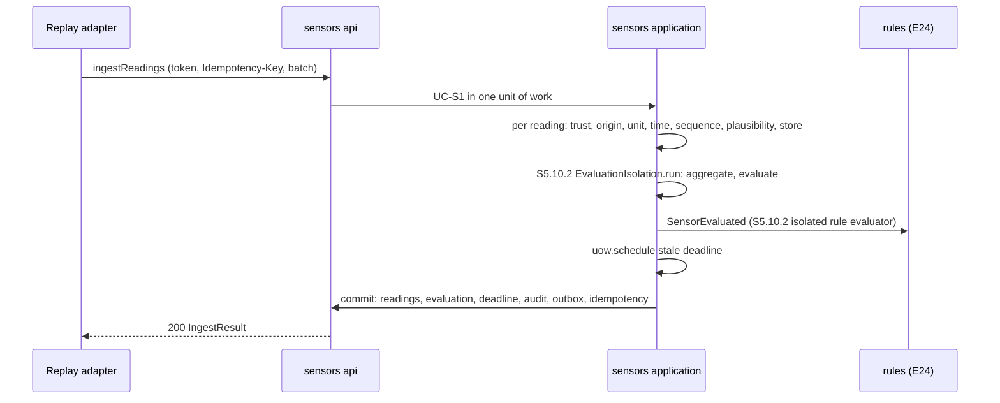

# E23: Environment profile and habitat sensors

Technical design. Binding inputs: `AGENTS.md`, `docs/SYSTEM.md`, `docs/DEPLOYMENT.md`,
`docs/requests/COORDINATOR-DECISIONS.md` Part A and `docs/BUILD-CHARTER.md`. Product citations are relative to
`docs/product/` (Q23). C13 means CONTRACTS 13; S5.7 means SYSTEM 5.7; D3.5 means DEPLOYMENT 3.5.
Coordinator decision IDs are distinct from demo assertion IDs. Implementation tests below are planned obligations.
Reviews: `docs/tdd/reviews/E23.opus-r1.md` through `E23.opus-r4.md` and their responses.

## 1. Scope

**Work packages.** E23-01 (environment profile, overlays, confirmed changes), E23-02 (habitat adapters with LIVE,
REPLAY, SIM and stale states), E23-03 (limit table, hazards and environment-aware effects from configuration), E23-04
(Habitat card and Habitat screen, built by stream D).

**Traces.** Requirements R34, R35, R41, R42, R43. Validation V55 (sensor part), V56 (evaluation part), V58 (dose-rate
label and shelter attendance record), V59 (overlay and evaluation part), V66, V70 (sensor part), V72, V73, V75 (E23
part). Demo D01 (habitat part), D16 (evaluation part), D18, D19 (evaluation part), D31 (activation part), D33
(profile part). Use cases UC04, UC05 (dose-rate label), UC06, UC12, UC17. Section 12.1 maps each to its tests.

E23 owns CONTRACTS sections 12 and 13, and the operation `getContext` by coordinator ruling (6.1). The Ground link subsection of section 12 is implemented by E29 (S4.2); its
rules are traced in 1.1 to that owner.

**Hard dependencies:** E01, E02 (S9). The brief also lists E05 and E10; S9 makes both optional, and this design
follows S9: E23 builds and runs with both absent.

**Decisions.** DE23-1 vocabulary is the generated C11/C12 keys, with words from configuration.
DE23-2 phase changes require an explicit proposal, never an inferred landing event. DE23-3/4 confirmation and demo
switches follow 3.3. DE23-5/7 preserve dataset time and apply D3/D14 freshness (3.1). DE23-6 requires sourced pressure
for ppm conversion (S5.4). DE23-8/11 require the four input plausibility checks before evaluation (R-E23-2).
DE23-9 uses the sourced hazard level, never a local level table. DE23-10 evaluates channels independently (3.7).
DE23-12 uses S5.10.2 capture-first isolation. DE23-13 excludes pre-activation readings from the new environment.

**Not delivered here** (owner): raising, clearing and showing warnings, including `sensor_quiet` and the vehicle
procedure line (E24); routine recomputation and the manual reading task (E25, after E25 request 6); the ground link state,
schedule and demo route (E29); the kit list and kit map counts (E27); the mission clock, MET and the day and short
label (E01); the roster (E02); Today assembly (E03); guidance eligibility (E27 `guidance`, S8.2); locations and
custody (after R-SYS-6).

### 1.1 Rule trace

| Source | Rule | Design | Test |
|---|---|---|---|
| CONTRACTS.md:593 | Only one proposal can be open | 3.3, 5.1 partial unique index | T-E23-004 |
| CONTRACTS.md:594 | Until confirmed, any action that depends on the change returns `CONFIRMATION_REQUIRED` | 3.3 rule C1, 6; scope question R-E23-9 | T-E23-064 |
| CONTRACTS.md:611 | Only environments with a return option may have a return stage | Not E23: loader check 14 (E28). E23 serves `return_option` unchanged (4.2) | T-E23-046 |
| CONTRACTS.md:615 | `living_here`: condition hazards, name without source IDs, effect regions, effects after filters, what to do from `info` and `watch` skipping "Nothing to do" sentences, words for this environment | 3.9, one clause each | T-E23-038, T-E23-039, T-E23-071 |
| CONTRACTS.md:623 | `sleep` and `eva` always suppress routine | Not E23: E25 reads `OverlayPort.intervals`. E23 keeps intervals exact (3.5) | T-E23-012 |
| CONTRACTS.md:627 | State facts change only by listed event types, only in listed environments | 3.6 | T-E23-015, T-E23-016, T-E23-067 |
| CONTRACTS.md:631 | The ground is never a step; only four readers of the link | E23 reads the link only for the Habitat line and `getMission`, and waits on nothing (4.4, 9) | T-E23-047 |
| CONTRACTS.md:642 | `gap_planned` always false when up or delayed | Not E23: E29. E23 serves the object unchanged | T-E23-047 |
| CONTRACTS.md:645 | Delay text never from hub state or code | Not E23: E29 for the link object. The Habitat `ground_delay_text` comes from `environment-hazards.json` `earth_delay` (3.9) | T-E23-040 |
| CONTRACTS.md:648 | Demo ground link route only in demo mode | Not E23: E29 | None here (E29) |
| CONTRACTS.md:658 | Channel must belong to the adapter; origin must equal the channel's | 3.8 steps 2 and 3 | T-E23-020, T-E23-021 |
| CONTRACTS.md:659 | Unit must be canonical or accepted | 3.8 step 4 | T-E23-022, T-E23-023 |
| CONTRACTS.md:662 | A rejected-quality reading is stored, never evaluated | 3.8 step 8 | T-E23-026 |
| CONTRACTS.md:664 | A batch is never rejected as a whole | 3.8, 4.1 UC-S1 | T-E23-027 |
| CONTRACTS.md:682 | A limit is evaluated only with enough coverage; `latest` has no coverage | 3.7: the gate applies to windowed aggregations; a `latest` limit is evaluated on the current reading at E | T-E23-031, T-E23-063 |
| CONTRACTS.md:688 | Only active warning limits of the active environment are evaluated | 3.7 | T-E23-032 |
| CONTRACTS.md:697 | `threshold_pending` only when every limit is pending | 3.7 | T-E23-033 |
| CONTRACTS.md:700 | Display-only limits never change the status; a pending limit never raises | 3.7 | T-E23-033, T-E23-034 |
| CONTRACTS.md:706 | Clear holds for the dwell in observation time; stale data never clears | E23 reports `clear_holds` per limit only for eligible windows (3.7); the dwell is E24's | T-E23-035 |
| CONTRACTS.md:728 | A REPLAY reading is never a person's exposure or evidence about a person; an insight may mention it only as a habitat fact | 3.8, 4.2 `PlaceFact`, 10 | T-E23-041 |

PRD requirements: R34 (3.3, T-E23-001 to 009), R35 (3.7, 3.9, T-E23-030 to 037), R41 (3.9, T-E23-038, 039), R42 (3.4,
3.8, T-E23-017 to 029), R43 (7, 8, T-E23-050, 058).

## 2. Seams

Names are those of S4.2. R-E23-5 records remaining consumer aliases and snapshot bindings; E01 already consumes `MissionStatePort.current`
with the signature below. No unagreed alias is a second provider contract. Use S5.4 Quantity and S5.2 normalized time/provenance.

| Name | Provider epic | Consumer epics | Signature or payload with types | SYSTEM.md |
|---|---|---|---|---|
| `MissionStatePort` | E23 | E01, E04, E05, E11, E13, E22, E24, E25, E26, E27, E28, E29, E31, E32, E33 | 4.2: `current`, `mission_mode`, `active_environment_id`, `overlays`, `latest_event`, `events_since`, `state_facts`, `return_option`, `day_end` | 4.2, 4.4 |
| `OverlayPort` | E23 | E02, E05, E11, E25, E28, E30, E31 | 4.2: `active(person_ids, at)`, `intervals(person_id, kinds, since, until, limit)` | 4.2 |
| `EnvironmentFacts` | E23 | E27, E12 | 4.2: `applicable(snapshot, patient_location_id, environments)`, `place_facts(uow, start, end)` | 8.2 |
| `LocationPort` | E23 | E25, E26, E31, E32 | 4.2: `location_of(person_id, at) -> str \| None`; `None` until R-SYS-6 | 8.5 |
| `DayLabelPort` | E23 | E15, E28, E31 | 4.2: `inline_label_at(instant) -> str` from the profile's `inline_template` | 5.3 |
| `SensorStateQuery` | E23 | E24 | 4.2: `last_results`, `freshness`, `channels`, `type_name` | 4.2 |
| `SensorSeriesReader` | E23 | E32 | 4.2: `accepted(channel_id, *, until, limit) -> SeriesSlice` | 4.2 |
| `ProvenanceStreamsPort.habitat_streams` | E23 | E27 | 4.2: `habitat_streams(snapshot) -> Sequence[HabitatStream]` | 4.2 |
| `SensorEvaluated` | E23 | E24 | 4.3 payload; published in the ingest, activation and freshness units of work | 4.2, 5.7 |
| `ChannelFreshnessChanged` | E23 | E24 | 4.3 payload | 4.2, 5.7 |
| `EnvironmentActivated`, `OverlayChanged`, `MissionEventRecorded`, `StateFactChanged` | E23 | E24, E25, E29, E33 | 4.3 payloads | 4.2, 5.7 |
| `HabitatParts` | E23 | E03 | 4.2: `today_part(snapshot, at)`, `today_sensors(snapshot, at)` | 4.2, 4.4 |
| Loader checks 4, 7 and the sensor half of 12 | E23 | E01 | `ReleaseCheck` registered through `ModuleRegistry.loader_check` | 5.6 |
| `ActivationParticipant` | E23 | E23 | 4.2: `on_activated(uow, profile)`; declared in `mission`, implemented by `sensors`, wired at the composition root | 6.4 |
| `Actor`, `SessionContext`, `DomainEvent`, `DomainEventBus` | E01 | E23 | Exact actor/session fields, `subscribe`, iterative `publish` | 5.7; E02 authenticates/populates SessionContext |
| Roster | E02 | E23 | `RosterPort.crew(at: datetime) -> Sequence[RosterMember]`, `members() -> Sequence[RosterMember]`, `person_ids() -> frozenset[str]` | 4.4, 8.3; snapshot-bound by E02 2 |
| `AssistantStatusPort` | E13 | E23 view only | `AssistantState`; consumer-owned protocol, no assistant implementation import; R-E23-17 for model release | 6.4, D16 |
| `SourceRegistryPort` | E10 | E23 | `summary(source_id: str) -> SourceSummary | SourceUnknown | RegistryUnavailable`; `resolve_many(source_ids: Sequence[str], extra: Sequence[DeclaredSource] = ()) -> ResolutionReport | RegistryUnavailable` | 5.6; E10 4.1; E23 uses summary |
| `GroundLinkQuery` | E29 | E23 mission views | Pending R-E23-6; E29 design unavailable in this checkout, no invented provider signature | 4.2, 6.4 |
| `WarningQueries`, `WarningRaised`, `WarningCleared` | E24 | E23 | Current authorized active warning fields and E24 domain notifications; 3.9 | 4.2, 5.7 |

Consumed, by the S5 names and never redefined: `UnitOfWorkFactory`, `ReadSnapshotFactory`, `DomainEventBus`,
`OutboxEvent`, `AuditEntry` (S5.7, S5.9); `IdFactory` (S5.1); `Clock`, `MissionClock`, `ClockCorrected`,
`ClockRegressed` (S5.2, S5.3); `UnitRegistry`, `Quantity` (S5.4); `ProblemError`, `StorageUnavailable` (S5.5);
`ConfigReleaseReader`, `ConfigReader`, `TemplateRenderer`, `ReleaseCheck`, `ActivationGuard` (S5.6);
`IdempotencyStore`, `CommandIdentity` (S5.8); `EvaluationIsolation` (S5.10.2); `uow.schedule`, `SchedulerRegistry`, `HealthState` (S5.7, S5.10);
`HubSettings` (S5.11); `ModuleRegistry`, `StartupPhase` (S5.12); `SessionContext` and `RosterPort` (E02);
`WarningQueries` and the domain events `WarningRaised`, `WarningCleared` (E24, optional); `SourceRegistryPort.summary`
(E10, optional, for citation titles); `GroundLinkQuery` (E29, optional, R-E23-6). The event log delivers the wire
events of section 4.3.

## 3. Domain model

Two modules, `mission` and `sensors` (S4.2), each with pure `domain` code. `sensors` reads the active environment
through `MissionStatePort` only.

### 3.1 Time

Use `TimeInput`, `ClockSegments`, `ClockCorrections.normalize/elapsed`, `NormalizedTime`, `ClockCorrected` and
`ClockRegressed` exactly as S5.2; no E23 safe clock or offset arithmetic. Reads use `ReadSnapshot.now`, commands
`uow.now`. Persist original observation time and its authenticated source/channel sequence-to-segment mapping;
normalization provenance stays beside the wire reading. A health poll alone cannot prove a clock segment.
LIVE/SIM freshness requires the entire normalized uncertainty interval within the freshness window, with no future
endpoint. Unknown, future or regressed time is unavailable for current/clearing decisions; previously stale data
cannot become current from a backward jump. Keep sweeps running; show stale/unknown and the S5.10 fault notice until
correction and sweep finish. No counter from a previous process epoch is compared with a current monotonic counter.

| Timer or instant | Kind and correction behavior |
|---|---|
| Channel quiet deadline, status emission throttle, evaluation retry | `ElapsedDeadline` (S5.10), anchored to the S5.2 TimeInput; recompute under corrected history |
| Proposal `effective_at`, overlay `planned_start` | `AbsoluteDeadline` (S5.10); no shift on offset correction |
| `post_eva` day end | Absolute boundary obtained from S5.3 `day_bounds` with its opaque clock version; ordinary correction does not move it; explicit mission-clock revision follows S5.3 audited rebuild |
| Aggregation window | C13 data interval; corrected observation time for LIVE/SIM, original dataset time for REPLAY; corrections rebuild derived buckets without altering original records |

Order readings by normalized observation time then sequence within channel/dataset/origin, keeping unknown times
outside evaluated windows. E never moves backward due to late arrival or retry. D14 supplies the sole REPLAY
freshness exception: persist E and the correction-aware receive TimeInput of the reading that strictly advanced it
in the ingest transaction. Restart, file loops, rejected rows and duplicate instants cannot reset either. Keep
original dataset dates on screen. REPLAY evidence never clears LIVE state; a REPLAY clear also needs dataset time
later than its raising evidence. `clear_holds` is absent for non-advancing or untrusted windows; E24 owns dwell.

`clock_state` retains E24's `trusted`, `uncertain`, `unknown` vocabulary. `trusted` requires successful S5.2
normalization for the complete evaluated interval and no unresolved regression; LIVE/SIM additionally require a
recent synchronized adapter poll. A known but uncertain/future interval is `uncertain`; missing segment, correction,
heartbeat or evaluation is `unknown`. REPLAY instead requires matching dataset/time basis and a known D14 receive
reference, independent of adapter heartbeat. A correction touching any evaluated limit window invalidates trust
until the bounded sweep finishes. Required tests: T-E23-053, T-E23-077, T-E23-081, T-E23-087.

### 3.2 Records and identifiers

Records use generated EnvironmentProfile, ActivityOverlay, MissionEvent, SensorChannel, SensorReading and
SensorEvaluation types; section 5.1 preserves nullable fields and complete enums. S5.1 factories assign msn/env/ovl/mev
IDs and derived rdg IDs from channel plus adapter sequence, stable on retry. Registry channel IDs are globally unique
per originating site, never reused for another dataset/origin. No local ID pattern or generator. State facts and
bucket/evaluation projections are internal derived state, not new public resources.

### 3.3 Mission start and the environment change state machine

**Mission start.** R-E23-4's authenticated operator CLI creates mission_identity and the first active profile in
one S5.7/5.8 command, refusing an existing identity. Mode is immutable for that mission. Set reason=mission_start,
empty confirmations, configured confirmation count, operator actor, activation/effective/environment-day-start
instants from uow.now, and lists from the active release. Demo init also validates/loads its fenced registry and
audits its hash. No mission is inferred from an incoming reading.

Before init, `current`, `mission_mode` and `active_environment_id` return None; environment facts are Unknown.
Mission commands and mission/context/environment aggregate queries return retryable INTERNAL_ERROR naming the
unavailable mission. Readings remain durable and visible in series, never evaluated against a guessed environment.
Emergency entry and other safety functions still run. Internal health identifies uninitialized mission; public Health
is degraded. A missing/corrupt identity after initialization is S8.6 integrity failure, never a default.

**Changes.** `proposed → active → superseded`, or `proposed → rejected` (C12). Invariants:

- I-M1. Exactly one record is `active` at every committed state after mission init.
- I-M2. At most one record is `proposed`; a second proposal is `INVALID_TRANSITION`.
- I-M3. A record activates only when `len(confirmations)` reaches `confirmations_required` and `uow.now` is at or
  after `effective_at` (when set). A person is counted once. `confirmations_required` is copied from the active release
  at proposal time. Keep the proposal release and confirmation policy pinned; activation lists use the active release
  as C12 requires. A release cannot relax authorization or confirmation for this open work.
- I-M4. Reason `demo_switch` is refused unless the mission mode is SIM or REPLAY (`INVALID_VALUE`).
- I-M5. Proposing the active environment again is `INVALID_VALUE`.
- I-M6. `proposed_by`, `rejected_by` and each confirmation come from the session, never from the body.
- C1. `confirm` by a person already in `confirmations` while the count is not reached returns `409
  CONFIRMATION_REQUIRED` with the record in `current_state`: the change still waits for another crew member. This is
  the only action that the contract's operations let return it; R-E23-9 asks whether more were meant.

At proposal, the record's `hazard_ids`, `limit_ids`, `warning_definition_ids`, `sensor_type_ids`, `sensor_channel_ids`
and `routine_item_ids` are computed from the active release and the channel registry, for display (the package
examples fill them at proposal). The proposer may also confirm; C12 lets any `crew` session confirm, so a deployment
that wants two people sets `confirmations_required` to 2 (10).

**Activation** runs in one unit of work, in the C12 order: (1) supersede and activate, setting `activated_at`,
`environment_day_start` and, when it was null, `effective_at` to the unit of work's `now` (as the package example
does); (2) recompute the six lists from the release active at activation and set `config_release_id` to it; (3)
emit `environment.activated` first into the transactional outbox (C12 step 6), then publish
`EnvironmentActivated` on the in-transaction bus, where E24 clears warnings whose definition does not apply (its
own rule), E25 recomputes schedules and E29 resets the link; (4) after `publish` returns, so after every handler of
step 3, `mission` calls `ActivationParticipant.on_activated(uow, profile)`, which `sensors` implements: for every
channel whose `environment_ids` include the new environment and that had readings, it records the separate activation
quiet-watch anchor (3.4) and schedules its generation-checked deadline in the same unit of work; it recomputes the
statuses; and it publishes `SensorEvaluated` only for a channel that already has an evaluable reading in the new
environment, which at the activation instant is none, so E24 never receives an input without a window end or a
reading. A channel outside the new environment keeps its state, appears on no card, and no freshness transition is
published for it until an environment that lists it is active again. Activation is a top-level command, not a
recursive event handler; S5.7 drains its bounded FIFO before the explicit participant call. The outbox order is
`environment.activated` before all caused wire events, and all become visible only after commit. Rule DE23-13: in the new environment, a reading from before `activated_at` (by S5.2 normalized observation time
for LIVE and SIM, by receive time for REPLAY) is never current, never shown and never in a window, on every channel,
including one listed for both environments. Each card shows `no_reading` until a newer reading is accepted; a channel
that sends nothing more goes stale at `activated_at + stale_after_seconds` and raises `sensor_quiet` (E24). Readings
stay stored under their channel and in series.

### 3.4 Freshness

Freshness uses S5.2 (D3/D14) and the catalog's `stale_after_seconds`. No eligible reading means `no_reading`;
no channel history means `never_reported`. With history but unknown time, fail closed as stale with a general degraded
notice, never a fresh value. `stale_since` is the corrected deadline when known, otherwise null, not an invented time
(R-E23-13). `last_received_at` remains transport metadata and is not LIVE/SIM freshness evidence.

After an environment switch, only post-activation readings enter the new card/window (DE23-13). For a previously
reporting channel with none yet, retain a separate activation quiet-watch anchor and show `no_reading`; it can become
quiet after the catalog interval without pretending activation was a measurement. This anchor never resets D14's
persisted E or receive reference. A previously stale channel stays stale until eligible new data arrives.

**Deadline.** Use S5.10 `ScheduledJob` with one stable key per channel/origin/profile and an `ElapsedDeadline`,
reference-only payload and stored expected generation. `uow.schedule(job, expected_generation=...)` replaces the
prior generation atomically with ingest or activation. At the inclusive freshness boundary schedule the next bounded
check if elapsed still equals the duration; stale means strictly greater. Completed/stale generations cannot repeat
effects. The handler first skips channels whose `environment_ids` exclude the active environment.

**Independent sweep.** Register at S5.12 `STATE_SWEEP` before INGEST, then run an independent bounded adapter-layer
timer every `sensors.freshness_sweep_s`, not a platform scheduler job. Each tick uses a UOW and scans the bounded
registry; it too skips channels outside the active environment. It records missed transitions and marks
`SCHEDULER_LAG` if the current scheduled generation is overdue beyond `sensors.scheduler_lag_max_s`.
Both paths share the hub process; DEPLOYMENT 7.2 restarts it and the startup sweep precedes serving. Read paths
independently normalize freshness, and disconnected clients show cached age/offline, never current.

A transition persists freshness, publishes `ChannelFreshnessChanged`, evaluates only where an eligible reading
exists, and emits C18 `sensor.quiet` or `sensor.resumed` and rate-limited `sensor.status_changed`. No synthetic
`SensorEvaluated` with an invented reading or window is published at activation. `sensor.resumed` requires an
eligible advancing observation, never merely an arriving row or release change. T-E23-019 and T-E23-079 remove
scheduled jobs, stall the dispatcher and leave a pre-switch deadline pending.

**Fault notices.** S5.10 `HealthState` component `sensors` uses exactly `EVALUATION_UNAVAILABLE`, `SCHEDULER_LAG`,
`INSTANT_CONFLICT`, `SEQUENCE_CONFLICT`, `WINDOW_SCAN_BOUND`. Codes and `since` are internal diagnostics only.
The current Health response exposes `status=degraded`, which every crew/station safety view renders as the configured
general fault notice; failed health calls also fail visibly. R-E23-16 tracks richer fields/copy, not permission to
silence faults or extend closed JSON. Adapter `/health` fields `clock` and `queue` remain separate.

### 3.5 Overlays

States `planned`, `active`, `ended`. Invariants: I-O1 at most one `active` overlay of each kind per person; I-O2
`ended_at >= started_at` when both are present; ending a planned overlay preserves null started_at; I-O3 `eva_ended` ends `eva` and starts `post_eva` in the same unit of work; I-O4 `post_eva`
ends when the person ends it, when that person's next `eva` starts, or at the end of the mission day (a durable
deadline, absolute); I-O5 creating an overlay kind absent from the active profile is INVALID_VALUE; ending existing work uses its
pinned definition, so a release cannot prevent an authorized end. Planned overlays do not become measured activity merely because the planned time arrives; explicit start/event
activates them. Every
change publishes `OverlayChanged` and emits `overlay.changed` for the `person` and `crew` scopes.

`ActivityOverlay.source`: `person` (ref `null`) when the session's person creates or ends it; `mission_event` (ref the
event ID) when an event starts or ends it; `operator` only after R-E23-7; `adapter` is never written here.

**Late or conflicting events.** An event changes an overlay only after S5.2 normalization establishes it is newer than the last effect;
`event_id` breaks equal-time ties within the mission/origin partition. Unknown, future or overlapping uncertainty
never overwrites or clears state. Store those events without effects for correction/re-evaluation. No later event may already have changed that person's overlay of the same kind. An event whose effect would break an invariant (for
example `eva_started` while that person's `eva` is active, or `eva_ended` with none active) is recorded unchanged, its
overlay effect is skipped and the hub records audit event_type `mission.overlay_effect_skipped` with the event and overlay IDs. The
event is a real report, so it is kept; E24 receives `MissionEventRecorded` only with an agreed S5.2 eligibility binding (R-E23-5). Until that seam
is settled, untrusted events are retained for recovery but cannot clear or overwrite E24 state; trusted storm raises
and the independent manual emergency path remain available.

### 3.6 Mission events and state facts

`recordMissionEvent` checks, in order: the type exists in `mission_event_types` (`INVALID_VALUE`); a session role is
in `who_may_record` (`UNAUTHORIZED_SCOPE`); the body's `origin_mode` equals the mission mode (`ORIGIN_MISMATCH`);
every `person_ids` entry is on the roster (`INVALID_VALUE`). The event stores the active `environment_id`.

A state fact changes only when the event type is in that fact's `set_by_event_types` or `cleared_by_event_types`, the
active environment is in its `environments`, and S5.2 ordering proves it later than the fact's current cause in the same mission/origin partition (3.5). An older event is recorded and changes nothing, so a delayed
`local_water_source_added` never sets `local_water_untested` again after a later `local_water_tested`.

D2: E23 forwards the configured storm event without downgrading it during sleep; E24 raises Emergency and wakes
everyone, including with model/ground absent (T-E23-088). E23 does not infer a storm threshold from pending radiation
limits. Shelter attendance (V58) is recorded as mission events of configured types carrying `person_ids`; E23 stores and
serves them and decides nothing from them.

### 3.7 Aggregation and evaluation

Use C13 aggregation functions, half-open windows, coverage and empty-window semantics without interpolation.
E is the latest eligible observation in 3.1's time basis. Exclude pre-activation input (DE23-13), using normalized
observed time for LIVE/SIM and normalized receive time for REPLAY. Pre-init readings never enter an evaluation.
An instant on one channel counts once in coverage. Where two readings disagree at one instant (3.8 step 6), each limit
is evaluated on two variants of its window, one taking the lower value at every conflicting instant and one the
higher; every C13 aggregation is monotone in each value, so the two bound every choice. A limit is crossed if either
variant crosses it, and `clear_holds` is true only if both hold. The card's `display_value` and the evaluation's
`aggregated_value` come from the variant that ranks worse: the one with the higher crossed level, else the one nearer
a card-mark limit, else the higher value. The conflict is flagged through health (`INSTANT_CONFLICT`, 3.8) until
R-E23-14 gives the card a designed state for it.

**Arithmetic.** Use S5.4/D12 rounding and Quantity conversion, retaining unrounded converted values internally
for aggregation/comparison. Reconstruct only from immutable originals with pinned mapping/pressure provenance.
`Decimal` precision 34 and half-even arithmetic also apply to energy_mean exp/ln/log10; non-finite computation is a
typed failure. Catalog rounding is display only. T-E23-075 tests conversion near a threshold before wire rounding.

**Incremental state.** Windowed aggregations read per-bucket partial sums (`sensors.aggregate_bucket_s`) for the whole
buckets of a window and scan only the two edge buckets, so cost does not grow with W. A late reading updates only the
buckets its segment touches (for `time_weighted_mean` and `energy_mean`, the hold segment between its neighbours). An
activation guard rejects a release in which a limit's aggregation of kind `max` or `sum` (no partial sums) would scan
more than `sensors.window_scan_max_readings` at the fastest of the catalog interval and every registry override, and
the registry is validated against the same bound. A channel that reports faster than declared can still exceed it at
run time: that limit is then not evaluated (result `None`, so it neither raises nor clears), the channel shows
`insufficient_data` if no other limit was evaluated, and health is degraded (`WINDOW_SCAN_BOUND`) with the channel
named, shown through the S5.10 general health notice.

**Status**, per channel, the first that applies of the C13 table (`no_reading`, `stale`, `beyond_limit`,
`within_limit`, `insufficient_data`, `threshold_pending`, `no_limit_on_file`). Only limits with role `warning`, status
`active` and the active environment in `environments` are evaluated, each on its own `aggregation_id`.

- **Coverage gate.** A limit on a windowed aggregation is evaluated only when the window's coverage is at least its
  `min_coverage`. A limit on `latest` has no coverage (C13); it is evaluated whenever the channel is current and has an
  accepted reading at E, and its `min_coverage` is not applied. So `o2_low_emergency` crosses on one reading.
- A crossed limit sets `beyond_limit` with the highest crossed level; ties go to the earlier limit in the document.
  Limits with role `display_only` are marks only. A limit with status `threshold_pending` evaluates nothing and is
  listed in `pending_limit_ids`.
- For each evaluated limit E23 also reports `clear_holds`: the limit's `clear` comparator against the same aggregation;
  `None` when the channel is stale, the window is not newer than the last one, or the evaluation failed.
- **Stuck value, range, saturation and rate (DE23-11).** Missing criteria cannot waive a check in any mode.
  Until R-E23-2 supplies and validates them, preserve captured REPLAY/SIM data and its provenance but disable
  current/evaluated sensor results, show unavailable/insufficient data with the general fault notice and permit no
  raises or clears from those inputs. LIVE registration stays refused. Required scenario tests remain blocked, never
  relabeled passing; no threshold or tolerance is tuned to make the golden cases pass.

**Card channel (DE23-10).** With several channels of one sensor type in the active environment, each is evaluated and
published separately. The `SensorStatus` of the type shows the channel that ranks first by: `beyond_limit` by level
descending, then `stale`, `insufficient_data`, `no_reading`, `within_limit`, `threshold_pending`, `no_limit_on_file`;
ties by `channel_id`. Its `trace` lists every other channel of the type as `{source_label}, {location_label}:
{display_value.text} {unit_display}` (served values and configured words joined by separators only), so a disagreement
is visible on the card; values are never averaged. `trace` carries only that list and the reading provenance the
package defines; every sentence about a fault comes from the health line. R-E23-14 asks for a per-channel field and a
designed state for the conflict.

### 3.8 Ingest pipeline

Before any reading: a batch of more than `sensors.batch_max_readings` (never above the contract's 1,000) is `413
PAYLOAD_TOO_LARGE`, checked before schema validation; otherwise a body that fails `AdapterReadingBatch` is `400
MALFORMED_REQUEST`. Then for each reading, in order, inside the batch's unit of work:

1. Apply the defaults of the contract: `aggregation` absent means `{kind: sample, window_seconds: null}`.
2. The channel exists, belongs to the adapter of the token and has `trusted` true; otherwise the index is rejected
   with `ADAPTER_NOT_TRUSTED`.
3. The reading's `origin_mode` equals the channel's; otherwise `ORIGIN_MISMATCH`.
4. The unit is the catalog unit or one of `accepted_units`; otherwise `INVALID_UNIT`. S5.4 `WireUnitConverter` validates the indicator mapping and sourced pressure context; retain its original and
   converted quantities and mapping version internally. Wire conversion: `identity` stores
   `conversion` `null`; `scale` and `ppm_to_mmhg` store `{method, cabin_pressure_mmhg, pressure_basis, factor}`; the
   last needs `cabin_pressure_mmhg` on the reading, else `INVALID_VALUE`. `original_value` and `original_unit` are
   always stored.
5. Time: preserve `observed_at`; normalize through S5.2 (3.1), excluding unknown/future data from current evaluation; a REPLAY reading must carry `replay`, and a LIVE or SIM
   reading must not, else `INVALID_VALUE`. A stored REPLAY reading has `replay.original_observed_at = observed_at`.
6. Sequence and instant. `(channel_id, adapter_sequence)` already stored with the same canonical validated reading body, including pressure/basis, quality, aggregation, replay metadata and observation time:
   counted in `duplicates`, nothing written, its existing ID returned. Stored with any semantic field different: the index is
   rejected with `INVALID_VALUE`, the raw JSON is kept in `sensors_batch`, and the adapter is marked degraded
   (`SEQUENCE_CONFLICT`), so a reset sequence is loud and its readings are never silently dropped. A new sequence at
   the same S5.2 normalized instant in the same channel/origin partition (or same dataset instant for REPLAY): stored; with the same value it counts as a duplicate instant and
   never enters a window twice. Raw timestamp equality across different clock segments is not instant equality;
   both corrected instants remain distinct and advance E/coverage normally. Unknown instants stay unevaluated. With a different value both are kept and both reach evaluation through the two
   variants of 3.7, and the adapter is marked degraded (`INSTANT_CONFLICT`), shown through the S5.10 general health notice.
7. Plausibility (DE23-11): all four sourced checks of R-E23-2, in every origin mode. A reading that fails is stored with
   `quality_status` `rejected` and the failed check in its provenance trace, so it is kept and never evaluated.
8. Store. A reading sent with `quality_status` `rejected` is stored and not evaluated; the hub never upgrades a
   quality status.

`IngestResult`: `accepted`, `duplicates`, `reading_ids` (IDs of the accepted and duplicate readings in index order),
`rejected` (index and code) and `evaluations_changed` (sensor type IDs whose served status changed). Rejected indexes
are kept with their code and raw JSON in the batch record (5.1), so no real reading is discarded. After the loop, each
touched channel is aggregated and evaluated once through S5.10.2 `EvaluationIsolation.run`, with the immutable input
reference, original TimeInput, partition/revision, capture release and evaluator version. A REPLAY or SIM
reading creates no Observation, no exposure record and no person evidence: `sensors` has no port to `records` at all.

### 3.9 Card and Habitat content

`SensorStatus` follows the C13 card table. R-E23-5 must bind E24 warning reads to the caller snapshot;
its present self-opening query cannot see uncommitted WarningRaised/Cleared effects or prove coherent Habitat
assembly. Until settled, warning-driven status recomposition is unavailable and visibly degraded; E24 warnings stay
visible independently. Never treat a truncated warning page as a complete set. It is computed on read from stored evaluations, freshness against
the S5.2 normalized time and E24's active warnings; only `revision` and the last emission time are stored. `display_value.text` uses
catalog `decimals` and `trim_trailing_zeros`, or `no_reading_label`. `shown_level` is the highest of the evaluation
level and the levels of linked active warnings from `WarningQueries` (E24); with E24 absent it is the evaluation level
and `linked_warning_ids` is empty. E23 subscribes to E24's `WarningRaised` and `WarningCleared` domain events and, when
the result for a linked sensor type changes, emits `sensor.status_changed` in that transaction.

Apply C13 card fields and sentence rule, with property tests. Effect filters and source IDs come from the pinned
hazard configuration; missing source produces the configured unsupported state, never guidance. Optional E10
supplies source titles; absence uses validated bare IDs. `living_here` implements all six clauses of C12:615;
ground_delay_text uses the active environment's sourced earth_delay. T-E23-038/039/040/071 verify those clauses.

## 4. Application layer

### 4.1 Use cases

| ID | Command/query and boundary types | Errors beyond shared S5 checks |
|---|---|---|
| UC-M0 | Operator CLI mission init -> identity/profile | Existing identity |
| UC-M1 | Propose: EnvironmentChangeCreate -> EnvironmentProfile | I-M2/4/5 |
| UC-M2 | Confirm/reject: profile ID, EnvironmentChangeAction, If-Match -> EnvironmentProfile | Wrong state, stale revision, C1 |
| UC-M3 | Scheduled activation: profile reference -> no public result | Stale scheduled generation |
| UC-M4 | OverlayCreate or overlay ID/OverlayEnd -> ActivityOverlay | I-O1/2/5, revision/subject |
| UC-M5 | MissionEventCreate -> MissionEvent | 3.6 |
| UC-S1 | Adapter ID/token, AdapterReadingBatch -> IngestResult | 3.8 request versus per-index failures |
| UC-S2 | Scheduled freshness/sweep -> no public result | Stale generation |
| UC-S3 | Release/environment/start/pending evaluation -> no public result | S5.10.2 |
| UC-Q | Authenticated queries -> section 6 views | Current visibility, bounded unavailable providers |

Use S5.7 UOW/replication accounting, S5.8 complete command identity and authorized durable receipts (D6),
and S5.9 audit unchanged. Mission notes never enter cache/audit/diagnostics; results are references, private body
fingerprints keyed. Receipt lookup precedes mutable preconditions. E23 defines no transaction/ledger/hash mechanism.

| Command | State and work committed in its producer UOW |
|---|---|
| UC-M0 | Identity, first profile, validated demo registry reference, activation quiet watches, audit and receipt |
| UC-M1 | Proposal, confirmation count pin and display lists; proposed event and receipt |
| UC-M2 | Revision-checked confirmation/rejection, activation when due or absolute scheduled generation; profile events and receipt |
| UC-M3 | Scheduled generation check, superseded/active profiles, same-transaction mission consumers, sensor activation participant and ordered outbox |
| UC-M4 | Overlay revision/state, absolute post-EVA end job and OverlayChanged; end/create have distinct targets |
| UC-M5 | Immutable event, ordered overlay/fact effects, consumer evaluations under S8.6, audit and receipt |
| UC-S1 | Readings and rejects, immutable evaluation input manifest, duplicate identities, clock provenance, E/D14 reference, quiet job; evaluation savepoint or pending marker/retry, receipt |
| UC-S2 | Freshness transition and current job generation, in-transaction inputs, status outbox; sweep has no HTTP identity |
| UC-S3 | Bounded evaluation page under its retained release/time; result or pending marker, retry generation and outbox |

S5.7/5.8 provide all-or-nothing commands and retry after acknowledgment loss, including the durable-ledger path
after 24 hours. Storage failure leaves client/adapter queues intact. T-E23-051/052/054/089 inject each command's
commit, audit, outbox, scheduler and replication boundaries. DEPLOYMENT 4.2.1 governs restored identity/fencing.

### 4.2 Ports (`mission/application/ports.py`, `sensors/application/ports.py`)

```python
@dataclass(frozen=True, slots=True)
class MissionFacts:
    mission_id: str; mission_mode: OriginMode; active_environment_id: str   # MissionContext.mission_mode
    planned_length_days: int | None; site_node_id: str
@dataclass(frozen=True, slots=True)
class OverlayFact:
    overlay_id: str; person_id: str; kind: str; state: str                  # ActivityOverlay.overlay, .state
    planned_start: datetime | None; started_at: datetime | None; ended_at: datetime | None
@dataclass(frozen=True, slots=True)
class ReturnOption:
    trip_text: str; source_ids: tuple[str, ...]; to_be_set_by: str | None
@dataclass(frozen=True, slots=True)
class PlaceFact:                                                             # habitat facts only, never a person's
    kind: str; text: str; at: datetime; origin_mode: OriginMode; source_label: str
@dataclass(frozen=True, slots=True)
class HabitatStream:
    channel_id: str; sensor_type_id: str; origin_mode: OriginMode; source_label: str; dataset: str | None
type Snap = UnitOfWork | ReadSnapshot

class MissionStatePort(Protocol):
    def current(self, uow: Snap | None = None) -> MissionFacts | None: ...      # None: opens its own snapshot
    def mission_mode(self, uow: Snap | None = None) -> OriginMode | None: ...
    def active_environment_id(self, uow: Snap | None = None) -> str | None: ...
    def overlays(self, uow: UnitOfWork, person_id: str, since: datetime) -> Sequence[OverlayFact]: ...
    def latest_event(self, uow: UnitOfWork, event_types: Sequence[str], scope_key: str,
                     at_or_before: datetime | None) -> MissionEventRecorded | None: ...
    def events_since(self, uow: UnitOfWork, since: datetime, after_event_id: str | None,
                     limit: int) -> Sequence[MissionEventRecorded]: ...
    def state_facts(self, uow: UnitOfWork) -> Sequence[StateFactChanged]: ...
    def return_option(self, uow: Snap | None, environment_id: str) -> ReturnOption | None: ...
    def day_end(self, instant: datetime) -> datetime: ...
class OverlayPort(Protocol):
    def active(self, person_ids: Collection[str], at: datetime) -> Mapping[str, Sequence[OverlayFact]]: ...
    def intervals(self, person_id: str, kinds: Collection[str], since: datetime, until: datetime,
                  limit: int) -> Sequence[OverlayFact]: ...
class EnvironmentFacts(Protocol):
    def applicable(self, snapshot: ReadSnapshot, patient_location_id: str | None,
                   environments: Collection[str]) -> Fact[bool]: ...
    def place_facts(self, uow: Snap, start: datetime, end: datetime) -> Sequence[PlaceFact]: ...
class LocationPort(Protocol):
    def location_of(self, person_id: str, at: datetime) -> str | None: ...
class DayLabelPort(Protocol):
    def inline_label_at(self, instant: datetime) -> str: ...
class SensorStateQuery(Protocol):
    def last_results(self, uow: UnitOfWork, channel_id: str) -> SensorEvaluated | None: ...
    def freshness(self, uow: UnitOfWork, channel_id: str) -> Freshness: ...   # SensorChannel.freshness
    def channels(self, uow: UnitOfWork) -> Sequence[str]: ...
    def type_name(self, uow: UnitOfWork, sensor_type_id: str) -> str: ...
class SensorSeriesReader(Protocol):
    def accepted(self, channel_id: str, *, until: datetime, limit: int) -> SeriesSlice: ...
class ProvenanceStreamsPort(Protocol):
    def habitat_streams(self, snapshot: ReadSnapshot) -> Sequence[HabitatStream]: ...
class ActivationParticipant(Protocol):                                       # declared in mission, implemented by sensors
    def on_activated(self, uow: UnitOfWork, profile: EnvironmentProfileModel) -> None: ...
class HabitatParts(Protocol):                                                # E03 Today
    def today_part(self, snapshot: ReadSnapshot, at: datetime) -> TodayEnvironment: ...
    def today_sensors(self, snapshot: ReadSnapshot, at: datetime) -> Sequence[SensorStatusModel]: ...
```

`Freshness` is the generated enum of `SensorChannel.freshness` (`current`, `stale`, `never_reported`).
`TodayEnvironment` is the generated model of `TodayView.environment`, `SensorStatusModel` the generated model of
`sensor-status.schema.json` and `EnvironmentProfileModel` that of `environment-profile.schema.json` (S6.5); none is
hand-written.

`EnvironmentFacts.applicable`: under the S8.5 interim (one location per environment), a `patient_location_id` of
`None` means the active environment's single location, so the answer is `Known(active_environment_id in
environments)`. It returns `Unknown("environment", "no_data")` only when no profile is active (before mission init)
or the location named is not the active environment's (fail closed, S8.2). `overlays` and `intervals` return at most
`mission.max_overlay_rows` rows and raise a typed error beyond it, so a caller never reads a truncated list as
complete. `SeriesSlice` carries `points` (observation time, canonical `Quantity`, quality status, origin mode) and
`truncated`. `DayLabelPort.inline_label_at(instant)` renders the `day_label.inline_template` of the profile that was
active at `instant` (using profile history in the caller snapshot and S5.3 MissionClock), so a transit-era instant keeps its transit label after a switch to Mars.

### 4.3 Events

Published on S5.7's bus. SensorEvaluated, ChannelFreshnessChanged, MissionEventRecorded and StateFactChanged
use the exact typed SensorEvaluatedInput, FreshnessInput, MissionEventInput and StateFactInput payloads in E24 4.3,
including nullable results/locations and full origin enums. R-E23-5 covers clock/snapshot integration; R-E23-19 covers
pinned results. Their current scalar duration/coverage fields are unit-qualified at the S5.4 boundary; agreement on
Quantity-bearing shared inputs is part of R-E23-5, never a locally changed consumer signature. E25 consumes mission
changes, not SensorEvaluated. Payload inventory:

| Name | Payload |
|---|---|
| `SensorEvaluated` | `config_release_id`, `sensor_type_id`, `channel_id`, `location`, `origin_mode`, `window_end`, `received_at`, `reading_id`, `clock_state` (3.1), `freshness`, `stale_after_seconds`, `results` (per limit: `limit_id`, `crossed`, `clear_holds`, `value` as `Quantity`, `coverage`, render facts), `channel` (name, location label, source label, last received time, replay dataset) |
| `ChannelFreshnessChanged` | `channel_id`, `sensor_type_id`, `state`, `stale_since`, `last_reading_id`, `origin_mode`, `channel` |
| `EnvironmentActivated` | the activated profile record and the superseded `environment_id` |
| `OverlayChanged` | `overlay_id`, `person_id`, `kind`, `state`, `planned_start`, `started_at`, `ended_at` |
| `MissionEventRecorded` | `event_id`, `event_type`, `label`, `occurred_at`, `recorded_at`, `origin_mode`, `environment_id`, `person_ids`, `location` |
| `StateFactChanged` | `fact`, `value`, `environment_id`, `at`, `cause_event_id`, `origin_mode` |

Wire events through `uow.emit` (C18 names and scopes): `environment.change_proposed`, `environment.change_rejected`
(crew, operator); `environment.activated` (crew, ground, operator); `overlay.changed` (person, crew);
`mission.event_recorded` (crew, operator); `sensor.status_changed` (habitat); `sensor.quiet`, `sensor.resumed`
(habitat, operator).

`sensor.status_changed` follows CONTRACTS.md:732: at most once per sensor type per expected interval, or per reading
when the interval is null. A change inside an interval is held and sent at the interval's end with the then current
status (a durable job keyed by sensor type and interval end). Safety does not wait on it: quiet and resumed channels
have their own events, warnings have `warning.*`, and the Habitat screen refetches on both (7). Consumed:
`config.release_activated` (UC-S3) and the domain events `WarningRaised`, `WarningCleared` (3.9). `sensors` does not
subscribe to `EnvironmentActivated`; activation reaches it only through the explicit call of 3.3 step 4.

### 4.4 Sequences

Principal path:



Failure path: use S5.10.2 `EvaluationIsolation.run/retry/pending` and S8.6 exclusively. E01 owns savepoints,
completion identities, pending markers, reference-only fault audit and bounded recovery, including scheduler work.
Register the sensor evaluator in `module.py`; no E23 retry loop or mutable pending flag on readings. Only
`EvaluatorComputationFailure` isolates computation. Storage, I/O, integrity, authorization, configuration and
input-validation failures abort the producer, including failures to persist the pending marker. Health follows
committed pending state. Retry uses the original time/release/version and cannot replace newer partition state.

E24's existing not-evaluated `SensorEvaluated` input has every result's `crossed` and `clear_holds` null and
`clock_state=unknown`, resetting channel dwell. This notification is not a durable clearing interlock by itself:
R-E23-18 requests E24's transaction-bound check of E01 pending evaluations, including failure before notification.
Until that check is wired, automatic sensor clearing is disabled and visibly degraded; capture, raising from valid
inputs, retained active warnings, manual medical-officer resolution and emergency entry remain available. V56 stays
blocked. Recovery never uses its arrival as fresh evidence; tests inject every forbidden error class and stale retry.

## 5. Adapters

### 5.1 Storage

Use S5.7 storage types/constraints; quantity columns retain UCUM units and nullable contract fields.

| Table | Columns beyond the contract object's fields | Constraints and indexes |
|---|---|---|
| `mission_identity` | `mission_id`, `mission_mode`, `planned_length_days` nullable, `created_at` | Single row (CHECK on a constant key) |
| `mission_environment` | every `EnvironmentProfile` field; lists as JSON; `effective_at`, `rejected_by`, `activated_at`, `superseded_at`, `environment_day_start` nullable | Unique partial index where `state = 'active'`; unique partial index where `state = 'proposed'`; CHECK on `state` and `reason` enums |
| `mission_overlay` | every `ActivityOverlay` field; `planned_start`, `started_at`, `ended_at`, `location`, source `ref_id` nullable; `last_event_key`, source clock/segment provenance, release pin | Unique partial index on `(person_id, overlay)` where `state = 'active'`; index `(person_id, started_at)` |
| `mission_event` | every `MissionEvent` field; `location`, `note` nullable; mission ID, original TimeInput/segment provenance and release pin | Append only (trigger refuses UPDATE and DELETE); index `(occurred_at, event_id)` |
| `mission_state_fact` | `mission_id`, `fact`, `environment_id`, `value`, `at`, `cause_event_id`, `cause_occurred_at`, `origin_mode` | Primary key `(mission_id, origin_mode, fact, environment_id)` |
| `sensors_channel` | static registry fields; `last_received_at`, `last_observed_at`, `reference_at`, `next_stale_check_at`, `location_label`, `expected_interval_seconds`, `dataset`, `display_note`, `health_url` nullable; `freshness`; `registry_version`; durable E, D14 receive TimeInput and activation quiet-watch anchor; clock segment and job generation references | CHECK on `freshness` and `origin_mode` (all three values) |
| `sensors_reading` | every `SensorReading` field; `conversion`, `window_start`, `replay` nullable; `batch_id`; immutable ingest revision; `instant_conflict`; source TimeInput/segment mapping, unrounded canonical quantity, unit-mapping version and pressure source; capture release | Unique `(channel_id, adapter_sequence)`; index `(channel_id, observed_at)`; append only (trigger); E01 owns pending evaluations separately |
| `sensors_bucket` | `channel_id`, `profile_id`, `config_release_id`, `bucket_start`, partial sums and counts | Primary key `(channel_id, profile_id, config_release_id, bucket_start)`; rebuildable from readings |
| `sensors_evaluation` | `channel_id`, `profile_id`, input revision/time high water; per channel: every `SensorEvaluation` field (`level`, `limit_id`, `aggregated_value`, `aggregation_label`, `window_start`, `window_end`, `coverage` nullable), `config_release_id`, per-limit results as JSON | Primary key `(channel_id, profile_id, config_release_id)`; monotonic input revision/time high water |
| `sensors_evaluation_input` | immutable input_ref; mission/profile/channel/origin/dataset partition, bounded reading high-water/revision, capture release, evaluator version, original TimeInput, window end and correction-map version | Primary key input_ref; pins exact historical membership by immutable reading revision, never later rows; source data is retained for S5.10.2 replay |
| `sensors_status` | per sensor type and environment: `revision`, `last_emitted_at`, `pending_emit_at` nullable | Primary key `(sensor_type_id, environment_id)` |
| `sensors_batch` | `batch_id`, `adapter_id`, counts, rejected indexes with code and raw JSON, `received_at` | Primary key `(adapter_id, batch_id)` |

`mission_location` is created with R-SYS-6, not before. `sensors_batch`, `sensors_bucket` and `mission_identity` are
registered by their modules under S5.12 (R-E23-8). Readings are kept for the mission's life (S7.1); E23 deletes no reading.
Use S5.7 storage and S7 expand/contract migrations; previous code must still run against the expanded schema. Reading rows hold no private text:
habitat readings describe a place, never a person. Mission event `note` is free text and is never logged (10).

Replication uses S5.7.1 `mission/context/1` and `sensors/reading/1` only: authorized habitat/crew leaf fields,
no person IDs, notes, overlays or raw audit data. Required release dependencies are verified; forbidden references
are omitted without IDs/hashes. Owned appliers write replica tables, never activate the receiving hub's environment
or feed its live evaluator. Materialize, send, import and reads recheck current object/field grants. Cursor and
replica effects commit together; DEPLOYMENT 4.2 fencing/restore rules apply. Other mutations remain local;
R-E23-20 asks E01 to settle their non-exportable declaration under the mandatory replication-change invariant.
An unresolved projection is unavailable, never a broad table dump. T-E23-091 covers dependency loss, revoked grants,
duplicate delivery and crashes around cursor commit.

### 5.2 Habitat adapters (`adapters/habitat/`, uv member `crew-health-adapter-habitat`)

One process per configured feed, talking to the hub only through `ingestReadings` (S6.2): the same code path for
LIVE, REPLAY and SIM from the HTTP boundary inward.

| Adapter | Source | Notes |
|---|---|---|
| `replay` | A recorded file named by a feed entry | Original dates kept; `replay.dataset` and `time_basis` from the feed entry; paced as the entry says |
| `sim` | Frozen SIM rows from a file, or a seeded generator, described by a feed entry | `origin_mode` SIM; values in the catalog display range |
| `ble_ess` | Bluetooth Environmental Sensing (0x181A) through `bleak` | LIVE; refused by the registry until R-E23-2 (DE23-8); `hardware` tests only |
| `xtce` | A read-only CCSDS or XTCE described feed (D3.6) | LIVE; same refusal; parser tests only this weekend; never writes to the vehicle |

**Feeds and the demo gate.** One feed file, to be owned by E21: `fixtures/demo-mara-fd19/sensors/feeds.json`, which
E21's interim feeder already reads; until then E23's interim copy (5.3). E23 owns its schema (`adapters/habitat/schemas/feeds.schema.json`): per feed `feed_id`,
`kind` (`replay` or `sim`), `channel_id`, `file`, `columns` (time column, value column, unit), `dataset`,
`time_basis`, `pace`, `seed` or frozen rows (SIM), and a `basis` on each choice. R-E23-15 asks E21 to adopt the
schema and to hold byte copies of the RR-1 CO2 file and the RadLab DosTel1 sample, with a SHA-256 check against
`docs/product/nasa-data/`, in its fixture, so no feed reads `docs/product` at run time. The entry point answers E21
request 14.9: `crew-health adapters replay --feed <feeds.json> [--feed-id <id>]` and `crew-health adapters sim --feed
<feeds.json>` (`adapters/habitat/src/crew_health_adapter_habitat/cli.py`). The gate needs no hub call: each adapter
refuses to start unless the local deployment settings say `profile = "demo"`, and the hub loads the demo channels
only when its profile is `demo` and the mission mode is SIM or REPLAY (5.3). E23's unit tests build their inputs from
the package files under `hub/tests/sensors/`.

**Process rules.** Each adapter keeps a bounded on-disk queue, a monotonic `adapter_sequence` persisted across
restarts and a `/health` endpoint (schema `adapters/habitat/schemas/health.schema.json`: `adapter_id`, `clock` as
`synchronized`, `unsynchronized` or `unknown` from its host's time service, `queue` as `ok` or `queue_full`). The hub
polls each registered adapter's `health_url` every `sensors.adapter_poll_s`, concurrently, each with a timeout of
`sensors.adapter_poll_timeout_s`, at most `sensors.adapter_poll_max` adapters, in its own background task separate
from the freshness sweep, so a slow adapter never delays the sweep. The URL is loopback on T0; on a separate
integration node (DEPLOYMENT.md 3.6) it is that node's enrolled address over the hub's TLS (DEPLOYMENT.md 5.4), with
the same timeout. The result feeds `clock_state` for LIVE and SIM (3.1) and internal S5.10 health. A failed or late
poll gives `unknown`. Every HTTP call has
a timeout; retries use capped backoff; a full queue drops nothing silently: the adapter stops reading its source,
reports `queue_full` in health and resumes in order. Parsers reject a row they cannot parse and count it; they never
substitute a value.

### 5.3 Channel registry

The contract has no command that creates a channel. Channels describe how this deployment is wired (which adapter,
which location, which file), like adapter tokens. They live in `<data_dir>/sensor-channels.json`, validated at the
`CONFIG` startup phase against the static part of `sensor-channel.schema.json` plus: every `sensor_type_id` and
`hazard_id` exists in the active release; `input_unit` is the catalog unit or an accepted unit; every override of
`expected_interval_seconds` or `stale_after_seconds` carries a `basis`; a REPLAY channel names a `dataset`; a LIVE
channel is refused while its sensor type has no plausibility criteria (R-E23-2); REPLAY/SIM capture without criteria stays
unevaluated under 3.7; an interval override that would let
a `max` or `sum` window exceed `sensors.window_scan_max_readings` is refused (3.7); each adapter names its
`health_url` (5.2). An invalid registry is rejected and the last good one stays loaded; with none, there are no
channels and every card shows `no_reading`.

**Demo registry and feeds.** They load only when the deployment profile is `demo` and the mission mode is SIM or
REPLAY. Because the mode exists only after `mission init`, the demo registry is validated and loaded inside the
`mission init` unit of work (and at every later start-up, once the mode is known), with an audit entry naming its
SHA-256; before init no demo channel exists. Until E21 adopts them (R-E23-15), E23 ships them under its own path
`eval/scenarios/e23/demo/`: `sensor-channels.json`, `feeds.json` and byte copies of the RR-1 CO2 file and the RadLab
DosTel1 sample with their provenance and a SHA-256 check against `docs/product/nasa-data/`. T-E23-029, T-E23-061 and
walking skeleton W1.5 use these; when E21's fixture carries the same files, the demo profile points at E21's and
E23's copies are removed. R-E23-3 asks whether the registry belongs in the configuration release.

## 6. API

Roles are the operation's `x-roles`; any other role is `403 UNAUTHORIZED_SCOPE`. Errors use the ErrorEnvelope
(decision D5). HTTP mutations require `Idempotency-Key`; `Config-Release` is optional under OpenAPI ConfigReleaseIn and checked
when supplied, after S5.8 receipt lookup and authorization. A body in another media type is `415
UNSUPPORTED_MEDIA_TYPE`. A command whose `Config-Release` names a release other than the active one is refused with
`CONFIG_VERSION_MISMATCH` (CONTRACTS.md:214), status 409; no E23 operation lists that code yet, so it travels in the
documented `default` envelope until R-E23-12 adds it, as E24 does.

| operationId | Roles | Response | Errors beyond 400, 401, 403 | Notes |
|---|---|---|---|---|
| `getMission` | all listed | `MissionContext` | `default` | Clock from E01, crew from E02, link from E29; before init, 3.3 |
| `getEnvironment` | all listed | `EnvironmentProfile` | `default` | The active record |
| `listEnvironmentChanges` | crew, crew_medical_officer, operator, ground | page of `EnvironmentProfile` | `default` | Newest first; cursor and limit |
| `proposeEnvironmentChange` | operator, ground, crew_medical_officer | 201 `EnvironmentProfile` | 409 `DUPLICATE_COMMAND`, 409 `INVALID_TRANSITION`, 415 `UNSUPPORTED_MEDIA_TYPE`, 422 `INVALID_VALUE` | UC-M1 |
| `actOnEnvironmentChange` | crew, crew_medical_officer | `EnvironmentProfile` | 404 `NOT_FOUND`, 409 `CONFIRMATION_REQUIRED`, 409 `INVALID_TRANSITION`, 409 `STALE_VERSION`, 409 `DUPLICATE_COMMAND`, 415 `UNSUPPORTED_MEDIA_TYPE`, 428 `VERSION_REQUIRED` | UC-M2; needs a person session; C1 |
| `listOverlays` | crew, crew_medical_officer | page of `ActivityOverlay` | `default` | The session person's overlays only, as the operation states |
| `createOverlay` | crew, crew_medical_officer, operator | 201 `ActivityOverlay` | 409 `INVALID_TRANSITION`, 409 `DUPLICATE_COMMAND`, 415 `UNSUPPORTED_MEDIA_TYPE`, 422 `INVALID_VALUE` | For the session's person; R-E23-7 for operators |
| `endOverlay` | crew, crew_medical_officer, operator | `ActivityOverlay` | 404 `NOT_FOUND`, 409 `INVALID_TRANSITION`, 409 `STALE_VERSION`, 409 `DUPLICATE_COMMAND`, 415 `UNSUPPORTED_MEDIA_TYPE`, 428 `VERSION_REQUIRED` | Own overlay, or any for operator and medical officer |
| `listMissionEvents` | crew, crew_medical_officer, operator, ground | page of `MissionEvent` | `default` | |
| `recordMissionEvent` | crew, crew_medical_officer, operator, ground | 201 `MissionEvent` | 409 `DUPLICATE_COMMAND`, 415 `UNSUPPORTED_MEDIA_TYPE`, 422 `INVALID_VALUE`, 422 `ORIGIN_MISMATCH` | `who_may_record` narrows the roles; 3.5 for skipped effects |
| `listSensorStatus` | all listed | page of `SensorStatus` | `default` | Sensor types of the active profile, in profile order |
| `getSensorStatus` | all listed | `SensorStatus` | 404 `NOT_FOUND`, 422 `CONTEXT_INAPPLICABLE` | Unknown type; type not in the active environment |
| `getSensorSeries` | all listed | `SensorSeries` | 404 `NOT_FOUND`, 422 `INVALID_VALUE` | The card channel (3.7); original observation times; at most `sensors.series_max_points` |
| `listSensorChannels` | all listed | page of `SensorChannel` | `default` | |
| `getSensorReading` | all listed | `SensorReading` | 404 `NOT_FOUND` | |
| `ingestReadings` | adapter | `IngestResult` | 403 `ADAPTER_NOT_TRUSTED`, 404 `NOT_FOUND`, 409 `DUPLICATE_COMMAND`, 413 `PAYLOAD_TOO_LARGE`, 415 `UNSUPPORTED_MEDIA_TYPE` | The path adapter must be the token's adapter |
| `getHabitatView` | all listed | `HabitatView` | `default` | 3.9; warnings from E24 |
| `getContext` | all listed | generated context response | `default` | Decision D16; 6.1 |

`allowed_actions` on a profile record lists `confirm` and `reject` for a `proposed` record when the session has the
`crew` role and a person (without `confirm` for a person already counted), and nothing otherwise. Per-reading codes
inside `IngestResult.rejected` are those of 3.8 and never fail the request. Lists are paged with `sensors.page_max` and
`mission.page_max`.

Series points: each point is the chosen aggregation over its bucket (`q_bucket_seconds`) with the C13 coverage formula
applied to that bucket; for `latest` a point is the last accepted reading in the bucket and its coverage is the same
formula over the bucket, never an invented 1. The series serves the card channel; R-E23-13 asks for a channel
parameter.

### 6.1 getContext

E23 owns this query in `mission` (D16). Authenticate E02 `SessionContext` and open one S5.7 `ReadSnapshot`;
`server_time` is `snapshot.now`, never `uow.now` in a read handler. It is a session-scoped response, never a shared
station cache entry. The response schema is `api/schemas/context.schema.json`; no diagnostic properties are added.

| Field | Source and failure rule |
|---|---|
| `person`, `roles` | Session person ID and roles; resolve only that person's `person_ref` through snapshot-bound E02 roster facts. A non-person session has null person and empty overlays. Missing referenced person is an integrity fault, not a guessed name. Sort roles deterministically |
| `mission_id`, `mission_mode`, `environment` | E23 state in that snapshot; environment labels/place/eva_word from its validated release |
| `today`, `met` | S5.3 MissionClock at `snapshot.now`, opaque version retained; E23 historical profile/day-label mapping. Preserve nullable environment_day |
| `overlays` | Session owner's active overlays only, bounded by `mission.max_overlay_rows`; station, adapter, editor and ground sessions gain no person's overlays |
| `config_release_id`, `config_versions` | One snapshot-bound S5.6 ReleaseHandle, names/versions in deterministic order. Header Config-Release equals the body pin; D12 effective contract validates overlay pins |
| `assistant_state` | E13 `AssistantStatusPort.state()` through a consumer-owned application protocol, wired by assembly (S6.4). Only an absent provider or typed availability/timeout gives `unavailable`; no model call is made |
| `model_release_id` | Nullable under the schema; R-E23-17 requests the missing E13 read. Until supplied, null is an unavailable value, never inferred from config release or state |
| `ground_link` | Local E29 state only, through the pending R-E23-6 view binding; never a transport call or wait for Earth |

S5.5 storage, I/O and integrity errors propagate; they are never converted into assistant/ground availability.
R-E23-5 records remaining snapshot bindings and the person_ref mapping, rather than inventing a new E02 method.
Before mission init, `getContext` fails like `getMission` (3.3). With E29 absent or no usable ground-link view,
`getContext`, `getMission` and `getHabitatView` return retryable `INTERNAL_ERROR` with an allowlisted unavailable
component. Their schemas require a link object, so no down/up object or null is fabricated before R-E23-6 lands.
The Start shell uses E02 session state, `getEnvironment` and configuration independently; Habitat uses sensor status
and E24 warnings. Static emergency entry remains usable before any of these reads, authentication or storage.
T-E23-086 checks all roles, person/null branches, concurrent activation, release/header consistency, missing providers,
storage faults and cache invalidation. Whole-context acceptance remains blocked on R-E23-6/R-E23-17.

## 7. User interface

Owned: the seven Habitat files listed in section 13 (stream D). Bindings follow C19.

| Component | Binds to | Refreshed by |
|---|---|---|
| Habitat card (Today slot `today.habitat`) | E03's Today view part from `HabitatParts` | `sensor.status_changed`, `sensor.quiet`, `sensor.resumed`, `environment.activated` |
| Habitat screen | `getHabitatView`; fallback `listSensorStatus` with E24's warning list | `sensor.status_changed`, `sensor.quiet`, `sensor.resumed`, `warning.*`, `environment.activated`, `ground_link.changed` |
| Sensor detail with trend and limit line | `getSensorSeries`, `SensorStatus.limit_marks` | the same |
| Environment switch (demo control and confirmation) | `getMission`, `listEnvironmentChanges`, `proposeEnvironmentChange`, `actOnEnvironmentChange`, `recordMissionEvent`, `createOverlay`, `endOverlay` | `environment.*`, `overlay.changed`, `mission.event_recorded` |
| What changed (after activation) | The activated and the superseded profile records: hazard names, sensor names, routine item names, ground delay text | `environment.activated` |

States, each drawn from served fields and ui-copy `designed_states`: loading; empty (no sensor types in the
profile); error and offline (the last view stays with its `as_of` time and the offline word, never as current); stale
("No data since" from `designed_states.sensor_quiet` with `SensorStatus.stale_since`, never the last value as current
and never a safe word); `no_reading`; `threshold_pending`; `no_limit_on_file`; `insufficient_data`; the source word
LIVE, REPLAY or SIM on every value from `SensorStatus.source_label`; for REPLAY the original time from
`designed_states.replay_time` and the note `designed_states.replay_note` with `{dataset}` from the channel ("A record of
another mission's cabin, not your exposure", D01); unavailable (ground line when E29 is absent); the channel list of
`trace` when several channels disagree.

What changed (V66, UC12): after `environment.activated`, the screen lists what the new record switches on and off
compared with the superseded one, each item by its configured name. The heading words and "You are now on {place}"
are not in ui-copy; R-E23-10 asks E03 for them. Until they land the panel stays off with the configured general unavailable state; the Habitat
screen itself shows the new hazards, sensors and ground delay, and V66 is reported as partly met (12.1).

The client computes no level, state, label or number: it draws `shown_level`, `display_value.text`, `effects`, `todo`,
`here` and `citation` as served. A pending change shows who proposed it and what it switches on, from the record's
lists and the cached configuration names.

Accessibility: every level has a word next to its color; the trend has a text alternative (latest value, limit, time
range); the body figure's lit regions are listed as text; controls are reachable by keyboard; the confirmation dialog
names the environment in words. Proof of no content in client code: T-E23-058 scans the feature folder for any label,
threshold, unit word, environment name or sensor list.

## 8. Configuration

| Document | Read for | Loader checks E23 registers | Provenance |
|---|---|---|---|
| `environment-profiles.json` | Profiles, day labels, sensor types per environment, overlays, mission event types, state facts, effect filters, the confirmation rule, `return_option` | Check 7; the effect filter half of check 12 | `basis`, `source_ids`, `to_be_set_by` |
| `environment-hazards.json` | Hazard IDs per environment, levels, effects, what to do, `by_environment`, `earth_delay` | none (check 2 is E01's; E23 relies on its result) | Source IDs in the research file |
| `sensor-catalog.json` | Names, units, conversions, aggregations, display, intervals, stale times, labels | Check 12 (aggregation and unit); every unit maps to a UCUM code (below) | `interval_basis`, `interval_source_ids`, `stale_basis`, `citation_text` |
| `sensor-limits.json` | Limits, levels, comparators, coverage, clear conditions, card marks | Check 4 | `basis`, `source_ids`, `window_basis`, `coverage_basis` |
| `ui-copy.json` | Designed states and vocabulary words (owned by E03) | none | as E03 |

E23 owns `config/environment-profiles.json`, `config/sensor-catalog.json` and `config/sensor-limits.json`; each
deployment authors sourced content and passes the loader; package examples are explicit demo fixtures, never production
seed data, and required notices are retained (C11). Sourced values are copied
unchanged; a value with no source stays `threshold_pending` or `team default`.

**Units.** Use S5.4 `WireUnitConverter` and D12's versioned, sourced `unit-mapping.json` from the effective release.
Validate all sensor wire spellings, dimensions, conversion IDs and explicit pressure provenance at load/ingest.
There is no local spelling table or implicit cabin pressure. Unknown mapping rejects the candidate or reading;
R-E23-11 is answered by D12. Preserve original wire units in records and emit the contracted display spelling.

**Edit tests.** T-E23-050 changes a sensor's `name`, a display range and an effect filter in a candidate release and
checks that the served `SensorStatus` and `HabitatView` change with no code change. T-E23-065 (V75, E23-03) changes a
sourced threshold in a scratch candidate release, editing the level value in `environment-hazards.json` and the limit
value in `sensor-limits.json` together so check 4 passes, and asserts the new `limit_marks`, the new evaluation and no
code change. It touches only a scratch copy, never the shipped documents, and changes neither a level, a comparator,
nor who may raise a level, so it is not a safety mapping edit (decision D15).

**Golden cases** (T-E23-036), package expectations requiring independent source verification, using the demo registry channels
`ch_co2_cabin_replay` (expected interval 300 s, basis: the 5-minute file) and `ch_rad_columbus_replay` (no interval):
(1) RR-1 CO2 window (14:36, 15:36] on 7 Oct 2014 holds 12 samples; (2) their mean is 4,605.67 ppm; (3) 3.5003 mmHg at
an assumed 760 mmHg; (4) coverage 1; (5) `co2_1h_act` crossed at `act`; (6) card text 3.5; (7) DosTel1 two-hour window
ending 01:04:40 on 2 Apr 2022 holds 80 samples with mean 6.0819 µGy/h, shown as 6.1; (8) DosTel1 status
`threshold_pending` with both radiation limits pending (CONTRACTS.md:1123).

### 8.1 Activation effects

| On a new release | Behavior |
|---|---|
| Sensor evaluations | UC-S3 re-evaluates every channel under the new release and publishes `SensorEvaluated` with the new `config_release_id`, so a newly applicable limit already crossed is raised at once. E23 clears nothing: an active warning keeps its pinned definition (decision D1) and is cleared only by E24's rules |
| A limit removed or made pending | New raises stop using it; existing warning pins remain. Until R-E23-19 supports pinned clearing evaluation, no automatic clear for that warning; medical-officer resolution remains available |
| A sensor type removed from a profile | Its card disappears from the profile's list; its channels keep ingesting and stay readable; open warnings stay with E24 |
| An open proposed change | Keeps its proposal release and confirmation policy (I-M3); its lists are recomputed at activation from the active release. An activation guard rejects a release that removes the proposed environment's profile while a proposal is open |
| The active profile | An activation guard rejects a release with no profile for the active environment (check 7 also requires one per environment) |
| Active overlays and state facts | Kept. An overlay kind or fact no longer listed stays recorded and is ended or cleared only by a person or an event |
| Window bounds | The guard of 3.7 rejects a release whose `max` or `sum` window would exceed the scan bound |
| Validation failure | The release is rejected and the last good one stays active; never downgraded to a warning |
| `environment-hazards.json`, `warning-rules.json`, `sensor-limits.json` | New content only for new raises; D1 warning definition/limit pins cannot be overwritten. R-E23-19 resolves the E24 single-release cache conflict |
| `environment-profiles.json`, `routine-rules.json` | Guard active/proposed environments; preserve open overlay pins and absolute day-end jobs. Future work uses new content; E25 owns routine recalculation. D11 bundle lifetime is optional sourced content for E29, with no implicit lifetime |
| `sensor-catalog.json`, `unit-mapping.json` | Validate units/provenance atomically; preserve stored originals, conversion pins and pending input releases; recompute new evaluations, freshness and generation-checked jobs without clearing warnings |
| `ui-copy.json`, source registry | New reads use snapshot-pinned wording/titles; optional E10 absence never skips offline source validation. No missing source becomes guidance |
| Stock, open help sessions and plan runs | None owned here; consumers keep their work pins (D8) |

## 9. Deployment and fallbacks

| Tier or missing part | Behavior |
|---|---|
| T0, one laptop | Both modules run in the hub. With no feed, every card shows `no_reading` |
| T4 feeds | Adapters as 5.2; a dead adapter degrades only its channels, which go stale |
| T5 vehicle node | Read only; the vehicle's own caution and warning system stays the authority |
| T6 several hubs | Each hub evaluates its own channels and owns its own profile record; nothing is merged |
| Adapter process dead | Channels go stale at their deadline or at the next sweep; `sensor.quiet`; health shows the adapter |
| E24 absent | Cards show evaluation levels; no warnings listed |
| E29 absent | `getMission` and `getHabitatView` fail loud (6); the Habitat client falls back to sensor status and warnings; sensor and environment operations work |
| Before mission init | 3.3: the hub runs, mission-dependent parts say unavailable, Someone needs help works |
| Model, devices, ground link down | No safety dependency: E23 reads only optional local view ports (S6.4 `no-model-in-safety`) |

S5.12 startup is STORAGE, CONFIG, CLOCK, STATE_SWEEP, INGEST, SERVE: validate sources and effective contracts
without E10, restore segments/high waters, reconcile jobs and pending evaluations before accepting inputs. Register
ports in two passes from each `module.py`; optional providers are late-bound. T0 native loopback/token and Compose
service-DNS/private worker bindings follow DEPLOYMENT 2/3/5, with no published unauthenticated worker port. A Mac
container uses the documented host gateway or native adapter; T5 is an enrolled, read-only mTLS feed. T6 replicas
follow ownership epochs and restored-incarnation fencing; never merge their rows into authoritative mission state.
T7 receives approved snapshots only. Signed offline installation and expand/contract rollback follow DEPLOYMENT 7;
previous binaries keep reading the expanded schema, never roll back accepted data.

**Critical path: stale or offline readings never shown as current** (charter 6). Primary: the scheduled deadline per
channel (3.4), committed with the reading. Independent backup: the periodic sweep, which shares no state with the
deadline path except the stored readings; with every deadline deleted it still records the transition, publishes
`ChannelFreshnessChanged` to E24 and emits `sensor.quiet` within `sensors.freshness_sweep_s` (T-E23-019). Third line:
every read recomputes freshness against the S5.2 normalized time. Fail safe state: `stale`, no level, no value shown as current.

**Critical path: a dead habitat feed.** Sensing itself has no software backup here: the dissimilar backups are the
vehicle's own caution and warning system, which E23 never overrides, and the manual reading task named by
`manual_alternative_item_id`, which E25 adds for a quiet channel after E25 request 6. A manual reading is recorded by E01's
records as an Observation and is not evaluated against a sensor limit by E23. What E23 guarantees is the loud failure:
the channel goes stale, `sensor.quiet` is emitted and E24 raises `sensor_quiet` at watch. T-E23-066 removes the feed
and checks the stale state, the event and, with E25's fake after E25 request 6, the manual task.

**Critical path: the active environment.** Primary, the confirmed record; backup, none automatic, by design: with no
active record every environment-dependent answer is `None` or `Unknown` and the human path applies.

## 10. Safety, security and privacy

| Hazard | Cause | Mitigation | Test |
|---|---|---|---|
| A stale value read as current or safe | Dead feed, late batch, clock jump, lost deadline | 3.1, 3.4, 9, decision D3; no safe word exists in any status | T-E23-017 to 019, T-E23-053 |
| An emergency limit never evaluated | Coverage gate applied to `latest` | 3.7 coverage gate | T-E23-063 |
| Another mission's air read as this cabin's | REPLAY shown without its label | Origin, original date and the replay note on every value; no path to person records | T-E23-041, T-E23-042 |
| Old air read as the new place's | Environment change | DE23-13 | T-E23-003, T-E23-068 |
| Wrong partial pressure | Assumed pressure, missing pressure | DE23-6; basis stored and shown in the trace | T-E23-023, T-E23-024 |
| Wrong environment | Mistaken switch | Confirmed/audited proposal, pinned count, no carry-over; C12 permits own confirmation at count 1 | T-E23-001 to 009, T-E23-069 |
| A stuck, saturated or out of range sensor | Sensor fault | The checks need criteria (R-E23-2); until then no LIVE channel is accepted (DE23-8), and REPLAY/SIM capture stays unevaluated under 3.7 | T-E23-025, T-E23-070 |
| A dead feed at an environment switch staying silent | Shared channel stops at activation | Separate activation quiet-watch anchor (3.4), without replacing D14 evidence | T-E23-079 |
| Two values at one instant, the crossing one ignored | Adapter fault | Both variants evaluated (3.7); adapter degraded | T-E23-080 |
| A pending threshold read as "within limit" | Missing source | `threshold_pending` status, never `within_limit` | T-E23-033 |
| One channel hiding another | Several channels | DE23-10 and the `trace` list | T-E23-037 |
| Real readings dropped as duplicates | Adapter sequence reset | 3.8 step 6 | T-E23-028 |

Authorization: roles from the session only (C20). Adapter tokens are bound to one adapter and its channels. Habitat
readings and profiles are P1 (S8.3); mission-event notes and person links require field-level policy, never blanket P1 export. Overlays name a person and an activity: `listOverlays` returns
only the session person's; other modules read them through `OverlayPort` for their own rules; they go to the ground
only in explicitly approved, consented snapshots; a configured line alone is not authorization. Mission event `note` is never logged and never placed in idempotency records'
diagnostic fields; logs carry IDs and codes only. The assistant has no write port here: it cannot propose or confirm an
environment, record an event, start an overlay or ingest a reading; it reads `EnvironmentFacts.place_facts` through
E12, labeled by origin. S6.4 forbids assistant implementations in `mission` and `sensors`; T-E23-072 checks that no
tool route reaches an E23 command. Confirmation and rejection need a `crew` session with a person; a station session
cannot confirm.

### 10.1 Failure and edge cases

| Case | Behavior | Test |
|---|---|---|
| Crash or power loss at each step of a command | One unit of work per command, deadlines included; nothing partial; retry returns the stored result (4.1) | T-E23-051 |
| Duplicate and retried submissions | Idempotency key over operation, path and body; sequence rules of 3.8 step 6 | T-E23-028, T-E23-052 |
| Clock jumps and mission time boundaries | 3.1 the S5.2 normalized time; `post_eva` end at the day boundary is absolute | T-E23-013, T-E23-053 |
| Disk full | `StorageUnavailable` propagates; adapters keep their queues; nothing acknowledged | T-E23-054 |
| Corrupt or missing configuration | Release rejected, last good stays; with none, the hub does not serve sensors until a release loads | T-E23-055 |
| Partial, implausible or disagreeing readings | Per-index rejection; absent criteria disable evaluation in every mode; same-instant conflicts evaluated on both variants; channels never merged, disagreement in `trace` | T-E23-025, T-E23-027, T-E23-037 |
| Concurrent edits from two clients | `If-Match` on profile and overlay actions; partial unique indexes; the second proposal or confirmation sees the committed state | T-E23-005, T-E23-056 |
| A long ground link outage and its backlog | Nothing in E23 waits for the ground; a proposal from `ground` arrives as a normal command when the link returns | T-E23-047 |
| A crew member who is incapacitated or absent | Any crew session can confirm or reject; an overlay can be ended by an operator or medical officer | T-E23-006, T-E23-014 |
| Privacy between crew members | Each person lists only their own overlays; operational scope is not blanket consent; notes and person links are excluded from operational projections and logs | T-E23-057 |
| Mission never initialized | 3.3 | T-E23-073 |

## 11. Performance and resources

S5.11 `SettingSpec` registrations supply types, units and inclusive minimum/maximum; unknown keys/types reject
startup. These are proposed operational settings with `basis=team default`, operator responsibility and measurement
before implementation greenlight. They cannot relax source, freshness, coverage, quality or clearing checks.

| Setting | Seed; allowed range | Limit behavior |
|---|---|---|
| `sensors.batch_max_readings` | 1000; 1..1000 rows | Reject oversized body before parsing |
| `sensors.aggregate_bucket_s` | 60; 1..3600 s | Validate window/bucket/edge-scan bounds at activation |
| `sensors.window_scan_max_readings` | 20000; 1..20000 rows | Guard candidate and registry; runtime excess is unevaluated, never partial |
| `sensors.window_max_buckets` | 10080; 1..10080 | Reject candidate windows exceeding it; correction rebuilds pagewise |
| `sensors.series_max_points` | 2000; 1..2000 | Refuse oversized series |
| `sensors.page_max`, `mission.page_max` | 200 each; 1..200 | Bound database/event history/sweep pages; cursors resume next batch |
| `sensors.max_channels`, `sensors.max_types`, `sensors.max_limits` | 256, 64, 1024; 1..seed each | Reject oversized registry/release, including pinned-release memory envelope |
| `mission.max_overlay_rows`, `mission.max_event_types`, `mission.max_state_facts` | 500, 128, 128; 1..seed each | Query overflow is typed failure; reject oversized candidate |
| `sensors.freshness_sweep_s` | 30; 1..30 s | Independent bounded background tick, scheduler lag visible |
| `sensors.adapter_heartbeat_max_s`, `sensors.adapter_poll_s` | 60, 15; 1..seed s each | Overdue heartbeat gives unknown trust |
| `sensors.adapter_poll_timeout_s`, `sensors.adapter_poll_max` | 2 s, 32 adapters; 1..seed each | Timeout gives unknown; registry rejects excess |
| `sensors.scheduler_lag_max_s` | 60; 1..60 s | Internal SCHEDULER_LAG plus general crew notice |
| `habitat_adapter.queue_max`, `habitat_adapter.row_max_bytes` | 100000 rows, 65536 bytes; 1..seed each | Backpressure, no silent discard; oversized row fails visibly |
| `habitat_adapter.http_timeout_s`, `habitat_adapter.retry_max` | 5 s, 5 attempts; 1..seed each | Exhaustion preserves queue, degrades and requires supervisor/operator recovery |
| `habitat_adapter.retry_max_backoff_s`, `habitat_adapter.batch_interval_s` | 60 s, 5 s; 1..seed each | Capped adapter retry/batch wait; no network inside UOW |
| E01 settings: `storage.*`, `commands.*`, `event_bus.max_events`, `clock.*`, `scheduler.*`, `evaluation.*`, `sync.*`, `registry.*`, `workers.habitat.*` | Exact validated E01 descriptors, S5.11; E23 registers no duplicates | Shared call, byte, row, retry, retention, correction, recovery, replication and restart bounds |

No full mission scan in a request: persistent histories page; startup loads validated release/indexes; queries use
bounded pages. Sweeps yield between pages; configuration bounds ensure a full pass fits its measured period. A missed
period degrades visibly and reads still recompute freshness. Pinned releases cannot be evicted to admit new work;
if the registered memory envelope cannot hold required pins, reject the candidate or optional new work.

Budgets on the reference laptop: ingest of 1,000 readings with evaluation at most 1 s (shared with E24);
`getHabitatView` at most 50 ms p95 with eight sensor types; a 7 day window at the catalog's 5 s CO2 interval (120,960
readings) evaluated from 10,080 buckets plus two edge buckets of at most 12 readings each. Adapters stay within the
256 MB shared budget of S3. Evaluation runs in the ingest transaction and never waits on a model, forecast or network
call.

## 12. Test plan

Fixtures are built from the configuration documents and the NASA files; no clinical content is typed into a test.
Levels: U unit, P property, C contract, I integration, E end to end. Marker `e23` selects hermetic tests;
`hardware` marks the device test, which the hermetic suites never select.

| Test | Level | Marker | Proves | Traces |
|---|---|---|---|---|
| T-E23-001 | U | e23 | A proposal changes nothing until confirmed | R34, V66, D18 |
| T-E23-002 | I | e23 | Confirmation by a crew session activates in one unit of work, in the C12 order | R34, D18, D33 |
| T-E23-003 | I | e23 | After activation no reading of the old environment is on any card; new values carry their own origin | R34, V66, D18 |
| T-E23-004 | U | e23 | A second open proposal is `INVALID_TRANSITION` | I-M2 |
| T-E23-005 | I | e23 | Two concurrent confirmations: one activation, one stale version | I-M1 |
| T-E23-006 | U | e23 | Any crew session may confirm or reject; a station session may not | I-M6 |
| T-E23-007 | U | e23 | `demo_switch` refused in a LIVE mission | I-M4 |
| T-E23-008 | U | e23 | `effective_at` later than confirmation: activation at that instant, unmoved by a clock correction | 3.1 |
| T-E23-009 | P | e23 | Any sequence of propose, confirm, reject keeps exactly one active record | I-M1 |
| T-E23-010 | U | e23 | S5.3/C20 day-label vectors and historical inline label retained after environment switch | C12 |
| T-E23-011 | U | e23 | Overlay invariants I-O1 to I-O5 and the `source` field | C12 |
| T-E23-012 | U | e23 | `intervals` returns exact open and closed intervals; over the bound raises | E25 seam |
| T-E23-013 | I | e23 | `post_eva` ends at the end of the mission day; survives restart; clock correction | I-O4 |
| T-E23-014 | I | e23 | `eva_ended` ends `eva` and starts `post_eva` atomically; operator can end an overlay | V59 |
| T-E23-015 | U | e23 | A state fact changes only by its listed event types | C12 |
| T-E23-016 | U | e23 | A state fact is untouched in an environment not listed | C12 |
| T-E23-017 | U | e23 | Freshness from observation time: a late reading is not fresh | Decision D3, R42 |
| T-E23-018 | I | e23 | Quiet channel: `stale`, `sensor.quiet`, "No data since", no level, last value not current | R42, V70, UC17 |
| T-E23-019 | I | e23 | Remove deadlines, then stall scheduler: independent sweep transitions and emits within its period; degraded notice and stale reads persist | Charter 6 |
| T-E23-020 | U | e23 | Channel of another adapter, or not trusted: index rejected | C13 |
| T-E23-021 | U | e23 | Origin mismatch: index rejected | C13, V72 |
| T-E23-022 | P | e23 | Unit conversion round trips; unknown unit rejected; every catalog unit maps to UCUM | C13, S5.4 |
| T-E23-023 | U | e23 | 4,646 ppm at an assumed 760 mmHg is 3.531 mmHg, basis stored | C13 |
| T-E23-024 | U | e23 | ppm with no pressure: index rejected, no default | DE23-6 |
| T-E23-025 | U | e23 | Non-finite indexes are rejected with bounded raw provenance, never stored as numeric values; future/unknown times cannot evaluate; range, saturation, stuck and rate checks use independent source-checked expectations, including quantized replay data | DE23-11 |
| T-E23-026 | U | e23 | A rejected-quality reading is stored, never evaluated | C13 |
| T-E23-027 | I | e23 | One bad reading never rejects the batch; `IngestResult` by index, `reading_ids` and `evaluations_changed` | C13 |
| T-E23-028 | I | e23 | Repeated sequence and key: one reading; reused sequence with another value: rejected, kept, adapter degraded; replay restart: no reading counted twice | R42, AGENTS 6 |
| T-E23-029 | I | e23 | The RR-1 and DosTel1 files replay with original dates and the Replay label | R42, D01 |
| T-E23-030 | P | e23 | Aggregations: bounds, permutation of arrival order, empty window has no value, bucketed equals direct | C13 |
| T-E23-031 | U | e23 | Windowed limit below `min_coverage`: `insufficient_data`, nothing crossed | C13 |
| T-E23-032 | U | e23 | Only active warning limits of the active environment are evaluated | C13 |
| T-E23-033 | U | e23 | Pending limit: `threshold_pending`, raises nothing, never `within_limit` | R35 |
| T-E23-034 | U | e23 | Display-only limit never changes the status | C13 |
| T-E23-035 | U | e23 | `clear_holds` is `None` for stale channels and non-advancing windows | C13, V56 |
| T-E23-036 | U | e23 | The eight golden cases of 8 | R35, V55, D16 |
| T-E23-037 | U | e23 | Two channels disagree: both evaluated, the worse one on the card, the other in `trace`, no averaging | DE23-10 |
| T-E23-038 | U | e23 | Dust effects: perchlorate salts on Mars only | R41, V73 |
| T-E23-039 | U | e23 | An effect with no source reads the unsupported state | R41, V73 |
| T-E23-040 | U | e23 | Habitat ground delay text from `earth_delay` | C12 |
| T-E23-041 | I | e23 | REPLAY and SIM readings create no Observation or exposure record | V72, D16 |
| T-E23-042 | E | e23 | Every habitat value shows one source word; replay shows its original date and the replay note | D01, V72 |
| T-E23-043 | I | e23 | Dose-rate card labeled by instrument and source, never as a personal dose | V58, UC05 |
| T-E23-044 | I | e23 | Shelter attendance mission events stored with `person_ids` and served | V58 |
| T-E23-045 | I | e23 | Airlock particle reading over its limit publishes a crossed `act` result with the limit and its source | V59, D19, UC06 |
| T-E23-046 | U | e23 | `return_option` served unchanged, `None` where null | C12 |
| T-E23-047 | I | e23 | Ground link down or E29 raising: sensor and environment operations identical; Habitat fallback keeps cards and warnings | C12, 6 |
| T-E23-048 | C | e23 | Every operation of section 6 against `openapi.yaml`, examples and error codes included | R43 |
| T-E23-049 | C | e23 | E24 contract payloads including unavailable/clock states, activation, pending barrier and freshness with no new-environment reading | E24 seam |
| T-E23-050 | I | e23 | Configuration edit changes names, ranges and effects with no code change | R43, V75 |
| T-E23-051 | I | e23 | Kill the hub at each step of ingest and activation: nothing partial, retry safe | Rule 6 |
| T-E23-052 | I | e23 | Same key on another resource is a conflict | S5.8 |
| T-E23-053 | I | e23 | Clock regression: a feed that dies during it goes stale; an already stale channel stays stale; no deadline lost | 3.1 |
| T-E23-054 | I | e23 | Disk full during ingest: command fails loud, adapter queue intact | Rule 6 |
| T-E23-055 | I | e23 | Corrupt profiles, catalog or limits: rejected, last good stays | Rule 9 |
| T-E23-056 | I | e23 | Two clients end the same overlay: one wins, one stale version | 10.1 |
| T-E23-057 | I | e23 | Logs and idempotency records hold no mission event note; `listOverlays` shows only the session person's | Rule 7 |
| T-E23-058 | E | e23 | Scan of `features/habitat`: no label, threshold, unit word, environment or sensor list | R43, V75 |
| T-E23-059 | E | e23 | Habitat card and screen: every state of section 7 | E23-04 |
| T-E23-060 | I | e23 | Evaluator fault: reading committed, pending marker, shared pending marker, E24 clearing barrier even if no notification can be built, nothing cleared, health degraded | DE23-12 |
| T-E23-061 | E | e23 | Switch to `lunar_surface` in the demo fixture: Habitat, routine and link line follow the served profile; the what-changed lists are served | D18, D31, D33, V66 |
| T-E23-062 | U | hardware | Bluetooth Environmental Sensing reader on a real device (optional) | DE23-8 |
| T-E23-063 | U | e23 | `o2_low_emergency` crosses on one reading: `beyond_limit` at `emergency` | CONTRACTS.md:682 |
| T-E23-064 | I | e23 | A second confirm by the same person before the count: `409 CONFIRMATION_REQUIRED` with the record | CONTRACTS.md:594 |
| T-E23-065 | I | e23 | A threshold edited consistently in a scratch release changes the marks and the evaluation with no code change | V75, E23-03 |
| T-E23-066 | I | e23 | Feed removed: stale, `sensor.quiet`, E24 fake raises `sensor_quiet`; with E25's fake, the manual task | UC17, V70 |
| T-E23-067 | U | e23 | A delayed event older than the fact's cause changes nothing; a conflicting overlay effect is skipped and audited | 3.5, 3.6 |
| T-E23-068 | I | e23 | Shared-channel LIVE/REPLAY activation cutoff and mission-init RR-1 golden window; no previous-environment input becomes current | DE23-13, V66, D16 |
| T-E23-069 | I | e23 | Release between proposal/confirmation keeps policy pin, uses new activation lists; own confirm allowed and audited | 3.3 |
| T-E23-070 | I | e23 | Missing plausibility criteria refuse LIVE registration and disable evaluation in REPLAY/SIM, retaining captured data and showing degraded state | DE23-8 |
| T-E23-071 | U | e23 | `living_here` clauses (a) to (f), including skipped "Nothing to do" sentences | CONTRACTS.md:615 |
| T-E23-072 | I | e23 | No tool route of the gateway reaches an E23 command; import contract holds | Rule 4 |
| T-E23-073 | I | e23 | Pre-init safety/capture works, mission queries unavailable, windows empty; demo init validates registry and audits atomically | 3.3, 5.3 |
| T-E23-074 | P | e23 | Replay CSV, BLE and XTCE parsers never substitute a value; the sentence rule splits and strips source IDs | 5.2, 3.9 |
| T-E23-075 | U | e23 | Near-threshold conversion/aggregate crossing survives four-place wire rounding; compare unrounded internal values, plus energy_mean context | 3.7 |
| T-E23-076 | I | e23 | A warning raised or cleared by E24 updates `shown_level` and emits `sensor.status_changed`; a change inside an interval is sent at its end | C13, 4.3 |
| T-E23-077 | U | e23 | REPLAY freshness (decision D14): a replay restarted from the top, or stopped, goes stale; advancing rows keep it current | 3.4 |
| T-E23-078 | I | e23 | `EnvironmentFacts.applicable` with no location under the S8.5 interim returns `Known`; with no profile `Unknown`; checked through E27's `decide` | S8.2 |
| T-E23-079 | I | e23 | Shared feed stops at activation: deadline raises quiet. Nonapplicable station replay stays silent after Moon switch, including a previously queued deadline and sweep | DE23-13, UC17, D18 |
| T-E23-080 | U | e23 | Two values at one instant: a crossing on either variant raises, a clear needs both, the card shows the worse variant, the adapter is degraded | 3.7, AGENTS 6 |
| T-E23-081 | I | e23 | Healthy SIM poll plus normalized window is trusted; failed/absent/late poll unknown; slow poll never delays sweep; REPLAY independent; correction invalidates trust | 3.1, V56 |
| T-E23-082 | I | e23 | Activation order: E24's handler runs before `on_activated`; `sensors` holds no `EnvironmentActivated` subscription | 3.3 |
| T-E23-083 | I | e23 | A channel faster than declared past the scan bound: limit not evaluated, health `WINDOW_SCAN_BOUND`, nothing cleared | 3.7 |
| T-E23-084 | I | e23 | Adapters refuse to start outside the demo profile, and the hub refuses the demo registry in a LIVE mission or before init, with E29 absent | 5.2, 5.3, AGENTS 2 |
| T-E23-086 | C | e23 | All getContext fields/roles and absence, snapshot consistency, storage faults, owner privacy and Start fallback (6.1) | Decision D16, 6.1 |
| T-E23-085 | U | e23 | Each of the five faults sets health component `sensors` with its code and `since`, and crew/station views show the configured general degraded notice; detailed codes stay internal | 3.4 |

| T-E23-087 | I | e23 | Two clock segments with identical raw timestamps remain distinct in windows/coverage and advance E; missing segment, future interval, backward/forward jumps and corrected retries never rejuvenate stale evidence; D14 reference survives restart | D3, D14, S5.2 |
| T-E23-088 | I | e23 | Storm event during sleep with model and ground absent produces E24 Emergency and wakes all; habitat value cannot silence vehicle alarm and procedure wording remains | D2, V57, V58 |
| T-E23-089 | I | e23 | All command classes crash before/after commit; 30-day retry, target/body conflict, changed grant, disk-full pending/audit write and restored node identity preserve exact receipt and one effect | D6, S5.7, S5.8 |
| T-E23-090 | I | e23 | Release edits/removals never lower existing warning; proposal/overlay pins survive; missing unit mapping/pressure rejects; original-release recovery cannot overwrite newer state; golden expectations checked independently, never tuned | D1, D8, D12, D13 |
| T-E23-091 | I | e23 | Projection allowlist, missing allowed dependency, forbidden reference, grant revocation and atomic cursor/replica crash tests; replica never controls local environment or evaluates LIVE | S5.7.1, S8.3, DEPLOYMENT 4.2 |
| T-E23-092 | I | e23 | Every section 11 bound at zero/maximum/over maximum, pressure/unit change, queue backpressure and independent sweep lag; no partial result or dropped input | AGENTS 6, S5.11 |

### 12.1 Acceptance matrix

| Item | Tests |
|---|---|
| E23-01 | T-E23-001 to T-E23-016, T-E23-064, T-E23-067 to T-E23-069, T-E23-073, T-E23-082 |
| E23-02 | T-E23-017 to T-E23-029, T-E23-041, T-E23-066, T-E23-070, T-E23-077, T-E23-079 to T-E23-081, T-E23-083 to T-E23-085 |
| E23-03 | T-E23-030 to T-E23-040, T-E23-050, T-E23-063, T-E23-065, T-E23-071 |
| E23-04 | T-E23-042, T-E23-058, T-E23-059 |
| R34 | T-E23-001, T-E23-002, T-E23-003 |
| R35 | T-E23-033, T-E23-036 |
| R41 | T-E23-038, T-E23-039 |
| R42 | T-E23-017, T-E23-018, T-E23-029 |
| R43 | T-E23-048, T-E23-050, T-E23-058 |
| V55 | T-E23-036 (evaluation; the warning is E24's) |
| V56 | T-E23-035 |
| V57 | T-E23-088; E24 owns vehicle-procedure wording |
| V58 | T-E23-043, T-E23-044, T-E23-088 |
| V59 | T-E23-014, T-E23-045 |
| V66 | T-E23-001, T-E23-003, T-E23-061, T-E23-068; the "what changed" words wait on R-E23-10, so V66 reports partly met until then |
| V70 | T-E23-018, T-E23-066 |
| V72 | T-E23-021, T-E23-041, T-E23-042 |
| V73 | T-E23-038, T-E23-039 |
| V75 | T-E23-050, T-E23-058, T-E23-065 |
| Coordinator decision D14 | T-E23-077, T-E23-087 (not demo D14) |
| D01 | T-E23-029, T-E23-042 |
| D16 | T-E23-036, T-E23-041 |
| D18 | T-E23-002, T-E23-003, T-E23-061 |
| D19 | T-E23-045 |
| D31 | T-E23-061 |
| D33 | T-E23-002, T-E23-061 |

A row is covered only when its tests pass; a row waiting on a request reports as failing. R-E23-2 blocks sensor
acceptance requiring evaluated values (E23-02/03, R35/R42, V55/56/59/70/72/75 and D01/16/18/19 integration portions).
R-E23-5 blocks unsettled snapshot/event integrations; R-E23-18/19 additionally block V56 automatic clearing; R-E23-6 blocks complete view schemas (E23-04 and D18),
R-E23-10 the V66 change panel, R-E23-17 complete context metadata. Individual offline capture and fail-safe tests
still run. These dependencies do not remove requirements. D16 getContext ownership is a coordinator decision,
distinct from demo assertion D16.

## 13. File ownership

Exact implementation claims below; module manifests register S5.12 contributions without editing shared files.
This revision edits only this design, `docs/requests/E23.md` and `docs/tdd/reviews/E23.conformance.md`.

```text
hub/src/crew_health/mission/__init__.py
hub/src/crew_health/mission/module.py
hub/src/crew_health/mission/cli.py
hub/src/crew_health/mission/domain/__init__.py
hub/src/crew_health/mission/domain/profile.py
hub/src/crew_health/mission/domain/overlay.py
hub/src/crew_health/mission/domain/events.py
hub/src/crew_health/mission/domain/state_facts.py
hub/src/crew_health/mission/domain/day.py
hub/src/crew_health/mission/domain/errors.py
hub/src/crew_health/mission/domain/loader_checks.py
hub/src/crew_health/mission/application/__init__.py
hub/src/crew_health/mission/application/ports.py
hub/src/crew_health/mission/application/use_cases.py
hub/src/crew_health/mission/application/init.py
hub/src/crew_health/mission/application/queries.py
hub/src/crew_health/mission/application/habitat_view.py
hub/src/crew_health/mission/application/deadlines.py
hub/src/crew_health/mission/adapters/__init__.py
hub/src/crew_health/mission/adapters/sqlite_repository.py
hub/src/crew_health/mission/adapters/config_reader.py
hub/src/crew_health/mission/adapters/migrations/0001_mission.sql
hub/src/crew_health/mission/api/__init__.py
hub/src/crew_health/mission/api/router.py
hub/src/crew_health/sensors/__init__.py
hub/src/crew_health/sensors/module.py
hub/src/crew_health/sensors/domain/__init__.py
hub/src/crew_health/sensors/domain/channel.py
hub/src/crew_health/sensors/domain/reading.py
hub/src/crew_health/sensors/domain/conversion.py
hub/src/crew_health/sensors/domain/plausibility.py
hub/src/crew_health/sensors/domain/aggregation.py
hub/src/crew_health/sensors/domain/buckets.py
hub/src/crew_health/sensors/domain/evaluation.py
hub/src/crew_health/sensors/domain/freshness.py
hub/src/crew_health/sensors/domain/card.py
hub/src/crew_health/sensors/domain/sentences.py
hub/src/crew_health/sensors/domain/errors.py
hub/src/crew_health/sensors/domain/loader_checks.py
hub/src/crew_health/sensors/application/__init__.py
hub/src/crew_health/sensors/application/ports.py
hub/src/crew_health/sensors/application/ingest.py
hub/src/crew_health/sensors/application/evaluate.py
hub/src/crew_health/sensors/application/queries.py
hub/src/crew_health/sensors/application/deadlines.py
hub/src/crew_health/sensors/application/sweep.py
hub/src/crew_health/sensors/application/registry.py
hub/src/crew_health/sensors/adapters/__init__.py
hub/src/crew_health/sensors/adapters/sqlite_repository.py
hub/src/crew_health/sensors/adapters/config_reader.py
hub/src/crew_health/sensors/adapters/channel_registry.py
hub/src/crew_health/sensors/adapters/migrations/0001_sensors.sql
hub/src/crew_health/sensors/api/__init__.py
hub/src/crew_health/sensors/api/router.py
config/environment-profiles.json
config/sensor-catalog.json
config/sensor-limits.json
docs/requests/E23.md
hub/src/crew_health/mission/replica.schema.json
hub/src/crew_health/mission/adapters/replication.py
hub/src/crew_health/sensors/replica.schema.json
hub/src/crew_health/sensors/adapters/replication.py
hub/tests/mission/conftest.py
hub/tests/mission/test_profile.py
hub/tests/mission/test_overlay.py
hub/tests/mission/test_events.py
hub/tests/mission/test_context.py
hub/tests/mission/test_durability.py
hub/tests/mission/test_replication.py
hub/tests/sensors/conftest.py
hub/tests/sensors/test_ingest.py
hub/tests/sensors/test_aggregation.py
hub/tests/sensors/test_freshness.py
hub/tests/sensors/test_config.py
hub/tests/sensors/test_cards.py
hub/tests/sensors/test_seams.py
hub/tests/sensors/test_faults.py
hub/tests/sensors/test_bounds.py
hub/tests/sensors/mutation_gate.py
adapters/habitat/pyproject.toml
adapters/habitat/src/crew_health_adapter_habitat/__init__.py
adapters/habitat/src/crew_health_adapter_habitat/cli.py
adapters/habitat/src/crew_health_adapter_habitat/ports.py
adapters/habitat/src/crew_health_adapter_habitat/replay.py
adapters/habitat/src/crew_health_adapter_habitat/sim.py
adapters/habitat/src/crew_health_adapter_habitat/ble_ess.py
adapters/habitat/src/crew_health_adapter_habitat/xtce.py
adapters/habitat/src/crew_health_adapter_habitat/queue.py
adapters/habitat/src/crew_health_adapter_habitat/health.py
adapters/habitat/src/crew_health_adapter_habitat/http_client.py
adapters/habitat/src/crew_health_adapter_habitat/errors.py
adapters/habitat/schemas/feeds.schema.json
adapters/habitat/schemas/health.schema.json
adapters/habitat/tests/conftest.py
adapters/habitat/tests/test_parsers.py
adapters/habitat/tests/test_transport.py
adapters/habitat/tests/test_hardware.py
ui/crew/src/features/habitat/HabitatCard.vue
ui/crew/src/features/habitat/HabitatView.vue
ui/crew/src/features/habitat/SensorDetail.vue
ui/crew/src/features/habitat/EnvironmentChange.vue
ui/crew/src/features/habitat/WhatChanged.vue
ui/crew/src/features/habitat/api.ts
ui/crew/src/features/habitat/habitat.test.ts
eval/scenarios/e23/conftest.py
eval/scenarios/e23/test_environment.py
eval/scenarios/e23/test_sensors.py
eval/scenarios/e23/test_fallbacks.py
eval/scenarios/e23/demo/sensor-channels.json
eval/scenarios/e23/demo/feeds.json
eval/scenarios/e23/demo/eda_rr1_telemetry.csv
eval/scenarios/e23/demo/radlab_dostel_sample.csv
eval/scenarios/e23/demo/provenance.json
```

Read-only: product package and generated contracts; E01/E02/E10/E13/E24 application ports; E21 fixtures;
`config/ui-copy.json`, warning/routine definitions, unit mappings and source registry. No shared registration file,
consumer design, product schema or engine file is owned here. Any additional implementation path requires an explicit
ownership claim before use; R-E23-5 tracks consumer integration.

## 14. Requests and open questions

Canonical entries: [docs/requests/E23.md](../requests/E23.md), R-E23-1 through R-E23-21. D14, D15 and D16 settle
REPLAY freshness, the scratch threshold test and getContext ownership; these are not open questions. No proposal or
interim is defined in this section. Pending acceptance dependencies are identified in section 12.1.

## 15. Build plan

| Step | Work | Done when |
|---|---|---|
| 1 | Domain of `sensors`: units, conversion, aggregation and buckets, evaluation, freshness through S5.2, card, sentences | T-E23-017, 022 to 026, 030 to 040, 063, 071, 074, 075 green; properties at 1,000 examples |
| 2 | Domain of `mission`: init, profile state machine, overlays, events, state facts, day labels | T-E23-001, 004, 006 to 012, 015, 016, 046, 067 green |
| 3 | Storage, migrations, deadlines, sweep and watchdog, adapter health poll, channel registry, loader checks | T-E23-013, 019, 053, 055, 070, 073, 081, 083 green |
| 4 | Ingest, evaluation, published events against the kernel fakes and E24's contract test | T-E23-020, 021, 027, 028, 049, 060, 076, 080 green |
| 5 | API, `getContext` and idempotency | T-E23-086, T-E23-002, 003, 005, 014, 048, 051, 052, 054, 056, 057, 064, 068, 069, 079, 082 green |
| 6 | Replay and Sim adapters, feed schema, health endpoint, interim demo registry and feeds | T-E23-029, 036, 041, 077, 084, 085 green; walking skeleton W1.5 with E24 |
| 7 | Habitat card and screen (stream D) | T-E23-042, 058, 059 green |
| 8 | Scenarios with E24, E25, E27, E29 and the gateway | T-E23-018, 043 to 045, 047, 050, 061, 065, 066, 072, 078 green |

Implementation gate commands (planned, not run by this documentation revision). Missing command/test registration
is a gate defect, never a passing skip. Test collection must contain every named ID; `e23` excludes `hardware`.
Run the full hermetic suite for a bug fix, then CI and independent review. AI run evidence is recorded in the
conformance report; the coordinator must append the AI-USE-LOG row because it is outside this edit scope.

Gate commands:

```
.venv/bin/python scripts/design_lint.py docs/tdd/E23.md
uv run python scripts/validate_contracts.py
uv run --project hub python scripts/validate_hub.py interfaces generated trace safety mutations
uv run --project hub mypy --strict hub/src/crew_health/mission hub/src/crew_health/sensors adapters/habitat
uv run ruff check . && uv run ruff format --check .
uv run --project hub python -m crew_health.app.import_contracts --output .cache/e23-imports.ini
uv run --project hub lint-imports --config .cache/e23-imports.ini
uv run pytest -q hub/tests/mission hub/tests/sensors adapters/habitat -m "e23" --cov=crew_health.mission.domain --cov=crew_health.mission.application --cov=crew_health.sensors.domain --cov=crew_health.sensors.application --cov-branch --cov-fail-under=95
uv run mutmut run --paths-to-mutate hub/src/crew_health/sensors/domain && uv run python hub/tests/sensors/mutation_gate.py --min-score 0.80
pnpm -C ui/crew lint && pnpm -C ui/crew format:check
pnpm -C ui/crew typecheck && pnpm -C ui/crew test -- features/habitat
uv run pytest -q eval -m "e23"
uv run pytest -q adapters/habitat -m "hardware"
```

The last command runs only with the device attached; a run without it is reported as not measured. The safety critical
core here (freshness, evaluation, ingest checks) keeps a cyclomatic complexity of at most 15 per function, full
condition coverage of its decisions and the mutation gate above (SYSTEM.md section 12, AGENTS section 7).
