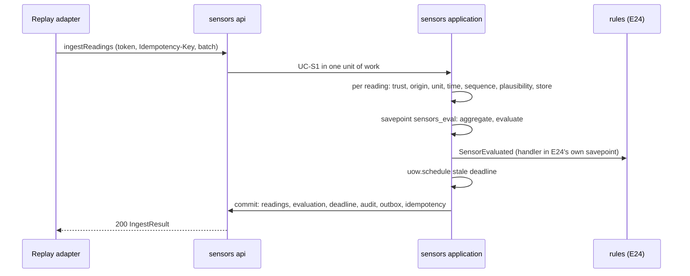

# E23: Environment profile and habitat sensors

Technical design for epic E23. Inputs: the brief (`tdd/E23.md` in the planning package), PRD.md 4.8, USE-CASES.md
(section 3, UC04 to UC07, UC12, UC17), CONTRACTS.md, `api/openapi.yaml` (tags Environment and Sensors), the
environment, overlay, mission event, sensor and habitat view schemas with their examples, `environment-hazards.json`,
ENVIRONMENTS.md, VALIDATION.md, `backlog.json`, `docs/BUILD-CHARTER.md`, `docs/SYSTEM.md`, `docs/DEPLOYMENT.md` and
`docs/requests/COORDINATOR-DECISIONS.md`. Citations: "C13" is CONTRACTS.md section 13, "S5.7" is SYSTEM.md section
5.7, "D3.5" is DEPLOYMENT.md section 3.5, "decision D3" is row D3 of the coordinator decisions. Reviews and responses are in
`docs/tdd/reviews/E23.opus-r1.md` to `E23.opus-r4.md` and `E23.response-r1.md` to `E23.response-r4.md`.

Status: design. Every test named here is planned; none has run. Limits, effects and steps are an unreviewed draft
copied from the research files; numerical verification of this module is not clinical approval.

## 1. Scope

**Work packages.** E23-01 (environment profile, overlays, confirmed changes), E23-02 (habitat adapters with LIVE,
REPLAY, SIM and stale states), E23-03 (limit table, hazards and environment-aware effects from configuration), E23-04
(Habitat card and Habitat screen, built by stream D).

**Traces.** Requirements R34, R35, R41, R42, R43. Validation V55 (sensor part), V56 (evaluation part), V58 (dose-rate
label and shelter attendance record), V59 (overlay and evaluation part), V66, V70 (sensor part), V72, V73, V75 (E23
part). Demo D01 (habitat part), D16 (evaluation part), D18, D19 (evaluation part), D31 (activation part), D33
(profile part). Use cases UC04, UC05 (dose-rate label), UC06, UC12, UC17. Section 12.1 maps each to its tests.

E23 owns CONTRACTS sections 12 and 13, and the operation `getContext` by coordinator ruling (6.1). The Ground link subsection of section 12 is implemented by E29 (S4.2); its
rules are traced in 1.1 to that owner.

**Hard dependencies:** E01, E02 (S9). The brief also lists E05 and E10; S9 makes both optional, and this design
follows S9: E23 builds and runs with both absent.

**Decisions** (brief, "Decisions the TDD must settle"):

| # | Decision | Selected | Rejected and why |
|---|---|---|---|
| DE23-1 | Environment and overlay vocabulary | `common.schema.json#/$defs/environment_id` and `overlay`, as keys only; every word from `environment-profiles.json` and ui-copy | Words or lists in code (R43) |
| DE23-2 | How a mission phase proposes a change | An explicit `proposeEnvironmentChange` with reason `phase_plan`, by `operator`, `ground` or `crew_medical_officer`. A mission event never switches or proposes an environment | Proposing from a `landing` event: `mission_event_types` has no field for it, and a mistyped event would start a switch |
| DE23-3 | Crew confirmation | C12 as written: the count from `change_confirmation.confirmations_required`; activation in one unit of work (3.3) | Client-side confirmation; a timer that confirms by itself |
| DE23-4 | The demo control | A proposal with reason `demo_switch`, accepted only while the mission mode is SIM or REPLAY, stored on the record and audited. It still needs the crew confirmation | A hidden switch that skips confirmation (D18 requires Mara's confirmation) |
| DE23-5 | Replay binding and replay clock | The channel names its `dataset`; each reading keeps its original `observed_at` and carries `replay`; windows follow the data (C13); the card shows the original time through ui-copy `designed_states.replay_time` and the note `designed_states.replay_note` | Rewriting replay dates to today: it would present another mission's cabin as a current measurement |
| DE23-6 | ppm to partial pressure | mmHg = ppm x cabin pressure in mmHg / 1,000,000 with the pressure the reading carries and its basis (measured or assumed). A ppm reading with no pressure is rejected at its index | A default pressure in code (AGENTS rule 5) |
| DE23-7 | Freshness | From the observation time (decision D3), compared with a regression-safe hub time (3.1). REPLAY: the arrival of the latest reading that advanced E (decision D8, 3.4) | Arrival time: a delayed batch would look current |
| DE23-8 | Which habitat modules run LIVE at the event | None. A LIVE channel is refused by the registry until plausibility bounds exist (R-E23-2). The Bluetooth Environmental Sensing reader is built behind the same port and tested only with the `hardware` marker | Claiming a LIVE feed from a simulator; a LIVE feed without range and saturation checks |
| DE23-9 | The level each limit raises | The level of the hazard level the limit is bound to, checked by loader check 4. The brief's CO2 question is closed by the package: USE-CASES.md section 4 and the C20 test vector both put the one-hour limit at `act` | A level table in code; a per-deployment override of a sourced level |
| DE23-10 | Several channels of one sensor type | Every channel is evaluated on its own and raises its own warning; the card shows the channel in the worst state and lists every other channel's value in `trace` (3.7); values are never merged across channels | Averaging channels; hiding the other channel |
| DE23-11 | Input checks before evaluation | Finite number, unit, timestamps, sequence, origin and quality on every reading now; range, saturation, stuck value and rate of change when the catalog carries their criteria (R-E23-2), which LIVE channels wait for (DE23-8) | Criteria in code or in hub settings, or borrowed from a number that means something else: they are domain content (AGENTS rule 1) |
| DE23-12 | Evaluator fault | Capture first, evaluate second (S8.6): the reading commits, the evaluation is marked pending, a not-evaluated `SensorEvaluated` resets every dwell (4.4), nothing clears | Rolling back the reading with the evaluation; silence toward E24 |
| DE23-13 | Readings across an environment change | A reading from before the activation instant (by observation time for LIVE and SIM, by receive time for REPLAY) is never current and never in a window of the new environment, even on a channel listed for both; such a channel goes stale from the activation instant if nothing new arrives (3.3, 3.4) | Carrying a cabin's averages across a landing (V66); a feed that dies at the switch staying silent |

**Not delivered here** (owner): raising, clearing and showing warnings, including `sensor_quiet` and the vehicle
procedure line (E24); routine recomputation and the manual reading task (E25, after E25 request 6); the ground link state,
schedule and demo route (E29); the kit list and kit map counts (E27); the mission clock, MET and the day and short
label (E01); the roster (E02); Today assembly (E03); guidance eligibility (E27 `guidance`, S8.2); locations and
custody (after R-SYS-6).

### 1.1 Rule trace

| Source | Rule | Design | Test |
|---|---|---|---|
| CONTRACTS.md:593 | Only one proposal can be open | 3.3, 5.1 partial unique index | T-E23-004 |
| CONTRACTS.md:594 | Until confirmed, any action that depends on the change returns `CONFIRMATION_REQUIRED` | 3.3 rule C1, 6; scope question R-E23-9 | T-E23-064 |
| CONTRACTS.md:611 | Only environments with a return option may have a return stage | Not E23: loader check 14 (E28). E23 serves `return_option` unchanged (4.2) | T-E23-046 |
| CONTRACTS.md:615 | `living_here`: condition hazards, name without source IDs, effect regions, effects after filters, what to do from `info` and `watch` skipping "Nothing to do" sentences, words for this environment | 3.9, one clause each | T-E23-038, T-E23-039, T-E23-071 |
| CONTRACTS.md:623 | `sleep` and `eva` always suppress routine | Not E23: E25 reads `OverlayPort.intervals`. E23 keeps intervals exact (3.5) | T-E23-012 |
| CONTRACTS.md:627 | State facts change only by listed event types, only in listed environments | 3.6 | T-E23-015, T-E23-016, T-E23-067 |
| CONTRACTS.md:631 | The ground is never a step; only four readers of the link | E23 reads the link only for the Habitat line and `getMission`, and waits on nothing (4.4, 9) | T-E23-047 |
| CONTRACTS.md:642 | `gap_planned` always false when up or delayed | Not E23: E29. E23 serves the object unchanged | T-E23-047 |
| CONTRACTS.md:645 | Delay text never from hub state or code | Not E23: E29 for the link object. The Habitat `ground_delay_text` comes from `environment-hazards.json` `earth_delay` (3.9) | T-E23-040 |
| CONTRACTS.md:648 | Demo ground link route only in demo mode | Not E23: E29 | None here (E29) |
| CONTRACTS.md:658 | Channel must belong to the adapter; origin must equal the channel's | 3.8 steps 2 and 3 | T-E23-020, T-E23-021 |
| CONTRACTS.md:659 | Unit must be canonical or accepted | 3.8 step 4 | T-E23-022, T-E23-023 |
| CONTRACTS.md:662 | A rejected-quality reading is stored, never evaluated | 3.8 step 8 | T-E23-026 |
| CONTRACTS.md:664 | A batch is never rejected as a whole | 3.8, 4.1 UC-S1 | T-E23-027 |
| CONTRACTS.md:682 | A limit is evaluated only with enough coverage; `latest` has no coverage | 3.7: the gate applies to windowed aggregations; a `latest` limit is evaluated on the current reading at E | T-E23-031, T-E23-063 |
| CONTRACTS.md:688 | Only active warning limits of the active environment are evaluated | 3.7 | T-E23-032 |
| CONTRACTS.md:697 | `threshold_pending` only when every limit is pending | 3.7 | T-E23-033 |
| CONTRACTS.md:700 | Display-only limits never change the status; a pending limit never raises | 3.7 | T-E23-033, T-E23-034 |
| CONTRACTS.md:706 | Clear holds for the dwell in observation time; stale data never clears | E23 reports `clear_holds` per limit only for eligible windows (3.7); the dwell is E24's | T-E23-035 |
| CONTRACTS.md:728 | A REPLAY reading is never a person's exposure or evidence about a person; an insight may mention it only as a habitat fact | 3.8, 4.2 `PlaceFact`, 10 | T-E23-041 |

PRD requirements: R34 (3.3, T-E23-001 to 009), R35 (3.7, 3.9, T-E23-030 to 037), R41 (3.9, T-E23-038, 039), R42 (3.4,
3.8, T-E23-017 to 029), R43 (7, 8, T-E23-050, 058).

## 2. Seams

Names are those of S4.2. Where a consumer design uses another name or shape for the same seam, R-E23-5 lists the
mismatch and asks SYSTEM.md to record the one below. Every quantity is a `Quantity` (S5.4); every instant is an aware
UTC `datetime`.

| Name | Provider epic | Consumer epics | Signature or payload with types | SYSTEM.md |
|---|---|---|---|---|
| `MissionStatePort` | E23 | E01, E04, E11, E13, E22, E24, E25, E26, E27, E28, E29, E31, E32, E33 | 4.2: `current`, `mission_mode`, `active_environment_id`, `overlays`, `latest_event`, `events_since`, `state_facts`, `return_option`, `day_end` | 4.2, 4.4 |
| `OverlayPort` | E23 | E02, E11, E25, E28, E30, E31 | 4.2: `active(person_ids, at)`, `intervals(person_id, kinds, since, until, limit)` | 4.2 |
| `EnvironmentFacts` | E23 | E27, E12 | 4.2: `applicable(snapshot, patient_location_id, environments)`, `place_facts(uow, start, end)` | 8.2 |
| `LocationPort` | E23 | E25, E26, E31, E32 | 4.2: `location_of(person_id, at) -> str \| None`; `None` until R-SYS-6 | 8.5 |
| `DayLabelPort` | E23 | E15, E28, E31 | 4.2: `inline_label_at(instant) -> str` from the profile's `inline_template` | 5.3 |
| `SensorStateQuery` | E23 | E24 | 4.2: `last_results`, `freshness`, `channels`, `type_name` | 4.2 |
| `SensorSeriesReader` | E23 | E32 | 4.2: `accepted(channel_id, *, until, limit) -> SeriesSlice` | 4.2 |
| `ProvenanceStreamsPort.habitat_streams` | E23 | E27 | 4.2: `habitat_streams(snapshot) -> Sequence[HabitatStream]` | 4.2 |
| `SensorEvaluated` | E23 | E24 | 4.3 payload; published in the ingest, activation and freshness units of work | 4.2, 5.7 |
| `ChannelFreshnessChanged` | E23 | E24 | 4.3 payload | 4.2, 5.7 |
| `EnvironmentActivated`, `OverlayChanged`, `MissionEventRecorded`, `StateFactChanged` | E23 | E24, E25, E29, E33 | 4.3 payloads | 4.2, 5.7 |
| `HabitatParts` | E23 | E03 | 4.2: `today_part(snapshot, at)`, `today_sensors(snapshot, at)` | 4.2, 4.4 |
| `ProfileDayPort` | E23 | E01 | `at(view, at) -> ProfileDay(profile_id, environment_id, environment_day) \| None` | 5.3 |
| `MissionIdentity` | E23 | E01 | `current(view) -> MissionRef(mission_id, mission_mode) \| None` | 5.7 |
| `AdapterHealthSource` | E23 | E01 | `states() -> Sequence[tuple[str, str]]` | 5.10 |
| Loader checks 4, 7 and the sensor half of 12 | E23 | E01 | `ReleaseCheck` registered through `ModuleRegistry.loader_check` | 5.6 |
| `ActivationParticipant` | E23 | E23 | 4.2: `on_activated(uow, profile)`; declared in `mission`, implemented by `sensors`, wired at the composition root | 6.4 |

Consumed, by the S5 names and never redefined: `UnitOfWorkFactory`, `ReadSnapshotFactory`, `DomainEventBus`,
`OutboxEvent`, `AuditEntry` (S5.7, S5.9); `IdFactory` (S5.1); `Clock`, `MissionClock`, `ClockCorrected`,
`ClockRegressed` (S5.2, S5.3); `UnitRegistry`, `Quantity` (S5.4); `ProblemError`, `StorageUnavailable` (S5.5);
`ConfigReleaseReader`, `ConfigReader`, `TemplateRenderer`, `ReleaseCheck`, `ActivationGuard` (S5.6);
`IdempotencyStore`, `CommandIdentity` (S5.8); `uow.schedule`, `SchedulerRegistry`, `HealthState` (S5.7, S5.10);
`HubSettings` (S5.11); `ModuleRegistry`, `StartupPhase` (S5.12); `SessionContext` and `RosterPort` (E02);
`WarningQueries` and the domain events `WarningRaised`, `WarningCleared` (E24, optional); `SourceRegistryPort.summary`
(E10, optional, for citation titles); `GroundLinkQuery` (E29, optional, R-E23-6). The event log delivers the wire
events of section 4.3.

## 3. Domain model

Two modules, `mission` and `sensors` (S4.2), each with pure `domain` code. `sensors` reads the active environment
through `MissionStatePort` only.

### 3.1 Time

**Regression-safe time.** Freshness and deadlines compare against `safe_now`, never against a raw clock read. Normally
`safe_now = uow.now`. After `ClockRegressed` and until a `ClockCorrected` is recorded, `safe_now = last_committed_at +
(monotonic_ns now − monotonic_ns at detection)`, taken from the event and `Clock.monotonic_ns` (S5.2), so it keeps
advancing at the true rate and never moves backward. After a restart inside an unresolved regression (a new process
epoch), `safe_now = max(uow.now, last_committed_at)` at start, then advances by `monotonic_ns` again. Sweeps and
deadlines keep running throughout: a channel can go stale during a regression and can never return to `current` by
the jump.

| Timer or instant | Kind | Clock | On `ClockCorrected` | During a regression |
|---|---|---|---|---|
| Stale deadline of a channel (3.4) | Relative to the freshness reference | `safe_now`, `uow.schedule` | Moves with the clock (S5.10 reschedules); recomputed by the sweep | Kept; the sweep (3.4) compares with `safe_now` |
| `effective_at` of a proposed change | Absolute | Hub clock | Does not move | Activation waits until `safe_now` reaches it |
| `planned_start` of an overlay | Absolute | Hub clock | Does not move | No change |
| End of `post_eva` at the end of the mission day | Absolute, from `MissionClock.day_bounds` (S5.3) | Mission clock | Recomputed from the new clock version | Applied on `safe_now` |
| Aggregation windows | Data time: (E − W, E] on `observed_at` (C13) | None | Unaffected | Unaffected |

**Ordering.** Readings are ordered by `(observed_at, adapter_sequence)` within a channel. A late, duplicated or
replayed reading is stored and appears in series; it never moves E backward, never makes a channel `current` unless it
advances the freshness reference (3.4), and never clears anything: E23 reports `clear_holds` only for windows whose end
E is later than the previous evaluation's E. An observation time later than `safe_now` by more than
`sensors.future_tolerance_s` rejects the reading at its index (`INVALID_VALUE`); it is kept in the batch record.
Mission events are ordered by `(occurred_at, event_id)`; 3.5 and 3.6 say what a late event may change.

**`clock_state`** (published on `SensorEvaluated`, E24 3.6), per evaluated reading at E:

| Value | When |
|---|---|
| `trusted` | No unresolved `ClockRegressed`; no `ClockCorrected` recorded inside the clock window (below); and, for LIVE and SIM only, the last health poll of the channel's adapter (5.2), no older than `sensors.adapter_heartbeat_max_s`, reported its clock `synchronized` (a SIM generator stamps times from its host clock and reports that host's state). REPLAY does not use the poll: its times are the dataset's, so it is `trusted` when the reading carries `replay.time_basis` and the channel's dataset matches |
| `uncertain` | An unresolved `ClockRegressed`, a `ClockCorrected` inside the clock window, or a health poll reporting a LIVE or SIM adapter's clock `unsynchronized` |
| `unknown` | For LIVE and SIM: no successful health poll within the bound, or an adapter with no health endpoint (its readings can raise but never complete a dwell). For any channel: the evaluation itself failed (4.4) |

One `clock_state` is published per `SensorEvaluated`. Its clock window is the longest window among the channel's
evaluated limits, (E − W_max, E], or the instant E alone when every evaluated limit is on `latest`; so a correction that
touches any limit's window makes the whole input `uncertain`.

### 3.2 Records and identifiers

| Record | Contract object | Identifier | Notes |
|---|---|---|---|
| Mission identity | `MissionContext` fields | `IdFactory.new("msn")` once | One row, written by mission init (3.3); R-E23-4 |
| Environment profile record | `EnvironmentProfile` | `IdFactory.new("env")` | New record per change; never edited after `superseded` or `rejected` |
| Overlay | `ActivityOverlay` | `IdFactory.new("ovl")` | Per person |
| Mission event | `MissionEvent` | `IdFactory.new("mev")` | Append only |
| State fact | none on the wire | fact key and environment | Derived from events; rebuilt on start |
| Channel | `SensorChannel` | from the channel registry (5.3) | Static part from the registry, dynamic part from readings |
| Reading | `SensorReading` | `IdFactory.derived("rdg", channel_id, str(adapter_sequence))` | Equal on a retry, so a duplicate maps to the same ID |
| Evaluation | `SensorEvaluation` | channel | Derived; rebuildable from readings and the release |

All generated identifiers match `common.schema.json#/$defs/id` (prefix, underscore, 32 hexadecimal characters).

### 3.3 Mission start and the environment change state machine

**Mission start.** `crew-health mission init --mission-id <id> --mode <LIVE|REPLAY|SIM> --environment <id>
[--planned-length-days <n>]` (owned CLI, 13) runs in one unit of work: it writes `mission_identity` and the first
EnvironmentProfile with reason `mission_start`, state `active`, `confirmations_required` from the active release,
`confirmations` empty, `proposed_by` the operator actor, `activated_at`, `effective_at` and `environment_day_start` set
to `uow.now`, the switch-on lists computed as in step 2 below, and an audit entry. It refuses when an identity exists.
The demo profile runs it from the fixture (E21); in the same unit of work it loads the demo channel registry (5.3). Until it has run, the hub still starts and serves every function that
does not need a mission (Someone needs help included): health reports `mission` as `uninitialized`;
`MissionStatePort.current`, `mission_mode` and `active_environment_id` return `None`; `EnvironmentFacts` returns
`Unknown`; readings are stored and appear in series but never enter a window, because they precede the mission (3.7);
every mission command and `getMission` and `getEnvironment` answer `INTERNAL_ERROR` retryable with
`current_state.unavailable` naming `mission`, the code every operation declares through its `default` envelope. A missing or corrupt identity row after init is a storage integrity
failure handled by E01's start-up checks (S8.6 item 4), never replaced by a default.

**Changes.** `proposed → active → superseded`, or `proposed → rejected` (C12). Invariants:

- I-M1. Exactly one record is `active` at every committed state after mission init.
- I-M2. At most one record is `proposed`; a second proposal is `INVALID_TRANSITION`.
- I-M3. A record activates only when `len(confirmations)` reaches `confirmations_required` and `safe_now` is at or
  after `effective_at` (when set). A person is counted once. `confirmations_required` is copied from the active release
  at proposal time, so a later release cannot lower the bar of an open proposal; nothing else is pinned.
- I-M4. Reason `demo_switch` is refused unless the mission mode is SIM or REPLAY (`INVALID_VALUE`).
- I-M5. Proposing the active environment again is `INVALID_VALUE`.
- I-M6. `proposed_by`, `rejected_by` and each confirmation come from the session, never from the body.
- C1. `confirm` by a person already in `confirmations` while the count is not reached returns `409
  CONFIRMATION_REQUIRED` with the record in `current_state`: the change still waits for another crew member. This is
  the only action that the contract's operations let return it; R-E23-9 asks whether more were meant.

At proposal, the record's `hazard_ids`, `limit_ids`, `warning_definition_ids`, `sensor_type_ids`, `sensor_channel_ids`
and `routine_item_ids` are computed from the active release and the channel registry, for display (the package
examples fill them at proposal). The proposer may also confirm; C12 lets any `crew` session confirm, so a deployment
that wants two people sets `confirmations_required` to 2 (10).

**Activation** runs in one unit of work, in the C12 order: (1) supersede and activate, setting `activated_at`,
`environment_day_start` and, when it was null, `effective_at` to the unit of work's `now` (as the package example
does); (2) recompute the six lists from the release active at activation and set `config_release_id` to it; (3)
publish `EnvironmentActivated` on the in-transaction bus, where E24 clears warnings whose definition does not apply (its
own rule), E25 recomputes schedules and E29 resets the link; (4) after `publish` returns, so after every handler of
step 3, `mission` calls `ActivationParticipant.on_activated(uow, profile)`, which `sensors` implements: for every
channel whose `environment_ids` include the new environment and that had readings, it sets the freshness reference to
`activated_at` (3.4) and schedules its stale deadline with `uow.schedule` in the same unit of work; it recomputes the
statuses; and it publishes `SensorEvaluated` only for a channel that already has an evaluable reading in the new
environment, which at the activation instant is none, so E24 never receives an input without a window end or a
reading. A channel outside the new environment keeps its state, appears on no card, and no freshness transition is
published for it until an environment that lists it is active again; (5) emit
`environment.activated`. Rule DE23-13: in the new environment, a reading from before `activated_at` (by `observed_at`
for LIVE and SIM, by receive time for REPLAY) is never current, never shown and never in a window, on every channel,
including one listed for both environments. Each card shows `no_reading` until a newer reading is accepted; a channel
that sends nothing more goes stale at `activated_at + stale_after_seconds` and raises `sensor_quiet` (E24). Readings
stay stored under their channel and in series.

### 3.4 Freshness

`freshness(channel, safe_now)`: `never_reported` with no reference; otherwise `current` when `safe_now − reference <=
stale_after_seconds`, else `stale`. `stale_since = reference + stale_after_seconds`, the value C11 places in the
`sensor_quiet` designed state (the meaning of that field is R-E23-13).

**Reference, LIVE and SIM:** the latest `observed_at` among accepted readings observed at or after the active
profile's `activated_at` (decision D3). A channel with no such reading but with earlier readings takes `activated_at`
itself as its reference, so it goes stale if nothing arrives; only a channel that never reported is `never_reported`.

**Reference, REPLAY** (decision D8): `observed_at` is another mission's date and cannot be compared with this hub's
clock. The reference is the hub receive time of the latest accepted reading that advanced E. A reading that does not
advance E (a replay restarted from the top, a late or repeated row) never refreshes the reference, so a looping or dead
replay goes stale. Only readings received at or after `activated_at` count; a channel with earlier readings only takes
`activated_at` as its reference, as above. Windows and evaluation still follow `observed_at`.

**Deadline (primary path).** In the ingest unit of work, for each channel whose reference advanced, E23 calls
`uow.schedule("sensors.stale.<channel_id>.<due>", due, "sensors.stale")` with `due = reference + stale_after_seconds`,
so the deadline commits with the reading. Keys differ per due time, so nothing relies on replace semantics. The handler
recomputes freshness from stored state and first skips a channel whose `environment_ids` exclude the active
environment (a deadline scheduled before a switch does nothing after it): if the channel is still current, it
schedules the next key at the new due time; if it is stale, it records the transition. Superseded jobs find a current channel with a later due and do
nothing.

**Sweep (independent backup).** The sweep runs at the `STATE_SWEEP` start-up phase and then on its own timer, a
background task started through `ModuleRegistry.on_startup`, every `sensors.freshness_sweep_s`, each tick in its own
unit of work. It does not use the platform scheduler, so a stalled scheduler does not stop it; it recomputes every
channel of the active environment (channels whose `environment_ids` exclude it are skipped, as in the deadline
handler) against `safe_now` and records any transition the deadlines missed. The same tick is the scheduler watchdog:
when `safe_now` passes a channel's stored `next_stale_check_at` by more than `sensors.scheduler_lag_max_s` and the
deadline has not run, it marks health degraded (`SCHEDULER_LAG`), which every view shows through the health line of
R-SYS-9. Common mode, stated: both paths run in the hub process; if that process dies, the supervisor restarts it, the
start-up sweep recomputes every channel before ingest opens, and meanwhile clients show their last view with its
`as_of` time and the offline word, never as current.

**Transition** (either path): update `sensors_channel.freshness`, publish `ChannelFreshnessChanged` (its
`last_reading_id` is `None` for a channel stale from an activation), re-evaluate the channel and publish
`SensorEvaluated` when it has an evaluable reading, emit `sensor.quiet` or `sensor.resumed` and
`sensor.status_changed`.
Every read path also recomputes freshness against `safe_now`, so a client that fetches never sees a stale channel as
current.

**Fault notices.** Five faults are reported as health component `sensors`, state `degraded`, with a code and `since`,
spelled the same everywhere in this design: `EVALUATION_UNAVAILABLE` (4.4), `SCHEDULER_LAG` (above),
`INSTANT_CONFLICT` and `SEQUENCE_CONFLICT` (3.8) and `WINDOW_SCAN_BOUND` (3.7). Adapter health values
(`queue_full`, `clock`) belong to the adapter's own `/health` schema (5.2), not to these codes. Every
mention of "the health line of R-SYS-9" in this design means this component. R-SYS-9 proposes only the `rules` and
`pathways` components, so R-E23-16 asks SYSTEM.md to add `sensors` and these codes and E03 to add their words. Until
then the faults are served by `/v1/health`, which the operator panel and the station read (the R-SYS-9 interim), and
no crew screen shows a sentence for them. The crew side stays safe by behavior alone: a pending evaluation keeps the
last status and blocks every clear; the sweep still runs during scheduler lag; a conflict is evaluated on its worse
variant; an unevaluated limit shows `insufficient_data` with the configured words.

### 3.5 Overlays

States `planned`, `active`, `ended`. Invariants: I-O1 at most one `active` overlay of each kind per person; I-O2
`ended_at >= started_at`; I-O3 `eva_ended` ends `eva` and starts `post_eva` in the same unit of work; I-O4 `post_eva`
ends when the person ends it, when that person's next `eva` starts, or at the end of the mission day (a durable
deadline, absolute); I-O5 an overlay kind not listed in the active profile's `overlays` is `INVALID_VALUE`. Every
change publishes `OverlayChanged` and emits `overlay.changed` for the `person` and `crew` scopes.

`ActivityOverlay.source`: `person` (ref `null`) when the session's person creates or ends it; `mission_event` (ref the
event ID) when an event starts or ends it; `operator` only after R-E23-7; `adapter` is never written here.

**Late or conflicting events.** An event changes an overlay only if no event with a later `(occurred_at, event_id)`
has already changed that person's overlay of the same kind. An event whose effect would break an invariant (for
example `eva_started` while that person's `eva` is active, or `eva_ended` with none active) is recorded unchanged, its
overlay effect is skipped and the hub audits `mission.overlay_effect_skipped` with the event and overlay IDs. The
event is a real report, so it is kept; E24 still receives `MissionEventRecorded`.

### 3.6 Mission events and state facts

`recordMissionEvent` checks, in order: the type exists in `mission_event_types` (`INVALID_VALUE`); a session role is
in `who_may_record` (`UNAUTHORIZED_SCOPE`); the body's `origin_mode` equals the mission mode (`ORIGIN_MISMATCH`);
every `person_ids` entry is on the roster (`INVALID_VALUE`). The event stores the active `environment_id`.

A state fact changes only when the event type is in that fact's `set_by_event_types` or `cleared_by_event_types`, the
active environment is in its `environments`, and the event's `(occurred_at, event_id)` is later than that of the
fact's current `cause_event_id`. An older event is recorded and changes nothing, so a delayed
`local_water_source_added` never sets `local_water_untested` again after a later `local_water_tested`.

Shelter attendance (V58) is recorded as mission events of configured types carrying `person_ids`; E23 stores and
serves them and decides nothing from them.

### 3.7 Aggregation and evaluation

Pure functions over the accepted readings of one channel in the window (E − W, E], exactly as the C13 table:
`latest`, `mean`, `time_weighted_mean`, `energy_mean`, `max`, `sum`. Coverage is `min(1, n x I / W)` with an expected
interval, `(last − first) / W` without one, 0 with fewer than two readings, and absent for `latest`. No value is
assumed before the first reading in a window, and an empty window yields no value, never zero. Only readings from at
or after the active profile's `activated_at` enter a window (DE23-13): by `observed_at` for LIVE and SIM, by receive
time for REPLAY, whose `observed_at` is another mission's date. Readings stored before mission init never enter one.
An instant on one channel counts once in coverage. Where two readings disagree at one instant (3.8 step 6), each limit
is evaluated on two variants of its window, one taking the lower value at every conflicting instant and one the
higher; every C13 aggregation is monotone in each value, so the two bound every choice. A limit is crossed if either
variant crosses it, and `clear_holds` is true only if both hold. The card's `display_value` and the evaluation's
`aggregated_value` come from the variant that ranks worse: the one with the higher crossed level, else the one nearer
a card-mark limit, else the higher value. The conflict is flagged through health (`INSTANT_CONFLICT`, 3.8) until
R-E23-14 gives the card a designed state for it.

**Arithmetic.** `Decimal` with precision 34 and `ROUND_HALF_EVEN`; canonical values are rounded to 4 decimal places at
storage (C13); the aggregate compared with a limit is the unrounded result of that arithmetic on stored values;
rounding to catalog `decimals` happens only for display. `energy_mean` uses `Decimal.exp`, `ln` and `log10` in the same
context. A non-finite result raises a typed error.

**Incremental state.** Windowed aggregations read per-bucket partial sums (`sensors.aggregate_bucket_s`) for the whole
buckets of a window and scan only the two edge buckets, so cost does not grow with W. A late reading updates only the
buckets its segment touches (for `time_weighted_mean` and `energy_mean`, the hold segment between its neighbours). An
activation guard rejects a release in which a limit's aggregation of kind `max` or `sum` (no partial sums) would scan
more than `sensors.window_scan_max_readings` at the fastest of the catalog interval and every registry override, and
the registry is validated against the same bound. A channel that reports faster than declared can still exceed it at
run time: that limit is then not evaluated (result `None`, so it neither raises nor clears), the channel shows
`insufficient_data` if no other limit was evaluated, and health is degraded (`WINDOW_SCAN_BOUND`) with the channel
named, shown through the health line of R-SYS-9.

**Status**, per channel, the first that applies of the C13 table (`no_reading`, `stale`, `beyond_limit`,
`within_limit`, `insufficient_data`, `threshold_pending`, `no_limit_on_file`). Only limits with role `warning`, status
`active` and the active environment in `environments` are evaluated, each on its own `aggregation_id`.

- **Coverage gate.** A limit on a windowed aggregation is evaluated only when the window's coverage is at least its
  `min_coverage`. A limit on `latest` has no coverage (C13); it is evaluated whenever the channel is current and has an
  accepted reading at E, and its `min_coverage` is not applied. So `o2_low_emergency` crosses on one reading.
- A crossed limit sets `beyond_limit` with the highest crossed level; ties go to the earlier limit in the document.
  Limits with role `display_only` are marks only. A limit with status `threshold_pending` evaluates nothing and is
  listed in `pending_limit_ids`.
- For each evaluated limit E23 also reports `clear_holds`: the limit's `clear` comparator against the same aggregation;
  `None` when the channel is stale, the window is not newer than the last one, or the evaluation failed.
- **Stuck value, range, saturation and rate (DE23-11).** Off until R-E23-2 gives each sensor type its criteria with a
  basis; no number is borrowed for them. No real sensor is exposed meanwhile, because the registry refuses LIVE
  channels until those criteria exist (DE23-8); REPLAY and SIM values carry their source word.

**Card channel (DE23-10).** With several channels of one sensor type in the active environment, each is evaluated and
published separately. The `SensorStatus` of the type shows the channel that ranks first by: `beyond_limit` by level
descending, then `stale`, `insufficient_data`, `no_reading`, `within_limit`, `threshold_pending`, `no_limit_on_file`;
ties by `channel_id`. Its `trace` lists every other channel of the type as `{source_label}, {location_label}:
{display_value.text} {unit_display}` (served values and configured words joined by separators only), so a disagreement
is visible on the card; values are never averaged. `trace` carries only that list and the reading provenance the
package defines; every sentence about a fault comes from the health line. R-E23-14 asks for a per-channel field and a
designed state for the conflict.

### 3.8 Ingest pipeline

Before any reading: a batch of more than `sensors.batch_max_readings` (never above the contract's 1,000) is `413
PAYLOAD_TOO_LARGE`, checked before schema validation; otherwise a body that fails `AdapterReadingBatch` is `400
MALFORMED_REQUEST`. Then for each reading, in order, inside the batch's unit of work:

1. Apply the defaults of the contract: `aggregation` absent means `{kind: sample, window_seconds: null}`.
2. The channel exists, belongs to the adapter of the token and has `trusted` true; otherwise the index is rejected
   with `ADAPTER_NOT_TRUSTED`.
3. The reading's `origin_mode` equals the channel's; otherwise `ORIGIN_MISMATCH`.
4. The unit is the catalog unit or one of `accepted_units`; otherwise `INVALID_UNIT`. Conversion: `identity` stores
   `conversion` `null`; `scale` and `ppm_to_mmhg` store `{method, cabin_pressure_mmhg, pressure_basis, factor}`; the
   last needs `cabin_pressure_mmhg` on the reading, else `INVALID_VALUE`. `original_value` and `original_unit` are
   always stored.
5. Time: `observed_at` not beyond the future tolerance (3.1); a REPLAY reading must carry `replay`, and a LIVE or SIM
   reading must not, else `INVALID_VALUE`. A stored REPLAY reading has `replay.original_observed_at = observed_at`.
6. Sequence and instant. `(channel_id, adapter_sequence)` already stored with the same value, unit and `observed_at`:
   counted in `duplicates`, nothing written, its existing ID returned. Stored with anything different: the index is
   rejected with `INVALID_VALUE`, the raw JSON is kept in `sensors_batch`, and the adapter is marked degraded
   (`SEQUENCE_CONFLICT`), so a reset sequence is loud and its readings are never silently dropped. A new sequence at
   an `observed_at` already stored on the channel: stored; with the same value it counts as a duplicate instant and
   never enters a window twice; with a different value both are kept and both reach evaluation through the two
   variants of 3.7, and the adapter is marked degraded (`INSTANT_CONFLICT`), shown through the health line of R-SYS-9.
7. Plausibility (DE23-11): the bounds of R-E23-2 when the catalog has them. A reading that fails is stored with
   `quality_status` `rejected` and the failed check in its provenance trace, so it is kept and never evaluated.
8. Store. A reading sent with `quality_status` `rejected` is stored and not evaluated; the hub never upgrades a
   quality status.

`IngestResult`: `accepted`, `duplicates`, `reading_ids` (IDs of the accepted and duplicate readings in index order),
`rejected` (index and code) and `evaluations_changed` (sensor type IDs whose served status changed). Rejected indexes
are kept with their code and raw JSON in the batch record (5.1), so no real reading is discarded. After the loop, each
touched channel is aggregated and evaluated once, inside `uow.savepoint("sensors_eval")` (DE23-12). A REPLAY or SIM
reading creates no Observation, no exposure record and no person evidence: `sensors` has no port to `records` at all.

### 3.9 Card and Habitat content

`SensorStatus` follows the C13 card table. It is computed on read from stored evaluations, freshness against
`safe_now` and E24's active warnings; only `revision` and the last emission time are stored. `display_value.text` uses
catalog `decimals` and `trim_trailing_zeros`, or `no_reading_label`. `shown_level` is the highest of the evaluation
level and the levels of linked active warnings from `WarningQueries` (E24); with E24 absent it is the evaluation level
and `linked_warning_ids` is empty. E23 subscribes to E24's `WarningRaised` and `WarningCleared` domain events and, when
the result for a linked sensor type changes, emits `sensor.status_changed` in that transaction.

`effects` are the hazard's effects after `effect_filters`, source IDs removed, with their body regions; `todo` the
sentences of `what_to_do` at `shown_level` (or `info`); `here` the hazard's `by_environment` text; `citation` built
from the card-mark limits' and the effects' source IDs, with titles from E10's `SourceRegistryPort.summary` when
present and the bare source IDs when E10 is absent. An effect with no source ID is replaced by ui-copy's "no supported
guidance" designed state (V73). The sentence rule of C13 is one pure function with property tests.

`living_here`, one clause each (CONTRACTS.md:615): (a) the active environment's hazards of kind `condition`; (b)
`name` without its source IDs; (c) `body_regions` from the regions of its effects; (d) `effects` after
`effect_filters`, an effect at `effect_index` shown only in the environments in `only_in`; (e) `todo` from the
sentences of `what_to_do.info` then `what_to_do.watch`, skipping each sentence that is the "Nothing to do" sentence of
the hazard file; (f) `here` from `by_environment` for this environment. The Habitat `environment.ground_delay_text` is
the `earth_delay` of `environment-hazards.json` for the active environment, source IDs removed.

## 4. Application layer

### 4.1 Use cases

| ID | Use case | Input | Output | Errors | Idempotency key |
|---|---|---|---|---|---|
| UC-M0 | Mission init (CLI) | mission ID, mode, environment | identity and first profile | identity exists | the CLI's command identity, stored in the ledger |
| UC-M1 | Propose a change | `EnvironmentChangeCreate`, session | `EnvironmentProfile` | I-M2, I-M4, I-M5 | header key, operation, body |
| UC-M2 | Confirm or reject | profile ID, `EnvironmentChangeAction`, `If-Match` | `EnvironmentProfile` | stale version, wrong state, C1 | header key, operation, profile ID, body |
| UC-M3 | Activate when due | profile ID (scheduler, for a later `effective_at`) | none | none | scheduler key `mission.activate.<profile_id>` |
| UC-M4 | Create or plan an overlay; end an overlay | `OverlayCreate`; overlay ID and `OverlayEnd` | `ActivityOverlay` | I-O1, I-O2, I-O5 | create: header key, operation, body; end: header key, operation, overlay ID, body |
| UC-M5 | Record a mission event | `MissionEventCreate`, session | `MissionEvent` | 3.6 | header key, operation, body |
| UC-S1 | Ingest a batch | adapter ID, `AdapterReadingBatch`, adapter session | `IngestResult` | whole-request errors of 3.8; per index otherwise | header key, operation, adapter ID, body; plus `(channel_id, adapter_sequence)` |
| UC-S2 | Freshness deadline and sweep | channel ID, or none for the sweep (scheduler) | none | none | scheduler keys of 3.4 |
| UC-S3 | Re-evaluate | release activation, environment activation, mission init, start, pending job | none | none | deterministic |
| UC-Q | Queries | session | views of section 6 | visibility | none |

The idempotency key covers the operation, its path parameters and the body (S5.8). The same key with another path
parameter or body is `DUPLICATE_COMMAND`, never a replay.

Crash behavior. Every command is one unit of work (S5.7): state, scheduled deadlines, audit, outbox and the idempotency
record commit together or not at all. A crash before commit leaves nothing; the client or adapter retries with the same
key. A crash after commit and before the response: the retry returns the stored result. For UC-S1 a retry after the 24
hour cache is still safe because step 6 of 3.8 maps stored sequences to their existing IDs. A storage fault
(`StorageUnavailable`) is never caught by the evaluation savepoint or any retry wrapper: the command fails with
`INTERNAL_ERROR`, the adapter keeps its queue (5.2), health shows the cause.

### 4.2 Ports (`mission/application/ports.py`, `sensors/application/ports.py`)

```python
@dataclass(frozen=True, slots=True)
class MissionFacts:
    mission_id: str; mission_mode: OriginMode; active_environment_id: str   # MissionContext.mission_mode
    planned_length_days: int | None; site_node_id: str
@dataclass(frozen=True, slots=True)
class OverlayFact:
    overlay_id: str; person_id: str; kind: str; state: str                  # ActivityOverlay.overlay, .state
    planned_start: datetime | None; started_at: datetime | None; ended_at: datetime | None
@dataclass(frozen=True, slots=True)
class ReturnOption:
    trip_text: str; source_ids: tuple[str, ...]; to_be_set_by: str | None
@dataclass(frozen=True, slots=True)
class PlaceFact:                                                             # habitat facts only, never a person's
    kind: str; text: str; at: datetime; origin_mode: OriginMode; source_label: str
@dataclass(frozen=True, slots=True)
class HabitatStream:
    channel_id: str; sensor_type_id: str; origin_mode: OriginMode; source_label: str; dataset: str | None
type Snap = UnitOfWork | ReadSnapshot

class MissionStatePort(Protocol):
    def current(self, uow: Snap | None = None) -> MissionFacts | None: ...      # None: opens its own snapshot
    def mission_mode(self, uow: Snap | None = None) -> OriginMode | None: ...
    def active_environment_id(self, uow: Snap | None = None) -> str | None: ...
    def overlays(self, uow: UnitOfWork, person_id: str, since: datetime) -> Sequence[OverlayFact]: ...
    def latest_event(self, uow: UnitOfWork, event_types: Sequence[str], scope_key: str,
                     at_or_before: datetime | None) -> MissionEventRecorded | None: ...
    def events_since(self, uow: UnitOfWork, since: datetime, after_event_id: str | None,
                     limit: int) -> Sequence[MissionEventRecorded]: ...
    def state_facts(self, uow: UnitOfWork) -> Sequence[StateFactChanged]: ...
    def return_option(self, uow: Snap | None, environment_id: str) -> ReturnOption | None: ...
    def day_end(self, instant: datetime) -> datetime: ...
class OverlayPort(Protocol):
    def active(self, person_ids: Collection[str], at: datetime) -> Mapping[str, Sequence[OverlayFact]]: ...
    def intervals(self, person_id: str, kinds: Collection[str], since: datetime, until: datetime,
                  limit: int) -> Sequence[OverlayFact]: ...
class EnvironmentFacts(Protocol):
    def applicable(self, snapshot: ReadSnapshot, patient_location_id: str | None,
                   environments: Collection[str]) -> Fact[bool]: ...
    def place_facts(self, uow: Snap, start: datetime, end: datetime) -> Sequence[PlaceFact]: ...
class LocationPort(Protocol):
    def location_of(self, person_id: str, at: datetime) -> str | None: ...
class DayLabelPort(Protocol):
    def inline_label_at(self, instant: datetime) -> str: ...
class SensorStateQuery(Protocol):
    def last_results(self, uow: UnitOfWork, channel_id: str) -> SensorEvaluated | None: ...
    def freshness(self, uow: UnitOfWork, channel_id: str) -> Freshness: ...   # SensorChannel.freshness
    def channels(self, uow: UnitOfWork) -> Sequence[str]: ...
    def type_name(self, uow: UnitOfWork, sensor_type_id: str) -> str: ...
class SensorSeriesReader(Protocol):
    def accepted(self, channel_id: str, *, until: datetime, limit: int) -> SeriesSlice: ...
class ProvenanceStreamsPort(Protocol):
    def habitat_streams(self, snapshot: ReadSnapshot) -> Sequence[HabitatStream]: ...
class ActivationParticipant(Protocol):                                       # declared in mission, implemented by sensors
    def on_activated(self, uow: UnitOfWork, profile: EnvironmentProfileModel) -> None: ...
class HabitatParts(Protocol):                                                # E03 Today
    def today_part(self, snapshot: ReadSnapshot, at: datetime) -> TodayEnvironment: ...
    def today_sensors(self, snapshot: ReadSnapshot, at: datetime) -> Sequence[SensorStatusModel]: ...
```

`Freshness` is the generated enum of `SensorChannel.freshness` (`current`, `stale`, `never_reported`).
`TodayEnvironment` is the generated model of `TodayView.environment`, `SensorStatusModel` the generated model of
`sensor-status.schema.json` and `EnvironmentProfileModel` that of `environment-profile.schema.json` (S6.5); none is
hand-written.

`EnvironmentFacts.applicable`: under the S8.5 interim (one location per environment), a `patient_location_id` of
`None` means the active environment's single location, so the answer is `Known(active_environment_id in
environments)`. It returns `Unknown("environment", "no_data")` only when no profile is active (before mission init)
or the location named is not the active environment's (fail closed, S8.2). `overlays` and `intervals` return at most
`mission.max_overlay_rows` rows and raise a typed error beyond it, so a caller never reads a truncated list as
complete. `SeriesSlice` carries `points` (observation time, canonical `Quantity`, quality status, origin mode) and
`truncated`. `DayLabelPort.inline_label_at(instant)` renders the `day_label.inline_template` of the profile that was
active at `instant` (from the profile records' `activated_at` and `superseded_at`, through `ProfileDayPort.at(view,
instant)`), so a transit-era instant keeps its transit label after a switch to Mars.

### 4.3 Events

Published on the in-transaction bus (S5.7), field names as E24 section 4.3 and E25 section 4 consume them:

| Name | Payload |
|---|---|
| `SensorEvaluated` | `config_release_id`, `sensor_type_id`, `channel_id`, `location`, `origin_mode`, `window_end`, `received_at`, `reading_id`, `clock_state` (3.1), `freshness`, `stale_after_seconds`, `results` (per limit: `limit_id`, `crossed`, `clear_holds`, `value` as `Quantity`, `coverage`, render facts), `channel` (name, location label, source label, last received time, replay dataset) |
| `ChannelFreshnessChanged` | `channel_id`, `sensor_type_id`, `state`, `stale_since`, `last_reading_id`, `origin_mode`, `channel` |
| `EnvironmentActivated` | the activated profile record and the superseded `environment_id` |
| `OverlayChanged` | `overlay_id`, `person_id`, `kind`, `state`, `planned_start`, `started_at`, `ended_at` |
| `MissionEventRecorded` | `event_id`, `event_type`, `label`, `occurred_at`, `recorded_at`, `origin_mode`, `environment_id`, `person_ids`, `location` |
| `StateFactChanged` | `fact`, `value`, `environment_id`, `at`, `cause_event_id`, `origin_mode` |

Wire events through `uow.emit` (C18 names and scopes): `environment.change_proposed`, `environment.change_rejected`
(crew, operator); `environment.activated` (crew, ground, operator); `overlay.changed` (person, crew);
`mission.event_recorded` (crew, operator); `sensor.status_changed` (habitat); `sensor.quiet`, `sensor.resumed`
(habitat, operator).

`sensor.status_changed` follows CONTRACTS.md:732: at most once per sensor type per expected interval, or per reading
when the interval is null. A change inside an interval is held and sent at the interval's end with the then current
status (a durable job keyed by sensor type and interval end). Safety does not wait on it: quiet and resumed channels
have their own events, warnings have `warning.*`, and the Habitat screen refetches on both (7). Consumed:
`config.release_activated` (UC-S3) and the domain events `WarningRaised`, `WarningCleared` (3.9). `sensors` does not
subscribe to `EnvironmentActivated`; activation reaches it only through the explicit call of 3.3 step 4.

### 4.4 Sequences

Principal path:



Failure path: the evaluator raises a non-domain error. The savepoint rolls back; outside it, in the same unit of work,
the readings commit with `evaluation_pending`, E23 publishes for each touched channel a `SensorEvaluated` whose every
result has `crossed` and `clear_holds` `None` and whose `clock_state` is `unknown`, so E24 deletes every dwell marker
of the channel (E24 3.6 "not eligible, `False`, `None`, absent: delete") and no clear completes; a durable job retries
up to `sensors.eval_retry_max`; `HealthState.mark_degraded("sensors", "EVALUATION_UNAVAILABLE", since)`; the last committed evaluation
stays and the health line of R-SYS-9 says the evaluation is out of date; no sentence is written into `trace`. If building that payload fails
too, the command fails loudly (S8.6 item 3) rather than commit a reading E24 has not heard about.

## 5. Adapters

### 5.1 Storage

STRICT tables, foreign keys on, instants as UTC ISO 8601 text, quantities as decimal text with a unit column.

| Table | Columns beyond the contract object's fields | Constraints and indexes |
|---|---|---|
| `mission_identity` | `mission_id`, `mission_mode`, `planned_length_days` nullable, `created_at` | Single row (CHECK on a constant key) |
| `mission_environment` | every `EnvironmentProfile` field; lists as JSON; `effective_at`, `rejected_by`, `activated_at`, `superseded_at`, `environment_day_start` nullable | Unique partial index where `state = 'active'`; unique partial index where `state = 'proposed'`; CHECK on `state` and `reason` enums |
| `mission_overlay` | every `ActivityOverlay` field; `planned_start`, `started_at`, `ended_at`, `location`, source `ref_id` nullable; `last_event_key` | Unique partial index on `(person_id, overlay)` where `state = 'active'`; index `(person_id, started_at)` |
| `mission_event` | every `MissionEvent` field; `location`, `note` nullable | Append only (trigger refuses UPDATE and DELETE); index `(occurred_at, event_id)` |
| `mission_state_fact` | `fact`, `environment_id`, `value`, `at`, `cause_event_id`, `cause_occurred_at`, `origin_mode` | Primary key `(fact, environment_id)` |
| `sensors_channel` | static registry fields; `last_received_at`, `last_observed_at`, `reference_at`, `next_stale_check_at`, `location_label`, `expected_interval_seconds`, `dataset`, `display_note`, `health_url` nullable; `freshness`; `registry_version` | CHECK on `freshness` and `origin_mode` (all three values) |
| `sensors_reading` | every `SensorReading` field; `conversion`, `window_start`, `replay` nullable; `batch_id`; `evaluation_pending`; `instant_conflict` | Unique `(channel_id, adapter_sequence)`; index `(channel_id, observed_at)`; append only (trigger), except `evaluation_pending`, cleared once by re-evaluation |
| `sensors_bucket` | `channel_id`, `bucket_start`, per aggregation kind partial sums and counts | Primary key `(channel_id, bucket_start)`; rebuildable from readings |
| `sensors_evaluation` | per channel: every `SensorEvaluation` field (`level`, `limit_id`, `aggregated_value`, `aggregation_label`, `window_start`, `window_end`, `coverage` nullable), `config_release_id`, per-limit results as JSON | Primary key `channel_id` |
| `sensors_status` | per sensor type and environment: `revision`, `last_emitted_at`, `pending_emit_at` nullable | Primary key `(sensor_type_id, environment_id)` |
| `sensors_batch` | `batch_id`, `adapter_id`, counts, rejected indexes with code and raw JSON, `received_at` | Primary key `(adapter_id, batch_id)` |

`mission_location` is created with R-SYS-6, not before. `sensors_batch`, `sensors_bucket` and `mission_identity` are
added to the S4.2 table by R-E23-8. Readings are kept for the mission's life (S7.1); E23 deletes no reading.
Migrations are files under each module's `adapters/migrations/`, run by E01's migrator, expand then contract: `0001`
creates; a later column is added nullable and backfilled before any constraint. Reading rows hold no private text:
habitat readings describe a place, never a person. Mission event `note` is free text and is never logged (10).

### 5.2 Habitat adapters (`adapters/habitat/`, uv member `crew-health-adapter-habitat`)

One process per configured feed, talking to the hub only through `ingestReadings` (S6.2): the same code path for
LIVE, REPLAY and SIM from the HTTP boundary inward.

| Adapter | Source | Notes |
|---|---|---|
| `replay` | A recorded file named by a feed entry | Original dates kept; `replay.dataset` and `time_basis` from the feed entry; paced as the entry says |
| `sim` | Frozen SIM rows from a file, or a seeded generator, described by a feed entry | `origin_mode` SIM; values in the catalog display range |
| `ble_ess` | Bluetooth Environmental Sensing (0x181A) through `bleak` | LIVE; refused by the registry until R-E23-2 (DE23-8); `hardware` tests only |
| `xtce` | A read-only CCSDS or XTCE described feed (D3.6) | LIVE; same refusal; parser tests only this weekend; never writes to the vehicle |

**Feeds and the demo gate.** One feed file, to be owned by E21: `fixtures/demo-mara-fd19/sensors/feeds.json`, which
E21's interim feeder already reads; until then E23's interim copy (5.3). E23 owns its schema (`adapters/habitat/schemas/feeds.schema.json`): per feed `feed_id`,
`kind` (`replay` or `sim`), `channel_id`, `file`, `columns` (time column, value column, unit), `dataset`,
`time_basis`, `pace`, `seed` or frozen rows (SIM), and a `basis` on each choice. R-E23-15 asks E21 to adopt the
schema and to hold byte copies of the RR-1 CO2 file and the RadLab DosTel1 sample, with a SHA-256 check against
`docs/product/nasa-data/`, in its fixture, so no feed reads `docs/product` at run time. The entry point answers E21
request 14.9: `crew-health adapters replay --feed <feeds.json> [--feed-id <id>]` and `crew-health adapters sim --feed
<feeds.json>` (`adapters/habitat/src/crew_health_adapter_habitat/cli.py`). The gate needs no hub call: each adapter
refuses to start unless the local deployment settings say `profile = "demo"`, and the hub loads the demo channels
only when its profile is `demo` and the mission mode is SIM or REPLAY (5.3). E23's unit tests build their inputs from
the package files under `hub/tests/sensors/`.

**Process rules.** Each adapter keeps a bounded on-disk queue, a monotonic `adapter_sequence` persisted across
restarts and a `/health` endpoint (schema `adapters/habitat/schemas/health.schema.json`: `adapter_id`, `clock` as
`synchronized`, `unsynchronized` or `unknown` from its host's time service, `queue` as `ok` or `queue_full`). The hub
polls each registered adapter's `health_url` every `sensors.adapter_poll_s`, concurrently, each with a timeout of
`sensors.adapter_poll_timeout_s`, at most `sensors.adapter_poll_max` adapters, in its own background task separate
from the freshness sweep, so a slow adapter never delays the sweep. The URL is loopback on T0; on a separate
integration node (DEPLOYMENT.md 3.6) it is that node's enrolled address over the hub's TLS (DEPLOYMENT.md 5.4), with
the same timeout. The result feeds `clock_state` for LIVE and SIM (3.1) and `AdapterHealthSource`. A failed or late
poll gives `unknown`. Every HTTP call has
a timeout; retries use capped backoff; a full queue drops nothing silently: the adapter stops reading its source,
reports `queue_full` in health and resumes in order. Parsers reject a row they cannot parse and count it; they never
substitute a value.

### 5.3 Channel registry

The contract has no command that creates a channel. Channels describe how this deployment is wired (which adapter,
which location, which file), like adapter tokens. They live in `<data_dir>/sensor-channels.json`, validated at the
`CONFIG` startup phase against the static part of `sensor-channel.schema.json` plus: every `sensor_type_id` and
`hazard_id` exists in the active release; `input_unit` is the catalog unit or an accepted unit; every override of
`expected_interval_seconds` or `stale_after_seconds` carries a `basis`; a REPLAY channel names a `dataset`; a LIVE
channel is refused while its sensor type has no plausibility criteria (R-E23-2); an interval override that would let
a `max` or `sum` window exceed `sensors.window_scan_max_readings` is refused (3.7); each adapter names its
`health_url` (5.2). An invalid registry is rejected and the last good one stays loaded; with none, there are no
channels and every card shows `no_reading`.

**Demo registry and feeds.** They load only when the deployment profile is `demo` and the mission mode is SIM or
REPLAY. Because the mode exists only after `mission init`, the demo registry is validated and loaded inside the
`mission init` unit of work (and at every later start-up, once the mode is known), with an audit entry naming its
SHA-256; before init no demo channel exists. Until E21 adopts them (R-E23-15), E23 ships them under its own path
`eval/scenarios/e23/demo/`: `sensor-channels.json`, `feeds.json` and byte copies of the RR-1 CO2 file and the RadLab
DosTel1 sample with their provenance and a SHA-256 check against `docs/product/nasa-data/`. T-E23-029, T-E23-061 and
walking skeleton W1.5 use these; when E21's fixture carries the same files, the demo profile points at E21's and
E23's copies are removed. R-E23-3 asks whether the registry belongs in the configuration release.

## 6. API

Roles are the operation's `x-roles`; any other role is `403 UNAUTHORIZED_SCOPE`. Errors use the ErrorEnvelope
(decision D5). Every command takes `Idempotency-Key` and `Config-Release`; a body in another media type is `415
UNSUPPORTED_MEDIA_TYPE`. A command whose `Config-Release` names a release other than the active one is refused with
`CONFIG_VERSION_MISMATCH` (CONTRACTS.md:214), status 409; no E23 operation lists that code yet, so it travels in the
documented `default` envelope until R-E23-12 adds it, as E24 does.

| operationId | Roles | Response | Errors beyond 400, 401, 403 | Notes |
|---|---|---|---|---|
| `getMission` | all listed | `MissionContext` | `default` | Clock from E01, crew from E02, link from E29; before init, 3.3 |
| `getEnvironment` | all listed | `EnvironmentProfile` | `default` | The active record |
| `listEnvironmentChanges` | crew, crew_medical_officer, operator, ground | page of `EnvironmentProfile` | `default` | Newest first; cursor and limit |
| `proposeEnvironmentChange` | operator, ground, crew_medical_officer | 201 `EnvironmentProfile` | 409 `DUPLICATE_COMMAND`, 409 `INVALID_TRANSITION`, 415 `UNSUPPORTED_MEDIA_TYPE`, 422 `INVALID_VALUE` | UC-M1 |
| `actOnEnvironmentChange` | crew, crew_medical_officer | `EnvironmentProfile` | 404 `NOT_FOUND`, 409 `CONFIRMATION_REQUIRED`, 409 `INVALID_TRANSITION`, 409 `STALE_VERSION`, 409 `DUPLICATE_COMMAND`, 415 `UNSUPPORTED_MEDIA_TYPE`, 428 `VERSION_REQUIRED` | UC-M2; needs a person session; C1 |
| `listOverlays` | crew, crew_medical_officer | page of `ActivityOverlay` | `default` | The session person's overlays only, as the operation states |
| `createOverlay` | crew, crew_medical_officer, operator | 201 `ActivityOverlay` | 409 `INVALID_TRANSITION`, 409 `DUPLICATE_COMMAND`, 415 `UNSUPPORTED_MEDIA_TYPE`, 422 `INVALID_VALUE` | For the session's person; R-E23-7 for operators |
| `endOverlay` | crew, crew_medical_officer, operator | `ActivityOverlay` | 404 `NOT_FOUND`, 409 `INVALID_TRANSITION`, 409 `STALE_VERSION`, 409 `DUPLICATE_COMMAND`, 415 `UNSUPPORTED_MEDIA_TYPE`, 428 `VERSION_REQUIRED` | Own overlay, or any for operator and medical officer |
| `listMissionEvents` | crew, crew_medical_officer, operator, ground | page of `MissionEvent` | `default` | |
| `recordMissionEvent` | crew, crew_medical_officer, operator, ground | 201 `MissionEvent` | 409 `DUPLICATE_COMMAND`, 415 `UNSUPPORTED_MEDIA_TYPE`, 422 `INVALID_VALUE`, 422 `ORIGIN_MISMATCH` | `who_may_record` narrows the roles; 3.5 for skipped effects |
| `listSensorStatus` | all listed | page of `SensorStatus` | `default` | Sensor types of the active profile, in profile order |
| `getSensorStatus` | all listed | `SensorStatus` | 404 `NOT_FOUND`, 422 `CONTEXT_INAPPLICABLE` | Unknown type; type not in the active environment |
| `getSensorSeries` | all listed | `SensorSeries` | 404 `NOT_FOUND`, 422 `INVALID_VALUE` | The card channel (3.7); original observation times; at most `sensors.series_max_points` |
| `listSensorChannels` | all listed | page of `SensorChannel` | `default` | |
| `getSensorReading` | all listed | `SensorReading` | 404 `NOT_FOUND` | |
| `ingestReadings` | adapter | `IngestResult` | 403 `ADAPTER_NOT_TRUSTED`, 404 `NOT_FOUND`, 409 `DUPLICATE_COMMAND`, 413 `PAYLOAD_TOO_LARGE`, 415 `UNSUPPORTED_MEDIA_TYPE` | The path adapter must be the token's adapter |
| `getHabitatView` | all listed | `HabitatView` | `default` | 3.9; warnings from E24 |
| `getContext` | all listed | `ContextView` | `default` | Decision D10; 6.1 |

`allowed_actions` on a profile record lists `confirm` and `reject` for a `proposed` record when the session has the
`crew` role and a person (without `confirm` for a person already counted), and nothing otherwise. Per-reading codes
inside `IngestResult.rejected` are those of 3.8 and never fail the request. Lists are paged with `sensors.page_max` and
`mission.page_max`.

Series points: each point is the chosen aggregation over its bucket (`q_bucket_seconds`) with the C13 coverage formula
applied to that bucket; for `latest` a point is the last accepted reading in the bucket and its coverage is the same
formula over the bucket, never an invented 1. The series serves the card channel; R-E23-13 asks for a channel
parameter.

### 6.1 getContext

Built in `mission` (decision D10) from one read snapshot: `person` and `roles` from the session (E02
`SessionContext`); `mission_id`, `mission_mode`, `today`, `met` and `environment` from the active profile and the
mission clock; `server_time` from `uow.now`; `overlays` the session person's active overlays only, empty for a session
without a person (as `listOverlays`); `ground_link` from E29; `config_release_id` and `config_versions` from E01's
`ConfigReleaseReader`; `assistant_state` from E13's `AssistantStatusPort.state()`, `unavailable` when E13 is not
installed or the call fails; `model_release_id` from the same port after R-E23-17, and until then `null`, a gap the
response documents rather than a claim that no model release exists. Before mission init it answers like
`getMission` (3.3). It needs the ground link like the two views below; the Start screen then falls back to
`getEnvironment` and `GET /v1/config` and shows the ground line as unavailable (R-E23-6 adds `ContextView` to the
nullable link).

`getMission` and `getHabitatView` require a ground link object. With E29 absent or failing they answer
`INTERNAL_ERROR` (retryable) with `current_state.unavailable` naming `ground_link`; no link is invented. The Habitat
client then falls back to `listSensorStatus` and the warnings list, so every sensor card and warning stays on screen
with the ground line shown as unavailable (7). R-E23-6 asks for a nullable link in both objects.

## 7. User interface

Owned: `ui/crew/src/features/habitat/**` (stream D). Bindings follow C19.

| Component | Binds to | Refreshed by |
|---|---|---|
| Habitat card (Today slot `today.habitat`) | E03's Today view part from `HabitatParts` | `sensor.status_changed`, `sensor.quiet`, `sensor.resumed`, `environment.activated` |
| Habitat screen | `getHabitatView`; fallback `listSensorStatus` with E24's warning list | `sensor.status_changed`, `sensor.quiet`, `sensor.resumed`, `warning.*`, `environment.activated`, `ground_link.changed` |
| Sensor detail with trend and limit line | `getSensorSeries`, `SensorStatus.limit_marks` | the same |
| Environment switch (demo control and confirmation) | `getMission`, `listEnvironmentChanges`, `proposeEnvironmentChange`, `actOnEnvironmentChange`, `recordMissionEvent`, `createOverlay`, `endOverlay` | `environment.*`, `overlay.changed`, `mission.event_recorded` |
| What changed (after activation) | The activated and the superseded profile records: hazard names, sensor names, routine item names, ground delay text | `environment.activated` |

States, each drawn from served fields and ui-copy `designed_states`: loading; empty (no sensor types in the
profile); error and offline (the last view stays with its `as_of` time and the offline word, never as current); stale
("No data since" from `designed_states.sensor_quiet` with `SensorStatus.stale_since`, never the last value as current
and never a safe word); `no_reading`; `threshold_pending`; `no_limit_on_file`; `insufficient_data`; the source word
LIVE, REPLAY or SIM on every value from `SensorStatus.source_label`; for REPLAY the original time from
`designed_states.replay_time` and the note `designed_states.replay_note` with `{dataset}` from the channel ("A record of
another mission's cabin, not your exposure", D01); unavailable (ground line when E29 is absent); the channel list of
`trace` when several channels disagree.

What changed (V66, UC12): after `environment.activated`, the screen lists what the new record switches on and off
compared with the superseded one, each item by its configured name. The heading words and "You are now on {place}"
are not in ui-copy; R-E23-10 asks E03 for them. Until they land the panel stays off and says nothing, the Habitat
screen itself shows the new hazards, sensors and ground delay, and V66 is reported as partly met (12.1).

The client computes no level, state, label or number: it draws `shown_level`, `display_value.text`, `effects`, `todo`,
`here` and `citation` as served. A pending change shows who proposed it and what it switches on, from the record's
lists and the cached configuration names.

Accessibility: every level has a word next to its color; the trend has a text alternative (latest value, limit, time
range); the body figure's lit regions are listed as text; controls are reachable by keyboard; the confirmation dialog
names the environment in words. Proof of no content in client code: T-E23-058 scans the feature folder for any label,
threshold, unit word, environment name or sensor list.

## 8. Configuration

| Document | Read for | Loader checks E23 registers | Provenance |
|---|---|---|---|
| `environment-profiles.json` | Profiles, day labels, sensor types per environment, overlays, mission event types, state facts, effect filters, the confirmation rule, `return_option` | Check 7; the effect filter half of check 12 | `basis`, `source_ids`, `to_be_set_by` |
| `environment-hazards.json` | Hazard IDs per environment, levels, effects, what to do, `by_environment`, `earth_delay` | none (check 2 is E01's; E23 relies on its result) | Source IDs in the research file |
| `sensor-catalog.json` | Names, units, conversions, aggregations, display, intervals, stale times, labels | Check 12 (aggregation and unit); every unit maps to a UCUM code (below) | `interval_basis`, `interval_source_ids`, `stale_basis`, `citation_text` |
| `sensor-limits.json` | Limits, levels, comparators, coverage, clear conditions, card marks | Check 4 | `basis`, `source_ids`, `window_basis`, `coverage_basis` |
| `ui-copy.json` | Designed states and vocabulary words (owned by E03) | none | as E03 |

E23 owns `config/environment-profiles.json`, `config/sensor-catalog.json` and `config/sensor-limits.json`; each
starts from the package example with the example notice removed and passes the loader. Sourced values are copied
unchanged; a value with no source stays `threshold_pending` or `team default`.

**Units.** Catalog units are display spellings (`mmHg`, `ppm`, `µGy/h`, `mSv/day`, `dBA`, `index`, `mg/m3`, `mg/L`).
`sensors/domain/units.py` holds one spelling to UCUM table, key to key like the fixed vocabulary of C11 (`mmHg` to
`mm[Hg]`, `ppm` to `[ppm]`, `µGy/h` to `uGy/h`, `mSv/day` to `mSv/d`, `dBA` to `dB{A}`, `index` to `{index}`,
`mg/m3` to `mg/m3`, `mg/L` to `mg/L`). A catalog unit missing from the table rejects the release. Display words still
come from `unit_display`. R-E23-11 moves the UCUM code into the catalog so the table can go.

**Edit tests.** T-E23-050 changes a sensor's `name`, a display range and an effect filter in a candidate release and
checks that the served `SensorStatus` and `HabitatView` change with no code change. T-E23-065 (V75, E23-03) changes a
sourced threshold in a scratch candidate release, editing the level value in `environment-hazards.json` and the limit
value in `sensor-limits.json` together so check 4 passes, and asserts the new `limit_marks`, the new evaluation and no
code change. It touches only a scratch copy, never the shipped documents, and changes neither a level, a comparator,
nor who may raise a level, so it is not a safety mapping edit (decision D9).

**Golden cases** (T-E23-036), each checked by hand against the source file, using the demo registry channels
`ch_co2_cabin_replay` (expected interval 300 s, basis: the 5-minute file) and `ch_rad_columbus_replay` (no interval):
(1) RR-1 CO2 window (14:36, 15:36] on 7 Oct 2014 holds 12 samples; (2) their mean is 4,605.67 ppm; (3) 3.5003 mmHg at
an assumed 760 mmHg; (4) coverage 1; (5) `co2_1h_act` crossed at `act`; (6) card text 3.5; (7) DosTel1 two-hour window
ending 01:04:40 on 2 Apr 2022 holds 80 samples with mean 6.0819 µGy/h, shown as 6.1; (8) DosTel1 status
`threshold_pending` with both radiation limits pending (CONTRACTS.md:1123).

### 8.1 Activation effects

| On a new release | Behavior |
|---|---|
| Sensor evaluations | UC-S3 re-evaluates every channel under the new release and publishes `SensorEvaluated` with the new `config_release_id`, so a newly applicable limit already crossed is raised at once. E23 clears nothing: an active warning keeps its pinned definition (decision D1) and is cleared only by E24's rules |
| A limit removed or made pending | It stops being evaluated; E23 reports no result for it, which E24 reads as not eligible, never as a clear |
| A sensor type removed from a profile | Its card disappears from the profile's list; its channels keep ingesting and stay readable; open warnings stay with E24 |
| An open proposed change | Keeps only its `confirmations_required` (I-M3); its lists are recomputed at activation from the active release. An activation guard rejects a release that removes the proposed environment's profile while a proposal is open |
| The active profile | An activation guard rejects a release with no profile for the active environment (check 7 also requires one per environment) |
| Active overlays and state facts | Kept. An overlay kind or fact no longer listed stays recorded and is ended or cleared only by a person or an event |
| Window bounds | The guard of 3.7 rejects a release whose `max` or `sum` window would exceed the scan bound |
| Validation failure | The release is rejected and the last good one stays active; never downgraded to a warning |
| Stock, open help sessions and plan runs | None owned here |

## 9. Deployment and fallbacks

| Tier or missing part | Behavior |
|---|---|
| T0, one laptop | Both modules run in the hub. With no feed, every card shows `no_reading` |
| T4 feeds | Adapters as 5.2; a dead adapter degrades only its channels, which go stale |
| T5 vehicle node | Read only; the vehicle's own caution and warning system stays the authority |
| T6 several hubs | Each hub evaluates its own channels and owns its own profile record; nothing is merged |
| Adapter process dead | Channels go stale at their deadline or at the next sweep; `sensor.quiet`; health shows the adapter |
| E24 absent | Cards show evaluation levels; no warnings listed |
| E29 absent | `getMission` and `getHabitatView` fail loud (6); the Habitat client falls back to sensor status and warnings; sensor and environment operations work |
| Before mission init | 3.3: the hub runs, mission-dependent parts say unavailable, Someone needs help works |
| Model, devices, ground link down | No effect: E23 imports none of them (`no-model-in-safety` after R-E23-8) |

**Critical path: stale or offline readings never shown as current** (charter 6). Primary: the scheduled deadline per
channel (3.4), committed with the reading. Independent backup: the periodic sweep, which shares no state with the
deadline path except the stored readings; with every deadline deleted it still records the transition, publishes
`ChannelFreshnessChanged` to E24 and emits `sensor.quiet` within `sensors.freshness_sweep_s` (T-E23-019). Third line:
every read recomputes freshness against `safe_now`. Fail safe state: `stale`, no level, no value shown as current.

**Critical path: a dead habitat feed.** Sensing itself has no software backup here: the dissimilar backups are the
vehicle's own caution and warning system, which E23 never overrides, and the manual reading task named by
`manual_alternative_item_id`, which E25 adds for a quiet channel after E25 request 6. A manual reading is recorded by E01's
records as an Observation and is not evaluated against a sensor limit by E23. What E23 guarantees is the loud failure:
the channel goes stale, `sensor.quiet` is emitted and E24 raises `sensor_quiet` at watch. T-E23-066 removes the feed
and checks the stale state, the event and, with E25's fake after E25 request 6, the manual task.

**Critical path: the active environment.** Primary, the confirmed record; backup, none automatic, by design: with no
active record every environment-dependent answer is `None` or `Unknown` and the human path applies.

## 10. Safety, security and privacy

| Hazard | Cause | Mitigation | Test |
|---|---|---|---|
| A stale value read as current or safe | Dead feed, late batch, clock jump, lost deadline | 3.1, 3.4, 9, decision D3; no safe word exists in any status | T-E23-017 to 019, T-E23-053 |
| An emergency limit never evaluated | Coverage gate applied to `latest` | 3.7 coverage gate | T-E23-063 |
| Another mission's air read as this cabin's | REPLAY shown without its label | Origin, original date and the replay note on every value; no path to person records | T-E23-041, T-E23-042 |
| Old air read as the new place's | Environment change | DE23-13 | T-E23-003, T-E23-068 |
| Wrong partial pressure | Assumed pressure, missing pressure | DE23-6; basis stored and shown in the trace | T-E23-023, T-E23-024 |
| A limit applied in the wrong place | Environment switched by mistake | Proposal plus crew confirmation, both audited with their actors; no carry over. With `confirmations_required` 1 the proposer may confirm their own proposal (C12 "any crew session"); one actor can switch when that actor holds the `crew` role and proposes. A deployment that needs two people sets the count to 2 | T-E23-001 to 009, T-E23-069 |
| A stuck, saturated or out of range sensor | Sensor fault | The checks need criteria (R-E23-2); until then no LIVE channel is accepted (DE23-8), and REPLAY and SIM values carry their source word | T-E23-025, T-E23-070 |
| A dead feed at an environment switch staying silent | Shared channel stops at activation | Reference set to `activated_at` (3.4) | T-E23-079 |
| Two values at one instant, the crossing one ignored | Adapter fault | Both variants evaluated (3.7); adapter degraded | T-E23-080 |
| A pending threshold read as "within limit" | Missing source | `threshold_pending` status, never `within_limit` | T-E23-033 |
| One channel hiding another | Several channels | DE23-10 and the `trace` list | T-E23-037 |
| Real readings dropped as duplicates | Adapter sequence reset | 3.8 step 6 | T-E23-028 |

Authorization: roles from the session only (C20). Adapter tokens are bound to one adapter and its channels. Habitat
readings, profiles and mission events are P1 (S8.3). Overlays name a person and an activity: `listOverlays` returns
only the session person's; other modules read them through `OverlayPort` for their own rules; they go to the ground
only through the lines E29 configures. Mission event `note` is never logged and never placed in idempotency records'
diagnostic fields; logs carry IDs and codes only. The assistant has no write port here: it cannot propose or confirm an
environment, record an event, start an overlay or ingest a reading; it reads `EnvironmentFacts.place_facts` through
E12, labeled by origin. R-E23-8 adds `mission` and `sensors` to `no-model-in-safety`, and T-E23-072 checks that no
tool route reaches an E23 command. Confirmation and rejection need a `crew` session with a person; a station session
cannot confirm.

### 10.1 Failure and edge cases

| Case | Behavior | Test |
|---|---|---|
| Crash or power loss at each step of a command | One unit of work per command, deadlines included; nothing partial; retry returns the stored result (4.1) | T-E23-051 |
| Duplicate and retried submissions | Idempotency key over operation, path and body; sequence rules of 3.8 step 6 | T-E23-028, T-E23-052 |
| Clock jumps and mission time boundaries | 3.1 `safe_now`; `post_eva` end at the day boundary is absolute | T-E23-013, T-E23-053 |
| Disk full | `StorageUnavailable` propagates; adapters keep their queues; nothing acknowledged | T-E23-054 |
| Corrupt or missing configuration | Release rejected, last good stays; with none, the hub does not serve sensors until a release loads | T-E23-055 |
| Partial, implausible or disagreeing readings | Per-index rejection; LIVE refused until plausibility criteria exist; same-instant conflicts evaluated on both variants; channels never merged, disagreement in `trace` | T-E23-025, T-E23-027, T-E23-037 |
| Concurrent edits from two clients | `If-Match` on profile and overlay actions; partial unique indexes; the second proposal or confirmation sees the committed state | T-E23-005, T-E23-056 |
| A long ground link outage and its backlog | Nothing in E23 waits for the ground; a proposal from `ground` arrives as a normal command when the link returns | T-E23-047 |
| A crew member who is incapacitated or absent | Any crew session can confirm or reject; an overlay can be ended by an operator or medical officer | T-E23-006, T-E23-014 |
| Privacy between crew members | Each person lists only their own overlays; nothing private is stored; notes never logged | T-E23-057 |
| Mission never initialized | 3.3 | T-E23-073 |

## 11. Performance and resources

Every key is a hub setting (S5.11) with `basis` `team default` and `to_be_set_by` "hub operator".

| Setting | Value | Bounds | Limit behavior |
|---|---|---|---|
| `sensors.batch_max_readings` | 1,000 | Readings per batch; never above the contract's 1,000 | `PAYLOAD_TOO_LARGE` |
| `sensors.aggregate_bucket_s` | 60 s | Width of the partial-sum buckets | none |
| `sensors.window_scan_max_readings` | 20,000 | Readings scanned for a `max` or `sum` window or two edge buckets | Activation guard rejects a release that could exceed it (3.7); at run time a typed error and health degraded, never a partial value |
| `sensors.series_max_points` | 2,000 | Points per series response | `INVALID_VALUE` asking for a larger bucket |
| `sensors.page_max`, `mission.page_max` | 200 | Page sizes | Capped |
| `sensors.future_tolerance_s` | 120 s | Observation time ahead of `safe_now` | Index rejected |
| `sensors.freshness_sweep_s` | 30 s | Period of the freshness sweep (3.4) | none |
| `sensors.adapter_heartbeat_max_s` | 60 s | Age of the last successful adapter health poll for `clock_state` (3.1) | `unknown` |
| `sensors.adapter_poll_s` | 15 s | Period of the adapter health poll (5.2) | none |
| `sensors.adapter_poll_timeout_s` | 2 s | Timeout of each health poll | Poll counted failed |
| `sensors.adapter_poll_max` | 32 | Adapters polled per round | Registry refuses more |
| `sensors.scheduler_lag_max_s` | 60 s | Lateness of a stale deadline before the watchdog marks health degraded (3.4) | `SCHEDULER_LAG` |
| `sensors.eval_retry_max` | 5 | Pending evaluation retries | Stays pending, health degraded (`EVALUATION_UNAVAILABLE`, 3.4 note) |
| `sensors.eval_retry_backoff_s` | 10 s, doubling, at most 300 s | Retry spacing | as above |
| `mission.max_overlay_rows` | 500 | Rows per overlay query | Typed error |
| `habitat_adapter.queue_max` | 100,000 readings | Adapter disk queue | Stops reading the source, `queue_full` |
| `habitat_adapter.http_timeout_s` | 5 s | Each call to the hub | Retry with backoff |
| `habitat_adapter.retry_max_backoff_s` | 60 s | Backoff cap | as above |
| `habitat_adapter.batch_interval_s` | 5 s | Batching | none |

Budgets on the reference laptop: ingest of 1,000 readings with evaluation at most 1 s (shared with E24);
`getHabitatView` at most 50 ms p95 with eight sensor types; a 7 day window at the catalog's 5 s CO2 interval (120,960
readings) evaluated from 10,080 buckets plus two edge buckets of at most 12 readings each. Adapters stay within the
256 MB shared budget of S3. Evaluation runs in the ingest transaction and never waits on a model, forecast or network
call.

## 12. Test plan

Fixtures are built from the configuration documents and the NASA files; no clinical content is typed into a test.
Levels: U unit, P property, C contract, I integration, E end to end. Marker `e23` selects hermetic tests;
`hardware` marks the device test, which the hermetic suites never select.

| Test | Level | Marker | Proves | Traces |
|---|---|---|---|---|
| T-E23-001 | U | e23 | A proposal changes nothing until confirmed | R34, V66, D18 |
| T-E23-002 | I | e23 | Confirmation by a crew session activates in one unit of work, in the C12 order | R34, D18, D33 |
| T-E23-003 | I | e23 | After activation no reading of the old environment is on any card; new values carry their own origin | R34, V66, D18 |
| T-E23-004 | U | e23 | A second open proposal is `INVALID_TRANSITION` | I-M2 |
| T-E23-005 | I | e23 | Two concurrent confirmations: one activation, one stale version | I-M1 |
| T-E23-006 | U | e23 | Any crew session may confirm or reject; a station session may not | I-M6 |
| T-E23-007 | U | e23 | `demo_switch` refused in a LIVE mission | I-M4 |
| T-E23-008 | U | e23 | `effective_at` later than confirmation: activation at that instant, unmoved by a clock correction | 3.1 |
| T-E23-009 | P | e23 | Any sequence of propose, confirm, reject keeps exactly one active record | I-M1 |
| T-E23-010 | U | e23 | `environment_day` from `environment_day_start` and `day_length_seconds`; `inline_label_at` renders the `inline_template` of the profile active at the instant, a transit instant after a switch to Mars included; C20 label vectors with E01 | C12 |
| T-E23-011 | U | e23 | Overlay invariants I-O1 to I-O5 and the `source` field | C12 |
| T-E23-012 | U | e23 | `intervals` returns exact open and closed intervals; over the bound raises | E25 seam |
| T-E23-013 | I | e23 | `post_eva` ends at the end of the mission day; survives restart; clock correction | I-O4 |
| T-E23-014 | I | e23 | `eva_ended` ends `eva` and starts `post_eva` atomically; operator can end an overlay | V59 |
| T-E23-015 | U | e23 | A state fact changes only by its listed event types | C12 |
| T-E23-016 | U | e23 | A state fact is untouched in an environment not listed | C12 |
| T-E23-017 | U | e23 | Freshness from observation time: a late reading is not fresh | Decision D3, R42 |
| T-E23-018 | I | e23 | Quiet channel: `stale`, `sensor.quiet`, "No data since", no level, last value not current | R42, V70, UC17 |
| T-E23-019 | I | e23 | Every stale deadline deleted, and separately the scheduler stalled: the sweep records the transition, publishes `ChannelFreshnessChanged` and emits `sensor.quiet` within the sweep period; the stalled scheduler marks `SCHEDULER_LAG`; reads report `stale` | Charter 6 |
| T-E23-020 | U | e23 | Channel of another adapter, or not trusted: index rejected | C13 |
| T-E23-021 | U | e23 | Origin mismatch: index rejected | C13, V72 |
| T-E23-022 | P | e23 | Unit conversion round trips; unknown unit rejected; every catalog unit maps to UCUM | C13, S5.4 |
| T-E23-023 | U | e23 | 4,646 ppm at an assumed 760 mmHg is 3.531 mmHg, basis stored | C13 |
| T-E23-024 | U | e23 | ppm with no pressure: index rejected, no default | DE23-6 |
| T-E23-025 | U | e23 | Non-finite and future-dated readings are kept and not evaluated; the RR-1 golden window (repeated quantized values) is never flagged; with R-E23-2 criteria, range, saturation, stuck and rate failures are kept as rejected | DE23-11 |
| T-E23-026 | U | e23 | A rejected-quality reading is stored, never evaluated | C13 |
| T-E23-027 | I | e23 | One bad reading never rejects the batch; `IngestResult` by index, `reading_ids` and `evaluations_changed` | C13 |
| T-E23-028 | I | e23 | Repeated sequence and key: one reading; reused sequence with another value: rejected, kept, adapter degraded; replay restart: no reading counted twice | R42, AGENTS 6 |
| T-E23-029 | I | e23 | The RR-1 and DosTel1 files replay with original dates and the Replay label | R42, D01 |
| T-E23-030 | P | e23 | Aggregations: bounds, permutation of arrival order, empty window has no value, bucketed equals direct | C13 |
| T-E23-031 | U | e23 | Windowed limit below `min_coverage`: `insufficient_data`, nothing crossed | C13 |
| T-E23-032 | U | e23 | Only active warning limits of the active environment are evaluated | C13 |
| T-E23-033 | U | e23 | Pending limit: `threshold_pending`, raises nothing, never `within_limit` | R35 |
| T-E23-034 | U | e23 | Display-only limit never changes the status | C13 |
| T-E23-035 | U | e23 | `clear_holds` is `None` for stale channels and non-advancing windows | C13, V56 |
| T-E23-036 | U | e23 | The eight golden cases of 8 | R35, V55, D16 |
| T-E23-037 | U | e23 | Two channels disagree: both evaluated, the worse one on the card, the other in `trace`, no averaging | DE23-10 |
| T-E23-038 | U | e23 | Dust effects: perchlorate salts on Mars only | R41, V73 |
| T-E23-039 | U | e23 | An effect with no source reads the unsupported state | R41, V73 |
| T-E23-040 | U | e23 | Habitat ground delay text from `earth_delay` | C12 |
| T-E23-041 | I | e23 | REPLAY and SIM readings create no Observation or exposure record | V72, D16 |
| T-E23-042 | E | e23 | Every habitat value shows one source word; replay shows its original date and the replay note | D01, V72 |
| T-E23-043 | I | e23 | Dose-rate card labeled by instrument and source, never as a personal dose | V58, UC05 |
| T-E23-044 | I | e23 | Shelter attendance mission events stored with `person_ids` and served | V58 |
| T-E23-045 | I | e23 | Airlock particle reading over its limit publishes a crossed `act` result with the limit and its source | V59, D19, UC06 |
| T-E23-046 | U | e23 | `return_option` served unchanged, `None` where null | C12 |
| T-E23-047 | I | e23 | Ground link down or E29 raising: sensor and environment operations identical; Habitat fallback keeps cards and warnings | C12, 6 |
| T-E23-048 | C | e23 | Every operation of section 6 against `openapi.yaml`, examples and error codes included | R43 |
| T-E23-049 | C | e23 | Published payloads satisfy E24's `rules_inputs` contract test, including the not-evaluated payload, each `clock_state`, an activation and a freshness transition with no reading in the new environment | E24 seam |
| T-E23-050 | I | e23 | Configuration edit changes names, ranges and effects with no code change | R43, V75 |
| T-E23-051 | I | e23 | Kill the hub at each step of ingest and activation: nothing partial, retry safe | Rule 6 |
| T-E23-052 | I | e23 | Same key on another resource is a conflict | S5.8 |
| T-E23-053 | I | e23 | Clock regression: a feed that dies during it goes stale; an already stale channel stays stale; no deadline lost | 3.1 |
| T-E23-054 | I | e23 | Disk full during ingest: command fails loud, adapter queue intact | Rule 6 |
| T-E23-055 | I | e23 | Corrupt profiles, catalog or limits: rejected, last good stays | Rule 9 |
| T-E23-056 | I | e23 | Two clients end the same overlay: one wins, one stale version | 10.1 |
| T-E23-057 | I | e23 | Logs and idempotency records hold no mission event note; `listOverlays` shows only the session person's | Rule 7 |
| T-E23-058 | E | e23 | Scan of `features/habitat`: no label, threshold, unit word, environment or sensor list | R43, V75 |
| T-E23-059 | E | e23 | Habitat card and screen: every state of section 7 | E23-04 |
| T-E23-060 | I | e23 | Evaluator fault: reading committed, pending marker, not-evaluated payload resets E24's dwell, nothing cleared, health degraded | DE23-12 |
| T-E23-061 | E | e23 | Switch to `lunar_surface` in the demo fixture: Habitat, routine and link line follow the served profile; the what-changed lists are served | D18, D31, D33, V66 |
| T-E23-062 | U | hardware | Bluetooth Environmental Sensing reader on a real device (optional) | DE23-8 |
| T-E23-063 | U | e23 | `o2_low_emergency` crosses on one reading: `beyond_limit` at `emergency` | CONTRACTS.md:682 |
| T-E23-064 | I | e23 | A second confirm by the same person before the count: `409 CONFIRMATION_REQUIRED` with the record | CONTRACTS.md:594 |
| T-E23-065 | I | e23 | A threshold edited consistently in a scratch release changes the marks and the evaluation with no code change | V75, E23-03 |
| T-E23-066 | I | e23 | Feed removed: stale, `sensor.quiet`, E24 fake raises `sensor_quiet`; with E25's fake, the manual task | UC17, V70 |
| T-E23-067 | U | e23 | A delayed event older than the fact's cause changes nothing; a conflicting overlay effect is skipped and audited | 3.5, 3.6 |
| T-E23-068 | I | e23 | One channel listed for two environments, LIVE and REPLAY: no pre-activation reading on the new card or in its windows; the RR-1 golden case 5 evaluates after mission init | DE23-13, V66, D16 |
| T-E23-069 | I | e23 | A release activated between proposal and confirmation: lists and `config_release_id` from the active release; the proposer's own confirm is allowed and audited | 3.3 |
| T-E23-070 | I | e23 | A LIVE channel without plausibility bounds is refused by the registry | DE23-8 |
| T-E23-071 | U | e23 | `living_here` clauses (a) to (f), including skipped "Nothing to do" sentences | CONTRACTS.md:615 |
| T-E23-072 | I | e23 | No tool route of the gateway reaches an E23 command; import contract holds | Rule 4 |
| T-E23-073 | I | e23 | Before mission init the hub runs, mission parts and every mission command answer unavailable, readings are stored and never enter a window; init loads the demo registry with an audit entry | 3.3, 5.3 |
| T-E23-074 | P | e23 | Replay CSV, BLE and XTCE parsers never substitute a value; the sentence rule splits and strips source IDs | 5.2, 3.9 |
| T-E23-075 | U | e23 | A mean of 3.00004 is above 3 though it displays as 3.0; `energy_mean` context | 3.7 |
| T-E23-076 | I | e23 | A warning raised or cleared by E24 updates `shown_level` and emits `sensor.status_changed`; a change inside an interval is sent at its end | C13, 4.3 |
| T-E23-077 | U | e23 | REPLAY freshness (decision D8): a replay restarted from the top, or stopped, goes stale; advancing rows keep it current | 3.4 |
| T-E23-078 | I | e23 | `EnvironmentFacts.applicable` with no location under the S8.5 interim returns `Known`; with no profile `Unknown`; checked through E27's `decide` | S8.2 |
| T-E23-079 | I | e23 | A shared channel that stops at activation goes stale at `activated_at + stale_after_seconds`, recorded by the deadline (not the sweep), and E24's fake raises `sensor_quiet`; a stopped station-only replay raises nothing after a switch to the Moon base, including a deadline scheduled before the switch that falls due after it and a sweep tick | DE23-13, UC17, D18 |
| T-E23-080 | U | e23 | Two values at one instant: a crossing on either variant raises, a clear needs both, the card shows the worse variant, the adapter is degraded | 3.7, AGENTS 6 |
| T-E23-081 | I | e23 | Adapter health poll: a healthy SIM feed gives `trusted`; a lapsed or failed poll, or an adapter with no endpoint, gives `unknown`; REPLAY is unaffected by the poll; a slow adapter does not delay the sweep; a correction inside the longest window gives `uncertain` | 3.1, V56 |
| T-E23-082 | I | e23 | Activation order: E24's handler runs before `on_activated`; `sensors` holds no `EnvironmentActivated` subscription | 3.3 |
| T-E23-083 | I | e23 | A channel faster than declared past the scan bound: limit not evaluated, health `WINDOW_SCAN_BOUND`, nothing cleared | 3.7 |
| T-E23-084 | I | e23 | Adapters refuse to start outside the demo profile, and the hub refuses the demo registry in a LIVE mission or before init, with E29 absent | 5.2, 5.3, AGENTS 2 |
| T-E23-086 | C | e23 | `getContext`: every field from its source; another person's overlays never appear; E13 absent gives `unavailable`; E29 absent fails loud and the Start screen falls back | D10, 6.1 |
| T-E23-085 | U | e23 | Each of the five faults sets health component `sensors` with its code and `since`, and no crew view renders a sentence for it | 3.4 |

### 12.1 Acceptance matrix

| Item | Tests |
|---|---|
| E23-01 | T-E23-001 to T-E23-016, T-E23-064, T-E23-067 to T-E23-069, T-E23-073, T-E23-082 |
| E23-02 | T-E23-017 to T-E23-029, T-E23-041, T-E23-066, T-E23-070, T-E23-077, T-E23-079 to T-E23-081, T-E23-083 to T-E23-085 |
| E23-03 | T-E23-030 to T-E23-040, T-E23-050, T-E23-063, T-E23-065, T-E23-071 |
| E23-04 | T-E23-042, T-E23-058, T-E23-059 |
| R34 | T-E23-001, T-E23-002, T-E23-003 |
| R35 | T-E23-033, T-E23-036 |
| R41 | T-E23-038, T-E23-039 |
| R42 | T-E23-017, T-E23-018, T-E23-029 |
| R43 | T-E23-048, T-E23-050, T-E23-058 |
| V55 | T-E23-036 (evaluation; the warning is E24's) |
| V56 | T-E23-035 |
| V58 | T-E23-043, T-E23-044 |
| V59 | T-E23-014, T-E23-045 |
| V66 | T-E23-001, T-E23-003, T-E23-061, T-E23-068; the "what changed" words wait on R-E23-10, so V66 reports partly met until then |
| V70 | T-E23-018, T-E23-066 |
| V72 | T-E23-021, T-E23-041, T-E23-042 |
| V73 | T-E23-038, T-E23-039 |
| V75 | T-E23-050, T-E23-058, T-E23-065 |
| D01 | T-E23-029, T-E23-042 |
| D16 | T-E23-036, T-E23-041 |
| D18 | T-E23-002, T-E23-003, T-E23-061 |
| D19 | T-E23-045 |
| D31 | T-E23-061 |
| D33 | T-E23-002, T-E23-061 |

A row is covered only when its tests pass; a row waiting on a request reports as failing.

## 13. File ownership

```
hub/src/crew_health/mission/__init__.py
hub/src/crew_health/mission/module.py
hub/src/crew_health/mission/cli.py
hub/src/crew_health/mission/domain/{__init__,profile,overlay,events,state_facts,day,errors,loader_checks}.py
hub/src/crew_health/mission/application/{__init__,ports,use_cases,init,queries,habitat_view,deadlines}.py
hub/src/crew_health/mission/adapters/{__init__,sqlite_repository,config_reader}.py
hub/src/crew_health/mission/adapters/migrations/0001_mission.sql
hub/src/crew_health/mission/api/{__init__,router}.py
hub/src/crew_health/sensors/__init__.py
hub/src/crew_health/sensors/module.py
hub/src/crew_health/sensors/domain/{__init__,channel,reading,conversion,units,plausibility,aggregation,buckets,evaluation,freshness,safe_time,card,sentences,errors,loader_checks}.py
hub/src/crew_health/sensors/application/{__init__,ports,ingest,evaluate,queries,deadlines,sweep,registry}.py
hub/src/crew_health/sensors/adapters/{__init__,sqlite_repository,config_reader,channel_registry}.py
hub/src/crew_health/sensors/adapters/migrations/0001_sensors.sql
hub/src/crew_health/sensors/api/{__init__,router}.py
hub/tests/mission/**
hub/tests/sensors/**                                 (including mutation_gate.py)
adapters/habitat/**
config/environment-profiles.json
config/sensor-catalog.json
config/sensor-limits.json
ui/crew/src/features/habitat/**
eval/scenarios/e23/**
docs/requests/E23.md
```

Reads only: `contracts/**`, `config/ui-copy.json`, `docs/product/environment-hazards.json`, `docs/product/nasa-data/`
(test inputs only), `fixtures/demo-mara-fd19/sensors/` (E21), the hub settings document, and the application ports of
E01, E02, E10, E24 and E29.

## 14. Requests and open questions

Filed in `docs/requests/E23.md`; each entry there has the target, the exact proposal, the reason and the interim.

| Request | Subject | Interim kept inside the contract |
|---|---|---|
| R-E23-1 | Freshness basis of REPLAY channels | Decided: decision D8 (option A), built in 3.4 |
| R-E23-2 | Plausibility criteria per sensor type in the sensor catalog | All four checks off and LIVE channels refused until the criteria exist |
| R-E23-3 | Whether the channel registry belongs in the configuration release | Registry file validated at start (5.3) |
| R-E23-4 | Mission identity, mode and the first profile | `crew-health mission init` (3.3); before it the hub runs without mission parts |
| R-E23-5 | One set of E23 port names and shapes in SYSTEM.md | The ports of 4.2; consumers map local names in their gateways |
| R-E23-6 | A nullable ground link in HabitatView and MissionContext, and E29's view port | Fail loud on the two views; Habitat client fallback (6) |
| R-E23-7 | A person for an overlay created by an operator | Operators record a mission event with `person_ids` |
| R-E23-8 | E01 registrations: tables, settings keys, prefixes, import-linter entries | Fakes; keys and values in 11 |
| R-E23-9 | Which actions "depend on the change" for `CONFIRMATION_REQUIRED` | Rule C1 (3.3) |
| R-E23-10 | ui-copy words for "what changed" (E03) | The panel stays off; V66 partly met |
| R-E23-11 | UCUM codes in the sensor catalog | The spelling table of 8 |
| R-E23-12 | `CONFIG_VERSION_MISMATCH` on the 409 lists of E23 commands | Returned through the `default` envelope |
| R-E23-13 | Meaning of `stale_since`; a channel parameter for series | C11 and the example; the card channel |
| R-E23-14 | Per-channel status and a conflict designed state | The `trace` list (3.7) |
| R-E23-15 | E21 adopts the feed schema, holds the NASA file copies and the demo registry | E23's copies under `eval/scenarios/e23/demo/` (5.3) |
| R-E23-16 | Health component `sensors`, its five codes and their words (SYSTEM.md R-SYS-9, E03) | `/v1/health` only; behavior keeps the crew side safe (3.4) |
| R-E23-17 | `AssistantStatusPort.model_release_id()` (E13) for `getContext` | `model_release_id` served `null` and documented as a gap (6.1) |

Open questions: (1) R-E23-1 is decided (decision D8); (2) the threshold edit test is decided (decision D9);
(3) the owner of `getContext` is decided (decision D10, 6.1); (4) to clinical review, every
`threshold_pending` limit and every `team default` clear condition and coverage in `sensor-limits.json`; (5) which
shelter attendance event types the mission procedure wants.

## 15. Build plan

| Step | Work | Done when |
|---|---|---|
| 1 | Domain of `sensors`: units, conversion, aggregation and buckets, evaluation, freshness and safe time, card, sentences | T-E23-017, 022 to 026, 030 to 040, 063, 071, 074, 075 green; properties at 1,000 examples |
| 2 | Domain of `mission`: init, profile state machine, overlays, events, state facts, day labels | T-E23-001, 004, 006 to 012, 015, 016, 046, 067 green |
| 3 | Storage, migrations, deadlines, sweep and watchdog, adapter health poll, channel registry, loader checks | T-E23-013, 019, 053, 055, 070, 073, 081, 083 green |
| 4 | Ingest, evaluation, published events against the kernel fakes and E24's contract test | T-E23-020, 021, 027, 028, 049, 060, 076, 080 green |
| 5 | API, `getContext` and idempotency | T-E23-086, T-E23-002, 003, 005, 014, 048, 051, 052, 054, 056, 057, 064, 068, 069, 079, 082 green |
| 6 | Replay and Sim adapters, feed schema, health endpoint, interim demo registry and feeds | T-E23-029, 036, 041, 077, 084, 085 green; walking skeleton W1.5 with E24 |
| 7 | Habitat card and screen (stream D) | T-E23-042, 058, 059 green |
| 8 | Scenarios with E24, E25, E27, E29 and the gateway | T-E23-018, 043 to 045, 047, 050, 061, 065, 066, 072, 078 green |

Gate commands:

```
uv run python scripts/validate_contracts.py
uv run mypy --strict hub/src/crew_health/mission hub/src/crew_health/sensors adapters/habitat
uv run ruff check . && uv run ruff format --check .
uv run lint-imports
uv run pytest -q hub/tests/mission hub/tests/sensors adapters/habitat -m "e23" --cov=crew_health.mission.domain --cov=crew_health.mission.application --cov=crew_health.sensors.domain --cov=crew_health.sensors.application --cov-branch --cov-fail-under=95
uv run mutmut run --paths-to-mutate hub/src/crew_health/sensors/domain && uv run python hub/tests/sensors/mutation_gate.py --min-score 0.80
pnpm -C ui/crew typecheck && pnpm -C ui/crew test -- features/habitat
uv run pytest -q eval -m "e23"
uv run pytest -q adapters/habitat -m "hardware"
```

The last command runs only with the device attached; a run without it is reported as not measured. The safety critical
core here (freshness, evaluation, ingest checks) keeps a cyclomatic complexity of at most 15 per function, full
condition coverage of its decisions and the mutation gate above (SYSTEM.md section 12, AGENTS section 7).
