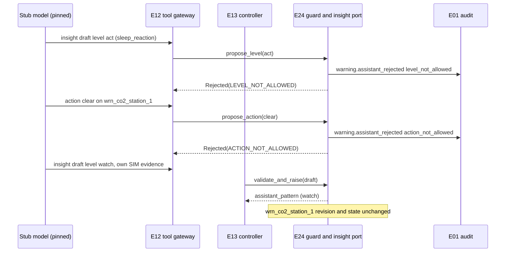

# E24: Warnings engine

Technical design for epic E24. Inputs: the brief (`tdd/E24.md` in the planning package), PRD.md 4.10, USE-CASES.md
(UC04 to UC07, UC11, UC16, UC17, UC21, UC25), CONTRACTS.md sections 1, 5, 11 to 14, 17 to 20, 25 and 26,
`api/openapi.yaml` (tag Warnings), `api/schemas/warning.schema.json`, `config-warning-rules.schema.json`, the examples
in `api/examples/warnings` and `api/examples/config`, `environment-hazards.json`, VALIDATION.md, `backlog.json` and
`docs/BUILD-CHARTER.md`. `docs/SYSTEM.md` and `docs/DEPLOYMENT.md` do not exist yet; every point that depends on them is
listed in section 14 (R-E24-11, R-E24-18). Package sections are cited as "C14" for CONTRACTS.md section 14.

Status: design. Every test named here is planned; none has run. Clinical content (levels, steps, limits) is an
unreviewed draft that needs clinician review before live guidance; this design carries it and changes none of it.

## 1. Scope

**Work packages.** E24-01 (record and lifecycle), E24-02 (rule and sensor-limit raisers), E24-03 (bounds on assistant
insights), E24-04 (To do warnings, Needs attention, the warning detail and the attention layer; built by stream D).

**Traces.** Requirements R36, R40, R43; evidence for R35, R39, R41. Validation V10, V32, V55, V56, V57, V58 (warning
part), V65, V69 (warning part), V70, V72, V74, V75 (warning part). Demo D16, D17, D19, D22 (the warnings the air-safety
line reads). Section 12.1 maps each acceptance item to its tests, owners and approval prerequisites.

**Decisions** (brief, "Decisions the TDD must settle"):

| # | Decision | Selected | Rejected and why |
|---|---|---|---|
| DE24-1 | Levels and words | `common.schema.json#/$defs/level`, ranked info < watch < act < emergency; words only from ui-copy `level_words` | Numeric severities; words in code (R43) |
| DE24-2 | Who raises each level | Matrix 3.4, enforced in the definition type, a loader check, the entity and a SQLite CHECK | Prompt instructions (charter 1.3) |
| DE24-3 | Clearing | Per kind (3.5); `clear_reason` from the closed enum; stale or unproven data never clears (3.6); configuration edits never clear a live hazard (3.8) | Timer clearing |
| DE24-4 | Hold during sleep and walks | Records are raised at once with their true time; only presentation is held, computed by the hub per person (3.12). Needs R-E24-1, a prerequisite for E24-04 done and V74 | Delaying the raise; client-computed hold (C19 forbids a screen computing a state) |
| DE24-5 | Insight bounds | Pure policy (3.13) before anything is stored; the warning takes its definition's level, loader-limited to info or watch | Trusting the model's level |
| DE24-6 | Answers to the engine | `answer` definitions fed by `AnswerAccepted` in the records owner's transaction | Help module or UI raising warnings |
| DE24-7 | Supersede without lowering | `level` immutable (domain plus trigger). Escalation clears lower with `superseded`; de-escalation raises a new lower warning after the higher clears (3.7) | Updating `level` in place |
| DE24-8 | Reaching every crew screen | Outbox `warning.*` events; the client reconciles a snapshot plus an ordered catch-up by revision (7.2); the shell mounts the attention layer on every crew screen | Polling; trusting each SSE event as current |
| DE24-9 | Stub model rejected cases | The assistant reaches warnings only through `AssistantWarningGuard` (4.2); both pinned stub proposals are rejected and audited | HTTP-only rejection (the assistant has no session) |
| DE24-10 | Vehicle alarm state | Read only, as mission events through `recordMissionEvent` (R-E24-9); no write port to any vehicle system (import-linter); no control labelled as acknowledging or silencing the vehicle | A vehicle adapter with acknowledge capability |

**Not delivered here** (owner): sensor ingest, aggregation, coverage, freshness, sensor formatting and `SensorStatus`
(E23); routine bindings including the post-storm tasks (E25); Someone needs help and the air-safety line (E26); insight
generation and the forbidden-output filter (E13, E12); the ground link state (E29); supply cover (E32); Today assembly
(views owner, provisionally E03); the event log, outbox, audit, idempotency store, template renderer, configuration
loader, clock and scheduler (E01); shelter attendance and the dose-rate panel of V58 (unassigned, R-E24-17).

## 2. Dependencies and seams

The producer owns the transaction; E24 handlers run inside it (C14 "in the same transaction"). The E01 bus dispatches
synchronously in registration order with reentrancy depth at most the E01 configured bound; a handler error rolls back
the producer's command. Input types are agreed in R-E24-14; until approved each side builds against the shapes in 4.3
and a shared fake in `hub/tests/contracts/rules_inputs.py` (owned by E24, read by producers' tests).

| Seam | Direction | Mechanism | Owner |
|---|---|---|---|
| Unit of work, connection, migrations, busy timeout | uses | `UnitOfWork` (E01) | E01 |
| Domain event bus | subscribes, publishes | `DomainEventBus.subscribe/publish` | E01 |
| Outbox, audit, idempotency store | writes | `Outbox.append`, `AuditLog.append`, `IdempotencyStore.get/put(uow, ...)` | E01 |
| Clock, mission clock, clock corrections | reads, subscribes | `Clock.now()`, `MissionClock.label(instant) -> (text, clock_version)`, `ClockCorrected`, `ClockRegressed` (R-E24-18) | E01 |
| Configuration | reads, registers checks | `ConfigReleaseReader.active()/.release(id)`, `LoaderCheckRegistry.register` | E01 |
| Template renderer | calls | `TemplateRenderer.render(field_key, template, values)` (unknown value: ui-copy `designed_states.unknown`, logged) | E01 |
| Scheduler | uses | `Scheduler.call_at(key, at, handler)`, idempotent by key | E01 |
| Health | sets | `HealthState.mark_degraded(component, code)` (in memory, served by `GET /v1/health` with no write) | E01 |
| Sensor inputs and state | subscribes, queries | `SensorEvaluated`, `ChannelFreshnessChanged`; `SensorStateQuery` | E23 |
| Mission inputs and state | subscribes, queries | `MissionEventRecorded`, `StateFactChanged`, `OverlayChanged`, `EnvironmentActivated`; `MissionStatePort` | E23 |
| Answers, records facts | subscribes, queries | `AnswerAccepted`; `RecordFactsPort`, `AnswerQuery` | E01 records |
| Ground link | subscribes, queries | `GroundLinkChanged`; `GroundLinkQuery` (only the `ground_silence` evaluator imports it) | E29 |
| Supply cover | subscribes, queries | `SupplyUseRecorded` (in transaction); `SupplyCoverFacts.rows(uow, environment_id)` (E32 4.3 signature plus `uow`, R-E24-14) | E32 |
| Insights | provides, queries | `InsightWarningPort`; `InsightQuery.active(uow)` for re-evaluation | E24, E13 |
| Assistant actions | provides | `AssistantWarningGuard` | E24 (consumers E12, E13) |
| Warning queries | provides | `WarningQueries` (4.2), including `active_shared_at_or_above(level)` for E26 (habitat and crew scope, R-E24-14) | E24 |
| Routine | publishes, receives | `WarningRaised`, `WarningCleared`; `WarningCommands.attach_routine_overrides` | E24, E25 |
| Sessions | reads | `Session(actor, person_id, roles)` | E02 |
| Crew app shell | mounts | `AttentionLayer.vue` on every crew screen; `BodyFigure` `alertRegions` | E03 (R-E24-18) |
| Help route | links | `help.start?entry=warning&ref=<warning_id>` | E26 |

## 3. Domain model

`crew_health/rules/domain/` is pure: frozen dataclasses and `StrEnum`s, no I/O, no clock reads. Generated Pydantic
models appear only at the API edge.

### 3.1 Vocabulary

`Level`, `RaisedBy`, `Scope`, `WarningState`, `ClearReason`, `ConditionKind`, `WarningAction` mirror the enums of
`warning.schema.json`, `common.schema.json` and `config-warning-rules.schema.json` exactly (a test compares them to the
contract copies). `Level.rank` is the declaration order. `ACTIVE = {raised, acknowledged}`; `FINAL = {cleared,
resolved, dismissed}`. `SPENT_REASONS = {condition_false, clear_event, expired}` plus the states `resolved` and
`dismissed`: a trigger whose warning ended this way never raises again (3.9). `superseded`, `config_changed` and
`environment_changed` are system clears and leave the trigger reusable.

### 3.2 Definitions

`WarningDefinition` is parsed once per release from `warning-rules.json` `definitions[]`, field for field, with two
derived hashes: `rule_hash` over every field except `content`, and `content_hash` over `content`. Construction enforces
DE24-2: `assistant` implies `level in {info, watch}` and kind `assistant_insight`; the two sensor kinds imply
`sensor_limit`; every other kind implies `rule`. Failure raises `DefinitionInvalid`, which the loader reports as a
`CONFIG_INVALID` finding.

### 3.3 Warning entity

`Warning` mirrors `warning.schema.json`, plus storage fields `scope_key`, `trigger` (3.9), `rule_hash`,
`content_hash` and `release_id_for_clearing` (the release whose rule governs clearing, 3.8). Hold is computed on read
(3.12), never stored. Transitions return a new value with `revision + 1`.

| Transition | Preconditions (typed error) | Effect |
|---|---|---|
| `raise_new` | Level allowed for raiser (`LevelNotAllowed`) | `raised`, revision 1, `raised_at` = the input's commit instant |
| `acknowledge(person, at)` | Active (`InvalidTransition`); actor can see it (`NotVisible`); person not yet in `acknowledgements` (`InvalidTransition`) | Appends `{person_id, at}`; `acknowledged`; nothing else changes |
| `add_note(person, at, text)` | Active; can see it; text within bounds (5.4) | Appends note |
| `clear(reason, at)` | Active; actor is `EngineActor` (never constructible from a session or the assistant) | `cleared`, `cleared_at`, `clear_reason` |
| `resolve(person, at, reason)` | Active; `raised_by == rule`; `clear.person_may_resolve`; can see it; reason non empty | `resolved` |
| `dismiss(person, at, reason)` | Active; `raised_by == assistant` (`ActionNotAllowed`); actor is `person_id` | `dismissed` |

No transition changes `level`, `raised_by`, `definition_id`, `scope_key`, `trigger`, `evidence`, `steps`, `raised_at`
or `origin_mode`. Final states have no outgoing transition.

**Warning ID.** `"wrn_" + base32_lower(sha256(f"{definition_id}|{scope_key}|{raise_seq}"))[:20]`, `raise_seq` = 1 +
earlier warnings for `(definition_id, scope_key)`, computed inside the write transaction (writes are serialized, 5.1).
Deterministic so the same release, state and clock give byte-identical views (C20).

### 3.4 Raiser policy (DE24-2)

| Level | `rule` | `sensor_limit` | `assistant` | A person |
|---|---|---|---|---|
| `info`, `watch` | yes | yes | yes | only through a rule on their answer |
| `act`, `emergency` | yes | yes | never (`LEVEL_NOT_ALLOWED`) | only through a rule on their answer (Someone needs help is E26, not a Warning) |

Enforced in `WarningDefinition`, loader check 5, `Warning.raise_new` and a SQLite CHECK. `AssistantActor` is accepted
by no transition. Dismissing an assistant warning is the person's act.

### 3.5 Engine semantics per condition kind

`engine.evaluate(inp: RuleInput, view: EngineView) -> Decision` (types in 4.3). `EngineView` is a read-only snapshot
built by the application layer: definitions of the active environment, active warnings with their governing rule,
last limit results per channel, dwell markers, spent triggers for the keys touched, the mission mode. The engine raises
only definitions whose `environments` include the active environment and never a second active warning for a
`(definition_id, scope_key)`.

| Kind | Input | Scope key | Raise when | Evidence, `evidence_time` | Clear when (`clear_reason`) |
|---|---|---|---|---|---|
| `sensor_limit` | `SensorEvaluated` | `channel_id` | Result for `limit_id` has `crossed is True`, limit `active` with role `warning`, and the escalation rule (3.7) allows it | `reading` at window end E; E | Clear condition proved continuously for `dwell_seconds` (3.6, `condition_false`); a higher level raised in the group (`superseded`) |
| `sensor_quiet` | `ChannelFreshnessChanged` to `stale` | `channel_id` | Sensor type in `sensor_type_ids` (empty: any of the environment); `never_reported` raises nothing | `reading`, last accepted; `stale_since` | Freshness back to `current` (`condition_false`) |
| `mission_event` | `MissionEventRecorded` | habitat: event `location` or `environment:<id>`; person: each of `person_ids`; crew: `""` | `event_type in event_types` and no clear event for the same key with a later `occurred_at` (3.9) | `mission_event`; `occurred_at` | A clear event for the same key with `occurred_at` strictly later than the warning's `evidence_time` (`clear_event`); `expires_after_seconds` (`expired`, 3.11) |
| `answer` | `AnswerAccepted` | `person_id` | `question_id` and `presence` match; with `within_days_after_event`, the latest event of that type naming the person or nobody satisfies `0 <= answered_at - occurred_at <= days x 86400 s` (3.11 for corrections) | `answer`; `answered_at` | Only `resolve` (when `person_may_resolve`) or `expired`; a later answer never clears it |
| `state_fact` | `StateFactChanged` | habitat `environment:<id>`, crew `""` | value `== equals` | `state_fact`; fact `at` | value `!= equals` (`condition_false`) |
| `assistant_insight` | `InsightWarningPort` | `person_id` | Insight valid (3.13), topic listed, topic's `warning_definition_id` is this definition | `insight` plus the insight's evidence; `created_at` | Person dismisses insight or warning (`dismissed`, both); insight expires or `expires_after_seconds` (`expired`) |
| `ground_silence` | `GroundLinkChanged`, deadline | `""` | `down`, `next_contact_at` set, threshold not null, clock past `next_contact_at + threshold` | interim none (R-E24-4); `next_contact_at + threshold` | Link `up` or `delayed`, or `next_contact_at` moved later (`condition_false`); never by a clock correction |
| `supply_cover_low` | `SupplyUseRecorded`, release or environment activation | `supply_id` (R-E24-3) | `below_uses` not null, `cover_uses` not null and `< below_uses` | `supply_use` that changed cover, else interim none (R-E24-4); the use's time, else activation instant | `cover_uses` not null and `>= below_uses` (`condition_false`). `null` cover changes nothing: it is unknown, not recovery and never zero |

A `null` threshold raises nothing and is never replaced by a number in code. Environment activation clears active
warnings whose definition excludes the new environment (`environment_changed`), then re-evaluates (UC-R8). Release
activation follows 3.8.

### 3.6 Dwell continuity (sensor limits)

Package rule: the clear condition "must hold continuously for `dwell_seconds` of `observed_at` time"; "`latest` has no
coverage"; "stale data never clears" (C13). Continuity is proved, never assumed:

- **Evidence.** One `SensorEvaluated` per accepted reading that moves the window end E (C13: an older reading does not
  move E). Each carries, per limit, `clear_holds: bool | None` (`None` when coverage is below `min_coverage`, computed
  by E23) and the channel's `stale_after_seconds` (catalog or channel, with its basis).
- **Permitted gap.** Two consecutive evaluations are continuous only when `E_next - E_prev <= stale_after_seconds` of
  that channel. For `latest`, this gap rule is the whole proof; for window aggregations coverage is proved by E23 too.
- **Marker.** `rules_dwell(warning_id, holding_since, last_window_end)`, written in the reading's transaction.
- **Step.** For an active warning's limit on evaluation E: `E <= last_window_end` (same E re-evaluated after a late
  reading): `clear_holds is True` changes nothing, anything else deletes the marker. Gap above the bound: delete, then
  continue as a first evaluation. `clear_holds is True`: create `(E, E)` or advance `last_window_end`; clear when
  `E - holding_since >= dwell_seconds`. `False` or `None`: delete.
- **Resets.** `ChannelFreshnessChanged` to `stale`; a rule change of the definition or its limit (3.8); E23 reporting
  the channel not `current` at startup (5.3).
- **Fast replay** clears on `observed_at` time only when every gap is within the bound; downtime or a replay hole above
  the bound restarts the dwell.

### 3.7 Escalation (DE24-7)

The package raises "once per definition and channel" and clears "active lower-level warnings for that sensor type and
channel" when a higher level raises (C13). The group is `(sensor_type_id, channel_id)`.

1. **Equal levels coexist.** `oxygen_low_act` (twa_1h below 127) and `oxygen_high_act` (latest above 356) can both hold
   at once; both raise and neither supersedes the other.
2. **Escalation.** A crossed definition whose level is above every active warning of the group raises; in the same
   decision the active lower ones clear `superseded` and the new warning's `previous_warning_id` names the highest of
   them.
3. **Lower crossing while a higher one is active.** Not raised: under the package rule it would be superseded by the
   active higher warning at once, and raising it would flap every evaluation. Clarification request R-E24-19.
4. **De-escalation.** When the higher clears by its own dwell, the same decision raises every still-crossed definition
   at the highest remaining level, linked by `previous_warning_id`. A level never drops in place.
5. **Several crossed in one evaluation.** Raise the highest level crossed (all definitions at that level).

`sensor_quiet` is outside the group. Rule-kind definitions are never grouped.

### 3.8 Configuration activation and live hazards (UC-R9)

The package clears only "a warning whose definition is gone" (C11 "Versions and releases"). A configuration edit never
clears a live hazard otherwise:

| Change between releases (per definition id) | Effect on its active warnings |
|---|---|
| Removed, or its `environments` no longer include the active one | Clear `config_changed` (package rule) |
| `content_hash` only | None. Stored words stay as raised under their pinned `config_release_id`; new raises use the new content |
| `rule_hash` (condition, clear, level, scope semantics) | Warning stays active and keeps its level. Clearing follows the new rule from activation on: `release_id_for_clearing` moves to the new release, dwell markers reset, pending expiry keeps its due time. If the new level is higher and the new condition holds now, escalation (3.7 step 2) supersedes it; if lower, it stays until it clears, then the lower raises (3.7 step 4) |
| `condition.kind`, `scope` or `raised_by` changed | Treated as removal (the definition the warning was raised under is gone) and R-E24-10 asks the loader to refuse such a release |

Routine overrides follow the warning: E25 ends bindings only on `warning_cleared`, so a kept warning keeps them. After
the table is applied the engine re-evaluates every definition from current state (4.2 queries) and raises only where no
active warning exists and the trigger is not spent (3.9). An acknowledged, stale or insufficient-coverage warning is
therefore unchanged by content and threshold edits (T-E24-013 to 015).

### 3.9 Occurrence identity

Each raise records `trigger = (kind, ref)`:

| Kind | Trigger ref |
|---|---|
| `sensor_limit` | `reading_id` at E |
| `sensor_quiet` | `channel_id` and `stale_since` |
| `mission_event` | `event_id` |
| `answer` | `answer_id` |
| `state_fact` | `cause_event_id` |
| `assistant_insight` | `insight_id` |
| `ground_silence` | `next_contact_at` |
| `supply_cover_low` | `supply_use_id`, else `config_release_id:environment_id` |

A raise is refused (decision `Refuse(code="trigger_spent")`, audited, nothing shown) when a warning for the same
`(definition_id, scope_key, trigger)` ended in a spent way (3.1). Replays of an input, re-evaluation after activation
and repeated deliveries therefore never resurrect a resolved answer, a dismissed insight or a cleared event. A
mission-event raise is refused (`clear_later`) when a clear event for the key has a strictly later `occurred_at`; equal
times keep the warning (fail safe). Causality uses `occurred_at`, never `recorded_at` (C1: a late arrival is not a fresh
event). R-E24-9 proposes an explicit `relates_to_event_id`; until then time order decides.

### 3.10 Visibility and allowed actions

| Scope | `crew`, `crew_medical_officer` | `station`, `ground`, `operator`, `adapter`, `editor` |
|---|---|---|
| `person` | only `session.person_id == person_id` | no |
| `habitat`, `crew` | yes | yes |

An invisible warning returns `404 NOT_FOUND`. `allowed_actions` (hub computed): `acknowledge` (crew roles, visible,
active, not yet acknowledged by this person); `add_note` (crew roles, visible, active); `resolve` (as `add_note`, `rule`,
`person_may_resolve`); `dismiss` (`assistant`, active, own). Other roles get `[]` (`actOnWarning` `x-roles`).

### 3.11 Time

| Use | Time base | Correction policy |
|---|---|---|
| Dwell, sensor causality | `observed_at` of readings | Unaffected by hub clock corrections |
| Mission-event causality, answer windows | `occurred_at`, `answered_at` as recorded | Stored instants are used as recorded. When E01 reports a correction between the two instants, the window test runs on both the recorded and the corrected difference and raises if either satisfies it (uncertainty fails toward raising, which is the person's own `watch` or the configured level) |
| Expiry (`expires_after_seconds`) | Hub UTC from `raised_at` | A duration: on `ClockCorrected(delta)` every pending expiry shifts by `delta`, so a forward jump never expires early and a backward jump never extends |
| Ground silence | Hub UTC against the absolute `next_contact_at` | Not shifted; re-evaluated at once. A forward correction may raise (safe direction); a backward one never clears (only the C26 clear conditions clear it) |
| `evidence_time_label` | Mission time HH:MM under the active `clock_version`, or replay time (C11) | Stored at raise; a mission clock version change never rewrites stored labels; new raises use the new version |
| Restart | Scheduler reloads deadlines; past due fire at once | If E01 reports `ClockRegressed` (clock earlier than its committed high-water mark), expiry clears are suspended until `ClockCorrected`; raises continue |

### 3.12 Hold during sleep and walks (DE24-4, V74)

Two lifecycles are separate. The **warning lifecycle** (3.3) never waits. The **presentation lifecycle** decides when a
person is interrupted. Interrupting means: the attention layer moves focus, uses `role="alert"`, and shows a new item.
A list row or an already shown banner is not an interruption.

Rule (PRD 4.10 "During sleep and spacewalks only emergencies interrupt", V74): for the session person, a warning is
**held** when its level is not `emergency` and its `raised_at` falls in a hold span: a maximal interval in which at
least one of the person's overlays listed in routine-rules `suppressed_overlays` (C12: "always sleep and eva") is
active; overlapping or touching overlays (sleep, then a walk) merge into one span. The hub computes it (`hold.spans`,
`hold.held(warning, spans)`), pure over ActivityOverlay records.

- Preexisting warnings (raised before the span) were presented when raised and are never re-presented during it.
- Acknowledging a held warning (from another device) removes it from the person's summary.
- A warning that clears while held stays in the summary with its clear reason; a held warning is shown after the span
  with its original `raised_at` and `evidence_time_label`.
- `emergency` is never held. Non-person sessions are never held: the shared habitat screen speaks for those awake.

Exposure needs R-E24-1 (`held` on the session projection and Today `held_summary`). That approval is an
**implementation prerequisite** for E24-04 done and for V74; no client computes hold. Until approved, nothing is held
(more interruption, never less) and V74 is reported as blocked on R-E24-1, not as covered.

### 3.13 Insight bounds (DE24-5, R40, V10, V65, D17)

`insight_bounds.validate(draft: InsightDraft, facts: Mapping[EvidenceKey, RecordFacts], policy: AssistantPolicy) ->
tuple[Violation, ...]`; empty means valid.

| Code | Rule (C17 validation rule) |
|---|---|
| `level_not_allowed` | `draft.level` not in `policy.allowed_warning_levels` |
| `topic_unknown` | topic not in `policy.insight_topics` |
| `evidence_empty`, `evidence_kind` | no entry; kind outside observation, answer, daily_check, routine_occurrence |
| `evidence_not_found`, `evidence_other_person` | record missing; owner differs from `draft.person_id` |
| `evidence_replay` | record `origin_mode` REPLAY, or a sensor reading or channel |
| `evidence_not_accepted` | observation not `accepted`; daily check not `submitted`; occurrence not `done` |
| `evidence_origin_mixed` | entries not all in the person's namespace origin |
| `habitat_fact_text` | a habitat fact carries model text |
| `action_count` | more than one routine occurrence |

Any violation: E13 stores nothing and adds a `notice`; E24 audits `insight.rejected` with codes only.

### 3.14 Vehicle alarms (DE24-10, V57)

The vehicle's caution and warning system is the authority; the app repeats and never annunciates or controls. Vehicle
alarm state enters only as mission events (`vehicle_alarm_sounding`, `vehicle_alarm_ended`, R-E24-9) recorded by an
adapter session or a crew member, raising a crew-scope `mission_event` definition in `config/warning-rules.json` (E24
owns the deployment document) whose `listed` steps start with the vehicle procedure line, basis `team default`.
Acknowledging records that a person saw the app's message; no control is labelled as acknowledging or silencing the
vehicle (words from R-E24-2); no hub module has an outbound vehicle port (`rules-no-vehicle-write`). No definition,
template or word list may state the vehicle or its air is safe (loader check, R-E24-10).

### 3.15 Invariants

| ID | Invariant | Tests |
|---|---|---|
| INV-E24-01 | Every warning has a level, `raised_by`, non-empty steps, regions from the fixed set and a citation | 001, 040 |
| INV-E24-02 | `assistant` implies info or watch | 002, 003, 061 |
| INV-E24-03 | No assistant actor acts on any warning; no actor dismisses a rule or sensor warning | 004, 005, 062 |
| INV-E24-04 | `level` never changes after storage | 006, 022 |
| INV-E24-05 | One active warning per `(definition_id, scope_key)`; within a sensor group no active warning below the group's highest active level | 007, 018 to 021 |
| INV-E24-06 | Acknowledging keeps the warning active and unchanged except acknowledgements | 008, 050 |
| INV-E24-07 | Stale, never-reported, insufficient, gapped or out-of-order data never clears | 024 to 026, 045 to 049 |
| INV-E24-08 | Final is final; a spent trigger never raises again; a new occurrence gets a new ID | 009, 035 to 038 |
| INV-E24-09 | A person warning's evidence shares the person's namespace origin; REPLAY never raises a person warning | 030, 031 |
| INV-E24-10 | Nothing raises or clears from a forecast, a model output other than a valid insight, or the link outside `ground_silence` | 032 to 034 |
| INV-E24-11 | Raise and clear commit with their input, outbox event and audit event | 070 to 072, 106 to 108 |
| INV-E24-12 | Every word and number comes from the active (or pinned) release or hub state | 090 to 093, 114 |
| INV-E24-13 | A person warning is visible only to that person | 051, 052 |
| INV-E24-14 | A null threshold raises nothing; a null cover changes nothing | 027, 028, 065 |
| INV-E24-15 | A configuration edit clears an active warning only when its definition is gone | 013 to 017 |

## 4. Application layer

### 4.1 Use cases

| ID | Use case | Input, output | Errors | Idempotency |
|---|---|---|---|---|
| UC-R1 | `ApplyRuleInput` | one input (4.3) in the producer's `uow`; `tuple[WarningChange, ...]` | `RulesInternalError`, `StorageUnavailable` (roll back the producer) | Active unique index plus spent triggers (3.9) |
| UC-R2 | `ActOnWarning` | session, id, body, `If-Match`, `Idempotency-Key`; `Warning` | 6.2 | Order below |
| UC-R3, R4 | `ListWarnings`, `GetWarning` | session, filters; page or `Warning` with ETag | 6.2 | read |
| UC-R5 | `ValidateAndRaiseFromInsight` | `uow`, `InsightDraft`; `Warning or None` | `InsightRejected` | as UC-R1 |
| UC-R6 | `OnInsightDismissed`, `OnInsightExpired` | `uow`, `insight_id` | none | no-op when final |
| UC-R7 | `AttachRoutineOverrides` | `uow`, id, override ids | `InvalidTransition` when final | set union |
| UC-R8 | `OnEnvironmentActivated` | `uow`, profile | none | deterministic |
| UC-R9 | `OnReleaseActivated` | `uow`, old and new release | none | deterministic (3.8) |
| UC-R10 | `RunDeadline` | `uow`, key | none | fired key deleted in the same transaction |
| UC-R11 | `OnClockCorrected`, `OnClockRegressed` | `uow`, delta | none | keyed by correction id |
| UC-R12 | `AssistantWarningGuard.propose_*` | proposal; `Rejected` or `Allowed` (level only) | `LEVEL_NOT_ALLOWED`, `ACTION_NOT_ALLOWED` | audit only |

**`ActOnWarning` order.** (1) Authenticate and check role in `x-roles` (`UNAUTHORIZED_SCOPE`). (2) Parse the body
(`MALFORMED_REQUEST`, interim 6.2). (3) Idempotency lookup by `(actor, key)` before any mutable precondition: same body
hash returns the stored first result byte for byte (status, body, ETag), even when the revision has since moved;
different body returns `DUPLICATE_COMMAND`. (4) `BEGIN IMMEDIATE` (serializes competing writers), then repeat the lookup
inside the transaction so two concurrent same-key requests yield one execution. (5) Visibility (`NOT_FOUND`). (6)
`If-Match` present (`VERSION_REQUIRED`) and equal (`STALE_VERSION` with `current_state`). (7) Action allowed
(`ACTION_NOT_ALLOWED` for an actor kind that may never take it, `INVALID_TRANSITION` for state). (8) Write the warning,
outbox, audit and the idempotency record of the 200 response in one commit. Only successes are stored: a rejected
command writes nothing and a retry recomputes the same rejection. `Config-Release` is recorded in the audit event and
otherwise ignored in the interim (the operation documents no `CONFIG_VERSION_MISMATCH`; allowed actions are always
computed against the active release; R-E24-13).

### 4.2 Ports (`crew_health/rules/application/ports.py`)

```python
class WarningRepository(Protocol):
    def get(self, uow: UnitOfWork, warning_id: str) -> Warning | None: ...
    def active(self, uow: UnitOfWork) -> Sequence[Warning]: ...
    def active_for_key(self, uow: UnitOfWork, definition_id: str, scope_key: str) -> Warning | None: ...
    def spent(self, uow: UnitOfWork, definition_id: str, scope_key: str, trigger: TriggerRef) -> bool: ...
    def next_raise_seq(self, uow: UnitOfWork, definition_id: str, scope_key: str) -> int: ...
    def insert(self, uow: UnitOfWork, warning: Warning) -> None: ...                     # DuplicateActive
    def update(self, uow: UnitOfWork, warning: Warning, *, expected_revision: int) -> None: ...  # StaleRevision
    def page(self, uow: UnitOfWork, *, visible_to: SessionScope, state: Literal["active", "all"],
             cursor: str | None, limit: int) -> Page[Warning]: ...

class DwellRepository(Protocol):
    def get(self, uow: UnitOfWork, warning_id: str) -> DwellMarker | None: ...
    def put(self, uow: UnitOfWork, marker: DwellMarker) -> None: ...
    def delete(self, uow: UnitOfWork, warning_id: str) -> None: ...

# Required of producers (R-E24-14); E24 tests use fakes with these exact signatures.
class SensorStateQuery(Protocol):                  # E23
    def last_results(self, uow: UnitOfWork, channel_id: str) -> SensorEvaluatedInput | None: ...
    def freshness(self, uow: UnitOfWork, channel_id: str) -> Literal["current", "stale", "never_reported"]: ...
    def channels(self, uow: UnitOfWork) -> Sequence[str]: ...
class MissionStatePort(Protocol):                  # E23
    def mission_mode(self, uow: UnitOfWork) -> OriginMode: ...
    def active_environment_id(self, uow: UnitOfWork) -> str: ...
    def overlays(self, uow: UnitOfWork, person_id: str, since: datetime) -> Sequence[OverlayFact]: ...
    def latest_event(self, uow: UnitOfWork, event_types: Sequence[str], scope_key: str,
                     at_or_before: datetime | None) -> MissionEventInput | None: ...
    def state_facts(self, uow: UnitOfWork) -> Sequence[StateFactInput]: ...
class RecordFactsPort(Protocol):                   # E01 records
    def facts(self, uow: UnitOfWork, keys: Sequence[EvidenceKey]) -> Mapping[EvidenceKey, RecordFacts]: ...
class AnswerQuery(Protocol):                       # E01 records, for re-evaluation
    def latest(self, uow: UnitOfWork, question_id: str, person_id: str) -> AnswerInput | None: ...
class InsightQuery(Protocol):                      # E13
    def active(self, uow: UnitOfWork) -> Sequence[InsightDraft]: ...
class GroundLinkQuery(Protocol):                   # E29
    def current(self, uow: UnitOfWork) -> GroundLinkInput: ...
class SupplyCoverFacts(Protocol):                  # E32 (E32 4.3 plus uow)
    def rows(self, uow: UnitOfWork, environment_id: str) -> tuple[CoverFact, ...]: ...

# Provided by E24
class WarningQueries(Protocol):
    def list(self, session: Session, state: Literal["active", "all"], cursor: str | None, limit: int) -> Page[WarningView]: ...
    def get(self, session: Session, warning_id: str) -> WarningView: ...
    def headline(self, session: Session) -> HeadlineView: ...
    def count_active_visible(self, session: Session) -> int: ...
    def held_summary(self, session: Session) -> HeldSummary | None: ...          # after R-E24-1
    def active_shared_at_or_above(self, level: Level) -> Sequence[WarningView]: ...  # habitat and crew scope (E26)
    def visible(self, session: Session, warning_id: str) -> bool: ...            # E26 WarningRefPort
class WarningCommands(Protocol):
    def act(self, session: Session, warning_id: str, body: WarningActionBody, *, if_match: int,
            idempotency_key: str, config_release: str | None) -> WarningView: ...
    def attach_routine_overrides(self, uow: UnitOfWork, warning_id: str, override_ids: Sequence[str]) -> None: ...
class InsightWarningPort(Protocol):
    def validate_and_raise(self, uow: UnitOfWork, draft: InsightDraft) -> Warning | None: ...  # InsightRejected
    def on_insight_dismissed(self, uow: UnitOfWork, insight_id: str, actor: PersonActor) -> None: ...
    def on_insight_expired(self, uow: UnitOfWork, insight_id: str) -> None: ...
class AssistantWarningGuard(Protocol):
    def propose_level(self, uow: UnitOfWork, ctx: AssistantContext, level: Level, topic_id: str | None) -> Rejected | Allowed: ...
    def propose_action(self, uow: UnitOfWork, ctx: AssistantContext, warning_id: str, action: str) -> Rejected: ...
```

`propose_action` has no success type. Every rejection audits `warning.assistant_rejected` with codes and IDs only.
E12 routes any tool call or output proposing a warning action or a level above watch to the guard before its
forbidden-output filter discards the output (`MODEL_OUTPUT_REJECTED`).

### 4.3 Typed inputs and decisions (`rules/domain/inputs.py`, `decisions.py`)

Producers' events are mapped to these in `rules/application/subscriptions.py` (anti-corruption layer). Every quantity
is a `Quantity(value: Decimal, unit: str)` with a UCUM unit; every instant is an aware UTC `datetime`.

```python
@dataclass(frozen=True)
class LimitResult:
    limit_id: str; crossed: bool | None; clear_holds: bool | None
    value: Quantity | None; coverage: Decimal | None          # None for latest (no coverage)
@dataclass(frozen=True)
class SensorRenderFacts:                                       # formatted by E23 from the catalog
    sensor_name: str; value_text: str; unit: str; unit_display: str; aggregation_label: str
    limit_value_text: str; location_label: str | None; source_label: str; last_received_time: str | None
    replay_dataset: str | None
@dataclass(frozen=True)
class SensorEvaluatedInput:
    config_release_id: str; sensor_type_id: str; channel_id: str; location: str | None
    origin_mode: OriginMode; window_end: datetime; reading_id: str; stale_after_seconds: int
    results: tuple[LimitResult, ...]; render: SensorRenderFacts
@dataclass(frozen=True)
class FreshnessInput:
    channel_id: str; sensor_type_id: str; state: Literal["current", "stale"]; stale_since: datetime | None
    last_reading_id: str | None; origin_mode: OriginMode; render: SensorRenderFacts
@dataclass(frozen=True)
class MissionEventInput:
    event_id: str; event_type: str; occurred_at: datetime; recorded_at: datetime; origin_mode: OriginMode
    environment_id: str; person_ids: tuple[str, ...]; location: str | None
@dataclass(frozen=True)
class StateFactInput:
    fact: str; value: bool; environment_id: str; at: datetime; cause_event_id: str; origin_mode: OriginMode
@dataclass(frozen=True)
class AnswerInput:
    answer_id: str; person_id: str; question_id: str; presence: str; answered_at: datetime
    origin_mode: OriginMode; day_label: str; time_label: str
@dataclass(frozen=True)
class GroundLinkInput:
    status: Literal["up", "delayed", "down"]; next_contact_at: datetime | None; source: str
    environment_id: str; gap_planned: bool
@dataclass(frozen=True)
class CoverFact:                                               # E32 CoverFact
    supply_id: str; supply_name: str; cover_uses: int | None; quantity_text: str; per_use_text: str | None
    last_use_id: str | None; last_use_at: datetime | None
@dataclass(frozen=True)
class SupplyCoverInput:
    environment_id: str; cause: Literal["use", "release", "environment"]; rows: tuple[CoverFact, ...]
@dataclass(frozen=True)
class EvidenceKey:
    kind: Literal["observation", "answer", "daily_check", "routine_occurrence"]; ref_id: str
@dataclass(frozen=True)
class RecordFacts:                                             # facts only, never content
    exists: bool; owner_person_id: str | None; origin_mode: OriginMode | None; is_sensor: bool
    quality_status: str | None; state: str | None; observed_at: datetime | None; summary: str | None
@dataclass(frozen=True)
class InsightDraft:
    insight_id: str; person_id: str; topic_id: str; level: Level; title: str; text: str; why: str
    headline_fragment: str; steps: tuple[str, ...]; body_region: str | None
    evidence: tuple[EvidenceKey, ...]; habitat_reading_ids: tuple[str, ...]; habitat_fact_text_present: bool
    routine_occurrence_ids: tuple[str, ...]; origin_mode: OriginMode; created_at: datetime; model_release_id: str
@dataclass(frozen=True)
class ActivationInput:
    kind: Literal["release", "environment"]; old_release_id: str; new_release_id: str; environment_id: str
@dataclass(frozen=True)
class DeadlineInput:
    key: str; due_at: datetime

RuleInput = (SensorEvaluatedInput | FreshnessInput | MissionEventInput | StateFactInput | AnswerInput
             | GroundLinkInput | SupplyCoverInput | ActivationInput | DeadlineInput)

@dataclass(frozen=True)
class TriggerRef: kind: ConditionKind; ref: str
@dataclass(frozen=True)
class Raise:
    definition_id: str; scope_key: str; trigger: TriggerRef; evidence: tuple[EvidenceRef, ...]
    evidence_time: datetime; origin_mode: OriginMode; render: RenderValues; supersedes: tuple[str, ...]
@dataclass(frozen=True)
class Clear: warning_id: str; reason: ClearReason
@dataclass(frozen=True)
class PutDwell: warning_id: str; holding_since: datetime; last_window_end: datetime
@dataclass(frozen=True)
class DeleteDwell: warning_id: str
@dataclass(frozen=True)
class ScheduleDeadline: key: str; due_at: datetime
@dataclass(frozen=True)
class CancelDeadline: key: str
@dataclass(frozen=True)
class Refuse:
    definition_id: str; scope_key: str
    code: Literal["trigger_spent", "clear_later", "origin_mismatch", "stale_release"]
Decision = tuple[Raise | Clear | PutDwell | DeleteDwell | ScheduleDeadline | CancelDeadline | Refuse, ...]
```

An input computed under a release other than the active one is refused (`stale_release`, audited); E23 re-evaluates
after activation. `Refuse` writes an audit event and nothing else.

Published in transaction: `WarningRaised(warning)` (E25 bindings, E11), `WarningCleared(warning)` (E25, E29).

### 4.4 Outbox events (C18)

`warning.raised` on insert; `warning.updated` on acknowledge, note, overrides attached; `warning.cleared` on clear,
resolve, dismiss. Scope is the warning's; `person_id` only for person scope. Data is the stored Warning with
`allowed_actions: []` and (after R-E24-1) `held: null`; clients fetch their projection.

### 4.5 Principal success path (UC04, V55, D16)

```mermaid
sequenceDiagram
    participant A as CO2 replay adapter
    participant M as E23 ingest and monitor
    participant R as E24 rule engine
    participant RT as E25 routine
    participant O as E01 outbox
    participant C as Crew app (laptop, tablets)
    A->>M: POST /v1/adapters/{id}/readings
    M->>R: SensorEvaluated(co2, ch_co2_cabin_replay, co2_1h_act crossed) same transaction
    R->>R: raise co2_above_limit (act, sensor_limit, REPLAY)
    R->>O: warning.raised + audit
    R->>RT: WarningRaised
    RT->>R: attach_routine_overrides(...)
    R->>O: warning.updated
    Note over M,O: one commit
    O-->>C: SSE warning.raised, warning.updated, routine.override_changed
    C->>C: reconcile by revision; banner on every crew screen; To do lists it
```

### 4.6 Failure path: the assistant tries "Act now" and to clear the CO2 warning (V65, D17, stub)



## 5. Adapters

### 5.1 Storage (SQLite, STRICT, WAL, foreign keys; `rules/adapters/migrations/0001_rules.sql`)

```sql
CREATE TABLE rules_warning (
  warning_id TEXT PRIMARY KEY,
  revision INTEGER NOT NULL CHECK (revision >= 1),
  definition_id TEXT NOT NULL, raise_seq INTEGER NOT NULL CHECK (raise_seq >= 1),
  config_release_id TEXT NOT NULL, release_id_for_clearing TEXT NOT NULL,
  rule_hash TEXT NOT NULL, content_hash TEXT NOT NULL,
  trigger_kind TEXT NOT NULL, trigger_ref TEXT NOT NULL,
  level TEXT NOT NULL CHECK (level IN ('info','watch','act','emergency')),
  raised_by TEXT NOT NULL CHECK (raised_by IN ('rule','sensor_limit','assistant')),
  hazard_id TEXT, limit_id TEXT, sensor_type_id TEXT, channel_id TEXT,
  scope TEXT NOT NULL CHECK (scope IN ('habitat','person','crew')),
  scope_key TEXT NOT NULL, person_id TEXT, environment_id TEXT NOT NULL, location TEXT,
  origin_mode TEXT NOT NULL CHECK (origin_mode IN ('LIVE','REPLAY','SIM')),
  title TEXT NOT NULL, what TEXT NOT NULL, why TEXT NOT NULL,
  steps_json TEXT NOT NULL CHECK (json_array_length(steps_json) >= 1),
  body_regions_json TEXT NOT NULL, headline_json TEXT NOT NULL, evidence_json TEXT NOT NULL,
  evidence_time TEXT NOT NULL, evidence_time_label TEXT NOT NULL, citation_json TEXT NOT NULL,
  insight_id TEXT,
  state TEXT NOT NULL CHECK (state IN ('raised','acknowledged','cleared','resolved','dismissed')),
  raised_at TEXT NOT NULL, cleared_at TEXT,
  clear_reason TEXT CHECK (clear_reason IS NULL OR clear_reason IN
    ('condition_false','clear_event','expired','superseded','environment_changed','config_changed')),
  resolved_json TEXT, dismissed_json TEXT,
  previous_warning_id TEXT REFERENCES rules_warning(warning_id),
  routine_override_ids_json TEXT NOT NULL DEFAULT '[]',
  CHECK (raised_by <> 'assistant' OR level IN ('info','watch')),
  CHECK (raised_by = 'assistant' OR (state <> 'dismissed' AND dismissed_json IS NULL)),
  CHECK (raised_by <> 'sensor_limit' OR sensor_type_id IS NOT NULL),
  CHECK (scope <> 'person' OR person_id IS NOT NULL),
  CHECK ((state = 'cleared') = (clear_reason IS NOT NULL AND cleared_at IS NOT NULL)),
  CHECK ((state = 'resolved') = (resolved_json IS NOT NULL)),
  UNIQUE (definition_id, scope_key, raise_seq)
) STRICT;
CREATE UNIQUE INDEX rules_warning_one_active ON rules_warning(definition_id, scope_key)
  WHERE state IN ('raised','acknowledged');
CREATE INDEX rules_warning_trigger ON rules_warning(definition_id, scope_key, trigger_kind, trigger_ref);
CREATE INDEX rules_warning_active ON rules_warning(state, environment_id) WHERE state IN ('raised','acknowledged');
CREATE INDEX rules_warning_person ON rules_warning(person_id, state);
CREATE INDEX rules_warning_group ON rules_warning(sensor_type_id, channel_id, state);
CREATE INDEX rules_warning_insight ON rules_warning(insight_id);

CREATE TRIGGER rules_warning_immutable BEFORE UPDATE ON rules_warning
WHEN NEW.level <> OLD.level OR NEW.raised_by <> OLD.raised_by OR NEW.definition_id <> OLD.definition_id
  OR NEW.scope_key <> OLD.scope_key OR NEW.trigger_ref <> OLD.trigger_ref OR NEW.raised_at <> OLD.raised_at
  OR NEW.evidence_json <> OLD.evidence_json OR NEW.steps_json <> OLD.steps_json OR NEW.origin_mode <> OLD.origin_mode
  OR OLD.state IN ('cleared','resolved','dismissed') OR NEW.revision <> OLD.revision + 1
BEGIN SELECT RAISE(ABORT, 'rules_warning immutable field or final state'); END;
CREATE TRIGGER rules_warning_no_delete BEFORE DELETE ON rules_warning
BEGIN SELECT RAISE(ABORT, 'rules_warning is append only'); END;

CREATE TABLE rules_warning_ack (warning_id TEXT NOT NULL REFERENCES rules_warning(warning_id),
  person_id TEXT NOT NULL, at TEXT NOT NULL, PRIMARY KEY (warning_id, person_id)) STRICT;
CREATE TABLE rules_warning_note (warning_id TEXT NOT NULL REFERENCES rules_warning(warning_id),
  seq INTEGER NOT NULL, actor_json TEXT NOT NULL, at TEXT NOT NULL, text TEXT NOT NULL,
  PRIMARY KEY (warning_id, seq)) STRICT;
CREATE TABLE rules_dwell (warning_id TEXT PRIMARY KEY REFERENCES rules_warning(warning_id),
  channel_id TEXT NOT NULL, holding_since TEXT NOT NULL, last_window_end TEXT NOT NULL,
  CHECK (last_window_end >= holding_since)) STRICT;
CREATE TABLE rules_deadline (deadline_key TEXT PRIMARY KEY,   -- 'expire:<warning_id>' or 'ground_silence:<definition_id>'
  due_at TEXT NOT NULL, kind TEXT NOT NULL CHECK (kind IN ('expire','ground_silence')),
  warning_id TEXT REFERENCES rules_warning(warning_id), definition_id TEXT) STRICT;
CREATE INDEX rules_deadline_due ON rules_deadline(due_at);
```

Times are UTC ISO 8601 with `Z`. Acknowledgements and notes are child tables, so concurrent notes never rewrite an
array. Last limit results come from `SensorStateQuery` (E23 state), not a copy. Rollback: additive migration; no
foreign key into other modules (their IDs are plain text).

### 5.2 Rendering (CONTRACTS 11, 14)

Rendered once at raise and stored; never re-rendered.

| Field | Source |
|---|---|
| `title`, `what`, `why`, `headline.fragment` | Definition templates through `TemplateRenderer`, values below |
| Sensor placeholders `{sensor_name}`, `{value}`, `{unit}`, `{unit_display}`, `{aggregation_label}`, `{limit_value}`, `{location}`, `{source_label}`, `{last_received_time}` | `SensorRenderFacts` from E23 (catalog `name`, `decimals`, `trim_trailing_zeros`, `unit_display`, aggregation `label`, channel location and source words); E24 formats no sensor value |
| `{answer_day_label}`, `{answer_time}`, `{day_short}`, `{eva_word}` | `AnswerInput` labels (E01 records, mission clock); profile walk word from environment-profiles |
| `{insight_title}`, `{insight_text}`, `{insight_why}`, `{insight_fragment}` | `InsightDraft` (fragment and steps not on Insight yet, R-E24-8) |
| `{silence_text}`, `{next_contact_time}` | C26 rounding with ui-copy `duration_words`; mission time of `next_contact_at` |
| `{supply_name}`, `{uses}`, `{quantity}`, `{per_use}` | `CoverFact` (E32 renders quantities with their units) |
| `{source_label}` on a non-channel definition | Interim ui-copy `origin_words[origin_mode]` (R-E24-16) |
| `steps` | `hazard_what_to_do`: C13 sentence rule on `what_to_do[level]` of `hazard_id`; `listed`: items; `assistant`: `InsightDraft.steps` |
| `body_regions` | Definition (an assistant warning narrows to the topic's `body_region`) |
| `evidence[].summary` | Reading: interim only for REPLAY, ui-copy `designed_states.replay_note` with `{dataset}` (the exposure disclaimer and dataset year); records: `RecordFacts.summary`; otherwise omitted (optional in `evidence_ref`); templates in R-E24-16 |
| `evidence[].observed_at` | The evidence's own instant, the original date for REPLAY |
| `evidence_time_label` | REPLAY: ui-copy `designed_states.replay_time` with the original `observed_at` in UTC; otherwise mission time HH:MM (3.11) |
| `citation.text` | Rendered `citation_template` (for REPLAY its `{source_label}` carries the original date, as in `co2-station.json`) |
| `citation.source_ids` | Definition `source_ids` (loader check 2) |
| `citation.basis` | The weakest basis among the values the warning used: condition, clear, steps and, for sensor kinds, the limit and its `clear` (`team default` wins over `sourced`) |

### 5.3 Scheduler and startup

On every `ScheduleDeadline` the adapter upserts `rules_deadline` and calls `Scheduler.call_at`. Startup, in order: E23
finishes its freshness sweep (R-E24-18); E24 deletes dwell markers whose channel is not `current`; loads deadlines in
pages of the E01 scheduler batch size; fires past-due ones at once, except expiries while `ClockRegressed` is active.

### 5.4 Bounds and storage faults

| Bound | Source and provenance | Enforcement | Overflow |
|---|---|---|---|
| Definitions per release | The release (finite, validated); R-E24-15 `limits.max_definitions` | Loader | Release rejected, last good stays |
| Active warnings | Derived at release load: sum over definitions of scope-key cardinality (channels from E23, roster, supplies of the kit map, profile locations); R-E24-15 `limits.max_active_warnings` | Checked at load and before each raise | Never refuse a raise; audit `warning.bound_exceeded`, mark health degraded |
| Evaluations per input | Definitions of the environment for the input's kind, at most one decision per scope key | Engine loop over a finite tuple | n/a |
| Evidence entries | One for engine kinds; insight evidence bounded by E13's validated draft; R-E24-15 `limits.max_insight_evidence` | Insight bounds | Rejected insight (`evidence_count`, after approval) |
| Notes per warning, note length | R-E24-15 `limits.max_notes_per_warning`, `max_note_chars`; interim: E01 request body limit only (open finding) | Use case | 413 or 422 after R-E24-13 |
| Deadlines | One per active warning with expiry plus one per `ground_silence` definition | Derived | n/a |
| Release cache | The active release plus releases still governing an active warning | Evicted on activation when unpinned | n/a |
| Bus depth, SQLite busy wait, scheduler batch | E01 configuration | E01 | `RulesInternalError` or `StorageUnavailable`, rollback |

Every call E24 makes is in process and synchronous on the producer's connection; the only waits are SQLite locks,
bounded by E01's busy timeout. Storage faults map to `StorageUnavailable(cause: disk_full | locked | commit_failed)`:
the producer's command rolls back (nothing partial; an adapter gets a retryable error and resends by sequence; a
deadline handler reschedules with E01's bounded backoff), and E24 calls `HealthState.mark_degraded("rules", cause)`,
which needs no database write. `GET /v1/health` then reports `degraded`; the crew app shell shows its degraded state
(E03) and every screen keeps its last lists dimmed with their time. The vehicle's own alarm system remains the
authority for habitat emergencies.

## 6. API

### 6.1 Operations

| operationId | Roles | Request | Response | Errors (documented) |
|---|---|---|---|---|
| `listWarnings` `GET /v1/warnings?state=&cursor=&limit=` | crew, crew_medical_officer, ground, operator, station, adapter, editor | query | `{items, page}`, ordered by `headline.rank`, then `raised_at`, then `warning_id` (the operation's description; R-E24-6) | 400, 401, 403, 500 |
| `getWarning` `GET /v1/warnings/{id}` | same | none | `Warning`, `ETag: "<revision>"` | 400, 401, 403, 404, 500 |
| `actOnWarning` `POST /v1/warnings/{id}/actions` | crew, crew_medical_officer | `WarningAction`; `Idempotency-Key`, `If-Match` required; `Config-Release`, `X-Correlation-Id` optional | `Warning` | 400, 401, 403, 404, 409, 415, 428, 500 |

Errors use the package envelope (`error.schema.json`, C5) with `correlation_id`; the charter's "RFC 9457 problem
details" conflicts with that closed envelope, and the charter itself says the package wins on shared objects; the
wording fix is R-E24-13. The assistant has no HTTP path: it never holds a session.

### 6.2 Typed error mapping

| Error | Code, HTTP | `current_state` | `retryable` |
|---|---|---|---|
| No or invalid token | `UNAUTHENTICATED` 401 | no | false |
| Role not in `x-roles` | `UNAUTHORIZED_SCOPE` 403 | no | false |
| `NotVisible`, unknown id | `NOT_FOUND` 404 | no | false |
| Body not JSON, unknown action, missing `reason` or `note`, header malformed | `MALFORMED_REQUEST` 400 with `field_errors` (interim: the operation documents no 422; R-E24-13 proposes `INVALID_VALUE` 422 for field failures) | no | false |
| Wrong media type | `UNSUPPORTED_MEDIA_TYPE` 415 | no | false |
| `VersionRequired` | `VERSION_REQUIRED` 428 | no | false |
| `StaleRevision` | `STALE_VERSION` 409 | yes | false |
| `InvalidTransition` | `INVALID_TRANSITION` 409 | yes | false |
| `DuplicateCommand` | `DUPLICATE_COMMAND` 409 | no | false |
| `ActionNotAllowed` | `ACTION_NOT_ALLOWED` 403 | no | false |
| `StorageUnavailable`, `RulesInternalError` | `INTERNAL_ERROR` 500 | no | true |

Example: `api/examples/requests/warning-acknowledge.json` to `co2-station-acknowledged.json` (`If-Match: "1"`, Mara;
`state: acknowledged`, one acknowledgement, `allowed_actions: ["add_note"]`).

## 7. User interface (E24-04, stream D)

### 7.1 Components (`ui/crew/src/features/warnings/`)

Components draw what the hub returns with words from cached configuration. No component computes a level, state,
count, order, time label, headline or hold.

| Component | Binds to | Shows |
|---|---|---|
| `WarningsTodoSection.vue` (mounted by the Today owner) | `GET /v1/views/today` `warnings` | Warnings first: level word, title, `raised_by_words`, origin word; tap opens detail |
| `NeedsAttentionScreen.vue` | `GET /v1/warnings?state=active`, history `?state=all` | List and detail; history shows clear reasons |
| `WarningDetail.vue` | `GET /v1/warnings/{id}` | What is happening (`what`, `evidence_time_label`, origin word); why (`why`, regions as alert lights); numbered `steps`; who raised it from what (`raised_by_words`, evidence summaries, `citation`); the warning-rules `notice`; actions from `allowed_actions` |
| `AttentionLayer.vue` (mounted by the shell on every crew screen) | the store (7.2) | `EmergencyInterrupt`: every active visible emergency, with level word, title, origin word, `evidence_time_label`, steps and the help route button; focus moves to it. `WarningBanner`: the first non-emergency item of the hub's active list (refetched on every `warning.*` event; until the refetch returns, a newly raised warning shows from its event data) that this person has not acknowledged, with its numbered steps and the acknowledge action; after R-E24-1, held warnings are skipped |
| `HeldSummary.vue` (after R-E24-1) | Today `held_summary` | After a hold span: each held warning with original time, current state and clear reason |
| `WarningLevelTag.vue`, `AcknowledgeAction.vue`, `ClearedReason.vue` | fields as named | Level in words; "Acknowledged {time}, still open" and clear reasons from R-E24-2 words |

V58 path: the storm warning is crew scope, so `warning.raised` reaches every crew session; each shell's attention
layer shows its title and shelter steps at once from the event data, with no model call, and then from the refetched
list (rank 1 in the example document, so first among non-emergency warnings).

### 7.2 Store and reconciliation (`useWarnings.ts`)

1. **Start or reconnect with a cursor.** Fetch `GET /v1/events?after=<seq>` with `Accept: application/json` page by
   page until `next_cursor` is null, applying each event; then open SSE from the last `seq`. Nothing renders as an
   interruption until the catch-up completes, so a raise followed by a clear while disconnected never interrupts.
2. **No cursor, or `410 CURSOR_EXPIRED`.** Drop the store, open SSE without a cursor and buffer, load the snapshot
   (`GET /v1/warnings?state=active`, `GET /v1/views/today`), then apply the buffer.
3. **Merge rule.** Keyed by `warning_id`: apply an event or snapshot item only when its `revision` is greater than the
   stored one; final states are never replaced by an active revision. Seen `seq` values are ignored (at-least-once).
4. **Interruptions** derive from the reconciled store, never from a raw event: an emergency active at sign-in
   interrupts like a live one; a live `warning.raised` emergency interrupts on receipt with the event's data.
5. On `config.release_activated`, `environment.activated` and (after R-E24-1) `overlay.changed` the store refetches.

**States.** Loading (design-system skeleton); empty (warning-rules `headline.none_text` from the hub); error (ui-copy
`error_messages[code]`); hub unreachable or `degraded` (last list dimmed with `as_of`, never presented as current);
LIVE, REPLAY, SIM (`origin_words` on every row, banner and interrupt); assistant stopped (assistant warnings stay).

**Accessibility.** Level in words; `role="alert"` and `aria-live="assertive"` only for interruptions; polite for lists;
keyboard path to acknowledge; no color-only meaning (V36); never animated.

**No content in client code:** T-E24-093 scans `features/warnings/**` (V75, V98).

## 8. Configuration

| Document | Fields read | Owner | Loader checks |
|---|---|---|---|
| `config/warning-rules.json` | `notice`, `headline`, `definitions[]` | E24 (starts from the package example) | 1, 2, 5, 13; R-E24-10 |
| `config/sensor-limits.json` | `limit_id`, `level`, `role`, `status`, `clear`, `basis`, `environments` | E23 | 4, 12 |
| `environment-hazards.json` | `hazards[].what_to_do` | research | 2, 4 |
| `config/ui-copy.json` | `level_words`, `raised_by_words`, `origin_words`, `designed_states`, `duration_words`, `error_messages`; R-E24-2 `warning_words` | E03 | 1, 13 |
| `config/assistant-policy.json` | `allowed_warning_levels`, `insight_topics` | E13 | 1 |
| `config/environment-profiles.json` | `state_facts`, `mission_event_types` | E23 | 7 |
| `config/routine-rules.json` | `suppressed_overlays` (hold spans, 3.12) | E25 | 6 |

Every warning stores `config_release_id`; the loader validates `warning-rules.json` before activation and an invalid
release leaves the last good one active. Edits change behavior with no code change: T-E24-090 (`co2_1h_act` 3 to 4:
3.5 mmHg no longer raises a new warning), T-E24-091 (a `listed` step edited: the next warning shows it), T-E24-092
(environment switch changes the evaluated definitions).

## 9. Deployment and fallbacks

| Tier | Behavior |
|---|---|
| One laptop and its webcam, no sensors, no model, link down | All in the hub. Answer, mission event, state fact, ground silence and supply rules work; no channel exists, so no sensor or quiet warning. The CO2 and DosTel REPLAY adapters can run from files. Storm alert recorded by the operator (interim) or crew (R-E24-9) |
| Laptop plus tablets | Same engine; tablets reconcile per 7.2 |
| Habitat telemetry and vehicle feeds | Sensor warnings from E23 adapters; vehicle alarms as mission events (R-E24-9); no outbound path |
| Several sites | R-E24-11; interim one hub, one environment |
| Ground console | Reads the catch-up log (E29); never a step |

| Missing part | Behavior |
|---|---|
| Language model | Rule and sensor warnings unchanged; no new assistant warning; existing ones stay until dismissed or expired (V69) |
| A sensor goes quiet | `sensor_quiet` at watch; open warnings stay open; dwell resets (V70) |
| Ground link | Only `ground_silence` reads it, past a non-null threshold |
| Tablets | The laptop browser is complete |
| Hub process or storage | Clients keep last lists dimmed with time; health `degraded`; help start renders from cache (E26); the vehicle alarm stays the authority |
| A configuration document invalid | Release rejected; last good stays; active warnings keep their governing rule |

| Critical path | Primary | Backup (dissimilar where possible) | Fail safe | Test removing the primary |
|---|---|---|---|---|
| Habitat hazard reaches the crew | Sensor limit on a live channel | The vehicle's own caution and warning system; `sensor_quiet` plus E25's manual routine item | "No data since"; open warnings stay | T-E24-024 |
| Shared warning reaches every crew screen | SSE `warning.raised` into the attention layer | Catch-up by cursor or snapshot reload on reconnect or `410` (7.2) | Last list dimmed with its time | T-E24-078, T-E24-098 |
| Assistant cannot raise or lower safety state | Domain types and transitions | SQLite CHECK and trigger; loader check; API roles | Rejection with audit | T-E24-003, 006, 062 (each layer with the others bypassed) |
| A warning clears only under its rule | Dwell continuity in `observed_at` | Active unique index, immutable level, spent triggers, edits never clear | Warning stays open | T-E24-026, T-E24-045 to 049, T-E24-014 |
| Rule fault or storage fault during ingest | Evaluation in the ingest transaction | Rollback and resend by sequence; health degraded without a write | Reading not committed without evaluation | T-E24-072, T-E24-106 |

## 10. Safety, security and privacy

| ID | Hazard | Mitigation | Tests |
|---|---|---|---|
| H1 | Assistant raises act or emergency | Raiser matrix in four layers; guard audits | 002, 003, 061, 062 |
| H2 | Assistant lowers, clears or acknowledges | No transition accepts it; level immutable; no session | 004 to 006, 062 |
| H3 | Stale or gapped data clears a warning | Dwell continuity (3.6) | 024 to 026, 045 to 049 |
| H4 | A serious warning hidden during sleep or a walk | Hold only affects presentation; emergency never held; records, lists and counts never held; interim holds nothing | 080, 081, 099 |
| H5 | REPLAY shown as a person's exposure | Origin rules (below); replay_note summary; insight bounds | 030, 031, 063, 114 |
| H6 | A level drops in place | Immutable level; new record linked | 021, 022 |
| H7 | App appears to silence a vehicle alarm | No vehicle port; wording from R-E24-2; vehicle procedure first | 079, 083, 094 |
| H8 | Duplicate or resurrected warnings | Active index; spent triggers; causal clear matching | 007, 035 to 038 |
| H9 | Engine or storage fault drops a reading | Pure total engine; rollback; resend | 012, 072, 106 to 108 |
| H10 | Private warning leaks | Person scope visible to that person only; 404 for others; SSE person scope | 051 to 053 |
| H11 | An edit or clock jump silently clears a live hazard | 3.8 and 3.11 | 013 to 017, 084 to 089 |
| H12 | A historical event shown as a current emergency | Reconciliation by revision after catch-up (7.2) | 098 |

**Origin rules (V72, D16).** `origin_mode` comes from the evidence: channel, event, record or insight; a fact from its
causing event; ground silence and supply cover take SIM when the link source is `demo_switch` or the stock is from an
example document, else the mission mode. A person warning is raised only when every evidence entry shares the person's
namespace origin, else `Refuse(origin_mismatch)`. A REPLAY or SIM habitat warning never names a person and never
appears in a person's records.

Authorization comes only from the session (E02). Audit events carry IDs and codes, never `what`, notes or model text.
Notes are visible to everyone who can see the warning (stated on the note field by R-E24-2 words). The assistant may
propose, through E13, one insight at most watch from the person's own accepted records with one action; nothing else.

## 11. Performance and resources

| Budget (M3, 16 GB) | Target | Test |
|---|---|---|
| `ApplyRuleInput`, 50 definitions | p95 at most 2 ms CPU | T-E24-100 |
| Ingest batch of 1,000 readings with evaluation | at most 1 s | T-E24-101 (with E23) |
| Commit to SSE send | at most 250 ms p95 | T-E24-102 |
| Commit to attention layer on a tablet | at most 1 s p95 | T-E24-103 |
| Today warnings part, 200 stored warnings | at most 20 ms p95 | T-E24-104 |
| Memory | Release cache per 5.4; no unbounded history | T-E24-105 |

Engine work runs in the producer's transaction and never waits on model, forecast or embedding workers.

## 12. Test plan

Fixtures load `api/examples/config/*.example.json`, the research files and example payloads through the real loader
(`hub/tests/rules/conftest.py` `example_release`); no test hand-types a label, threshold or step. Example comparisons
(T-E24-044, 050) compare every field except generated IDs, which are mapped through a fixture ID table
(`warning_id`, `config_release_id`, `previous_warning_id`), and except fields listed as example defects in R-E24-7.
Markers: `req`, `val`, `demo`, `inv`. The demo fixture is `demo-mara-fd19` (E21).

### 12.1 Acceptance matrix

| Acceptance | Tests | Owners | Prerequisite |
|---|---|---|---|
| E24-01 record and lifecycle | 001 to 009, 050, 054 to 059 | E24 | none |
| E24-02 sensor limits and answers | 020 to 029, 035 to 049, 065 to 068, 084 to 089 | E24 with E23, E01 records, E32 | none |
| E24-02 help events raise warnings | none until approved | E24, E26 | R-E24-12 |
| E24-02 only emergency interrupts in sleep and walks | 080, 081, 099 | E24 | R-E24-1 |
| E24-03 insight bounds | 060 to 064 | E24 with E13, E12 | none (steps and fragment through `InsightDraft`) |
| E24-04 screens and words | 093 to 098 | E24 stream D, E03 shell | R-E24-2 for the "Acknowledged, still open" and clear-reason words |
| V55, V56, D16 | 023, 025, 050, 096 | E24, E23 | none |
| V57 | 079, 083, 111 | E24, E23, E26 | R-E24-9 |
| V58 warning part | 075, 078 | E24 | none (operator records the alert); crew-recorded alert needs R-E24-9 |
| V58 shelter attendance, dose rate panel, post-storm tasks | outside E24 | R-E24-17 owner, E23, E25 | R-E24-17 |
| V65, D17 | 061 to 064 | E24, E13 | none |
| V69 warning part | 110 | E24 | none |
| V70 | 024 | E24, E23 | none |
| V72 | 030, 031 | E24 | none |
| V74 | 080, 081, 099 | E24, E25 | R-E24-1 |
| V75 | 090 to 093 | E24 | none |
| D19, D22 | 076, 077, 112 | E24, E26 | none |

### 12.2 Tests

IDs are `T-E24-NNN`; tables elsewhere cite the number alone.

| ID | Level | Proves | Traces |
|---|---|---|---|
| 001 | unit | Raised warning has level, raised_by, steps, regions, citation, evidence | R36, INV-01 |
| 002 | unit | Definition `assistant` at `act` fails construction | R40, INV-02 |
| 003 | property | No generated definition and input stores assistant act or emergency | INV-02 |
| 004, 005 | unit | No transition accepts `AssistantActor`; dismiss on rule or sensor warning fails | INV-03 |
| 006 | integration | UPDATE of `level` aborts | INV-04 |
| 007 | integration | Two identical inputs give one active warning | INV-05 |
| 008, 009 | unit | Acknowledge keeps it open and unchanged; final states reject actions; recurrence gets a new ID | V56, INV-06, INV-08 |
| 010 | property | Definition parser: schema-valid generated definitions parse and round trip; invalid ones raise only `DefinitionInvalid` | parser |
| 011 | property | Renderer: listed placeholders leave no braces; unknown values render `designed_states.unknown` | C11 |
| 012 | property | `evaluate` is total over valid definitions and inputs | H9 |
| 013 | integration | Content-only edit while acknowledged: warning stays, words unchanged, revision unchanged | INV-15 |
| 014 | integration | Threshold edit while the channel is stale: warning stays, dwell reset, no clear until a full fresh dwell | INV-15, INV-07 |
| 015 | integration | Threshold edit during insufficient coverage: warning stays | INV-15 |
| 016 | integration | Definition removed: clears `config_changed`; routine overrides end by E25 | C11 |
| 017 | integration | Level raised by release supersedes; level lowered keeps the old until it clears, then raises the lower | DE24-7 |
| 018 | unit | Lower crossing while a higher one is active raises nothing; de-escalation raises it linked | INV-05 |
| 019 | unit | `oxygen_low_act` and `oxygen_high_act` both hold: two act warnings, none superseded | C13, INV-05 |
| 020 | unit | O2 below 122: emergency raised; active lower ones superseded | R35 |
| 021, 022 | unit | Escalation links `previous_warning_id`; de-escalation never changes a level | INV-04 |
| 023 | integration | CO2 vector: 12 samples, 3.5003 mmHg, act, sensor_limit, REPLAY, "15:36, replay time" | V55, D16 |
| 024 | unit | Channel stale with CO2 open: CO2 stays, `sensor_quiet` raised | V70 |
| 025 | unit | Clear holds 599 s then insufficient: no clear, dwell restarts | V56 |
| 026 | property | Any stale or insufficient gap inside the dwell prevents a clear before a full fresh dwell | INV-07 |
| 027, 028, 029 | unit | Null `after_next_contact_seconds`, pending `rad_rate_act`, `never_reported` raise nothing | INV-14 |
| 030, 031 | unit, integration | Person warning refused for REPLAY evidence; LIVE record shows no REPLAY or SIM warning | V72 |
| 032, 033, 034 | unit, integration | No forecast input type; only `ground_silence` imports `GroundLinkQuery`; link state changes nothing else | V32, INV-10 |
| 035 | unit | All-clear with `occurred_at` before the alert (delivered late) does not clear; equal times do not clear | INV-08 |
| 036 | unit | Alert whose later all-clear is already recorded raises nothing (`clear_later`, audited) | INV-08 |
| 037 | integration | Same `event_id` or `answer_id` delivered again after the warning is final raises nothing | INV-08 |
| 038 | integration | Release re-evaluation after a resolve or dismissal raises nothing; after `superseded` or `config_changed` it re-raises | INV-08 |
| 040, 041 | unit | Steps by sentence rule; unknown placeholder renders unknown and logs | R36 |
| 042 | unit | Headline vectors for four environments | C20 |
| 043 | unit | List order is headline rank, raised_at, id | `listWarnings` |
| 044 | contract | `getWarning` equals `co2-station.json` and `assistant-sleep.json` under 12 comparison rules | R36 |
| 045 | unit | Sparse `latest` readings with a gap above `stale_after_seconds` reset the dwell | INV-07 |
| 046 | unit | Re-evaluation at the same E: false resets, true does not advance | INV-07 |
| 047 | integration | REPLAY file with a hole above the bound: dwell restarts after the hole | INV-07 |
| 048 | integration | Process killed during dwell; restart with channel stale per E23 sweep resets; with it current continues | INV-07 |
| 049 | integration | Dense fast REPLAY clears on `observed_at` time | C13 |
| 050 | API | Acknowledge returns `co2-station-acknowledged.json`; second by same person `INVALID_TRANSITION` | V56 |
| 051, 052, 053 | API | 404 for another person; SSE person scope not delivered; station sees habitat with no actions | INV-13 |
| 054 | API | Missing `If-Match` 428; stale 409 with `current_state`; same key different body 409 | C5 |
| 055 | contract | Schemathesis on the three operations | C5 |
| 056 | integration | Commit, then response lost: retry with the old revision returns the first 200, not `STALE_VERSION` | C5 |
| 057 | integration | Two concurrent requests with one key execute once and return the same result | C5 |
| 058 | integration | Two clients acknowledge at the same revision: one 200, one `STALE_VERSION` | C5 |
| 059 | API | `resolve` without `reason`: 400 `MALFORMED_REQUEST` with `field_errors` (interim) | 6.2 |
| 060 to 064 | unit, integration (stub) | Each insight violation code; pinned act rejected and audited; pinned clear rejected, CO2 unchanged; valid sleep insight at watch; dismissal scope | V10, V65, D17 |
| 065 | unit | Known low cover then `null`: warning stays | INV-14 |
| 066 | unit | `null` cover then known low: raises | UC25 |
| 067 | integration | Low stock at environment activation with no use: raises, evidence per interim | UC25 |
| 068 | integration | Two low supplies: two warnings | UC25, R-E24-3 |
| 070, 071, 072 | integration | Raise commits with outbox and audit, crash before commit leaves none; deadlines reload; engine fault rolls back ingest, resend evaluates once | INV-11 |
| 073, 074 | integration | Release and environment activation per 3.8 and UC-R8 | C11, C12 |
| 075 | integration | Storm raised by `space_weather_alert` with the model stopped and link down; cleared by a later all-clear | V58 |
| 076, 077 | integration | Lunar dust raises `dust_lunar_act`; `active_shared_at_or_above(act)` returns it | D19, D22 |
| 078 | e2e (Playwright, two contexts) | Model stopped, link down: storm alert shows title and shelter steps on both crew screens within the 103 budget, no model event | V58 |
| 079 | integration | After R-E24-9: oxygen emergency and `vehicle_alarm_sounding`: steps start with the vehicle procedure line; no vehicle control; no "safe" sentence | V57 |
| 080, 081 | unit, integration | Hold spans merge sleep then walk; emergency never held; station never held; preexisting not re-presented; interim holds nothing | V74 |
| 083 | static | No `rules` module imports a vehicle or habitat write adapter | V57 |
| 084, 085 | unit | Forward jump does not expire early; backward jump does not extend | 3.11 |
| 086 | unit | Ground silence: forward correction may raise; backward correction never clears | 3.11 |
| 087 | unit | Mission clock version change keeps stored labels | 3.11 |
| 088 | integration | `ClockRegressed` suspends expiry clears until corrected | 3.11 |
| 089 | unit | Answer window across a recorded correction raises if either reading satisfies it | 3.11 |
| 090 to 093 | integration, static | Threshold, step and environment edits change behavior; no content strings in the UI feature | R43, V75 |
| 094 | component | Detail: four parts in order, level in words, actions only from `allowed_actions` | E24-04 |
| 095 | component | Live emergency event shows the interrupt without a fetch, focus moves, no animation | D22 |
| 096, 097 | e2e | To do warnings first, stage title count equals `needs_attention_count`; keyboard acknowledge | E24-04, V36 |
| 098 | component | Raise and clear during disconnection: no interrupt after catch-up; duplicate `seq` ignored; emergency active before sign-in interrupts; `410` reloads | H12 |
| 099 | e2e | V74 sleep then walk, with R-E24-1 approved | V74 |
| 100 to 105 | benchmark | Section 11 budgets | PRD 10 |
| 106, 107, 108 | integration | Injected `SQLITE_FULL`, busy timeout and commit failure: typed `StorageUnavailable`, rollback, health degraded without a write, retry succeeds | INV-11 |
| 109 | integration | Active warning count at the derived bound: raise still happens, audit and degraded | 5.4 |
| 110 | e2e (`eval`) | Model stopped for a whole mission day on the demo fixture: rule and sensor warnings raise and clear, no insight, an existing assistant warning expires | V69 |
| 111 | e2e (with E26) | After R-E24-9: vehicle alarm through an adapter session appears on the air-safety line before the help questions | V57, D22 |
| 112 | contract | E26 fake and real `WarningQueries` agree on `active_shared_at_or_above` | seam |
| 113 | contract | Producer fakes (E23, E01 records, E29, E32, E13, E25) satisfy 4.2 and 4.3 types; producers run the same file | R-E24-14 |
| 114 | unit | Citation basis is the weakest used; REPLAY evidence summary carries `replay_note` | INV-12 |

Mutation testing (mutmut) on `engine.py`, `dwell.py`, `escalation.py`, `activation.py`, `warning.py`, `actions.py`,
`hold.py`, `insight_bounds.py`; score at least 80%. Scenario marker `e24` for E21's `eval/`.

## 13. File ownership

```
hub/src/crew_health/rules/__init__.py
hub/src/crew_health/rules/domain/{__init__,vocabulary,definitions,warning,inputs,decisions,engine,dwell,
    escalation,activation,occurrence,time_policy,visibility,actions,ordering,headline,origin,hold,
    insight_bounds,rendering,errors,loader_checks}.py
hub/src/crew_health/rules/application/{__init__,ports,use_cases,subscriptions,guard,events}.py
hub/src/crew_health/rules/adapters/{__init__,sqlite_repository,config_reader,scheduler}.py
hub/src/crew_health/rules/adapters/migrations/0001_rules.sql
hub/src/crew_health/rules/api/{__init__,router,errors}.py
hub/tests/rules/**
hub/tests/contracts/rules_inputs.py
config/warning-rules.json
ui/crew/src/features/warnings/**
import-linter entries: rules-layers, rules-no-vehicle-write, rules-ground-link-only-silence (in E01's configuration)
```

Reads only: `contracts/**`, other `config/*.json`, `environment-hazards.json`, E01, E02, E13, E23, E25, E29, E32 ports.

## 14. Open questions and requests

None is implemented before approval; each states its interim.

1. **R-E24-1 Hold exposure (V74).** `warning.schema.json`: add required `held: null | {since: instant, until: instant |
   null}`, computed per session person by 3.12 (null for non-person sessions and in event data). `today-view.schema.json`:
   add required `held_summary: null | {since, until, warnings: Warning[]}`, the person's latest closed span of the
   mission day with every visible warning raised in it, in list order, whatever its state now. C19 Today "Updates on":
   add `overlay.changed`. No configuration: overlays are routine-rules `suppressed_overlays`; the only interrupting level
   is `emergency` (PRD 4.10). Approval is a prerequisite for E24-04 done and V74. Interim: nothing held; V74 blocked.
2. **R-E24-2 Warning words** in `config-ui-copy.schema.json` (required `warning_words`): `section_what`, `section_why`,
   `section_steps`, `section_source`, `acknowledge`, `acknowledged_still_open` (`{time}`), `add_note`, `note_visibility`,
   `resolve`, `resolve_reason_prompt`, `dismiss`, `clear_reasons` (one per `clear_reason`), `resolved_text`
   (`{time}`, `{reason}`), `dismissed_text` (`{time}`), `held_summary_title`, `held_while` (`{time}`), `open_help`;
   placeholders added to the C11 table. Interim: section order without headings; E24-04 not done.
3. **R-E24-3 Supply scope key.** C14 scope table, row `crew`: "Definition (definition and supply for
   `supply_cover_low`)", matching C25 "one per supply". Interim: one warning per supply.
4. **R-E24-4 Evidence kinds.** Add `ground_link` (`ref_id` the environment id, `observed_at` the `next_contact_at`) and
   `supply_stock` (`ref_id` `supply_id`, `observed_at` the activation instant) to `common.schema.json#/$defs/evidence_ref`
   `kind`. Interim: empty evidence for those cases; the facts appear in `what`.
5. **R-E24-5 Observation rules.** Condition kind `observation`: `{kind, code, comparator, value: number | null, unit,
   basis, to_be_set_by}`, person scope, `raised_by: rule`, cleared `condition_false` by a later accepted observation of
   the same code and origin that fails it. Reason: USE-CASES 2, V03, E11. Interim: none.
6. **R-E24-6 List order.** `list-station.json` puts the CO2 act warning (rank 20) before the sleep watch (rank 10),
   against the `listWarnings` description. Proposal: correct the example to the description's order. Interim: the
   description's order.
7. **R-E24-7 Example defects.** `sensor-quiet.json` `title` is the unrendered template; `assistant-sleep.json` `why` is
   the literal `{insight_why}`; `co2-station.json` and `list-station.json` `citation.text` append "Limit: ... (EV01)"
   that no template produces (the transit example does not). Proposal: render them from the documents. Interim: 12
   comparison rules skip these fields.
8. **R-E24-8 Insight fields.** Add `steps: string[] (minItems 1)` and `headline_fragment: string` to
   `insight.schema.json`. Interim: carried on `InsightDraft`, not stored on the Insight.
9. **R-E24-9 Mission event recording.** (a) `recordMissionEvent` `x-roles`: add `adapter` (the example
   `mission_event_types` already lists it for sleep events). (b) Environment-profiles example: `vehicle_alarm_sounding`,
   `vehicle_alarm_ended` (`who_may_record`: crew, crew_medical_officer, adapter, operator); add `crew` and
   `crew_medical_officer` to `space_weather_alert` and `space_weather_all_clear`, so the crew records the onboard
   monitor's alarm with the link down (UC05) without an invented threshold. (c) Optional `relates_to_event_id` on
   `MissionEventCreate`. Interim: operator records storm events; no vehicle alarm input; clear matching by time (3.9).
10. **R-E24-10 Loader checks** registered by E24: a `sensor_limit` definition's level and sensor type equal its limit's;
    `hazard_what_to_do` needs `what_to_do[level]`; a limit's `clear` is the complement or stricter of its raise; every
    topic `warning_definition_id` names an `assistant_insight` definition listing the topic; no warning-rules text
    states the vehicle or its air is safe (phrase list in the check's own configuration); a release may not change
    `condition.kind`, `scope` or `raised_by` of a definition id in the active release. Interim: 3.8 treats such a
    change as removal.
11. **R-E24-11 Multi-site.** DEPLOYMENT.md decides whether a rover or second module runs its own hub and how habitat
    warnings cross sites. Interim: one hub, one environment.
12. **R-E24-12 Help events.** E24-02 acceptance says help events raise warnings; no condition kind exists, and a help
    session already reaches every screen as the CrewBroadcast (E26). Proposal: reword to "answers through a rule; help
    sessions reach every screen through the crew broadcast". Interim: none; acceptance item blocked.
13. **R-E24-13 API errors.** (a) Charter 3.6 and AGENTS.md 3: replace "RFC 9457 problem details" with "the ErrorEnvelope
    of CONTRACTS section 5". (b) `actOnWarning`: add `422 INVALID_VALUE` (missing reason or note, note too long), `409
    CONFIG_VERSION_MISMATCH`, `413 PAYLOAD_TOO_LARGE`. Interim: 6.2 (400 with `field_errors`; header recorded, ignored).
14. **R-E24-14 Producer interfaces.** Owners adopt 4.2 and 4.3 exactly: E23 (`SensorEvaluatedInput` with
    `config_release_id`, `stale_after_seconds`, `SensorRenderFacts`; `FreshnessInput`; mission inputs; queries), E01
    records (`AnswerInput` labels, `RecordFacts`, `AnswerQuery`), E29 (`GroundLinkInput`), E32 (`SupplyUseRecorded`
    domain event; `rows(uow, environment_id)`; `CoverFact.last_use_id`, `last_use_at`), E13 (`InsightDraft`,
    `InsightQuery`), E26 (`active_shared_at_or_above`, habitat and crew scope). Transactions: producer owns; dispatch
    synchronous in registration order. Interim: E24 builds against `hub/tests/contracts/rules_inputs.py`; T-E24-113.
15. **R-E24-15 Bounds.** `warning-rules.json` required `limits: {max_definitions, max_active_warnings,
    max_insight_evidence, max_notes_per_warning, max_note_chars, basis, to_be_set_by}` (team defaults). Interim: 5.4.
16. **R-E24-16 Rendering sources.** Define `{source_label}` for non-channel definitions (proposal: ui-copy
    `origin_words[origin_mode]`); add ui-copy `evidence_words` templates for reading, mission event, answer, state fact
    and supply use summaries; define `citation.text` composition with source titles. Interim: 5.2.
17. **R-E24-17 V58 split and storm level.** Assign shelter attendance ("who is in the shelter is recorded") and the
    dose-rate panel to an owner (proposal: E23 with mission events `shelter_entered`, `shelter_left`). UC05 says
    "Emergency" while `radiation_storm_shelter` is `act`: a clinical review question for the configuration owner. E24
    carries the configured level. Interim: E24 delivers the warning part only.
18. **R-E24-18 Platform seams** for SYSTEM.md: E01 `DomainEventBus`, `Scheduler`, `ClockCorrected` and `ClockRegressed`
    events with a correction log, `HealthState.mark_degraded`, `StorageUnavailable` causes; E23 completes its freshness
    sweep before ingest resumes; E03 shell mounts `AttentionLayer` on every crew screen.
19. **R-E24-19 Escalation family.** C13 "Raising and clearing sensor warnings": add "A lower-level definition does not
    raise while a higher-level warning for the same sensor type and channel is active; equal levels do not supersede
    each other." Interim: 3.7.

No question for the user.

## 15. Build plan

| Step | Work | Done when |
|---|---|---|
| 1 | Vocabulary, definitions, loader checks | 002, 010 green; example release validates |
| 2 | Entity, visibility, actions, ordering, headline, hold spans | 001 to 009, 042, 043, 080 green |
| 3 | Inputs, engine, dwell, escalation, occurrence, activation, time policy, origin, rendering | 011 to 049, 065, 066, 084 to 089, 114 green; properties at 1,000 examples |
| 4 | Storage, triggers, deadlines, scheduler, storage faults | 006, 007, 070 to 072, 088, 106 to 109 green |
| 5 | Subscriptions and queries against producer fakes, then real producers | 023, 067, 068, 073 to 077, 112, 113 green |
| 6 | API, idempotency order, error mapping | 050 to 059 green |
| 7 | Insight port and guard with the stub model | 060 to 064 green |
| 8 | UI and attention layer (stream D) | 078, 093 to 098 green; 099 after R-E24-1 |
| 9 | Benchmarks and scenarios | 100 to 105, 110 green; 079, 111 after R-E24-9 |

Gate commands:

```
uv run python scripts/validate_contracts.py
uv run mypy --strict hub/src/crew_health/rules
uv run ruff check . && uv run ruff format --check .
uv run lint-imports
uv run pytest -q hub/tests/rules --cov=crew_health.rules.domain --cov=crew_health.rules.application --cov-branch --cov-fail-under=95
uv run mutmut run --paths-to-mutate hub/src/crew_health/rules/domain && uv run mutmut results
pnpm -C ui/crew lint && pnpm -C ui/crew typecheck && pnpm -C ui/crew test -- features/warnings
pnpm -C ui/crew exec playwright test e2e/warnings
uv run pytest -q eval -m "e24"
```

The requirement traceability report (charter section 2, CI) must list every R, V and D of 12.1 with at least one
passing test or its named approval prerequisite.
