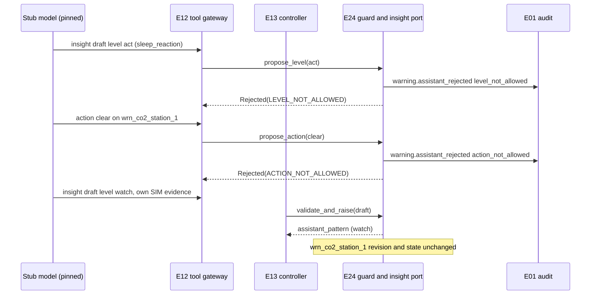

# E24: Warnings engine

Technical design for epic E24. Inputs: the brief (`tdd/E24.md` in the planning package), PRD.md 4.10, USE-CASES.md
(UC04 to UC07, UC11, UC16, UC17, UC21, UC25), CONTRACTS.md, `api/openapi.yaml` (tags Warnings and Events), the warning,
event-page and configuration schemas with their examples, `environment-hazards.json`, VALIDATION.md, `backlog.json`,
`docs/BUILD-CHARTER.md`, `docs/SYSTEM.md` and `docs/DEPLOYMENT.md`. Citations: "C14" is CONTRACTS.md section 14, "S8.6"
is SYSTEM.md section 8.6, "D4.4" is DEPLOYMENT.md section 4.4.

Status: design. Every test named here is planned; none has run. Clinical content (levels, steps, limits) is an
unreviewed draft. Numerical verification of this engine is not clinical approval: in LIVE, configured steps reach the
crew only when the shared eligibility rule approves them (3.16).

## 1. Scope

**Work packages.** E24-01 (record and lifecycle), E24-02 (rule and sensor-limit raisers), E24-03 (bounds on assistant
insights), E24-04 (To do warnings, Needs attention, the warning detail and the attention layer; built by stream D).

**Traces.** Requirements R36, R40, R43; evidence for R35 and R39. R41 and V73 belong to E23-03 ("environment-aware
adverse effects", `backlog.json`); E24 only renders the steps of the hazard entry and claims neither. Validation V10,
V32, V55, V56, V57, V58 (warning part), V65, V69 (warning part), V70, V72, V74, V75 (warning part). Demo D16, D17
(E24 part), D19, D22 (E24 part). Section 12.1 maps each to its tests and owners.

**Decisions** (brief, "Decisions the TDD must settle"):

| # | Decision | Selected | Rejected and why |
|---|---|---|---|
| DE24-1 | Levels and words | `common.schema.json#/$defs/level`, ranked info < watch < act < emergency; words only from ui-copy `level_words` | Numeric severities; words in code (R43) |
| DE24-2 | Who raises each level | Matrix 3.4 in the definition type, a loader check, the entity and a SQLite CHECK | Prompt instructions (charter 1.3) |
| DE24-3 | Clearing | Per kind (3.5); only eligible current evidence completes a dwell (3.6); a clear event resolves only the occurrences before it (3.9); no activation retires an active warning (3.8); no clear while an evaluation is pending (5.5) | Timer clearing; administrative removal as evidence |
| DE24-4 | Hold and attention | Records raise at once; the hub decides presentation per session: hold (sleep and walks) and attention (only act and emergency interrupt; emergency never held) (3.12) | Delaying the raise; client-computed hold (C19); headline rank as interruption order |
| DE24-5 | Insight bounds | Pure policy (3.13) before anything is stored; level from the definition, loader-limited to info or watch | Trusting the model's level |
| DE24-6 | Answers to the engine | `answer` definitions fed by `AnswerAccepted` in the records owner's transaction | Help module or UI raising warnings |
| DE24-7 | Supersede without lowering | `level` immutable. Escalation clears lower with `superseded`; de-escalation raises a new lower warning after the higher clears (3.7) | Updating `level` in place |
| DE24-8 | Reaching every crew screen | Outbox `warning.*` events; the client reconciles lifecycle by revision and the session projection by authoritative fetch (7.2); the shell slot `screen.top.attention` mounts the attention layer (R-E24-18) | Polling; trusting each event as the session's view |
| DE24-9 | Stub model rejected cases | The assistant reaches warnings only through `AssistantWarningGuard` (4.2); both pinned stub proposals rejected and audited | HTTP-only rejection (the assistant has no session) |
| DE24-10 | Vehicle and instrument alarms | Read only, as mission events from an adapter or a crew member (3.14, R-E24-9); no write port to any vehicle system | A vehicle adapter with acknowledge capability; inferring an alarm from a dose rate |
| DE24-11 | Evaluator fault | Capture first, evaluate second (S8.6): savepoint, `evaluation_pending`, durable recovery, clear freeze, health degraded (5.5) | Rolling back the producer (a deterministic fault would block capture forever) |
| DE24-12 | Several hubs | The origin node owns each warning; replicas are read only and never evaluated (3.15, D4.4) | Merging warnings; ground authority |
| DE24-13 | Guidance in warnings | Detection independent of review; steps served only when `GuidanceEligibility` (S8.2) says show, else the unsupported state and the human path (3.16) | A notice as the only barrier |

**Not delivered here** (owner): sensor ingest, aggregation, coverage, freshness, sensor formatting and `SensorStatus`
(E23); routine bindings including the post-storm tasks (E25, integration test 137); Someone needs help and the
air-safety line (E26); insight generation and the forbidden-output filter (E13, E12); the ground link state (E29); supply
cover (E32); the guidance eligibility rule (E27 `guidance`, S8.2); Today assembly (E03); the event log, outbox, audit,
idempotency store and ledger, template renderer, configuration loader, clock, scheduler and replication log (E01);
shelter attendance and the dose-rate panel of V58 (proposed owner E23, R-E24-17, integration test 138).

## 2. Dependencies and seams

The producer owns the transaction (C14 "in the same transaction", S5.7). E24 subscribes through
`ModuleRegistry.subscribe`; each handler runs inside `uow.savepoint("rules_eval")` (5.5). An evaluator fault rolls back
only the savepoint and the producer's record commits with `evaluation_pending`; a storage fault fails the whole command.
Inputs are mapped in `rules/application/subscriptions.py` (anti-corruption layer). Where no producer design exists yet
(E23), both sides build against `hub/tests/contracts/rules_inputs.py` (owned by E24, run by producers, T-E24-113).

| Seam | Direction | Exact mechanism | Owner | Agreed in |
|---|---|---|---|---|
| Unit of work, snapshots | uses | `UnitOfWork`, `UnitOfWorkFactory.begin`, `ReadSnapshotFactory.snapshot`, `uow.savepoint` | E01 | S5.7 |
| Bus, outbox, audit | subscribes, publishes | `ModuleRegistry.subscribe`, `uow.publish`, `uow.emit(OutboxEvent)`, `uow.audit(AuditEntry)` | E01 | S5.7, S5.9 |
| Identifiers | uses | `IdFactory.new("wrn")` | E01 | S5.1 |
| Clock | reads, subscribes | `uow.now`, `MissionClock.label`, `ClockCorrected`, `ClockRegressed` | E01 | S5.2, S5.3 |
| Configuration | reads, registers | `ConfigReleaseReader`, `ReleaseCheck`, `ActivationGuard` via `ModuleRegistry.loader_check`, `.activation_guard` | E01 | S5.6 |
| Settings | reads | `HubSettings.get("rules.<key>")` (5.4) | E01 | S5.11 |
| Template renderer | calls | `TemplateRenderer.render(field_key, template, values)` | E01 | S5.6 |
| Scheduler, health | uses | `uow.schedule`, `ModuleRegistry.scheduler_handler`, `HealthState.mark_degraded(component, code, since)`, `.mark_ok` | E01 | S5.10 |
| Idempotency | uses | `IdempotencyStore.lookup`, `.record` with `CommandIdentity(durable=True)` | E01 | S5.8, S8.6 |
| Event audience | registers | `ModuleRegistry.audience_rule("rules.warning", ...)` | E01 | S5.7, S8.3 |
| Replication | registers | apply handler for record type `warning` | E01 | D4.2 to D4.4; interim one hub |
| Startup | registers | `on_startup(StartupPhase.STATE_SWEEP, ...)` | E01 | S5.12 |
| Sessions | reads | `SessionContext` | E02 | S5.7 |
| Sensor inputs and state | subscribes, queries | `SensorEvaluated`, `ChannelFreshnessChanged`; `SensorStateQuery` | E23 | R-E24-14 |
| Mission inputs and state | subscribes, queries | `MissionEventRecorded`, `StateFactChanged`, `OverlayChanged`, `EnvironmentActivated`; `MissionStatePort` | E23 | R-E24-14 |
| Answers, record facts | subscribes, queries | `AnswerAccepted`; `RecordFactsPort`, `AnswerQuery` | E01 records | R-E24-14 |
| Ground link | subscribes, queries | `GroundLinkChanged`; `GroundLinkQuery` (only the `ground_silence` evaluator imports it) | E29 | R-E24-14 |
| Supply cover | subscribes, queries | `SupplyCoverChanged` in transaction; `SupplyCoverFacts.rows(uow, environment_id)` | E32 | S8.1 |
| Guidance eligibility | calls | `GuidanceEligibility.evaluate(snapshot, request)` | E27 `guidance` | S8.2; content kind R-E24-23 |
| Care authority | calls | `ClinicalAuthorityQuery.authority`, `HelpSessionReader.readable_by` | E31, E26 | S8.4, R-SYS-13; use R-E24-21 |
| Insights | provides, queries | `InsightWarningPort`; `InsightQuery.active(uow)` | E24, E13 | R-E24-14 |
| Assistant actions | provides | `AssistantWarningGuard` | E24 | consumers E12, E13 |
| Warning queries | provides | `WarningQueries` (4.2) | E24 | E03 section 2 (`active_visible`, `headline`, `count_active_visible`); E26 4.2 (`active_shared_at_or_above`, `visible(session, warning_id)`) |
| Routine | publishes, receives | `WarningRaised`, `WarningCleared`; `WarningCommands.attach_routine_overrides` | E24, E25 | E25 bindings |
| Crew app shell | fills | slot `today.todo.warnings` (exists, E03 7.1); slot `screen.top.attention` (R-E24-18) | E03 | |
| Help route | links | `help.start?entry=warning&ref=<warning_id>` | E26 | |

Section 14 is the exact text of E24's requests; it is filed verbatim as `docs/requests/E24.md` (this revision was
limited to the design and its review response).

## 3. Domain model

`crew_health/rules/domain/` is pure: frozen dataclasses and `StrEnum`s, no I/O, no clock reads. Generated Pydantic
models appear only at the API edge.

### 3.1 Vocabulary

`Level`, `RaisedBy`, `Scope`, `WarningState`, `ClearReason`, `ConditionKind`, `WarningAction` mirror the enums of
`warning.schema.json`, `common.schema.json` and `config-warning-rules.schema.json` (a test compares them).
`ACTIVE = {raised, acknowledged}`; `FINAL = {cleared, resolved, dismissed}`. A warning that ended by
`condition_false`, `clear_event`, `expired`, `resolved` or `dismissed` spends its trigger (3.9); `superseded`,
`config_changed` and `environment_changed` leave it reusable.

### 3.2 Definitions and the effective rule

`WarningDefinition` is parsed once per release from `warning-rules.json` `definitions[]`, field for field.
Construction enforces DE24-2 (`assistant` implies info or watch and kind `assistant_insight`; the two sensor kinds imply
`sensor_limit`; every other kind implies `rule`) and raises `DefinitionInvalid`, reported as `CONFIG_INVALID`.

Two fingerprints (sha256 of RFC 8785 canonical JSON), computed by `fingerprint.py` from the whole release:

- `content_hash`: the definition's `content`.
- `rule_fingerprint`: the definition without `content`, plus every value in another document that decides raising
  or clearing. Words, labels, `card_mark` and provenance fields (`basis`, `source_ids`, `to_be_set_by`) are excluded.

| Kind | Values from other documents in the fingerprint |
|---|---|
| `sensor_limit` | The referenced sensor-limits entry (comparator, value, unit, level, role, status, environments, `aggregation_id`, `clear` with `dwell_seconds` and `min_coverage`); the aggregation it names (kind, `window_seconds`); the catalog `stale_after_seconds` and `expected_interval_seconds` of its sensor type |
| `sensor_quiet` | Catalog `stale_after_seconds` of each sensor type it covers |
| `answer` | The questionnaires entry of `question_id` (answer type and presence values) |
| `assistant_insight` | assistant-policy `allowed_warning_levels` and the topics whose `warning_definition_id` names it |
| other kinds | none |

Editing only `sensor-limits.json` therefore changes the fingerprint of every definition that references the edited
limit (T-E24-126).

### 3.3 Warning entity

`Warning` mirrors `warning.schema.json`, plus storage fields `scope_key`, `trigger` (3.9), `rule_fingerprint`,
`content_hash` and `origin_node_id` (3.15). Hold, attention, served steps and `allowed_actions` are session projections
computed on read (3.10, 3.12, 3.16), never stored. Transitions return a new value with `revision + 1`.

| Transition | Preconditions (typed error) | Effect |
|---|---|---|
| `raise_new` | Level allowed for raiser (`LevelNotAllowed`) | `raised`, revision 1, `raised_at` = the input's commit instant |
| `acknowledge(person, at)` | Active (`InvalidTransition`); visible (`NotVisible`); person not yet in `acknowledgements` (`InvalidTransition`) | Appends `{person_id, at}`; `acknowledged`; nothing else changes |
| `add_note(person, at, text)` | Active; visible; below the note bound (`InvalidTransition`, 5.4) | Appends note |
| `clear(reason, at)` | Active; actor is the origin node's `EngineActor` (never constructible from a session or the assistant) | `cleared`, `cleared_at`, `clear_reason` |
| `resolve(person, at, reason)` | Active; `raised_by == rule`; `clear.person_may_resolve`; visible; reason non empty | `resolved` |
| `dismiss(person, at, reason)` | Active; `raised_by == assistant` (`ActionNotAllowed`); actor is `person_id` | `dismissed` |

No transition changes `level`, `raised_by`, `definition_id`, `scope_key`, `trigger`, `evidence`, `steps`, `raised_at`,
`origin_mode` or `origin_node_id`. Final states have no outgoing transition.

**Warning ID.** `IdFactory.new("wrn")`: `wrn_<uuid7 hex>` (S5.1, D4.2), unique across nodes without coordination, so
two disconnected hubs never generate the same ID. Tests inject a deterministic `IdFactory` fake, so equal release,
state, clock and identifiers give byte-identical views (C20).

### 3.4 Raiser policy (DE24-2)

| Level | `rule` | `sensor_limit` | `assistant` | A person |
|---|---|---|---|---|
| `info`, `watch` | yes | yes | yes | only through a rule on their answer |
| `act`, `emergency` | yes | yes | never (`LEVEL_NOT_ALLOWED`) | only through a rule on their answer (Someone needs help is E26, not a Warning) |

Enforced in `WarningDefinition`, loader check 5, `Warning.raise_new` and a SQLite CHECK. `AssistantActor` is accepted
by no transition.

### 3.5 Engine semantics per condition kind

`engine.evaluate(inp: RuleInput, view: EngineView) -> Decision` (types in 4.3). The engine raises only definitions
whose `environments` include the active environment and never a second active warning for a
`(definition_id, scope_key)`. While `view.clears_frozen` is true (an evaluation is pending, 5.5) it emits no `Clear` of
any kind; raises continue.

| Kind | Input | Scope key | Raise when | Evidence, `evidence_time` | Clear when (`clear_reason`) |
|---|---|---|---|---|---|
| `sensor_limit` | `SensorEvaluated` | `channel_id` | Result for `limit_id` has `crossed is True`, limit `active` with role `warning`, escalation (3.7) allows it | `reading` at window end E; E | The clear condition proved by eligible evidence continuously for `dwell_seconds` (3.6, `condition_false`); a higher level raised in the group (`superseded`) |
| `sensor_quiet` | `ChannelFreshnessChanged` to `stale` | `channel_id` | Sensor type in `sensor_type_ids` (empty: any of the environment); `never_reported` raises nothing | `reading`, last accepted; `stale_since` | Freshness back to `current` (`condition_false`) |
| `mission_event` | `MissionEventRecorded` | habitat: event `location` or `environment:<id>`; person: each of `person_ids`; crew: `""` | `event_type in event_types`, not resolved by a recorded clear event (3.9); with an active warning for the key it attaches as an outstanding occurrence | `mission_event`; `occurred_at` | Clear events resolve every outstanding occurrence (`clear_event`, 3.9) |
| `answer` | `AnswerAccepted` | `person_id` | `question_id` and `presence` match; with `within_days_after_event`, the latest event of that type naming the person or nobody satisfies `0 <= answered_at - occurred_at <= days x 86400 s` (3.11) | `answer`; `answered_at` | Only `resolve` (`person_may_resolve`); a later answer never clears it; expiry refused (3.8) |
| `state_fact` | `StateFactChanged` | habitat `environment:<id>`, crew `""` | value `== equals` | `state_fact`; fact `at` | value `!= equals` (`condition_false`) |
| `assistant_insight` | `InsightWarningPort` | `person_id` | Insight valid (3.13), topic listed, topic's `warning_definition_id` is this definition | `insight` plus the insight's evidence; `created_at` | Person dismisses insight or warning (`dismissed`); insight expires or `expires_after_seconds` (`expired`) |
| `ground_silence` | `GroundLinkChanged`, deadline | `""` | `down`, `next_contact_at` set, threshold not null, clock past `next_contact_at + threshold` | interim none (R-E24-4); `next_contact_at + threshold` | Link `up` or `delayed`, or `next_contact_at` moved later (`condition_false`); never by a clock correction |
| `supply_cover_low` | `SupplyCoverChanged`, release or environment activation | `supply_id` (R-E24-3) | `below_uses` and `cover_uses` not null, `cover_uses < below_uses` | `supply_use` that changed cover, else interim none (R-E24-4); the use's time, else activation instant | `cover_uses` not null and `>= below_uses` (`condition_false`); `null` cover changes nothing |

A `null` threshold raises nothing and is never replaced by a number in code. Environment activation clears active
warnings whose definition excludes the new environment (`environment_changed`, C12), then re-evaluates.

### 3.6 Dwell continuity and clearing evidence (sensor limits)

Package rule: the clear condition "must hold continuously for `dwell_seconds` of `observed_at` time"; "`latest` has no
coverage"; "stale data never clears" (C13); "a late arrival does not become a fresh measurement" (C1). Continuity and
currency are proved, never assumed.

**Eligible evidence.** An evaluation counts toward a dwell only when `clear_evidence.eligible(inp, now)` holds. For LIVE
and SIM channels (acquired in real time), all of:

1. `inp.clock_state == "trusted"` (E23 reports the device and adapter time state; `uncertain` and `unknown` fail);
2. `0 <= inp.received_at - inp.window_end <= inp.stale_after_seconds` (the reading at E was current when it arrived;
   future-dated readings fail);
3. `now - inp.received_at <= inp.stale_after_seconds` and `inp.freshness == "current"` (C13 freshness by reception and
   the deployment rule "freshness states from `observed_at`", D9: both must hold);
4. the warning's own `limit_id` is in `inp.results` with `clear_holds is True` (a missing or `None` result fails).

The only bound is the channel's `stale_after_seconds`, which carries its catalog basis and source; no new number.
**REPLAY** is evaluated on data time (C13 "E follows the data and not the wall clock"): conditions 1 (on the replay's
declared time basis) and 4 apply, 2 and 3 do not. A channel has one origin mode (C13 ingest step 1), so REPLAY evidence
can never clear a LIVE or SIM warning.

**Marker.** `rules_dwell(warning_id, rule_fingerprint, holding_since, last_window_end)`, written in the reading's
transaction; a marker whose fingerprint differs from the definition's current fingerprint is void (3.8).

**Step**, for an active warning's limit on evaluation E:

- `E <= last_window_end` (same E after a late reading): eligible and holding changes nothing; anything else deletes the
  marker.
- `E - last_window_end > stale_after_seconds`: delete, then continue as a first evaluation.
- Eligible and holding: create `(E, E)` or advance `last_window_end`; clear when `E - holding_since >= dwell_seconds`.
- Otherwise (not eligible, `False`, `None`, absent): delete.

**Resets.** `ChannelFreshnessChanged` to `stale`; a fingerprint change (3.8); E23 reporting the channel not `current` at
startup (5.3); an input of the channel going pending (5.5).

A backlog delivered after a reconnection fails condition 2 reading by reading, so it can raise (it is real evidence of a
past crossing, shown with its time) but never completes a dwell; the dwell restarts from the first eligible reading
(T-E24-120). Fast REPLAY clears on `observed_at` time only when every gap is within the bound (T-E24-049).

### 3.7 Escalation (DE24-7)

The package raises "once per definition and channel" and clears "active lower-level warnings for that sensor type and
channel" when a higher level raises (C13). The group is `(sensor_type_id, channel_id)`.

1. **Equal levels coexist.** `oxygen_low_act` (twa_1h below 127) and `oxygen_high_act` (latest above 356) both raise;
   neither supersedes the other; each renders its own limit's values (5.2).
2. **Escalation.** A crossed definition above every active warning of the group raises; the active lower ones clear
   `superseded` in the same decision; `previous_warning_id` names the highest of them.
3. **Lower crossing while a higher one is active.** Not raised (it would be superseded at once and flap). R-E24-19.
4. **De-escalation.** When the higher clears by its own dwell, the same decision raises every still-crossed definition
   at the highest remaining level, linked by `previous_warning_id`.
5. **Several crossed in one evaluation.** Raise the highest level crossed (all definitions at that level).

`sensor_quiet` and rule kinds are never grouped.

### 3.8 Configuration activation (UC-R9)

Activation runs inside the activation's `BEGIN IMMEDIATE` (S5.6), in this order:

1. **Guard** (`rules.no_retire_active`, an `ActivationGuard`). For each local active warning, the candidate must
   still hold its definition with the active environment in `environments` and the same `condition.kind`, `scope` and
   `raised_by`. Otherwise the guard returns a `Finding` naming each warning; the release is rejected and the last good
   stays. C11 clears "a warning whose definition is gone"; the guard keeps any such release from activating while the
   warning is unresolved, so an administrative edit never stands in for evidence that a hazard ended (PRD 4.10 "The
   warning stays open until its cause clears"). The release activates once the warning clears by its rule or is
   resolved. A kind, scope or raiser change is a rejected migration, never treated as removal. R-E24-20 asks for an
   explicit retired state.
2. **Swap** (E01).
3. **`OnReleaseActivated`** (in the same transaction), local active warnings in `(definition_id, scope_key,
   warning_id)` order:

| Change of the definition between releases | Effect |
|---|---|
| `content_hash` only | None. Stored words stay as raised under their pinned `config_release_id`; new raises use the new content |
| `rule_fingerprint` (including a referenced limit, aggregation or stale bound, 3.2) | Warning stays with its level; dwell markers become void (fingerprint mismatch); outstanding occurrences stay. Definition level now higher and the new condition holds: escalation (3.7 step 2) in the same decision. Lower: the old warning stays until it clears, then the lower raises (3.7 step 4) |
| none | none |

4. **Re-evaluation** of every definition from current state (4.2 queries), raising only where no active warning exists
   for the key and the trigger is not spent (3.9).

Every evaluation uses `uow.release` at its start, so the active release governs every evaluation after activation and
the release cache holds one release; an input computed under another release is refused (`stale_release`) and E23
re-evaluates after activation. Within one decision the adapter writes clears (supersessions first) before raises, so the
partial unique index (5.1) never sees two active rows for a key.

**Expiry.** `ReleaseCheck` `rules.expiry_scope` refuses non-null `expires_after_seconds` on every kind except
`assistant_insight` (whose expiry is the insight's own, C14). Expiry is a notification lifetime, not evidence that a
cause ended (C "No reviewed warning is implicitly medically resolved"). E24's `config/warning-rules.json` therefore sets
`dizzy_after_landing` `expires_after_seconds: null`: it stays until the person resolves it with a reason, and reaches
carers through 3.10 when the person cannot respond. R-E24-20 asks for a separate notification expiry.

Routine overrides follow the warning: E25 ends bindings only on `warning_cleared`.

### 3.9 Occurrence identity and outstanding occurrences

Each raise records `trigger = (kind, ref)`:

| Kind | Trigger ref |
|---|---|
| `sensor_limit` | `reading_id` at E |
| `sensor_quiet` | `channel_id` and `stale_since` |
| `mission_event` | `event_id` |
| `answer` | `answer_id` |
| `state_fact` | `cause_event_id` |
| `assistant_insight` | `insight_id` |
| `ground_silence` | `next_contact_at` |
| `supply_cover_low` | `supply_use_id`, else `config_release_id:environment_id` |

A raise is refused (`Refuse(code="trigger_spent")`, audited) when a warning for the same `(definition_id, scope_key,
trigger)` ended in a spent way. Replays, re-evaluation and repeated deliveries never resurrect a resolved answer, a
dismissed insight or a cleared event.

**Outstanding occurrences (mission events).** Every triggering event is persisted in `rules_occurrence` (5.1),
including one that arrives while a warning for its key is active (C14 States: each "new occurrence" is distinct):

- A trigger for a key with an active warning attaches as an outstanding occurrence. The warning record is unchanged
  (evidence is immutable); audit `warning.occurrence_attached`.
- A clear event with `occurred_at = T` resolves every outstanding occurrence of its key with `occurred_at < T`. Equal
  times stay outstanding (fail safe). The warning clears `clear_event` only when no occurrence remains outstanding;
  otherwise the resolutions are recorded and the warning stays.
- A trigger whose `occurred_at` precedes an already recorded clear event of the key raises and attaches nothing
  (`Refuse(code="clear_later")`, audited).
- Duplicates: `(definition_id, scope_key, trigger_ref)` is the occurrence key and a clear event resolves each
  occurrence once, so repeated deliveries change nothing. All of this state is in SQLite and survives restart.
- Causality uses `occurred_at`, never `recorded_at` (C1). With `relates_to_event_id` (R-E24-9 c) a clear event would
  resolve only the occurrence it names; until then time order decides.

Worked sequence (T-E24-118): alert A at 10:00 raises W; alert B at 10:20 attaches; all-clear C that occurred at 10:10
arrives last and resolves A only, so W stays active; an all-clear at 10:30 resolves B and clears W.

### 3.10 Visibility, care access and allowed actions

| Scope | The subject's own session | Other crew sessions | `station`, `ground`, `operator`, `adapter`, `editor` |
|---|---|---|---|
| `person` | yes | only through care access below | no |
| `habitat`, `crew` | yes | yes | yes |

An invisible warning returns `404 NOT_FOUND` (C14 "That person only").

**Care access** (audit finding 5, S8.3 class P2). A person warning is a clinical record. `WarningQueries.care_view
(session, subject_person_id)` returns the subject's active person warnings only when the session person is the opener or
a current helper of an open help session for the subject (`HelpSessionReader.readable_by`), or
`ClinicalAuthorityQuery.authority(..., action="record_review")` returns `crew_medical_officer` or
`acting_medical_officer` for that subject. Every read audits `warning.care_read` (IDs and the basis only), the view is
labeled (R-E24-2 `care_access_label`), and access ends with the help session or the authority. HTTP `/v1/warnings` and
person-scope events stay person only (C14, C18) until R-E24-21 changes the contract; the interim care path is E26's
subject summary of an open help session (C16 lets helpers read it), which reads `care_view` once E26 adopts it.
Consent-based sharing with a named crewmate and resolution by a medical officer wait for R-E24-21.

**Client purge.** Person warnings and all session projections live in memory only and are discarded on sign-out, idle
lock (the shared laptop returns to the station session, D5.3), session change or `401` before the next session renders
(7.2); habitat and crew warnings (P1) may be cached by configuration version (S8.3).

**`allowed_actions`** (hub computed): `acknowledge` (crew roles, visible, active, not yet acknowledged by this person);
`add_note` (crew roles, visible, active, below the note bound); `resolve` (as `add_note`, `rule`,
`person_may_resolve`, origin node only); `dismiss` (`assistant`, active, own, origin node only). Replicas offer only
`acknowledge` and `add_note` (3.15). Other roles get `[]` (`actOnWarning` `x-roles`).

### 3.11 Time

| Use | Time base | Correction policy |
|---|---|---|
| Dwell, sensor causality | `observed_at` of readings, with reception currency for LIVE and SIM (3.6) | Unaffected by hub clock corrections |
| Mission-event causality, answer windows | `occurred_at`, `answered_at` as recorded | When E01 reports a correction between the two instants, the window test runs on both the recorded and the corrected difference and raises if either satisfies it |
| Assistant expiry | Hub UTC from `raised_at` | On `ClockCorrected` every pending expiry shifts by the correction, so a forward jump never expires early and a backward jump never extends |
| Ground silence | Hub UTC against the absolute `next_contact_at` | Not shifted; re-evaluated at once. A forward correction may raise; a backward one never clears |
| `evidence_time_label` | Mission time HH:MM under the active `clock_version`, or replay time (C11) | Stored at raise; never rewritten (S5.3) |
| Restart | Scheduler reloads deadlines; past due fire at once | While `ClockRegressed` is active, expiry clears are suspended until `ClockCorrected` (S5.2); raises continue |

### 3.12 Presentation: hold and attention (DE24-4, V74)

The **warning lifecycle** (3.3) never waits. The **presentation lifecycle** decides when a session is interrupted.
Interrupting means the attention layer moves focus, uses `role="alert"` and shows a new item. A list row is never an
interruption. The `listWarnings` and headline order (C14 Headline, openapi `listWarnings`) orders lists only; the
attention policy below is separate.

**Attention policy** (`attention.py`, pure over the session's visible active warnings):

1. `emergency` interrupts every session that can see it at once and is never held. All active emergencies show
   together in the interrupt, most recently raised first.
2. `act` interrupts unless held for this session. Every unacknowledged active `act` warning is shown in the banner,
   most recently raised first, with its numbered steps; none is concealed behind a lower level. Past
   `rules.max_banner_items` the banner shows the first ones and "and {n} more" linking to Needs attention.
3. `watch` and `info` never interrupt; they appear in To do, Needs attention and the headline.
4. Focus moves once per warning per session. A further item while focus is inside the attention layer is announced
   with `aria-live="assertive"` without moving focus again. Acknowledging removes the item from this person's banner
   only (the warning stays open, C14). Leaving the layer returns focus to the element that had it.

**Hold rule** (PRD 4.10 "During sleep and spacewalks only emergencies interrupt", V74): for the session person, a
non-emergency warning is held when its `raised_at` falls in a hold span: a maximal interval in which at least one of the
person's overlays listed in routine-rules `suppressed_overlays` (C12 "always sleep and eva") is active; overlapping or
touching overlays merge (`hold.spans`, `hold.held`, pure over ActivityOverlay records).

- Warnings raised before the span were presented when raised and are never re-presented during it.
- Acknowledging a held warning (on another device) removes it from the person's summary.
- A warning that clears while held stays in the summary with its clear reason; after the span the held summary is
  presented once (one interruption), each item with its original `raised_at` and `evidence_time_label`.
- Non-person sessions (the shared habitat screen) are never held.

E24's configuration raises the storm warning at `emergency` (section 8), so a storm is never held (T-E24-121).

**Exposure.** The hub serves both as session projections: `held` and `attention: {interrupt, order}` (R-E24-1, a
prerequisite of E24-04 done and V74). Interim, before approval: nothing is held (more interruption, never less) and the
client applies rules 1 to 3 to the served `level` within the served list order, a fixed safety rule in E24 code, not
content. A non-emergency interrupts only once its projection for this session is known (7.2 item 4).

### 3.13 Insight bounds (DE24-5, R40, V10, V65, D17)

`insight_bounds.validate(draft: InsightDraft, facts: Mapping[EvidenceKey, RecordFacts], policy: AssistantPolicy) ->
tuple[Violation, ...]`; empty means valid.

| Code | Rule (C17 validation rule) |
|---|---|
| `level_not_allowed` | `draft.level` not in `policy.allowed_warning_levels` |
| `topic_unknown` | topic not in `policy.insight_topics` |
| `evidence_empty`, `evidence_kind` | no entry; kind outside observation, answer, daily_check, routine_occurrence |
| `evidence_not_found`, `evidence_other_person` | record missing; owner differs from `draft.person_id` |
| `evidence_replay` | record `origin_mode` REPLAY, or a sensor reading or channel |
| `evidence_not_accepted` | observation not `accepted`; daily check not `submitted`; occurrence not `done` |
| `evidence_origin_mixed` | entries not all in the person's namespace origin |
| `habitat_fact_text` | a habitat fact carries model text |
| `action_count` | more than one routine occurrence |

Any violation: E13 stores nothing and adds a `notice`; E24 audits `insight.rejected` with codes only.

### 3.14 Vehicle and onboard instrument alarms (DE24-10, V57, V58)

The vehicle's caution and warning system and the onboard radiation monitor are the authorities; the app repeats and
never annunciates or controls. Their alarm state enters only as mission events (R-E24-9 b):
`vehicle_alarm_sounding`, `vehicle_alarm_ended` and `radiation_monitor_alarm`, each recorded by the instrument's or
vehicle's adapter on the integration node (D3.6) from the device's own alarm flag, or by any crew member from any crew
screen as the dissimilar manual backup, which works with the link down and no adapter (UC05 "With the ground link down,
the onboard radiation monitor alone starts the flow"). E24 never infers an alarm from a dose rate: `rad_rate_act` is
`threshold_pending` and C14 says the radiation `act` level is "handled by a rule on a mission event instead ... never by
an invented number".

- Vehicle alarms raise a crew-scope `mission_event` definition whose `listed` steps start with the vehicle procedure
  line (basis `team default`); no control is labelled as acknowledging or silencing the vehicle (R-E24-2); no hub
  module has an outbound vehicle port (`rules-no-vehicle-write`); no text states that the vehicle or its air is safe
  (R-E24-10).
- The storm definition (section 8) raises on `space_weather_alert` or `radiation_monitor_alarm` and clears on
  `space_weather_all_clear`. Its `what` and citation name no source; the evidence lists the event that raised it with
  that event type's configured `label`, so the warning states only the source actually present.
- Shelter attendance and the dose panel: R-E24-17 (proposed owner E23), integration test 138. Post-storm tasks: E25's
  `radiation_dosimeter.solar_particle_event` binding (`at_clear: true`) on `WarningCleared`, integration test 137.

### 3.15 Ownership across nodes (DE24-12, D4.1, D4.4)

- The node that holds the input raises and owns the warning (`origin_node_id` = settings `node.id`; alerts are raised by
  the hub of the site with the sensor, D3.5). Only the origin's engine clears, resolves, dismisses or supersedes it
  (D4.4 "A warning is cleared only by its own node's rule").
- Replicated warnings land in `rules_warning_replica` through the replication apply handler (`create` and `version`
  entries from the origin, applied in `origin_seq` order). The engine never reads that table, so local re-evaluation
  cannot clear an imported warning, and a local raise for the same definition and scope is a separate warning (D4.4
  "Never merged").
- Lists show a replica with its origin node and age (`now` minus the origin version's HLC time), words R-E24-2
  `replica_from`. Person replicas follow 3.10.
- Acknowledgements and notes on a replica are local append records replicated to the origin (D4.4 housekeeping and
  append rows); resolve and dismiss are offered only on the origin node.
- Interim (S11: one hub per site; HTTP sync is R-SYS-3, file sync works now): the apply handler and replica table exist
  and are tested with two hub processes on one laptop (D3.7, T-E24-125).

### 3.16 Guidance eligibility of steps (DE24-13, S8.2)

Detection never depends on review. On every read, the steps of each warning pass `GuidanceEligibility.evaluate` with
`ContentRef(kind="warning_steps", id=definition_id, content_sha256=content_hash)`, purpose `patient_instruction`, the
warning's `config_release_id` and `origin_mode`, `subject_person_id` = the warning's `person_id`, empty requirements and
`fixed_first_screen=False`:

| Decision | Served steps |
|---|---|
| `show`, label `live` | The stored steps |
| `show`, label `simulation_only` (SIM, REPLAY) | The stored steps, labeled |
| `not_supported`, `not_here`, or the provider absent or failing | R-E24-2 `no_supported_guidance` and `human_path` (follow the vehicle's procedure; call the crew medical officer); interim ui-copy `designed_states.not_available_here` plus the help route button |

Level, title, what, why, evidence, citation and interruption are unchanged; stored steps are never altered. Unreviewed,
withdrawn or mismatched content in LIVE therefore never reaches the crew as an instruction, and the warning-rules
`notice` still shows. Interim until R-E24-23 adds the content kind and E10 records approvals: the provider fake returns
`Unknown`, which S8.2 maps to `not_supported`, so LIVE shows no configured steps while SIM and REPLAY show them labeled.

### 3.17 Invariants

| ID | Invariant | Tests |
|---|---|---|
| INV-E24-01 | Every warning has a level, `raised_by`, non-empty stored steps, regions from the fixed set and a citation | 001, 040 |
| INV-E24-02 | `assistant` implies info or watch | 002, 003, 061 |
| INV-E24-03 | No assistant actor acts on any warning; no actor dismisses a rule or sensor warning | 004, 005, 062 |
| INV-E24-04 | `level` never changes after storage | 006, 022 |
| INV-E24-05 | One active local warning per `(definition_id, scope_key)`; within a sensor group none below the group's highest active level | 007, 018 to 021 |
| INV-E24-06 | Acknowledging keeps the warning active and unchanged except acknowledgements | 008, 050 |
| INV-E24-07 | Only eligible evidence completes a dwell: stale, never-reported, insufficient, gapped, out-of-order, delayed, future-dated or clock-uncertain readings never clear | 024 to 026, 045 to 049, 120 |
| INV-E24-08 | Final is final; a spent trigger never raises again; a new occurrence gets a new ID or attaches as outstanding | 009, 035 to 038, 118, 119 |
| INV-E24-09 | A person warning's evidence shares the person's namespace origin; REPLAY never raises a person warning | 030, 031 |
| INV-E24-10 | Nothing raises or clears from a forecast, a model output other than a valid insight, or the link outside `ground_silence` | 032 to 034 |
| INV-E24-11 | Raise and clear commit with their input, outbox event and audit event | 070, 071, 106 to 108 |
| INV-E24-12 | Every word and number comes from the active (or pinned) release, hub settings or hub state | 090 to 093, 114 |
| INV-E24-13 | A person warning reaches only that person, or a carer through audited care access | 051, 052, 132 |
| INV-E24-14 | A null threshold raises nothing; a null cover changes nothing | 027, 028, 065 |
| INV-E24-15 | No activation clears or retires an active warning; expiry never ends a rule warning | 013 to 017, 126 to 128 |
| INV-E24-16 | A failed evaluation never blocks capture and never changes a warning; no clear while any evaluation is pending | 072, 122, 123 |
| INV-E24-17 | A clear event clears a mission-event warning only when it resolves every outstanding occurrence | 035, 118, 119 |
| INV-E24-18 | Only the origin node changes a warning; replicas are never evaluated | 125 |
| INV-E24-19 | In LIVE, steps not approved for their exact content hash are never served | 130 |
| INV-E24-20 | No private projection survives a session change on a client | 116, 132 |

## 4. Application layer

### 4.1 Use cases

| ID | Use case | Input, output | Errors | Idempotency |
|---|---|---|---|---|
| UC-R1 | `ApplyRuleInput` | one input (4.3) in the producer's `uow`, inside the `rules_eval` savepoint; `tuple[WarningChange, ...]` | evaluator fault: pending (5.5); `StorageUnavailable` fails the command | Active unique index, occurrence key, spent triggers (3.9) |
| UC-R2 | `ActOnWarning` | session, id, body, headers; `WarningView` | 6.2 | Durable ledger, order below |
| UC-R3, R4 | `ListWarnings`, `GetWarning` | session, filters; page or `WarningView` with ETag | 6.2 | read |
| UC-R5 | `ValidateAndRaiseFromInsight` | `uow`, `InsightDraft`; `Warning or None` | `InsightRejected` | as UC-R1 |
| UC-R6 | `OnInsightDismissed`, `OnInsightExpired` | `uow`, `insight_id` | none | no-op when final |
| UC-R7 | `AttachRoutineOverrides` | `uow`, id, override ids | `InvalidTransition` when final | set union |
| UC-R8 | `OnEnvironmentActivated` | `uow`, profile | none | deterministic |
| UC-R9 | `GuardActivation`, `OnReleaseActivated` | `uow`, candidate or old and new release | findings | deterministic (3.8) |
| UC-R10 | `RunDeadline` | `uow`, key | none | fired key deleted in the same transaction |
| UC-R11 | `OnClockCorrected`, `OnClockRegressed` | `uow`, event | none | keyed by correction |
| UC-R12 | `AssistantWarningGuard.propose_*` | proposal; `Rejected` or `Allowed` (level only) | `LEVEL_NOT_ALLOWED`, `ACTION_NOT_ALLOWED` | audit only |
| UC-R13 | `RecoverPending` | scheduler, startup, activation; rows recovered | none (a failing row stays) | row deleted with its evaluation |
| UC-R14 | `ApplyReplica` | replication entry | quarantine by E01 on hash mismatch | `(origin_node_id, origin_seq)` |

**`ActOnWarning` order.**

1. Authenticate; role in `x-roles` (`UNAUTHORIZED_SCOPE`).
2. Parse. Not JSON or a malformed header: `400 MALFORMED_REQUEST`. A field failing `WarningAction` (missing `reason`
   or `note`; note longer than `rules.max_note_chars`): `422 INVALID_VALUE` with `field_errors` (C5: "A field fails
   validation; field_errors lists each one").
3. Idempotency lookup with `CommandIdentity(operation="actOnWarning", durable=True)` (S8.6 lists
   `/v1/warnings/{id}/actions` as durable) before any mutable precondition: same key and body within 24 hours returns
   the stored first result byte for byte, even after the revision or the release moved; after 24 hours the ledger hit
   returns `409 DUPLICATE_COMMAND` with `current_state` the warning (S8.6, R-SYS-8); a different body returns
   `DUPLICATE_COMMAND`.
4. `BEGIN IMMEDIATE`; repeat the lookup inside it.
5. Visibility (`NOT_FOUND`).
6. `If-Match` present (`VERSION_REQUIRED`) and equal (`STALE_VERSION` with `current_state`).
7. `Config-Release`: when present, different from the active release, and the action depends on configuration
   (`resolve` reads `clear.person_may_resolve`), `409 CONFIG_VERSION_MISMATCH` (C5: "a mutating request that depends on
   configuration under a different active release returns `409 CONFIG_VERSION_MISMATCH`"). `acknowledge`, `add_note`
   and `dismiss` read no configuration. An absent header is not checked.
8. Action allowed (`ACTION_NOT_ALLOWED` for an actor kind that may never take it, `INVALID_TRANSITION` for state or the
   note bound).
9. Write warning, outbox, audit and the idempotency and ledger records of the `200` in one commit. Rejections write
   nothing; a retry recomputes the same rejection.

The `422` and the `409 CONFIG_VERSION_MISMATCH` use the error envelope the operation documents through its `default`
response; R-E24-13 asks that they be listed by code.

### 4.2 Ports (`crew_health/rules/application/ports.py`)

```python
class WarningRepository(Protocol):                 # local warnings only (origin = this node)
    def get(self, uow: UnitOfWork, warning_id: str) -> Warning | None: ...
    def active_for_keys(self, uow: UnitOfWork, keys: Sequence[tuple[str, str]]) -> Mapping[tuple[str, str], Warning]: ...
    def active_in_group(self, uow: UnitOfWork, sensor_type_id: str, channel_id: str) -> Sequence[Warning]: ...
    def active_page(self, uow: UnitOfWork, after: str | None, limit: int) -> Sequence[Warning]: ...
    def spent(self, uow: UnitOfWork, definition_id: str, scope_key: str, trigger: TriggerRef) -> bool: ...
    def insert(self, uow: UnitOfWork, warning: Warning) -> None: ...                       # DuplicateActive
    def update(self, uow: UnitOfWork, warning: Warning, *, expected_revision: int) -> None: ...  # StaleRevision
class OccurrenceRepository(Protocol):
    def outstanding(self, uow: UnitOfWork, warning_id: str) -> Sequence[Occurrence]: ...
    def latest_clear(self, uow: UnitOfWork, definition_id: str, scope_key: str) -> datetime | None: ...
    def attach(self, uow: UnitOfWork, occurrence: Occurrence) -> bool: ...                 # False on duplicate
    def resolve_before(self, uow: UnitOfWork, warning_id: str, at: datetime, clear_event_id: str) -> int: ...
class DwellRepository(Protocol):
    def get(self, uow: UnitOfWork, warning_id: str) -> DwellMarker | None: ...
    def put(self, uow: UnitOfWork, marker: DwellMarker) -> None: ...
    def delete(self, uow: UnitOfWork, warning_id: str) -> None: ...
    def delete_for_channel(self, uow: UnitOfWork, channel_id: str) -> None: ...
class PendingRepository(Protocol):
    def record(self, uow: UnitOfWork, row: PendingInput) -> None: ...                      # coalesces (5.5)
    def any(self, uow: UnitOfWork) -> bool: ...
    def due(self, uow: UnitOfWork, now: datetime, limit: int) -> Sequence[PendingInput]: ...
    def done(self, uow: UnitOfWork, pending_id: str) -> None: ...
    def failed(self, uow: UnitOfWork, pending_id: str, code: str, next_at: datetime | None) -> None: ...
class ReplicaRepository(Protocol):
    def apply(self, uow: UnitOfWork, entry: ReplicatedWarning) -> None: ...
    def page(self, snapshot: ReadSnapshot, visible_to: SessionContext, after: str | None, limit: int) -> Sequence[ReplicaView]: ...

# Required of producers (R-E24-14); E24 tests use fakes with these exact signatures.
class SensorStateQuery(Protocol):                  # E23
    def last_results(self, uow: UnitOfWork, channel_id: str) -> SensorEvaluatedInput | None: ...
    def freshness(self, uow: UnitOfWork, channel_id: str) -> Literal["current", "stale", "never_reported"]: ...
    def channels(self, uow: UnitOfWork) -> Sequence[str]: ...
    def type_name(self, uow: UnitOfWork, sensor_type_id: str) -> str: ...
class MissionStatePort(Protocol):                  # E23
    def mission_mode(self, uow: UnitOfWork) -> OriginMode: ...
    def active_environment_id(self, uow: UnitOfWork) -> str: ...
    def overlays(self, uow: UnitOfWork, person_id: str, since: datetime) -> Sequence[OverlayFact]: ...
    def latest_event(self, uow: UnitOfWork, event_types: Sequence[str], scope_key: str,
                     at_or_before: datetime | None) -> MissionEventInput | None: ...
    def events_since(self, uow: UnitOfWork, since: datetime, after_event_id: str | None,
                     limit: int) -> Sequence[MissionEventInput]: ...
    def state_facts(self, uow: UnitOfWork) -> Sequence[StateFactInput]: ...
class RecordFactsPort(Protocol):                   # E01 records
    def facts(self, uow: UnitOfWork, keys: Sequence[EvidenceKey]) -> Mapping[EvidenceKey, RecordFacts]: ...
class AnswerQuery(Protocol):                       # E01 records
    def latest(self, uow: UnitOfWork, question_id: str, person_id: str) -> AnswerInput | None: ...
    def since(self, uow: UnitOfWork, since: datetime, after_answer_id: str | None, limit: int) -> Sequence[AnswerInput]: ...
class InsightQuery(Protocol):                      # E13
    def active(self, uow: UnitOfWork) -> Sequence[InsightDraft]: ...
class GroundLinkQuery(Protocol):                   # E29
    def current(self, uow: UnitOfWork) -> GroundLinkInput: ...
class SupplyCoverFacts(Protocol):                  # E32 (S8.1)
    def rows(self, uow: UnitOfWork, environment_id: str) -> tuple[CoverFact, ...]: ...

# Provided by E24. Each opens its own ReadSnapshot.
class WarningQueries(Protocol):
    def list(self, session: SessionContext, state: Literal["active", "all"], cursor: str | None,
             limit: int) -> Page[WarningView]: ...
    def get(self, session: SessionContext, warning_id: str) -> WarningView: ...           # NotVisible
    def active_visible(self, session: SessionContext) -> Sequence[WarningView]: ...       # E03 Today; first page
    def headline(self, session: SessionContext) -> HeadlineView: ...                       # E03
    def count_active_visible(self, session: SessionContext) -> int: ...                    # E03
    def held_summary(self, session: SessionContext) -> HeldSummary | None: ...             # after R-E24-1
    def active_shared_at_or_above(self, level: Level) -> Sequence[WarningView]: ...        # E26; habitat and crew
    def visible(self, session: SessionContext, warning_id: str) -> bool: ...               # E26
    def care_view(self, session: SessionContext, subject_person_id: str) -> Sequence[WarningView]: ...  # 3.10
class WarningCommands(Protocol):
    def act(self, session: SessionContext, warning_id: str, body: WarningActionBody, *, if_match: int,
            idempotency_key: str, config_release: str | None) -> WarningView: ...
    def attach_routine_overrides(self, uow: UnitOfWork, warning_id: str, override_ids: Sequence[str]) -> None: ...
class InsightWarningPort(Protocol):
    def validate_and_raise(self, uow: UnitOfWork, draft: InsightDraft) -> Warning | None: ...  # InsightRejected
    def on_insight_dismissed(self, uow: UnitOfWork, insight_id: str, actor: Actor) -> None: ...
    def on_insight_expired(self, uow: UnitOfWork, insight_id: str) -> None: ...
class AssistantWarningGuard(Protocol):
    def propose_level(self, uow: UnitOfWork, ctx: AssistantContext, level: Level, topic_id: str | None) -> Rejected | Allowed: ...
    def propose_action(self, uow: UnitOfWork, ctx: AssistantContext, warning_id: str, action: str) -> Rejected: ...
```

`propose_action` has no success type. Every rejection audits `warning.assistant_rejected` with codes and IDs only.
E12 routes any tool call or output proposing a warning action or a level above watch to the guard before its
forbidden-output filter discards the output (`MODEL_OUTPUT_REJECTED`).

### 4.3 Typed inputs, views and decisions (`rules/domain/inputs.py`, `views.py`, `decisions.py`)

Every quantity is a `Quantity(value: Decimal, unit: str)` with a UCUM unit; every instant is an aware UTC `datetime`.

```python
@dataclass(frozen=True)
class LimitRenderFacts:                                        # formatted by E23 for this limit only
    aggregation_id: str; aggregation_label: str; window_seconds: int | None
    value_text: str; unit: str; unit_display: str; limit_value_text: str
@dataclass(frozen=True)
class LimitResult:
    limit_id: str; crossed: bool | None; clear_holds: bool | None
    value: Quantity | None; coverage: Decimal | None           # None for latest (no coverage)
    render: LimitRenderFacts
@dataclass(frozen=True)
class ChannelRenderFacts:
    sensor_name: str; location_label: str | None; source_label: str; last_received_time: str | None
    replay_dataset: str | None
@dataclass(frozen=True)
class SensorEvaluatedInput:
    config_release_id: str; sensor_type_id: str; channel_id: str; location: str | None
    origin_mode: OriginMode; window_end: datetime; received_at: datetime; reading_id: str
    clock_state: Literal["trusted", "uncertain", "unknown"]
    freshness: Literal["current", "stale"]; stale_after_seconds: int
    results: tuple[LimitResult, ...]; channel: ChannelRenderFacts
@dataclass(frozen=True)
class FreshnessInput:
    channel_id: str; sensor_type_id: str; state: Literal["current", "stale"]; stale_since: datetime | None
    last_reading_id: str | None; origin_mode: OriginMode; channel: ChannelRenderFacts
@dataclass(frozen=True)
class MissionEventInput:
    event_id: str; event_type: str; label: str; occurred_at: datetime; recorded_at: datetime
    origin_mode: OriginMode; environment_id: str; person_ids: tuple[str, ...]; location: str | None
@dataclass(frozen=True)
class StateFactInput:
    fact: str; value: bool; environment_id: str; at: datetime; cause_event_id: str; origin_mode: OriginMode
@dataclass(frozen=True)
class AnswerInput:
    answer_id: str; person_id: str; question_id: str; presence: str; answered_at: datetime
    origin_mode: OriginMode; day_label: str; time_label: str
@dataclass(frozen=True)
class GroundLinkInput:
    status: Literal["up", "delayed", "down"]; next_contact_at: datetime | None; source: str
    environment_id: str; gap_planned: bool
@dataclass(frozen=True)
class CoverFact:                                               # E32 CoverFact (S8.1)
    supply_id: str; supply_name: str; cover_uses: int | None; quantity_text: str; per_use_text: str | None
    last_use_id: str | None; last_use_at: datetime | None
@dataclass(frozen=True)
class SupplyCoverInput:
    environment_id: str; cause: Literal["use", "release", "environment"]; supply_use_id: str | None
    rows: tuple[CoverFact, ...]
@dataclass(frozen=True)
class EvidenceKey:
    kind: Literal["observation", "answer", "daily_check", "routine_occurrence"]; ref_id: str
@dataclass(frozen=True)
class RecordFacts:                                             # facts only, never content
    exists: bool; owner_person_id: str | None; origin_mode: OriginMode | None; is_sensor: bool
    quality_status: str | None; state: str | None; observed_at: datetime | None; summary: str | None
@dataclass(frozen=True)
class InsightDraft:
    insight_id: str; person_id: str; topic_id: str; level: Level; title: str; text: str; why: str
    headline_fragment: str; steps: tuple[str, ...]; body_region: str | None
    evidence: tuple[EvidenceKey, ...]; habitat_reading_ids: tuple[str, ...]; habitat_fact_text_present: bool
    routine_occurrence_ids: tuple[str, ...]; origin_mode: OriginMode; created_at: datetime; model_release_id: str
@dataclass(frozen=True)
class ActivationInput:
    kind: Literal["release", "environment"]; old_release_id: str; new_release_id: str; environment_id: str
@dataclass(frozen=True)
class DeadlineInput:
    key: str; due_at: datetime

RuleInput = (SensorEvaluatedInput | FreshnessInput | MissionEventInput | StateFactInput | AnswerInput
             | GroundLinkInput | SupplyCoverInput | ActivationInput | DeadlineInput)

@dataclass(frozen=True)
class TriggerRef: kind: ConditionKind; ref: str
@dataclass(frozen=True)
class Occurrence:
    warning_id: str; definition_id: str; scope_key: str; trigger_ref: str; occurred_at: datetime
    resolved_by_event_id: str | None
@dataclass(frozen=True)
class DwellMarker:
    warning_id: str; channel_id: str; rule_fingerprint: str; holding_since: datetime; last_window_end: datetime
@dataclass(frozen=True)
class EngineView:                                              # built per input by the application layer
    release_id: str; environment_id: str; mission_mode: OriginMode; now: datetime
    definitions: tuple[WarningDefinition, ...]                 # active environment, the input's kind
    fingerprints: Mapping[str, str]                            # definition_id -> rule_fingerprint
    active: Mapping[tuple[str, str], Warning]                  # keys the input can touch
    group_active: tuple[Warning, ...]                          # sensor inputs: the input's group
    dwell: Mapping[str, DwellMarker]
    outstanding: Mapping[str, tuple[Occurrence, ...]]          # warning_id
    latest_clear: Mapping[tuple[str, str], datetime]           # recorded clear event per key
    spent: frozenset[tuple[str, str, TriggerRef]]
    clears_frozen: bool                                        # a pending evaluation exists (5.5)
@dataclass(frozen=True)
class RenderValues:
    placeholders: Mapping[str, str]                            # every placeholder of 5.2, already formatted
    evidence_summaries: tuple[str | None, ...]                 # aligned with Raise.evidence
    evidence_time_label: str
@dataclass(frozen=True)
class Projection:
    allowed_actions: tuple[WarningAction, ...]; served_steps: tuple[str, ...]
    guidance: Literal["show", "simulation_only", "unsupported"]
    held: HoldState | None; attention: Attention | None        # after R-E24-1
    replica: ReplicaInfo | None; care_access: bool
@dataclass(frozen=True)
class WarningView: warning: Warning; projection: Projection    # serialized as the contract Warning
@dataclass(frozen=True)
class HeadlineView: text: str; warning_ids: tuple[str, ...]
@dataclass(frozen=True)
class HeldSummary: since: datetime; until: datetime | None; warnings: tuple[WarningView, ...]
@dataclass(frozen=True)
class Raise:
    definition_id: str; scope_key: str; trigger: TriggerRef; evidence: tuple[EvidenceRef, ...]
    evidence_time: datetime; origin_mode: OriginMode; render: RenderValues; supersedes: tuple[str, ...]
@dataclass(frozen=True)
class Attach: warning_id: str; occurrence: Occurrence
@dataclass(frozen=True)
class ResolveOccurrences: warning_id: str; before: datetime; clear_event_id: str
@dataclass(frozen=True)
class Clear: warning_id: str; reason: ClearReason
@dataclass(frozen=True)
class PutDwell: marker: DwellMarker
@dataclass(frozen=True)
class DeleteDwell: warning_id: str
@dataclass(frozen=True)
class ScheduleDeadline: key: str; due_at: datetime
@dataclass(frozen=True)
class CancelDeadline: key: str
@dataclass(frozen=True)
class Refuse:
    definition_id: str; scope_key: str
    code: Literal["trigger_spent", "clear_later", "origin_mismatch", "stale_release"]
Decision = tuple[Raise | Attach | ResolveOccurrences | Clear | PutDwell | DeleteDwell | ScheduleDeadline
                 | CancelDeadline | Refuse, ...]
```

The adapter applies a decision in this order: `Clear` (supersessions first), `ResolveOccurrences`, `Raise`, `Attach`,
dwell, deadlines, then outbox and audit. `Refuse` writes an audit event and nothing else. Published in transaction:
`WarningRaised(warning)` (E25 bindings, E11) and `WarningCleared(warning)` (E25, E29).

### 4.4 Outbox events (C18)

`warning.raised` on insert; `warning.updated` on acknowledge, note, overrides attached; `warning.cleared` on clear,
resolve, dismiss. Scope is the warning's; `person_id` only for person scope; audience rule `rules.warning` (S8.3).
Event data is the stored Warning with `allowed_actions: []` and (after R-E24-1) `held: null`, `attention: null`:
events carry lifecycle facts, never a session's projection (7.2).

### 4.5 Principal success path (UC04, V55, D16)

```mermaid
sequenceDiagram
    participant A as CO2 replay adapter
    participant M as E23 ingest and monitor
    participant R as E24 rule engine
    participant RT as E25 routine
    participant O as E01 outbox
    participant C as Crew app (laptop, tablets)
    A->>M: POST /v1/adapters/{id}/readings
    M->>R: SensorEvaluated(co2, ch_co2_cabin_replay, co2_1h_act crossed) in savepoint rules_eval
    R->>R: raise co2_above_limit (act, sensor_limit, REPLAY)
    R->>O: warning.raised + audit
    R->>RT: WarningRaised
    RT->>R: attach_routine_overrides(...)
    R->>O: warning.updated
    Note over M,O: one commit
    O-->>C: SSE warning.raised, warning.updated, routine.override_changed
    C->>C: lifecycle by revision; GET projection; act banner on every crew screen
```

### 4.6 Failure path: the assistant tries "Act now" and to clear the CO2 warning (V65, D17, stub)



## 5. Adapters

### 5.1 Storage (SQLite, STRICT, WAL, foreign keys; `rules/adapters/migrations/0001_rules.sql`)

```sql
CREATE TABLE rules_warning (                     -- local warnings only
  warning_id TEXT PRIMARY KEY,
  revision INTEGER NOT NULL CHECK (revision >= 1),
  origin_node_id TEXT NOT NULL,
  definition_id TEXT NOT NULL, config_release_id TEXT NOT NULL,
  rule_fingerprint TEXT NOT NULL, content_hash TEXT NOT NULL,
  trigger_kind TEXT NOT NULL, trigger_ref TEXT NOT NULL,
  level TEXT NOT NULL CHECK (level IN ('info','watch','act','emergency')),
  raised_by TEXT NOT NULL CHECK (raised_by IN ('rule','sensor_limit','assistant')),
  hazard_id TEXT, limit_id TEXT, sensor_type_id TEXT, channel_id TEXT,
  scope TEXT NOT NULL CHECK (scope IN ('habitat','person','crew')),
  scope_key TEXT NOT NULL, person_id TEXT, environment_id TEXT NOT NULL, location TEXT,
  origin_mode TEXT NOT NULL CHECK (origin_mode IN ('LIVE','REPLAY','SIM')),
  title TEXT NOT NULL, what TEXT NOT NULL, why TEXT NOT NULL,
  steps_json TEXT NOT NULL CHECK (json_array_length(steps_json) >= 1),
  body_regions_json TEXT NOT NULL, headline_json TEXT NOT NULL, evidence_json TEXT NOT NULL,
  evidence_time TEXT NOT NULL, evidence_time_label TEXT NOT NULL, citation_json TEXT NOT NULL,
  insight_id TEXT,
  state TEXT NOT NULL CHECK (state IN ('raised','acknowledged','cleared','resolved','dismissed')),
  raised_at TEXT NOT NULL, cleared_at TEXT,
  clear_reason TEXT CHECK (clear_reason IS NULL OR clear_reason IN
    ('condition_false','clear_event','expired','superseded','environment_changed','config_changed')),
  resolved_json TEXT, dismissed_json TEXT,
  previous_warning_id TEXT REFERENCES rules_warning(warning_id),
  routine_override_ids_json TEXT NOT NULL DEFAULT '[]',
  CHECK (raised_by <> 'assistant' OR level IN ('info','watch')),
  CHECK (raised_by = 'assistant' OR (state <> 'dismissed' AND dismissed_json IS NULL)),
  CHECK (raised_by <> 'sensor_limit' OR sensor_type_id IS NOT NULL),
  CHECK (scope <> 'person' OR person_id IS NOT NULL),
  CHECK ((state = 'cleared') = (clear_reason IS NOT NULL AND cleared_at IS NOT NULL)),
  CHECK ((state = 'resolved') = (resolved_json IS NOT NULL))
) STRICT;
CREATE UNIQUE INDEX rules_warning_one_active ON rules_warning(definition_id, scope_key)
  WHERE state IN ('raised','acknowledged');
CREATE INDEX rules_warning_trigger ON rules_warning(definition_id, scope_key, trigger_kind, trigger_ref);
CREATE INDEX rules_warning_active ON rules_warning(state, environment_id, level, raised_at)
  WHERE state IN ('raised','acknowledged');
CREATE INDEX rules_warning_person ON rules_warning(person_id, state);
CREATE INDEX rules_warning_group ON rules_warning(sensor_type_id, channel_id, state);
CREATE INDEX rules_warning_insight ON rules_warning(insight_id);

CREATE TRIGGER rules_warning_immutable BEFORE UPDATE ON rules_warning
WHEN NEW.level <> OLD.level OR NEW.raised_by <> OLD.raised_by OR NEW.definition_id <> OLD.definition_id
  OR NEW.scope_key <> OLD.scope_key OR NEW.trigger_ref <> OLD.trigger_ref OR NEW.raised_at <> OLD.raised_at
  OR NEW.evidence_json <> OLD.evidence_json OR NEW.steps_json <> OLD.steps_json OR NEW.origin_mode <> OLD.origin_mode
  OR NEW.origin_node_id <> OLD.origin_node_id
  OR OLD.state IN ('cleared','resolved','dismissed') OR NEW.revision <> OLD.revision + 1
BEGIN SELECT RAISE(ABORT, 'rules_warning immutable field or final state'); END;
CREATE TRIGGER rules_warning_no_delete BEFORE DELETE ON rules_warning
BEGIN SELECT RAISE(ABORT, 'rules_warning is append only'); END;

CREATE TABLE rules_warning_ack (warning_id TEXT NOT NULL REFERENCES rules_warning(warning_id),
  person_id TEXT NOT NULL, at TEXT NOT NULL, PRIMARY KEY (warning_id, person_id)) STRICT;
CREATE TABLE rules_warning_note (warning_id TEXT NOT NULL REFERENCES rules_warning(warning_id),
  seq INTEGER NOT NULL, actor_json TEXT NOT NULL, at TEXT NOT NULL, text TEXT NOT NULL,
  PRIMARY KEY (warning_id, seq)) STRICT;
CREATE TABLE rules_occurrence (
  definition_id TEXT NOT NULL, scope_key TEXT NOT NULL, trigger_ref TEXT NOT NULL,
  warning_id TEXT REFERENCES rules_warning(warning_id), kind TEXT NOT NULL CHECK (kind IN ('trigger','clear')),
  occurred_at TEXT NOT NULL, recorded_at TEXT NOT NULL, resolved_by_event_id TEXT,
  PRIMARY KEY (definition_id, scope_key, trigger_ref)) STRICT;
CREATE INDEX rules_occurrence_open ON rules_occurrence(warning_id) WHERE resolved_by_event_id IS NULL;
CREATE INDEX rules_occurrence_clear ON rules_occurrence(definition_id, scope_key, kind, occurred_at);
CREATE TABLE rules_dwell (warning_id TEXT PRIMARY KEY REFERENCES rules_warning(warning_id),
  channel_id TEXT NOT NULL, rule_fingerprint TEXT NOT NULL, holding_since TEXT NOT NULL,
  last_window_end TEXT NOT NULL, CHECK (last_window_end >= holding_since)) STRICT;
CREATE TABLE rules_deadline (deadline_key TEXT PRIMARY KEY,   -- 'expire:<warning_id>' or 'ground_silence:<definition_id>'
  due_at TEXT NOT NULL, kind TEXT NOT NULL CHECK (kind IN ('expire','ground_silence')),
  warning_id TEXT REFERENCES rules_warning(warning_id), definition_id TEXT) STRICT;
CREATE INDEX rules_deadline_due ON rules_deadline(due_at);
CREATE TABLE rules_pending (                     -- the evaluation_pending marker of S8.6
  pending_id TEXT PRIMARY KEY, input_kind TEXT NOT NULL, input_ref TEXT NOT NULL,
  coalesce_key TEXT, input_json TEXT NOT NULL, input_seq INTEGER NOT NULL,
  first_failed_at TEXT NOT NULL, attempts INTEGER NOT NULL, last_code TEXT NOT NULL,
  next_attempt_at TEXT, state TEXT NOT NULL CHECK (state IN ('pending','stuck','quarantined','overflow'))) STRICT;
CREATE UNIQUE INDEX rules_pending_coalesce ON rules_pending(coalesce_key) WHERE coalesce_key IS NOT NULL;
CREATE TABLE rules_warning_replica (warning_id TEXT PRIMARY KEY, origin_node_id TEXT NOT NULL,
  origin_hlc TEXT NOT NULL, revision INTEGER NOT NULL, scope TEXT NOT NULL, person_id TEXT,
  warning_json TEXT NOT NULL, applied_at TEXT NOT NULL) STRICT;
CREATE TABLE rules_replica_action (action_id TEXT PRIMARY KEY, warning_id TEXT NOT NULL,
  kind TEXT NOT NULL CHECK (kind IN ('acknowledge','add_note')), person_id TEXT NOT NULL,
  at TEXT NOT NULL, text TEXT, hlc TEXT NOT NULL) STRICT;
```

Times are UTC ISO 8601 with `Z`. Last limit results come from `SensorStateQuery` (E23 state), not a copy. Rollback:
additive migration; no foreign key into other modules.

### 5.2 Rendering (C11, C14)

Rendered once at raise and stored; never re-rendered. Sensor placeholders come from the result of the warning's own
`limit_id`, so two simultaneous warnings on one channel each show their own aggregation, window, value and limit
(T-E24-019: `oxygen_low_act` shows the one-hour time-weighted value against 127 mmHg, `oxygen_high_act` the latest value
against 356 mmHg).

| Field | Source |
|---|---|
| `title`, `what`, `why`, `headline.fragment` | Definition templates through `TemplateRenderer` with `RenderValues.placeholders` |
| `{value}`, `{unit}`, `{unit_display}`, `{aggregation_label}`, `{limit_value}` | `LimitResult.render` of the warning's `limit_id` (E23 formats; E24 formats no sensor value) |
| `{sensor_name}`, `{location}`, `{source_label}`, `{last_received_time}` | `ChannelRenderFacts`; on a non-channel definition with `sensor_type_id`, `{sensor_name}` is `SensorStateQuery.type_name` and the value placeholders are refused by loader check (R-E24-10) |
| `{answer_day_label}`, `{answer_time}`, `{day_short}`, `{eva_word}` | `AnswerInput` labels; profile walk word |
| `{insight_title}`, `{insight_text}`, `{insight_why}`, `{insight_fragment}` | `InsightDraft` (R-E24-8) |
| `{silence_text}`, `{next_contact_time}` | C26 rounding with ui-copy `duration_words`; mission time of `next_contact_at` |
| `{supply_name}`, `{uses}`, `{quantity}`, `{per_use}` | `CoverFact` |
| `{source_label}` on a non-channel definition | Interim ui-copy `origin_words[origin_mode]` (R-E24-16) |
| `steps` | `hazard_what_to_do`: C13 sentence rule on `what_to_do[level]`; `listed`: items; `assistant`: `InsightDraft.steps`. Served per 3.16 |
| `body_regions` | Definition (an assistant warning narrows to the topic's `body_region`) |
| `evidence[].summary` | Reading: interim only for REPLAY, ui-copy `designed_states.replay_note`; mission event: the event type's configured `label`; records: `RecordFacts.summary`; otherwise omitted (R-E24-16) |
| `evidence[].observed_at` | The evidence's own instant, the original date for REPLAY |
| `evidence_time_label` | REPLAY: `designed_states.replay_time` with the original `observed_at`; otherwise mission time HH:MM (3.11) |
| `citation.text`, `.source_ids`, `.basis` | Rendered `citation_template`; definition `source_ids`; the weakest basis among condition, clear, steps and, for sensor kinds, the limit and its `clear` |

### 5.3 Scheduler and startup

On every `ScheduleDeadline` the adapter upserts `rules_deadline` and calls `uow.schedule`. In `StartupPhase.STATE_SWEEP`
(after E23's freshness sweep, S5.12): delete dwell markers whose channel is not `current`; re-register deadlines in
pages; fire past-due ones at once, except expiries while `ClockRegressed` is active; schedule `rules.recover_pending`
at once when `rules_pending` has rows, and set health degraded until it empties.

### 5.4 Bounds

Operational bounds are keys of the hub settings document (S5.11, which lists R-E24-15's operational part), each
`{value, unit, basis: "team default", to_be_set_by: "operator"}`; startup fails when a key is missing.

| Key | Value | Enforcement | At the bound |
|---|---|---|---|
| `rules.max_definitions` | 500 | `ReleaseCheck` | Release rejected, last good stays |
| `rules.page_limit` | 100 | Every list and `active_visible` | Exact count still served; "and {n} more" links to Needs attention |
| `rules.max_notes_per_warning` | 100 | `ActOnWarning` | `add_note` leaves `allowed_actions`; a request gets `409 INVALID_TRANSITION` with `current_state`; R-E24-2 `note_limit_reached` |
| `rules.max_note_chars` | 2000 | Parse | `422 INVALID_VALUE` |
| `rules.max_banner_items` | 5 | Projection | "and {n} more" |
| `rules.pending_max_rows` | 10000 | `PendingRepository` | One `overflow` row with `since`; full recovery (5.5) |
| `rules.reeval_batch` | 100 rows per run | Recovery handler | Next run |
| `rules.reeval_max_attempts` | 10 | Recovery handler | Row `stuck`; retried at start and after each activation |
| `rules.reeval_backoff` | 1 s doubling to 3600 s | Scheduler | n/a |
| `rules.eval_budget_ms` | 50 | Measured per input | Audit `rules.slow_evaluation`, health degraded; never preempted (in process) |

Active warnings are never refused for a bound: raises are safety records. Memory stays bounded because no structure
holds all of them: an `EngineView` holds only the keys one input touches (at most `max_definitions` definitions of the
input's kind times that input's scope keys), lists and Today page by `rules.page_limit`, counts and the headline are SQL
aggregates, and a GET carries at most `max_notes_per_warning x max_note_chars` of notes. The release cache holds the
active release only (3.8); E01 keeps the previous one for rollback. Client buffers are implementation constants with
asserted bounds (AGENTS rule 1): catch-up 20 pages, SSE buffer 2,000 events, final items 500, projection fetch 3
attempts of 2 s (7.2). Waits: SQLite `busy_timeout`, E01's request timeout, the client fetch timeout; the scheduler runs
one recovery row per unit of work.

### 5.5 Evaluator and storage faults (S8.6)

```python
def on_input(uow: UnitOfWork, event: DomainEvent) -> None:        # rules/application/subscriptions.py
    inp = to_rule_input(event)                                       # mapping fault: evaluator fault
    try:
        with uow.savepoint("rules_eval"):
            apply_rule_input(uow, inp)
    except StorageUnavailable:
        raise                                                        # nothing commits
    except Exception as fault:                                       # boundary: converted, never propagated
        pending.record(uow, PendingInput.of(inp, code=fault_code(fault), seq=uow_input_seq(uow)))
        if isinstance(inp, SensorEvaluatedInput):
            dwell.delete_for_channel(uow, inp.channel_id)
        uow.schedule("rules.recover_pending", uow.now, "rules.recover_pending")
        health.mark_degraded("rules", "EVALUATION_UNAVAILABLE", uow.now)
```

- **Storage fault.** `sqlite3` errors with result codes `SQLITE_FULL`, `SQLITE_IOERR`, `SQLITE_BUSY`, `SQLITE_CORRUPT`
  or `SQLITE_READONLY` map to `StorageUnavailable`; so does a failure to write the pending row. The command commits
  nothing and fails `INTERNAL_ERROR` retryable; adapters resend by sequence; health is set without a write (S8.6 item 3).
- **Evaluator fault.** Anything else (`RulesInternalError`, a renderer error, an unexpected exception). The producer's
  record commits; `rules_pending` is the `evaluation_pending` marker; existing warnings are untouched; while any row
  exists `EngineView.clears_frozen` is true, so nothing clears anywhere and raises continue (INV-E24-16); health
  `rules` shows `EVALUATION_UNAVAILABLE` (R-SYS-9) and the attention layer shows R-E24-2 `out_of_date_since`.
- **Coalescing.** Sensor rows coalesce per channel into two rows at most: the earliest input with any `crossed` result
  and the latest input. Other inputs are one row each. Past `rules.pending_max_rows` one `overflow` row with `since`
  replaces new rows.
- **Recovery** (`RecoverPending`, scheduler handler, also at startup and after activation): rows in `input_seq` order,
  each in its own unit of work, re-run the input as recorded. Raises carry the original evidence and time; clears obey
  3.6, so a recovered backlog of any age can raise but never clear. Success deletes the row; failure backs off; after
  `rules.reeval_max_attempts` the row is `stuck`. An `overflow` row runs the 3.8 step 4 re-evaluation from current state
  and replays mission events and answers since `since` in pages (`events_since`, `since`). When no row remains:
  `mark_ok("rules")`; clears resume with the next eligible evidence.
- **Operator path.** `crew-health rules pending` lists rows; `--quarantine <pending_id>` (operator, audited) marks a stuck
  row reviewed so clears resume; the row stays and health stays degraded until it re-evaluates.

## 6. API

### 6.1 Operations

| operationId | Roles | Request | Response | Errors |
|---|---|---|---|---|
| `listWarnings` `GET /v1/warnings?state=&cursor=&limit=` | crew, crew_medical_officer, ground, operator, station, adapter, editor | query | `{items, page}`, ordered by `headline.rank`, `raised_at`, `warning_id` (operation description; R-E24-6); local and replica warnings | 400, 401, 403, 500 |
| `getWarning` `GET /v1/warnings/{id}` | same | none | `Warning` with the session projection, `ETag: "<revision>"` | 400, 401, 403, 404, 500 |
| `actOnWarning` `POST /v1/warnings/{id}/actions` | crew, crew_medical_officer | `WarningAction`; `Idempotency-Key`, `If-Match` required; `Config-Release`, `X-Correlation-Id` optional | `Warning` | 400, 401, 403, 404, 409, 415, 422, 428, 500 |

Errors use the ErrorEnvelope of C5 with `correlation_id` (S5.5, R-SYS-1). The assistant has no HTTP path.

### 6.2 Typed error mapping

| Error | Code, HTTP | `current_state` | `retryable` |
|---|---|---|---|
| No or invalid token | `UNAUTHENTICATED` 401 | no | false |
| Role not in `x-roles` | `UNAUTHORIZED_SCOPE` 403 | no | false |
| `NotVisible`, unknown id | `NOT_FOUND` 404 | no | false |
| Body not JSON, header malformed | `MALFORMED_REQUEST` 400 | no | false |
| Unknown action, missing `reason` or `note`, note too long | `INVALID_VALUE` 422 with `field_errors` | no | false |
| Wrong media type | `UNSUPPORTED_MEDIA_TYPE` 415 | no | false |
| `VersionRequired` | `VERSION_REQUIRED` 428 | no | false |
| `StaleRevision` | `STALE_VERSION` 409 | yes | false |
| `ConfigVersionMismatch` | `CONFIG_VERSION_MISMATCH` 409 | no | false |
| `InvalidTransition` (state, note bound) | `INVALID_TRANSITION` 409 | yes | false |
| `DuplicateCommand`; durable replay after 24 hours | `DUPLICATE_COMMAND` 409 | replay: yes | false |
| `ActionNotAllowed` | `ACTION_NOT_ALLOWED` 403 | no | false |
| `StorageUnavailable`, `RulesInternalError` on a read | `INTERNAL_ERROR` 500 | no | true |

Example: `api/examples/requests/warning-acknowledge.json` to `co2-station-acknowledged.json` (`If-Match: "1"`, Mara;
`state: acknowledged`, one acknowledgement, `allowed_actions: ["add_note"]`).

## 7. User interface (E24-04, stream D)

### 7.1 Components (`ui/crew/src/features/warnings/`)

Components draw what the hub returns with words from cached configuration. No component computes a level, state,
count, order, time label, headline or hold.

| Component | Binds to | Shows |
|---|---|---|
| `WarningsTodoSection.vue` (slot `today.todo.warnings`) | `GET /v1/views/today` `warnings` | Warnings first: level word, title, `raised_by_words`, origin word; tap opens detail |
| `NeedsAttentionScreen.vue` | `GET /v1/warnings?state=active`, history `?state=all` | List and detail; history shows clear reasons; replicas with origin and age |
| `WarningDetail.vue` | `GET /v1/warnings/{id}` | What is happening (`what`, `evidence_time_label`, origin word); why (`why`, regions as alert lights); numbered served steps or the unsupported state (3.16); who raised it from what (`raised_by_words`, evidence summaries, `citation`); the warning-rules `notice`; actions from `allowed_actions` |
| `AttentionLayer.vue` (slot `screen.top.attention`, R-E24-18) | the store (7.2) | `EmergencyInterrupt`: every active visible emergency with level word, title, origin word, `evidence_time_label`, served steps and the help route button. `ActBanner`: every unacknowledged, unheld act warning per 3.12 with its served steps and the acknowledge action; the out-of-date line from health |
| `HeldSummary.vue` (after R-E24-1) | Today `held_summary` | After a hold span: each held warning with original time, current state and clear reason |
| `WarningLevelTag.vue`, `AcknowledgeAction.vue`, `ClearedReason.vue` | fields as named | Level in words; "Acknowledged {time}, still open" and clear reasons from R-E24-2 words |

Until E03 provides `screen.top.attention`, the attention layer renders in `today.todo.warnings` and on the Needs
attention route only, and V58 "on every crew screen" is reported failing, not covered (12.1). E26's air-safety line
shows act and emergency shared warnings on help screens independently (E26 7).

### 7.2 Store and reconciliation (`useWarnings.ts`)

Two maps keyed by `warning_id`:

- **Lifecycle** `{revision, warning}`, fed by events and fetches. A value replaces the stored one only when its
  revision is greater; a final state is never replaced by an active one; events with `seq <= lastAppliedSeq` are
  ignored (C18 at least once).
- **Projection** `{revision, allowed_actions, served_steps, held, attention}`, fed only by authoritative GET responses
  for the current session. It is accepted when its revision is at least the lifecycle revision (equal included,
  because a GET normally returns the revision the event announced). An event that raises a lifecycle revision marks
  that warning's projection unknown and fetches `GET /v1/warnings/{id}`.

1. **Catch-up with a cursor.** `GET /v1/events?after=<cursor>` with `Accept: application/json`; apply `events`; stop
   when `has_more` is false (an empty page included); otherwise repeat with `after=<next_cursor>` (opaque, never
   parsed). `has_more` true with `next_cursor` equal to the cursor just sent, or more than 20 pages, is a protocol
   fault: go to step 2. Then open SSE with `Last-Event-ID: <next_cursor>`. Nothing interrupts before catch-up ends,
   so a raise and clear while disconnected never interrupts.
2. **No cursor, `410 CURSOR_EXPIRED`, protocol fault or buffer overflow.** Drop both maps, open SSE without a cursor and
   buffer (at most 2,000 events; overflow restarts this step), load `GET /v1/warnings?state=active` and
   `GET /v1/views/today`, then apply the buffer.
3. **Projection refresh** at equal or greater revision: after steps 1 and 2; on `warning.*` (that warning); on
   `overlay.changed` (hold can change with no warning revision change), `config.release_activated` and
   `environment.activated` (the active list).
4. **Interruptions** come from the reconciled store. `emergency`: on receipt, from event data, never held. `act`: only
   once its projection for this session is known and not held; if the projection cannot be fetched after 3 attempts
   of 2 s, it interrupts anyway with the out-of-date line (fail loud). `watch`, `info`: never.
5. **Session transition.** Sign-out, idle lock, session change or `401`: both maps, the buffer and the cursor are
   discarded before the next session renders. Person warnings never enter persistent storage.

**States.** Loading (skeleton); empty (warning-rules `headline.none_text`); error (ui-copy `error_messages[code]`); hub
unreachable or `degraded` (last list dimmed with `as_of`, never presented as current; out-of-date line); LIVE, REPLAY,
SIM (`origin_words` on every row, banner and interrupt); assistant stopped (assistant warnings stay); unsupported
guidance (3.16).

**Accessibility.** Level in words; `role="alert"` and `aria-live="assertive"` only for interruptions; polite for lists;
keyboard path to acknowledge; focus returns after the layer closes; no color-only meaning (V36); never animated.

**No content in client code:** T-E24-093 scans `features/warnings/**` (V75).

## 8. Configuration

| Document | Fields read | Owner | Checks (E24 registers) |
|---|---|---|---|
| `config/warning-rules.json` | `notice`, `headline`, `definitions[]` | E24 | 1, 2, 5, 13; R-E24-10; `rules.expiry_scope`; `rules.max_definitions` |
| `config/sensor-limits.json` | limit fields of 3.2 | E23 | 4, 12 |
| `config/sensor-catalog.json` | `name`, `stale_after_seconds`, `expected_interval_seconds` | E23 | |
| `environment-hazards.json` | `hazards[].what_to_do` | research | 2, 4 |
| `config/ui-copy.json` | `level_words`, `raised_by_words`, `origin_words`, `designed_states`, `duration_words`, `error_messages`; R-E24-2 `warning_words` | E03 | 1, 13 |
| `config/assistant-policy.json` | `allowed_warning_levels`, `insight_topics` | E13 | 1 |
| `config/environment-profiles.json` | `state_facts`, `mission_event_types` (`label`) | E23 | 7 |
| `config/questionnaires.json` | the entries named by `answer` definitions (fingerprint) | E04 | |
| `config/routine-rules.json` | `suppressed_overlays` | E25 | 6 |
| Hub settings document | `rules.*` (5.4) | E01 | startup |

Activation runs the guard of 3.8. Every warning stores `config_release_id`; an invalid release leaves the last good one
active.

**E24's deployment `config/warning-rules.json`** starts from the package example ("illustrative examples ... Examples
are not seed data", CONTRACTS preamble) with these differences, each with `basis: "team default"` and
`to_be_set_by: "flight surgeon"` (R-E24-17 asks for clinical confirmation):

- `radiation_storm_shelter`: `level: "emergency"` (UC05 step 1: "Emergency: 'Go to the storm shelter.' The fixed
  shelter steps appear at once on every crew screen"); `hazard_level_index: null`; `steps: {from: "listed", items: [the
  three sentences of `environment-hazards.json` `radiation.what_to_do.act`, verbatim]}` (the `emergency` entry is about
  radiation sickness, not shelter); `event_types: ["space_weather_alert", "radiation_monitor_alarm"]` (the second after
  R-E24-9; interim the first only); `what` and `citation_template` name no source (3.14).
- `dizzy_after_landing`: `expires_after_seconds: null` (3.8).
- Vehicle alarm definition (3.14), after R-E24-9.

Edits change behavior with no code change: T-E24-090 (`co2_1h_act` 3 to 4: 3.5 mmHg no longer raises a new warning),
T-E24-091 (a `listed` step edited: the next warning shows it), T-E24-092 (environment switch changes the evaluated
definitions), T-E24-126 (a referenced limit edited).

## 9. Deployment and fallbacks

| Tier (D3) | Warnings behavior |
|---|---|
| T0 one laptop and its webcam | Whole engine in the hub. The station session at rest shows habitat and crew warnings; a crew sign-in adds that person's; the idle lock purges them (7.2). No channel exists, so no sensor or quiet warning; answers, mission events (crew record the storm alarm, R-E24-9), state facts, ground silence and supplies work. CO2 and DosTel REPLAY adapters run from files |
| T1 crew laptops, station display | Same hub; each browser reconciles per 7.2; the station display shows habitat and crew warnings with no actions and is never held |
| T2 tablets | Same; a tablet away keeps only P1 warnings cached by version and no person warning (S8.3); on return it reconciles by cursor or snapshot |
| T3 medical devices | Readings reach the engine only through their owners' records; a device's time state feeds `clock_state` (3.6) |
| T4 habitat feeds | Sensor and quiet warnings from E23 channels; LIVE clearing only on eligible evidence (3.6); REPLAY labeled with original time |
| T5 integration node | Vehicle and monitor alarms as mission events from the node's adapter (3.14); no outbound path |
| T6 several hubs | Each hub raises and clears its own warnings; replicas read only with origin and age (3.15); interim one hub |
| T7 ground link | Only `ground_silence` reads the link; the ground reads E29 catch-up lines; nothing waits on the ground |

| Missing or failed part | Behavior |
|---|---|
| Language model | Rule and sensor warnings unchanged; no new assistant warning; existing ones stay until dismissed or expired (V69) |
| A sensor goes quiet | `sensor_quiet` at watch; open warnings stay open; dwell resets (V70) |
| Ground link | Only `ground_silence` reads it, past a non-null threshold |
| Tablets | The laptop browser is complete |
| Rule evaluator | Records still commit; evaluation pending; no clears; health degraded and out-of-date line (5.5) |
| Hub process or storage | Clients keep last lists dimmed with time; health `degraded`; help start renders from cache (E26); the vehicle alarm stays the authority |
| Guidance provider | Steps unsupported in LIVE with the human path; warnings still raise and interrupt (3.16) |
| A configuration document invalid | Release rejected; last good stays |

| Critical path | Primary | Backup (dissimilar where possible) | Fail safe | Test removing the primary |
|---|---|---|---|---|
| Habitat hazard reaches the crew | Sensor limit on a live channel | The vehicle's own caution and warning system; `sensor_quiet` plus E25's manual routine item | "No data since"; open warnings stay | T-E24-024 |
| Storm reaches the crew with the link down | Monitor adapter records `radiation_monitor_alarm` | Crew member records it from any screen | Emergency on every crew screen, never held | T-E24-121 |
| Shared warning reaches every crew screen | SSE `warning.raised` into the attention layer | Catch-up by cursor or snapshot on reconnect or `410` (7.2) | Interrupt on projection failure; last list dimmed with time | T-E24-078, 098, 115, 117 |
| Assistant cannot raise or lower safety state | Domain types and transitions | SQLite CHECK and trigger; loader check; API roles | Rejection with audit | T-E24-003, 006, 062 |
| A warning clears only under its rule | Eligible evidence and occurrence resolution | Active unique index, immutable level, spent triggers, activation guard, clear freeze | Warning stays open | T-E24-026, 045 to 049, 118 to 120, 127 |
| Capture during an evaluator fault | Evaluation in the producer's savepoint | Pending row and durable recovery | Record kept, warnings unchanged, no clears, degraded | T-E24-072, 122, 123 |

## 10. Safety, security and privacy

| ID | Hazard | Mitigation | Tests |
|---|---|---|---|
| H1 | Assistant raises act or emergency | Raiser matrix in four layers; guard audits | 002, 003, 061, 062 |
| H2 | Assistant lowers, clears or acknowledges | No transition accepts it; level immutable; no session | 004 to 006, 062 |
| H3 | Stale, gapped, delayed or clock-uncertain data clears a warning | Eligible evidence and continuity (3.6) | 024 to 026, 045 to 049, 120 |
| H4 | A serious warning hidden during sleep or a walk | Only presentation is held; emergency never held; storm at emergency; interim holds nothing | 080, 081, 099, 121 |
| H5 | REPLAY shown as a person's exposure | Origin rules below; replay_note; insight bounds | 030, 031, 063, 114 |
| H6 | A level drops in place | Immutable level; new record linked | 021, 022 |
| H7 | App appears to silence a vehicle alarm | No vehicle port; wording R-E24-2; vehicle procedure first | 079, 083, 094 |
| H8 | Duplicate or resurrected warnings | Active index; spent triggers; occurrence key | 007, 035 to 038, 119 |
| H9 | A rule fault blocks capture or a storage fault loses a record | Capture first; storage fault commits nothing and is retried by the sender | 072, 106 to 108, 122, 123 |
| H10 | Private warning leaks, including through a cache after sign-out | Person scope; audited care access; client purge | 051 to 053, 132 |
| H11 | An edit, an expiry or a clock jump ends a live hazard | Activation guard; expiry refused on rule kinds; 3.11 | 013 to 017, 084 to 089, 126 to 128 |
| H12 | A historical event shown as a current emergency | Reconciliation after catch-up (7.2) | 098, 115 |
| H13 | An older all-clear clears a newer alert | Outstanding occurrences (3.9) | 118, 119 |
| H14 | A local rule clears another node's warning | Origin ownership; replicas never evaluated (3.15) | 125 |
| H15 | Unreviewed instructions shown as live guidance | Eligibility per read (3.16) | 130 |
| H16 | An urgent action hidden behind lower items, or alarm fatigue | Attention policy (3.12); measured mission day | 134 |
| H17 | A non-emergency interrupts a sleeper before its hold is known | Projection before interruption (7.2 item 4) | 116, 117 |

**Origin rules (V72, D16).** `origin_mode` comes from the evidence; a fact from its causing event; ground silence and
supply cover take SIM when the link source is `demo_switch` or the stock is from an example document, else the mission
mode. A person warning is raised only when every evidence entry shares the person's namespace origin, else
`Refuse(origin_mismatch)`. A REPLAY or SIM habitat warning never names a person and never appears in a person's
records.

Authorization comes only from the session (E02). Audit events carry IDs and codes, never `what`, notes or model text.
Notes are visible to everyone who can see the warning (R-E24-2 `note_visibility`). The assistant may propose, through
E13, one insight at most watch from the person's own accepted records with one action; nothing else.

## 11. Performance and resources

| Budget (M3, 16 GB) | Target | Test |
|---|---|---|
| `ApplyRuleInput`, 50 definitions | p95 at most 2 ms CPU (alarm at `rules.eval_budget_ms`) | T-E24-100 |
| Ingest batch of 1,000 readings with evaluation | at most 1 s | T-E24-101 (with E23) |
| Commit to SSE send | at most 250 ms p95 | T-E24-102 |
| Commit to attention layer on a tablet, including the projection fetch | at most 1 s p95 | T-E24-103 |
| Today warnings part, 200 stored warnings | at most 20 ms p95 | T-E24-104 |
| Memory at every bound of 5.4 | flat RSS over 30 minutes of saturation | T-E24-105, 129 |

Engine work runs in the producer's transaction and never waits on model, forecast or embedding workers.

## 12. Test plan

Fixtures load `api/examples/config/*.example.json`, E24's deployment configuration, the research files and example
payloads through the real loader (`hub/tests/rules/conftest.py` `example_release`); no test hand-types a label or step.
Example comparisons (T-E24-044, 050) map generated IDs through a fixture ID table and skip the example defects of
R-E24-7. Markers: `req`, `val`, `demo`, `inv`. The demo fixture is `demo-mara-fd19` (E21).

**Independent golden cases** (AGENTS rule 1). `hub/tests/rules/golden/cases.yaml` holds inputs and expected outcomes
(level raised or not, cleared or not) written by hand from the source, each with document, section and quoted value,
and checked by a second person: for example the C13 worked example (12 samples, mean 4,605.67 ppm, 3.5003 mmHg at an
assumed 760 mmHg, against the 3 mmHg one-hour limit) and the oxygen and dust limits quoted with their source IDs. The
test runs the real release. A mismatch is a finding to report; the golden file is never edited to match configuration.
Passing proves numerical verification only, never clinical approval.

### 12.1 Acceptance matrix

A row counts as covered only when every listed test passes. A row waiting on a request or on another epic is reported
as failing, and E24 is not done while any row fails (charter 4: CI "fails on an untested requirement in a built epic").

| Acceptance | Tests | Owners | Waits on |
|---|---|---|---|
| E24-01 record and lifecycle | 001 to 009, 050, 054 to 059, 124, 133 | E24 | none |
| E24-02 sensor limits and answers | 019 to 029, 035 to 049, 065 to 068, 084 to 089, 118 to 120, 126 to 128, 131 | E24 with E23, E01, E32 | none |
| E24-02 help events raise warnings | none | E24, E26 | R-E24-12 |
| E24-02 only Emergency interrupts in sleep and walks | 080, 081, 099, 116, 117, 121 | E24 | R-E24-1 |
| E24-03 insight bounds | 060 to 064 | E24 with E13, E12 | none |
| E24-04 screens and words | 093 to 098, 115 to 117, 134 | E24 stream D, E03 | R-E24-2, R-E24-18 |
| V55, V56, D16 | 023, 025, 050, 096 | E24, E23 | none |
| V57 | 079, 083, 111 | E24, E23, E26 | R-E24-9 |
| V58 warning on every screen | 075, 078, 121 | E24 | R-E24-9, R-E24-18 |
| V58 attendance and dose panel | 138 | R-E24-17 owner, E23 | R-E24-17 |
| V58 post-storm tasks | 137 | E24, E25 | E25 greenlit |
| V65, D17 E24 part | 060 to 064 | E24, E13 | none |
| D17 reaction test from the short-sleep rule | 136 | E25 (binding), E24 (rule raise) | E25 greenlit |
| V69 warning part | 110 | E24 | none |
| V70 | 024 | E24, E23 | none |
| V72 | 030, 031 | E24 | none |
| V74 | 080, 081, 099, 116, 117 | E24, E25 | R-E24-1 |
| V75 warning part | 090 to 093 | E24 | none |
| D19 | 076, 077 | E24 | none |
| D22 rendered sequence | 135 | E24, E26 | E26 greenlit |
| Safety core faults (section 9) | 072, 106 to 109, 122, 123, 125, 129, 130, 132 | E24 | none |

### 12.2 Tests

IDs are `T-E24-NNN`; tables elsewhere cite the number alone.

| ID | Level | Proves | Traces |
|---|---|---|---|
| 001 | unit | Raised warning has level, raised_by, steps, regions, citation, evidence | R36, INV-01 |
| 002 | unit | Definition `assistant` at `act` fails construction | R40, INV-02 |
| 003 | property | No generated definition and input stores assistant act or emergency | INV-02 |
| 004, 005 | unit | No transition accepts `AssistantActor`; dismiss on rule or sensor warning fails | INV-03 |
| 006 | integration | UPDATE of `level` or `origin_node_id` aborts | INV-04 |
| 007 | integration | Two identical inputs give one active warning | INV-05 |
| 008, 009 | unit | Acknowledge keeps it open and unchanged; final states reject actions; recurrence gets a new ID | V56, INV-06, INV-08 |
| 010 | property | Definition parser: schema-valid definitions parse and round trip; invalid ones raise only `DefinitionInvalid` | parser |
| 011 | property | Renderer: listed placeholders leave no braces; unknown values render `designed_states.unknown` | C11 |
| 012 | property | `evaluate` is total over valid definitions, inputs and views | H9 |
| 013 | integration | Content-only edit while acknowledged: warning, words and revision unchanged | INV-15 |
| 014 | integration | Threshold edit while the channel is stale: warning stays, dwell void, no clear until a full eligible dwell | INV-15, INV-07 |
| 015 | integration | Threshold edit during insufficient coverage: warning stays | INV-15 |
| 016 | integration | Release removing a definition with an active warning is rejected with a finding naming it; after the warning clears by its rule the same release activates | INV-15 |
| 017 | integration | Level raised by release supersedes when the condition holds; level lowered keeps the old until it clears, then raises the lower | DE24-7 |
| 018 | unit | Lower crossing while a higher one is active raises nothing; de-escalation raises it linked | INV-05 |
| 019 | unit | `oxygen_low_act` and `oxygen_high_act` both hold: two act warnings, none superseded; the first renders the one-hour time-weighted value against 127 mmHg, the second the latest value against 356 mmHg; each evidence names its own reading | C13, INV-05 |
| 020 | unit | O2 below 122: emergency raised; active lower ones superseded | R35 |
| 021, 022 | unit | Escalation links `previous_warning_id`; de-escalation never changes a level | INV-04 |
| 023 | integration | CO2 vector: 12 samples, 3.5003 mmHg, act, sensor_limit, REPLAY, "15:36, replay time" | V55, D16 |
| 024 | unit | Channel stale with CO2 open: CO2 stays, `sensor_quiet` raised | V70 |
| 025 | unit | Clear holds 599 s then insufficient: no clear, dwell restarts | V56 |
| 026 | property | Any stale, insufficient or ineligible step inside the dwell prevents a clear before a full eligible dwell | INV-07 |
| 027, 028, 029 | unit | Null `after_next_contact_seconds`, pending `rad_rate_act`, `never_reported` raise nothing | INV-14 |
| 030, 031 | unit, integration | Person warning refused for REPLAY evidence; LIVE record shows no REPLAY or SIM warning | V72 |
| 032, 033, 034 | unit, integration | No forecast input type; only `ground_silence` imports `GroundLinkQuery`; link state changes nothing else | V32, INV-10 |
| 035 | unit | All-clear occurring before the alert (delivered late) does not clear; equal times do not clear | INV-17 |
| 036 | unit | Alert whose later all-clear is already recorded raises nothing (`clear_later`, audited) | INV-08 |
| 037 | integration | Same `event_id` or `answer_id` delivered again after the warning is final raises nothing | INV-08 |
| 038 | integration | Release re-evaluation after a resolve or dismissal raises nothing; after `superseded` or `environment_changed` it re-raises | INV-08 |
| 040, 041 | unit | Steps by sentence rule; unknown placeholder renders unknown and logs | R36 |
| 042 | unit | Headline vectors for four environments | C14 |
| 043 | unit | List order is headline rank, raised_at, id | `listWarnings` |
| 044 | contract | `getWarning` equals `co2-station.json` and `assistant-sleep.json` under the comparison rules | R36 |
| 045 | unit | Sparse `latest` readings with a gap above `stale_after_seconds` reset the dwell | INV-07 |
| 046 | unit | Re-evaluation at the same E: false resets, true does not advance | INV-07 |
| 047 | integration | REPLAY file with a hole above the bound: dwell restarts after the hole | INV-07 |
| 048 | integration | Process killed during dwell; restart with channel stale per E23 sweep resets; with it current continues | INV-07 |
| 049 | integration | Dense fast REPLAY clears on `observed_at` time | C13 |
| 050 | API | Acknowledge returns `co2-station-acknowledged.json`; second by same person `INVALID_TRANSITION` | V56 |
| 051, 052, 053 | API | 404 for another person; person-scope event not delivered to others; station sees habitat with no actions | INV-13 |
| 054 | API | Missing `If-Match` 428; stale 409 with `current_state`; same key different body 409 | C5 |
| 055 | contract | Schemathesis on the three operations | C5 |
| 056 | integration | Commit, then response lost: retry with the old revision returns the first 200, not `STALE_VERSION` | C5 |
| 057 | integration | Two concurrent requests with one key execute once and return the same result | C5 |
| 058 | integration | Two clients acknowledge at the same revision: one 200, one `STALE_VERSION` | C5 |
| 059 | API | `resolve` without `reason`, `add_note` without `note` or over `max_note_chars`: 422 `INVALID_VALUE` with `field_errors`; non-JSON body 400 | C5 |
| 060 to 064 | unit, integration (stub) | Each insight violation code; pinned act rejected and audited; pinned clear rejected, CO2 unchanged; valid sleep insight at watch; dismissal scope | V10, V65, D17 |
| 065 | unit | Known low cover then `null`: warning stays | INV-14 |
| 066 | unit | `null` cover then known low: raises | UC25 |
| 067 | integration | Low stock at environment activation with no use: raises, evidence per interim | UC25 |
| 068 | integration | Two low supplies: two warnings | UC25, R-E24-3 |
| 070, 071 | integration | Raise commits with outbox and audit, crash before commit leaves none; deadlines reload | INV-11 |
| 072 | integration | Injected engine fault: the reading commits with a pending row, no warning changes, health degraded | INV-16 |
| 073, 074 | integration | Release and environment activation per 3.8 and C12 | C11, C12 |
| 075 | integration | Storm raised by `space_weather_alert` at emergency with the model stopped and link down; cleared by a later all-clear | V58 |
| 076, 077 | integration | Lunar dust raises `dust_lunar_act`; `active_shared_at_or_above(act)` returns it | D19, D22 |
| 078 | e2e (Playwright, two contexts) | Model stopped, link down: storm interrupt with title and shelter steps on both crew screens within the 103 budget, no model event | V58 |
| 079 | integration | Oxygen emergency and `vehicle_alarm_sounding`: steps start with the vehicle procedure line; no vehicle control; no "safe" sentence | V57 |
| 080, 081 | unit, integration | Hold spans merge sleep then walk; emergency never held; station never held; preexisting not re-presented; interim holds nothing | V74 |
| 083 | static | No `rules` module imports a vehicle or habitat write adapter | V57 |
| 084, 085 | unit | Forward jump does not expire early; backward jump does not extend | 3.11 |
| 086 | unit | Ground silence: forward correction may raise; backward correction never clears | 3.11 |
| 087 | unit | Mission clock version change keeps stored labels | 3.11 |
| 088 | integration | `ClockRegressed` suspends expiry clears until corrected | 3.11 |
| 089 | unit | Answer window across a recorded correction raises if either difference satisfies it | 3.11 |
| 090 to 093 | integration, static | Threshold, step and environment edits change behavior; no content strings in the UI feature | R43, V75 |
| 094 | component | Detail: four parts in order, level in words, actions only from `allowed_actions` | E24-04 |
| 095 | component | Live emergency event shows the interrupt without a fetch, focus moves, no animation | D22 |
| 096, 097 | e2e | To do warnings first, stage title count equals `needs_attention_count`; keyboard acknowledge | E24-04, V36 |
| 098 | component | Raise and clear during disconnection: no interrupt after catch-up; duplicate `seq` ignored; emergency active before sign-in interrupts; `410` reloads | H12 |
| 099 | e2e | V74 sleep then walk, with R-E24-1 approved | V74 |
| 100 to 105 | benchmark | Section 11 budgets | PRD 10 |
| 106, 107, 108 | integration | Injected `SQLITE_FULL`, busy timeout and commit failure: `StorageUnavailable`, nothing committed, health degraded without a write, retry succeeds | INV-11 |
| 109 | integration | Active warnings far above any expected count: raises still happen; lists page; memory flat | 5.4 |
| 110 | e2e (`eval`) | Model stopped for a whole mission day: rule and sensor warnings raise and clear, no insight, an existing assistant warning expires | V69 |
| 111 | e2e (with E26) | After R-E24-9: vehicle alarm through an adapter session appears on the air-safety line before the help questions | V57, D22 |
| 112 | contract | E03 and E26 fakes of `WarningQueries` agree with the real one (`active_visible`, `headline`, `count_active_visible`, `active_shared_at_or_above`, `visible`) | seam |
| 113 | contract | Producer fakes (E23, E01 records, E29, E32, E13, E25) satisfy 4.2 and 4.3; producers run the same file | R-E24-14 |
| 114 | unit | Citation basis is the weakest used; REPLAY evidence summary carries `replay_note` | INV-12 |
| 115 | component | Catch-up: empty history (`events: []`, `has_more: false`) ends; three pages end on `has_more: false` with a non-null final cursor; non-advancing cursor and page 21 fall back to the snapshot; SSE resumes from `next_cursor` | 7.2, H12 |
| 116 | component | Event before GET: actions absent, then the GET at equal revision supplies them; overlay ends with no revision change and the held state updates; release activation refetches; sign-out, idle lock and `401` leave no person warning in memory, DOM or storage | INV-20, V74 |
| 117 | component | Non-emergency during a hold span does not interrupt before or after its projection; projection fetch failing 3 times interrupts with the out-of-date line; emergency interrupts at once | H17 |
| 118 | unit | Alerts at 10:00 and 10:20, all-clear occurring 10:10 delivered last: warning stays; all-clear at 10:30 clears | INV-17 |
| 119 | integration | Duplicate alert and all-clear deliveries change nothing; restart between the three events keeps the outcome | INV-17 |
| 120 | unit, property | Delayed LIVE backlog, uncertain or unknown clock, future-dated readings and a missing limit result never complete a dwell; any of them may raise; REPLAY clears on data time | INV-07 |
| 121 | e2e | Storm during a sleep span and during a walk, model stopped, link down: `radiation_monitor_alarm` recorded by a crew member (after R-E24-9) interrupts every crew screen with the shelter steps (SIM, labeled); `what` names no absent source | V58, V74 |
| 122 | integration | Permanently failing evaluator: answers and readings commit with pending rows, warnings unchanged, no clears, degraded; restart keeps the rows; after a fix and a 30-day clock advance, recovery raises from the backlog with original times and clears nothing until fresh eligible evidence | INV-16 |
| 123 | integration | Storage fault and evaluator fault on the same input give different outcomes (nothing committed vs record committed); a failing pending write is a storage fault | INV-16 |
| 124 | integration | `actOnWarning` replay after 24 hours with the same key and body returns 409 `DUPLICATE_COMMAND` with `current_state` from the durable ledger | S8.6 |
| 125 | integration (two hub processes) | Disconnected habitat and rover raise their first crew storm warning: distinct IDs; after file sync each lists the other's with origin and age; the rover's all-clear does not clear the habitat's replica; only the habitat's version clears it | INV-18 |
| 126 | integration | Only the referenced limit value changes: fingerprint changes, dwell void, stale and insufficient cases keep the warning | INV-15 |
| 127 | integration | Release dropping the active environment from a definition, or changing its kind or scope, is rejected while a warning is active | INV-15 |
| 128 | integration | Dizziness warning with the person not responding for 3 days stays active; a release with `expires_after_seconds` on a rule definition is rejected | INV-15 |
| 129 | integration, component | Every bound of 5.4 saturated at once (notes, pending rows, banner, SSE buffer, final items): emergency still raised and interrupting, saturation visible, memory flat | 5.4 |
| 130 | integration | LIVE: unreviewed, withdrawn and hash-mismatched steps are not served (unsupported state and human path) while the warning raises and interrupts; approved steps served; SIM labeled; corrupted release rejected and the last good stays | INV-19 |
| 131 | unit | Golden cases from the source agree with the configured release | AGENTS 1 |
| 132 | integration, e2e | Incapacitated person: a helper of an open help session and the crew medical officer read the person warning through `care_view`, labeled and audited; ordinary crew get nothing; closing the session revokes; no cached copy after idle lock | INV-13, INV-20 |
| 133 | API | Release activated between rendering and submission: `resolve` with the old `Config-Release` gets 409 `CONFIG_VERSION_MISMATCH`; `acknowledge` succeeds; a replay of an earlier success returns its first result | C5 |
| 134 | component, e2e (`eval`) | CO2 act and a sleep watch at once: the act warning shows with its steps, the watch item never interrupts; two act warnings both visible; competing emergencies; focus once; mission-day run records interruptions per person, missed act or emergency items (must be zero) and focus recovery | H16 |
| 135 | e2e (with E26) | Dust warning at act: the first help screen shows the air-safety line before "Who needs help?" | D22 |
| 136 | integration (E25 owner) | The short-sleep rule raises its `rule` warning and E25 adds the morning reaction test | D17 |
| 137 | integration (with E25) | Storm cleared: E25 adds the post-storm dosimeter tasks with their reason and ends them | V58 |
| 138 | e2e (`eval`, with the R-E24-17 owner) | During the storm, who is in the shelter is recorded and shown; the dose rate is labeled by instrument | V58 |

Mutation testing (mutmut) on `engine.py`, `clear_evidence.py`, `dwell.py`, `occurrences.py`, `escalation.py`,
`activation.py`, `fingerprint.py`, `warning.py`, `actions.py`, `hold.py`, `attention.py`, `insight_bounds.py`; the gate
fails below a score of 80% (15). Scenario marker `e24` for E21's `eval/`.

## 13. File ownership

```
hub/src/crew_health/rules/__init__.py
hub/src/crew_health/rules/domain/{__init__,vocabulary,definitions,fingerprint,warning,inputs,views,decisions,engine,
    clear_evidence,dwell,occurrences,escalation,activation,time_policy,visibility,actions,ordering,headline,origin,
    hold,attention,ownership,guidance,insight_bounds,rendering,errors,loader_checks}.py
hub/src/crew_health/rules/application/{__init__,ports,use_cases,subscriptions,pending,queries,guard,events}.py
hub/src/crew_health/rules/adapters/{__init__,sqlite_repository,config_reader,scheduler,replication}.py
hub/src/crew_health/rules/adapters/migrations/0001_rules.sql
hub/src/crew_health/rules/api/{__init__,router,errors}.py
hub/src/crew_health/rules/cli.py
hub/tests/rules/**                                   (including golden/cases.yaml and mutation_gate.py)
hub/tests/contracts/rules_inputs.py
config/warning-rules.json
ui/crew/src/features/warnings/**                     (including routes.ts and slots.ts)
import-linter entries: rules-layers, rules-no-vehicle-write, rules-ground-link-only-silence (in E01's configuration)
```

Reads only: `contracts/**`, other `config/*.json`, the hub settings document, `environment-hazards.json`, and the ports
of E01, E02, E13, E23, E25, E26, E27, E29, E31 and E32.

## 14. Open questions and requests

None is implemented before approval; each states its interim.

1. **R-E24-1 Session projection (V74, attention).** `warning.schema.json`: add required `held: null | {since: instant,
   until: instant | null}` and `attention: null | {interrupt: boolean, order: integer}`, computed per session by 3.12
   (null in event data). `today-view.schema.json`: add required `held_summary: null | {since, until, warnings:
   Warning[]}`. C19 Today "Updates on": add `overlay.changed`. Prerequisite for E24-04 done and V74. Interim: nothing
   held; the client applies 3.12 rules 1 to 3 to served levels; V74 failing.
2. **R-E24-2 Warning words** in `config-ui-copy.schema.json` (required `warning_words`): `section_what`,
   `section_why`, `section_steps`, `section_source`, `acknowledge`, `acknowledged_still_open` (`{time}`), `add_note`,
   `note_visibility`, `note_limit_reached`, `resolve`, `resolve_reason_prompt`, `dismiss`, `clear_reasons` (one per
   `clear_reason`), `resolved_text` (`{time}`, `{reason}`), `dismissed_text` (`{time}`), `held_summary_title`,
   `held_while` (`{time}`), `open_help`, `more_items` (`{n}`), `out_of_date_since` (`{time}`), `replica_from`
   (`{node}`, `{age}`), `care_access_label`, `no_supported_guidance`, `human_path`; placeholders added to the C11
   table. Interim: section order without headings; `designed_states.not_available_here` for unsupported steps; E24-04
   failing.
3. **R-E24-3 Supply scope key.** C14 scope table, row `crew`: "Definition (definition and supply for
   `supply_cover_low`)", matching C25 "one per supply". Interim: one warning per supply.
4. **R-E24-4 Evidence kinds.** Add `ground_link` (`ref_id` the environment id, `observed_at` the `next_contact_at`) and
   `supply_stock` (`ref_id` `supply_id`, `observed_at` the activation instant) to `evidence_ref` `kind`. Interim: empty
   evidence for those cases; the facts appear in `what`.
5. **R-E24-5 Observation rules.** Condition kind `observation`: `{kind, code, comparator, value: number | null, unit,
   basis, to_be_set_by}`, person scope, `raised_by: rule`, cleared `condition_false` by a later accepted observation of
   the same code and origin that fails it. Reason: USE-CASES 2, V03, E11. Interim: none.
6. **R-E24-6 List order.** `list-station.json` puts the CO2 act warning (rank 20) before the sleep watch (rank 10),
   against the `listWarnings` description. Proposal: correct the example. Interim: the description's order.
7. **R-E24-7 Example defects.** `sensor-quiet.json` `title` is the unrendered template; `assistant-sleep.json` `why` is
   the literal `{insight_why}`; `co2-station.json` and `list-station.json` `citation.text` append "Limit: ... (EV01)"
   that no template produces. Proposal: render them from the documents. Interim: comparisons skip these fields.
8. **R-E24-8 Insight fields.** Add `steps: string[] (minItems 1)` and `headline_fragment: string` to
   `insight.schema.json`. Interim: carried on `InsightDraft`, not stored on the Insight.
9. **R-E24-9 Mission event recording.** (a) `recordMissionEvent` `x-roles`: add `adapter`. (b) Environment-profiles:
   add `vehicle_alarm_sounding`, `vehicle_alarm_ended` and `radiation_monitor_alarm` (label "Onboard radiation monitor
   alarm"), each `who_may_record: [crew, crew_medical_officer, adapter, operator]`; add `crew` and
   `crew_medical_officer` to `space_weather_alert` and `space_weather_all_clear`. (c) Optional `relates_to_event_id` on
   `MissionEventCreate`. Interim: operator records storm events; storm `event_types` `[space_weather_alert]`; no
   vehicle alarm input; clear matching by time (3.9); V57 and the link-down part of V58 failing.
10. **R-E24-10 Loader checks**, registered by E24 now (they only reject); request: document them in C11. A
    `sensor_limit` definition's level and sensor type equal its limit's; `hazard_what_to_do` needs `what_to_do[level]`;
    a limit's `clear` is the complement or stricter of its raise; every topic `warning_definition_id` names an
    `assistant_insight` definition listing the topic; no warning-rules text states the vehicle or its air is safe
    (phrase list in the check's own configuration); a non-channel definition uses no value placeholder; non-null
    `expires_after_seconds` only on `assistant_insight`; at most `rules.max_definitions` definitions.
11. **R-E24-11 Several sites.** Settled by D4.1, D4.4 and S11 (3.15). E24 needs only the replication apply registration
    (S5.12) and R-SYS-3 for HTTP sync. Interim: one hub; file sync tested (125).
12. **R-E24-12 Help events.** E24-02 acceptance says help events raise warnings; no condition kind exists, and a help
    session already reaches every screen as the CrewBroadcast (E26). Proposal: reword to "answers through a rule; help
    sessions reach every screen through the crew broadcast". Interim: none; acceptance row failing.
13. **R-E24-13 API errors.** (a) As R-SYS-1. (b) `actOnWarning`: list `422 INVALID_VALUE` (field failures, note
    too long) and add `CONFIG_VERSION_MISMATCH` to the `409` codes. Interim: both returned as C5 defines them, through
    the operation's documented `default` envelope (6.2).
14. **R-E24-14 Producer interfaces.** Owners adopt 4.2 and 4.3 exactly. E23: `SensorEvaluatedInput` with
    `config_release_id`, `received_at`, `clock_state`, `freshness`, `stale_after_seconds`, per-limit
    `LimitRenderFacts`, `ChannelRenderFacts`; `FreshnessInput`; mission inputs with `label`; `SensorStateQuery`
    including `type_name`; `MissionStatePort` including `events_since`. E01 records: `AnswerInput` labels,
    `RecordFacts`, `AnswerQuery` including `since`. E29: `GroundLinkInput`. E32: `SupplyCoverChanged` and `rows` per
    S8.1. E13: `InsightDraft`, `InsightQuery`. E03 and E26: `WarningQueries` as in 4.2 (their signatures already match).
    Interim: E24 builds against `hub/tests/contracts/rules_inputs.py`; T-E24-112, 113.
15. **R-E24-15 Bounds.** Hub settings keys of 5.4 with their values, `basis: "team default"`, `to_be_set_by:
    "operator"`, added to `hub-settings.schema.json` (E01; S5.11 names this request). Implementation gate: build step 4
    is not done until the keys exist and T-E24-109 and 129 pass against them.
16. **R-E24-16 Rendering sources.** Define `{source_label}` for non-channel definitions (proposal: ui-copy
    `origin_words[origin_mode]`); add ui-copy `evidence_words` templates for reading, answer, state fact and supply use
    summaries; define `citation.text` composition with source titles. Interim: 5.2.
17. **R-E24-17 V58 storm.** (a) Clinical confirmation of the deployment storm definition (section 8): `emergency`
    with the radiation `act` sentences as listed steps; until confirmed it runs as configured (the fail-safe direction:
    never held). (b) Owner of shelter attendance and the dose-rate panel; proposal E23, with mission events
    `shelter_entered` and `shelter_left` (`person_ids`) and a shelter view, accepted by T-E24-138. Interim: E24 delivers
    the warning part; the attendance row fails until (b) passes.
18. **R-E24-18 Shell slot.** E03 adds slot `screen.top.attention` on every route surface (`everyday`, `medical`,
    `help`, `station`), rendered above `screen.top.broadcast`, filled by E24's `AttentionLayer.vue`. Platform seams are
    otherwise settled by S5 (S11 row "E24 R-E24-18"). Interim: 7.1; V58 "every crew screen" failing.
19. **R-E24-19 Escalation family.** C13 "Raising and clearing sensor warnings": add "A lower-level definition does not
    raise while a higher-level warning for the same sensor type and channel is active; equal levels do not supersede
    each other." Interim: 3.7.
20. **R-E24-20 Retirement and notification expiry.** `config-warning-rules.schema.json`: per definition optional
    `retired: boolean` (raises nothing new; active warnings keep their clear rule until they clear or are resolved);
    `clear.notify_expires_after_seconds` ends presentation only. C11: replace "a warning whose definition is gone clears
    with `clear_reason` `config_changed`" with "a definition with an active warning cannot be removed; it is retired".
    Interim: the activation guard and `rules.expiry_scope` (3.8).
21. **R-E24-21 Care access.** C14 scope table, `person` "Visible to": "That person; for that person's care, crew
    medical officers, the acting medical officer and helpers of an open help session for that person, each read
    labeled and audited". `listWarnings`: optional `subject_person_id` for those roles; consent-scoped sharing with a
    named crewmate (`consent` reference); `resolve` by the crew medical officer for a person who cannot act. C18: the
    matching audience. Interim: 3.10.
22. **R-E24-22** is merged into R-E24-1.
23. **R-E24-23 Warning guidance content.** S8.2 `ContentRef.kind`: add `warning_steps` (`id` the definition id,
    `content_sha256` its `content_hash`); E10 and E19 record approvals for it. Interim: 3.16 (LIVE steps unsupported).

USER: confirm that the solar storm shelter warning runs at Emergency in the deployment configuration (UC05) until
clinical review answers R-E24-17 (a).

## 15. Build plan

| Step | Work | Done when |
|---|---|---|
| 1 | Vocabulary, definitions, fingerprints, loader checks, activation guard | 002, 010, 016, 127, 128 green; E24's release validates |
| 2 | Entity, visibility, care view, actions, ordering, headline, hold, attention | 001 to 009, 042, 043, 080, 132 (unit part) green |
| 3 | Inputs, engine, clear evidence, dwell, occurrences, escalation, activation, time policy, origin, rendering | 011 to 049, 065, 066, 084 to 089, 114, 118, 120, 126, 131 green; properties at 1,000 examples |
| 4 | Storage, triggers, deadlines, scheduler, pending and recovery, storage faults, bounds | 006, 007, 070 to 072, 088, 106 to 109, 119, 122, 123, 129 green; R-E24-15 keys present |
| 5 | Subscriptions, queries and replication against fakes, then real producers | 023, 067, 068, 073 to 077, 112, 113, 125 green |
| 6 | API, durable idempotency, configuration precondition, error mapping | 050 to 059, 124, 133 green |
| 7 | Insight port, guard, guidance eligibility | 060 to 064, 130 green |
| 8 | UI, store and attention layer (stream D) | 078, 093 to 098, 115 to 117, 134 green; 099, 121 after R-E24-1, R-E24-9, R-E24-18 |
| 9 | Benchmarks, scenarios and cross-epic tests | 100 to 105, 110 green; 079, 111, 135 to 138 with their owners |

Gate commands:

```
uv run python scripts/validate_contracts.py
uv run mypy --strict hub/src/crew_health/rules
uv run ruff check . && uv run ruff format --check .
uv run lint-imports
uv run pytest -q hub/tests/rules --cov=crew_health.rules.domain --cov=crew_health.rules.application --cov-branch --cov-fail-under=95
uv run mutmut run --paths-to-mutate hub/src/crew_health/rules/domain && uv run python hub/tests/rules/mutation_gate.py --min-score 0.80
pnpm -C ui/crew lint && pnpm -C ui/crew typecheck && pnpm -C ui/crew test -- features/warnings
pnpm -C ui/crew exec playwright test e2e/warnings
uv run pytest -q eval -m "e24"
```

`mutation_gate.py` reads `mutmut results` and exits non-zero below the score. The traceability report (charter 4) lists
every row of 12.1 and fails while any row has a failing or missing test.
