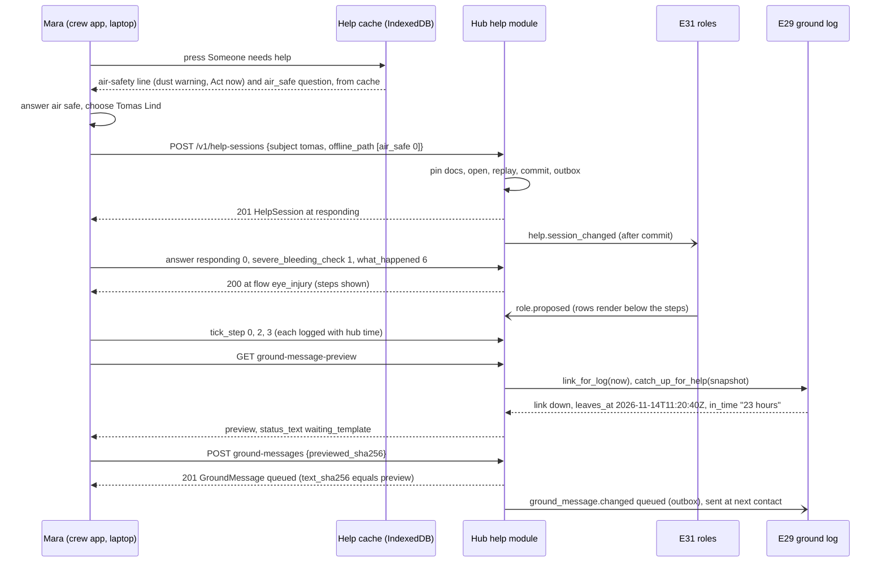
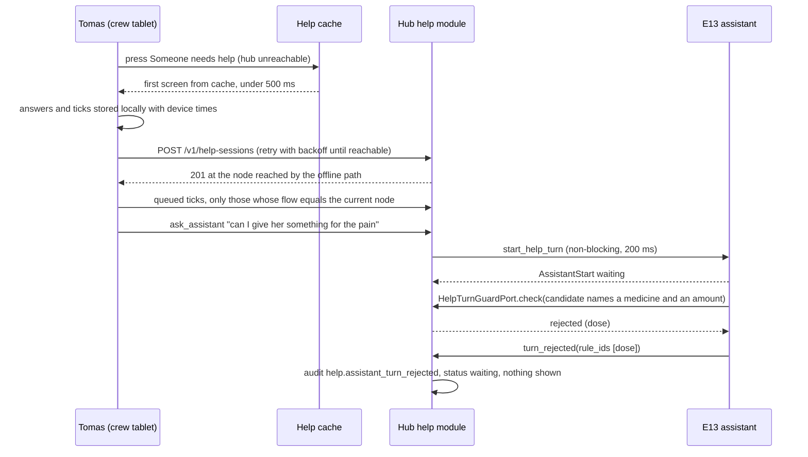

# E26: Someone needs help

Technical design for epic E26. Inputs: the brief (`tdd/E26.md` in the planning package), PRD.md (sections 4.11, 9, 11),
USE-CASES.md (rules 2, 6, 7; UC07 to UC10, UC14, UC16, UC18), RESPONDER-FLOWS.md and `responder-flows.json`,
CONTRACTS.md (sections 1 to 5, 9, 11, 16, 17, 18, 19, 20, 24, 26, 28), `api/openapi.yaml` (tag Help), the E26 work
packages in `backlog.json`, VALIDATION.md and `docs/BUILD-CHARTER.md`. `docs/SYSTEM.md` and `docs/DEPLOYMENT.md` are
being written in parallel; every point that depends on them is marked and listed in section 14.

Clinical status: every step, question and treatment line shown by this epic is the team's reading of public sources.
Unreviewed draft: needs clinician review before live guidance.

## 1. Scope

### Delivers

| Story | What | Requirements | Validation and demo |
|---|---|---|---|
| E26-01 | The help module: the HelpSession state machine over the pinned `responder-flows.json`, opening (button, red flag, warning, plan step, alias), offline path replay, the log with hub and client times, level, close | R15, R39, R43 | V01, V60, V61 (hub side), V62, V71, V75; D15, D22, D23 |
| E26-02 | The guided help session: `ask_assistant`, the assistant line, the help turn guard that checks every assistant turn against the pinned flow, the flow's onboard plan and the active kit before it is shown | R15, R39 (R28 rejection log) | V63; D25 |
| E26-03 | The help screens in the crew app: the help button in every stage head, the cached first screen, the crew broadcast line on every crew screen, the readings panel with its access grant, the second helper | R15, R39, R43 | V01, V60, V62, V64, V71; D15, D22, D23, D24, D41 (render order) |
| E26-04 | The message for the ground: the For the ground card, the preview, Tell the ground, the GroundMessage lifecycle `queued → sent → acknowledged`, replies into the log | R39, R61 (help side) | V68; D26 |

Use cases: UC07 (air-safety line, after-event flow entry), UC09, UC10, UC14 (help side), UC16 (help side), UC18. Invariants
from CONTRACTS section 9 and section 28 owned here: "no urgent response waits for LLM completion, another sample or a
ground acknowledgment", EI1, EI2 and EI5 for HelpSession and GroundMessage.

### Does not deliver

| Item | Epic |
|---|---|
| Role proposals, RoleAssignment, `GET`/`POST /v1/help-sessions/{id}/roles` (shown inside the help screen through a port) | E31 |
| CPR coaching samples and `GET /v1/help-sessions/{id}/coaching`; guided checks | E30 (camera worker E06) |
| Assistant controller, conversations, the stream, model runtime | E13 (prompts and model settings E17, tool gateway E12) |
| Comms queue, `catch_up` composition, `leaves_at`, the ground link and its line, GroundLogView | E29 |
| Ground console, receipts and replies at the ground (`/v1/ground/*`) | E16 |
| Red-flag questions, the concern flow and the episode; episode urgency state | E03 and E04 (questions), E15 (urgency) |
| Warning raising (including any vehicle alarm rule), mission events | E24, E23 |
| Supply uses during a help session (`POST /v1/supplies/{id}/uses`, component mounted in the help screen) | E32 |
| The flow's onboard plan card and plan runs opened from a help session | E28 |
| App shell, design tokens, the stage head that mounts the help button | E03 |
| PWA install, service worker precache, packaging | E20 |

## 2. Dependencies and seams

E26 depends only on E01 (configuration, clock, events, records read port, platform), E02 (identity, roster) and E23
(active environment, mission mode). Every other seam is optional: when the other module is absent, stopped or failing,
the help steps still work (section 9). Optional dependencies are inverted: E26 declares the protocol in its own
`application/ports.py` and the other epic provides the adapter, so there is no import cycle with E31 or E13.

| Seam | Direction | Mechanism | Owner | Required |
|---|---|---|---|---|
| Active release, pinned documents by version, template renderer, amount pattern | E26 uses | `ConfigPort` (E01 application port) | E01 | yes |
| Hub clock, mission time HH:MM | E26 uses | `Clock` (E01) | E01 | yes |
| Unit of work: one transaction with outbox events and audit events | E26 uses | `UnitOfWork` (E01) | E01 | yes |
| Idempotency-Key store, error envelope, `If-Match` parsing | E26 uses | E01 API middleware | E01 | yes |
| Session actor and roles; roster names and `medical_officer_rank` | E26 uses | `SessionActor` (API dependency), `RosterPort.crew(at)` | E02 | yes |
| Active environment ID; mission mode | E26 uses | `EnvironmentPort.active_environment_id()`, `EnvironmentPort.mission_mode()` | E23 | yes |
| Subject's latest accepted observations, formatted | E26 uses | `ObservationReadPort.latest_accepted(...)` | E01 records | readings panel only |
| Allergies and medicines by name | E26 uses | `ProfileFactsPort.allergies_and_medicines(person_id)` | E04 (per SYSTEM.md) | readings panel only |
| Roles for the broadcast | E26 declares `BroadcastRolesSource`; E31 implements | port call with 100 ms timeout | E31 | no |
| Roles proposed when a session reaches a flow | E31 subscribes to `help.session_changed`, reads `HelpQueryPort.snapshot()` | event plus E26 port | E31 | no |
| Assistant turns | E26 declares `HelpAssistantPort`; E13 implements | non-blocking call, 200 ms timeout | E13 | no |
| Assistant turn results and runtime status | E13 calls `HelpAssistantSink` (E26); E26 consumes `assistant.status_changed` | port plus event | E13 | no |
| Turn guard | E13 calls `HelpTurnGuardPort.check(...)` before showing any help-context turn | port | E26 provides | no |
| Link for the log, `leaves_at`, `{in_time}`, `catch_up` | E26 declares `GroundLogComposer`; E29 implements | port, 100 ms timeout | E29 | ground card only |
| Queueing a ground message | E29 subscribes to `ground_message.changed` (state `queued`) from the durable outbox | event | E29 | no (message waits in outbox) |
| Sent, acknowledged, reply | E29 calls `GroundMessageLifecyclePort` (E26); receipts and replies originate at E16 and cross E29's transport with the delay | port | E26 provides | no |
| Kit item names of the active environment, the flow's onboard plan step IDs and texts | E26 reads `kit-map.json` and `onboard-plans.json` through `ConfigPort` (documents, not another module's tables) | config read | E27, E28 (documents) | guard only |
| Plan step escalation | E28 calls `HelpEntryPort.open_from_plan_step(...)`; E28 consumes `help.session_changed` (closed) | port plus event | E26 provides | no |
| Episode urgency on a red-flag entry | E15 consumes `help.session_changed` with `entry.kind` `red_flag` | event | E15 | no |
| Reference checks for `entry.ref_id` | `EpisodeRefPort.visible(...)` (E15), `WarningRefPort.visible(...)` (E24) | port, 100 ms timeout; on timeout the entry is accepted and the ref is audited as unchecked | E15, E24 | no |
| Crew broadcast line and help button in every stage head | E03 mounts E26 components `HelpButton` and `BroadcastLine` | Vue components | E03 mounts, E26 owns | yes |
| Coaching line, role rows, plan card, supply use | E26's help screen mounts components owned by E30, E31, E28, E32 | Vue components with props | owners | no |

Dependants: E28 (escalation), E31 (roles and skill events from closed sessions), E15 (urgency), E16 (reads ground messages
by ID), E21 (fixture and scenarios), E29 (queue).

## 3. Domain model

Pure code in `hub/src/crew_health/help/domain/`. No I/O, no framework imports, no clock reads: every function takes `now`
and the pinned documents as arguments.

### 3.1 Value objects

| Type | Fields | Source |
|---|---|---|
| `PinnedHelpDocs` | `flows: FlowDocument`, `presentation: HelpPresentation`, `ui_copy: UiCopy`, `pins: tuple[ConfigPin, ...]` | The three documents at the versions pinned at open |
| `FlowDocument` | `triage: Mapping[ConfigId, TriageNode]`, `flows: Mapping[ConfigId, Flow]` | `responder-flows.json` |
| `TriageNode` | `id`, `question`, `answers: tuple[TriageAnswer, ...]` (`index`, `label`, `goes_to`) | `triage[]` |
| `Flow` | `id`, `title`, `plain`, `immediate_steps: tuple[str, ...]`, `questions`, `measurements`, `treatment_steps` (`step`, `who`, `kit`, `source_ids`), `call_ground_when`, `body_regions`, `environment_notes: Mapping[str, str]`, `source_ids` | `flows[]` |
| `NodeRef` | `kind: Literal["triage", "flow"]`, `id: ConfigId` | |
| `Subject` | `kind: Literal["self", "crewmate", "unknown"]`, `person_id: PersonId | None`, `display_name: str | None` | request plus roster |
| `Entry` | `kind: Literal["button", "red_flag", "warning", "urgent_event_alias", "plan_step"]`, `ref_id: str | None` | request or calling port |
| `Actor` | CONTRACTS common `actor` | session |
| `LogLine` | `at`, `client_at: datetime | None`, `text`, `by: Actor | None`, `kind` (`answer`, `step`, `crew`, `ground`, `assistant`, `note`, `system`) | rendered from `help-presentation` templates |
| `PathEntry` | `node_id`, `kind` (`triage`, `flow`, `start_over`), `answer_index`, `answer_label`, `at`, `by`, `replayed: bool` | |
| `Tick` | `flow_id`, `step_index`, `ticked_at`, `ticked_by` | |

### 3.2 HelpSession aggregate

Fields map one to one to `help-session.schema.json`; the stored aggregate also keeps `ticks` per flow (so a revisited
flow shows its ticks), `client_time` of each action, the `config_release_id` at open and `mission_id`. Serialization to
the schema is a pure function `to_contract(session, docs, active_environment_id, actor) -> dict`; `node.flow.environment_note`
is `flow.environment_notes[active_environment_id]` or `null`, `node.flow.immediate_steps[i].ticked_*` come from the
ticks of that flow, and `allowed_actions` comes from section 3.5.

State machine (CONTRACTS section 16; one transition per action, `revision` plus 1 on every applied action):

| From | Action | Guard | To | Log line (template) | Error when the guard fails |
|---|---|---|---|---|---|
| none | open | subject valid; `flow_id` only with `entry.kind` `red_flag` (or a plan step) and present in `presentation.red_flag_flows` (red flag) or the pinned flows (plan step) | open at `start_node_id`, or at the flow | `log_templates.opened` (`{opener_name}`, `{subject_name}`) | `INVALID_VALUE` |
| open, triage `n` | `answer(node_id, answer_index)` | `node_id == n`, index in range | open at `goes_to` (triage or flow) | `answer_log[(n, i)].log_template` or the answer's label | `INVALID_TRANSITION` (node differs), `INVALID_VALUE` (index) |
| open | `switch_flow(flow_id)` | flow exists in the pinned flows | open at the flow | `flow_switched` (`{flow_title}`) | `INVALID_VALUE` |
| open, flow `f` | `tick_step(i)` / `untick_step(i)` | `0 <= i < len(f.immediate_steps)` | same node, tick set or cleared (idempotent: ticking a ticked step changes nothing and adds no line) | `step_done` / `step_undone` (`{step}`) | `INVALID_TRANSITION` at triage, `INVALID_VALUE` index |
| open | `call_crew` | none | `crew_called_at` set the first time only | `crew_called` (first time only) | |
| open | `join` / `leave` | person session; not the subject; `join` only when not a helper, `leave` only when a helper | helpers changed | `joined` / `left` (`{helper_name}`) | `ACTION_NOT_ALLOWED` |
| open | `start_over` | none | open at `start_node_id`; path and log keep everything | `started_over` | |
| open | `set_body_region(region or null)`, `set_place(place)` | region in the fixed set | fields set | none: these are not care steps and add no log line (CONTRACTS section 16 says each action adds a log line; see request Q5) | `INVALID_VALUE` |
| open | `add_note(note)` | 1 to 2000 characters | log only | `note` (`{note}`) | `INVALID_VALUE` |
| open | `ask_assistant(text)` | person session; 1 to 2000 characters | `assistant.status` per section 3.6 | `assistant_line.stopped_text` once per stop, `assistant` (`{text}`) only for accepted output | `ACTION_NOT_ALLOWED` (station) |
| open | `close(disposition, note)` | disposition in the enum | closed, `closed_at`, `close` | `closed` (`{disposition}` from `disposition_words`) | |
| closed | any | none | unchanged | none | `SESSION_CLOSED` |

Level: `level_for(node, presentation)` returns `presentation.flow_levels[flow_id].level` at a flow, otherwise
`presentation.default_flow_level`; `level_basis` is that row's `basis`, or `team default` for the default. No other code
path writes `level`.

Body region: when the node becomes a flow with exactly one `body_regions` entry and no person set a region, the
session's `body_region` is that region; otherwise it keeps its value (CONTRACTS section 16).

Second press (decision): `open` for a `subject.person_id` that already has an open session returns that session instead
of creating a second one. If the presser is a person session, not the subject and not already a helper, the same
transaction applies `join` (log `joined`). Its `offline_path` is replayed against that session with the replay rule
below. `subject.kind` `unknown` never deduplicates.

Opener and helpers (decision inside the contract): the opener is recorded in `opened_by` and is not added to `helpers`
(matches every example in `api/examples/help/`). Section 14, request Q2, asks the coordinator whether a person who opens
for a crewmate should be added as the first helper, as V71's "two helpers" suggests.

Offline path replay (`replay(session, path) -> ReplayResult`): entries are applied in order as `answer` actions with
`at` equal to the entry's client time and `PathEntry.replayed` true. The first entry whose `node_id` differs from the
current node stops the replay; the rest are not applied; an AuditEvent `help.replay_stopped` records the index and the
two node IDs (no free text). Entries with client times later than the hub time or earlier than `client_opened_at` are
clamped for ordering and both times are kept.

### 3.3 GroundMessage aggregate

Fields map to `ground-message.schema.json`. States `queued → sent → acknowledged`; `reply` is an attribute that can be
set in `sent` or `acknowledged` (CONTRACTS section 16).

| From | Event | To | Effect |
|---|---|---|---|
| none | Tell the ground press | `queued` | lines, text, `text_sha256`, `session_revision`, `previewed_sha256` recorded; `leaves_at` from the composer; session log `ground_message_queued` |
| `queued` | `mark_sent(sent_at, one_way_delay_s, simulated)` | `sent` | `expected_arrival_at = sent_at + one_way_delay_s`, `leaves_at` null; session log `ground_message_sent` |
| `sent` | `mark_acknowledged(arrived_at)` | `acknowledged` | `acknowledged_at`; session log `ground_message_acknowledged` |
| `sent`, `acknowledged` | `record_reply(text, by, arrived_at)` | unchanged | `reply`; session log `ground_reply` (`{text}`) |
| any other | any | unchanged | duplicate delivery is a no-op (idempotent by `ground_message_id` and target state) |

`status_text` is computed on read: `queued` with the link `down` and `leaves_at` set: `waiting_template` (`{in_time}`);
`queued` otherwise: `queued_template` (`{time}` of `queued_at`); `sent`: `sent_template` (`{time}`, `{delay}`);
`acknowledged`: `acknowledged_template` (`{time}`). Log lines appended by the lifecycle are allowed on a closed session:
they are system lines from the ground side, not crew actions, and they do not reopen it.

Composition (`compose_lines(session, docs, mission_time) -> tuple[str, ...]`), exactly CONTRACTS section 16:

1. `header_template` with `{subject_name}`, `{place}`, `{flow_title}` (the current flow's title; at a triage node the
   placeholder has no value and renders `designed_states.unknown`, logged by the renderer).
2. `answers_template` with `{answers}` = the session's answer log lines (path entries of kind `triage`, in path order,
   rendered as in the log) joined by `". "`.
3. `steps_template` with `{steps}` = the texts of the ticked immediate steps of the current flow in step index order,
   joined by a single space; only when at least one is ticked.
4. `crew_template` with `{time}` = mission time of `crew_called_at` and `{helping}` = `broadcast.helping_template`
   with `{helper_names}` or `broadcast.nobody_helping`; only when the crew was called.
5. `extra_note` when the request has one.

`text` = lines joined by a single space; `text_sha256` = SHA-256 of `text` in UTF-8, lowercase hex. The same function
serves the preview and the press, so the queued message equals the preview at the same session revision and release
(test vector CONTRACTS section 20, "For the ground, act 6").

### 3.4 CrewBroadcast

Derived from the open session plus roles, stored only as `broadcast_id`, `state`, `started_at`, `ended_at`.
`text` = `broadcast.template` (`{subject_name}`, `{place}`) + `" "` + (`helping_template` with `{helper_names}` or
`nobody_helping`); `level` = session level; `roles` from `BroadcastRolesSource` (empty on timeout or absence). Helper
names are joined with `", "` (request Q8 moves the separator to ui-copy). `active` while the session is open, `ended` at
close. It never carries readings (V71).

### 3.5 Access rules (`access.py`)

| Question | Rule |
|---|---|
| May act on an open session | Any session with role `crew`, `crew_medical_officer` or `station` (x-roles). `join` and `leave` need a person session that is not the subject; `ask_assistant` needs a person session. The ground and every other role: `UNAUTHORIZED_SCOPE` |
| May read a session | `crew`, `crew_medical_officer`, `station`: any session. `ground`: `UNAUTHORIZED_SCOPE` on every session object (the ground reads ground messages and the ground log only; request Q3) |
| May read the subject summary | While `state` is `open`: the opener (same person ID, or the same station session ID), every current helper, the subject. Otherwise `UNAUTHORIZED_SCOPE`; on a closed session `SESSION_CLOSED` |
| `allowed_actions` | The actions of section 3.2 whose guards pass for this actor and state; empty when closed |

The help grant is never a records grant: it is evaluated only inside `GET /v1/help-sessions/{id}/subject`. Records
endpoints of E01 never consult it (D24: after the session, Mara's read of Tomas's records is `UNAUTHORIZED_SCOPE`).

### 3.6 Assistant line

`assistant.status`: `off` until the first `ask_assistant`. On `ask_assistant` at a triage node the text is held and
the status is `waiting`; it is sent to the assistant only when the session reaches a flow, so the assistant never speaks
before the fixed steps are on screen. At a flow: `waiting` until E13 reports the turn started, then `answering`; back to
`waiting` after a turn completes, is rejected or fails. Runtime `stopped` or `unavailable` (from `assistant.status_changed`
or the synchronous answer of `HelpAssistantPort`) sets `stopped` or `unavailable` and logs `assistant_line.stopped_text`
once per transition into that status. `last_text` holds only text the guard accepted (`GuardResult.display_text`).

### 3.7 Help turn guard (`turn_guard.py`)

`check(candidate, ctx) -> GuardResult` where `ctx` = the current flow (or `None` at triage), the flow's onboard plan
steps (`step_id`, `text`) from `onboard-plans.json` (`scope.flow_id`), the active environment's kit item names (instrument
and supply `name` from `kit-map.json`), the amount pattern and the medicine terms (section 8). Rules, first failure wins:

| Rule | Check | Rejection rule ID |
|---|---|---|
| G0 | `ctx.flow` is `None` (triage node) | `help_flow` |
| G1 | Action kind is one of `ask`, `request_measurement`, `request_review`, `stop_incomplete`, or no action; tool calls only `get_plan`, `choose_plan_step`, `propose_measurement`, `retrieve_evidence` | `help_flow` |
| G2 | No string in text, question, choices or tool arguments matches the amount pattern (CONTRACTS section 11, loader check 3) | `dose` |
| G3 | Every sentence that contains a medicine term equals, after normalization (case fold, whitespace collapsed, trailing punctuation stripped), a pinned treatment step text or a flow plan step text | `dose` |
| G4 | A text turn with no action carries a citation: a `choose_plan_step` call in this turn whose `step_id` is a step of the flow's plan, or a normalized substring match of an immediate step, treatment step, question or measurement `what` of the pinned flow, or a kit item name of the active kit | `help_flow` (request Q6 adds `uncited`) |
| G5 | Text length at most 2000 characters | `help_flow` |

`GuardResult` = `accepted: bool`, `rule_ids: tuple[str, ...]`, `citations: tuple[Citation, ...]`
(`kind`: `flow_step`, `plan_step`, `kit_item`; `ref`), `display_text: str | None`. For a `choose_plan_step` citation the
display text is the plan step text from the release, never model text (EI6). The guard is deterministic and has no I/O.

### 3.8 Invariants

| ID | Invariant | Test |
|---|---|---|
| I-H1 | Every question, answer, step, treatment line and flow word in a session comes from the pinned `responder-flows.json`; every other word from the pinned `help-presentation.json` or `ui-copy.json`, or hub state | T-E26-010, T-E26-011 |
| I-H2 | No help command calls the model, the network, a sensor adapter or the ground before it commits and returns | T-E26-001, T-E26-002 |
| I-H3 | A triage answer moves only along its configured `goes_to`; "not sure" answers route as configured (`responding` 1, `breathing` 1 reach `not_breathing` in three answers) | T-E26-012, T-E26-013 |
| I-H4 | At most one open session per subject person | T-E26-020, T-E26-021 |
| I-H5 | Every applied action increments `revision` by exactly 1; every applied care action (answer, tick, untick, call crew first time, join, leave, switch, start over, note, close) adds exactly one log line with hub time | T-E26-014 (property) |
| I-H6 | `level` is a pure function of the node and the pinned presentation | T-E26-015 |
| I-H7 | A closed session accepts no action and serves no subject summary | T-E26-016, T-E26-041 |
| I-H8 | The subject summary is readable only by opener, current helpers and subject while open, carries names only for medicines, and never reads the journal | T-E26-040 to T-E26-043 |
| I-H9 | A ground message exists only after a press; its text equals the preview at the same revision; states only move forward | T-E26-060 to T-E26-064 |
| I-H10 | No HelpSession field or transition reads the ground link; only the preview and the ground message do | T-E26-065, T-E26-066 |
| I-H11 | Ground message lines contain only header, answers, ticked steps, crew line and `extra_note`; never notes, readings, journal or participation | T-E26-067 |
| I-H12 | `tick_step`, `untick_step`, `call_crew`, `join`, `leave`, `add_note` merge on a stale `If-Match`; all others return `STALE_VERSION` | T-E26-017 |
| I-H13 | Assistant output reaches the session only after the guard accepts it; rejected output never appears in `log` or `last_text` | T-E26-050 to T-E26-054 |
| I-H14 | Replay stops at the first mismatch and audits it; nothing after it is applied | T-E26-018 |
| I-H15 | The broadcast is `active` exactly while its session is open | T-E26-030 |

## 4. Application layer

`hub/src/crew_health/help/application/`. Every use case runs in one `UnitOfWork`: state change, audit events and outbox
events commit together; events leave after commit (CONTRACTS section 20). Use cases never await a port that is not
required (section 2); optional ports run after commit on the help worker (section 11) with a timeout.

### 4.1 Use cases

| Use case | Input | Output | Errors | Idempotency |
|---|---|---|---|---|
| `OpenHelpSession` | actor, `HelpSessionCreate`, `entry_kind_override` (alias), idempotency key | `(HelpSession, created: bool)` | `INVALID_VALUE`, `UNAUTHORIZED_SCOPE`, `DUPLICATE_COMMAND` | `Idempotency-Key`; plus the open-subject dedupe |
| `ActOnHelpSession` | actor, session ID, `HelpAction`, `If-Match`, key | `HelpSession` | `ACTION_NOT_ALLOWED`, `UNAUTHORIZED_SCOPE`, `NOT_FOUND`, `INVALID_TRANSITION`, `SESSION_CLOSED`, `STALE_VERSION`, `INVALID_VALUE`, `VERSION_REQUIRED`, `DUPLICATE_COMMAND` | key |
| `GetHelpSession`, `ListHelpSessions` | actor, ID or `state`, cursor, limit | contract objects | `NOT_FOUND`, `UNAUTHORIZED_SCOPE` | n/a |
| `ReadSubjectSummary` | actor, session ID | `SubjectSummary` | `UNAUTHORIZED_SCOPE`, `NOT_FOUND`, `SESSION_CLOSED`, `INTERNAL_ERROR` (records port failed; never an empty list) | n/a; writes AuditEvent `help.subject_viewed` |
| `PreviewGroundMessage` | actor, session ID | `GroundMessagePreview` (`persisted` false) | `NOT_FOUND`, `UNAUTHORIZED_SCOPE`, `SESSION_CLOSED` | n/a |
| `QueueGroundMessage` | actor, session ID, `GroundMessageCreate`, key | `GroundMessage` (`queued`) | `NOT_FOUND`, `UNAUTHORIZED_SCOPE`, `SESSION_CLOSED`, `DUPLICATE_COMMAND` | key; never refused for an outdated `previewed_sha256` |
| `GetGroundMessage` | actor, ID | `GroundMessage` | `NOT_FOUND`, `UNAUTHORIZED_SCOPE` | n/a |
| `ListBroadcasts` | actor | active `CrewBroadcast` list | `UNAUTHORIZED_SCOPE` | n/a |
| `GroundMessageLifecycle.mark_sent / mark_acknowledged / record_reply` | from E29 | `None` | `GroundMessageNotFound` (typed) | by message ID and target state |
| `HelpAssistantSink.*` | from E13 | `None` | none | by `turn_id` |
| `OpenFromPlanStep` | from E28 | session ID | `INVALID_VALUE` | by `(plan_run_id, step_id)` key |

### 4.2 Ports (Python protocols, exact signatures)

```python
# hub/src/crew_health/help/application/ports.py
from collections.abc import Sequence
from datetime import datetime
from typing import Literal, Protocol

class HelpSessionRepository(Protocol):
    def get(self, session_id: str) -> HelpSession | None: ...
    def get_open_for_subject(self, person_id: str) -> HelpSession | None: ...
    def insert(self, session: HelpSession) -> None: ...            # raises OpenSessionExists
    def save(self, session: HelpSession, expected_revision: int) -> None: ...  # raises RevisionConflict
    def list(self, state: Literal["open", "closed"], cursor: str | None, limit: int) -> Page[HelpSession]: ...
    def open_session_ids(self) -> Sequence[str]: ...

class GroundMessageRepository(Protocol):
    def get(self, message_id: str) -> GroundMessage | None: ...
    def insert(self, message: GroundMessage) -> None: ...
    def save(self, message: GroundMessage, expected_revision: int) -> None: ...
    def for_session(self, session_id: str) -> Sequence[GroundMessage]: ...

class BroadcastRolesSource(Protocol):            # implemented by E31
    def roles_for_session(self, help_session_id: str) -> Sequence[BroadcastRole]: ...

class HelpAssistantPort(Protocol):               # implemented by E13
    def start_help_turn(self, help_session_id: str, actor: Actor, text: str,
                        conversation_id: str | None) -> AssistantStart: ...
    # returns at once: AssistantStart(status: Literal["waiting", "stopped", "unavailable"], conversation_id: str | None)

class GroundLogComposer(Protocol):               # implemented by E29
    def link_for_log(self, now: datetime) -> LinkForLog: ...
    # LinkForLog(ground_link: GroundLinkDict, leaves_at: datetime | None, in_time_text: str | None, delay_text: str | None)
    def catch_up_for_help(self, snapshot: HelpLogSnapshot) -> CatchUpDict: ...

class ObservationReadPort(Protocol):             # implemented by E01 records
    def latest_accepted(self, person_id: str, codes: Sequence[str], since: datetime) -> Sequence[ReadingView]: ...

class ProfileFactsPort(Protocol):                # implemented by E04 (per SYSTEM.md)
    def allergies_and_medicines(self, person_id: str) -> ProfileFacts: ...
    # ProfileFacts(allergies: NamedList, medicines: NamedList); NamedList(state, names: tuple[str, ...])

class RefCheckPort(Protocol):                    # E15 episodes, E24 warnings
    def visible(self, ref_id: str, actor: Actor) -> bool: ...
```

Ports E26 provides to other modules (`help/application/provided.py`):

```python
class HelpQueryPort(Protocol):
    def snapshot(self, help_session_id: str) -> HelpSessionSnapshot | None: ...
    # HelpSessionSnapshot(id, state, revision, subject_person_id, opener: Actor, helper_ids, node: NodeRef,
    #                     place, roles_needed_flow_id: str | None, opened_at, closed_at, close_disposition)

class HelpEntryPort(Protocol):
    def open_from_plan_step(self, plan_run_id: str, step_id: str, subject_person_id: str,
                            flow_id: str | None, actor: Actor, client_time: datetime) -> str: ...

class GroundMessageLifecyclePort(Protocol):
    def mark_sent(self, message_id: str, sent_at: datetime, one_way_delay_s: float | None, simulated: bool) -> None: ...
    def mark_acknowledged(self, message_id: str, arrived_at: datetime) -> None: ...
    def record_reply(self, message_id: str, text: str, by: Actor, arrived_at: datetime) -> None: ...

class HelpTurnGuardPort(Protocol):
    def check(self, help_session_id: str, candidate: AssistantCandidate) -> GuardResult: ...

class HelpAssistantSink(Protocol):
    def turn_started(self, help_session_id: str, turn_id: str) -> None: ...
    def turn_completed(self, help_session_id: str, turn_id: str, guard: GuardResult) -> None: ...
    def turn_rejected(self, help_session_id: str, turn_id: str, rule_ids: tuple[str, ...]) -> None: ...
    def turn_failed(self, help_session_id: str, turn_id: str, error_code: str) -> None: ...
```

### 4.3 Events

Published (CONTRACTS section 18), each from the outbox after commit:

| Type | Data | Scope | When |
|---|---|---|---|
| `help.session_changed` | HelpSession as the crew sees it (`allowed_actions` empty in event data; clients refetch for their own) | crew | every applied action, open, replay, assistant line change, lifecycle log line |
| `help.broadcast_changed` | CrewBroadcast | crew | open, helpers change, place change, level change, roles change, close |
| `ground_message.changed` | GroundMessage | crew; E01 also delivers it to ground sessions (section 18 lists "crew, ground") | queued, sent, acknowledged, reply |

Consumed: `role.proposed`, `role.changed` (rebuild broadcast roles), `assistant.status_changed` (assistant line),
`config.release_activated` (nothing changes in open sessions: pins hold; new sessions pin the new versions).

AuditEvents (references only, no free text, no values): `help.opened`, `help.replay_stopped`, `help.subject_viewed`,
`help.assistant_turn_rejected` (`rule_ids`, `turn_id`), `help.ref_unchecked`, `ground_message.queued`.

### 4.4 Sequence: principal success path (act 6, model stopped, link down)



### 4.5 Sequence: failure path (hub unreachable, then model output rejected)



## 5. Adapters

### 5.1 Storage (SQLite, WAL, STRICT tables, foreign keys on)

Migration `hub/src/crew_health/help/adapters/migrations/0001_help.sql`, registered with E01's migration runner (per
SYSTEM.md). Times are ISO 8601 UTC text with `Z`.

| Table | Columns (type, constraint) |
|---|---|
| `help_session` | `help_session_id TEXT PK`, `revision INTEGER NOT NULL CHECK (revision >= 1)`, `state TEXT NOT NULL CHECK (state IN ('open','closed'))`, `mission_id TEXT NOT NULL`, `opened_at TEXT NOT NULL`, `client_opened_at TEXT`, `opened_by TEXT NOT NULL` (JSON actor), `entry_kind TEXT NOT NULL CHECK (entry_kind IN ('button','red_flag','warning','urgent_event_alias','plan_step'))`, `entry_ref_id TEXT`, `subject_kind TEXT NOT NULL CHECK (subject_kind IN ('self','crewmate','unknown'))`, `subject_person_id TEXT`, `subject_display_name TEXT`, `place TEXT`, `body_region TEXT`, `node_kind TEXT NOT NULL CHECK (node_kind IN ('triage','flow'))`, `node_id TEXT NOT NULL`, `level TEXT NOT NULL CHECK (level IN ('act','emergency'))`, `level_basis TEXT NOT NULL`, `crew_called_at TEXT`, `broadcast_id TEXT NOT NULL UNIQUE`, `broadcast_ended_at TEXT`, `assistant_status TEXT NOT NULL`, `assistant_conversation_id TEXT`, `assistant_last_text TEXT`, `assistant_pending_text TEXT`, `closed_at TEXT`, `close_json TEXT`, `config_release_id TEXT NOT NULL`, `config_pins TEXT NOT NULL` (JSON), `plan_step_key TEXT UNIQUE` |
| index | `CREATE UNIQUE INDEX ux_help_open_subject ON help_session(subject_person_id) WHERE state = 'open' AND subject_person_id IS NOT NULL` (enforces I-H4 under concurrency) |
| `help_path` | `help_session_id TEXT NOT NULL REFERENCES help_session`, `seq INTEGER NOT NULL`, `node_id TEXT NOT NULL`, `kind TEXT NOT NULL CHECK (kind IN ('triage','flow','start_over'))`, `answer_index INTEGER`, `answer_label TEXT`, `at TEXT NOT NULL`, `client_at TEXT`, `by_json TEXT NOT NULL`, `replayed INTEGER NOT NULL CHECK (replayed IN (0,1))`, `PRIMARY KEY (help_session_id, seq)` |
| `help_log` | `help_session_id`, `seq INTEGER`, `at TEXT NOT NULL` (hub time; the client time for a replayed answer), `hub_at TEXT NOT NULL`, `client_at TEXT`, `text TEXT NOT NULL`, `by_json TEXT`, `kind TEXT NOT NULL CHECK (kind IN ('answer','step','crew','ground','assistant','note','system'))`, `PRIMARY KEY (help_session_id, seq)` |
| `help_tick` | `help_session_id`, `flow_id TEXT`, `step_index INTEGER CHECK (step_index >= 0)`, `ticked_at TEXT NOT NULL`, `ticked_by TEXT NOT NULL`, `PRIMARY KEY (help_session_id, flow_id, step_index)` (an untick deletes the row; the log keeps both) |
| `help_helper` | `help_session_id`, `person_id TEXT`, `display_name TEXT NOT NULL`, `joined_at TEXT NOT NULL`, `left_at TEXT`, `PRIMARY KEY (help_session_id, person_id, joined_at)` |
| `ground_message` | `ground_message_id TEXT PK`, `revision INTEGER NOT NULL`, `help_session_id TEXT NOT NULL REFERENCES help_session`, `state TEXT NOT NULL CHECK (state IN ('queued','sent','acknowledged'))`, `lines_json TEXT NOT NULL`, `text TEXT NOT NULL`, `text_sha256 TEXT NOT NULL CHECK (length(text_sha256) = 64)`, `previewed_sha256 TEXT`, `session_revision INTEGER NOT NULL`, `extra_note TEXT`, `queued_by TEXT NOT NULL`, `queued_at TEXT NOT NULL`, `sent_at TEXT`, `expected_arrival_at TEXT`, `acknowledged_at TEXT`, `one_way_delay_s REAL`, `simulated INTEGER NOT NULL`, `reply_json TEXT`, `catch_up_json TEXT NOT NULL`, `leaves_at_at_queue TEXT`, `config_release_id TEXT NOT NULL` |

The help tables live in the same SQLite file as the event log so a command and its outbox entry commit in one
transaction (per SYSTEM.md). Bounds: `help_path` at most 500 rows and `help_log` at most 10 000 rows per session; at the
bound every action except `close` returns `INVALID_VALUE` with `field_errors[0].code` `LOG_FULL` (not reachable in
practice, required by the charter's bounded queues rule). `offline_path` at most 50 entries.

### 5.2 Client cache (crew app)

`ui/crew/src/features/help/cache.ts`: IndexedDB database `crew-health-help`, store `docs` keyed by document name
(`responder-flows`, `help-presentation`, `ui-copy`) holding `{version, body}`, and store `roster` holding the last
`GET /v1/crew` names (names and person IDs only, no health data). Filled at sign-in and refreshed on
`config.release_activated`; never cleared on sign-out (they hold no private data). Parsed into memory at app start so a
press renders without I/O. Store `outbox` holds pending help commands (open, actions) with device times, drained in order
with exponential backoff (1 s to 30 s, unbounded retries while the page lives, at most 500 queued commands).

### 5.3 External calls

| Call | Timeout | Retries | On failure |
|---|---|---|---|
| `BroadcastRolesSource.roles_for_session` | 100 ms | none | `roles` empty; logged at debug |
| `HelpAssistantPort.start_help_turn` | 200 ms | none | `assistant.status` `unavailable`, `stopped_text` logged once |
| `GroundLogComposer.*` | 100 ms | one | preview: `500 INTERNAL_ERROR` retryable; press: message queued with `leaves_at` null and `catch_up` from a deterministic local fallback (`what_happened` = header and answers lines, other lists empty) |
| `ObservationReadPort.latest_accepted` | 150 ms | none | `500 INTERNAL_ERROR` retryable (never an empty list that could read as "no readings") |
| `ProfileFactsPort.allergies_and_medicines` | 100 ms | none | both lists `state` `unknown`, empty |
| `RefCheckPort.visible` | 100 ms | none | entry accepted, `help.ref_unchecked` audited |

## 6. API

Router `hub/src/crew_health/help/api/router.py`; request and response models generated from `contracts/` (charter rule
3). Roles from `x-roles`; any other role: `403 UNAUTHORIZED_SCOPE`. Every mutating operation requires `Idempotency-Key`.
Help actions ignore `Config-Release` (CONTRACTS section 5).

| operationId | Method and path | Request | Response | Rules beyond the contract text |
|---|---|---|---|---|
| `openHelpSession` | `POST /v1/help-sessions` | `HelpSessionCreate` | `201 HelpSession` (also for the second-press join; request Q1 proposes `200`) | `subject.kind` `self` requires a person session and uses the session person; a `person_id` that differs from the session person returns `INVALID_VALUE`; `crewmate` requires a roster `person_id` (`INVALID_VALUE`), and a crewmate equal to the session person is stored as `self`. `entry.kind` `warning` requires `ref_id`; `red_flag` requires `ref_id` (the episode) and `flow_id` from `red_flag_flows`; `flow_id` with any other kind: `INVALID_VALUE` |
| `createUrgentEvent` | `POST /v1/urgent-events` | same | `201 HelpSession`, `entry.kind` `urgent_event_alias` | same handler |
| `listHelpSessions` | `GET /v1/help-sessions?state=` | | list | ground: empty page (object-level `UNAUTHORIZED_SCOPE` filter, request Q3) |
| `getHelpSession` | `GET /v1/help-sessions/{id}` | | `HelpSession`, `ETag` | ground: `403 UNAUTHORIZED_SCOPE` |
| `actOnHelpSession` | `POST .../actions` | `HelpAction`, `If-Match` | `200 HelpSession` | commuting merge (I-H12); missing `If-Match`: `428 VERSION_REQUIRED` |
| `getHelpSubject` | `GET .../subject` | | `SubjectSummary` | grant section 3.5; audit per read |
| `previewGroundMessage` | `GET .../ground-message-preview` | | `GroundMessagePreview` | computed on read |
| `queueGroundMessage` | `POST .../ground-messages` | `GroundMessageCreate` | `201 GroundMessage` | never refused for an outdated preview |
| `getGroundMessage` | `GET /v1/ground-messages/{id}` | | `GroundMessage` | crew, crew_medical_officer, station, ground |
| `listBroadcasts` | `GET /v1/help/broadcasts` | | list of active broadcasts | |

SubjectSummary construction: `readings` = `ObservationReadPort.latest_accepted(subject, readings_panel.codes,
now - readings_panel.max_age_minutes)`, one per code (latest by `observed_at`), with `label`, `value_text` and
`source_label` formatted by the records module from `indicator-catalog.json` and `ui-copy.origin_words`, `age_minutes`
= floor((now - observed_at) / 60 s); `allergies` and `medicines` from `ProfileFactsPort` (names only). A subject of kind
`unknown` returns empty readings and both lists `unknown`.

Contract example conformance: the responses for the act 6 sequence equal `api/examples/help/eye-01` to `eye-10`,
`ground-message-preview.json` and `ground-message-queued.json` field for field, apart from IDs and the assistant line,
when run on the E21 fixture with the same clock (test T-E26-090).

## 7. User interface

Owned path `ui/crew/src/features/help/`. Vue 3, TypeScript strict. Visual system: UX-DESIGN.md sections 1.9 (help
style) and 1.10 (no animation on the help card), tokens from E03's design system.

| Component | Where | Binds to (CONTRACTS section 19) |
|---|---|---|
| `HelpButton.vue` | Stage head of every screen (mounted by E03's shell); keyboard reachable, first in tab order of the stage head | opens `HelpScreen` from memory; no network |
| `HelpScreen.vue` | Full screen route `/help` and `/help/:id`, in the main bundle (no lazy chunk) | cache first; then `POST /v1/help-sessions` or `GET /v1/help-sessions/{id}`; `POST .../actions`; events `help.session_changed` |
| `AirSafetyLine.vue` | Top of the first screen | the last known active warnings at level `act` or `emergency` with scope `habitat` or `crew` (from the Today view store and `warning.*` events); interim words in section 14 Q4 |
| `WhoStep.vue` | After the `air_safe` answer "yes" | cached roster; the session person first |
| `TriageQuestion.vue`, `FlowSteps.vue` | Body | session `node`, or the cached document before the session exists |
| `FixedButtons.vue` | Always visible on the help screen | `help-presentation.fixed_buttons` |
| `RoleRows` (E31) | Below `FlowSteps`, never above | `GET .../roles`, `role.*` |
| `CoachingLine` (E30) | Inside `FlowSteps` of a flow with a compression check | `GET .../coaching`, `coaching.sample` |
| `AssistantLine.vue` | Beside the steps (right column wide, below the role rows narrow) | `session.assistant`; `ask_assistant` |
| `ReadingsPanel.vue` | Below the assistant line | `GET .../subject` (only once a session exists and the actor holds the grant) |
| `ForTheGroundCard.vue` | Last card | `GET .../ground-message-preview`, `POST .../ground-messages`, `ground_message.changed`, `ground_link.changed` |
| `HelpLog.vue` | Collapsible, last | `session.log` |
| `BroadcastLine.vue` | Top of every crew screen (mounted by E03) | `GET /v1/help/broadcasts`, `help.broadcast_changed`; tap opens `/help/:id` |

Screen order (D22, D23): air-safety line when present, `air_safe`, Who (only after "yes"; any other `air_safe` answer
shows that flow at once with `subject.kind` `unknown`), `responding`, `breathing` or `severe_bleeding_check`,
`what_happened`, then the flow: title, plain words, level word, numbered tickable steps, then role rows, the assistant,
the readings, For the ground, the log. "Me" answers `responding` like anyone else: the configured question already says
"If you are the person who needs help, answer Yes" (request Q4 adds a configured skip).

When the client opens the session: at the Who choice; or at once with `subject.kind` `unknown` when an `air_safe` answer
leads to a flow or a fixed button is tapped first. Answers before the hub answers go in `offline_path`. Ticks made
before the hub answers are queued and sent only when the session's current node is the flow they were made on
(request Q7 adds `flow_id` to `tick_step` so the hub enforces it).

States:

| State | Shown |
|---|---|
| Hub unreachable | The cached screens work; the outbox count is shown as a number beside the fixed buttons; words per request Q4 |
| Model stopped or unavailable | `assistant_line.stopped_text`; every step unchanged |
| Assistant waiting, answering | `assistant_line.waiting_text`; the accepted `last_text` |
| Link down, delayed, up | The For the ground card's `status_text` and E29's link line; nothing else changes (EI2) |
| Readings: SIM, REPLAY, LIVE | `source_label` and `origin_mode` as served; age in minutes |
| Readings unavailable (500) | `ui-copy.error_messages[code]` or `designed_states.unknown` |
| Stale `If-Match` | the merged response replaces local state silently for commuting actions; for others `error_messages.STALE_VERSION` and the latest state |
| Session closed | read only; fixed buttons hidden; `allowed_actions` empty |
| Practice mode (drills, E31) | `HelpScreen` with `mode="practice"`: cached documents only, no API call, no broadcast, no log sent, labeled with the drill's routine item name |

Accessibility: WCAG 2.2 AA; targets at least 44 by 44 CSS px; the first question receives focus on open; the broadcast
line is an `aria-live="assertive"` region for `emergency` and `polite` for `act`; tick state is announced; no animation
and no autoplay on the help card, regardless of `prefers-reduced-motion`.

No content in client code: every visible string comes from the cached documents, hub objects or ui-copy. Test
T-E26-080 scans `ui/crew/src/features/help/**` for string literals in templates and script blocks and fails on any that
is not a vocabulary key, CSS class, route or event name. Test T-E26-081 renders the help screen with an edited
`help-presentation.json` and an edited `responder-flows.json` step and asserts the new words appear.

## 8. Configuration

| Document | Fields read | Loader checks relied on |
|---|---|---|
| `responder-flows.json` (`config/responder-flows.json`, verbatim copy of the package research file) | `triage`, `flows` (all fields), `sources` | 1, 2, 3, 10 |
| `help-presentation.json` (`config/help-presentation.json`, owned by E26) | every field | 1, 10, 13 |
| `ui-copy.json` | `designed_states.unknown`, `origin_words`, `duration_words`, `error_messages`, `level_words` | 1, 13 |
| `onboard-plans.json` | plans with `scope.flow_id`: `step_id`, `text` (guard only) | 14 |
| `kit-map.json` | instrument and supply `name` in the active environment's kit (guard only) | 11 |
| `indicator-catalog.json` | via the records formatter (readings panel) | 9 |

Provenance: each pinned document carries its SHA-256 version in `config_pins`; `help-presentation` rows carry `basis`;
`responder-flows` steps carry `source_ids`; `node.flow.citation` is rendered from the flow's `source_ids` by E01's
citation renderer; the document `notice` ("Unreviewed draft: needs clinician review before live guidance") is shown on
every help screen.

Amount pattern and medicine terms: the guard uses E01's single implementation of loader check 3 (the amount regex and the
medicine words named in CONTRACTS section 11), imported from `crew_health.config.domain.text_rules`; request Q6 moves the
medicine words into `assistant-policy.json`.

Configuration edit test (R43, V75): T-E26-085 activates a release whose `responder-flows.json` changes the text of
`eye_injury` step 0 and whose `help-presentation.json` changes `broadcast.template`; a session opened after activation
shows both; a session opened before keeps its pinned versions until it closes; no code changes between runs.

## 9. Deployment and fallbacks

Tiers follow the charter's model; the tier names and the device inventory are per DEPLOYMENT.md (section 14, Q9).

| Tier (per DEPLOYMENT.md) | How help works |
|---|---|
| Minimum: one laptop and its webcam | Hub and crew app on the same laptop. The help button works from the in-memory cache even when the hub process is stopped or restarting. One device, so the broadcast is the line on that screen; roles still name people, because roles are about the roster, not devices. CPR coaching uses the webcam when E30 and E06 run |
| Laptop plus crew tablets on the habitat network | Each tablet holds the cached documents and roster. The broadcast reaches every connected crew screen through the event stream. A tablet that loses the hub keeps the first screen and every flow, stores answers and ticks with device times and replays them when the hub returns |
| Away team (rover, surface walk support) without the hub in reach | Same as a tablet that lost the hub: the full fixed flows run; the session is created when the device rejoins, with `offline_path` and queued ticks. Clock skew between device and hub is kept (client and hub times) |
| Vehicle integration (habitat or vehicle alarm feed) | A vehicle caution and warning feed enters through E23's habitat adapter as a mission event; a warning rule (E24 configuration) raises it at `emergency`; the air-safety line shows it. The app never acknowledges or silences a vehicle alarm |
| Ground link via store-and-forward bundles | Ground messages leave through E29's transport (file drop, local DTN node, HTTPS on Earth). The help session never reads the link (EI1) |

Redundancy (AGENTS.md section 2): Someone needs help is a critical path with one primary, two backups and a fail safe
state, each exercised by a test that removes what comes before it.

| Layer | What serves the first screen and the flows | Independent of | Test that removes the layer above |
|---|---|---|---|
| Primary | The hub session: state, log, broadcast, readings panel, ground message | the model, devices, the link | T-E26-001 |
| Backup 1 (similar data, different code) | The crew app's local flow engine (`localFlow.ts`) on each device's cached documents, with the outbox | the hub process, the network | T-E26-104 (hub killed mid session) |
| Backup 2 (dissimilar) | Printed help cards: one page per triage node and flow, generated from the same `responder-flows.json` and `help-presentation.json` versions by `uv run crew-health help print-cards --out <dir>` (HTML for printing, with the release ID and the document `notice` on every page), stored with the kit | every computer | T-E26-103 (cards equal the documents, node by node) |
| Fail safe state | When nothing can be shown or a step cannot be resolved (missing document version, replay mismatch): the client shows the fixed buttons and the start node from the last good cached version; the hub never shows an empty flow | | T-E26-105 (corrupt cached document: last good version used, never an empty screen) |

Fallbacks (charter section 5):

| Missing part | Behavior | Shown as |
|---|---|---|
| Language model | Every fixed step, flow, tick, crew call, broadcast, readings panel and ground message works | `assistant_line.stopped_text` |
| Camera or poor signal | Steps unchanged; CPR coaching line shows E30's `cannot_see` phrase or nothing | E30 phrase |
| Devices (oximeter, cuff, thermometer, band) | Readings panel shows older readings with their age, or none | ages and source words |
| Habitat sensors | Air-safety line shows only warnings that exist; never a guessed alarm | absent line |
| Ground link | Everything; messages queue | `waiting_template`, E29 link line |
| Crew tablets | The laptop is a complete station | |
| Roles module (E31) | Steps unchanged; no role rows; broadcast without roles | no rows |
| Hub process | Cached first screen and flows; outbox | outbox count |

## 10. Safety, security and privacy

| Hazard | Cause | Mitigation | Test |
|---|---|---|---|
| H1 Help delayed in an emergency | Model, network, sensor or ground in the path; slow hub | Cached first screen; no optional port awaited before commit; dedicated executor (section 11) | T-E26-001, T-E26-002, T-E26-100 |
| H2 Wrong steps for the situation | Path drift, replay mismatch, tick on the wrong flow | `answer` checks `node_id`; replay stops at mismatch; ticks only on the matching flow (client), Q7 (hub) | T-E26-012, T-E26-018, T-E26-019 |
| H3 "Not sure" treated as fine | Content or code shortcut | Routing only by `goes_to`; vector test on the release | T-E26-013 |
| H4 Air hazard ignored | Helper overcome while helping | Air-safety line before any question; `air_safe` is the configured start node | T-E26-070 (D22) |
| H5 Assistant gives a dose or an unreviewed treatment | Model output | Guard G2, G3; output never shown before acceptance | T-E26-050 to T-E26-054 (V63, D25) |
| H6 Assistant hides or reorders steps | UI or model | Assistant cannot change node, ticks or level (no such action reaches it); layout puts it beside or below; held until a flow is on screen | T-E26-055, T-E26-071 |
| H7 Private data shown to the wrong person | Subject summary or broadcast | Grant section 3.5; broadcast has no readings; journal never read | T-E26-040 to T-E26-043, T-E26-031 |
| H8 Crew waits for the ground | Waiting state or link read | No state waits; link read only in preview and message | T-E26-065, T-E26-066, T-E26-068 |
| H9 Two sessions for one emergency | Two near-simultaneous presses | Partial unique index plus join | T-E26-021 |
| H10 Drill mistaken for a real emergency | Practice run | Practice mode makes no API call and shows the drill label | T-E26-082 |
| H11 Lost log after a crash | Process crash mid-action | One transaction per action; outbox; idempotency keys; client outbox | T-E26-092, T-E26-093 |

Authorization: section 3.5; identity only from the session (never from the body). The station role can open and act,
cannot join (no person) and cannot ask the assistant. The assistant may: ask one question, propose a step of the flow's
plan, request a measurement through the kit gate, request a review on board. It may not: change the node, tick, set the
level, close, approve a ground message, name a dose or a medicine outside the procedure.

Privacy and observability: audit events carry IDs and rule IDs only; the help log text is crew data and is never written
to application logs; structured logs carry `help_session_id`, action name, latency and outcome code only; journal and
participation stores are never read by this module (T-E26-067 uses a journal canary).

Unresolved clinical and equipment assumptions: per flow levels are team defaults; the `not sure` routing of `air_safe` is
a team default; flow review state is document level only (Q5); the rigid eye shield, eye wash set and defibrillator are
"if listed" kit items whose presence comes from the kit map; the CPR rate line is experimental until the venue check.

## 11. Performance and resources

| Budget (16 GB laptop, model loaded, CPU stressed) | Target | Measured by |
|---|---|---|
| Press to first question visible, every route, hub stopped or running, model stopped | p95 under 500 ms (design target 150 ms) | T-E26-100 (Playwright, 30 presses per route) |
| `POST /v1/help-sessions` | p95 under 150 ms | T-E26-101 |
| `POST .../actions` | p95 under 100 ms | T-E26-101 |
| `GET .../subject`, preview | p95 under 150 ms | T-E26-101 |
| Role rows after reaching a flow (E31) | under 500 ms | T-E26-102 |

Help handlers run their database work on a dedicated two-thread executor (`help_executor`) that no other module uses,
so model jobs, imports and forecasting never queue ahead of help (PRD section 10, resource use). Optional port calls run
after commit on a bounded in-process queue (capacity 256; on overflow the oldest broadcast rebuild is dropped and
recomputed on the next event). Client cache: under 1 MB for the three documents and the roster. Hub memory for the
module: under 30 MB with 50 open sessions.

## 12. Test plan

Critical paths first. Fixtures are built from the configuration documents under test (`config/` and
`api/examples/config/`) and the E21 fixture `demo-mara-fd19`, never from hand-typed step text: tests look up steps by
`(flow_id, index)` and assert equality with the document.

| Test ID | Level | Proves | Traces to |
|---|---|---|---|
| T-E26-001 | integration | With the model service absent (no adapter bound), open, answer to a flow and tick succeed; fakes for E13, E29, E31 raise on any call before commit | R15, V01, I-H2 |
| T-E26-002 | integration | No help command awaits an optional port: each optional fake sleeps 5 s; every command returns under 150 ms | R15, I-H2 |
| T-E26-100 | end to end (Playwright) | First question visible within 500 ms of the press on every route, hub stopped, model stopped, CPU stressed; no network request between press and paint | D15, D41, V01, R39 |
| T-E26-010 | contract | Session node texts equal the pinned document by index for all 5 triage nodes and 20 flows | I-H1, R43 |
| T-E26-011 | unit | Log lines render only from `help-presentation` templates; a missing placeholder renders `designed_states.unknown` | I-H1 |
| T-E26-012 | unit | CONTRACTS vector: `air_safe` 0, `responding` 0, `severe_bleeding_check` 1, `what_happened` 6 reach `eye_injury` | I-H3 |
| T-E26-013 | unit | `air_safe` 0, `responding` 1, `breathing` 1 reach `not_breathing` in three answers; level `emergency` | V62, I-H3 |
| T-E26-014 | property (Hypothesis) | Random valid action sequences: revision increments by 1 per applied action; one log line per care action; closed is absorbing | I-H5, I-H7 |
| T-E26-015 | property | `level` equals `flow_levels` lookup for every reachable node | I-H6 |
| T-E26-016 | integration | Every action on a closed session returns `SESSION_CLOSED` with `current_state` | I-H7 |
| T-E26-017 | integration | Stale `If-Match` on commuting actions merges and returns 200; on `answer` returns `409 STALE_VERSION` | I-H12 |
| T-E26-018 | unit | Replay stops at the first mismatch, audits `help.replay_stopped`, applies nothing after it | I-H14, H2 |
| T-E26-019 | unit (vitest) | Client sends a queued tick only when the session is at the tick's flow | H2 |
| T-E26-020 | integration | Second press for the same subject returns the same session and adds the presser as helper with one `joined` line | V71, I-H4 |
| T-E26-021 | integration | Two concurrent opens for one subject (threads) yield one session (partial unique index) | V71, I-H4, H9 |
| T-E26-030 | integration | Broadcast `active` on open, helpers and place reflected, `ended` on close, `help.broadcast_changed` each time | UC18, I-H15 |
| T-E26-031 | contract | Broadcast and session events carry no readings, allergies, medicines or journal fields | V71, H7 |
| T-E26-040 | integration | Opener, helper and subject read the summary while open; another crew member gets `UNAUTHORIZED_SCOPE`; ground gets `UNAUTHORIZED_SCOPE` | V64, D24, I-H8 |
| T-E26-041 | integration | After close the summary read returns `SESSION_CLOSED`; E01 records read by the helper for the subject returns `UNAUTHORIZED_SCOPE` | V64, D24, I-H7 |
| T-E26-042 | integration | Each summary read writes one `help.subject_viewed` audit event; the journal store is never queried (spy) | V64, D24 |
| T-E26-043 | contract | Summary medicines and allergies carry names only; schema has no dose field; records port failure returns 500, never an empty list | I-H8, charter rule 4 |
| T-E26-050 | unit | Guard rejects a text naming an amount (`dose`) | V63, D25, I-H13 |
| T-E26-051 | unit | Guard rejects a sentence naming a medicine term that is not a pinned treatment step | V63, I-H13 |
| T-E26-052 | unit | Guard accepts `ask` with a flow question and a `choose_plan_step` citation; display text is the plan step text from the release | D25, EI6 |
| T-E26-053 | unit | Guard rejects every output at a triage node; `ask_assistant` at triage is held and sent when the flow is reached | E26-02, H6 |
| T-E26-054 | integration (E13 stub mode) | A pinned stub turn naming a medicine is rejected, audited, absent from log and `last_text` | D25, V63 |
| T-E26-055 | integration | Model stopped: `ask_assistant` returns at once, status `stopped`, one `stopped_text` line; steps unchanged | UC16, D25 |
| T-E26-060 | integration | Tell the ground creates `queued` only on the press; text and SHA equal the preview at the same revision | R39, R61, D26, I-H9 |
| T-E26-061 | integration | `queued → sent → acknowledged` through the lifecycle port; duplicates are no-ops; no backward move | D26, I-H9 |
| T-E26-062 | integration | Link down: `leaves_at` is the next contact and `status_text` the waiting template ("23 hours" at 12:05) | V68, D26 |
| T-E26-063 | integration | Ticks after the press are logged; the session never waited (timestamps after `queued_at`) | D26, CONTRACTS section 9 |
| T-E26-064 | integration | A reply is appended with `ground_reply` and changes no node, level or step | UC14, EI5 |
| T-E26-065 | integration | EI2: session responses byte identical with the link up, delayed and down at the same clock | EI2, I-H10 |
| T-E26-066 | static | Import scan: only `preview` and `ground_message` modules import the link types | EI1, I-H10 |
| T-E26-067 | integration | Journal canary and participation data absent from preview, message, catch-up and ground log | D26, I-H11 |
| T-E26-068 | static | No HelpSession or GroundMessage state or field named after waiting for the ground | EI5 |
| T-E26-070 | end to end | With the dust warning at Act now, the air-safety line renders before the Who step; event order press, air safe, who, responding, bleeding check, situation, steps | D22, D23, V60 |
| T-E26-071 | end to end | Role rows and the assistant render below or beside the steps, never above | D41, D25 |
| T-E26-072 | integration | Red-flag entry opens straight on the mapped flow for self and emits the event E15 consumes | V61 (hub side) |
| T-E26-080 | static | No content strings in the help feature | R43, V75 |
| T-E26-081 | component | Edited documents change the rendered words | R43, V75 |
| T-E26-082 | component | Practice mode performs no network request | H10 |
| T-E26-085 | integration | Release activation changes new sessions only; open sessions keep pins | R43, V75 |
| T-E26-090 | contract | Act 6 replay equals the help examples field for field (IDs and assistant line aside) | D23 to D26 |
| T-E26-091 | contract (Schemathesis) | All Help operations conform to `contracts/openapi.yaml` | charter section 4 |
| T-E26-092 | integration | Kill the process between commit and response; retry with the same key returns the same session; nothing lost | charter rule 5 |
| T-E26-093 | integration | Same key with a different body: `409 DUPLICATE_COMMAND` | CONTRACTS section 5 |
| T-E26-101 | performance | Hub latency budgets of section 11 under the stress profile | PRD section 11 |
| T-E26-102 | integration | Role rows present within 500 ms of reaching a flow when E31 runs | D41 |
| T-E26-103 | unit | Printed cards: for every triage node and flow, the card text equals the document text by index, with release ID and notice | AGENTS.md section 2, R15 |
| T-E26-104 | end to end | Kill the hub after the session opens: the tablet keeps answering and ticking from cache; on restart the outbox replays and the log holds every step with device and hub times | R15, H11, AGENTS.md section 2 |
| T-E26-105 | component | A corrupt or missing cached document: the last good version renders; with no good version the fixed buttons and an error state from `error_messages` show, never an empty flow | AGENTS.md section 2 |

Mutation testing (charter section 4) on `domain/session.py`, `domain/replay.py`, `domain/turn_guard.py`,
`domain/ground_message.py` and `domain/access.py`.

## 13. File ownership

Creates and owns:

```
hub/src/crew_health/help/__init__.py
hub/src/crew_health/help/domain/{flows,session,replay,level,broadcast,ground_message,access,turn_guard,errors}.py
hub/src/crew_health/help/application/{ports,provided,open_session,act_on_session,subject_summary,ground_preview,ground_queue,ground_lifecycle,assistant_sink,queries}.py
hub/src/crew_health/help/adapters/{sqlite_repository,executor,print_cards}.py   (print_cards: the CLI subcommand, registered with E20's entry point)
hub/src/crew_health/help/adapters/migrations/0001_help.sql
hub/src/crew_health/help/api/{router,errors}.py
hub/tests/help/**
config/help-presentation.json
config/responder-flows.json            (verbatim copy of the package research file; content changes come by request)
ui/crew/src/features/help/**           (components of section 7, cache.ts, outbox.ts, localFlow.ts, tests)
ui/crew/e2e/help/**
```

Reads, never edits: `contracts/**`, `config/ui-copy.json`, `config/onboard-plans.json`, `config/kit-map.json`,
`config/indicator-catalog.json`, E01, E02, E23 application ports, E03 shell and design tokens.

## 14. Open questions and requests

1. Q1 (request, contract): a second press for an open subject returns the existing session with `201`. Proposal: allow
   `200 OK` with the existing `HelpSession` on `openHelpSession` and `createUrgentEvent`. Interim: `201` with the
   existing session and its `Location`.
2. Q2 (coordinator): V71 says two pressers give "two helpers", while every help example keeps the opener out of
   `helpers`. Proposal: a person who opens for a crewmate is added as the first helper (`joined_at` = `opened_at`), and
   the examples `eye-01` to `eye-10`, `broadcast.json` and the ground message examples are regenerated. Interim: opener
   not a helper; V71 asserted as one session, one log, the second presser in `helpers`.
3. Q3 (request, contract): remove `ground` from `x-roles` of `listHelpSessions` and `getHelpSession`; the ground reads
   only approved messages and the ground log (R39: the log leaves only after a helper approves). Interim: object-level
   `UNAUTHORIZED_SCOPE` for the ground role.
4. Q4 (request, configuration shape, blocking for D22 and D23 copy): add to `help-presentation.json`:
   ```json
   "who_question": {"text": "Who needs help?", "self_label": "Me", "unknown_label": "Not sure who"},
   "self_answers": [{"node_id": "responding", "answer_index": 0}],
   "air_safety_line": {"text": "If an alarm is sounding, follow the vehicle's emergency procedure first.",
                       "levels": ["act", "emergency"], "scopes": ["habitat", "crew"]},
   "readings_words": {"title": "Latest readings", "allergies": "Allergies", "medicines": "Medicines",
                      "none_recorded": "None recorded", "unknown": "Not known"},
   "ground_card_title": "For the ground",
   "hub_unreachable_text": "Working from this device. The log goes to the hub when it is back."
   ```
   with schema entries and loader check 10 extended (every `self_answers` node and index exists). Interim: the Who step
   shows roster names only (the session person first, no heading); `air_safety_line` shows the triggering warning's
   hub-rendered `title`; readings show names and values without headings; `self` answers `responding` by hand.
5. Q5 (request, contract): flows carry no review state. Proposal: add `review_state` (`unreviewed`, `reviewed`,
   `rejected`) and `checked_by` to each flow in `config-responder-flows.schema.json` and `review_state` to
   `HelpSession.node.flow`. Also confirm that `set_body_region` and `set_place` add no log line (section 16 says every
   action does; no template exists). Interim: the document `notice` on every help screen; no log line for those two.
6. Q6 (request, contract): structured citations for help turns. Proposal: add `flow_step` and `kit_item` to
   `evidence_ref.kind`, add `citations[]` to `HelpSession.assistant`, add forbidden output `uncited` and a
   `medicine_terms[]` list with `source_ids` to `assistant-policy.json`. Interim: guard rules G3 and G4 of section 3.7
   using E01's loader check 3 words and verbatim matching; rejections reported as `dose` or `help_flow`.
7. Q7 (request, contract): add optional `flow_id` to `HelpAction` for `tick_step` and `untick_step`; the hub returns
   `INVALID_TRANSITION` when the session is not at that flow. Interim: client-side check (T-E26-019).
8. Q8 (request, configuration shape): ui-copy `list_separator` for helper names. Interim: `", "`.
9. Q9 (per DEPLOYMENT.md): tier names, whether the minimum laptop runs a crew session or a `station` session by default,
   which crew devices exist (laptop only, tablets), and whether an away-team device syncs over the habitat network or
   only on return. Section 9 assumes the charter model. The readings panel and `ask_assistant` need a person session.
10. Q10 (per SYSTEM.md): GroundMessagePreview is listed under the catch-up composer (E29) in CONTRACTS section 20, but
    its endpoint is in the Help tag. This TDD owns the endpoint, the lines and the text, and calls E29 for `catch_up`,
    `leaves_at` and the link. Also confirm `ProfileFactsPort` (allergies, medicines) belongs to E04 intake and that the
    help migration registers with E01's runner.
11. Q11 (request to E01): event delivery of `ground_message.changed` to ground sessions (scope "crew, ground") needs one
    event delivered to two scopes; proposal: E01's dispatcher keeps a per type table of extra scopes from section 18.
12. Q12 (USER): should a new help session also sound an audible alert on the other crew devices? The package specifies a
    visual broadcast only and the help card never animates; the vehicle's own alarm remains separate. Interim: visual
    only.

## 15. Build plan

| Step | Work | Done when |
|---|---|---|
| 1 | Domain: flows parsing, session state machine, level, replay, access, ground message composition, guard | T-E26-010 to T-E26-018, T-E26-050 to T-E26-053 green; 95% branch on domain; mutation score at least 80% on the five critical files |
| 2 | Storage and migration; repositories; executor | T-E26-021, T-E26-092 green |
| 3 | Application use cases with fakes for every optional port; outbox events; audit | T-E26-001, T-E26-002, T-E26-020, T-E26-030, T-E26-040 to T-E26-043, T-E26-060 to T-E26-068 green |
| 4 | API router and error mapping; contract tests | T-E26-016, T-E26-017, T-E26-091, T-E26-093 green |
| 5 | Crew app: cache, local flow engine (shares the path vectors with step 1), HelpButton, HelpScreen, BroadcastLine, fixed buttons, outbox | T-E26-019, T-E26-080 to T-E26-082 green |
| 6 | Readings panel, For the ground card, assistant line, slots for role rows and coaching | T-E26-055, T-E26-070, T-E26-071 green |
| 7 | Integration with E13 stub, E29, E31 adapters when available; act 6 replay | T-E26-054, T-E26-090, T-E26-102 green |
| 8 | Performance under stress | T-E26-100, T-E26-101 green on the 16 GB laptop |
| 9 | Redundancy: printed cards, hub kill, corrupt cache | T-E26-103 to T-E26-105 green |

Gate commands:

```
uv run python scripts/validate_contracts.py
uv run mypy --strict hub/src/crew_health/help
uv run ruff check . && uv run ruff format --check .
uv run lint-imports
uv run pytest -q hub/tests/help --cov=crew_health.help --cov-branch
pnpm -C ui/crew typecheck && pnpm -C ui/crew test -- features/help
pnpm -C ui/crew exec playwright test e2e/help
uv run pytest -q eval -m "E26 or V01 or V60 or V62 or V63 or V64 or V68 or V71 or D15 or D22 or D23 or D24 or D25 or D26"
```
