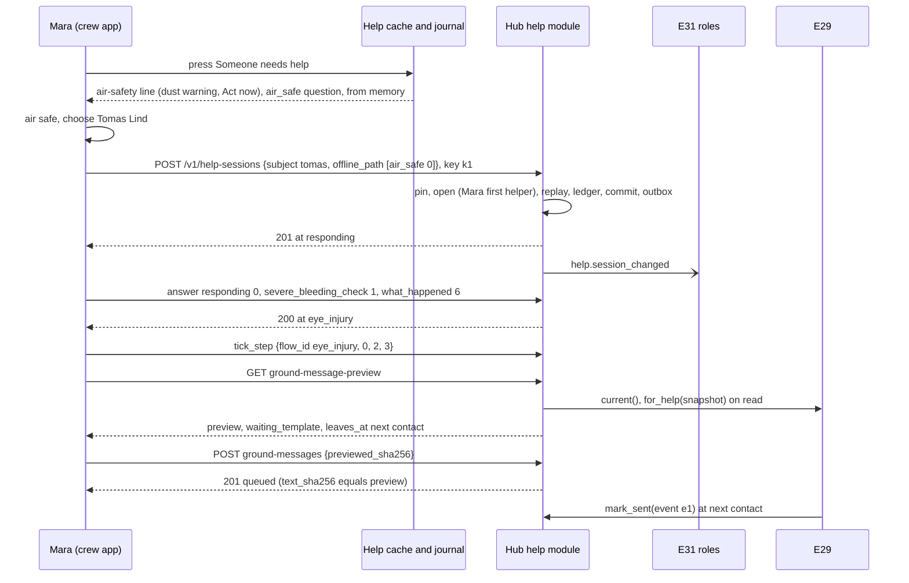

# E26: Someone needs help

Technical design for epic E26. Inputs: the brief (`tdd/E26.md` in the planning package), PRD.md (sections 4.11, 9, 11),
USE-CASES.md (rules 2, 6, 7; UC07 to UC10, UC14, UC16, UC18), RESPONDER-FLOWS.md and `responder-flows.json`,
CONTRACTS.md (sections 1 to 5, 9, 11, 16 to 20, 22, 24, 26, 28), `api/openapi.yaml` (tag Help), the E26 work packages in
`backlog.json`, VALIDATION.md, `docs/BUILD-CHARTER.md` and the designs of E11, E12, E24, E28, E30 and E31 in
`docs/tdd/`. `docs/SYSTEM.md` and `docs/DEPLOYMENT.md` do not exist yet; every point that depends on them is listed in
section 14. Package sections are cited, not restated.

Clinical status: every step, question and treatment line shown by this epic is the team's reading of public sources.
Unreviewed draft: needs clinician review before live guidance. All test evidence in this document is planned; none of it
has run.

## 1. Scope

### Delivers

| Story | What | Requirements | Validation and demo |
|---|---|---|---|
| E26-01 | Help module: HelpSession state machine over the pinned `responder-flows.json`, every entry (button, red flag, warning, plan step, alias), offline replay, the command ledger, the log with client and hub times, level, close, flow review state | R15, R39, R43 | V01, V60 (air-safety part), V61 (hub side), V62, V71, V75; D15, D22, D23 |
| E26-02 | Guided help session: `ask_assistant`, the turn ledger, the help turn guard, rendering of accepted turns from configuration | R15, R39 (R28 rejection log) | V63; D25 |
| E26-03 | Help screens in the crew app: help button, help document cache and pre-authentication bootstrap consumer, local flow engine, command journal, crew broadcast line, readings panel, second helper, the slot for E29's For the ground card | R15, R39, R43 | V01, V60 (air-safety part), V62, V64, V71; D15, D22, D23, D24, D41 (render order) |
| E26-04 | GroundMessage: lines and text from the help log, Tell the ground, lifecycle `queued → sent → acknowledged` with a durable incoming-event ledger, replies into the log, onboard and ground projections | R39, R61 (help side) | V68; D26 (hub side) |

Invariants owned (CONTRACTS 9 and 28): no urgent response waits for LLM completion, another sample or a ground
acknowledgment; EI1, EI2, EI5 for HelpSession and GroundMessage.

V60 is split; each part has one owner (request R-E26-14 asks the coordinator to confirm the three outside E26):

| V60 part | Owner | Test |
|---|---|---|
| Air-safety line before any question, from a warning or a vehicle alarm warning | E26 | T-E26-070, T-E26-073 |
| Vehicle alarm entering as a crew-scope warning (`vehicle_alarm_sounding`) | E24 (R-E24-9) | E24 111 |
| After-event checks for each exposed person (`after_event` cadence binding) | E25 | end to end T-E26-074, runs when E24, E25, E29 are greenlit |
| Exposure noted per person; ground summary lists who was exposed | E24 (exposure), E29 (summary) | same |

### Does not deliver

| Item | Epic |
|---|---|
| Urgency of the episode, its disposition (help close never changes urgency, E11 DE11-5) | E11 |
| Role proposals, RoleAssignment, roles endpoints; acting medical officer assignment | E31 |
| CPR coaching and guided checks | E30 (camera worker E06) |
| Assistant controller, conversations, model runtime; tool gateway and phase exposure | E13; E12 |
| `catch_up` composition, `leaves_at` source (the link), the For the ground card component (E29-05), caching of plans and teach steps (E29-06), transport | E29 |
| Ground console, receipts and replies at the ground (`/v1/ground/*`) | E16 |
| Red-flag questions and the episode | E04, E15 |
| Warning raising (including vehicle alarm rules), mission events | E24, E23 |
| Plan step availability (kit, stock, skill holders) and plan runs | E28 |
| Supply uses during help | E32 |
| App shell, stage head, sign-in screen | E03 |
| PWA install, service worker precache, the help bootstrap artifact and the static fail-safe shell (R-E26-12) | E20 |

## 2. Dependencies and seams

Required: E01 (configuration by version, clock, unit of work and outbox, records read port, settings), E02 (identity,
roster), E23 (active environment, mission mode). Every other seam is optional; with the other module absent, stopped or
failing, every fixed help step works (section 9). Optional dependencies are inverted: E26 declares the protocol in
`help/application/ports.py` and the owner provides the adapter.

| Seam | Direction | Mechanism | Owner | Required |
|---|---|---|---|---|
| Documents by name and version (every activated version, R-E11-10), active release, template renderer | uses | `ConfigReader.document(name, version)` | E01 | yes |
| Amount pattern and medicine words | uses | `TextRulesPort.amount_pattern()`, `medicine_terms(version)` (E01 application port; never `crew_health.config.domain` imports) | E01 | yes |
| Runtime limits (section 5.4) | uses | `SettingsPort.get(key)` | E01 | yes |
| Hub clock, mission time HH:MM with the mission clock version | uses | `Clock.now()`, `Clock.mission_hhmm(at) -> MissionTime(text, clock_version)` | E01 | yes |
| One transaction with audit, outbox (explicit scope per entry, R-E26-10) and idempotency | uses | `UnitOfWork` | E01 | yes |
| Session actor and roles; roster | uses | `SessionActor`; `RosterPort.crew(at)` | E02 | yes |
| Active environment, mission mode | uses | `EnvironmentPort.active_environment_id()`, `mission_mode()` | E23 | yes |
| Subject's latest accepted observations | uses | `ObservationReadPort` (4.2) | E01 | readings only |
| Allergies and medicines by name | uses | `ProfileFactsPort` (4.2) | provider per R-E04-6 (E03 proposed) | readings only |
| Active shared warnings at `act` or above; warning visibility | uses | `WarningQueries.active_shared_at_or_above(level)`, `visible(session, warning_id)` | E24 | no |
| Episode visibility for `red_flag` refs | uses | `EpisodeRefPort.visible(session, episode_id)` | E15 | no |
| Flow plan steps with review state and availability | uses | `FlowPlanPort.plan_for_flow(...)` (4.2) | E28 (R-E26-8) | guard only |
| Link snapshot and in-time words; catch-up composition | uses | `GroundLinkReader.current()`, `InTimeWords.render(now, until)`, `CatchUpComposer.for_help(snapshot)` | E29 | ground message only |
| Ground message lifecycle | provides | `GroundMessageLifecyclePort` (4.3) | E26 | no |
| Assistant turns | uses | `HelpAssistantPort.start_help_turn`, `cancel_help_turn` | E13 | no |
| Turn results; guard | provides | `HelpAssistantSink`, `HelpTurnGuardPort` | E26 | no |
| Broadcast roles | uses | `BroadcastRolesSource.roles_for_session(id)` | E31 | no |
| Help snapshot, readability, ref, broadcasts | provides | `HelpQueryPort` (E31, E28, E30), `BroadcastQueries` (E03) | E26 | no |
| Help from a plan step, inside E28's transaction | provides | `HelpSessionOpener.open_for_plan_step(uow, ...)` | E26 | no |
| Help from a red flag yes (E11 effect runner) | provides | `HelpEntryPort.open_from_red_flag(...)` | E26 (R-E11-4) | no |
| Urgency from help sessions | E11 consumes | `help.session_changed` through E01's durable outbox subscription | E11 | no |
| Help button, broadcast line; help button on the sign-in screen | E03 mounts E26 components | `HelpButton`, `BroadcastLine` | E03 mounts (R-E26-13) | yes |
| Role rows, coaching line, plan card, supply use, For the ground card | E26's help screen mounts | Vue slots with props | E31, E30, E28, E32, E29 | no |
| Help bootstrap artifact and static shell | E26 reads at start | `help-bootstrap.json` in the precache; static shell markup | E20 (R-E26-12) | yes for pre-authentication |

Dependants: E11, E28, E30, E31, E03, E16 (reads delivered ground messages), E21 (fixture), E29 (queue).

## 3. Domain model

Pure code in `hub/src/crew_health/help/domain/`: no I/O, no framework imports, no clock reads; every function takes
`now`, the pinned documents and the settings it needs as arguments.

### 3.1 Value objects

| Type | Fields |
|---|---|
| `PinnedHelpDocs` | `release_id`, `flows: FlowDocument`, `presentation: HelpPresentation`, `ui_copy: UiCopy`, `pins: tuple[ConfigPin, ...]` |
| `Flow` | as `responder-flows.json` `flows[]`, plus `review_state: Literal["unreviewed", "reviewed", "rejected"]` (parsed when R-E26-5 adds it; absent means `unreviewed`) |
| `NodeRef` | `kind: Literal["triage", "flow"]`, `id: ConfigId` |
| `Subject` | `kind`, `person_id: PersonId | None`, `display_name: str | None` |
| `BodyRegionState` | `value: BodyRegion | None`, `source: Literal["none", "derived", "person"]` |
| `Tick` | `flow_id`, `step_index`, `ticked_at`, `ticked_by`, `client_at` |
| `Duration` | `seconds: Decimal` (`>= 0`, UCUM `s`); built at the port boundary from a unit-bearing quantity; unknown is `None`, never `0` |
| `CommandRecord` | `key`, `body_sha256`, `actor_id`, `outcome: Literal["applied", "rejected"]`, `result_revision`, `error_code` |
| `TurnRecord` | section 3.6 |
| `HelpLogSnapshot` | section 3.3 |

### 3.2 HelpSession aggregate

Fields map to `help-session.schema.json`. The stored aggregate also keeps: ticks per flow, `node_revision` (revision at
which the node last changed), `context_epoch` (increments on answer, switch, start over, close), `body_region` with its
source, `mission_id`, `config_release_id`, the assistant runtime status and citations. `to_contract(...)` is pure.

Each applied action increments `revision` by 1 and adds exactly one log line (CONTRACTS 16 "Actions"):

| From | Action | Guard | To | Log line | Error |
|---|---|---|---|---|---|
| none | open | subject valid; `flow_id` only for `red_flag` (in `red_flag_flows`) or a plan step (in the pinned flows) | open at `start_node_id` or the flow; a person opener for a `crewmate` or `unknown` subject is the first helper, `joined_at = opened_at` | `opened` | `INVALID_VALUE` |
| triage `n` | `answer(node_id, i)` | `node_id == n`, `i` in range | `goes_to` | `answer_log[(n, i)]` or the label | `INVALID_TRANSITION`, `INVALID_VALUE` |
| open | `switch_flow(f)` | `f` in pinned flows | flow `f` | `flow_switched` | `INVALID_VALUE` |
| open | `tick_step` / `untick_step` | tick rule below | tick set or cleared on the target flow; idempotent (no change, no line) | `step_done` / `step_undone` | `INVALID_TRANSITION`, `INVALID_VALUE`, `STALE_VERSION` |
| open | `call_crew` | none | `crew_called_at` first time | `crew_called` first time only | |
| open | `join` / `leave` | person session, not the subject; join when not a helper, leave when a helper (the opener too) | helpers changed | `joined` / `left` | `ACTION_NOT_ALLOWED` |
| open | `start_over` | none | `start_node_id`; path and log keep everything | `started_over` | |
| open | `set_body_region(r or null)` | `r` in the fixed set | `BodyRegionState(r, "person")` | `note` with `{note}` = `ui-copy.body_region_labels[r]` or `designed_states.unknown` for null (interim, R-E26-5) | `INVALID_VALUE` |
| open | `set_place(p)` | 1 to 200 characters | place | `note` with `{note}` = `p` (interim, R-E26-5) | `INVALID_VALUE` |
| open | `add_note(t)` | 1 to `help.note_max_chars`; soft log cap not reached | log only | `note` | `INVALID_VALUE` (`LOG_FULL`) |
| open | `ask_assistant(t)` | person session; 1 to 2000 characters; soft log cap not reached | turn per 3.6 | `note` with the asked text, kind `assistant` (interim, R-E26-5) | `ACTION_NOT_ALLOWED`, `INVALID_VALUE` |
| open | `close(disposition, note)` | disposition in the enum | closed; broadcast ended; turns cancelled | `closed` | |
| closed | any | | unchanged | none | `SESSION_CLOSED` |

Tick rule (closes the delayed-tick race; the hub decides atomically, the client cannot). `HelpAction.flow_id` already
exists in `requests.schema.json` (`HelpAction.properties.flow_id`); E26 gives it tick semantics (R-E26-6 documents them):

1. `flow_id` present: it must be a flow in this session's path (`INVALID_TRANSITION` otherwise), `step_index` in range of
   that flow (`INVALID_VALUE`). The tick applies to that flow's ticks whatever the current node; a tick on a past flow
   is a late record of real care and changes no node. The commuting merge of a stale `If-Match` applies.
2. `flow_id` absent: the node must be a flow (`INVALID_TRANSITION`), and a stale `If-Match` merges only when its revision
   is `>= node_revision`; otherwise `STALE_VERSION` with `current_state`, because the index may name another flow's step.

E26's client always sends `flow_id`. Pins never change within a session, so `(flow_id, step_index)` names one text.

Level: `level_for(node, presentation)` (flow row or `default_flow_level`); nothing else writes `level`.

Body region (CONTRACTS 16 "Nodes and level", exact): on every node change, when `source != "person"`, the value becomes
the new flow's region if it has exactly one, otherwise `null` with `source = "derived"` (`"none"` at a triage node). A
person's choice, including an explicit `null`, is kept until a person changes it.

Opener and helpers (decision D-E26-1). V71 requires "One session with two helpers and one shared log" when two crewmates
press for one person. The help examples keep the opener out of `helpers`, which yields one helper and a broadcast saying
nobody is helping while the opener helps. VALIDATION is the acceptance criterion, so a person who opens for a crewmate
or an unknown person is the first helper; a `self` opener (the subject) and a `station` opener are not. The opener may
`leave` and `join` like anyone. Broadcast and ground message name helpers in join order; `nobody_helping` appears only
when `helpers` is empty. R-E26-2 asks for the examples to be regenerated; T-E26-090 lists the resulting differences.

Second press: `open` for a subject person with an open session returns that session (I-H4); a person presser who is
not the subject and not a helper joins in the same transaction (`joined`). Its `offline_path` is replayed against that
session. A red-flag open (client or E11's runner) against an existing session never changes its node: the steps under a
helper's hands never move; E11 links the episode from the returned session ID (R-E11-4). `unknown` never deduplicates.

Offline replay (`replay(session, path, client_docs) -> ReplayResult`), CONTRACTS 16 "Opening" step 2: entries apply in
order as `answer` with their client time. Replay stops at the first entry that (a) names a node other than the current
one, or (b) when the request's `Config-Release` names a release whose `responder-flows` version differs from the pinned
one, has a different normalized answer label or `goes_to` at `(node_id, answer_index)` in the two versions (read by
version, R-E11-10); an unreadable client version stops at entry 0. The header is information only: help actions never
fail on it (CONTRACTS 5, `Config-Release` row). A stop is audited (`help.replay_stopped`, index, reason, node IDs) and
returned as `ReplayResult.applied_count`; the client turns the rest into its reconciliation list (section 7). Client
times later than hub time or earlier than `client_opened_at` are kept and clamped only for ordering.

Command ledger: every applied or rejected command records `CommandRecord(key = Idempotency-Key)` in the session's
transaction and keeps it for the session's life plus `help.command_ledger_retention_days` after close. A retry with the
same key and body returns the recorded outcome at any age, so the help path does not depend on the 24 hour platform
window (CONTRACTS 5, `Idempotency-Key` row); a different body returns `409 DUPLICATE_COMMAND`. Opens record
`(key, body_sha256, session_id)` in `help_open_command` with no expiry.

### 3.3 GroundMessage aggregate

States `queued → sent → acknowledged` (CONTRACTS 16, 26). The message's content (`lines`, `text`, `text_sha256`,
`session_revision`, `snapshot`) is immutable after the press.

`HelpLogSnapshot` (built in the press transaction from the session at revision R, also by the preview): `session_id`,
`session_revision`, `subject_name`, `place`, `flow_id`, `flow_title`, `answer_lines` (path order), `ticks` (flow visit
order, then index: `flow_id`, `index`, `text`, `ticked_at`, `ticked_time_text`), `crew_called_at` and its time text,
`helper_names`, `clock_version`, `pins`, `onboard_plans_version`, `environment_id`, `episode_id | None`, `queued_at`.

`compose_lines(snapshot, presentation) -> tuple[str, ...]` follows CONTRACTS 16 "Message for the ground" exactly; the
steps line lists the ticked steps of every flow in the snapshot, so a step done on an earlier flow is not lost (CONTRACTS
26: "for each ticked help step"). Placeholders without a value render `designed_states.unknown`. `text` joins lines
with one space; `text_sha256` is lowercase hex SHA-256 of UTF-8 `text`. Preview and press call the same builder and
composer, so the queued text equals the preview at the same revision and pins.

Computed on read, never stored, so no outage at press time can lose them: `leaves_at` (the link's `next_contact_at`
while `queued` and the link is `down`, else `null`), `status_text` (`waiting_template` with the link `down`,
`queued_template` with it up, delayed or unknown; then `sent_template`, `acknowledged_template`; an unknown delay
renders `{delay}` as `designed_states.unknown`), and `catch_up` = `CatchUpComposer.for_help(snapshot)`. When the composer
fails or times out, `catch_up` is the fallback: `what_happened` = header and answer lines, `what_was_done` = one
`step_done_line` per tick and the crew line (both from the snapshot, so known care is never erased), `being_watched` and
`advice_welcome` = `[designed_states.unknown]` (never `nothing_watched`, which would be a claim). E29 composes again
when it transports, from the same stored snapshot, so delivery is complete once the composer runs.

Incoming events (from E29, originating at E16 or the transport) form an append-only ledger keyed by `event_id`:

| Event | Precondition | Effect | Session log |
|---|---|---|---|
| `sent(sent_at, delay, simulated)` | `queued` | `sent`; `expected_arrival_at = sent_at + delay` or `null` when the delay is unknown | `ground_message_sent` |
| `arrived(arrived_at)` | `sent` or later | `ground_arrived_at` (first only) | none |
| `receipt(received_at, arrived_at)` | `sent` | `acknowledged`, `acknowledged_at`; implies arrival | `ground_message_acknowledged` (first only) |
| `reply(text, by, replied_at, arrived_at)` | `sent` or `acknowledged` | new reply row; `reply` = latest by `replied_at`, then `event_id`; implies arrival | `ground_reply` per reply |

A known `event_id` returns `duplicate` and changes nothing. An event whose precondition does not hold yet (a receipt
before the local `sent` was recorded) is stored `buffered` and applied in `(occurred_at, event_id)` order when the
precondition holds; nothing is discarded. A second receipt is recorded without a state change. Lines on a closed session
are system lines and do not reopen it (EI5). The contract keeps one `reply`; R-E26-9 proposes `replies[]`, and until
then every reply is in the session log.

Projections: the crew sees the message from the press. A `ground` session sees it only once `ground_arrived_at` is set
(`404 NOT_FOUND` before, so an outage never leaks it), matching CONTRACTS 20 "read what reached the ground".

### 3.4 CrewBroadcast

As CONTRACTS 16 "Crew broadcast and readings panel": text from `broadcast.template` plus `helping_template` or
`nobody_helping`; helper names joined with the ui-copy separator (R-E26-7; interim `", "`); level from the session;
roles from E31 (empty on timeout or absence); `active` exactly while open; never readings (V71).

### 3.5 Access rules (`access.py`)

| Question | Rule |
|---|---|
| Act on an open session | `crew`, `crew_medical_officer`, `station`; `join`, `leave`, `ask_assistant` need a person session. Others: `UNAUTHORIZED_SCOPE` |
| Read a session | `crew`, `crew_medical_officer`, `station`. `ground`: `UNAUTHORIZED_SCOPE` per object (R-E26-3) |
| Read the subject summary | While open: the opener (person ID or the same station session), current helpers, the subject. Closed: `403 UNAUTHORIZED_SCOPE` (V64; R-E26-4). Subject `unknown`: `404 NOT_FOUND` (no person to summarize; R-E26-4) |
| `readable_by(session, id)` (E30) | the "read a session" rule |
| Read a ground message | crew roles always; `ground` per 3.3 projections |

The help grant is evaluated only in `getHelpSubject`; E01 records endpoints never consult it (D24). Identity comes only
from the session (CONTRACTS 5: "Client/model-supplied IDs are not authorization"). An acting medical officer (E31
assignment, owner decision) needs no extra help permission: any crew session may act, and E11 records dispositions.

### 3.6 Assistant turns (`turns.py`)

One conversation per asker and help session (`context` `help_session`, `person_id` the asker): one person's questions
never enter another person's conversation, and E13 builds a help-context turn only from the `HelpTurnContext` E26
passes (flow ID, pins, path labels, ticked steps; no readings, no person records), with the help phase tools of E12 3.3,
none of which reads person records (R-E26-11). `HelpSession.assistant.conversation_id` is the conversation of the turn
last shown.

`TurnRecord`: `help_turn_id` (E26 generated), `help_session_id`, `asked_by`, `asked_at`, `text`, `state`,
`context_epoch`, `release_id`, `flow_id`, `conversation_id`, `result` (citations, display text), `updated_at`.

| State | Meaning | Next |
|---|---|---|
| `held` | asked at a triage node | `requested` when the session reaches a flow (new epoch); `cancelled` on close or a newer ask |
| `queued` | asked while another turn is active (one slot; a newer ask cancels the older, `superseded`) | `requested` when the active turn ends |
| `requested` | committed; the worker calls `start_help_turn` after commit | `running`, `failed`, `cancelled` |
| `running` | E13 reported start | `accepted`, `rejected`, `stale`, `failed`, `cancelled` |
| terminal | `accepted`, `rejected`, `stale`, `failed`, `cancelled` | none |

At most one turn per session is `requested` or `running` (partial unique index). Two simultaneous asks cannot both
apply: `ask_assistant` is not a commuting action, so the second gets `409 STALE_VERSION` (CONTRACTS 16 "Concurrency").
An answer, switch, start over or close increments `context_epoch` and cancels the active turn (`cancel_help_turn` after
commit). `turn_completed` runs in one `BEGIN IMMEDIATE` transaction: a turn not in `requested` or `running` is a
duplicate or late callback (ignored, audited `help.assistant_turn_late`); a closed session or a different epoch makes
it `stale` (audited, never shown); otherwise E26 runs the guard (3.7) against the current context inside the transaction
and applies the result. A helper leaving does not change the epoch: the turn answers the shared session and stays
attributed to the asker. At startup, `requested` turns are re-sent once (idempotent by `help_turn_id`) and turns older
than `help.turn_timeout_s` become `failed` (`MODEL_TIMEOUT`).

`assistant.status`: `stopped` or `unavailable` from the runtime (`assistant.status_changed` or `start_help_turn`),
logging `assistant_line.stopped_text` once per transition; otherwise `answering` while a turn runs, `off` before the first
ask, `waiting` else. `last_text` changes only on an accepted turn.

### 3.7 Help turn guard (`turn_guard.py`)

The guard decides what may be displayed and renders it from configuration: model words are never shown in a help
session. Input `AssistantCandidate` and output `GuardResult` are defined in 4.2. Context: the current flow (pinned) or
`None`, the mission mode, `FlowPlanSnapshot | None` from E28, the kit snapshot, text rules and `max_chars`.

References a turn may resolve to, with eligibility (decision D-E26-2):

| Reference | Display text | Eligible when |
|---|---|---|
| `flow_step(i)` | immediate step `i` of the current flow | always (it is already on screen as a fixed step) |
| `flow_question(i)` | question `i` of the current flow | always (a question, not an instruction) |
| `flow_measurement(i)` | measurement `i` `what` | the E27 kit gate accepts its capability through E12 |
| `plan_step(step_id)` | the PlanView step text from E28 (`substituted`: the substitute's text) | in E28's snapshot for this flow, environment and subject; availability `aboard` or `substituted`; `who_can` non-empty (an acting medical officer counts, via E28 and E31); review: `reviewed`, or `unreviewed` only when the mission mode is not `LIVE`; `rejected` never |

Responder `treatment_steps` are not citable: their `kit` is free text, so their availability cannot be evaluated; they
stay visible in the flow itself. Until R-E26-5 lands every flow is `unreviewed`, so in `LIVE` the assistant can only
point at fixed steps, questions and measurements. When nothing eligible matches, the turn is rejected and nothing is
shown: the fixed steps are the fallback.

Rules, all evaluated, rejection lists every failed rule ID (interim IDs `help_flow` and `dose`; R-E26-6 adds `uncited`
and `not_eligible`):

| Rule | Check | Rule ID |
|---|---|---|
| G0 | `ctx.flow` is not `None` | `help_flow` |
| G1 | Action kind in `ask`, `request_measurement`, `request_review`, `stop_incomplete`, `retrieve_evidence` (E12 alias of `search_evidence`) or none; tool names in the E12 help phase set `get_plan`, `choose_plan_step`, `propose_measurement`, `search_evidence` (E12 3.3; `tool-catalog.json`) | `help_flow` |
| G2 | Every string anywhere in the candidate (text, every action field including `reason`, `decision_affected`, `question`, `choices`, `note`, `missing`, `query`; tool arguments; `limitations`) is at most `max_chars` and does not match the amount pattern | `dose` |
| G3 | Every sentence anywhere that contains a medicine term equals, normalized, a pinned treatment step text or an eligible plan step text | `dose` |
| G4 | Every displayed field (`text`, `ask.question`, `request_review.note`, `stop_incomplete.missing`, `limitations`) segments completely into whole reference texts (below); `ask.choices` is empty | `help_flow` |
| G5 | A turn with any displayed field resolves at least one reference; every `choose_plan_step` call names an eligible `plan_step` | `help_flow` |
| G6 | Every resolved reference is eligible now | `help_flow` |

Normalization: Unicode NFC, case fold, whitespace collapsed, trailing `.`, `!`, `?` stripped. Segmentation: dynamic
programming over positions of the normalized string (no recursion, bounded by `max_chars` times the reference count):
the string must equal a whitespace-separated sequence of whole normalized reference texts; the longest match wins at
equal positions. Loader check: normalized texts within one flow are unique, else the release is invalid for help.

`display_text` = the matched references' configured texts in order, joined by one space; `citations` = the references.
Because G2 and G3 cover non-displayed fields and G4 covers displayed ones, unsupported text appended to a valid
reference, and medicine names outside the loader's word list, are both rejected (the second by G4: no configured text
contains them). The guard is deterministic and has no I/O; E26 runs it at commit (3.6) and also serves it to E13 through
`HelpTurnGuardPort` so E13 stores only `display_text` as the message text (R-E26-11).

### 3.8 Invariants

| ID | Invariant | Test |
|---|---|---|
| I-H1 | Every step, question and flow word comes from the pinned `responder-flows.json`; every other word from the pinned `help-presentation.json`, `ui-copy.json` or hub state; assistant display text is configuration text only | T-E26-010, 011, 050 to 053 |
| I-H2 | No help care command calls the model, the network, a sensor adapter or the ground before it commits and returns | T-E26-001, 002 |
| I-H3 | Triage moves only along `goes_to`; "not sure" routes as configured | T-E26-012, 013 |
| I-H4 | At most one open session per subject person | T-E26-020, 021 |
| I-H5 | Every applied action increments `revision` by 1 and adds exactly one log line | T-E26-014 |
| I-H6 | `level` is a pure function of node and pinned presentation | T-E26-015 |
| I-H7 | A closed session accepts no action and serves no subject summary | T-E26-016, 041 |
| I-H8 | The subject summary: opener, helpers, subject, while open; names only; never the journal | T-E26-040 to 044 |
| I-H9 | A ground message exists only after a press; content immutable; text equals the preview at the same revision; states only move forward; every incoming event applies at most once and none is dropped | T-E26-060 to 064 |
| I-H10 | No HelpSession field or transition reads the ground link | T-E26-065, 066 |
| I-H11 | Ground message lines: header, answers, ticked steps, crew line, `extra_note` only | T-E26-067 |
| I-H12 | A tick changes the step it was made on or is refused; never another flow's step | T-E26-017, 019 |
| I-H13 | Assistant output reaches the session only when accepted at commit against the current epoch; the assistant cannot change node, ticks, level, broadcast, close or urgency | T-E26-050 to 059 |
| I-H14 | Replay stops at the first node or release mismatch and audits it | T-E26-018 |
| I-H15 | The broadcast is `active` exactly while its session is open | T-E26-030 |
| I-H16 | A retried command applies at most once at any age | T-E26-092, 094 |
| I-H17 | Body region follows CONTRACTS 16 unless a person set it | T-E26-022 |
| I-H18 | A ground session never sees a message before it arrived | T-E26-069 |

## 4. Application layer

`hub/src/crew_health/help/application/`. Every use case is one `UnitOfWork` (`BEGIN IMMEDIATE`): state change, ledger,
audit and outbox commit together, or nothing does. Optional ports run after commit on the help worker, except the reads
listed in 4.5.

### 4.1 Use cases

| Use case | Output | Errors | Idempotency |
|---|---|---|---|
| `OpenHelpSession(actor, HelpSessionCreate, entry_kind_override, client_release, key)` | `(HelpSession, created)` | `INVALID_VALUE`, `UNAUTHORIZED_SCOPE`, `DUPLICATE_COMMAND`, `INTERNAL_ERROR` (retryable, storage) | `help_open_command`; open-subject dedupe |
| `ActOnHelpSession(actor, id, HelpAction, if_match, key)` | `HelpSession` | per `actOnHelpSession` in the OpenAPI, plus `INTERNAL_ERROR` retryable | command ledger |
| `GetHelpSession`, `ListHelpSessions` | contract objects | `NOT_FOUND`, `UNAUTHORIZED_SCOPE` | |
| `ReadSubjectSummary(actor, id)` | `SubjectSummary` | `UNAUTHORIZED_SCOPE`, `NOT_FOUND`, `INTERNAL_ERROR` (port failed, never an empty list) | audit `help.subject_viewed` per read |
| `PreviewGroundMessage(actor, id)` | `GroundMessagePreview` | `NOT_FOUND`, `UNAUTHORIZED_SCOPE`, `SESSION_CLOSED` | |
| `QueueGroundMessage(actor, id, GroundMessageCreate, key)` | `GroundMessage` | `NOT_FOUND`, `UNAUTHORIZED_SCOPE`, `SESSION_CLOSED`, `DUPLICATE_COMMAND` | key; never refused for `previewed_sha256` |
| `GetGroundMessage(actor, id)` | projection per 3.3 | `NOT_FOUND`, `UNAUTHORIZED_SCOPE` | |
| `ListBroadcasts(actor)` | active broadcasts | `UNAUTHORIZED_SCOPE` | |
| Lifecycle, sink, entry ports | 4.3 | typed | by `event_id`, `help_turn_id`, entry keys |

### 4.2 Ports E26 declares (`ports.py`)

```python
Level = Literal["act", "emergency"]
Review = Literal["unreviewed", "reviewed", "rejected"]

@dataclass(frozen=True, slots=True)
class ReadingView:            # formatted by E01 records from indicator-catalog and ui-copy
    observation_id: str; code: str; label: str; value_text: str; observed_at: datetime; received_at: datetime
    origin_mode: OriginMode; source_label: str; body_region: BodyRegion | None

@dataclass(frozen=True, slots=True)
class NamedList: state: Literal["recorded", "none_recorded", "unknown"]; names: tuple[str, ...]
@dataclass(frozen=True, slots=True)
class ProfileFacts: allergies: NamedList; medicines: NamedList

@dataclass(frozen=True, slots=True)
class PlanStepView:
    step_id: str; text: str; review_state: Review
    availability: Literal["aboard", "not_aboard", "substituted", "needs_skill_holder"]
    substitute_step_id: str | None; substitute_text: str | None; who_can_count: int
@dataclass(frozen=True, slots=True)
class FlowPlanSnapshot:
    plan_id: str; onboard_plans_version: str; kit_map_version: str; computed_at: datetime
    steps: tuple[PlanStepView, ...]

@dataclass(frozen=True, slots=True)
class LinkSnapshot:
    status: Literal["up", "delayed", "down"]; next_contact_at: datetime | None
    one_way_delay: Duration | None; simulated: bool; observed_at: datetime

@dataclass(frozen=True, slots=True)
class HelpTurnContext:
    help_session_id: str; help_turn_id: str; flow_id: str; release_id: str; pins: tuple[ConfigPin, ...]
    path_labels: tuple[str, ...]; ticked_step_texts: tuple[str, ...]; environment_id: str

@dataclass(frozen=True, slots=True)
class AssistantStart: status: Literal["waiting", "stopped", "unavailable"]; conversation_id: str | None

class ObservationReadPort(Protocol):           # E01
    def latest_accepted(self, person_id: str, codes: Sequence[str], since: datetime, until: datetime,
                        limit_per_code: int) -> Sequence[ReadingView]: ...
class ProfileFactsPort(Protocol):              # provider per R-E04-6
    def allergies_and_medicines(self, person_id: str) -> ProfileFacts: ...
class WarningQueries(Protocol):                # E24 4.2
    def active_shared_at_or_above(self, level: Level) -> Sequence[WarningView]: ...
    def visible(self, session: Session, warning_id: str) -> bool: ...
class EpisodeRefPort(Protocol):                # E15
    def visible(self, session: Session, episode_id: str) -> bool: ...
class FlowPlanPort(Protocol):                  # E28 (R-E26-8)
    def plan_for_flow(self, flow_id: str, environment_id: str, subject_person_id: str | None,
                      at: datetime) -> FlowPlanSnapshot | None: ...
class GroundLinkReader(Protocol):              # E29
    def current(self) -> LinkSnapshot: ...
class InTimeWords(Protocol):                   # E29, CONTRACTS 26 rounding
    def render(self, now: datetime, until: datetime) -> str: ...
class CatchUpComposer(Protocol):               # E29
    def for_help(self, snapshot: HelpLogSnapshot) -> CatchUpDict: ...
class HelpAssistantPort(Protocol):             # E13
    def start_help_turn(self, ctx: HelpTurnContext, actor: Actor, text: str) -> AssistantStart: ...
    def cancel_help_turn(self, help_turn_id: str) -> None: ...
class BroadcastRolesSource(Protocol):          # E31
    def roles_for_session(self, help_session_id: str) -> Sequence[BroadcastRole]: ...

class HelpSessionRepository(Protocol):
    def get(self, uow: UnitOfWork, session_id: str) -> HelpSession | None: ...
    def get_open_for_subject(self, uow: UnitOfWork, person_id: str) -> HelpSession | None: ...
    def insert(self, uow: UnitOfWork, session: HelpSession) -> None: ...             # raises OpenSessionExists
    def save(self, uow: UnitOfWork, session: HelpSession, expected_revision: int) -> None: ...  # RevisionConflict
    def list(self, uow: UnitOfWork, state: Literal["open", "closed"], cursor: str | None, limit: int) -> Page[HelpSession]: ...
    def open_ids(self, uow: UnitOfWork, limit: int) -> Sequence[str]: ...
    def command(self, uow: UnitOfWork, session_id: str, key: str) -> CommandRecord | None: ...
class GroundMessageRepository(Protocol):
    def get(self, uow: UnitOfWork, message_id: str) -> GroundMessage | None: ...
    def insert(self, uow: UnitOfWork, message: GroundMessage) -> None: ...
    def save(self, uow: UnitOfWork, message: GroundMessage, expected_revision: int) -> None: ...
    def for_session(self, uow: UnitOfWork, session_id: str, limit: int) -> Sequence[GroundMessage]: ...
    def event(self, uow: UnitOfWork, event_id: str) -> GroundEvent | None: ...
class TurnRepository(Protocol):
    def get(self, uow: UnitOfWork, help_turn_id: str) -> TurnRecord | None: ...
    def save(self, uow: UnitOfWork, turn: TurnRecord) -> None: ...
    def pending_dispatch(self, uow: UnitOfWork, limit: int) -> Sequence[TurnRecord]: ...
```

`Page.limit` is capped by `help.page_max`; every `Sequence` return is bounded by its `limit` argument.

### 4.3 Ports E26 provides (`provided.py`)

```python
@dataclass(frozen=True, slots=True)
class HelpSessionSnapshot:     # E31
    id: str; state: Literal["open", "closed"]; revision: int; subject_person_id: str | None
    opener: Actor; helper_ids: tuple[str, ...]; node: NodeRef; place: str | None
    opened_at: datetime; closed_at: datetime | None; close_disposition: str | None
@dataclass(frozen=True, slots=True)
class HelpSessionRef: id: str; subject_person_id: str | None; state: Literal["open", "closed"]   # E28

class HelpQueryPort(Protocol):
    def snapshot(self, help_session_id: str) -> HelpSessionSnapshot | None: ...       # E31
    def get(self, help_session_id: str) -> HelpSessionRef | None: ...                 # E28 HelpSessionReader
    def readable_by(self, session: SessionContext, help_session_id: str) -> bool: ... # E30 X13
class BroadcastQueries(Protocol):                                                      # E03
    def active_for(self, session: SessionContext) -> Sequence[CrewBroadcast]: ...
class HelpSessionOpener(Protocol):                                                     # E28, in its transaction
    def open_for_plan_step(self, uow: UnitOfWork, *, subject_person_id: str, plan_run_id: str,
                           flow_id: str | None, actor: Actor, at: datetime) -> str: ...
class HelpEntryPort(Protocol):                                                         # E11 effect runner
    def open_from_red_flag(self, episode_id: str, answer_id: str, subject_person_id: str, flow_id: str,
                           client_time: datetime, idempotency_key: str) -> str: ...   # opener engine
class GroundMessageLifecyclePort(Protocol):                                            # E29
    def mark_sent(self, message_id: str, event_id: str, sent_at: datetime, one_way_delay: Duration | None,
                  simulated: bool) -> EventOutcome: ...
    def record_arrival(self, message_id: str, event_id: str, arrived_at: datetime) -> EventOutcome: ...
    def record_receipt(self, message_id: str, event_id: str, received_at: datetime, arrived_at: datetime) -> EventOutcome: ...
    def record_reply(self, message_id: str, event_id: str, text: str, by: Actor, replied_at: datetime,
                     arrived_at: datetime) -> EventOutcome: ...
    # EventOutcome = Literal["applied", "duplicate", "buffered"]; raises GroundMessageNotFound, GroundEventBufferFull

@dataclass(frozen=True, slots=True)
class ToolCallView: name: str; arguments: Mapping[str, JsonValue]          # validated by E12
@dataclass(frozen=True, slots=True)
class AssistantCandidate:
    help_turn_id: str; text: str | None; action: Mapping[str, JsonValue] | None   # model-action.schema.json
    tool_calls: tuple[ToolCallView, ...]; limitations: tuple[str, ...]
@dataclass(frozen=True, slots=True)
class Citation: kind: Literal["flow_step", "flow_question", "flow_measurement", "plan_step"]; ref: str
@dataclass(frozen=True, slots=True)
class GuardResult:
    accepted: bool; rule_ids: tuple[str, ...]; field_paths: tuple[str, ...]
    citations: tuple[Citation, ...]; display_text: str | None

class HelpTurnGuardPort(Protocol):                                                     # E13
    def check(self, help_session_id: str, candidate: AssistantCandidate) -> GuardResult: ...
class HelpAssistantSink(Protocol):                                                     # E13
    def turn_started(self, help_turn_id: str) -> None: ...
    def turn_completed(self, help_turn_id: str, candidate: AssistantCandidate) -> GuardResult: ...
    def turn_failed(self, help_turn_id: str, error_code: str) -> None: ...
```

`turn_completed` returns the commit-time result; E13 stores `display_text` as the message text, or a rejection.

### 4.4 Events and audit

| Event | Data | Scope | When |
|---|---|---|---|
| `help.session_changed` | HelpSession (`allowed_actions` empty) | crew | every applied action, lifecycle line, assistant change |
| `help.broadcast_changed` | CrewBroadcast | crew | open, helpers, place, level, roles, close |
| `ground_message.changed` | GroundMessage | crew on every change; `ground` only for changes at or after arrival (explicit outbox scope, R-E26-10) | queued, sent, arrived, receipt, reply |

Consumed: `role.proposed`, `role.changed` (mark the broadcast dirty), `assistant.status_changed`,
`config.release_activated` (nothing changes in open sessions; new sessions pin the new versions).

Audit (IDs, codes and counts only): `help.opened`, `help.replay_stopped`, `help.subject_viewed`,
`help.reading_future_excluded`, `help.assistant_turn_rejected`, `help.assistant_turn_stale`, `help.assistant_turn_late`,
`help.command_rejected`, `help.preauth_attributed`, `help.ref_unchecked`, `ground_message.queued`,
`ground_message.event_duplicate`.

### 4.5 Transaction and failure boundary

| Step | When | On failure |
|---|---|---|
| Ref checks (`WarningQueries.visible`, `EpisodeRefPort.visible`) | before the open transaction, 100 ms | entry accepted, `help.ref_unchecked` audited |
| State change, path, log, ticks, ledger, audit, outbox, broadcast dirty flag, turn rows | one transaction | rollback; `500 INTERNAL_ERROR` `retryable: true`; client keeps the command pending (section 7) |
| Ground press: `HelpLogSnapshot`, lines, text, SHA, message row, log line | one transaction; no port call | as above |
| `FlowPlanSnapshot` for a completing turn | read before the turn's transaction, `help.port_timeout_ms.plan` | `None`: plan references ineligible |
| `start_help_turn`, `cancel_help_turn`, broadcast roles, catch-up and link on read | after commit, help worker or read path | turn `failed` and status `unavailable`; roles empty; catch-up fallback; link unknown |

The help worker is one thread: it serves turn rows in `requested` without a dispatch mark and sessions with the
broadcast dirty flag, each bounded by `help.worker_batch`, on notify and at startup. Work is a durable row, so nothing is
dropped and a crash only delays it.

### 4.6 Sequences

Principal path (act 6, model stopped, link down):



Failure path (hub unreachable, then a stale and a rejected turn):

```mermaid
sequenceDiagram
    participant T as Tomas (tablet)
    participant C as Cache and journal
    participant H as Hub
    participant A as E13
    T->>C: press (hub unreachable)
    C-->>T: first screen in under 500 ms
    T->>C: answers and ticks journaled with device times, flow_id, release
    C->>H: POST /v1/help-sessions with Config-Release, retried with backoff
    H-->>C: 201; applied_count equals the offline path
    C->>H: journaled ticks with flow_id (late ticks on a past flow are accepted)
    T->>H: ask_assistant "can I give her something for the pain"
    H->>A: start_help_turn (after commit)
    T->>H: switch_flow (epoch + 1, turn cancelled)
    A->>H: turn_completed (old turn): stale, audited, not shown
    A->>H: turn_completed (new turn naming a medicine): G3 and G4 fail, audited, nothing shown
```

## 5. Adapters

### 5.1 Storage (SQLite, WAL, STRICT, foreign keys on)

Migration `hub/src/crew_health/help/adapters/migrations/0001_help.sql`, registered with E01's runner. Times are ISO 8601
UTC text with `Z`. The tables share E01's SQLite file so a command, its audit and its outbox entry commit together.

| Table | Columns and constraints |
|---|---|
| `help_session` | `help_session_id` PK, `revision INTEGER CHECK (revision >= 1)`, `state CHECK IN ('open','closed')`, `mission_id`, `opened_at`, `client_opened_at`, `opened_by_json`, `entry_kind CHECK IN (...)`, `entry_ref_id`, `subject_kind CHECK IN (...)`, `subject_person_id`, `subject_display_name`, `place`, `body_region`, `body_region_source CHECK IN ('none','derived','person')`, `node_kind`, `node_id`, `node_revision INTEGER`, `context_epoch INTEGER`, `level`, `level_basis`, `crew_called_at`, `broadcast_id UNIQUE`, `broadcast_ended_at`, `broadcast_dirty INTEGER CHECK IN (0,1)`, `assistant_runtime`, `assistant_conversation_id`, `assistant_last_text`, `assistant_citations_json`, `log_bytes INTEGER CHECK (log_bytes >= 0)`, `closed_at`, `close_json`, `config_release_id`, `config_pins`, `plan_step_key UNIQUE`, `red_flag_key UNIQUE` |
| index | `ux_help_open_subject` unique on `subject_person_id` where `state = 'open' AND subject_person_id IS NOT NULL` (I-H4 under concurrency) |
| `help_path`, `help_log` | as the contract path and log, plus `client_at`, `hub_at`, `replayed`; PK `(help_session_id, seq)`; display order is `seq`, never `at` (clock jumps) |
| `help_tick` | PK `(help_session_id, flow_id, step_index)`; `ticked_at`, `client_at`, `ticked_by` (untick deletes; the log keeps both) |
| `help_helper` | PK `(help_session_id, person_id, joined_at)`, `left_at` |
| `help_command` | PK `(help_session_id, key)`, `body_sha256`, `actor_id`, `outcome`, `result_revision`, `error_code`, `recorded_at` |
| `help_open_command` | PK `key`, `body_sha256`, `help_session_id` |
| `help_assistant_turn` | PK `help_turn_id`; columns of 3.6; partial unique index on `help_session_id` where `state IN ('requested','running')` and another where `state IN ('held','queued')` |
| `ground_message` | PK `ground_message_id`, `revision`, `help_session_id`, `state CHECK IN ('queued','sent','acknowledged')`, `lines_json`, `text`, `text_sha256 CHECK (length = 64)`, `previewed_sha256`, `session_revision`, `extra_note`, `snapshot_json`, `queued_by`, `queued_at`, `sent_at`, `one_way_delay_s REAL CHECK (one_way_delay_s IS NULL OR one_way_delay_s >= 0)`, `expected_arrival_at`, `simulated`, `acknowledged_at`, `ground_arrived_at`, `config_release_id` |
| `ground_message_event` | PK `event_id`, `ground_message_id`, `kind CHECK IN ('sent','arrived','receipt','reply')`, `payload_json`, `occurred_at`, `state CHECK IN ('applied','buffered')`, `recorded_at`; append only (triggers refuse update except `buffered → applied`, refuse delete) |

Log bound: `log_bytes` counts UTF-8 bytes of log text. At `help.log_soft_cap_bytes`, `add_note` and `ask_assistant`
return `INVALID_VALUE` (`LOG_FULL`) and every care action still applies. At `help.log_hard_cap_bytes` every action but
`close` returns `INVALID_VALUE` (`LOG_FULL`), and the client enters fail-loud mode (section 7). With configured texts
under 1 KiB each, the soft cap leaves room for thousands of care actions.

Storage faults: `SQLITE_FULL`, `SQLITE_IOERR`, a failed commit or `SQLITE_BUSY` past `help.busy_timeout_ms` roll back the
whole transaction and return `500 INTERNAL_ERROR` `retryable: true`; health becomes `degraded`. Nothing is reported as
accepted that was not committed. E01 releases its reserve file on `SQLITE_FULL` and caps other modules' write
transactions (R-E26-10), so a help command waits at most `help.busy_timeout_ms`. WAL recovery restores the last commit
after power loss; the command ledger makes the client's retry exact.

### 5.2 Client storage (crew app)

All in `ui/crew/src/features/help/`. IndexedDB database `crew-health-help`:

| Store | Key | Content | Rule |
|---|---|---|---|
| `docs` | `[name, sha256]` | document bytes | immutable: written once, verified by SHA-256 before write, never overwritten |
| `bundles` | `release_id` | pins `{name: sha256}`, client settings, `validated_at` | written only after every doc it pins is present and valid |
| `meta` | fixed keys | `active_release_id`, `last_good_release_id` | swapped in the same IndexedDB transaction that writes the bundle |
| `journal` | `command_id` | section below | |
| `roster` | `mission_id` | last `GET /v1/crew` names and IDs | no health data |
| `warnings` | fixed key | last air-safety snapshot: `fetched_at` (hub time), items `warning_id`, `title`, `level`, `scope`, first listed step | |

Activation (`cache.ts`): on `config.release_activated` or start, fetch the three documents of the new release by
version, verify each SHA-256, validate with the generated schema validators and the client checks (start node exists,
every `goes_to` exists, normalized texts unique), then write docs, bundle and pointer in one `readwrite` transaction;
any failure aborts it and the old bundle stays active. Retention: keep the active and last-good bundles, every bundle
pinned by a session open on this device or referenced by a journal entry, and at most `client.bundles_kept` others;
delete unreferenced docs after activation. Bundles in use are parsed into memory at app start, so a press renders with no
I/O and a session resumes offline with the exact versions it pinned.

Bootstrap before authentication (PRD 4.11: "The fixed first screens of Someone needs help stay usable before
authentication is complete"; `GET /v1/config/{name}` needs a session): E20 packages `help-bootstrap.json` (release ID,
pins, the three documents, client settings, SHA-256 manifest) into the service worker precache and bakes the start
question and the fixed button labels into the static shell markup (R-E26-12). Load order: IndexedDB active bundle, else
last good, else the bootstrap (SHA-256 checked), else the static shell markup plus the printed cards. The bootstrap is
copied into IndexedDB on first start, so missing or wiped IndexedDB falls back to it.

Journal (`journal.ts`): one entry per command, created when the person acts:

`command_id` (UUID v7, sent as `Idempotency-Key`), `kind`, `body` (references only: node IDs, indexes, `flow_id`, subject
person ID; `add_note` and `ask_assistant` are never journaled, they need the hub), `help_session_id | local id`,
`release_id`, `actor_key` (`person:<id>`, `station:<session id>` or `preauth:<device id>`), `mission_id`, `client_time`,
`state` (`pending`, `sent`, `accepted`, `rejected`), `attempts`, `last_error_code`, `hub_revision`.

- Bodies are encrypted with AES-GCM under a non-extractable WebCrypto key held in IndexedDB. This protects a copied
  database file, not a compromised browser profile; device disk encryption is DEPLOYMENT.md's (R-E26-15).
- An entry is sent only by a session whose actor matches `actor_key` and whose mission matches `mission_id`; a mismatch
  waits and is counted, never sent under another person. Pre-authentication entries are attributed to the first
  session that signs in on that device, and the hub audits `help.preauth_attributed` (device ID, count); R-E26-5 adds
  confirmation words.
- Drain in creation order per session; exponential backoff from `client.retry_initial_s` to `client.retry_max_s`; at most
  `client.retry_attempts_per_epoch` attempts per connectivity epoch (a new epoch starts when `/v1/health` answers or
  the person taps the pending count); at most `client.journal_max_entries` entries (at the bound the screen keeps
  guiding and shows the count; new actions are shown as not saved).
- `accepted` (2xx, with the hub revision) entries are deleted. `rejected` (a typed 4xx) entries move to the
  reconciliation list with their labels from the pinned bundle; the hub also recorded them (`help.command_rejected`).
  Network errors and `retryable` 5xx return to `pending`.
- Sign-out keeps the encrypted journal; it drops the readings panel and the assistant display from memory.

The readings panel is never stored: memory only, `Cache-Control: no-store` on the response (section 6).

### 5.3 External calls

| Call | Timeout (settings key) | Retries | On failure |
|---|---|---|---|
| `BroadcastRolesSource.roles_for_session` | `roles`, 100 ms | none | `roles` empty |
| `HelpAssistantPort.start_help_turn` | `assistant`, 200 ms | once at startup | turn `failed`, status `unavailable`, `stopped_text` once |
| `FlowPlanPort.plan_for_flow` | `plan`, 100 ms | none | plan references ineligible |
| `GroundLinkReader.current`, `InTimeWords.render`, `CatchUpComposer.for_help` | `composer`, 100 ms | none | link unknown (`queued_template`, `leaves_at` null); catch-up fallback (3.3) |
| `ObservationReadPort.latest_accepted` | `observations`, 150 ms | none | `500 INTERNAL_ERROR` retryable, never an empty list |
| `ProfileFactsPort.allergies_and_medicines` | `profile`, 100 ms | none | both lists `unknown` |
| `WarningQueries.visible`, `EpisodeRefPort.visible` | `refcheck`, 100 ms | none | entry accepted, `help.ref_unchecked` |

### 5.4 Runtime limits

Held in E01's hub settings document with `basis` and validation (the R-E11-9 mechanism; R-E26-10 adds these keys).
Interim: E01's settings port serves the keys with these team defaults, and the client reads the `client.*` keys from the
bundle:

`help.log_soft_cap_bytes` 786432; `help.log_hard_cap_bytes` 1048576; `help.path_max_entries` 500;
`help.offline_path_max` 50; `help.note_max_chars` 2000; `help.max_open_sessions` 20; `help.page_max` 100;
`help.turn_timeout_s` 120; `help.ground_events_max_per_message` 200; `help.command_ledger_retention_days` 30;
`help.busy_timeout_ms` 2000; `help.worker_batch` 20; `help.port_timeout_ms` (roles 100, assistant 200, plan 100,
composer 100, observations 150, profile 100, refcheck 100); `help.readings_refresh_s` 60; `client.retry_initial_s` 1;
`client.retry_max_s` 30; `client.retry_attempts_per_epoch` 10; `client.journal_max_entries` 500;
`client.bundles_kept` 2; `client.warnings_max_age_s` 120.

## 6. API

Router `hub/src/crew_health/help/api/router.py`; models generated from `contracts/`. Roles from `x-roles`. Every
mutating operation requires `Idempotency-Key`. Storage faults map to `500 INTERNAL_ERROR` with `retryable: true`
(CONTRACTS 5: "The help path never returns this for a cached step": the client keeps the cached step and the pending
command).

| operationId | Rules beyond the contract text |
|---|---|
| `openHelpSession`, `createUrgentEvent` | One handler (E11 R-E11-4 agreed). `self` uses the session person (a different `person_id` is `INVALID_VALUE`); `crewmate` needs a roster `person_id`, and the session person as crewmate is stored as `self`; `warning` and `red_flag` need `ref_id` (warning ID; episode ID, R-E11-5); `red_flag` needs `flow_id` from `red_flag_flows`; `flow_id` with any other kind is `INVALID_VALUE`. Second press returns `201` with the existing session (R-E26-1). `Config-Release` is read for replay (3.2), never rejected |
| `listHelpSessions`, `getHelpSession` | ground: empty page and `403 UNAUTHORIZED_SCOPE` per object (R-E26-3) |
| `actOnHelpSession` | tick rule (3.2); commuting merge per CONTRACTS 16; missing `If-Match`: `428 VERSION_REQUIRED` |
| `getHelpSubject` | 3.5; `Cache-Control: no-store`; one audit event per read |
| `previewGroundMessage`, `queueGroundMessage` | 3.3; preview is never stored |
| `getGroundMessage` | crew roles: always; ground: `404 NOT_FOUND` until arrival |
| `listBroadcasts` | active broadcasts |

SubjectSummary: `as_of = now`; for each `readings_panel.codes` code, the latest accepted observation with
`observed_at` in the closed interval from `as_of` minus `max_age_minutes` to `as_of`, ties broken by `received_at`, then
`observation_id`; `age_minutes` is the whole minutes from `observed_at` to `as_of`, never negative. An observation dated after `as_of` (device drift, a backward
clock correction) is excluded and counted in `help.reading_future_excluded`; it is never shown as current. REPLAY and SIM
readings keep their original `observed_at` and origin (CONTRACTS 9), so an old replay is simply too old to show.

Contract conformance: T-E26-090 replays act 6 on the E21 fixture and compares with `api/examples/help/` field for field,
except IDs, the assistant line and the D-E26-1 differences (opener in `helpers`, broadcast text, crew line and SHA of the
ground message) until R-E26-2 regenerates the examples.

## 7. User interface

Owned path `ui/crew/src/features/help/`. Vue 3, TypeScript strict; UX-DESIGN.md 1.9 and 1.10; E03 tokens.

| Component | Binds to |
|---|---|
| `HelpButton.vue` (stage head of every screen and the sign-in screen, R-E26-13) | opens `HelpScreen` from memory; no network |
| `HelpScreen.vue` (`/help`, `/help/:id`, main bundle) | local engine first, then `POST /v1/help-sessions` or `GET`; actions; `help.session_changed` |
| `AirSafetyLine.vue` | `airSafety.ts`: `GET /v1/warnings?state=active` at app start (when signed in), `warning.*` events, persisted snapshot; shows warnings at `act` or `emergency` with scope `habitat` or `crew`, including E24's vehicle alarm warnings |
| `WhoStep.vue`, `TriageQuestion.vue`, `FlowSteps.vue`, `FixedButtons.vue` | session node, or the pinned bundle before the session exists |
| `AssistantLine.vue` | `session.assistant`; the immediate steps whose text appears in `last_text` are marked (interim for R-E26-6 `citations`) |
| `ReadingsPanel.vue` | `GET .../subject` when a session exists and the actor holds the grant |
| `Reconciliation.vue` | journal `rejected` entries and unreplayed offline answers, with labels from the pinned bundle; "do again" sends a new command on the current state; dismiss is local |
| `HelpLog.vue`, `BroadcastLine.vue` | `session.log`; `GET /v1/help/broadcasts`, `help.broadcast_changed` |
| Slots | `RoleRows` (E31), `CoachingLine` (E30), plan card (E28), supply use (E32), `ForTheGroundCard` (E29-05, props `help_session_id`) |

Screen order (D22, D23): air-safety line when present, `air_safe`, Who (after "yes"; any other answer opens that flow at
once with `subject.kind` `unknown`), `responding`, `breathing` or `severe_bleeding_check`, `what_happened`, the flow,
then role rows, the assistant, the readings, the For the ground slot, the log.

Air-safety line words: R-E26-5 adds `air_safety_line.text` ("If an alarm is sounding, follow the vehicle's emergency
procedure first", PRD 4.11 item 1). Interim: each warning's hub-rendered `title` and its first listed step; E24 3.14 makes
the first listed step of a vehicle alarm definition the vehicle procedure line. D22 and V60's exact PRD sentence are
reported failing until R-E26-5 lands. A snapshot older than `client.warnings_max_age_s`, or one taken while the hub is
unreachable, shows its items with `designed_states.sensor_quiet` ("No data since {time}", the snapshot time), never as
current. The `air_safe` question is always first, so with no warning data at all the person is still asked about alarms.

States:

| State | Shown |
|---|---|
| Hub unreachable, or a command not yet accepted | cached screens work; pending count beside the fixed buttons; pending ticks styled as not saved (words R-E26-5) |
| Fail loud (storage fault, `LOG_FULL`, journal full) | guidance continues from the local engine; the not-saved count; `error_messages.INTERNAL_ERROR` or `designed_states.unknown`; the fixed `call_crew` button and the printed cards remain the human backup; nothing is shown as saved |
| Release mismatch after reconnect | the local steps stay on screen; the hub's current node and `Reconciliation` list the answers not carried over |
| Model stopped or unavailable | `assistant_line.stopped_text`; steps unchanged |
| Readings | `source_label`, `origin_mode`, age; refetched every `help.readings_refresh_s` and on `help.session_changed`; between fetches the age grows by monotonic elapsed minutes; a row past `max_age_minutes` is removed; a failed refetch keeps rows with `designed_states.sensor_quiet` at `as_of`; discarded on leave, close, `403`, sign-out or route exit |
| Stale `If-Match` | commuting merge replaces local state; otherwise `error_messages.STALE_VERSION` and the latest state |
| Closed | read only; fixed buttons hidden |
| Practice (E31 drills) | `mode="practice"`: cached documents only, no API call, no broadcast, labeled with the drill name |
| From cache | the pinned release ID is shown in the footer (V97) |

Accessibility: WCAG 2.2 AA; 44 by 44 CSS px targets; focus on the first question; broadcast `aria-live` assertive for
`emergency`, polite for `act`; no animation on the help card regardless of `prefers-reduced-motion`.

No content in client code: T-E26-080 scans `ui/crew/src/features/help/**` for string literals outside vocabulary keys,
CSS classes, routes and event names; T-E26-081 renders edited documents.

## 8. Configuration

| Document | Fields read | Loader checks |
|---|---|---|
| `responder-flows.json` (`config/responder-flows.json`, verbatim package copy) | `triage`, `flows`, `sources` | 1, 2, 3, 10; help check: normalized texts unique per flow |
| `help-presentation.json` (owned) | every field | 1, 10, 13 |
| `ui-copy.json` | `designed_states`, `origin_words`, `duration_words`, `error_messages`, `level_words`, `body_region_labels`, `catch_up_words` | 1, 13 |
| `onboard-plans.json`, `kit-map.json` | through E28's `FlowPlanPort` and E12's kit gate only | 11, 14 |
| `indicator-catalog.json` | through E01's formatter | 9 |
| E01 hub settings | section 5.4 keys | E01 validation |

Provenance: `config_pins` carry SHA-256 versions; `help-presentation` rows carry `basis`; flow steps carry `source_ids`;
`node.flow.citation` comes from E01's citation renderer; `help-presentation.notice` is on every help screen and printed
card. Flow review state: parsed per flow when R-E26-5 adds it, `unreviewed` until then; the eligibility rules of 3.7 read
it. The fixed steps are shown in every mission mode with the notice (decision D-E26-3: hiding unreviewed emergency
steps leaves the crew with nothing; Q-E26-1 asks the owner to confirm for `LIVE`).

Configuration edit test (R43, V75): T-E26-085 activates a release that changes `eye_injury` step 0 and
`broadcast.template`; a session opened after shows both; one opened before keeps its pins (hub and offline client) until
it closes; no code change.

## 9. Deployment and fallbacks

Tier names per DEPLOYMENT.md (R-E26-15).

| Tier | How help works |
|---|---|
| One laptop and its webcam | Hub and crew app on one laptop; the help button works from memory with the hub stopped; the broadcast is the line on that screen |
| Laptop plus crew tablets | Each tablet holds its bundles and journal; the broadcast reaches every connected screen; a tablet that loses the hub runs every flow and journals with device times |
| Away team without the hub | As a disconnected tablet; the session is created on rejoin with `offline_path` and journaled ticks; client and hub times kept |
| Vehicle alarm feed | Enters as E24 warnings (R-E24-9); the air-safety line shows it; no control acknowledges or silences a vehicle alarm |
| Ground link by store and forward | E29 transports; the help session never reads the link (EI1) |

Redundancy (AGENTS.md 2): each layer is exercised by a test that removes the one above.

| Layer | Serves | Independent of | Test |
|---|---|---|---|
| Primary | Hub session: state, log, broadcast, readings, ground message | model, devices, link, E13, E29, E31 | T-E26-001 |
| Backup 1 (same data, different code) | Client local engine on pinned bundles with the journal | hub process, network | T-E26-104 |
| Backup 2 (dissimilar) | Printed cards from the same documents: `uv run crew-health help print-cards --out <dir>` (release ID and notice on every page), kept with the kit | every computer | T-E26-103 |
| Fail safe | No valid bundle anywhere: the static shell markup (start question and fixed buttons) and the printed cards; the hub never shows an empty flow | | T-E26-105 |

| Missing part | Behavior |
|---|---|
| Model or E13 | every fixed step, tick, crew call, broadcast, readings panel and ground message works; `stopped_text` |
| Ground console or E16 | everything; messages stay `sent` without receipt |
| E29 | messages stay `queued`; `leaves_at` null and `queued_template`; catch-up fallback |
| E31 | no role rows; broadcast without roles |
| E28 | plan steps not citable by the assistant |
| E24 | no air-safety items; `air_safe` question still first |
| Devices | readings panel shows older readings with age, or none |
| Hub process or storage | local engine, journal, fail loud |

## 10. Safety, security and privacy

| Hazard | Cause | Mitigation | Test |
|---|---|---|---|
| H1 Help delayed | model, network, sensor or ground in the path; slow hub | in-memory first screen; no optional port before commit; dedicated executor | T-E26-001, 002, 100 |
| H2 Wrong steps | replay drift, release change, stale tick | node check; replay stops on node or release mismatch; tick rule | T-E26-012, 017, 018, 019 |
| H3 "Not sure" treated as fine | shortcut | routing only by `goes_to` | T-E26-013 |
| H4 Air hazard ignored | helper overcome | air-safety line and `air_safe` first; stale snapshot labeled | T-E26-070, 073 |
| H5 Assistant gives a dose, an unsupported or ineligible instruction | model output | display only configuration text; G2 to G6; review and availability eligibility; commit-time recheck | T-E26-050 to 053, 056 to 059 |
| H6 Assistant changes safety state or the steps | model | no port lets it: the sink applies only `last_text` and citations; domain tests attempt node, tick, level, close, broadcast and urgency changes | T-E26-055 |
| H7 Private data to the wrong person | summary, broadcast, journal, conversation | grant 3.5; broadcast without readings; per-asker conversations; journal partitioned and encrypted; panel memory only | T-E26-040 to 044, 031, 096, 097 |
| H8 Crew waits for the ground | waiting state | no state waits; link read only on read | T-E26-065, 066, 068 |
| H9 Two sessions for one emergency | concurrent presses, red flag | partial unique index; join; red flag returns the open session | T-E26-021, 072 |
| H10 Drill mistaken for real | practice | no API call; drill label | T-E26-082 |
| H11 Lost or duplicated care record | crash, retry after 24 h, offline flows | one transaction; command ledger; journal; late ticks on past flows | T-E26-092 to 095, 104 |
| H12 Storage exhausted blocks help | disk full, log cap | care actions continue past the soft cap; fail loud with local guidance; E01 reserve | T-E26-110 to 113 |
| H13 Ground reads a message early | co-located ground console | ground projection after arrival only | T-E26-069 |
| H14 Stale reading shown as current | clock jump, late arrival | upper time bound, exclusion, client age growth and expiry | T-E26-045, 046, 087 |

Authorization: 3.5. The assistant may ask a configured question, point at a fixed step or an eligible plan step,
request a kit-gated measurement and request a review on board. It may not change the node, tick, set level, close, end
or alter the broadcast, approve a ground message, change urgency, or name a dose or a medicine outside the procedure.

Privacy and observability: audit events carry IDs, codes and counts; help log text is crew data and never enters
application logs; structured logs carry `help_session_id`, action, latency and outcome code; journal and participation
stores are never read (T-E26-067 journal canary).

Unresolved clinical and equipment assumptions: per flow levels and the `air_safe` "not sure" routing are team defaults;
flows are unreviewed (R-E26-5, Q-E26-1); the eye shield, eye wash set and defibrillator are "if listed" items whose
presence comes from the kit map; the CPR rate line is experimental.

## 11. Performance and resources

| Budget (16 GB laptop, model loaded, CPU stressed) | Target | Test |
|---|---|---|
| Press to first question, every route, hub stopped or running | p95 under 500 ms | T-E26-100 |
| `POST /v1/help-sessions` | p95 under 150 ms | T-E26-101 |
| `POST .../actions` with a session at the soft log cap, under concurrent writes from another module | p95 under 100 ms; never above `help.busy_timeout_ms` | T-E26-101, 114 |
| `GET .../subject`, preview | p95 under 150 ms | T-E26-101 |

Help database work runs on a two-thread `help_executor` that no other module uses. Memory: sessions are loaded per
command, never cached; the largest in-flight state is two sessions at the hard cap (1 MiB log each) plus serialization,
under 30 MB. The worker's work is bounded by `help.max_open_sessions` and `help.worker_batch`. Client cache: bundles of
under 1 MB each, at most `client.bundles_kept` unreferenced.

## 12. Test plan

Critical paths first. Fixtures are built from the configuration documents under test and the E21 fixture
`demo-mara-fd19`; tests look up texts by `(flow_id, index)`. Fault tests use real SQLite files.

| Test ID | Level | Proves | Traces to |
|---|---|---|---|
| T-E26-001 | integration | No adapters bound for E13, E29, E31, E28, E24: open, answer to a flow, tick succeed; fakes raise on any call before commit | R15, V01, I-H2 |
| T-E26-002 | integration | Optional fakes sleep 5 s; every care command returns under 150 ms | I-H2 |
| T-E26-100 | end to end | First question within 500 ms on every route, hub and model stopped, CPU stressed, no network request before paint | D15, D41, V01 |
| T-E26-010, 011 | contract, unit | Node texts equal the pinned document; log lines only from templates | I-H1 |
| T-E26-012, 013 | unit | CONTRACTS vectors to `eye_injury` and `not_breathing` | I-H3, V62 |
| T-E26-014 | property | Random action sequences: revision + 1 and one log line per applied action, closed absorbing | I-H5, I-H7 |
| T-E26-015 | property | Level equals the lookup at every reachable node | I-H6 |
| T-E26-016 | integration | Every action on a closed session: `SESSION_CLOSED` | I-H7 |
| T-E26-017 | integration | Client checks flow A, another helper switches to B, the stale `tick_step(0)` without `flow_id` gets `STALE_VERSION`; with `flow_id` A it ticks A, not B; start over then back to A; offline replay of ticks from two flows | I-H12, H2 |
| T-E26-018 | unit | Replay stops at node mismatch and at release mismatch (reordered answers between versions), audits, applies nothing after | I-H14 |
| T-E26-019 | property (Hypothesis) | For random interleavings of switch, start over and stale ticks, a tick never changes a step of a flow other than its `flow_id` | I-H12 |
| T-E26-020, 021 | integration | Two pressers: one session, `helpers` = both, one log; concurrent opens yield one session | V71, I-H4 |
| T-E26-022 | unit | Body region: single to multi region gives `null`; person value and explicit null kept; start over | I-H17 |
| T-E26-023 | integration | Opener leaves and rejoins; broadcast composition; `nobody_helping` only when empty | V71, D-E26-1 |
| T-E26-030, 031 | integration, contract | Broadcast lifecycle; no readings in broadcast or events | UC18, V71, I-H15 |
| T-E26-040 | integration | Opener, helper, subject read while open; another crew member and ground get `UNAUTHORIZED_SCOPE` | V64, D24 |
| T-E26-041 | integration | After close the read returns `403 UNAUTHORIZED_SCOPE`; E01 records read of the subject also `UNAUTHORIZED_SCOPE` | V64, D24 |
| T-E26-042, 043 | integration, contract | One audit per read; journal never queried; names only; port failure is 500, never empty | V64, I-H8 |
| T-E26-044 | integration | Unknown subject: `404 NOT_FOUND`; no `person_ref` fabricated | I-H8 |
| T-E26-045 | unit | Future-dated observation excluded and counted; tie-break; `age_minutes >= 0` | H14 |
| T-E26-046 | integration | Clock jumps forward and back between reads; late REPLAY reading keeps original date and is too old to show | H14, CONTRACTS 9 |
| T-E26-087 | component | Readings age grows between fetches, expires past max age, failed refetch shows the stale label, discarded on leave, close, sign-out, 403 | H14, V64 |
| T-E26-050 | unit | Amount in any field (text, `request_review.note`, tool args, `reason`) rejected `dose` | V63, D25 |
| T-E26-051 | unit | A medicine name outside the loader word list, in displayed text, rejected by G4 | V63 |
| T-E26-052 | unit | Accepted `ask` resolving to a flow question; display text is the configured text; citations set | D25 |
| T-E26-053 | unit | Every output rejected at triage; held ask sent when a flow is reached | E26-02 |
| T-E26-056 | unit | Valid reference with unsupported text appended: rejected; action-bearing turn with an uncited `note`: rejected | V63, H5 |
| T-E26-057 | unit | Plan step `unreviewed` in `LIVE`, `rejected`, `not_aboard` (missing instrument, exhausted supply) and `needs_skill_holder`: rejected; `unreviewed` in SIM accepted with notice; acting medical officer counts as holder | H5, owner decision |
| T-E26-058 | property | Normalization idempotent and whitespace invariant; segmentation accepts exactly concatenations of reference texts | parser rule |
| T-E26-059 | integration | Turn ledger: flow change, close, helper departure, two simultaneous asks (one `STALE_VERSION`), duplicate and late callbacks, callbacks after restart | I-H13 |
| T-E26-054 | integration (E13 stub) | A pinned stub turn naming a medicine is rejected, audited, absent from log and `last_text` | D25 |
| T-E26-055 | unit, integration | Direct domain attempts by the assistant actor to change node, tick, level, broadcast, close or urgency fail; model stopped: steps unchanged, one `stopped_text` | rule 4, UC16 |
| T-E26-060 | integration | Queued only on the press; text and SHA equal the preview at the same revision and pins | R61, D26, I-H9 |
| T-E26-061 | integration | Sent, receipt, two distinct replies (two lines, latest in `reply`), duplicated reply (no change), receipt before local sent (buffered then applied), delivery after close | I-H9, EI5 |
| T-E26-062 | integration | Link down: `leaves_at` next contact, waiting template; E29 absent: `queued_template`, `leaves_at` null | V68, D26 |
| T-E26-063, 064 | integration | Ticks after the press logged; a reply changes no node, level or step | D26, EI5 |
| T-E26-065, 066, 068 | integration, static | EI2 byte identity across link states; only ground message modules import link types; no waiting state | EI1, EI2, EI5 |
| T-E26-067 | integration | Journal canary and participation absent from preview, message, catch-up | D26, I-H11 |
| T-E26-069 | integration | Ground session: `404` while queued and through an outage; visible after arrival; crew always | I-H18 |
| T-E26-075 | integration | Composer failure, restart and recovery: stored snapshot gives the same lines; fallback keeps what was done; complete catch-up once the composer runs; ticks on two flows both listed | CONTRACTS 26 |
| T-E26-070 | end to end | Dust warning at Act now: air-safety line before Who | D22, V60 |
| T-E26-073 | component | Warning snapshot initialized at app start and opened from any route; stale and offline snapshot labeled | V60, H4 |
| T-E26-074 | end to end (after E24, E25, E29) | V60 whole: toxic release alarm, help opened, after-event checks per exposed person, exposure noted, ground summary lists exposed | V60 |
| T-E26-071 | end to end | Role rows and assistant below or beside the steps | D41, D25 |
| T-E26-072 | integration | Red-flag entry opens on the mapped flow; against an open session it returns that session unchanged; client post arriving after E11's open joins it | V61, R-E11-4 |
| T-E26-080, 081, 082 | static, component | No content strings; edited documents change words; practice mode makes no request | R43, V75, H10 |
| T-E26-085 | integration | Activation changes new sessions only; open sessions keep pins on hub and client | R43, V75 |
| T-E26-086 | component | Cache: interrupted activation keeps the old bundle; reordered answers across releases render the pinned version; reconnect across activation | 5.2 |
| T-E26-088 | property (fast-check) | Flow document parser: random documents parse or fail with a typed error; journal reducer never loses an entry | charter 4 |
| T-E26-090 | contract | Act 6 equals the help examples apart from listed differences | D23 to D26 |
| T-E26-091 | contract (Schemathesis) | Help operations conform to the OpenAPI | charter 4 |
| T-E26-092 | integration | Kill between commit and response; retry returns the same session | I-H16 |
| T-E26-093 | integration | Same key, different body: `409 DUPLICATE_COMMAND` | CONTRACTS 5 |
| T-E26-094 | integration | Retry 30 hours later with the same key: same outcome, no duplicate | I-H16 |
| T-E26-095 | end to end | Two offline flows with ticks on each, lost responses, restart, a second helper online: every tick recorded once; conflicts in the reconciliation list | H11 |
| T-E26-096 | component | Account switch: entries of person A never sent under B; pre-authentication entries attributed and audited | H7 |
| T-E26-097 | integration | Revoked session mid help: readings refused, journal waits | H7 |
| T-E26-101, 114 | performance | Budgets of section 11; concurrent writer contention | PRD 11 |
| T-E26-102 | integration | Role rows within 500 ms when E31 runs | D41 |
| T-E26-103 | unit | Printed cards equal the documents node by node | AGENTS 2 |
| T-E26-104 | end to end | Hub killed mid session: tablet continues; journal replays; log holds device and hub times | R15, H11 |
| T-E26-105 | component | Signed-out cold launch; expired authentication; IndexedDB missing; corrupt bundle with the hub unavailable: bootstrap used; all bundles invalid: static shell markup, never an empty flow | PRD 4.11, AGENTS 2 |
| T-E26-110 | integration | `SQLITE_FULL` (small `max_page_count`): command rolls back, `500` retryable, nothing reported accepted, client fail loud with guidance | H12 |
| T-E26-111 | integration | Injected commit failure and `SQLITE_BUSY` past the timeout: same | H12 |
| T-E26-112 | component | IndexedDB quota exhausted: guidance continues, not-saved count | H12 |
| T-E26-113 | integration | Power loss (kill 9 mid transaction), reopen: last commit intact; soft and hard log caps behave per 5.1 | H12, rule 6 |

Mutation testing: `domain/session.py`, `domain/replay.py`, `domain/turn_guard.py`, `domain/turns.py`,
`domain/ground_message.py`, `domain/access.py` (mutmut) and `journal.ts`, `localFlow.ts`, `cache.ts` (Stryker), each at
least 80% killed, as gates in section 15. Every result above is planned until it runs.

## 13. File ownership

```
hub/src/crew_health/help/__init__.py
hub/src/crew_health/help/domain/{flows,session,replay,level,broadcast,ground_message,access,turns,turn_guard,errors}.py
hub/src/crew_health/help/application/{ports,provided,open_session,act_on_session,subject_summary,ground_preview,ground_queue,ground_lifecycle,assistant_sink,worker,queries}.py
hub/src/crew_health/help/adapters/{sqlite_repository,executor,print_cards}.py
hub/src/crew_health/help/adapters/migrations/0001_help.sql
hub/src/crew_health/help/api/{router,errors}.py
hub/tests/help/**                      (including tools/mutation_gate.py)
config/help-presentation.json
config/responder-flows.json            (verbatim package copy; content changes by request)
ui/crew/src/features/help/**           (components of section 7, cache.ts, journal.ts, localFlow.ts, airSafety.ts, tests)
ui/crew/e2e/help/**
ui/crew/stryker.help.conf.json
```

Reads, never edits: `contracts/**`, `config/ui-copy.json`, E01, E02, E23 application ports, E03 shell and tokens, the
bootstrap artifact of E20.

## 14. Open questions and requests

The coordinator files these in `docs/requests/E26.md` (this revision may edit only its design). Each states its
interim behavior, already specified above.

1. **R-E26-1 (contract).** Allow `200 OK` with the existing session on `openHelpSession` and `createUrgentEvent` for a
   second press. Interim: `201` with the existing session and its `Location`.
2. **R-E26-2 (package examples, coordinator).** D-E26-1 (opener is the first helper, V71). Regenerate `eye-01` to
   `eye-10`, `broadcast.json`, `broadcasts.json` and the ground message examples with Mara in `helpers` and the
   resulting texts and SHA. Interim: D-E26-1 applies; T-E26-090 lists the differences.
3. **R-E26-3 (contract).** Remove `ground` from `x-roles` of `listHelpSessions` and `getHelpSession`. Interim:
   per-object `403 UNAUTHORIZED_SCOPE`.
4. **R-E26-4 (contract).** `getHelpSubject`: document `403 UNAUTHORIZED_SCOPE` after close (V64: "After it ends, the
   same read returns `UNAUTHORIZED_SCOPE`") and remove `409 SESSION_CLOSED`; document `404 NOT_FOUND` for a session whose
   subject is `unknown`. Interim: as proposed (both codes are already listed responses).
5. **R-E26-5 (configuration shape and package, blocks D22 and V60 copy).** (a) `config-responder-flows.schema.json`:
   required `review_state` (`unreviewed`, `reviewed`, `rejected`), `checked_by` per flow, and `review_state` in
   `HelpSession.node.flow`. (b) `help-presentation.json`:
   ```json
   "who_question": {"text": "Who needs help?", "self_label": "Me", "unknown_label": "Not sure who"},
   "self_answers": [{"node_id": "responding", "answer_index": 0}],
   "air_safety_line": {"text": "If an alarm is sounding, follow the vehicle's emergency procedure first.",
                       "levels": ["act", "emergency"], "scopes": ["habitat", "crew"]},
   "readings_words": {"title": "Latest readings", "allergies": "Allergies", "medicines": "Medicines",
                      "none_recorded": "None recorded", "unknown": "Not known"},
   "client_words": {"hub_unreachable": "Working from this device. The log goes to the hub when it is back.",
                    "not_saved": "Not saved yet", "not_carried_over": "Not carried over: answer again",
                    "preauth_send": "Send the help steps taken before sign in as you?"},
   "log_templates": {"body_region_set": "Body region: {region}", "place_set": "Place: {place}",
                     "assistant_asked": "{helper_name} asked the assistant: {text}"}
   ```
   with schema entries and loader check 10 extended. Interim: flows `unreviewed`; Who shows roster names (session person
   first); air-safety line as section 7; set body region, set place and ask use `log_templates.note`; pending state by
   count and style; pre-authentication entries attributed automatically with audit.
6. **R-E26-6 (contract).** `HelpAction`: document that `flow_id` on `tick_step` and `untick_step` names the flow the
   step belongs to (3.2 tick rule). `HelpSession.assistant.citations[]` (`kind`, `ref`); `evidence_ref.kind` adds
   `flow_step`, `plan_step`; `assistant-policy.json` forbidden outputs `uncited` and `not_eligible`; a
   `medicine_terms[]` list with `source_ids`. Interim: tick rule as specified; rule IDs `help_flow` and `dose`; client
   marks cited steps by text.
7. **R-E26-7 (configuration shape).** ui-copy `list_separator`. Interim `", "`.
8. **R-E26-8 (to E28).** Provide `FlowPlanPort.plan_for_flow` (4.2) from E28's `assess_step`, with the acting medical
   officer counted through E31. Interim: E26 fake; without it plan steps are not citable.
9. **R-E26-9 (contract).** `GroundMessage.replies[]` (append only, each with `event_id`, `text`, `by`, `at`) beside
   `reply`; `ground_arrived_at`. Interim: `reply` is the latest; every reply is a log line; arrival kept internally.
10. **R-E26-10 (to E01).** (a) Outbox entries with an explicit scope, so `ground_message.changed` reaches ground sessions
    only after arrival (replaces CONTRACTS 18 "crew, ground" fan-out for this type). (b) Settings keys of 5.4 in the hub
    settings document (R-E11-9 mechanism). (c) A reserve file released on `SQLITE_FULL` and a cap on write transaction
    length for other modules. (d) `TextRulesPort` as an application port. Interim: E26 fakes; tests use real SQLite.
11. **R-E26-11 (to E13).** In `help_session` context: one conversation per asker; context only from `HelpTurnContext`;
    call `HelpAssistantSink.turn_completed` and store the returned `display_text` as the message text; never store or
    stream model text to any client in that context. Interim: E26 tests against an E13 fake.
12. **R-E26-12 (to E20).** Package `help-bootstrap.json` (release ID, pins, three documents, client settings, SHA-256
    manifest) in the precache, and bake the start question and fixed button labels into the static shell from the same
    release. Interim: E26's component tests build the bootstrap from `config/`.
13. **R-E26-13 (to E03).** Mount `HelpButton` on the sign-in screen. Interim: help reachable only from signed-in
    screens; T-E26-105 runs against the help route directly.
14. **R-E26-14 (coordinator).** Confirm V60 owners: E24 exposure records, E25 after-event checks, E29 exposed list in
    the ground summary. Confirm the E29 split: E29-05 owns the For the ground card (E26 mounts it); E26 owns the help
    document cache, journal and local engine (the first help screen is the charter's first critical path, and the E26
    brief asks it to "Decide how the fixed screens work before authentication completes"); E29-06 caches plans and teach
    steps and may reuse `cache.ts`. Interim: as stated.
15. **R-E26-15 (DEPLOYMENT.md, SYSTEM.md).** Tier names; device inventory; whether the laptop runs a `station` session by
    default; away-team sync; device disk encryption; migration runner registration; `ProfileFactsPort` provider
    (R-E04-6). Interim: section 9.
16. **Q-E26-1 (USER).** In `LIVE` mode with unreviewed responder flows, should the fixed first steps still show, labeled
    "Unreviewed draft"? Interim (D-E26-3): yes, shown with the notice; the assistant may not point at unreviewed plan
    steps in `LIVE`.
17. **Q-E26-2 (USER).** Should a new help session also sound an audible alert on other crew devices? Interim: visual
    only.

## 15. Build plan

| Step | Work | Done when |
|---|---|---|
| 0 | R-E11-4 seam recorded by the coordinator (this design adopts it) | recorded |
| 1 | Domain: flows, session, tick rule, replay, level, access, turns, guard, ground message | T-E26-010 to 022, 050 to 053, 056 to 058 green; domain 95% branch; mutation at least 80% |
| 2 | Storage, ledgers, executor, fault injection | T-E26-021, 092 to 094, 110, 111, 113 green |
| 3 | Application with fakes of every optional port; worker | T-E26-001, 002, 020, 023, 030, 040 to 046, 059 to 069, 075 green |
| 4 | API and contract tests | T-E26-016, 017, 091, 093 green |
| 5 | Crew app: cache, bootstrap consumer, journal, local engine, help button, screen, broadcast, air-safety store | T-E26-019, 073, 080 to 082, 086 to 088, 096, 105, 112 green; Stryker at least 80% |
| 6 | Readings panel, assistant line, reconciliation, slots | T-E26-055, 070, 071, 087 green |
| 7 | Integration with E11, E13 stub, E28, E29, E31 as they land; act 6 | T-E26-054, 072, 090, 095, 097, 102 green |
| 8 | Performance | T-E26-100, 101, 114 green on the 16 GB laptop |
| 9 | Redundancy | T-E26-103, 104 green; T-E26-074 when its owners are greenlit |

Gate commands:

```
uv run python scripts/validate_contracts.py
uv run mypy --strict hub/src/crew_health/help
uv run ruff check . && uv run ruff format --check .
uv run lint-imports
uv run pytest -q hub/tests/help --cov=crew_health.help.domain --cov=crew_health.help.application --cov-branch --cov-fail-under=95
uv run mutmut run --paths-to-mutate hub/src/crew_health/help/domain && uv run python hub/tests/help/tools/mutation_gate.py --min 80
pnpm -C ui/crew typecheck && pnpm -C ui/crew test -- features/help
pnpm -C ui/crew exec stryker run stryker.help.conf.json
pnpm -C ui/crew exec playwright test e2e/help
uv run pytest -q eval -m "E26 or V01 or V60 or V62 or V63 or V64 or V68 or V71 or D15 or D22 or D23 or D24 or D25 or D26"
```
