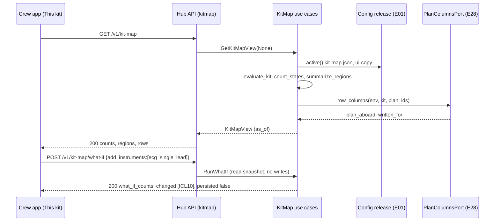

# E27: Kit map: what this ship can test

Technical design for epic E27. Inputs: the brief (`tdd/E27.md` in the planning package), PRD.md (sections 1, 4.12,
4.13, 11, R07, R43 to R46), USE-CASES.md (UC19, UC20, UC22), CONTRACTS.md (sections 1 to 5, 7, 9, 11, 18 to 22, 25, 28),
`api/openapi.yaml` (tag "Kit map", `listCapabilities`, `createMeasurementRequest`), the schemas `config-kit-map`,
`kit-map-view`, `kit-map-what-if`, `kit-check`, `capability`, `capability-gap`, `measurement-request`, the examples in
`api/examples/kit-map/`, `api/examples/kit-map.example.json`, `api/examples/clinical/kit-check-ecg.json`,
`api/examples/errors/kit-cannot-perform.json`, UX-DESIGN.md (sections 1.6 to 1.8, 3.1, 3.6, 3.7), VALIDATION.md (V76 to
V80, D28 to D32, section 6), DEMO-CONDITIONS.md, `condition-assessments-119.json`, `docs/BUILD-CHARTER.md`. `docs/SYSTEM.md`
and `docs/DEPLOYMENT.md` are being written in parallel; every point that depends on them is marked "per DEPLOYMENT.md" or
"per SYSTEM.md" and listed in section 14.

Package paths below are relative to ``; repository paths are relative
to ``.

## 1. Scope

### Delivers

| Story | What | Requirements | Scenarios and assertions |
|---|---|---|---|
| E27-01 | The 119 kit map rows of `config/kit-map.json`, written from NASA's Clinical Findings Forms (CliFFs) through an authoring pipeline that builds the document from one file per row, each row with its form link, body regions, confirming tests and instruments, report-only findings, writer and second checker, `review_state: unreviewed` | R43, R44 | V76, D28 |
| E27-02 | The kit map engine (`crew_health.kitmap`): the frozen precedence rule, region aggregation, `GET /v1/kit-map`, `POST /v1/kit-map/what-if`, the capability derivation served to E05, the release checks for kit-map.json (loader checks 11 and the kit-map half of 12) | R43, R44, R59 (instrument part) | V76, V77, V79, D28, D29, D31 |
| E27-03 | The kit gate: a pure function and a port that E05's `createMeasurementRequest` calls before a request exists; the integration contract that records an unavailable request and an open CapabilityGap in one transaction and answers `422 KIT_CANNOT_PERFORM` | R07, R45 | V78, D30 |
| E27-04 | The This kit card on Today, the kit view (Test here and Plan here), the instrument part of The kit aboard card, How this was built, What would close the most gaps (planning toggles), and the kit check line on the measurement request card | R43, R44 | D28, D29, D31, D32 (display) |
| E27-05 | The venue camera study protocol, consent wording, raw result format and analysis, and the How we know panel | R46 | V80 |

Use cases: UC19 (whole), UC20 (gate, gap, planning list), UC22 (the gap that starts the plan; the plan itself is E28).
Invariants owned: CONTRACTS section 9 "No experimental forecast or camera estimate substitutes for a required clinical
instrument" for the kit map; "no state stored or typed" (R44); section 28 EI3 counts as displayed (`plans_aboard`, computed
by E28).

### Does not deliver

| Item | Owner |
|---|---|
| Onboard plans, PlanView, PlanRun, `plan_aboard`, `waits_for_medical_officer`, loader checks 14 and 15 | E28 |
| MeasurementRequest storage, its state machine, attempts, CapabilityGap storage, `GET /v1/capabilities` endpoint and device availability | E05 (CapabilityGap with E15 for episode display) |
| Supplies, stock, SupplyUse, cover, `cover_changed`, the supplies section of The kit aboard card | E32 |
| SkillRecords, the Trained hands section of The kit aboard card | E31 |
| The assistant's `propose_measurement` tool wiring and the turn's `limitations` | E12, E13 (stream C, E27-03 owner stream, implements the wiring against the port defined here) |
| The configuration loader, release activation, document store, error envelope, idempotency store, event outbox | E01 |
| The result panel artifact and the frozen scenario runs | E21 (E27-05 supplies the venue study section) |
| The crewmate pulse count pairs at the venue | E30 (same protocol and consent document, section 5.5) |
| Body figure renderer and marks | E03 design system (`ui/crew/src/design`) |

## 2. Dependencies and seams

E27 depends on E01, E05, E10, E23 (epics.json). E28, E32, E05 (gate wiring), E12/E13 (assistant), E21 (fixture and
result panel) and E29 (offline cache) depend on E27.

| Seam | Direction | Port, event or endpoint | Owner |
|---|---|---|---|
| Active configuration release and documents (kit-map.json, ui-copy.json, skills-catalog.json IDs) | E27 reads | `ConfigReleaseReader` (E01 application port): `active() -> ConfigReleaseSnapshot`, `document(name, version) -> bytes` | E01 |
| Release validation plug-in | E27 provides | `ReleaseCheck` protocol (E01): `KitMapReleaseCheck` for loader checks 11 and 12 (kit-map half) | E01 defines, E27 implements |
| Clock | E27 reads | `Clock.now() -> datetime` (UTC, injected) | E01 |
| Template rendering | E27 calls | `TemplateRenderer.render(template, values, allowed) -> str` with the section 11 missing-placeholder rule | E01 |
| Active environment | E27 reads | `ActiveEnvironmentReader.active_environment_id() -> EnvironmentId` | E23 |
| Roster person IDs (what-if `add_skills` validation only) | E27 reads | `RosterReader.person_ids() -> frozenset[str]` (the roster behind `listCrew`) | E01 (Hub tag), per SYSTEM.md |
| Plan columns of each row and `plans_changed` | E27 consumes, E28 implements | `PlanColumnsPort` defined in `kitmap.application.ports` | E27 defines, E28 implements |
| Supply cover in a what-if | E27 consumes, E32 implements | `CoverPlanningPort` defined in `kitmap.application.ports` | E27 defines, E32 implements |
| Kit composition for other engines (plans, supplies, routine "Not available") | E27 provides | `KitQueryPort` implemented by `kitmap.application.KitQueryService` | E27 |
| Kit gate | E27 provides, E05 calls | `KitGatePort.check(...) -> contracts.KitCheck` implemented by `kitmap.application.KitGateService` | E27 |
| Capability derivation | E27 provides, E05 serves | `KitCapabilitiesPort.capabilities(environment_id) -> Sequence[KitCapability]` | E27 |
| Gap's plan and check-another-way steps | E05 calls E28 | `GapPlanPort` (E28) | E28 |
| Plan rows (`plan_id`, written_for, aboard) | via `PlanColumnsPort` | | E28 |
| Form texts and source registry (quote checks, CliFF source IDs) | E27 authoring writes, E10 ingests | `FormTextPort.quote_on_page(source_id, page, quote) -> bool` | E10 |
| Event stream (client refresh) | clients consume | `config.release_activated`, `environment.activated`, `supply.used` (CONTRACTS section 19) | E01, E23, E32 |
| Endpoints served | E27 | `getKitMap`, `kitMapWhatIf` | E27 |
| UI shell, router, design tokens, BodyRender wrapper, API client, config cache | E27 UI uses | `ui/crew/src/shell`, `ui/crew/src/design` | E03 |
| Offline cache of documents and last views on crew devices | E27 UI uses | per E29 TDD | E29 |

Dependency direction (import-linter, section 13): `kitmap` imports only `crew_health.contracts` (generated models),
`crew_health.platform` kernel types and its own layers. `plans` may import `kitmap.application.ports` (DTOs and
`KitQueryPort`); `kitmap` never imports `plans`, `supplies` or `measurement`. Cross-module values that have a contract
schema (KitCheck, KitMapView, KitMapWhatIf, Capability) use the generated models in `crew_health.contracts`.

## 3. Domain model

All in `hub/src/crew_health/kitmap/domain/`, pure, no I/O, `@dataclass(frozen=True, slots=True)`, tuples instead of lists,
no framework imports.

### 3.1 Types

```python
# model.py
EnvironmentId = Literal["station_leo", "transit", "lunar_surface", "mars_surface"]
BodyRegion = Literal["head", "eyes", "ear", "neck", "shoulder", "heart", "lungs", "abdomen",
                     "flank", "back", "wrist", "hand", "legs", "knee", "ankle"]
RegionKey = BodyRegion | Literal["whole_body"]

class ConditionState(StrEnum):
    MEASURED_HERE = "measured_here"
    REPORT_ONLY = "report_only"
    NEEDS_TEST_NOT_ABOARD = "needs_test_not_aboard"

STATE_ORDER: Final = (ConditionState.MEASURED_HERE, ConditionState.REPORT_ONLY,
                      ConditionState.NEEDS_TEST_NOT_ABOARD)   # contract order, vocabulary not content

@dataclass(frozen=True, slots=True)
class Instrument:
    id: str; name: str; needs_text: str            # needs_text defaults to name at parse time
    capability_codes: tuple[str, ...]; method: AcquisitionMethod  # default "manual_instrument"

@dataclass(frozen=True, slots=True)
class CapabilityWords:
    code: str; label: str; body_region: BodyRegion | None
    operator_requirement: Literal["self", "crewmate", "crew_medical_officer"]
    expected_duration_seconds: int | None; basis: Literal["sourced", "team default"]

@dataclass(frozen=True, slots=True)
class ConfirmingTest:
    index: int; name: str; test_id: str | None; instruments: tuple[str, ...]

@dataclass(frozen=True, slots=True)
class ConditionRow:
    condition_id: str; name: str; body_regions: tuple[BodyRegion, ...]
    tests: tuple[ConfirmingTest, ...]; cliff_url: str; report_only_findings: tuple[str, ...]
    review_state: Literal["unreviewed", "reviewed", "rejected"]
    written_by: str | None; checked_by: str | None; plan_id: str | None
    ground_needs: GroundNeeds | None; treatment_scope: FormQuote | None; rtdc: Rtdc | None
    source_ids: tuple[str, ...]

@dataclass(frozen=True, slots=True)
class KitMapDoc:
    version: str            # SHA-256 of the raw bytes (CONTRACTS section 11)
    label: str              # the document's own "version" field, display only
    example: bool; notice: str | None
    instruments: tuple[Instrument, ...]            # document order is meaningful
    capabilities: tuple[CapabilityWords, ...]
    kits: Mapping[EnvironmentId, frozenset[str]]
    candidates: tuple[str, ...]
    conditions: tuple[ConditionRow, ...]           # document order is meaningful
    # supplies, stock, candidate_supplies, candidate_skills are parsed and handed to E32 and E28 untouched
```

```python
# evaluation.py
@dataclass(frozen=True, slots=True)
class TestEvaluation:
    index: int; name: str; instruments: tuple[str, ...]
    needs_no_instrument: bool; fully_aboard: bool; missing: tuple[str, ...]

@dataclass(frozen=True, slots=True)
class ConditionEvaluation:
    row: ConditionRow; state: ConditionState
    tests: tuple[TestEvaluation, ...]; missing_instruments: tuple[str, ...]

@dataclass(frozen=True, slots=True)
class StateCounts:
    measured_here: int; report_only: int; needs_test_not_aboard: int; total: int

@dataclass(frozen=True, slots=True)
class RegionSummary:
    region: RegionKey; counts: StateCounts; marks: tuple[ConditionState, ...]

@dataclass(frozen=True, slots=True)
class StateChange:
    row: ConditionRow; before: ConditionState; after: ConditionState

@dataclass(frozen=True, slots=True)
class GateResult:
    capability_code: str; environment_id: EnvironmentId
    can: bool; instrument_ids: tuple[str, ...]; missing_instrument_ids: tuple[str, ...]
    condition_ids: tuple[str, ...]; cliff_urls: tuple[str, ...]
    template_key: Literal["can", "cannot"]; instrument_words: tuple[str, ...]
    kit_map_version: str
```

### 3.2 Rules (pure functions, `rules.py`)

```python
def evaluate_test(test: ConfirmingTest, kit: frozenset[str]) -> TestEvaluation
def evaluate_condition(row: ConditionRow, kit: frozenset[str]) -> ConditionEvaluation
def evaluate_kit(doc: KitMapDoc, kit: frozenset[str]) -> tuple[ConditionEvaluation, ...]   # rejected rows dropped
def count_states(evals: Sequence[ConditionEvaluation]) -> StateCounts
def summarize_regions(evals: Sequence[ConditionEvaluation],
                      region_order: Sequence[BodyRegion]) -> tuple[RegionSummary, ...]
def diff_states(base: Sequence[ConditionEvaluation],
                after: Sequence[ConditionEvaluation]) -> tuple[StateChange, ...]
def kit_gate(doc: KitMapDoc, capability_code: str, environment_id: EnvironmentId,
             condition_ids: Sequence[str]) -> GateResult
def derive_capabilities(doc: KitMapDoc, environment_id: EnvironmentId) -> tuple[KitCapability, ...]
```

**The frozen precedence rule** (CONTRACTS section 21, selected design D27.1). For kit K and row r, first match:

1. `measured_here` when some test t has `t.instruments` non-empty and `set(t.instruments) <= K`.
2. `report_only` when some test has `instruments == ()`.
3. `needs_test_not_aboard` otherwise.

`evaluate_test`: `needs_no_instrument = (instruments == ())`; `missing = tuple(i for i in instruments if i not in K)` in
the test's own order; `fully_aboard = not needs_no_instrument and missing == ()`.

`missing_instruments`: `()` for `measured_here`; otherwise among tests with `needs_no_instrument` false, the `missing`
tuple of smallest length, ties to the lowest `index`; `()` when no test needs an instrument.

Decisions the brief asks for:

| Question | Decision | Alternatives rejected and why |
|---|---|---|
| Several confirming tests, some instruments aboard | A test counts only when all its instruments are aboard. Partial tests never count. A row whose only instrument test is half aboard (ICL3: 12-lead ECG and troponin) is `needs_test_not_aboard` with the smallest missing set (`[troponin_poc]` if the ECG were aboard) | "Any instrument aboard counts" would claim a confirmation the crew cannot make; weighted partial credit would invent a clinical score |
| Connected, manual or import only | Kit membership is the configured `kits[E]` list only. An instrument in `kits[E]` counts whatever its data path: a connected device and a device read by eye and typed in are both aboard (manual entry is the always-available fallback, charter section 2). An instrument not in `kits[E]` never counts, even if an existing report of that test can be imported (UC15): an imported ECG report is a record about the past, not a test this ship can do, and the dashed ring stays (DEMO-CONDITIONS ICL10, "An existing ECG report can be imported", Available here: No). Connection is shown beside the instrument, never folded into the state (request R27-1) | Removing an instrument when its Bluetooth link drops would flip rows to "needs a test not aboard" while the device sits in the kit and can be read by hand; counting importable tests would let a file upload close a dashed ring, which section 9 forbids |
| Camera estimates | No confirming test may name an instrument whose `method` is `camera_estimate` (CONTRACTS section 9: "No experimental forecast or camera estimate substitutes for a required clinical instrument"). Enforced by the content check T27-17 now and proposed as part of loader check 11 (R27-12) | Allowing it would let the experimental camera turn a dashed ring into a dot |
| Body regions aggregation | For each region in the fixed order of `body-regions-1`, then `whole_body` for rows with `body_regions == ()`: counts of the rows that list it and `marks`, the states present among them in `STATE_ORDER`. A row listing four regions counts once in each. Regions with `total == 0` are omitted (as in `api/examples/kit-map/view-station.json`). The figure draws one glyph per entry in `marks`, ring around dot (UX-DESIGN 1.6) | One mark per region by "worst state" hides that a region is partly measurable; counting a row once per figure would need a primary region the CliFFs do not give |
| Row order | Document order. The authoring build (section 5.3) writes rows in `condition-assessments-119.json` order, so ties and lists are stable and reviewable | Sorting by state in the hub would move rows between releases for no clinical reason |
| What-if bound | The what-if is a pure function call over the active release and an extended kit; the use case runs inside a read-only snapshot and has no repository with a write method in its dependencies (structural guarantee); `persisted` is the constant `false` | A "scratch" table or a flag in session state would be a write path to audit |
| Gate leakage | The gate's inputs are a capability code, an environment and the condition IDs named by the request; its output holds only configuration data. It reads no person state, so it cannot leak one. Patient scope is enforced before the gate by E12 (assistant) or E05 (person) | |

**Kit gate** (`kit_gate`): providers P = instruments, in document order, whose `capability_codes` contain c. If P is
empty the code is unknown: raise `UnknownCapabilityCode` (loader check 11 guarantees every listed capability has a
provider, so this only happens for a code outside the document). `instrument_ids = P ∩ kits[E]` in document order;
`can = bool(instrument_ids)`; `missing_instrument_ids = () if can else P` (all providers are outside the kit);
`condition_ids` = the requested IDs in request order, each required to name a non-rejected row (else
`UnknownConditionId`); `cliff_urls` = their `cliff_url` in the same order; `template_key = "can" if can else "cannot"`;
`instrument_words` = provider `name`s of `instrument_ids` when `can`, else `needs_text` of `missing_instrument_ids`.
The application layer renders `text` with ui-copy `kit_check_templates[template_key]`, `{instruments}` = the words joined
by ", " (can) or " or " (cannot), exactly as CONTRACTS section 21 states (R27-8 proposes moving the joiners to ui-copy).

**Capability derivation** (`derive_capabilities`): for each `CapabilityWords` entry: `methods` = distinct `method` of
providers in document order; `instrument_ids` and `missing_instrument_ids` as in the gate for the given environment;
`applicable_environments` = environments, in the fixed vocabulary order, whose kit holds a provider; `status =
"unavailable"`, `unavailable_reason = "not_in_kit"` when no provider is aboard, else `"available"` with reason `None`.
E05 overlays device availability (`device_absent`, `adapter_down`, `device_ids`) on the result; E27 never reads devices.

### 3.3 State machines

None. The kit map has no stored state (R44, "no state is stored or typed"). The only lifecycle is the configuration
release (E01): a new release with a new kit-map.json version changes every computed view at activation.

### 3.4 Invariants

| ID | Invariant | Test |
|---|---|---|
| KM-I1 | Every non-rejected row has exactly one state; rejected rows appear in no view, count, region or gate result | T27-02, T27-13 |
| KM-I2 | `measured_here` iff some test with a non-empty instrument list is fully in the kit | T27-01, T27-02 |
| KM-I3 | Monotonic: adding instruments never moves a row from `measured_here`, and never moves a row from `report_only` to `needs_test_not_aboard` | T27-02 |
| KM-I4 | `missing_instruments` is a minimum-cardinality missing set, ties to the first test; empty for `measured_here` | T27-03 |
| KM-I5 | `counts.total` equals the number of non-rejected rows and the sum of the three counts | T27-02 |
| KM-I6 | Region `marks` are in `STATE_ORDER`, contain exactly the states present, and regions with zero rows are absent | T27-14 |
| KM-I7 | No read path writes: `GET /v1/kit-map` and the what-if change no row, sequence or outbox entry | T27-06 |
| KM-I8 | The same release, environment, stock, plans and clock give byte-identical responses | T27-19 |
| KM-I9 | The gate output carries no person data and is independent of the model, devices and the ground link | T27-11, T27-20 |
| KM-I10 | No confirming test names a `camera_estimate` instrument | T27-17 |
| KM-I11 | Kit view, This kit card and result panel counts are the same response (single source) | T27-21, D28 |

## 4. Application layer

`hub/src/crew_health/kitmap/application/`.

### 4.1 Ports

```python
# ports.py
@dataclass(frozen=True, slots=True)
class KitMapRelease:
    release_id: str
    doc: KitMapDoc
    kit_check_templates: Mapping[Literal["can", "cannot"], str]   # ui-copy, same release
    designed_unknown: str                                          # ui-copy designed_states.unknown
    region_order: tuple[BodyRegion, ...]                           # body-regions-1, from common schema
    skill_ids: frozenset[str]                                      # skills-catalog skill IDs
    supply_ids: frozenset[str]                                     # kit-map supplies[].supply_id

class KitMapReleaseSource(Protocol):
    def active(self) -> KitMapRelease: ...
    def at_version(self, kit_map_version: str, ui_copy_version: str) -> KitMapRelease: ...  # pinned plan runs (E28)

class ActiveEnvironmentReader(Protocol):
    def active_environment_id(self) -> EnvironmentId: ...

class RosterReader(Protocol):
    def person_ids(self) -> frozenset[str]: ...

@dataclass(frozen=True, slots=True)
class SupplyAddition: supply_id: str; quantity: float
@dataclass(frozen=True, slots=True)
class SkillAddition: skill_id: str; person_ids: tuple[str, ...]
@dataclass(frozen=True, slots=True)
class PlanningDelta:
    add_instruments: frozenset[str]
    add_supplies: tuple[SupplyAddition, ...]
    add_skills: tuple[SkillAddition, ...]

@dataclass(frozen=True, slots=True)
class PlanColumns:
    plan_id: str | None
    written_for: Literal["condition", "family", "flow"] | None
    plan_aboard: bool

@dataclass(frozen=True, slots=True)
class PlanChange:
    plan_id: str; condition_id: str | None; flow_id: str | None
    before_plan_aboard: bool; before_waits_for_mo: bool
    after_plan_aboard: bool; after_waits_for_mo: bool

class PlanColumnsPort(Protocol):                      # implemented by E28 plans.application
    def row_columns(self, *, environment_id: EnvironmentId, kit: frozenset[str],
                    plan_ids: Sequence[str | None]) -> Sequence[PlanColumns]: ...
    def plans_changed(self, *, environment_id: EnvironmentId, base_kit: frozenset[str],
                      delta: PlanningDelta) -> Sequence[PlanChange]: ...

@dataclass(frozen=True, slots=True)
class CoverChange: supply_id: str; from_uses: int | None; to_uses: int | None

class CoverPlanningPort(Protocol):                    # implemented by E32 supplies.application
    def cover_changed(self, *, environment_id: EnvironmentId,
                      add_supplies: Sequence[SupplyAddition]) -> Sequence[CoverChange]: ...

class ReadSnapshot(Protocol):                         # E01: one SQLite read transaction (WAL snapshot)
    def __enter__(self) -> "ReadSnapshot": ...
    def __exit__(self, *exc: object) -> None: ...
```

`PlanColumnsPort.row_columns` must not depend on people (EI3's `plan_aboard` needs an `any_crew` step that needs no
skill, so it is a function of plan, environment, kit and stock only). That is what keeps the kit map free of person data.

### 4.2 Ports E27 provides

```python
class KitQueryPort(Protocol):          # implemented by KitQueryService
    def kit_instruments(self, environment_id: EnvironmentId,
                        kit_map_version: str | None = None) -> frozenset[str]: ...
    def instrument(self, instrument_id: str, kit_map_version: str | None = None) -> Instrument: ...

class KitGatePort(Protocol):           # implemented by KitGateService, called by E05
    def check(self, *, capability_code: str, environment_id: EnvironmentId | None,
              condition_ids: Sequence[str]) -> contracts.KitCheck: ...
        # raises KitGateInvalid(field_errors) for an unknown capability code or an unknown or rejected condition ID

class KitCapabilitiesPort(Protocol):   # implemented by KitCapabilitiesService, called by E05 listCapabilities
    def capabilities(self, environment_id: EnvironmentId | None) -> Sequence[KitCapability]: ...
```

### 4.3 Use cases

| Use case | Input | Output | Errors | Idempotency |
|---|---|---|---|---|
| `GetKitMapView.execute(environment_id: EnvironmentId \| None) -> contracts.KitMapView` | Environment or active | KitMapView | `InvalidEnvironment` (400 by schema) | Read, none |
| `RunWhatIf.execute(cmd: WhatIfCommand) -> contracts.KitMapWhatIf` | `add_instruments`, `add_supplies`, `add_skills`, `environment_id` | KitMapWhatIf, `persisted: false` | `WhatIfInvalid(field_errors)` → `422 INVALID_VALUE` | None by contract (no `Idempotency-Key`); pure, so repeats are identical |
| `KitGateService.check(...)` | capability code, environment, condition IDs | `contracts.KitCheck` | `KitGateInvalid` → E05 maps to `422 INVALID_VALUE` | Pure |
| `KitCapabilitiesService.capabilities(env)` | environment | `KitCapability` list | none | Pure |
| `KitMapReleaseCheck.run(release)` | candidate release documents | `list[Finding]` | none (findings are data) | Pure |

`GetKitMapView` algorithm, inside one `ReadSnapshot`:

1. `rel = source.active()`; `env = environment_id or environments.active_environment_id()`; `K = rel.doc.kits[env]`.
2. `evals = evaluate_kit(rel.doc, K)`; `counts = count_states(evals)`; `regions = summarize_regions(evals, rel.region_order)`.
3. `cols = plan_columns.row_columns(environment_id=env, kit=K, plan_ids=[e.row.plan_id for e in evals])`.
4. Per row: `missing_text = render(kit_check_templates["cannot"], {"instruments": " and ".join(needs_text of missing_instruments)})`
   when `missing_instruments` is non-empty, else `None`.
5. `plans_aboard = sum(c.plan_aboard)`; `plans_written_for_condition = count(written_for == "condition")`;
   `plans_from_family = count(written_for == "family")`; `plans_to_write = [row ids with plan_aboard false]` in row order.
6. `kit` = instruments of `K` in document order with `name`; `candidates` = `doc.candidates` with `aboard = id in K`.
7. `as_of = clock.now()`; `kit_map_version = doc.version`; `kit_map_label = doc.label`; `example = doc.example`.

`RunWhatIf` algorithm, inside one `ReadSnapshot`:

1. Validate: every `add_instruments` ID in `doc.instruments` (else field error `/add_instruments/<i>`), every supply ID in
   `rel.supply_ids` (`/add_supplies/<i>/supply_id`), every skill ID in `rel.skill_ids` (`/add_skills/<i>/skill_id`), every
   person ID in `roster.person_ids()` (`/add_skills/<i>/person_ids/<j>`). At most 64 instruments, 64 supplies, 32 skills
   and 64 people per skill (bounds, Power of Ten); beyond: `INVALID_VALUE`. All findings are reported together.
2. `K' = K ∪ add_instruments`; `ignored_instrument_ids` = requested IDs already in `K`, request order;
   `added_instrument_ids` = the rest, request order, duplicates removed.
3. `base = evaluate_kit(doc, K)`, `after = evaluate_kit(doc, K')`; `base_counts`, `what_if_counts`,
   `regions = summarize_regions(after)`, `changed = diff_states(base, after)` in row order.
4. `plans_changed = plan_columns.plans_changed(environment_id, base_kit=K, delta)`; `cover_changed =
   cover_planning.cover_changed(environment_id, add_supplies)`; supplies and skills never move a ring (CONTRACTS 21).
5. Echo `added_supplies`, `added_skills`; `persisted = False`. No event, no write, no idempotency record.

### 4.4 Events

Published: none. The what-if "sends no event" (CONTRACTS section 21); the views are computed on read.
Consumed: none on the hub. Clients refetch on `config.release_activated`, `environment.activated` and `supply.used`
(CONTRACTS section 19).

### 4.5 Gate integration contract (E27-03)

E05's `CreateMeasurementRequest` use case runs, in one `UnitOfWork` (E01):

1. Identity and scope checks (session or the assistant's injected patient scope, E12). A request about another person
   fails here with `UNAUTHORIZED_SCOPE` and the gate never runs.
2. `kit_check = kit_gate_port.check(capability_code=..., environment_id=None, condition_ids=req.condition_ids or [])`.
3. If `kit_check.can`: the request is created `proposed` with `kit_check` (CONTRACTS section 4), `201`.
4. Else: the request is created directly in `unavailable` with `kit_check` and `allowed_actions: []`; a CapabilityGap is
   opened (`reason: no_capability`, `capability_code`, `body_region` from the capability words, `state: open`,
   `plan_id` and `check_another_way_step_ids` from E28's `GapPlanPort.plan_for(condition_ids, environment_id,
   subject_person_id)`, choosing the first requested condition whose row has a plan); `measurement_request.changed` is put
   in the outbox; the transaction commits; the response is `422 KIT_CANNOT_PERFORM` with the recorded request in
   `current_state`. The request never reaches `awaiting_acceptance`, so it never reaches a person as a task.
5. E12 turns the 422 into a ToolResult whose limitation text is `kit_check.text`; E13's turn continues (section 17).

`supported_alternative` in that 422: the package example names `share_with_ground`, which contradicts USE-CASES rule 7.
Interim: E05 sets `supported_alternative` to `null` until R27-6 is decided; the gap card offers the plan (E28).

## 5. Adapters

### 5.1 Storage

None. `crew_health.kitmap` owns no table and no migration. A storage scan test (T27-06) asserts that no table name
starts with `kitmap_` and that the kit map routes perform no write.

### 5.2 Configuration adapter

`hub/src/crew_health/kitmap/adapters/config_source.py`:

```python
class ConfigKitMapReleaseSource(KitMapReleaseSource):
    def __init__(self, releases: ConfigReleaseReader, common_schema: CommonVocabulary,
                 cache_size: int = 4) -> None: ...
```

Parses kit-map.json bytes (already schema validated by the loader) into `KitMapDoc`, keyed by `(kit_map_version,
ui_copy_version, skills_catalog_version)`; an LRU of 4 parsed releases (active plus pinned versions used by open plan
runs). Parse cost for 119 rows is under 20 ms; no parse happens on the request path after the first. `needs_text`
defaults to `name`, `method` defaults to `manual_instrument`, exactly as the schema descriptions state.

### 5.3 Authoring pipeline (E27-01), not part of the hub

`authoring/kitmap/` holds the inputs the team edits and the scripts that build `config/kit-map.json`. The hub never reads
this folder.

| File | Holds |
|---|---|
| `authoring/kitmap/kit.json` | The document head: `version` label, `example: false`, `notice`, `instruments`, `capabilities`, `kits`, `candidates`, `supplies`, `stock`, `candidate_supplies`, `candidate_skills` (supplies and stock are co-owned with E32, which edits them through its own PRs) |
| `authoring/kitmap/rows/ICL<n>.json` | One kit map row, exactly the `conditions[]` item shape of `config-kit-map.schema.json` |
| `authoring/kitmap/assignments.csv` | `condition_id,family,writer,checker` for all 119 rows (names from the user, Q27-1) |
| `authoring/kitmap/forms/ICL<n>/form.json` | The saved form: `url`, `sha256` of the PDF bytes, `fetched_at`, `pages[]` (page number and extracted text) |
| `authoring/kitmap/fetch_forms.py` | Downloads each row's `cliff_url` (timeout 30 s, 3 attempts with 2 s, 4 s, 8 s backoff, at most 4 concurrent, 25 MB cap), records the SHA-256 and extracts per-page text with `pypdf`; never overwrites a saved form with a different hash without `--refresh` |
| `authoring/kitmap/show_form.py ICL<n>` | Prints the pages that hold "Diagnostic", "Treatment", "Communications and Support Needs" and "Table 4" with page numbers, to help the writer copy quotes |
| `authoring/kitmap/build.py` | Merges `kit.json` and `rows/*.json` (ordered as `condition-assessments-119.json`) into `config/kit-map.json`, deterministic bytes (sorted keys inside objects as in the schema order, 2-space indent, trailing newline) |
| `authoring/kitmap/check.py` | The E27-01 acceptance checks (section 8.3) for CI and for a checker before they sign a row |

The saved form texts are handed to E10 as DocumentVersions so loader check 14's quote verification (E28) and T27-18 use
one copy (`FormTextPort`). NASA CliFF PDFs are public NASA documents; only text, URL and hash are committed.

## 6. API

Both operations are in `hub/src/crew_health/kitmap/api/router.py`, mounted by E01's app assembly. Request and response
bodies are the generated models from `contracts/` (no hand-written shared type). Every response carries `Config-Release`
and `X-Correlation-Id` (E01 middleware).

### `getKitMap`: `GET /v1/kit-map?environment_id=`

- Roles (`x-roles`): crew, crew_medical_officer, ground, operator, station, adapter, editor. Any other: `403
  UNAUTHORIZED_SCOPE`. No session: `401 UNAUTHENTICATED`.
- `environment_id` optional, one of the fixed vocabulary (schema enum, otherwise `400 MALFORMED_REQUEST`); default the
  active environment at request time.
- `200` KitMapView (`schemas/kit-map-view.schema.json`). Rejected rows are absent. Person data: none.
- Example for the package example document, station, clock 2026-11-13T09:10:16Z: `api/examples/kit-map/view-station.json`
  (counts 0, 3, 4 of 7; `plans_aboard` 7).

### `kitMapWhatIf`: `POST /v1/kit-map/what-if`

- Same roles. No `Idempotency-Key` (CONTRACTS section 5), no `If-Match`, no `Config-Release` check (it changes nothing).
- Body `requests.schema.json#/$defs/KitMapWhatIf` (at least one of the three lists). Schema failure: `422 INVALID_VALUE`
  with `field_errors` (E01 maps body validation to INVALID_VALUE; a non-JSON body is `400 MALFORMED_REQUEST`; a non-JSON
  content type is `415 UNSUPPORTED_MEDIA_TYPE`).
- Unknown instrument, supply, skill or person ID, or a bound exceeded: `422 INVALID_VALUE`, one `field_errors` entry per
  finding with its JSON pointer.
- `200` KitMapWhatIf, `persisted: false`. Example: `api/examples/kit-map/what-if-ecg.json` (station, `ecg_single_lead`:
  ICL10 `needs_test_not_aboard` → `measured_here`, counts 1, 3, 3).

### Gate errors surfaced by E05's `createMeasurementRequest`

| Condition | Code |
|---|---|
| Capability code not in kit-map.json `capabilities` | `422 INVALID_VALUE`, field `/capability_code`, nothing recorded |
| A `condition_ids` entry not a non-rejected row | `422 INVALID_VALUE`, field `/condition_ids/<i>`, nothing recorded |
| No provider aboard | `422 KIT_CANNOT_PERFORM`, request recorded `unavailable` with `kit_check`, gap opened |

Error words on screen come from ui-copy `error_messages[code]`, never `message`.

## 7. User interface

All in `ui/crew/src/features/kitmap/`, Vue 3 with TypeScript strict, generated API types, the E03 shell and design
system. No component holds a label, count, threshold, condition name or instrument name: every word is ui-copy or comes in
a response; every number comes in a response.

| Component | Where | Binds to | Shows |
|---|---|---|---|
| `ThisKitCard.vue` | Today grid (paper card) | `GET /v1/kit-map` (active environment) | Big number `counts.needs_test_not_aboard` "of" `counts.total`; legend from `kit_map_state_words` with the three glyphs; the plans line: `plan_lines.plans_aboard` with `{count}=plans_aboard`, `{total}=counts.total` when `plans_to_write` is empty, otherwise `plan_lines.plans_to_write` with `{missing}=plans_to_write.length`; arrow to the kit view |
| `KitView.vue` | Route `/kit` (registered in the E03 router) | `GET /v1/kit-map?environment_id=`, `GET /v1/supplies` (E32 section), `GET /v1/config/kit-map` (candidate supplies and skills, supply and skill names) | Stage figure in kit view (marks from `regions[].marks`); pills Test here and Plan here; state and region filters; condition rows (name, state glyph, `missing_text`, form link to `cliff_url`, review state); a row opens the plan (E28 route `/plan/condition/{condition_id}`) |
| `ConditionRow.vue` | inside KitView | one `conditions[]` item | Test here end column: `missing_text` or nothing; Plan here end column: interim `plan_written_for` word and plan state until R27-3 lands |
| `KitAboardCard.vue` | KitView (sun card) | `kit[]`; slots `supplies` (E32 component) and `trained-hands` (E31 component) | Instrument names; the connection word after R27-1 lands |
| `HowBuiltCard.vue` | KitView (dusk card) | `GET /v1/kit-map`, `GET /v1/config/kit-map` (`notice`) | Notice, `plans_written_for_condition`, `plans_from_family`, `plans_to_write.length`; the "checked by a second person" count after R27-3 |
| `PlanningCard.vue` | KitView (deep green) | `candidates[]` (instruments, `aboard` false), `candidate_supplies`, `candidate_skills` from the cached config, `GET /v1/crew` (names for the skill chooser) | Toggles. Any change sends one `POST /v1/kit-map/what-if` with the union of active toggles (debounced 150 ms, the previous request aborted); the stage switches to the response's `regions` and highlights the regions of `changed[]`; the label "Planning view" (R27-2 key) is shown while any toggle is on; turning the last toggle off restores the last `GET /v1/kit-map` response, refetched |
| `KitCheckLine.vue` | Exported for the E05 measurement request card and E28 gap card | a `KitCheck` | `text`; one form link per `cliff_urls` entry |
| `HowWeKnow.vue` | Person button → Records → How we know (E03 route `/how-we-know`) | `GET /v1/how-we-know` (R27-7); interim: `GET /v1/config` and `GET /v1/kit-map` for the What is unreviewed card only | Three cards of UX-DESIGN 3.7; every number from the response; a line with no artifact shows "Not measured yet" from ui-copy (R27-7) |

### States

| State | Behavior |
|---|---|
| Loading | Card skeleton in the card's own geometry; the stage keeps the previous marks |
| Empty | A row list with no rows in a state shows nothing for that group; a region with no rows has no mark (the API omits it) |
| Error | ui-copy `error_messages[code]` in place of the counts, with a retry; never a zero |
| Offline or hub stopped | The last KitMapView from the E29 device cache, with its `as_of` and `kit_map_version` shown and the planning toggles disabled (a what-if needs the hub). Words for "hub not reachable" per E29 (R28-7 in the E28 TDD) |
| Stale | Not applicable to a computed view; a refetch follows every `config.release_activated`, `environment.activated` and `supply.used` event |
| LIVE, REPLAY, SIM | The kit map is configuration, not a reading. `example: true` documents carry the SIM label (ui-copy `origin_words.SIM`) on the card legend, so an example kit is never read as a mission kit |
| Unavailable | Not applicable: every endpoint here works without the model, devices and the ground link |
| Planning view | Distinct deep-green card state and stage label; the base view is never overwritten by a what-if response |

### Accessibility

Marks differ in shape (dot, hollow ring, dashed ring) and always carry words (`kit_map_state_words`); every row's state is
text. Toggles are `button` elements with `aria-pressed`; the counts region is an `aria-live="polite"` region announcing the
new counts after a what-if. Regions on the figure are reachable from the region filter list (UX-DESIGN 1.11). No drag.

### Proof that no content lives in client code

1. `ui/crew/src/features/kitmap/` imports words only through the E03 `useCopy()` composable (ui-copy) and data only
   through generated API clients.
2. The V98 scan (E21 owns the scanner; E27 adds its fixtures): the built bundle and the source under `features/kitmap/`
   contain no condition ID, instrument ID, instrument name, condition name, count, `kit_map_state_words` value or
   `kit_check_templates` value from the active configuration. T27-21 runs it.
3. A configuration edit test (T27-07) changes a kit and a confirming test and asserts the rendered card and view change
   with the same client build.

## 8. Configuration

### 8.1 Documents read

| Document | Fields | Used for |
|---|---|---|
| `config/kit-map.json` (owned by E27) | `version`, `example`, `notice`, `instruments[]`, `capabilities[]`, `kits`, `candidates`, `conditions[]`; `supplies`, `stock`, `candidate_supplies`, `candidate_skills` passed through for E32 and E28 | Everything in this TDD |
| `config/ui-copy.json` (E03 owns the document per SYSTEM.md) | `kit_map_state_words`, `kit_check_templates`, `plan_lines.plans_aboard`, `plan_lines.plans_to_write`, `origin_words`, `error_messages`, `designed_states.unknown`, `body_region_labels` | Words |
| `config/skills-catalog.json` (E30) | `skills[].skill_id`, `short_name` | What-if validation and toggle words |
| `contracts/schemas/common.schema.json` | `body_region` enum order, `environment_id` enum order | Region and environment order (fixed vocabulary, code) |
| `condition-assessments-119.json` (copied into `knowledge/` by E10) | `condition_id`, `family` | Loader check 11 (IDs), row order, assignment by family |

### 8.2 Loader checks provided (registered with E01 as `KitMapReleaseCheck`)

Each finding is `Finding(pointer: str, message_key: str, args: Mapping[str, str])`; E01 renders `validation.errors`.

| Check | Rule | Pointer |
|---|---|---|
| 11a | Every `kits[E][i]` and `candidates[i]` and every `conditions[r].confirming_tests[t].instruments[i]` exists in `instruments` | the offending element |
| 11b | Every capability code of every instrument has exactly one `capabilities` entry; every entry is provided by some instrument | `/capabilities/<i>` or `/instruments/<i>/capability_codes/<j>` |
| 11c | Every `condition_id` exists in condition-assessments-119 and appears once | `/conditions/<r>/condition_id` |
| 12 (kit-map half) | A row with `review_state: reviewed` names `checked_by` (also enforced by the schema) | `/conditions/<r>/checked_by` |
| Content (proposed into 11, R27-12) | No confirming test instrument has `method: camera_estimate` | `/conditions/<r>/confirming_tests/<t>/instruments/<i>` |
| 23 (section 11 rule) | `example: true` cannot be activated while the mission mode is LIVE | `/example` |

### 8.3 Authoring acceptance (E27-01), `authoring/kitmap/check.py`, run in CI on `config/kit-map.json`

1. Exactly the 119 `condition_id`s of condition-assessments-119.json, once each, in that order.
2. Every row: `cliff_url` set and equal to `forms/ICL<n>/form.json` `url`; `body_regions` from the fixed set; at least one
   confirming test; `written_by` and `checked_by` both non-null and different (both are team handles from
   `assignments.csv`); `review_state` is `unreviewed` unless a clinician is named (Q27-2).
3. Every `ground_needs.quote`, `treatment_scope.quote` and `rtdc` value is found on its cited `page` of the saved form text
   (whitespace-normalized exact match), and its `source_id` resolves in the registry (blocked by R27-4 for most rows;
   until then those fields stay `null`, which the schema allows: "Only when the form is saved in the package; otherwise
   null, never typed from anywhere else").
4. `config/kit-map.json` is byte-identical to `build.py` output.

### 8.4 Provenance

Every row carries `cliff_url`, `source_ids`, `review_state`, `written_by`, `checked_by`; the document carries `notice`
("Unreviewed draft: needs clinician review before live guidance.") shown on every page that renders it; the served
version is the SHA-256. The kits per environment are team defaults (the kit on the table, PITCH "The kit sits on the
table"), not a flight inventory; R27-5 adds their provenance to the document so a real deployment cites its manifest.

### 8.5 A configuration edit changes behavior with no code change

T27-07: release A is the package example; release B edits only `kits.station_leo` (adds `ecg_single_lead`) and
`conditions[ICL64].confirming_tests[0].instruments` (empties it). After activating B with the same hub build: ICL10 is
`measured_here`, ICL64 `report_only`, counts 1, 4, 2; the UI test renders the new counts with the same bundle.

## 9. Deployment and fallbacks

Tiers follow the charter's model; their final definitions are per DEPLOYMENT.md.

| Tier | Kit map behavior |
|---|---|
| Minimum: one laptop and its webcam, browser on the same laptop | Fully functional: the kit map is configuration plus a pure computation. The webcam is the `camera_station` instrument; every other instrument listed in the kit is read by eye and typed in (manual). Counts do not depend on anything being connected |
| Crew devices: hub laptop plus crew tablets on the habitat network | Tablets render the same responses; the E29 cache holds kit-map.json and the last KitMapView per environment so the This kit card renders with the hub stopped (labeled with `as_of`) |
| Full: kit devices, more cameras, habitat feeds, the model | Unchanged counts; connected instruments show "connected" beside their name after R27-1 |
| Several nodes (a pressurized rover, a second module, a ground console), per DEPLOYMENT.md | Each hub node runs its own activated release, so a rover node's kit-map.json lists the rover kit; the ground console reads `GET /v1/kit-map` as a read-only role. Whether one hub should model several locations is Q27-3 |

A real mission writes `kits` from its medical inventory manifest (with R27-5 provenance) and activates it through the
normal release path; nothing in code changes.

| Missing part | What still works | How it shows |
|---|---|---|
| Language model | Everything in this epic; the gate is deterministic and is called by person-initiated requests too | The assistant panel's own stopped state (E13) |
| Camera or poor signal | Kit map unchanged (the instrument is aboard); a failed reading is E06's designed state | E06 "No reading" |
| Oximeter, cuff, thermometer, band not connected | Kit map unchanged; requests for them pass the gate and E05 offers manual entry | "manual" beside the instrument (R27-1) |
| Instrument not in the kit | The rows it confirms show the dashed ring; requests for it are refused before a person sees them | "This kit can't: needs ..." with the form link |
| Habitat sensor feed | Not read by this epic | |
| Ground link | Everything; nothing here reads the link (EI1) | |
| Crew tablets | The laptop is a complete station | |
| Forecasting model | Not read by this epic | |
| Hub stopped (tablet) | Last cached view, read only | `as_of` and release version shown; toggles disabled |

**Safety functions with the model stopped, devices absent and the link down.** The gate runs inside E05's request path
with only configuration as input (T27-20 runs `KitGateService.check` and `GET /v1/kit-map` with the assistant runtime
stopped, no adapter registered and GroundLink `down`, and compares bytes with the all-up run).

## 10. Safety, security and privacy

| Hazard | Cause | Mitigation | Test |
|---|---|---|---|
| H27-1 A row shows Measured here when the kit cannot confirm it (false reassurance) | A partial test counted; a camera estimate named as a confirming instrument; a kit list not matching the real kit | Precedence rule counts only fully aboard tests; camera_estimate ban; kit provenance (R27-5) and the SIM label on example documents | T27-01, T27-02, T27-17 |
| H27-2 Counts on Today, the kit view and the result panel disagree | Client-side arithmetic or separate sources | One response, no client arithmetic; D28 compares | T27-21 |
| H27-3 A person is asked to take a measurement the kit cannot do | Request created before the gate | Gate before creation, request recorded `unavailable`, never `awaiting_acceptance` | T27-10 |
| H27-4 An imported report or a felt pulse closes a dashed ring | Treating records as kit | Kit membership is configuration only; guided-check Observations are ignored by the gate and the kit map (EI8) | T27-01 (no record input exists), T27-20 |
| H27-5 Another person's data leaks through the gate or the kit map | Gate reading records | The gate and the kit map read no person state; KitCheck keys are fixed by schema; scope is enforced before the gate | T27-11 |
| H27-6 A planning what-if is mistaken for the real kit | UI overwrites the base view; hub persists | `persisted: false`, no write path, a separate Planning view state and label | T27-06, T27-21 |
| H27-7 Unreviewed content read as clinical fact | Missing notice | `notice` on every render; `review_state` per row; How this was built card | T27-21 |
| H27-8 Stale counts on a tablet with the hub stopped | Cache shown as current | `as_of` and version shown, toggles disabled | E29 cache test plus T27-22 |

Authorization: section 6 roles; the kit map holds no person data, so every listed role reads the same response.

Private data: none in this module. Logs: one line per request with correlation ID, `environment_id`, `kit_map_version`,
the three counts, `duration_ms`; for the gate, `capability_code`, `can`, `missing_instrument_ids`, `request_id`; never
symptom text, reasons or condition names typed by a person.

The assistant in this epic may: read capabilities (E12 `get_capabilities`), propose a measurement that then passes the
gate. It may not: create a request that bypasses the gate, see a request the gate refused as a task, or change any count.

**Venue study (E27-05) human-participant safeguards.** Adults only (an explicit "I am 18 or older" confirmation in the
consent form and an `adult_confirmed` field required on every raw row); written consent before any window; withdrawal at
any time with deletion of that participant's rows before publication; no images or video stored (the camera worker keeps
no frames, CONTRACTS section 10); participants identified only by a random code (`P` plus 3 digits) generated at
enrollment; no name, age, sex or skin tone recorded (no subgroup claims are made); no dangerous state is induced
(VALIDATION section 6); the protocol and consent text are frozen and hashed before the first volunteer (Q27-4).

## 11. Performance and resources

Targets on the 16 GB M3 laptop, measured by T27-23 against the 119-row document and the full onboard-plans.json:

| Operation | Budget (p95) | Notes |
|---|---|---|
| `GET /v1/kit-map` | 50 ms | 119 rows × at most 3 tests × at most 6 instruments; plan columns from E28 within 20 ms of that |
| `POST /v1/kit-map/what-if` | 80 ms | Two evaluations plus E28 and E32 calls |
| `KitGateService.check` | 2 ms | Inside E05's request transaction |
| Release parse | 20 ms once per release | LRU of 4 parsed releases, under 5 MB |

No background work, no queue, no thread. The UI debounces what-if toggles (150 ms) and aborts superseded requests. These
reads take a SQLite read snapshot only, so they never block the help path's writes (WAL).

## 12. Test plan

Fixtures: `hub/tests/kitmap/fixtures/` loads the package example documents through the same loader as production (the
contract copy in `contracts/examples/config/` and `contracts/examples/kit-map.example.json`, owned by E01), never
hand-typed content. Property tests generate synthetic documents with Hypothesis (random IDs and words) from the schema.
Vectors are CONTRACTS section 20 rows. Markers: `@pytest.mark.req("R44")`, `@pytest.mark.scenario("V76")`,
`@pytest.mark.demo("D28")`, `@pytest.mark.invariant("KM-I1")`.

Critical paths first.

| ID | Level | What it proves | Traces to |
|---|---|---|---|
| T27-10 | integration (with E05 use case and a fake E28 `GapPlanPort`) | An `ecg_rhythm` request from the assistant actor on `lunar_surface` with `condition_ids ["ICL10"]` returns `422 KIT_CANNOT_PERFORM`; the stored request is `unavailable` with the exact KitCheck of `api/examples/clinical/kit-check-ecg.json` (version aside); a CapabilityGap is `open` with `plan_id plan_icl10` and `check_another_way_step_ids ["icl10_pulse_by_crewmate"]`; no request reaches `awaiting_acceptance`; one `measurement_request.changed` event; a `pulse` request returns 201 with `can: true`, text "This kit can: camera station, pulse oximeter" | V78, D30, R45, R07, KM-I9 |
| T27-28 | integration, fault injection | A crash injected after the request insert and before the gap insert leaves neither (one transaction); a retry with the same Idempotency-Key returns the same 422 body | V78, charter non-negotiable 5 |
| T27-01 | unit, table driven | Precedence on hand-built rows (synthetic IDs): fully aboard test → measured; partial only → needs with smallest missing; empty test plus partial → report_only with missing set; no tests satisfied and no empty test → needs | R44, KM-I2, H27-1 |
| T27-02 | property | For random documents and kits: one state per non-rejected row (KM-I1); measured iff a non-empty test is a subset (KM-I2); monotonic under kit growth (KM-I3); counts sum to total (KM-I5) | R44, V76 |
| T27-03 | property | `missing_instruments` minimum cardinality, ties to first test, empty for measured | KM-I4 |
| T27-04 | unit, vectors | Package example: station 0, 3 (ICL14, ICL95, ICL18), 4 (ICL10, ICL3, ICL64, ICL100); Mars 1, 3, 3 with ICL100 measured by `ultrasound`; station what-if `ecg_single_lead` → ICL10 measured, 1, 3, 3, `changed` = [ICL10]; gate `ecg_rhythm` on station `can` false, missing `[ecg_single_lead]`, text "This kit can't: needs an ECG" | CONTRACTS section 20, D28, D29 |
| T27-06 | integration | `GET /v1/kit-map` and `POST /v1/kit-map/what-if` leave `sqlite3.Connection.total_changes`, the outbox max `seq` and the idempotency store unchanged; no SSE event; `persisted` false; no `kitmap_` table exists | V77, D29, KM-I7, H27-6 |
| T27-07 | integration | Configuration edit (section 8.5) changes states and counts with the same build; removing the edit restores them | V76, R43, R44 |
| T27-08 | integration | Activating `lunar_surface` (E23 test helper) changes the default view's `environment_id`, `kit` and counts to the lunar kit; `?environment_id=mars_surface` serves Mars while the station is active | V79, D31 |
| T27-11 | unit plus contract | `contracts.KitCheck` produced by the gate has exactly the schema keys and no person field; the gate's dependency graph contains no repository; an assistant request for another person's episode fails `UNAUTHORIZED_SCOPE` before `KitGatePort.check` is called (spy) | KM-I9, H27-5, R07 |
| T27-12 | unit | Unknown capability code and unknown or rejected condition IDs raise `KitGateInvalid` with pointers; E05 maps to `422 INVALID_VALUE`; nothing recorded | R07 |
| T27-13 | unit | A row with `review_state: rejected` is absent from `conditions`, counts, regions and gate `condition_ids` validation | KM-I1 |
| T27-14 | unit plus property | Region order follows `body-regions-1` then `whole_body`; zero regions omitted; marks ordered and exact; a row with `[]` counts under `whole_body` | KM-I6 |
| T27-15 | contract | What-if validation: each unknown ID yields one `field_errors` entry with its pointer; already-aboard instruments go to `ignored_instrument_ids`; bounds enforced | R44 |
| T27-16 | integration with fakes | Supplies and skills alone never change `changed` or counts; `plans_changed` and `cover_changed` are exactly the port outputs; instruments plus supplies combine | R59, V92 (instrument part) |
| T27-17 | unit | Release check findings for 11a, 11b, 11c, 12 and the camera_estimate ban, each with its pointer; an example document refused under LIVE | KM-I10, H27-1 |
| T27-18 | content (CI over `config/kit-map.json`) | Section 8.3 checks 1 to 4 | E27-01 acceptance, R44 |
| T27-19 | unit | Two runs with the same release, environment, fake plan columns and fixed clock serialize byte-identically | KM-I8 |
| T27-20 | integration | With the assistant runtime stopped, no device adapter registered and GroundLink `down`, `GET /v1/kit-map` and the gate give the same bytes as with all of them up | charter non-negotiable 2, EI1, KM-I9 |
| T27-21 | UI component (Vitest) plus end to end (Playwright on the demo fixture) | This kit card, kit view and a recorded result panel show the same counts from one recorded response; marks equal `regions[].marks`; a toggle shows "Planning view", fills exactly the regions of `changed[]` and restores on removal; the notice is visible; the V98 scan finds no content in `features/kitmap` | D28, D29, D32, H27-2, H27-6, H27-7, V98 |
| T27-22 | UI component | Each state of section 7 (loading, error, offline with `as_of`, SIM label for `example: true`) | UX-DESIGN 1.8 |
| T27-23 | performance | Section 11 budgets on the full documents, 200 runs, p95 | PRD section 10 |
| T27-24 | UI component | How we know shows "Not measured yet" for every metric without an artifact, and for a present metric the number with its denominator and artifact hash | V80, R46 |
| T27-25 | unit (analysis script) | On a synthetic raw CSV: people, windows, MAE, bias, refusal rate, one camera against two agreeing, per-person means; rows without `adult_confirmed` or with a protocol hash different from `FROZEN.sha256` abort the run | V80, R46 |
| T27-26 | unit | `derive_capabilities`: methods, `applicable_environments`, `unavailable`/`not_in_kit` when no provider is aboard (station `ecg_rhythm`) | R07 |
| T27-27 | mutation (mutmut on `domain/rules.py`) | No surviving mutant in the precedence, missing-set and gate functions | charter section 4 |

## 13. File ownership

Created and owned by E27:

```
hub/src/crew_health/kitmap/__init__.py
hub/src/crew_health/kitmap/domain/{__init__,model,evaluation,rules,validation,errors}.py
hub/src/crew_health/kitmap/application/{__init__,ports,dto,get_kit_map,what_if,gate,capabilities,release_check,kit_query}.py
hub/src/crew_health/kitmap/adapters/{__init__,config_source}.py
hub/src/crew_health/kitmap/api/{__init__,router,mapping}.py
hub/tests/kitmap/** (unit, property, contract, integration, performance, fixtures loaders)
config/kit-map.json
authoring/kitmap/** (section 5.3)
ui/crew/src/features/kitmap/** (section 7 components, their tests and stories)
eval/venue_study/{PROTOCOL.md,CONSENT.md,FROZEN.sha256,raw-schema.json,analyze.py,README.md}
eval/scenarios/e27/** (V76 to V80 and D28 to D32 scenario tests; ownership request R27-11)
```

Import-linter contracts added to E01's `.importlinter` by request (E01 owns the file): `kitmap` layers
(`api → application → domain`, `adapters → application → domain`), and "kitmap must not import plans, supplies,
measurement, assistant".

Reads (never edits): `contracts/**`, `config/ui-copy.json`, `config/skills-catalog.json`, `knowledge/` condition list,
E01 platform kernel, E03 shell and design system.

## 14. Open questions and requests

1. **R27-1 (contract, KitMapView).** Add to each `kit[]` item `link: "connected" | "manual"` computed from E05's device
   registry (connected when at least one device of that instrument has an attached adapter now), and ui-copy
   `kit_map_words.instrument_link` `{connected, manual}`. Reason: UX-DESIGN 3.6 "The kit aboard" shows "connected,
   manual, import only" and the charter fallback ladder says counts change with "attached devices, live", which conflicts
   with CONTRACTS section 21 (state from kit-map.json only). Proposal: the package rule stands (states from configuration),
   connection is a separate live word, and the charter line becomes "The kit aboard shows each instrument as connected or
   manual, live; the kit map counts change from configuration". Interim: instruments show their name only.
2. **R27-2 (contract, ui-copy).** Add `kit_map_words` with keys and placeholders (section 11 template table rows to
   add): `card_caption` ("need a test this ship doesn't carry"), `pill_test_here`, `pill_plan_here`, `kit_aboard_title`,
   `how_built_title`, `how_built_text`, `rows_checked` (`{count}`, `{total}`), `plans_breakdown` (`{written}`, `{family}`,
   `{missing}`), `close_gaps_title`, `planning_view`, `toggle_instrument` (`{name}`, `{n}`), `toggle_supply` (`{name}`,
   `{m}`), `toggle_skill` (`{skill_short}`, `{n}`), `form_link`, `ground_was_for` (`{needs}`), `ground_need_words`
   (`diagnosis`, `treatment`, `follow_up`), `plan_written_for_words` (`condition`, `family`, `flow`), `plan_summary`
   (`{stage}`, `{aboard}`, `{total}`), `medical_officer_suffix`, `instrument_link` (R27-1), `not_measured_yet`. Reason: R43;
   these words have no document today. Interim: components render a line only when its key exists in the cached
   ui-copy, and omit it otherwise.
3. **R27-3 (contract, KitMapView).** Add per row `plan_summary {first_stage, steps_total, steps_aboard,
   has_medical_officer_step}` (warning signs not counted, UX-DESIGN 3.6) and `ground_was_for` (the true keys of
   `ground_needs`), and top-level `rows_checked` (rows with `checked_by` set). Reason: Plan here and How this was built
   need them and the client may not count. Interim: Plan here shows the `plan_written_for` word; the row opens the
   PlanView, which has everything.
4. **R27-4 (contract, source IDs).** The source ID pattern `^(EV|RT|RS|SK|S|C|N|L)\d{2}$` leaves 69 free `C` IDs for 119
   forms. Proposal: add `CF\d{3}` where the digits are the ICL number (`CF010` for ICL10's CliFF), registered by E10 with
   the saved form text per page. Interim: rows without a registered form source keep `ground_needs`, `treatment_scope`
   and `rtdc` `null` (schema-valid); E28-03's acceptance cannot complete until this lands.
5. **R27-5 (contract, kit-map.json).** Add `kit_basis` per environment: `{basis, source_ids, note}`. Reason: a real
   deployment writes its kit from a flight inventory manifest and must cite it; the demo kit is the kit on the table and
   must say "team default". Interim: How this was built shows the document notice only.
6. **R27-6 (package example).** `api/examples/errors/kit-cannot-perform.json` gives `supported_alternative.action
   share_with_ground`, which makes the ground the next step (USE-CASES rule 7, EI1). Proposal: `{action:
   "check_another_way", href: "/v1/conditions/ICL10/plan", text: <kit check text>}`. Interim: `null`.
7. **R27-7 (contract, endpoint).** `GET /v1/how-we-know` (roles crew, crew_medical_officer, station, ground, operator,
   editor) returning `HowWeKnowView {sources[] {stream_label, origin_mode, device_or_dataset, first_at, last_at},
   measured[] {metric_id, status: "measured" | "not_measured_yet", value, unit, denominator {people, windows, pairs,
   scenarios}, failures, artifact_path, artifact_sha256, run_id, measured_at}, unreviewed[] {document, version,
   review_counts {unreviewed, reviewed, checked}}}`, read from the E21 result panel artifact `eval/results/result-panel.json`
   (schema to be added by E21) and the configuration documents; plus ui-copy `how_we_know_words` (card titles, metric
   labels by `metric_id`). Interim: only the What is unreviewed card renders; V80 stays open until this lands.
8. **R27-8 (contract, ui-copy, low).** Move the kit check joiners (", ", " or ", " and ") into `kit_check_templates`
   (`join_any`, `join_all`, `join_list`) so no English lives in hub code. Interim: CONTRACTS section 21 joiners.
9. **R27-9 (contract, CapabilityGap).** Add `request_id`, `condition_ids` and `cliff_urls`. Reason: the gap card must link
   the form and the kit text without the client joining three responses. Interim: the gap card resolves `plan_id` →
   PlanView `condition_id` → the KitMapView row (`missing_text`, `cliff_url`).
10. **R27-10 (package example, doc fix).** `api/examples/clinical/kit-check-ecg.json` says "on the station" while its value
    is `lunar_surface`. Tests use the value.
11. **R27-11 (ownership).** E27 claims `authoring/kitmap/`, `eval/venue_study/` and `eval/scenarios/e27/` (the provisional
    map gives `eval/scenarios` to E21 as a whole). Proposal: per-epic subfolders, E21 owns the runner and shared fixtures.
12. **R27-12 (loader check 11).** Add "no confirming test names an instrument whose method is camera_estimate" (CONTRACTS
    section 9). Interim: T27-17 and `authoring/kitmap/check.py` enforce it in CI.
13. **Q27-1 USER.** Who writes and who second-checks the 119 rows (team handles for `assignments.csv`)? Proposed split: by
    family from condition-assessments-119.json (37 families), stream B writers, each checker from another stream; the
    seven demo rows first.
14. **Q27-2 USER.** Is any clinician available to review rows at the event? Without one every row stays `unreviewed` and
    the notice stays on every screen.
15. **Q27-3 USER.** Should one hub model more than one kit in an environment (for example a habitat kit and a pressurized
    rover kit on the Moon)? Interim: one kit per environment per hub; a rover node runs its own hub and release (per
    DEPLOYMENT.md).
16. **Q27-4 USER.** Has the Local Lead approved running a volunteer camera study at the venue, and who signs the frozen
    protocol and consent? The study does not start without it.
17. **Per DEPLOYMENT.md.** Tier names, the device cache mechanism, and whether the ground console reads the kit map live
    or from the delivered log.
18. **Per SYSTEM.md.** Owner of `config/ui-copy.json`; the `ConfigReleaseReader`, `ReleaseCheck`, `ReadSnapshot` and
    `TemplateRenderer` signatures; table prefixes.

Unresolved clinical and equipment assumptions (named, not decided here): the confirming tests are the team's reading of
CliFFs written for a physician aboard; the station, transit, lunar and Mars kits are team defaults; the single-lead ECG
is assumed to provide `ecg_rhythm` sufficient for ICL10's first confirming test; the camera station never confirms a
condition.

## 15. Build plan

| Step | Work | Done when |
|---|---|---|
| 1 | Domain types, parser, precedence, regions, gate, capabilities (`domain/`) with T27-01 to T27-04, T27-13, T27-14, T27-19, T27-26 test first | 100% branch coverage on `domain/`, mutation T27-27 clean |
| 2 | Release check (11a to 11c, 12, camera ban) and its registration with E01 | T27-17 green against the example documents |
| 3 | Application use cases with fake `PlanColumnsPort` and `CoverPlanningPort`; `ReadSnapshot` | T27-15, T27-16 green |
| 4 | API router, mapping to generated models, Schemathesis on the two operations | T27-06, T27-08, contract tests green; responses equal the package examples apart from `as_of` and versions |
| 5 | Gate wiring in E05 (stream C pairs with E05) | T27-10, T27-11, T27-12, T27-28 green |
| 6 | Authoring pipeline (`authoring/kitmap/`), the seven demo rows, then the other 112 by family | T27-18 green for all 119 rows (quote checks pending R27-4 reported, not skipped) |
| 7 | UI components and states | T27-21, T27-22 green; Playwright act 1 on the demo fixture |
| 8 | Real E28 and E32 ports wired; performance | T27-07, T27-20, T27-23 green |
| 9 | Venue study protocol and consent frozen and hashed before the first volunteer; analysis script; How we know | T27-24, T27-25 green; protocol hash committed before the first raw row |

Gate commands (charter section 8):

```
uv run python scripts/validate_contracts.py
uv run mypy --strict hub/src/crew_health/kitmap authoring/kitmap eval/venue_study
uv run ruff check . && uv run ruff format --check .
uv run lint-imports
uv run pytest -q hub/tests/kitmap --cov=crew_health.kitmap --cov-branch --cov-fail-under=95
uv run python authoring/kitmap/check.py config/kit-map.json
pnpm -C ui/crew typecheck && pnpm -C ui/crew test -- features/kitmap
uv run pytest -q eval -m "V76 or V77 or V78 or V79 or V80 or D28 or D29 or D30 or D31 or D32"
```

### Sequence: principal success path (act 1, then a pulse request)



### Sequence: failure path (the assistant asks for an ECG)

```mermaid
sequenceDiagram
  participant AS as Assistant controller (E13)
  participant GW as Tool gateway (E12)
  participant MR as CreateMeasurementRequest (E05)
  participant GT as KitGateService (E27)
  participant GP as GapPlanPort (E28)
  participant DB as SQLite (one transaction)
  AS->>GW: propose_measurement(ecg_rhythm, ICL10)
  GW->>MR: create (patient scope injected)
  MR->>GT: check(ecg_rhythm, active env, [ICL10])
  GT-->>MR: KitCheck can=false, missing [ecg_single_lead]
  MR->>GP: plan_for([ICL10], env, subject)
  GP-->>MR: plan_icl10, [icl10_pulse_by_crewmate]
  MR->>DB: insert request (unavailable, kit_check), insert gap (open), outbox event
  DB-->>MR: commit
  MR-->>GW: 422 KIT_CANNOT_PERFORM (current_state = request)
  GW-->>AS: ToolResult limitation "This kit can't: needs an ECG"
  Note over AS: the turn continues; nothing reaches the person as a task
```
