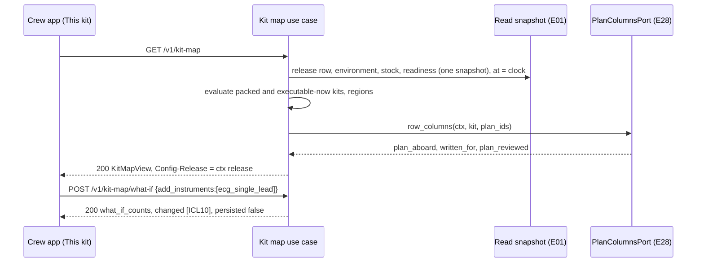
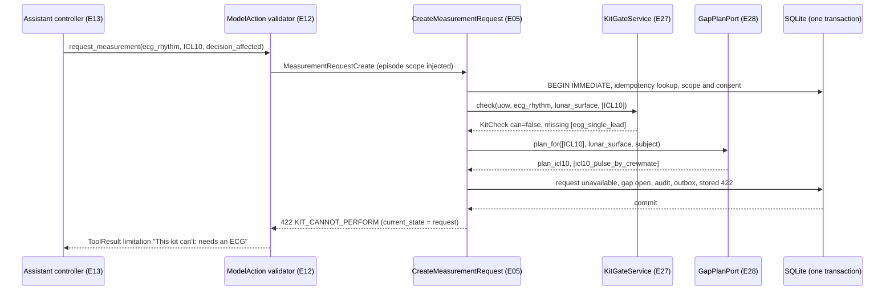

# E27: Kit map: what this ship can test

Technical design for epic E27. Inputs: the brief (`tdd/E27.md` in the planning package), PRD.md (sections 1, 4.12,
4.13, 11, R02, R07, R43 to R46), USE-CASES.md (UC19, UC20, UC22), CONTRACTS.md (sections 2, 4 to 6, 9, 11, 17 to 22,
25, 28), `api/openapi.yaml` (tag "Kit map", `listCapabilities`, `createMeasurementRequest`), the schemas
`config-kit-map`, `config-ui-copy`, `kit-map-view`, `kit-map-what-if`, `kit-check`, `capability`, `capability-gap`,
`measurement-request`, `model-action`, `requests` (`MeasurementRequestCreate`, `KitMapWhatIf`), `error`,
`tool-catalog.json`, the examples in `api/examples/kit-map/`, `api/examples/clinical/`, `api/examples/errors/`,
UX-DESIGN.md (1.6 to 1.8, 3.6, 3.7), VALIDATION.md (V76 to V80, V92, V98, D28 to D32, section 6),
`condition-assessments-119.json`, `docs/BUILD-CHARTER.md`, AGENTS.md, and the E28 and E32 designs at their seams.
`docs/SYSTEM.md` and `docs/DEPLOYMENT.md` do not exist yet; dependent points say "per SYSTEM.md" or "per DEPLOYMENT.md"
and are listed in section 14.

Package paths are relative to `docs/product/`; repository paths to
``.

## 1. Scope

### Delivers

| Story | What | Requirements | Scenarios |
|---|---|---|---|
| E27-01 | The 119 rows of `config/kit-map.json` from NASA's Clinical Findings Forms (CliFFs): one authored file per row, a provenance sidecar per row, the build and the acceptance checks (section 5.3) | R43, R44 | V76, D28 |
| E27-02 | The engine (`crew_health.kitmap`): precedence rule, regions, count bases, `getKitMap`, `kitMapWhatIf`, the capability derivation served by E05, the release checks for kit-map.json (section 8.2) | R43, R44, R59 (instrument part) | V76, V77, V79, D28, D29, D31 |
| E27-03 | The kit gate and its integration contract with E05's `createMeasurementRequest` (section 4.5) and the assistant mapping (section 4.6) | R07, R45 | V78, D30 |
| E27-04 | This kit card, the kit view (Test here; the Plan here column), The kit aboard card shell, How this was built, What would close the most gaps (planning toggles), the kit check line | R43, R44 | D28, D29, D31, D32 (display) |
| E27-05 | The venue study (section 5.4): protocol, consent, raw format, analysis, the hand-off to E21's result panel, and How we know | R46 | V80 |

Use cases: UC19 (whole), UC20 (gate, gap, planning list), UC22 (the gap that starts a plan; the plan is E28).
Invariants owned: CONTRACTS section 9 "No experimental forecast or camera estimate substitutes for a required clinical
instrument" for the kit map; R44 "no state is stored or typed"; the coordinator decision that every count the kit map
shows distinguishes packed equipment, tests executable now, reviewed plans and demonstrated clinical capability
(section 3.2, "Count bases").

### Does not deliver

| Item | Owner |
|---|---|
| Plans, PlanView, PlanRun, `plan_aboard`, `plans_changed`, `GapPlanPort`, loader checks 14 and 15 | E28 |
| MeasurementRequest and CapabilityGap storage, the request state machine, the scope, consent, context, operator and device checks of section 4.5, `listCapabilities`, device availability | E05 |
| Supplies, stock, cover, `cover_changed`, the content of kit-map keys `supplies`, `stock`, `candidate_supplies`, `candidate_skills`, the `supplies` slot of The kit aboard card | E32 |
| The trained hands slot of The kit aboard card | E31 |
| ModelAction validation, the tool gateway and the turn's `limitations` | E12, E13 |
| Loader, release activation, document store, hub settings, error envelope, idempotency store, audit, outbox, event stream | E01 |
| The result panel artifact, the frozen scenario runs, the assistant turn-time and rules-alone runs | E21 (E27-05 consumes them) |
| The crewmate pulse-count pairs (teach and check at the venue) | E30, under the protocol and consent of section 5.4 |
| Assessment gap display and the handoff that carries "Not available here" | E15, E16, E29 (E27 owns the end to end test T27-30) |
| Body figure renderer, router, API client, event stream client | E03 |

## 2. Dependencies and seams

E27 depends on E01, E05, E10, E23 (epics.json). E05, E12/E13, E21, E28, E29, E32 depend on E27.

| Seam | Port, event or endpoint | Owner |
|---|---|---|
| Release documents by version | `ConfigReleaseReader.active(conn) -> ConfigReleaseSnapshot`, `document(name, version) -> bytes` (E01 keeps every version an open plan run pins, CONTRACTS 11) | E01 |
| Release validation and activation hooks | `ReleaseCheck.run(candidate) -> list[Finding]`; `on_activated(release_id)` | E01 defines, E27 implements `KitMapReleaseCheck` |
| Read snapshot, unit of work, clock, settings, template renderer | `ReadSnapshot`, `UnitOfWork`, `Clock.now()`, `HubSettings.get(key)`, `TemplateRenderer.render(template, values, allowed)` | E01 |
| Active environment | `ActiveEnvironmentReader.active_environment_id(conn)` | E23 |
| Roster IDs (what-if skills only) | `RosterReader.person_ids(conn)` | E01 |
| Plan columns and planning deltas | `PlanColumnsPort` (section 4.1) | E27 defines, E28 implements |
| Cover in a what-if | `CoverPlanningPort` (section 4.1) | E27 defines, E32 implements (E32 4.3) |
| Stock for one snapshot | `StockReader.stock(environment_id)` read inside the snapshot | E32 |
| Instruments usable now | `InstrumentReadinessPort.usable_now(conn, environment_id) -> frozenset[str]` | E05 (request R27-15) |
| Kit composition for other engines | `KitQueryPort` (section 4.2) | E27 |
| Kit gate | `KitGatePort.check(uow, ...)` | E27, called by E05 |
| Capability derivation | `KitCapabilitiesPort.capabilities(conn, environment_id) -> tuple[KitCapability, ...]` | E27, served by E05 |
| Gap plan | `GapPlanPort.plan_for(...)` (E28 4.2) | E28, called by E05 |
| Form texts | `FormTextPort.quote_on_page(source_id, page, quote) -> bool` | E10 |
| Provenance streams (How we know) | `ProvenanceStreamsPort.person_streams(person_id)`, `.habitat_streams()` | E05 and E23 (R27-7) |
| Events clients act on | `config.release_activated`, `environment.activated`, `supply.used` | E01, E23, E32 |

Import rules (import-linter, requested from E01 in R27-18): `kitmap` imports `crew_health.contracts`,
`crew_health.platform` and its own layers only. `plans` and `supplies` may import `kitmap.application.ports`. `kitmap`
never imports `plans`, `supplies`, `measurement` or `assistant`.

## 3. Domain model

`hub/src/crew_health/kitmap/domain/`: pure, no I/O, frozen slotted dataclasses, tuples, no framework imports.

### 3.1 Types

```python
# model.py
EnvironmentId = Literal["station_leo", "transit", "lunar_surface", "mars_surface"]    # common.schema enum
BodyRegion = Literal[...]                     # common.schema body_region enum, generated
RegionKey = BodyRegion | Literal["whole_body"]

class ConditionState(StrEnum):
    MEASURED_HERE = "measured_here"; REPORT_ONLY = "report_only"; NEEDS_TEST_NOT_ABOARD = "needs_test_not_aboard"
STATE_ORDER: Final = tuple(ConditionState)     # contract order, vocabulary

@dataclass(frozen=True, slots=True)
class Instrument:
    id: str; name: str; needs_text: str; capability_codes: tuple[str, ...]; method: AcquisitionMethod

@dataclass(frozen=True, slots=True)
class CapabilityWords:
    code: str; label: str; body_region: BodyRegion | None
    operator_requirement: Literal["self", "crewmate", "crew_medical_officer"]
    expected_duration_seconds: int | None; basis: str

@dataclass(frozen=True, slots=True)
class ConfirmingTest:
    index: int; name: str; test_id: str | None; instruments: tuple[str, ...]

@dataclass(frozen=True, slots=True)
class ConditionRow:
    condition_id: str; name: str; body_regions: tuple[BodyRegion, ...]; tests: tuple[ConfirmingTest, ...]
    cliff_url: str; report_only_findings: tuple[str, ...]
    review_state: Literal["unreviewed", "reviewed", "rejected"]
    written_by: str | None; checked_by: str | None; plan_id: str | None
    ground_needs: GroundNeeds | None; treatment_scope: FormQuote | None; rtdc: Rtdc | None
    source_ids: tuple[str, ...]

@dataclass(frozen=True, slots=True)
class SupplyDef:
    supply_id: str; name: str; unit: Unit; consumable: bool    # Unit: parsed UCUM, E32 rule (word w -> {w})

@dataclass(frozen=True, slots=True)
class KitMapDoc:
    version: str                     # SHA-256 of the raw bytes
    label: str; example: bool; notice: str | None
    instruments: tuple[Instrument, ...]               # document order is meaningful
    capabilities: tuple[CapabilityWords, ...]
    kits: Mapping[EnvironmentId, frozenset[str]]
    candidates: tuple[str, ...]; candidate_supplies: tuple[str, ...]; candidate_skills: tuple[str, ...]
    supplies: Mapping[str, SupplyDef]
    conditions: tuple[ConditionRow, ...]              # document order, rejected rows already dropped
```

```python
# evaluation.py
@dataclass(frozen=True, slots=True)
class TestEvaluation:
    index: int; instruments: tuple[str, ...]; needs_no_instrument: bool; fully_aboard: bool; missing: tuple[str, ...]

@dataclass(frozen=True, slots=True)
class ConditionEvaluation:
    row: ConditionRow; state: ConditionState; tests: tuple[TestEvaluation, ...]; missing_instruments: tuple[str, ...]

@dataclass(frozen=True, slots=True)
class StateCounts:
    measured_here: int; report_only: int; needs_test_not_aboard: int; total: int

@dataclass(frozen=True, slots=True)
class CountBases:                          # coordinator decision, section 3.2
    packed: StateCounts                    # kit K = kits[E]: the contract's `counts`
    executable_now: StateCounts            # kit K_now = K ∩ usable_now
    rows_reviewed: int                     # rows with review_state "reviewed"
    plans_aboard: int; plans_reviewed: int # from E28 columns: aboard; aboard and plan reviewed

@dataclass(frozen=True, slots=True)
class RegionSummary:
    region: RegionKey; counts: StateCounts; marks: tuple[ConditionState, ...]

@dataclass(frozen=True, slots=True)
class GateResult:
    capability_code: str; environment_id: EnvironmentId; can: bool
    instrument_ids: tuple[str, ...]; missing_instrument_ids: tuple[str, ...]
    condition_ids: tuple[str, ...]; cliff_urls: tuple[str, ...]
    template_key: Literal["can", "cannot"]; instrument_words: tuple[str, ...]; kit_map_version: str

@dataclass(frozen=True, slots=True)
class KitCapability:                       # E27's half of contracts.Capability; E05 adds the device overlay
    code: str; label: str; body_region: BodyRegion | None
    operator_requirement: Literal["self", "crewmate", "crew_medical_officer"]
    expected_duration_seconds: int | None
    methods: tuple[AcquisitionMethod, ...]            # distinct provider methods, document order
    instrument_ids: tuple[str, ...]; missing_instrument_ids: tuple[str, ...]
    applicable_environments: tuple[EnvironmentId, ...]
    kit_status: Literal["available", "unavailable"]; kit_reason: Literal["not_in_kit"] | None
```

E05 maps `KitCapability` to `contracts.Capability`: same fields; `status` and `unavailable_reason` start from
`kit_status` and `kit_reason`, and E05 may only move an `available` capability to `unavailable` with `device_absent`,
`adapter_down`, `operator_absent` or `context_inapplicable`, or to `not_applicable`; it never makes a `not_in_kit`
capability available (test T27-26).

### 3.2 Rules (`rules.py`, pure)

```python
def evaluate_condition(row: ConditionRow, kit: frozenset[str]) -> ConditionEvaluation
def evaluate_kit(doc: KitMapDoc, kit: frozenset[str]) -> tuple[ConditionEvaluation, ...]
def count_states(evals: Sequence[ConditionEvaluation]) -> StateCounts
def summarize_regions(evals: Sequence[ConditionEvaluation], order: Sequence[BodyRegion]) -> tuple[RegionSummary, ...]
def diff_states(base: Sequence[ConditionEvaluation], after: Sequence[ConditionEvaluation]) -> tuple[ConditionEvaluation, ...]
def kit_gate(doc: KitMapDoc, capability_code: str, env: EnvironmentId, condition_ids: Sequence[str]) -> GateResult
def derive_capabilities(doc: KitMapDoc, env: EnvironmentId) -> tuple[KitCapability, ...]
```

**Precedence, missing set, kit gate and capability derivation** are exactly CONTRACTS section 21 ("State of a
condition", "The kit gate", the `GET /v1/capabilities` paragraph); this design adds only: `missing` lists a test's
missing instruments in the test's own order; an unknown capability code raises `UnknownCapabilityCode`; a condition ID
that names no non-rejected row raises `UnknownConditionId`; `instrument_words` are provider `name`s (can) or
`needs_text`s (cannot), joined by the application layer with the section 21 joiners (R27-8); `applicable_environments`
follow the fixed environment vocabulary order.

| Decision the brief asks for | Selected | Rejected, and why |
|---|---|---|
| Several tests, some instruments aboard | A test counts only when all its instruments are aboard; partial tests never count (ICL3 with the ECG but no troponin stays `needs_test_not_aboard`, missing `[troponin_poc]`) | "Any instrument counts" claims a confirmation the crew cannot make; partial credit invents a clinical score |
| Connected, manual, import only | The packed basis counts every instrument in `kits[E]`, whatever its data path (a device read by eye is aboard; manual entry is the always-available fallback, charter 2). The executable-now basis removes packed instruments E05 reports unusable now (lost, broken, depleted). An importable report never counts: it is a record of the past (DEMO-CONDITIONS ICL10, "Available here: No"). Connection is a separate live word (R27-1) | Dropping an instrument when its Bluetooth link drops flips rows while the device can be read by hand; counting imports lets a file close a dashed ring (section 9) |
| Camera estimates | No confirming test may name an instrument with `method: camera_estimate`. This is a safety invariant in code: `KitMapReleaseCheck` refuses it at every validation, so no release that breaks it can be activated (section 8.2) | Letting the experimental camera turn a dashed ring into a dot |
| Count bases (coordinator decision) | Every count names its basis: **packed** (the contract `counts`: instruments in the kit list), **executable now** (packed and usable now per E05; who can run it is checked at request time), **reviewed** (rows and plans whose `review_state` is `reviewed`) and **clinically demonstrated**, which is never a number: AGENTS section 7 claims no clinical validation, so the view always reads "not demonstrated" from ui-copy. Served by R27-16 | One unlabeled count would read as clinical capability |
| Body region aggregation | Per region in `body_region` enum order, then `whole_body` for rows with `[]`: counts of rows listing it, `marks` = states present in `STATE_ORDER`; regions with no rows omitted (as `view-station.json`). One glyph per mark, ring around dot (UX-DESIGN 1.6) | "Worst state" hides a partly measurable region; a primary region is not in the CliFFs |
| Row order | Document order; the build writes `condition-assessments-119.json` order | Sorting by state moves rows between releases |
| What-if bound | A pure computation over one context (section 4.3); the use case holds no repository with a write method; `persisted` is the constant `false` | A scratch table or session flag is a write path |
| Gate leakage | Inputs: capability code, environment, condition IDs; output: configuration data only. Scope and consent are checked before the gate (section 4.5) | |

### 3.3 State machines

None. Nothing is stored (R44). The only lifecycle is the configuration release (E01).

### 3.4 Invariants

| ID | Invariant | Test |
|---|---|---|
| KM-I1 | Every non-rejected row has exactly one state per basis; rejected rows appear in no view, count, region or gate result | T27-02, T27-13 |
| KM-I2 | `measured_here` iff some test with a non-empty instrument list is inside the kit | T27-01, T27-02 |
| KM-I3 | Monotonic: adding instruments never moves a row down the precedence | T27-02 |
| KM-I4 | `missing_instruments` is minimum cardinality, ties to the first test, empty for `measured_here` | T27-03 |
| KM-I5 | `total` equals non-rejected rows and the sum of the three counts, on both bases | T27-02 |
| KM-I6 | Region marks ordered and exact; empty regions absent | T27-14 |
| KM-I7 | No read path writes (rows, sequence, outbox, idempotency store unchanged) | T27-06 |
| KM-I8 | One context gives byte-identical responses; no response mixes releases, environments, stock or clocks | T27-19, T27-29 |
| KM-I9 | The gate output carries no person data and does not depend on the model, devices or the ground link | T27-11, T27-20 |
| KM-I10 | No confirming test names a `camera_estimate` instrument in any activated release | T27-17 |
| KM-I11 | `executable_now` counts never exceed `packed`; `plans_reviewed` never exceeds `plans_aboard` | T27-02, T27-31 |
| KM-I12 | Card, kit view and result panel counts come from one response | T27-21, D28 |

## 4. Application layer

`hub/src/crew_health/kitmap/application/`.

### 4.1 Ports E27 defines and consumes

```python
# ports.py
@dataclass(frozen=True, slots=True)
class ReleasePins:                        # versions (SHA-256) of the documents a computation reads
    kit_map: str; ui_copy: str; skills_catalog: str; onboard_plans: str; role_rules: str

@dataclass(frozen=True, slots=True)
class KitMapRelease:
    release_id: str | None                # None for a pinned set outside the active release (open plan runs)
    pins: ReleasePins; doc: KitMapDoc
    kit_check_templates: Mapping[Literal["can", "cannot"], str]
    copy: KitMapCopy                      # R27-2 words; a missing key is None and drives the designed failure
    region_order: tuple[BodyRegion, ...]; skill_ids: frozenset[str]

class KitMapReleaseSource(Protocol):
    def active(self, conn: SnapshotConn) -> KitMapRelease: ...       # the release committed at snapshot start
    def at_version(self, pins: ReleasePins) -> KitMapRelease: ...    # E28 pinned runs; re-parses after eviction

@dataclass(frozen=True, slots=True)
class KitMapContext:                      # captured once per request, passed to every port
    snapshot: SnapshotConn                # E01 read transaction; first statement reads the release row
    release: KitMapRelease; environment_id: EnvironmentId; at: datetime
    stock: Mapping[str, StockLevel]       # E32 StockReader, same snapshot
    usable_now: frozenset[str]            # E05 InstrumentReadinessPort, same snapshot

@dataclass(frozen=True, slots=True)
class SupplyAddition: supply_id: str; quantity: Quantity          # Decimal plus the supply's UCUM unit (E32)
@dataclass(frozen=True, slots=True)
class SkillAddition: skill_id: str; person_ids: tuple[str, ...]
@dataclass(frozen=True, slots=True)
class PlanningDelta:
    add_instruments: tuple[str, ...]; add_supplies: tuple[SupplyAddition, ...]; add_skills: tuple[SkillAddition, ...]

@dataclass(frozen=True, slots=True)
class PlanColumns:
    plan_id: str | None; written_for: Literal["condition", "family", "flow"] | None
    plan_aboard: bool; plan_reviewed: bool              # plan_reviewed: R27-20 (E28)

@dataclass(frozen=True, slots=True)
class PlanChange:
    plan_id: str; condition_id: str | None; flow_id: str | None
    before_plan_aboard: bool; before_waits_for_mo: bool; after_plan_aboard: bool; after_waits_for_mo: bool

class PlanColumnsPort(Protocol):          # E28
    def row_columns(self, ctx: KitMapContext, *, kit: frozenset[str],
                    plan_ids: Sequence[str | None]) -> Sequence[PlanColumns]: ...
    def plans_changed(self, ctx: KitMapContext, *, base_kit: frozenset[str],
                      delta: PlanningDelta) -> Sequence[PlanChange]: ...

@dataclass(frozen=True, slots=True)
class CoverChange: supply_id: str; from_uses: int | None; to_uses: int | None

class CoverPlanningPort(Protocol):        # E32
    def cover_changed(self, ctx: KitMapContext, *, add_supplies: Sequence[SupplyAddition]) -> Sequence[CoverChange]: ...
```

Ports read only through `ctx` (its snapshot, release, stock and `at`); E28 builds the hypothetical stock with E32's
`with_added(ctx.stock, ...)`. `row_columns` takes no person input (EI3's `plan_aboard` needs an `any_crew` step needing
no skill), which keeps the view free of person data. These signatures are the agreement recorded in R27-20 with E28 and
E32 (it makes E32's R-E32-02 (a) to (c) explicit).

### 4.2 Ports E27 provides

```python
class KitQueryPort(Protocol):
    def kit_instruments(self, environment_id: EnvironmentId, pins: ReleasePins) -> frozenset[str]: ...
    def instrument(self, instrument_id: str, pins: ReleasePins) -> Instrument: ...

class KitGatePort(Protocol):              # E05 calls it inside its unit of work
    def check(self, uow: UnitOfWork, *, capability_code: str, environment_id: EnvironmentId,
              condition_ids: Sequence[str]) -> GateOutcome: ...
    # GateOutcome: kit_check (contracts.KitCheck), capability words, rows (condition_id, plan_id) in request order
    # raises KitGateInvalid(field_errors) for an unknown capability or condition ID or a bound exceeded

class KitCapabilitiesPort(Protocol):
    def capabilities(self, conn: SnapshotConn, environment_id: EnvironmentId) -> tuple[KitCapability, ...]: ...
```

### 4.3 Use cases

| Use case | Errors | Idempotency |
|---|---|---|
| `GetKitMapView.execute(session, environment_id \| None) -> contracts.KitMapView` | `InvalidEnvironment`, `KitMapUnavailable` (section 6) | read |
| `RunWhatIf.execute(session, cmd) -> contracts.KitMapWhatIf` | `WhatIfInvalid(field_errors)` | none by contract; pure |
| `KitGateService.check` | `KitGateInvalid(field_errors)` | pure, inside the caller's transaction |
| `KitCapabilitiesService.capabilities` | none | pure |
| `KitMapReleaseCheck.run`, `.on_activated` | findings are data | pure |

**Context capture** (both read use cases): open one E01 `ReadSnapshot`; the first statement reads the active release
row (SQLite fixes a WAL snapshot at the first read, so everything after sees that commit); then the active environment
(E23), stock (E32) and `usable_now` (E05) in the same snapshot; `at = clock.now()` once. An `environment_id` query
parameter replaces only the environment. Every port and every rendered word use this one `ctx`; the response's
`Config-Release` header is `ctx.release.release_id` (R27-18 asks E01's middleware to take it from the handler).

**`GetKitMapView`**: `K = kits[env]`, `K_now = K ∩ usable_now`; evaluate on both; regions from the packed basis (the
figure shows what is packed); `row_columns(ctx, kit=K, plan_ids)`; `missing_text` rendered with
`kit_check_templates.cannot` and " and "; plan counts as CONTRACTS 21; `as_of = ctx.at`. R27-3 and R27-16 fields when
approved; until then the contract fields only.

**`RunWhatIf`**:

1. Parse the body with the generated model, numbers as `Decimal` (`parse_float=Decimal`, `parse_constant` refusing
   `NaN` and `Infinity`). Bounds from hub settings (section 11) are checked on list lengths before any lookup.
2. Validate, reporting every finding together with its JSON pointer: instrument IDs in `doc.instruments`; supply IDs in
   `doc.supplies`; each supply ID at most once (duplicates are `/add_supplies/<i>/supply_id` findings, never summed);
   quantity finite, above 0, at most `kitmap.whatif_max_quantity` and `kitmap.whatif_max_quantity_scale` decimal places;
   skill IDs in `rel.skill_ids`, each at most once; person IDs in the roster read in the snapshot.
3. Resolve each supply quantity's unit from the pinned `SupplyDef.unit` and build `Quantity(value, unit)`; no bare
   number leaves the API layer.
4. `K' = K ∪ add_instruments`; `ignored_instrument_ids` = requested IDs already in `K`, request order; evaluate `K` and
   `K'`; `changed` in row order.
5. `plans_changed = plan_columns.plans_changed(ctx, base_kit=K, delta)`; `cover_changed =
   cover_planning.cover_changed(ctx, add_supplies)`; supplies and skills never move a ring (CONTRACTS 21).
6. Echo `added_supplies` and `added_skills` with the request's decimal text; `persisted = False`; no event, no write.

### 4.4 Events

Published: none. Consumed on the hub: none. Clients act on the events of section 7.

### 4.5 Gate integration contract with E05 (E27-03)

E05 owns `CreateMeasurementRequest`; E27 owns this contract and its tests (T27-10, T27-28, T27-32 to T27-35), run
against E05's real use case. Request R27-15 asks E05 to adopt it. One `BEGIN IMMEDIATE` unit of work, in this order;
the first failure ends the command:

| Step | Check | Failure (nothing recorded unless stated) |
|---|---|---|
| 1 | Session and `x-roles` (crew, crew_medical_officer) | 401 `UNAUTHENTICATED`, 403 `UNAUTHORIZED_SCOPE` |
| 2 | Body against `MeasurementRequestCreate`; `condition_ids` at most `kitmap.gate_max_condition_ids` | 400 `MALFORMED_REQUEST`, 422 `INVALID_VALUE` |
| 3 | Idempotency: key and body SHA-256 looked up inside the transaction (section 4.5.2) | stored result, or 409 `DUPLICATE_COMMAND` |
| 4 | Subject and scope: the subject is the episode's person when `episode_id` is set (the episode must be visible, else 404 `NOT_FOUND`), otherwise the session person. Self: allowed. Another person: allowed only with a valid ConsentGrant from the subject for this purpose naming the requester (stored as `consent_ref`), or, without one, for a `crew_medical_officer` session inside an open help session for that subject (onboard care when the subject cannot consent). The assistant acts only for the session person (CONTRACTS 17) | 403 `UNAUTHORIZED_SCOPE` (interim also for a missing grant: `CONSENT_REQUIRED` is not in the operation's codes, R27-15). The gate never runs |
| 5 | Kit gate: `kit_gate_port.check(uow, capability_code, environment_id=<active, read in this transaction>, condition_ids)` | unknown code or condition: 422 `INVALID_VALUE`. `can` false: record and 422 `KIT_CANNOT_PERFORM` (4.5.1) |
| 6 | Context applicability (E05, configured rule per R27-15) | record with gap reason `context_inapplicable`, 422 `CONTEXT_INAPPLICABLE` |
| 7 | Operator: `operator_id` (or the subject for `self`) is on the roster, not in an eva overlay, and holds the role the capability's `operator_requirement` needs | record with gap reason `operator_absent`, 422 `CAPABILITY_UNAVAILABLE` |
| 8 | Device: some provider aboard is usable now. A packed instrument whose device is disconnected but can be read by eye passes, and E05 offers manual entry | no usable provider: record with gap reason `device_absent`, 422 `CAPABILITY_UNAVAILABLE` with `supported_alternative` naming manual entry when a manual method exists |
| 9 | Create `proposed` with `kit_check`; audit; outbox `measurement_request.changed`; store the 201 result | 201 |

Steps 6 to 8 are E05's rules; their order after the gate is fixed here so an absent instrument is always reported as
the kit (the actionable fact) and a present but unusable one is never reported as absent.

#### 4.5.1 Recording an unavailable request

In the same unit of work: insert the request `unavailable` with `kit_check` and `allowed_actions: []` (it never
reaches `awaiting_acceptance`, so it never reaches a person as a task); insert the CapabilityGap when the request has an
episode; append the hash-chained audit entries `measurement_request.recorded_unavailable` and `capability_gap.opened`;
put `measurement_request.changed` in the outbox; store the 422 envelope (status, body bytes, `request_sha256`) in the
idempotency store; commit; respond.

| CapabilityGap field | Source |
|---|---|
| `gap_id` | E01 `IdGenerator.new("gap")` |
| `episode_id` | the request's `episode_id` |
| `capability_code`, `body_region` | the request's capability code; the capability words' `body_region` (CONTRACTS 7: the region the missing test would examine) |
| `reason` | `no_capability` (step 5) or the step 6 to 8 reason |
| `consequence` | the request's `decision_affected` (required, `minLength 1`): the decision that stays unresolved |
| `alternatives` | the texts of the gap plan's check another way steps when E28's `GapPlan` carries them (R27-20), otherwise `[]` (schema allows empty). Never an invented alternative |
| `state` | `open` |
| `plan_id`, `check_another_way_step_ids` | `GapPlanPort.plan_for(condition_ids, environment_id, subject)`: the first requested condition, in request order, whose row has a plan covering the environment; `null` and `[]` when `condition_ids` is empty, no row has a plan, or the plan has no applicable step |

One request opens at most one gap, whatever the number of conditions; every condition and form link stays on the
request's `kit_check`. A request without an episode is recorded `unavailable` with its `kit_check` and opens no gap,
because CapabilityGap requires a non-null `episode_id` and no episode is invented; the audit entry records
`gap_not_opened: no_episode` and R27-13 asks to allow it. `supported_alternative` is `null` (the example's
`share_with_ground` makes the ground a step, USE-CASES rule 7; R27-6).

#### 4.5.2 Durability and idempotency

- Concurrent identical submissions: the second blocks on `BEGIN IMMEDIATE` (busy timeout from
  `storage.busy_timeout_ms`), then finds the stored result and returns it byte for byte: one request, one gap.
- Same key, different body: 409 `DUPLICATE_COMMAND`, nothing written.
- Crash before commit: nothing exists (no request, gap, audit, outbox or key). Crash after commit and before the
  response: the retry returns the stored 422 with the original request and KitCheck, even if the environment or the
  release changed in between, because the lookup at step 3 precedes the gate.
- Disk full (`SQLITE_FULL`) or I/O error at any write or at commit: rollback, 500 `INTERNAL_ERROR` with
  `retryable: true`, nothing stored, so a retry runs the command afresh. Keys are kept 24 hours (CONTRACTS 5).

### 4.6 The assistant boundary (E12, E13)

The model proposes the ModelAction `request_measurement` (CONTRACTS 6; `propose_measurement` maps to it, CONTRACTS 17
step 3). E12 validates it against `model-action.schema.json` and then builds `MeasurementRequestCreate`:

| Create field | From |
|---|---|
| `episode_id` | the conversation's injected episode scope (`null` outside an episode context); never from the model |
| `capability_code`, `reason`, `body_region`, `condition_ids` | the ModelAction fields (codes and IDs re-validated by steps 2 and 5) |
| `decision_affected` | the ModelAction field; `null` is refused as a schema repair (one allowed, then `MALFORMED_MODEL_OUTPUT`), since the create schema requires it and nothing is invented (R27-14) |
| `operator_id` | not set by the model; E05 assigns per its operator rule |

The `propose_measurement` tool schema (`capability_code`, `reason`, `source_ids`, no additional properties) cannot carry
`condition_ids` or `decision_affected`; R27-14 asks to align it with the ModelAction. Until then the controller accepts
only the ModelAction form for measurement requests. A 422 `KIT_CANNOT_PERFORM` becomes a ToolResult whose limitation is
`kit_check.text`; the turn continues. T27-10 enters through E12's validator with ModelAction JSON, not through E05.

## 5. Adapters

### 5.1 Storage

None. `kitmap` owns no table or migration. T27-06 asserts no `kitmap_` table and no write on its routes.

### 5.2 Configuration adapter

`kitmap/adapters/config_source.py`, `ConfigKitMapReleaseSource(releases, common_vocabulary, settings)`:

- **Parse before activation.** `KitMapReleaseCheck.run` parses the candidate's kit-map.json into `KitMapDoc` and the
  ui-copy words into `KitMapCopy` while validating; a valid parse is kept with the draft and `on_activated` installs it,
  so the request path never parses the active release.
- **Cache.** Key: `(kit_map, ui_copy, skills_catalog)` versions. LRU of `kitmap.parsed_release_cache` entries (active
  plus plan-run pins). A pinned set evicted and asked for again is re-parsed from E01's document store by version
  (bounded by the document size cap); if a version is missing, `at_version` raises `PinnedVersionMissing` and E28 shows
  its designed unknown state (T27-29).
- Defaults from the schema descriptions only: `needs_text` = `name`, `method` = `manual_instrument`.

### 5.3 Authoring pipeline (E27-01), not part of the hub

Authoring (binding interim decision, pending the owner's answer to Q27-1 and Q27-2): one model drafts each row from the
package sources and the saved form; the other model checks it against the same sources; both are recorded; every row
stays `unreviewed` and the document notice says it is not clinically reviewed.

| Path | Holds |
|---|---|
| `authoring/kitmap/kit.json` | Head: `version` label, `example: false`, `notice`, `instruments`, `capabilities`, `kits`, `candidates` |
| `authoring/supplies/kit-map-supplies.json` | `supplies`, `stock`, `candidate_supplies`, `candidate_skills`, owned by E32 (R-E32-01; interim: E32's patch applied by E27, R27-20) |
| `authoring/kitmap/rows/ICL<n>.json` | One row, exactly the `conditions[]` item shape. `written_by` is `model:<drafting model id>`, `checked_by` `model:<checking model id>`, `review_state: unreviewed` |
| `authoring/kitmap/provenance/ICL<n>.json` | Per field: the sources consulted (form URL and SHA-256, page numbers, package file and line), the drafting run and the checking run (`AI-USE-LOG.md` row IDs), the checker's verdict per field, and `reportable_findings_pages` (pages read for what a person can report) |
| `authoring/kitmap/forms/ICL<n>/form.json` | Saved form: `url`, PDF `sha256`, `fetched_at`, `pages[]` with extracted text |
| `authoring/kitmap/fetch_forms.py` | Downloads each `cliff_url` (timeout 30 s, 3 attempts with 2, 4, 8 s backoff, at most 4 concurrent, 25 MB cap), never overwrites a saved form with a different hash without `--refresh` |
| `authoring/kitmap/build.py` | Merges the three inputs in `condition-assessments-119.json` order into `config/kit-map.json`, deterministic bytes |
| `authoring/kitmap/check.py` | The acceptance checks of section 8.3 |

Saved form texts go to E10 as DocumentVersions so E28's loader check 14 and T27-18 use one copy (`FormTextPort`).

### 5.4 Venue study (E27-05)

Binding interim (pending Q27-4): the hub laptop's webcam is the only camera; the reference is a manual 30 second
pulse count by a second person, plus a pulse oximeter when one is available; no accuracy claim beyond what is measured.
"One camera against two agreeing" cannot be measured with one camera and is published as not measured, with the
reason.

**Frozen before the first volunteer** (`eval/venue_study/FROZEN.json`, its SHA-256 committed before the first raw
row): PROTOCOL.md and CONSENT.md hashes, hub build commit, configuration release ID (it pins the camera worker's
quality gate thresholds), camera worker version, `study.json` (window lengths, the windows per condition, metronome
rates for paced breathing, the clock discontinuity tolerance), analysis script hash. Nothing is tuned after the first
raw row; a changed hash aborts analysis (T27-25).

**Collection.** One participant at a time, seated at the laptop. `eval/venue_study/collect.py` runs on the laptop
outside the hub: it starts each window from one monotonic clock, shows the counter's countdown and starts the camera
worker's window (through E06's worker interface, per the E06 design) at the same instant, so the camera, the manual
count and the oximeter share one time base. Its readings go only to the raw file; nothing enters a person's records. Conditions, in order: rest, light change, recovery after light movement (the protocol defines both without
inducing any dangerous state, VALIDATION 6), paced breathing, natural breathing. The second person counts the radial
pulse for 30 seconds (or breaths for the breathing window) and types the count; the oximeter value at window end is
typed, or read from the connected device with its timestamp. Frames are never stored (CONTRACTS 10).

**Raw row** (`eval/venue_study/raw-schema.json`, one row per window, CSV):

| Field | Unit or values |
|---|---|
| `participant_code` (`P` plus 3 digits, random at enrollment), `adult_confirmed`, `consent_sha256`, `frozen_sha256` | |
| `window_id`, `condition` (`rest`, `light_change`, `recovery`, `paced_breathing`, `natural_breathing`) | |
| `window_start`, `window_end` (hub UTC), `monotonic_elapsed_ms`, `clock_discontinuity` (wall and monotonic elapsed differ by more than the frozen tolerance) | ms |
| `camera_pulse`, `camera_breath_rate` | `/min`, or empty |
| `camera_pulse_refusal`, `camera_breath_refusal` | the worker's reason code, or empty; each independent (R09) |
| `manual_count`, `manual_count_seconds`, `counter_code` | count, `s` |
| `oximeter_present`, `oximeter_pulse` | boolean, `/min` or empty |
| `paced_rate` | `/min` (paced windows only) |
| `excluded`, `exclusion_reason` | pre-specified reasons only |

**Analysis** (`eval/venue_study/analyze.py`, deterministic, no network): reference pulse = `manual_count × 60 /
manual_count_seconds`. Pre-specified exclusions: withdrawn participant (rows deleted before publication), missing
`adult_confirmed` or consent hash, frozen hash mismatch, `clock_discontinuity`; each counted. Per condition and overall:

- attempted windows; refusal rate = refused windows / attempted windows;
- paired windows (camera value and reference both present); windows missing a reference are counted, not paired;
- error e = camera minus reference; MAE and bias are computed per participant first and then averaged across
  participants (windows from one person are not independent people); window-level MAE and bias are reported beside
  them with both denominators;
- the oximeter comparison is reported separately and only over windows where it was present;
- breathing: camera rate against counted breaths, paced and natural reported separately; a window with a pulse but no
  breathing result counts as a breathing refusal only;
- every metric carries people, windows and pairs; a metric with no pairs is `not_measured_yet`.

**Hand-offs.** The analysis writes `eval/results/venue-study.json` (schema `eval/venue_study/result.schema.json`:
`metric_id`, `status`, value with UCUM unit, denominators, exclusions, `frozen_sha256`, raw file SHA-256, command line).
E21 ingests it into the result panel artifact; E21 also supplies the assistant turn-time (on the M3) and the rules
alone against rules plus assistant results with failures counted. E30 adds its pair results under the same protocol.

**Retention and access.** Raw rows hold no name, age, sex, skin tone or image. Participant-level files live in
`eval/venue_study/raw/` in the repository only, never served by the hub, never in a prompt, index or ground log; the
API serves aggregates only (section 6, R27-7). Withdrawal before publication deletes that participant's rows and
reruns the analysis.

**Done when**: frozen hash committed before the first raw row; actual collection run and raw rows committed; the
analysis reproduces `venue-study.json` byte for byte from the raw file; the result panel holds it; How we know shows
each line or "Not measured yet". Synthetic tests (T27-25) prove the analysis only; they never complete E27-05. Without
the owner's authorization the study does not start and E27-05 stays open, reported as such.

## 6. API

Routers in `kitmap/api/router.py`, mounted by E01. Bodies are the generated models. Errors use the package envelope
(`error.schema.json`, which allows no additional properties); the charter's "RFC 9457 problem details" conflicts and is
filed as R27-19; until it is decided the envelope stands, since the charter preamble says CONTRACTS.md and
`openapi.yaml` win on shared objects.

**`getKitMap`** `GET /v1/kit-map?environment_id=`: `x-roles` crew, crew_medical_officer, ground, operator, station,
adapter, editor. Person data: none; every role reads the same response. 200 KitMapView; example
`api/examples/kit-map/view-station.json`.

**`kitMapWhatIf`** `POST /v1/kit-map/what-if`: same roles; no `Idempotency-Key`, no `If-Match`. 200 KitMapWhatIf,
`persisted: false`; example `what-if-ecg.json`.

| Domain or adapter error | Code |
|---|---|
| Schema failure of the body, `WhatIfInvalid`, `KitGateInvalid` | 422 `INVALID_VALUE` with one `field_errors` entry per finding |
| Non-JSON body or `NaN`/`Infinity` token | 400 `MALFORMED_REQUEST` |
| Non-JSON content type | 415 `UNSUPPORTED_MEDIA_TYPE` |
| Unknown `environment_id` | 400 `MALFORMED_REQUEST` (schema enum) |
| No session / role not listed | 401 `UNAUTHENTICATED` / 403 `UNAUTHORIZED_SCOPE` |
| `KitMapUnavailable` (no installed parse for the active release), `StorageUnavailable`, a port raising, busy timeout | 500 `INTERNAL_ERROR`, `retryable: true`, nothing written; logged with correlation ID |
| Gate in E05 | section 4.5 |

Words on screen come from ui-copy `error_messages[code]`, else `designed_states.unknown`; never `message`.

## 7. User interface

`ui/crew/src/features/kitmap/`, Vue 3, TypeScript strict, generated API types, E03 shell. No component holds a word,
count, threshold, condition or instrument: words from ui-copy via `useCopy()`, everything else from responses. No client
arithmetic on counts, and no client rendering of a template that needs hub state (CONTRACTS 11 "The hub renders every
template that needs hub state"): such lines wait for R27-3 and R27-16.

| Component | Owner | Binds to | Shows |
|---|---|---|---|
| `ThisKitCard.vue` | E27 | `getKitMap` | Count with its basis label (packed, executable now, reviewed, not demonstrated: R27-16 texts); legend from `kit_map_state_words`; the plan line (R27-3 `plan_line_text`); arrow to the kit view |
| `KitView.vue` | E27 | `getKitMap`, cached config | Stage in kit view (`regions[].marks`), pills Test here and Plan here, state and region filters, rows; a row opens E28's `/plan/condition/{id}` |
| `ConditionRow.vue` (Test here and Plan here columns) | E27 | one `conditions[]` item | `missing_text`, form link, review state; Plan here: R27-3 `plan_summary_text` and `ground_was_for_text` |
| `KitAboardCard.vue` (shell) | E27 | `kit[]`; slots `supplies` (E32 `KitAboardSupplies.vue`), `trained-hands` (E31) | Instrument names, the R27-1 link word |
| `HowBuiltCard.vue` | E27 | `getKitMap`, config `notice` | Notice; R27-3 `rows_checked_text` and plan breakdown text |
| `PlanningCard.vue` | E27 | `candidates[]`, `candidate_supplies`, `candidate_skills`, skills-catalog `short_name` by skill ID, `GET /v1/crew` names | Toggles with R27-3 `candidate_impacts[].text`; posts the what-if; supply quantity per R-E32-09 interim (typed by the person, no default) |
| `KitCheckLine.vue` | E27 (used by E05 and E28 cards) | a `KitCheck` | `text`, one form link per `cliff_urls` |
| `HowWeKnow.vue` | E27 | R27-7 endpoint | Three cards of UX-DESIGN 3.7 |

**Required copy (C1).** Release check C1 lists every missing required key (R27-2) in `validation.warnings`; it cannot
reject, because the ui-copy schema forbids those keys until R27-2 is approved. The UI treats a missing required key as
a designed failure: `planning_view` missing disables the planning toggles (the card
shows `designed_states.unknown` with the error look); a missing basis label hides that count, never shows it bare;
`not_measured_yet` missing makes How we know show the error state. No omission satisfies an acceptance criterion:
E27-04 is done only with R27-2's required keys and R27-3 approved and rendered, E27-05 only with R27-7 and its copy.

### States and freshness

| State | Behavior |
|---|---|
| Loading, first load | Skeleton in the card's geometry; no marks |
| Refetching | The retained view stays only with the R27-2 `view_stale` label and its `as_of`; without that key the skeleton shows instead |
| Error | `error_messages[code]` with retry; never a zero |
| Offline or hub stopped | Last view from the E29 cache with `as_of` and `kit_map_version`, labeled stale; toggles disabled |
| Planning view | Deep-green card state and the `planning_view` label on the stage; the base view is kept separately and never overwritten |
| `example: true` | SIM label (`origin_words.SIM`) on the legend |
| Unavailable | Not applicable: nothing here needs the model, devices or the link |

**Invalidation.** The feature subscribes through E03's event client to `config.release_activated`,
`environment.activated` and `supply.used`. On any of them, or on a stream reconnect after a gap: mark both views stale,
refetch configuration first (on `config.release_activated`, CONTRACTS 19), then the base view, then re-post the active
toggle set; toggles whose candidate left the configuration are dropped and named with the R27-2 `toggle_removed` words.
`410 CURSOR_EXPIRED` (handled by E03): reload configuration and views, resubscribe without a cursor.

**Response ordering.** Every fetch carries a sequence number; a response is applied only when it is the latest issued
for that view, its `Config-Release` header equals the client's current release and its `environment_id` equals the
view's environment (the active one for the default view). Otherwise it is discarded and one refetch is issued; after 3
consecutive discards the error state shows. A superseded what-if is aborted and, if it still arrives, discarded by the
same rule.

**Accessibility.** Marks differ in shape and always carry words; toggles are `button` with `aria-pressed`; counts sit
in an `aria-live="polite"` region; regions are reachable from the region filter list (UX-DESIGN 1.11).

**No content in client code.** Imports of words only through `useCopy()`; the V98 scan (E21's scanner, E27 fixtures)
finds no condition ID or name, instrument ID or name, count, `kit_map_state_words` or `kit_check_templates` value in
the bundle or under `features/kitmap/` (T27-21); T27-07 changes the configuration and the rendered output with the same
build.

## 8. Configuration

### 8.1 Documents read

| Document | Fields |
|---|---|
| `config/kit-map.json` (E27; four supply keys' content E32) | all |
| `config/ui-copy.json` (owner per SYSTEM.md) | `kit_map_state_words`, `kit_check_templates`, `plan_lines`, `origin_words`, `error_messages`, `designed_states.unknown`, `body_region_labels`; R27-2 `kit_map_words` |
| `config/skills-catalog.json` (E30) | `skills[].skill_id`, `short_name` |
| E01 hub settings | the `kitmap.*` bounds of section 11 (R27-17) |
| `contracts/schemas/common.schema.json` | `body_region` and `environment_id` enum order |
| `knowledge/` condition list (E10 copy of `condition-assessments-119.json`) | `condition_id`, `family` |

### 8.2 Release checks (`KitMapReleaseCheck`, run by E01 at every validation, so at every activation)

| Check | Rule | Pointer |
|---|---|---|
| B (bounds, first) | Document bytes within `config.max_document_bytes` (E01, before parsing); counts and string lengths within the `kitmap.*` bounds, checked before building domain objects | the offending array or string |
| 11a, 11b, 11c | CONTRACTS 11 check 11 as written | the offending element |
| 12 (kit-map half) | A `reviewed` row names `checked_by` | `/conditions/<r>/checked_by` |
| CAM | No confirming test instrument has `method: camera_estimate`. Code, not a setting; it cannot be switched off | `/conditions/<r>/confirming_tests/<t>/instruments/<i>` |
| C1 (warning) | Each required key of R27-2 missing from ui-copy is listed in `validation.warnings`; once R27-2 makes them schema-required, check 1 rejects | `/kit_map_words/<key>` |
| EX | `example: true` cannot be activated while the mission mode is LIVE (CONTRACTS 11) | `/example` |

A failing check rejects the release with `CONFIG_INVALID`; the last good release stays active. A corrupt document is a
schema failure (check 1, E01). At cold start with no valid release, CONTRACTS 20 build order step 1 applies ("Nothing
else starts until a release validates"): the kit map routes and the gate are not mounted, the UI shows the error state,
and Someone needs help still works (E01, E11). T27-17 covers all three.

### 8.3 Authoring acceptance (`authoring/kitmap/check.py`, CI)

1. Exactly the 119 condition IDs, once each, in list order.
2. Every row: `cliff_url` equal to its saved form `url`; regions from the fixed set; at least one confirming test;
   `report_only_findings` present, and empty only when the provenance sidecar names the pages read and the checker
   confirmed none; `written_by` and `checked_by` both `model:` identifiers and different; `review_state: unreviewed`
   unless a named clinician reviewed it (Q27-2).
3. Every provenance field has a checker verdict `agrees`; any `disagrees` blocks the build.
4. Every `ground_needs.quote`, `treatment_scope.quote` and `rtdc` value is found on its cited page of the saved form
   (whitespace-normalized exact match) and its `source_id` resolves (R27-4; until then those fields stay `null`, which
   the schema allows).
5. Section 8.2 checks pass; `config/kit-map.json` is byte-identical to `build.py` output.

### 8.4 Provenance

Rows carry `cliff_url`, `source_ids`, `review_state`, `written_by`, `checked_by`; the sidecars carry per-field sources
and runs; the notice reads as a not clinically reviewed draft on every page that renders the content; the served
version is the SHA-256. The kits are team defaults (the kit on the table); R27-5 adds their basis to the document.

### 8.5 A configuration edit changes behavior with no code change

T27-07: release B edits only `kits.station_leo` (adds `ecg_single_lead`) and `conditions[ICL64].confirming_tests[0]
.instruments` (empties it). After activation with the same build: ICL10 `measured_here`, ICL64 `report_only`, packed
counts 1, 4, 2; the UI renders them with the same bundle. A copy edit of `kit_check_templates.cannot` changes
`missing_text` and the gate text with no client or hub change.

## 9. Deployment and fallbacks

| Tier (final names per DEPLOYMENT.md) | Behavior |
|---|---|
| One laptop and its webcam | Fully functional: configuration plus a pure computation. The webcam is `camera_station`; every other packed instrument is read by eye and typed in |
| Hub laptop plus crew tablets | Same responses; E29 caches the last view per environment, shown labeled with `as_of` |
| Full devices, cameras, feeds, model | Same packed counts; executable-now counts and link words follow E05's readiness |
| Several hub nodes | Each node activates its own release (a rover lists the rover kit); the ground console reads the view as a read-only role; Q27-3 |

| Missing part | What still works | How it shows |
|---|---|---|
| Language model | Everything here; the gate also serves person-initiated requests | E13's stopped state |
| Camera or poor signal | Kit map unchanged | E06 "No reading" |
| Device disconnected | Packed counts unchanged; requests pass and E05 offers manual entry | R27-1 link word |
| Device lost or broken (E05 readiness) | Packed counts unchanged; executable-now counts drop; requests refused at step 8 with a gap | executable-now label |
| Instrument not packed | Dashed ring; requests refused at step 5 with a gap | "This kit can't: needs ..." with the form link |
| Ground link, habitat feed, forecasting | Not read | |
| Hub stopped (tablet) | Cached view, read only | `as_of`, version, stale label; toggles disabled |

T27-20 runs the gate and `getKitMap` with the assistant stopped, no device adapter and the link down, and compares
bytes with the all-up run (readiness fixed by the fake).

## 10. Safety, security and privacy

| Hazard | Mitigation | Test |
|---|---|---|
| H27-1 A row reads Measured here when the kit cannot confirm it | Full-test rule; camera ban enforced at activation; basis labels; kit provenance (R27-5); SIM label on examples | T27-01, T27-02, T27-17, T27-31 |
| H27-2 Counts disagree across screens | One response; no client arithmetic | T27-21 |
| H27-3 A person is asked for a test the kit cannot do | Gate before creation; `unavailable` never reaches a person | T27-10 |
| H27-4 An import or a felt pulse closes a dashed ring | Kit membership is configuration; the gate ignores observations (EI8) | T27-01, T27-20 |
| H27-5 Another person's data leaks through the gate | Scope and consent before the gate; the gate reads no person state | T27-11, T27-33 |
| H27-6 A what-if is taken for the real kit | No write path; separate Planning view state and required label | T27-06, T27-21, T27-22 |
| H27-7 Unreviewed content read as clinical fact | Notice; review state per row; "not demonstrated" basis | T27-21, T27-31 |
| H27-8 A stale or mixed view shown as current | One context per response; client ordering and release checks; stale label or skeleton | T27-29, T27-36 |
| H27-9 A gap or request lost after a crash | One transaction with audit, outbox and stored result | T27-28 |
| H27-10 Study participant identified or harmed | Codes only, no images, no dangerous state, adults only, frozen consent | T27-25, Q27-4 |

**Authorization.**

| Data | Who | Rule |
|---|---|---|
| Kit map view, what-if, capabilities | the `x-roles` of section 6 | configuration only, same response for all |
| Gate | via E05 only | section 4.5 step 4 |
| How we know, personal provenance (the session person's own streams) | a crew session for its own person only | no person parameter exists; sessions without a person (station, ground, operator, editor) get `personal: null`; nobody, the medical officer included, reads another crew member's sources here |
| How we know, habitat provenance | crew, crew_medical_officer, station, ground, operator | habitat streams only |
| How we know, published results and review counts | the R27-7 roles | aggregates only; never per participant |
| Venue study raw rows | repository only | never served, prompted, indexed or logged |

Logs: correlation ID, `environment_id`, `kit_map_version`, the three packed counts, `duration_ms`; for the gate
`capability_code`, `can`, `missing_instrument_ids`, `request_id`; never symptom text, reasons or condition names typed
by a person.

The assistant may read capabilities and propose a measurement that then passes section 4.5. It may not bypass the gate,
see a refused request as a task, act for another person or change any count.

## 11. Performance and resources

Operational bounds (team defaults, operational and not clinical; E01 hub settings with provenance, R27-17): the
schema has no `maxItems`, so they are enforced by check B and the what-if parser.

| Setting | Default | Enforced |
|---|---|---|
| `kitmap.max_conditions` | 200 | check B |
| `kitmap.max_tests_per_row`, `kitmap.max_instruments_per_test` | 8, 8 | check B |
| `kitmap.max_instruments`, `kitmap.max_capabilities`, `kitmap.max_findings_per_row` | 128, 128, 32 | check B |
| `kitmap.max_text_chars`, `kitmap.max_url_chars` | 2,000, 2,048 | check B |
| `kitmap.gate_max_condition_ids` | 16 | gate (step 2) |
| `kitmap.whatif_max_instruments`, `_supplies`, `_skills`, `_people_per_skill` | 64, 64, 32, 64 | what-if parser |
| `kitmap.whatif_max_quantity`, `kitmap.whatif_max_quantity_scale` | E32's `supplies.max_quantity` and `max_quantity_scale` | what-if parser |
| `kitmap.parsed_release_cache` | 4 | adapter |

Budgets on the 16 GB M3, measured by T27-23 on the 119-row document at the bounds: `getKitMap` p95 50 ms (E28 columns
within 20 ms of it), what-if p95 80 ms, gate 2 ms, pinned re-parse 20 ms. No background work, queue or thread. Reads
hold a WAL read snapshot only, so the help path's writes never wait for them; the only waits are E01's busy timeout in
the gate's write transaction. The UI's 150 ms toggle debounce is an implementation constant with no domain meaning
(AGENTS rule 1), named in the component with its bound asserted.

## 12. Test plan

Fixtures load the package example documents through the production loader (`contracts/examples/`, E01); property
tests generate documents from the schema with Hypothesis; golden vectors are CONTRACTS 20 rows. Markers: one static
marker per traced ID (`@pytest.mark.V78`, `@pytest.mark.D30`, `@pytest.mark.R45`, `@pytest.mark.KM_I1`), registered
by E01's root configuration (R27-18; interim, `pytest_configure` in `eval/scenarios/e27/conftest.py` and
`hub/tests/kitmap/conftest.py` registers the IDs these tests use). `eval/scenarios/e27/expected-ids.txt` lists the
test IDs each selection must collect; the gate fails when collection differs.

| ID | Level | Proves | Traces |
|---|---|---|---|
| T27-10 | integration (real E12 validator, E05 use case, E28 `GapPlanPort` fake then real) | ModelAction `request_measurement` for `ecg_rhythm`, ICL10, on `lunar_surface`: 422 `KIT_CANNOT_PERFORM`; stored request `unavailable` with the KitCheck of `kit-check-ecg.json` (version aside); gap open with every field per 4.5.1 (`consequence` = `decision_affected`, `plan_icl10`, `["icl10_pulse_by_crewmate"]`); ToolResult limitation = `kit_check.text`; no `awaiting_acceptance`; a `pulse` request returns 201, `can: true`, "This kit can: camera station, pulse oximeter"; a null `decision_affected` is repaired or refused | V78, D30, R45, R07 |
| T27-28 | integration, fault injection | Crash before commit leaves nothing (request, gap, audit, outbox, key); crash after commit then retry returns the stored 422 byte for byte after an environment switch and a release activation; two concurrent identical submissions give one request and one gap; changed body with the same key gives 409; `SQLITE_FULL` at commit rolls back and returns 500 retryable; audit chain verifies | V78, charter 5 |
| T27-32 | integration | Gap field sources: no episode (request recorded, no gap, audit `no_episode`); no `condition_ids` (`plan_id` null); two conditions, first without a plan (plan from the second); no applicable step (`[]`); never an invented episode, condition or alternative | R45, R07 |
| T27-33 | integration (E05 order) | Cross-person without grant: 403 and the gate spy never called; with a grant: proceeds; medical officer in an open help session for an incapacitated subject: proceeds; assistant for another person: 403 | R07, R02, H27-5 |
| T27-34 | integration (E05 order) | Packed but lost device: 422 `CAPABILITY_UNAVAILABLE`, gap `device_absent`; packed and disconnected with a manual method: 201 with manual entry offered; absent instrument: `KIT_CANNOT_PERFORM` even when the operator is also absent | R07, R08 |
| T27-35 | integration (E05 order) | Operator in an eva overlay or lacking the medical officer role: `CAPABILITY_UNAVAILABLE`, gap `operator_absent`; context rule (fake readiness port until R27-15): `CONTEXT_INAPPLICABLE`, gap `context_inapplicable` | R07 |
| T27-30 | end to end (demo fixture, real E05, E15, E16, E29) | The ECG gap appears on the assessment with its form link, in the handoff preview as "Not available here", survives a link outage in the queue, and the approved handoff carries it; Playwright: act 5 shows it under "Can't test here: check it another way" | V78, D30 |
| T27-01 | unit, table | Precedence on synthetic rows (full test, partial only, empty plus partial, none) | R44, KM-I2 |
| T27-02 | property | KM-I1, I2, I3, I5, I11 on random documents, kits and readiness sets | R44, V76 |
| T27-03 | property | KM-I4 | KM-I4 |
| T27-04 | unit, vectors | CONTRACTS 20 kit map rows: station 0, 3, 4; Mars 1, 3, 3; what-if ECG; gate on station | D28, D29 |
| T27-05 | property | Parsers: kit-map document (generated valid and mutated invalid documents give a `KitMapDoc` or findings, never an exception), what-if body (any JSON gives a command or `field_errors`; `NaN`, `Infinity`, huge exponents, more than the scale, duplicates rejected; fractional quantities kept exact as Decimal with the supply's unit) | charter 4 |
| T27-06 | integration | Both routes leave `total_changes`, outbox `seq` and the idempotency store unchanged; no event; no `kitmap_` table | V77, D29, KM-I7 |
| T27-07 | integration plus UI | Section 8.5 with the same builds; reverting restores | V76, R43, R44 |
| T27-08 | integration | Activating `lunar_surface` switches the default view; `?environment_id=mars_surface` serves Mars meanwhile | V79, D31 |
| T27-11 | unit plus contract | KitCheck has exactly the schema keys; the gate's dependency graph holds no repository | KM-I9 |
| T27-12 | unit | Unknown capability, unknown or rejected condition, too many condition IDs: `KitGateInvalid` with pointers, nothing recorded | R07 |
| T27-13 | unit | Rejected rows absent everywhere | KM-I1 |
| T27-14 | unit plus property | Region order, omission, marks, `whole_body` | KM-I6 |
| T27-15 | contract | What-if validation pointers, `ignored_instrument_ids`, bounds | R44 |
| T27-16 | integration with real E28 and E32 | Supplies and skills never move rings; a plan runnable only with an instrument, a supply and a skill together shows in `plans_changed`; `cover_changed` from E32; a supply use and a release activation committed during the what-if do not change its answer | R59, V92 |
| T27-17 | integration | Each check of 8.2 with its pointer; an activation with a camera-estimate test is rejected and the last good release stays active; a corrupt document is rejected; cold start with no valid release mounts no kit map route while Someone needs help works | KM-I10, H27-1 |
| T27-18 | content (CI) | Section 8.3 checks 1 to 5 on `config/kit-map.json`, including reportable findings evidence | E27-01, R44 |
| T27-19 | unit | Same context, byte-identical output | KM-I8 |
| T27-20 | integration | Model stopped, no adapter, link down: same bytes | charter 2, KM-I9 |
| T27-21 | Vitest plus Playwright (demo fixture) | Card, kit view and recorded result panel show the same counts from one response; marks equal `regions[].marks`; a toggle shows "Planning view", fills exactly `changed[]` and restores; notice and basis labels visible; V98 scan clean | D28, D29, D32, V98 |
| T27-22 | Vitest | Every state of section 7, including each missing required copy key (toggles disabled, count hidden, How we know error) | UX-DESIGN 1.8, H27-6 |
| T27-36 | Vitest plus Playwright | Delayed responses out of order; a response from the previous release or environment discarded; a missed event recovered after reconnect; `410` reload; release activation during an active toggle re-posts or drops it; `supply.used` from another client refreshes the view and the active what-if | H27-8 |
| T27-23 | performance | Section 11 budgets at the bounds, 200 runs, p95; oversized documents and bodies rejected before evaluation; cache churn across 10 pinned sets; Someone needs help's first screen stays within 500 ms meanwhile | PRD 10, 11 |
| T27-29 | integration | Activation, stock use and environment switch committed between context capture and the E28 and E32 calls: the response is all old or (next request) all new; `Config-Release` header equals the computed release; a pinned set evicted and asked again re-parses identically; a missing pinned version raises `PinnedVersionMissing` | KM-I8 |
| T27-31 | unit | Count bases: readiness fake removes an instrument, `executable_now` drops and `packed` does not; `plans_reviewed` counts only reviewed aboard plans; the demonstrated line never carries a number | KM-I11, coordinator decision |
| T27-24 | Vitest plus contract | How we know: "Not measured yet" for every metric without an artifact; a present metric shows value, unit, denominators and artifact hash; role matrix: own provenance for a crew session, `personal: null` for station, ground, operator and editor, no route or parameter returns another member's sources, no participant-level field in any response | V80, R46, R02 |
| T27-25 | unit (analysis) | Synthetic raw CSV: exclusions counted, participant-level and window-level MAE and bias with denominators, refusal rate over attempted windows, missing references counted not paired, oximeter separate, paced and natural separate, pulse without breathing, clock discontinuity excluded; frozen hash mismatch or missing `adult_confirmed` aborts | V80, R46 |
| T27-26 | unit | `derive_capabilities` and the E05 overlay never making `not_in_kit` available | R07 |
| T27-27 | mutation | No surviving mutant in `domain/rules.py` precedence, missing set, gate and bases | charter 4 |

## 13. File ownership

Created and owned by E27:

```
hub/src/crew_health/kitmap/{__init__,domain/*,application/*,adapters/*,api/*}.py
hub/tests/kitmap/**
config/kit-map.json                         (four supply keys' content per R27-20)
authoring/kitmap/**
ui/crew/src/features/kitmap/**              (including the KitAboardCard.vue shell)
eval/venue_study/{PROTOCOL.md,CONSENT.md,FROZEN.json,study.json,raw-schema.json,result.schema.json,collect.py,analyze.py,raw/**}
eval/results/venue-study.json
eval/scenarios/e27/**                       (R27-11)
```

Reads only: `contracts/**`, `config/ui-copy.json`, `config/skills-catalog.json`, `knowledge/`, E01 kernel, E03 shell,
`authoring/supplies/kit-map-supplies.json` (E32). E32 owns `ui/crew/src/features/supplies/**`; E31 the trained hands
slot.

## 14. Open questions and requests

Requests are filed in `docs/requests/E27.md`; each states the interim behavior.

1. **R27-1 (contract, KitMapView, ui-copy).** Each `kit[]` item gains `link: "connected" | "manual"` from E05's device
   registry; ui-copy `kit_map_words.instrument_link`. Charter section 5 line becomes "The kit aboard shows each
   instrument as connected or manual, live; the kit map counts change from configuration". Interim: name only.
2. **R27-2 (contract, `config-ui-copy.schema.json`).** Add `kit_map_words` (placeholders added to CONTRACTS 11).
   Required (C1): `planning_view`, `basis_packed`, `basis_executable_now`, `basis_reviewed`, `clinical_not_demonstrated`,
   `not_measured_yet`, `view_stale` (`{time}`), `toggle_removed` (`{name}`). Optional: `card_caption`, pill and card
   titles, `form_link`, `ground_need_words`, `plan_written_for_words`, `medical_officer_suffix`, `instrument_link`.
   Interim: the schema forbids the key, so the features needing required keys stay in their designed failure state
   (section 7); E27-04 and E27-05 are not done until approved.
3. **R27-3 (contract, KitMapView).** Hub-rendered texts: top level `plan_line_text` (`plan_lines.plans_aboard` or
   `plans_to_write` with `{count}`, `{total}`, `{missing}`), `rows_checked` and `rows_checked_text`, `plans_breakdown_text`;
   per row `plan_summary {first_stage, steps_total, steps_aboard, has_medical_officer_step}` with `plan_summary_text`,
   and `ground_was_for` with `ground_was_for_text`; `candidate_impacts[] {kind: instrument | supply | skill, id,
   rings_fill, plans_changed, text}`, computed by the hub as one what-if per candidate (instruments alone; a supply at
   its R-E32-09 quantity, or omitted while that is `null`; a skill for every roster person who lacks it). Interim: those
   lines are not shown; the row opens the PlanView, which has everything.
4. **R27-4 (contract, source IDs).** Add `CF\d{3}` (ICL number) for saved CliFF forms, registered by E10. Interim: form
   quote fields `null`; E28-03 acceptance waits.
5. **R27-5 (contract, kit-map.json).** `kit_basis` per environment `{basis, source_ids, note}`. Interim: notice only.
6. **R27-6 (package example).** `kit-cannot-perform.json` `supported_alternative` becomes `{action:
   "check_another_way", href: "/v1/conditions/ICL10/plan", text}`. Interim: `null`.
7. **R27-7 (contract, endpoint).** `GET /v1/how-we-know`, roles crew, crew_medical_officer, station, ground, operator,
   editor, no parameters: `{personal: {streams[]} | null, habitat: {streams[]} | null, results[] {metric_id, status,
   value, unit, denominators {people, windows, pairs, scenarios}, failures, artifact_path, artifact_sha256, run_id,
   measured_at}, unreviewed[] {document, version, review_counts}}`. `personal` only for a crew session's own person;
   `habitat` omitted (`null`) for editor; results are aggregates from E21's result panel; participant-level artifacts
   are never served. ui-copy `how_we_know_words`. Interim: How we know shows its error state; V80 open.
8. **R27-8 (ui-copy, low).** Move the joiners into `kit_check_templates`. Interim: CONTRACTS 21 joiners.
9. **R27-9 (contract, CapabilityGap).** Add `request_id`, `condition_ids`, `cliff_urls`. Interim: the gap card resolves
   them through the PlanView and the KitMapView row.
10. **R27-10 (package example).** `kit-check-ecg.json` says "on the station" while its value is `lunar_surface`; tests
    use the value.
11. **R27-11 (ownership).** E27 owns `authoring/kitmap/`, `eval/venue_study/`, `eval/scenarios/e27/`; E21 the runner.
12. **R27-12 (package loader check list).** Add the camera ban to CONTRACTS 11 check 11 and the package validator.
    Interim: enforced at runtime now by `KitMapReleaseCheck` (section 8.2); the request only aligns the package.
13. **R27-13 (contract, CapabilityGap).** `episode_id` becomes nullable, or CONTRACTS 2 states that a request without
    an episode opens no gap. Interim: no gap, audited (section 4.5.1).
14. **R27-14 (contract, `tool-catalog.json`, `model-action.schema.json`).** `propose_measurement` input gains
    `decision_affected` (required), `body_region` and `condition_ids` (same pattern as MeasurementRequestCreate);
    `request_measurement.decision_affected` becomes a non-null string. Interim: ModelAction form only; null refused.
15. **R27-15 (E05 and contract).** E05 adopts section 4.5's order and cross-person rule (CONTRACTS 4 or 5 to state it);
    `CONSENT_REQUIRED` added to `createMeasurementRequest`'s 403 codes; `capabilities[]` gains `not_applicable_in
    {environments, overlays, source_ids}` so R07's microgravity example is configuration; E05 provides
    `InstrumentReadinessPort`. Interim: missing grant answers `UNAUTHORIZED_SCOPE`; no capability is context
    inapplicable by configuration; readiness is "every packed instrument usable" until E05 provides the port, and the
    executable-now label states that basis.
16. **R27-16 (contract, KitMapView; coordinator decision).** Add `bases {packed: counts, executable_now: counts,
    rows_reviewed, plans_aboard, plans_reviewed}` and hub-rendered `basis_texts[]`; the clinical line is always the
    `clinical_not_demonstrated` words, no number. Interim: the hub computes them internally (T27-31); the card shows
    no count without its basis text (section 7).
17. **R27-17 (contract schema and E01).** Add the section 11 bounds as `maxItems`/`maxLength` to
    `config-kit-map.schema.json`, and the `kitmap.*` keys to E01 hub settings with provenance. Interim: check B with the
    defaults of section 11.
18. **R27-18 (E01).** `Config-Release` header from the handler's context; `at_version` by `ReleasePins`; the
    `on_activated` hook; import-linter contracts; one registered pytest marker per traceability ID. Interim: E27
    passes the release ID to a response hook; markers registered in E27's conftests.
19. **R27-19 (charter and AGENTS).** Replace "RFC 9457 problem details" with "the package error envelope
    (`error.schema.json`)" (same as R-E24-13). Interim: the envelope (section 6).
20. **R27-20 (E28, E32, coordinator).** Agreed seam: the `ctx` parameter of section 4.1 (makes R-E32-02 (a) to (c)
    explicit; `SupplyAddition.quantity` is `Quantity`); E28's `PlanColumns.plan_reviewed` and `GapPlan.alternative_texts`;
    UI split per R-E32-28 (E27 owns the card shell, the Plan here column and the toggles; E32 the supplies slot; E31 trained
    hands), which the coordinator records against backlog E32-05; E32 authors the four supply keys in
    `authoring/supplies/kit-map-supplies.json` and E27's build merges it. Interim: E32 patches applied by E27;
    `plan_reviewed` false and alternatives `[]` until E28 adds them.
21. **Q27-1 USER (pending).** Who writes and second-checks the 119 rows? Interim (coordinator): one model drafts, the
    other checks, provenance per row, labeled not clinically reviewed (section 5.3).
22. **Q27-2 USER (pending).** Is a clinician available? Interim: every row `unreviewed`; the notice on every screen.
23. **Q27-3 USER.** One hub with several kits in an environment (habitat and rover)? Interim: one kit per environment
    per hub; a rover runs its own hub.
24. **Q27-4 USER (pending).** Venue study authorization, consent approver and instruments. Interim (coordinator):
    laptop webcam only, manual 30 second count by a second person, oximeter if available, no claim beyond what is
    measured (section 5.4). The study does not start without authorization.
25. **Per DEPLOYMENT.md and SYSTEM.md.** Tier names, the device cache, the ground console's read path, the owner of
    `config/ui-copy.json`, the E01 port signatures used in section 2.

Unresolved clinical and equipment assumptions: the confirming tests are the team's reading of CliFFs written for a
physician aboard; the kits per environment are team defaults; the single-lead ECG is assumed to provide `ecg_rhythm`
sufficient for ICL10's first confirming test; the camera station never confirms a condition; the venue reference is a
manual count, itself imperfect (VALIDATION 6).

## 15. Build plan

| Step | Work | Done when |
|---|---|---|
| 1 | Domain types, parser, precedence, bases, regions, gate, capabilities | T27-01 to T27-05, T27-13, T27-14, T27-19, T27-26, T27-31 green; 100% branch on `domain/`; T27-27 clean |
| 2 | Release checks B, 11, 12, CAM, C1, EX; parse at validation and install at activation | T27-17 green |
| 3 | Context capture, use cases, ports with fakes | T27-15, T27-29 green |
| 4 | API, error mapping, Schemathesis | T27-06, T27-08 and contract tests green; responses equal the package examples apart from `as_of` and versions |
| 5 | Gate contract with E05 and E12 (stream C) | T27-10, T27-11, T27-12, T27-28, T27-32 to T27-35 green against E05's real use case |
| 6 | Authoring pipeline; the seven demo rows, then 112 by family | T27-18 green for 119 rows (quote checks pending R27-4 reported, not skipped) |
| 7 | UI components, states, ordering | T27-21, T27-22, T27-36 green; D28, D29 only after R27-2, R27-3, R27-16 land |
| 8 | Real E28 and E32 ports; performance; end to end | T27-07, T27-16, T27-20, T27-23, T27-30 green |
| 9 | Venue study frozen, run and analyzed; How we know | T27-24, T27-25 green; actual collection and publication per section 5.4 |

Gate commands (charter section 8 plus this epic's):

```
uv run python scripts/validate_contracts.py
uv run mypy --strict hub/src/crew_health/kitmap authoring/kitmap eval/venue_study
uv run ruff check . && uv run ruff format --check .
uv run lint-imports
uv run pytest -q hub/tests/kitmap --cov=crew_health.kitmap --cov-branch --cov-fail-under=95
uv run mutmut run --paths-to-mutate hub/src/crew_health/kitmap/domain/rules.py && uv run mutmut results
uv run python authoring/kitmap/check.py config/kit-map.json
pnpm -C ui/crew typecheck && pnpm -C ui/crew lint && pnpm -C ui/crew test -- features/kitmap
uv run pytest --collect-only -q eval -m "V76 or V77 or V78 or V79 or V80 or D28 or D29 or D30 or D31 or D32" \
  | diff eval/scenarios/e27/expected-ids.txt /dev/stdin
uv run pytest -q eval -m "V76 or V77 or V78 or V79 or V80 or D28 or D29 or D30 or D31 or D32"
uv run python scripts/trace_matrix.py --epic E27     # E21's traceability report; fails on an untested R, V or D
```

### Sequence: principal success path (act 1)



### Sequence: failure path (the assistant asks for an ECG)


