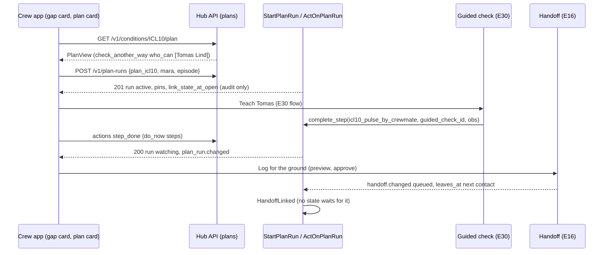

# E28: Onboard plans: no dead ends

Technical design for epic E28. Inputs: the brief (`tdd/E28.md` in the planning package), PRD.md (R47, R50, R56, R57),
USE-CASES.md (UC21, UC22), CONTRACTS.md (sections 4, 5, 11, 16, 18, 19, 21 to 28, especially 22 and 28), `api/openapi.yaml`
(tag "Onboard plans": `getConditionPlan`, `getPlan`, `listPlanRuns`, `startPlanRun`, `getPlanRun`, `actOnPlanRun`), the
schemas `config-onboard-plans`, `plan-view`, `plan-run`, `requests#/$defs/PlanRunCreate` and `PlanRunAction`, the examples
in `api/examples/plans/` and `api/examples/config/onboard-plans.example.json`, `tool-catalog.json` (`get_plan`,
`choose_plan_step`, `explain_step`), UX-DESIGN.md (sections 3.6, 3.8, 8), VALIDATION.md (V81 to V84, V94, V95, V97,
V98, D34, D36, D39, D40), `condition-assessments-119.json`, `responder-flows.json`, `docs/BUILD-CHARTER.md` and the E27
design (`docs/tdd/E27.md`). `docs/SYSTEM.md` and `docs/DEPLOYMENT.md` are being written in parallel; points that depend
on them are marked "per SYSTEM.md" or "per DEPLOYMENT.md" and listed in section 14.

Package paths are relative to ``; repository paths are relative to
``.

## 1. Scope

### Delivers

| Story | What | Requirements | Scenarios and assertions |
|---|---|---|---|
| E28-01 | The frozen plan model (stage order, modes, `who`, `needs`, substitutes), PlanView computation, loader checks 14 and 15, the `plan_aboard` and `waits_for_medical_officer` rules, the `PlanColumnsPort` for the kit map | R47, R57, R56 | V82, D34 |
| E28-02 | Plans written for the seven demo conditions and the 20 responder flows, each checked by a second person | R47, R56 | V83, D40 |
| E28-03 | Family plans for the other 112 rows from family templates, with each row's form quotes (`ground_needs`, `treatment_scope`, `rtdc` come from E27-01; E28 copies `replaces_ground_task` quotes) | R47, R56 | V82 |
| E28-04 | The PlanRun engine: start, `step_done`, `not_available`, `use_substitute`, `escalate`, `close`, rechecks, supply uses, guided check completion, handoff link, events | R47, R57, R61 (plan run part) | V81, V83, V95, D40 |
| E28-05 | The rewritten Assessment screen layout, the Can't test here card, The plan aboard card, the plan detail and the plan run view | R50 | D36, D39, V97 (render), V98 |
| E28-06 | Tool handlers `get_plan`, `choose_plan_step`, `explain_step` and the controller rules for step choices | R56, R07 | V84 |

Use cases: UC21 (whole), UC22 (from the gap to the closed run). Invariants owned or co-owned: EI2 (PlanView part), EI3,
EI4, EI5 (PlanRun part), EI6 (plans part), EI7, EI11, EI12 (step and refusal part). EI1 is shared: this module holds one
of the four GroundLink readers of CONTRACTS section 26.

### Does not deliver

| Item | Owner |
|---|---|
| Kit map, kit composition, KitCheck, the gap's creation | E27 (and E05 for the gap record) |
| Supplies, stock, SupplyUse ledger, cover numbers | E32 (E28 calls its port in the action transaction) |
| Guided checks, teach steps, skills-catalog content | E30 |
| SkillRecords, freshness, role engine, `listPlanRunRoles` and `actOnPlanRunRole` | E31 |
| Someone needs help sessions, help flows, ground messages | E26 |
| Handoffs, their preview, approve and queue | E16 |
| GroundLink, `{in_time}` rounding, ground log and catch-up composition, device cache of plans and flows (E29-06) | E29 |
| ReturnReadiness (`GET /v1/return-readiness`) | E33 (reads E28's run through `PlanRunQueryPort`) |
| Active environment, `return_option`, activity overlays (awake, EVA) | E23 |
| Assistant controller, tool gateway, rejection log | E12, E13 (E28 supplies the handlers and their validation rules) |
| The "What we observed" and "What might explain it" cards | E13 and E15 (placed by E28's Assessment layout) |

## 2. Dependencies and seams

E28 depends on E10, E26, E27 (epics.json) and, at its seams, on E01, E16, E23, E29, E30, E31, E32. E30, E32 and E33
depend on E28.

| Seam | Direction | Port, event or endpoint | Owner |
|---|---|---|---|
| Active and pinned configuration documents (onboard-plans, skills-catalog, role-rules, kit-map, ui-copy) | E28 reads | `ConfigReleaseReader` (`active()`, `document(name, version)`) | E01 |
| Release validation plug-in | E28 provides | `ReleaseCheck`: `PlansReleaseCheck` for loader checks 14 and 15 | E01 defines |
| Unit of work, idempotency, audit, outbox, clock, IDs, template renderer, problem details | E28 uses | E01 kernel (per SYSTEM.md) | E01 |
| Kit for an environment at a pinned kit-map version; instrument words | E28 reads | `KitQueryPort` (`kitmap.application.ports`) | E27 |
| Plan columns and planning deltas for the kit map | E28 provides | `PlanColumnsPort` (defined in `kitmap.application.ports`) | E27 defines, E28 implements |
| The gap's plan and check-another-way steps | E28 provides, E05 calls | `GapPlanPort.plan_for(...)` | E28 |
| Stock for availability; supply uses in an action | E28 reads and writes through | `StockReader.stock(environment_id)`, `SupplyLedgerPort.record_step_uses(uow, ...)` | E32 |
| Skill holders (fresh or due) | E28 reads | `SkillHoldersPort.holders(skill_id, at)` | E31 |
| Roster, medical officer rank | E28 reads | `CrewRosterReader.members()` (behind `listCrew`) | E01, per SYSTEM.md |
| Awake and EVA overlays; active environment; `return_option` | E28 reads | `CrewOverlayReader.unavailable_person_ids(at)`, `ActiveEnvironmentReader`, `EnvironmentProfileReader.return_option(environment_id)` | E23 |
| Ground link state and `{in_time}` words | E28 reads (one of the four readers) | `GroundLinkReader.current()`, `InTimeWords.render(now, until)` | E29 |
| Open help from an `if_worse` step | E28 calls in its transaction | `HelpSessionOpener.open_for_plan_step(uow, ...)` | E26 |
| Help session closed | E28 consumes | event `help.session_changed` | E26 |
| Handoff created for a run's episode | E28 consumes | event `handoff.changed` | E16 |
| Guided check reached `checked` | E30 calls in its transaction | `PlanRunGuidedCheckPort.complete_step(uow, ...)` | E28 provides |
| Episode exists and its subject | E28 reads | `EpisodeReader.subject_of(episode_id)` | E15 |
| Help session exists, its subject and state | E28 reads | `HelpSessionReader.get(help_session_id)` | E26 |
| Plan run role holders (visibility) | E28 reads | `PlanRunRoleReader.role_holder_ids(plan_run_id)` | E31 |
| Form texts for quote checks; evidence passages for `explain_step` | E28 reads | `FormTextPort.quote_on_page(...)`, `EvidencePassagePort.passages(source_ids, release_id)` | E10 |
| Shared amount and dose pattern | E28 reads | `crew_health.config.domain.amount_pattern` (request R28-12) | E01 |
| Catch-up inputs for the ground log | E28 provides | `PlanRunQueryPort.catch_up_inputs(plan_run_id)` | E28, read by E16, E26, E29 |
| Tool handlers | E28 provides, E12 registers | `ToolHandler` protocol (E12): `get_plan`, `choose_plan_step`, `explain_step` | E12 defines |
| Endpoints served | E28 | `getConditionPlan`, `getPlan`, `listPlanRuns`, `startPlanRun`, `getPlanRun`, `actOnPlanRun` | E28 |

Import rules (import-linter, section 13): `plans` imports `kitmap.application.ports` and `crew_health.contracts`, and no
other module's internals. The other ports above are defined by their owners in their `application/ports.py` and wired at
the composition root (per SYSTEM.md). `kitmap` never imports `plans`.

## 3. Domain model

`hub/src/crew_health/plans/domain/`, pure, frozen dataclasses with slots, tuples, no I/O.

### 3.1 Plan model (parsed from onboard-plans.json)

```python
# model.py
PlanStageId = Literal["check_another_way", "do_now", "watch", "if_worse", "medical_officer", "return", "ground_log"]
STAGE_ORDER: Final[tuple[PlanStageId, ...]] = ("check_another_way", "do_now", "watch", "if_worse",
                                              "medical_officer", "return", "ground_log")   # common plan_stage enum order
PlanMode = Literal["resolve", "talk_through", "stabilize", "prepare_return"]

@dataclass(frozen=True, slots=True)
class Who:
    kind: Literal["any_crew", "crew_medical_officer", "skill"]; skill_id: str | None
    @staticmethod
    def parse(raw: str) -> "Who": ...          # "any_crew" | "crew_medical_officer" | "skill:<skill_id>"

@dataclass(frozen=True, slots=True)
class SupplyNeed: supply_id: str; per_use: Decimal | None; basis: str; to_be_set_by: str | None

@dataclass(frozen=True, slots=True)
class Needs: instruments: tuple[str, ...]; supplies: tuple[SupplyNeed, ...]; skills: tuple[str, ...]

@dataclass(frozen=True, slots=True)
class Recheck: cadence: str | None; n: int | None; interval_seconds: int | None; basis: str; to_be_set_by: str | None

@dataclass(frozen=True, slots=True)
class Step:
    step_id: str; stage_id: PlanStageId; ordinal: int; text: str; text_first_time: str | None
    who: Who; needs: Needs; substitute_step_id: str | None; substitute_only: bool
    environments: frozenset[EnvironmentId] | None; body_region: BodyRegion | None; landmark_id: str | None
    guided_check_skill_id: str | None; cannot_replace_text: str | None; recheck: Recheck | None
    opens_help: bool; opens_flow_id: str | None; medicine_named_as: str | None
    replaces_ground_task: FormQuote | None; source_ids: tuple[str, ...]; basis: str
    review_state: Literal["unreviewed", "reviewed", "rejected"]

@dataclass(frozen=True, slots=True)
class ReturnStage:
    environments: frozenset[EnvironmentId]; criteria: tuple[Criterion, ...]
    prepare: tuple[Step, ...]; decided_by: tuple[Literal["commander", "crew_medical_officer"], ...]; rtdc: Rtdc | None

@dataclass(frozen=True, slots=True)
class GroundLogStage: items: tuple[GroundLogItem, ...]

@dataclass(frozen=True, slots=True)
class Plan:
    plan_id: str; title: str; condition_id: str | None; flow_id: str | None
    written_for: Literal["condition", "family", "flow"]; mode: PlanMode
    environments: frozenset[EnvironmentId]
    steps: tuple[Step, ...]                    # all step stages, document order within stage
    return_stage: ReturnStage | None; ground_log: GroundLogStage
    source_ids: tuple[str, ...]; review_state: str; written_by: str | None; checked_by: str | None

@dataclass(frozen=True, slots=True)
class PlansDoc:
    version: str; label: str; example: bool; notice: str
    plans: Mapping[str, Plan]; plan_order: tuple[str, ...]
    by_condition: Mapping[str, str]; by_flow: Mapping[str, str]
```

Rejected steps (`review_state: rejected`) are dropped at parse time, as rejected kit map rows are (E27 KM-I1).

### 3.2 Environment context and step availability (`availability.py`)

```python
@dataclass(frozen=True, slots=True)
class Person: person_id: str; display_name: str; roster_order: int; medical_officer_rank: int | None

@dataclass(frozen=True, slots=True)
class StockLevel: supply_id: str; aboard: bool; quantity_now: Decimal | None; unit: str

@dataclass(frozen=True, slots=True)
class EnvContext:
    environment_id: EnvironmentId; kit: frozenset[str]; stock: Mapping[str, StockLevel]
    available_people: tuple[Person, ...]         # awake and not on EVA, roster order
    holders: Mapping[str, frozenset[str]]        # skill_id -> person_ids, freshness fresh or due
    subject_person_id: str | None                # None: no subject known (section 6)

Availability = Literal["aboard", "not_aboard", "substituted", "needs_skill_holder"]

@dataclass(frozen=True, slots=True)
class Missing: instruments: tuple[str, ...]; supplies: tuple[str, ...]; skills: tuple[str, ...]

@dataclass(frozen=True, slots=True)
class StepAssessment:
    step: Step; availability: Availability; missing: Missing
    who_can: tuple[tuple[Person, Literal["any_crew", "skill_holder", "medical_officer"]], ...]
    supply_cover_after: tuple[tuple[str, int | None], ...]

def applies(step: Step, plan: Plan, env: EnvironmentId) -> bool
def missing_for(step: Step, ctx: EnvContext) -> Missing
def assess_step(step: Step, plan: Plan, ctx: EnvContext) -> StepAssessment
```

Rules, exactly CONTRACTS section 22 "What a step needs here", numbered as there:

1. `applies`: `env in plan.environments` and (`step.environments is None` or `env in step.environments`).
2. Missing instruments: `needs.instruments` not in `ctx.kit`, step order. Missing supplies: a supply with no stock row,
   `aboard` false, or `quantity_now == 0`; or a consumable with `per_use` and `quantity_now` set and
   `quantity_now < per_use`. Quantities are compared as `Decimal` in the supply's unit (one unit per supply, E32);
   a unit mismatch raises `UnitMismatch` (never coerced).
3. Holders of skill k: `ctx.holders[k]` without the subject. Missing skills: `needs.skills` and the `who` skill with no holder.
4. Availability: with a missing instrument or supply, `substituted` when the substitute step exists, applies, and has no
   missing instrument or supply itself; otherwise `not_aboard`. Else, with a missing skill, `needs_skill_holder`. Else
   `aboard`.
5. `who_can`, roster order, from `available_people`: `any_crew` everyone including the subject (`any_crew`);
   `skill:k` holders of k other than the subject (`skill_holder`); `crew_medical_officer` people with
   `medical_officer_rank` set, other than the subject, ordered by rank (`medical_officer`).
6. `supply_cover_after`: per consumable the step uses, the cover in uses after one more run (E32's formula), `None` when stock
   or `per_use` is unset (E32 owns the cover formula; E28 calls `CoverFormula.uses_after_one(...)` from E32's domain
   types, imported through `supplies.application.ports`, per SYSTEM.md).
7. `recheck.text`: `plan_lines.recheck_pending` with `{to_be_set_by}` when `interval_seconds is None`, otherwise the
   cadence words (`cadence_words`).

### 3.3 Plan-level rules (`view.py`)

```python
def stage_assessments(plan: Plan, ctx: EnvContext) -> tuple[tuple[PlanStageId, tuple[StepAssessment, ...]], ...]
def plan_aboard(plan: Plan, env: EnvironmentId, kit: frozenset[str], stock: Mapping[str, StockLevel]) -> bool
def waits_for_medical_officer(plan: Plan, ctx: EnvContext) -> bool
def return_applies(plan: Plan, env: EnvironmentId, return_option_present: bool) -> bool
```

- `plan_aboard` (EI3, exactly the contract): true when some step that applies, in `check_another_way`, `do_now` or
  `watch`, with `who == any_crew` and `needs.skills == ()`, is `aboard`, or has availability `substituted` with an
  `any_crew` substitute that is aboard; and the plan has at least one applicable `watch` or `check_another_way` step.
  It takes kit and stock only (no people), because such a step needs no holder: that is why the kit map stays free of
  person data (E27 section 4.1).
- `waits_for_medical_officer`: true when no step outside `if_worse` that applies and is `aboard` or `substituted` can be
  done by someone other than a medical officer. "Can be done by someone other than a medical officer": `who == any_crew`,
  or `who == skill:k` with a holder of k (rule 3) whose `medical_officer_rank` is null. The contract's field description
  says "holds fresh"; this design uses rule 3's holders (fresh or due) so the two rules cannot disagree (R28-6 asks to
  align the description).
- `return_applies`: `plan.return_stage is not None` and `env in plan.return_stage.environments` and the environment's
  `return_option` is not null (EI11). Otherwise `no_return_text` is `plan_lines.no_return` when `return_option` is null,
  else `None`.
- `substitute_only` steps are included in the view with their flag (the schema lists them); a client shows one only in
  place of its principal (section 7). They never count for `plan_aboard` on their own.

### 3.4 PlanRun aggregate (`run.py`)

```python
RunState = Literal["active", "watching", "escalated", "closed"]
StepState = Literal["open", "done", "not_available", "substituted"]

@dataclass(frozen=True, slots=True)
class RunStep:
    step_id: str; stage_id: PlanStageId; substitute_only: bool; principal_step_id: str | None
    state: StepState; by: Actor | None; at: datetime | None; substitute_step_id: str | None
    guided_check_id: str | None; observation_ids: tuple[str, ...]; supply_use_ids: tuple[str, ...]

@dataclass(frozen=True, slots=True)
class RunRecheck: step_id: str; interval_seconds: int | None; due_at: datetime | None
                  done_at: datetime | None; observation_ids: tuple[str, ...]

@dataclass(frozen=True, slots=True)
class Escalation: step_id: str; help_session_id: str; at: datetime; session_closed: bool

@dataclass(frozen=True, slots=True)
class PlanRun:
    plan_run_id: str; revision: int; plan_id: str; pins: Mapping[str, str]
    subject_person_id: str; episode_id: str | None; help_session_id: str | None
    environment_id: EnvironmentId; opened_by: Actor; opened_at: datetime
    steps: tuple[RunStep, ...]; rechecks: tuple[RunRecheck, ...]; escalations: tuple[Escalation, ...]
    handoff_id: str | None; link_state_at_open: LinkSnapshot; close: Closure | None

def open_run(plan: Plan, ctx: EnvContext, *, plan_run_id: str, subject_person_id: str,
             episode_id: str | None, help_session_id: str | None, pins: Mapping[str, str],
             opened_by: Actor, at: datetime, link: LinkSnapshot) -> tuple[PlanRun, tuple[DomainEvent, ...]]
def derive_state(run: PlanRun) -> RunState
def apply(run: PlanRun, cmd: RunCommand, ctx: EnvContext, plan: Plan, at: datetime
          ) -> tuple[PlanRun, RunEffects]          # pure; RunEffects lists supply uses, help to open, events
```

`RunCommand` is a tagged union: `StepDone(step_id, observation_ids, guided_check_id, actor)`,
`NotAvailable(step_id, reason, actor)`, `UseSubstitute(step_id, actor)`, `Escalate(step_id, actor)`,
`Close(disposition, note, actor)`, plus the internal commands `GuidedCheckCompleted(step_id, guided_check_id,
observation_ids, actor)`, `EscalationClosed(help_session_id)` and `HandoffLinked(handoff_id)`.

`open_run` creates one `RunStep` per applicable step (return `prepare` steps included when `return_applies`), every one
`open`, and one `RunRecheck` per applicable `watch` step with a `recheck` (`due_at None`, `done_at None`).
`link_state_at_open` is copied for audit and no function reads it (EI1, T28-07).

**State rule** (`derive_state`, CONTRACTS section 22):

```
closed      if run.close is not None
escalated   elif any escalation with session_closed == False
active      elif any actionable step in check_another_way or do_now is open
watching    otherwise
actionable(s) = not s.substitute_only, or the principal step (the step whose substitute_step_id is s) is
                not_available or substituted
```

State is derived after every command and stored with the run (it is a column for listing and indexing; it is never set
directly).

**Transitions** (guards evaluated in this order; the first failing guard decides the error):

| Command | Guard | Effect | Error |
|---|---|---|---|
| any | run closed | none | `409 INVALID_TRANSITION` |
| `StepDone(s)` | s in run | | `422 INVALID_VALUE` `/step_id` |
| `StepDone(s)`, s `open` | availability now (section 3.5) `aboard` | s `done`, `by`, `at`; supply uses for s; recheck `due_at` set for a watch step with an interval | |
| `StepDone(s)`, s `open` | availability `substituted` | s `substituted` with `substitute_step_id`; the substitute `done`; supply uses for the substitute (R28-14) | |
| `StepDone(s)`, s `open` | availability `not_aboard` or `needs_skill_holder` | none | `422 STEP_NOT_AVAILABLE`, `current_state` the step view |
| `StepDone(s)`, s `done`, watch step with a recheck | | recheck `done_at = at`, observations appended, `due_at = at + interval` when set (R28-15) | |
| `StepDone(s)`, s `done`, otherwise | | none; merged no-op, 200 with the current run, no event | |
| `StepDone(s)`, s `not_available` or `substituted` | | none | `409 INVALID_TRANSITION` |
| `NotAvailable(s, reason)` | s `open` | s `not_available`; its substitute becomes actionable | `409 INVALID_TRANSITION` otherwise |
| `UseSubstitute(s)` | s has `substitute_step_id` (else `422 INVALID_VALUE`) and s `open` or `not_available` | s `substituted`; the substitute stays `open` and is actionable | `409 INVALID_TRANSITION` |
| `Escalate(s)` | s in `if_worse` with `opens_help` (else `422 INVALID_VALUE` `/step_id`) | help opened through E26 (section 4.4); `Escalation` appended; state `escalated` | |
| `Close(d, note)` | run not closed | `close` set; state `closed` | |
| `GuidedCheckCompleted(s, g, obs)` | s `open` and `guided_check_skill_id` set | s `done`, `guided_check_id = g`, `observation_ids = obs` (empty on disagreement, EI8) | `INVALID_TRANSITION` to E30, which logs it |
| `EscalationClosed(h)` | an escalation with h | `session_closed = True`; state re-derived | ignored when unknown (idempotent) |
| `HandoffLinked(h)` | `handoff_id is None` | `handoff_id = h` | ignored otherwise |

Every applied command increments `revision` by 1. A merged no-op does not.

### 3.5 Availability inside a run

A run is evaluated against its pins: onboard-plans, skills-catalog and kit-map at the pinned versions, and the run's own
`environment_id` (fixed at open, R28-13). Stock, people, overlays and skill holders are live at the action time (they are
state, not configuration). So a step that became not aboard because a supply ran out refuses `step_done` (EI12), and a
release activated mid run never changes the run's steps.

### 3.6 Invariants

| ID | Invariant | Test |
|---|---|---|
| EI3 | Every kit map row, in every environment, has a plan with an aboard `any_crew` no-skill step in check_another_way, do_now or watch, and a watch or check_another_way step | T28-01 |
| EI4 | Stages in the fixed order, each at most once; `ground_log` last with `blocking` false | T28-02 |
| EI5 | No run state waits for the ground; no transition reads a handoff status, receipt or reply | T28-09, T28-17 |
| EI6 | Step text from the release only; no dose anywhere; the assistant names step IDs of the active plan only | T28-03, T28-18 |
| EI7 | A step with anything missing is `not_aboard`, `substituted` or `needs_skill_holder`, never `aboard`, and `step_done` on it is refused | T28-04, T28-11 |
| EI2 | Link up, delayed and down give byte-identical PlanViews except `ground_log.link_text` and `leaves_at` | T28-06 |
| EI1 | Only `plans/application/ground_log.py` imports `GroundLinkReader` | T28-07 |
| EI11 | A return stage only where `return_option` is not null and the stage lists the environment | T28-08 |
| EI12 | A supply use below zero refuses the whole action and writes nothing | T28-10 |
| PR-I1 | `derive_state` is the only source of `state`; it equals the rule of 3.4 after every command | T28-09 |
| PR-I2 | Exactly one of `episode_id` or `help_session_id` | T28-09, schema and table CHECK |
| PR-I3 | A run's steps and their stage order never change after open | T28-16 |
| PR-I4 | `revision` increases by exactly 1 per applied command and never on a no-op | T28-13 |
| PR-I5 | `link_state_at_open` is read by no rule | T28-07 |
| PR-I6 | A guided check never changes a kit map state or closes a gap (EI8): plans never write to kitmap or the gap | T28-15 |

## 4. Application layer

`hub/src/crew_health/plans/application/`.

### 4.1 Ports E28 consumes (defined by their owners; signatures as E28 needs them, per SYSTEM.md)

```python
class CrewRosterReader(Protocol):                      # E01
    def members(self) -> Sequence[Person]: ...
class CrewOverlayReader(Protocol):                     # E23
    def unavailable_person_ids(self, at: datetime) -> frozenset[str]: ...   # asleep or on EVA
class EnvironmentProfileReader(Protocol):              # E23
    def active_environment_id(self) -> EnvironmentId: ...
    def return_option(self, environment_id: EnvironmentId) -> ReturnOption | None: ...
class SkillHoldersPort(Protocol):                      # E31
    def holders(self, skill_ids: Collection[str], at: datetime) -> Mapping[str, frozenset[str]]: ...
class StockReader(Protocol):                           # E32
    def stock(self, environment_id: EnvironmentId) -> Mapping[str, StockLevel]: ...
class SupplyLedgerPort(Protocol):                      # E32, runs inside the caller's unit of work
    def record_step_uses(self, uow: UnitOfWork, *, environment_id: EnvironmentId, plan_run_id: str,
                         step_id: str, uses: Sequence[SupplyNeed], actor: Actor, at: datetime
                         ) -> Sequence[str]: ...        # supply_use_ids; raises SupplyBelowZero(supply_id)
class GroundLinkReader(Protocol):                      # E29
    def current(self) -> LinkSnapshot: ...             # status, gap_kind, next_contact_at, origin_mode
class InTimeWords(Protocol):                            # E29, section 26 rounding
    def render(self, now: datetime, until: datetime) -> str: ...
class HelpSessionOpener(Protocol):                     # E26, inside the caller's unit of work
    def open_for_plan_step(self, uow: UnitOfWork, *, subject_person_id: str, plan_run_id: str,
                           flow_id: str | None, actor: Actor, at: datetime) -> str: ...
        # entry.kind plan_step, ref_id the run; returns the open session for the subject when one exists
class HelpSessionReader(Protocol):                     # E26
    def get(self, help_session_id: str) -> HelpSessionRef | None: ...   # subject_person_id, state
class EpisodeReader(Protocol):                         # E15
    def subject_of(self, episode_id: str) -> str | None: ...
class PlanRunRoleReader(Protocol):                     # E31
    def role_holder_ids(self, plan_run_id: str) -> frozenset[str]: ...
class FormTextPort(Protocol):                          # E10
    def quote_on_page(self, source_id: str, page: int, quote: str) -> bool: ...
class EvidencePassagePort(Protocol):                   # E10
    def passages(self, source_ids: Sequence[str], release_id: str) -> Sequence[Passage]: ...
```

`KitQueryPort` (E27) supplies `kit_instruments(environment_id, kit_map_version)`.

### 4.2 Ports E28 provides

```python
class PlanColumnsService(PlanColumnsPort): ...          # E27 section 4.1 signatures

@dataclass(frozen=True, slots=True)
class GapPlan: plan_id: str; check_another_way_step_ids: tuple[str, ...]

class GapPlanPort(Protocol):
    def plan_for(self, *, condition_ids: Sequence[str], environment_id: EnvironmentId,
                 subject_person_id: str | None) -> GapPlan | None: ...
        # first condition whose row has a plan covering the environment; step IDs of its applicable,
        # non substitute_only check_another_way steps, document order

class PlanRunGuidedCheckPort(Protocol):                 # called by E30 inside its transaction
    def complete_step(self, uow: UnitOfWork, *, plan_run_id: str, step_id: str, guided_check_id: str,
                      observation_ids: Sequence[str], actor: Actor, at: datetime) -> None: ...

class PlanRunQueryPort(Protocol):                       # read by E16, E26, E29 (catch-up), E33 (return)
    def get(self, plan_run_id: str) -> contracts.PlanRun | None: ...
    def open_run_with_return_stage(self, subject_person_id: str) -> contracts.PlanRun | None: ...
    def catch_up_inputs(self, plan_run_id: str) -> PlanCatchUpInputs: ...
        # done check_another_way and do_now steps (at, text); non substitute_only watch steps (text, recheck text);
        # steps with replaces_ground_task (quote); ground_log items; all from the run's pins
```

### 4.3 Use cases

| Use case | Input | Output | Errors | Idempotency |
|---|---|---|---|---|
| `GetConditionPlan.execute(condition_id, environment_id?, viewer)` | row ID | PlanView | `NOT_FOUND` (unknown or rejected row), `CONTEXT_INAPPLICABLE` (row without `plan_id`, or plan not covering the environment) | Read |
| `GetPlan.execute(plan_id, environment_id?, viewer)` | plan ID | PlanView | `NOT_FOUND`, `CONTEXT_INAPPLICABLE` | Read |
| `ListPlanRuns.execute(viewer, subject?)` | | runs not closed | `UNAUTHORIZED_SCOPE` | Read |
| `StartPlanRun.execute(cmd, viewer, idempotency_key)` | `PlanRunCreate` | `201` PlanRun | `INVALID_VALUE`, `CONTEXT_INAPPLICABLE`, `UNAUTHORIZED_SCOPE`, `ACTION_NOT_ALLOWED`, `DUPLICATE_COMMAND` | `Idempotency-Key` (E01 store, scope `startPlanRun` plus actor) |
| `GetPlanRun.execute(plan_run_id, viewer)` | | PlanRun | `NOT_FOUND`, `UNAUTHORIZED_SCOPE`, `CONSENT_REQUIRED` | Read |
| `ActOnPlanRun.execute(plan_run_id, action, if_match, viewer, idempotency_key)` | `PlanRunAction` | `200` PlanRun | table 3.4 plus `VERSION_REQUIRED`, `STALE_VERSION`, `SUPPLY_BELOW_ZERO`, `ACTION_NOT_ALLOWED` | `Idempotency-Key` plus `If-Match` |
| `CompleteGuidedStep` (port) | from E30 | none | `INVALID_TRANSITION` to the caller | E30's command key |
| `OnHelpSessionChanged` (event consumer) | `help.session_changed` | run updated | none | event ID dedupe table |
| `OnHandoffChanged` (event consumer) | `handoff.changed` | run updated | none | event ID dedupe table |

**`StartPlanRun`**, one unit of work:

1. Viewer is a person (crew, crew_medical_officer or station session). An assistant actor gets `403 ACTION_NOT_ALLOWED`
   (a proposal never starts or marks anything).
2. Body schema; exactly one of `episode_id` or `help_session_id` (else `422 INVALID_VALUE` with both pointers).
3. Plan exists in the active onboard-plans (else `422 INVALID_VALUE` `/plan_id`); it covers the active environment
   (else `422 CONTEXT_INAPPLICABLE`).
4. The episode (E15) or help session (E26) exists and its subject equals `subject_person_id` (else `422 INVALID_VALUE`).
5. Scope: a crew session may start a run for itself, or for a subject when it holds an open help session role or is
   crew_medical_officer or station (E02 policy). Else `403 UNAUTHORIZED_SCOPE`.
6. A run not closed for the same plan, subject and episode or session: `422 INVALID_VALUE` `/plan_id`, with the open
   run in `current_state` (the partial unique index enforces it under concurrency).
7. `pins` = the active versions of onboard-plans, skills-catalog, role-rules, kit-map, ui-copy; `environment_id` = active;
   `link_state_at_open` = `GroundLinkReader.current()`; `open_run(...)`; insert; audit; outbox `plan_run.changed`
   (reason `opened`); commit. No call waits for the model, a device or the ground.

**`ActOnPlanRun`**, one unit of work (`BEGIN IMMEDIATE`):

1. Viewer is a person (else `403 ACTION_NOT_ALLOWED`) with visibility (section 10) and a role allowed to act: the subject,
   a role holder of the run (E31), crew_medical_officer or station (else `403 UNAUTHORIZED_SCOPE`).
2. `If-Match` missing: `428 VERSION_REQUIRED`. Stale: for `step_done`, `not_available`, `use_substitute` apply against
   the current revision (commuting, as help ticks); for `escalate` and `close`, `409 STALE_VERSION` with the current run.
3. Load the run, its pinned `Plan` and `EnvContext` (pinned kit; live stock, people, holders; subject = run subject).
4. `apply(...)`; then, in the same unit of work: E32 `record_step_uses` for each supply use (a `SupplyBelowZero` rolls
   back everything and returns `422 SUPPLY_BELOW_ZERO`, R28-3); E26 `open_for_plan_step` for an escalation; persist; audit
   (the `reason` of `not_available` is stored in the audit entry and the step row, never in events or logs); outbox
   events (section 4.5); commit.
5. Return `200` with the run and `ETag` = revision.

`client_time` is stored with the audit entry only; `at` is always the hub clock.

### 4.4 Escalation decision

Selected: the hub opens Someone needs help through E26's port inside the action's transaction, for the run's subject,
`entry.kind plan_step`, `ref_id` the run, straight on `opens_flow_id` when set, otherwise at the start node (CONTRACTS
section 22). The client does not wait for the response: on pressing an `if_worse` step it opens the help screen from its
cached help flows at once (E26, V97) and sends the `escalate` action in parallel; the help session from the response is
attached to the screen when it returns.

| Alternative | Rejected because |
|---|---|
| Client calls `createHelpSession` then `escalate` with the session ID | Two commands, two transactions; a crash between them leaves an escalation with no record, or a session with no run link; the action body has no session field |
| Run waits in `escalated` until a person confirms | A state that waits on a person before help opens delays help |
| Escalation through an event consumer | Help would open after the commit, asynchronously; a lost event would lose the escalation |

### 4.5 Events

| Event (CONTRACTS section 18) | When | Payload (`ref`) | Scope (interim, R28-4) |
|---|---|---|---|
| `plan_run.changed` | opened; state becomes `watching`; closed | `plan_run_id`, `revision`, `state`, `reason` (`opened`, `watching`, `closed`) | Run on an episode: `person` (subject). Run on a help session: `person`, `crew` |
| `plan_run.step_done` | a step becomes `done` or `substituted`, a recheck is recorded | `plan_run_id`, `revision`, `step_id` | same |
| `plan_run.escalated` | an escalation is appended | `plan_run_id`, `revision`, `help_session_id` | same |

Consumed: `help.session_changed` (when the session closes: `EscalationClosed`), `handoff.changed` (status `queued` for a
handoff whose `episode_id` equals an open or closed run's `episode_id` and the run's `handoff_id` is null:
`HandoffLinked`, earliest run first; R28-5 replaces this with an explicit `plan_run_id`). A later `handoff.changed`
(sent, receipt, reply) changes nothing in the run (EI5, V95). Consumers deduplicate by event ID in
`plans_event_seen` (bounded: rows older than 30 days are pruned by the E01 maintenance job).

### 4.6 Tool handlers (E28-06)

Registered with E12's gateway (`plans/api/tools.py`); the controller injects the authorized patient, episode or help
session, and the active release.

| Tool | Handler | Rule |
|---|---|---|
| `get_plan` | PlanView for `condition_id` (the episode's row) or `flow_id` (the session's flow) in the active environment, subject = the authorized patient | `condition_id` must be named by the episode, `flow_id` must be the session's flow, else `MODEL_OUTPUT_REJECTED` reason `answer_out_of_scope` |
| `choose_plan_step` | Validates and returns the step view as a proposal; never marks anything | Reasons, in order: `plan_not_active` (plan_id is not the plan `get_plan` returns for this context), `step_not_in_plan` (step not applicable in this plan here), `step_substitute_only` (substitute_only while its principal is open), `step_not_runnable` (availability `not_aboard`), `answer_out_of_scope` (`because_answer_id` not an Answer or message of this episode or session), `dose_in_text` (any string argument matches the shared amount pattern, R28-12) |
| `explain_step` | The step's `text`, `text_first_time`, `source_ids` and the passages E10 returns for them | Same `plan_not_active` and `step_not_in_plan` checks |

A rejection returns `MODEL_OUTPUT_REJECTED` to the controller, which logs it in E12's rejection log with the reason code
and no free text; the person's screen is unchanged (V84). Step text on screen always comes from the PlanView, never from
a tool result.

## 5. Adapters

### 5.1 Storage (SQLite, STRICT, WAL; table prefix per SYSTEM.md)

Migration `hub/src/crew_health/plans/adapters/sqlite/migrations/0001_plans.sql`:

| Table | Columns | Constraints and indexes |
|---|---|---|
| `plans_run` | `plan_run_id TEXT PK`, `revision INTEGER NOT NULL`, `plan_id TEXT NOT NULL`, `subject_person_id TEXT NOT NULL`, `episode_id TEXT`, `help_session_id TEXT`, `environment_id TEXT NOT NULL`, `state TEXT NOT NULL CHECK (state IN ('active','watching','escalated','closed'))`, `opened_by TEXT NOT NULL` (actor JSON), `opened_at TEXT NOT NULL`, `handoff_id TEXT`, `link_status TEXT NOT NULL`, `link_gap_kind TEXT`, `link_next_contact_at TEXT`, `close_disposition TEXT`, `close_note TEXT`, `close_by TEXT`, `close_at TEXT` | `CHECK ((episode_id IS NULL) <> (help_session_id IS NULL))`; `CHECK ((state = 'closed') = (close_at IS NOT NULL))`; unique partial index `(plan_id, subject_person_id, coalesce(episode_id, help_session_id)) WHERE state <> 'closed'`; index `(subject_person_id, state)`; index `(episode_id)` |
| `plans_run_pin` | `plan_run_id`, `name`, `version` | PK `(plan_run_id, name)`; `name IN ('onboard-plans','skills-catalog','role-rules','kit-map','ui-copy')` |
| `plans_run_step` | `plan_run_id`, `step_id`, `stage_id`, `ordinal INTEGER`, `substitute_only INTEGER`, `principal_step_id TEXT`, `state TEXT`, `by TEXT`, `at TEXT`, `substitute_step_id TEXT`, `guided_check_id TEXT`, `not_available_reason TEXT` | PK `(plan_run_id, step_id)`; FK run; `CHECK (state IN ('open','done','not_available','substituted'))` |
| `plans_run_step_observation` | `plan_run_id`, `step_id`, `kind TEXT CHECK (kind IN ('step','recheck'))`, `ordinal`, `observation_id` | PK `(plan_run_id, step_id, kind, ordinal)`; at most 64 per step (domain bound) |
| `plans_run_step_supply_use` | `plan_run_id`, `step_id`, `supply_use_id` | PK all three |
| `plans_run_recheck` | `plan_run_id`, `step_id`, `interval_seconds INTEGER`, `due_at TEXT`, `done_at TEXT` | PK `(plan_run_id, step_id)` |
| `plans_run_escalation` | `plan_run_id`, `step_id`, `help_session_id`, `at`, `session_closed INTEGER` | PK `(plan_run_id, help_session_id)`; index `(help_session_id)` |
| `plans_event_seen` | `event_id TEXT PK`, `seen_at TEXT` | pruned after 30 days |

Instants are TEXT RFC 3339 UTC with milliseconds and `Z`. Rows are updated only through the repository inside a unit of
work; the audit trail (E01, append only, hash chained) holds every command. Rollback of the migration: the tables are new
and nothing else references them; dropping them loses runs, so a rollback exports them first (E01 export tool).

### 5.2 Configuration adapter

`plans/adapters/config_source.py`: parses onboard-plans.json into `PlansDoc`, keyed by version, LRU of 4 (active plus
pins of open runs). With the run's pins it asks E27's `KitMapReleaseSource.at_version(...)` and E01 for skills-catalog and
ui-copy at the pinned versions. Bounds: at most 300 plans, 40 steps per plan (loader finding beyond, so the request path
stays bounded).

### 5.3 Authoring pipeline (E28-02, E28-03), not part of the hub

| Path | Holds |
|---|---|
| `authoring/plans/conditions/plan_icl<n>.json` | A plan written for its condition: the `plans[]` item shape of `config-onboard-plans.schema.json` |
| `authoring/plans/flows/plan_<flow_id>.json` | A plan written for a responder flow (20 flows of `responder-flows.json`) |
| `authoring/plans/families/<family>.json` | A family template (format below), one per family in use (37 of the 51 families of `assessment-families.json` appear in `condition-assessments-119.json`) |
| `authoring/plans/doc.json` | `version` label, `example: false`, `notice`, `sources` |
| `authoring/plans/assignments.csv` | `plan_id,writer,checker` (names from the user, Q28-1) |
| `authoring/plans/build.py` | Expands templates for every row without a condition plan, merges, orders plans (rows in condition-assessments-119 order, then flows in responder-flows order) and writes `config/onboard-plans.json` deterministically |
| `authoring/plans/check.py` | Section 8.3 checks |

Family template format (authoring only, validated by `authoring/plans/family-template.schema.json`, owned by E28):

```json
{
  "family": "<family value from condition-assessments-119.json>",
  "title": "<plan title words; {condition_name} is the kit map row name>",
  "mode": "resolve | talk_through | stabilize | prepare_return",
  "environments": ["station_leo", "transit", "lunar_surface", "mars_surface"],
  "stages": [
    {"stage_id": "<plan stage>", "steps": [
      {"key": "<snake_case>", "replaces_ground_need": "diagnosis | treatment | follow_up | null",
       "...": "every other step field of config-onboard-plans except step_id and replaces_ground_task"}]}
  ],
  "source_ids": ["..."], "written_by": "<handle>", "checked_by": "<handle>"
}
```

Expansion for row r of family F: `plan_id = "plan_" + lower(r.condition_id)`, `scope.condition_id = r.condition_id`,
`written_for = "family"`, `step_id = lower(r.condition_id) + "_" + key` (and `substitute_step_id` rewritten the same way),
`replaces_ground_task` = `{quote, source_id, page}` of r's `ground_needs` when `replaces_ground_need` is set and
`ground_needs[need]` is true, otherwise `null`; `review_state` and authors from the template. The kit map row's
`plan_id` is written by E27's build from the same rule, and `check.py` asserts both agree. No family plan text is
written per row: the label `family` is what the This kit line counts (`plans_from_family`), and the PlanView's
`written_for` shows it.

## 6. API

Router `hub/src/crew_health/plans/api/router.py`; generated models only; RFC 9457 problem details through E01.

| operationId | Roles | Request | Response | Errors (contract) |
|---|---|---|---|---|
| `getConditionPlan` `GET /v1/conditions/{condition_id}/plan?environment_id=` | per `x-roles` | path, optional environment | `200` PlanView | `404 NOT_FOUND`, `422 CONTEXT_INAPPLICABLE`, 401, 403 |
| `getPlan` `GET /v1/plans/{plan_id}?environment_id=` | per `x-roles` | | `200` PlanView | same |
| `listPlanRuns` `GET /v1/plan-runs?subject=` | crew, crew_medical_officer, station | | `200` list | 401, 403 |
| `startPlanRun` `POST /v1/plan-runs` | crew, crew_medical_officer, station | `PlanRunCreate`, `Idempotency-Key` | `201` PlanRun | 400, 401, 403, 409 `DUPLICATE_COMMAND`, 415, 422 `CONTEXT_INAPPLICABLE`, `INVALID_VALUE` |
| `getPlanRun` `GET /v1/plan-runs/{id}` | crew, crew_medical_officer, station, ground | | `200` PlanRun | 401, 403 (`UNAUTHORIZED_SCOPE`, `CONSENT_REQUIRED`), 404 |
| `actOnPlanRun` `POST /v1/plan-runs/{id}/actions` | crew, crew_medical_officer, station | `PlanRunAction`, `Idempotency-Key`, `If-Match` | `200` PlanRun | 400, 401, 403 `ACTION_NOT_ALLOWED`, `UNAUTHORIZED_SCOPE`, 404, 409 `DUPLICATE_COMMAND`, `INVALID_TRANSITION`, `STALE_VERSION`, 415, 422 `INVALID_VALUE`, `STEP_NOT_AVAILABLE`, `SUPPLY_BELOW_ZERO` (R28-3), 428 `VERSION_REQUIRED` |

**Subject for `who_can` in a PlanView.** The contract gives these two reads no subject parameter. Interim: a crew session
viewing its own row uses its own person as the subject; every other viewer gets `subject_person_id = None`, so `who_can`
excludes nobody for skill and medical officer steps. R28-1 proposes `subject` and `plan_run_id` query parameters.

**Ground role.** `getPlanRun` for a ground session: allowed only when an approved handoff carries the run (the run's
`handoff_id` set and that handoff approved, E16), otherwise `403 CONSENT_REQUIRED`. `listPlanRuns` is not a ground
operation.

**`allowed_actions`.** `[]` when closed; otherwise `step_done`, `not_available`, `use_substitute`, `close`, plus
`escalate` when the plan has an applicable `if_worse` step with `opens_help`; for an assistant viewer always `[]`.

**`Config-Release` header on `actOnPlanRun`.** Recorded in the audit entry. The action is evaluated against the run's pins
(section 3.5), so a newer active release does not refuse it (R28-13).

Examples to match byte for byte apart from IDs and instants: `api/examples/plans/view-icl10-lunar.json`,
`view-icl10-lunar-link-up.json`, `view-eye-injury-{lunar,mars,transit}.json`, `run-icl10-{opened,watching,escalated,closed}.json`,
`runs-list.json`. Known differences: `tag_text` (R28-2) and the `substitute_only` step `icl10_pulse_at_oximeter` that the
example lists (R28-9).

## 7. User interface

`ui/crew/src/features/plans/`, Vue 3, TypeScript strict, generated client types, E03 design system and router.

| Component | Where | Binds to | Shows |
|---|---|---|---|
| `AssessmentLayout.vue` | Assessment route (E03 router, the episode screen) | the episode (E15) | The grid of UX-DESIGN section 8: slots `observed` and `explain` filled by E13/E15 components; `GapCard` (17 to 24, rows 1 to 2); `PlanCard` (9 to 24, row 3). No "Prepare a summary for medical review" action exists (D36) |
| `GapCard.vue` | Assessment | `GET /v1/capability-gaps?episode_id=` (E05), E27 `KitCheckLine`, `GET /v1/conditions/{id}/plan` | The dashed ring, the missing words and the form link (from the KitMapView row until R27-9), then each `check_another_way` step: `text`, `cannot_replace_text`, `who_can` with reasons, `availability_text`; primary action on a guided step opens E30's teach flow ("Teach" words per R28-2); the ring stays after any check (D39) |
| `PlanCard.vue` | Assessment, deep green | `GET /v1/conditions/{id}/plan`, `GET /v1/plan-runs?subject=` | Start the plan (`startPlanRun`), the numbered stages (labels `plan_stage_words`), `tag_text`, `notice`, the `ground_log` fine line `link_text`; refetch on `ground_link.changed` |
| `PlanDetail.vue` | Route `/plan/condition/{condition_id}` and `/plan/{plan_id}` | PlanView | Every stage and step; return stage with criteria, `who_decides_text`, `trip_text`; or `no_return_text` (EI11) |
| `PlanRunView.vue` | Route `/plan-runs/{id}` | `GET /v1/plan-runs/{id}`, the PlanView, `plan_run.*` events | Step rows with run state; the actions; rechecks with `due_text` or `recheck_at` |
| `StepRow.vue` | inside the two above | one step view plus its run step | Text, `text_first_time` on first view, `who_can`, availability; a not aboard step shows `availability_text` and no Done button (EI7); a `substitute_only` step renders only under its principal when the principal is `substituted`, `not_aboard`, or marked `not_available` or `substituted` in the run; an `if_worse` step with `opens_help` shows `plan_lines.opens_help` and a button that opens the cached help flow at once and sends `escalate` |

### States

| State | Behavior |
|---|---|
| Loading | Card skeleton; the stage marks stay |
| Empty | No run: Start the plan; no plan for a row (cannot happen in LIVE, EI3): the row shows `plan_lines.plans_to_write` count context and the gap card's steps are absent with `designed_states.unknown` |
| Error | `error_messages[code]` when the key exists, otherwise `designed_states.unknown`, with a retry; `STEP_NOT_AVAILABLE` and `SUPPLY_BELOW_ZERO` refetch the view so the step shows Not aboard with its substitute (EI12) |
| Stale | `STALE_VERSION` on escalate or close refetches and shows `error_messages.STALE_VERSION` |
| Offline or hub stopped | From the E29 device cache (E29-06): the active plan's steps and the first help screen with their release version (V97); action buttons disabled except the help button, which opens the cached flow; words for "hub not reachable" per R28-7 |
| LIVE, REPLAY, SIM | Plans are configuration; an `example: true` document shows `origin_words.SIM` with the notice. The `ground_log` fine line shows the link origin word in `link_text` |
| Unavailable | Model stopped: nothing changes here (the assistant panel shows its own state) |
| Run mismatch | A run whose `onboard-plans` pin differs from the view's `plan_version`: interim, steps are drawn from the view and states from the run; a step in the run missing from the view is shown with its stored state and `designed_states.unknown` text (R28-1 removes this case) |

### Accessibility

Steps are an ordered list with stage headings; state is text, never color alone; Done, Not available, Use substitute and
Someone needs help are buttons with names from configuration; the help button is reachable by keyboard from every plan
screen (UX-DESIGN 9); `aria-live="polite"` announces a step marked by another person.

### Proof that no content lives in client code

The V98 scan (E21's scanner, E28 fixtures): no plan, step, stage, mode, skill, role, supply or link text from the active
configuration appears in `ui/crew/src/features/plans/` or the bundle. T28-25 runs it, and T28-26 edits a step text in
configuration and asserts the rendered screen changes with the same bundle.

## 8. Configuration

### 8.1 Documents read

| Document | Fields | Used for |
|---|---|---|
| `config/onboard-plans.json` (owned by E28) | all | Plans |
| `config/kit-map.json` (E27) | `kits`, `instruments`, `conditions[].plan_id`, `ground_needs`, `supplies[].unit` | Availability, row plan, family expansion |
| `config/skills-catalog.json` (E30) | `skills[].skill_id`, `short_name`, `landmarks` | `{skill_short}`, landmark checks |
| `config/role-rules.json` (E31) | pinned only | Run pin |
| `config/environment-profiles.json` (E23) | `return_option` | EI11, `trip_text` |
| `config/responder-flows.json` (E26) | flow IDs, titles | `opens_flow_id`, flow plans |
| `config/ui-copy.json` | `plan_lines`, `plan_stage_words`, `plan_mode_words`, `cadence_words`, `origin_words`, `designed_states`, `error_messages`, `duration_words` | Words |

### 8.2 Loader checks provided (`PlansReleaseCheck`)

| Check | Rule (CONTRACTS section 11) | Mode |
|---|---|---|
| 14a | Stages in fixed order, each at most once, `ground_log` last, `blocking` false | reject |
| 14b | `return` only for covered environments with a `return_option` | reject |
| 14c | Every instrument, supply, skill, landmark, flow and substitute exists; a substitute is a `substitute_only` step of the same plan | reject |
| 14d | `crew_medical_officer` steps only in `medical_officer` or `return`; guided checks only in `check_another_way`; only `if_worse` opens help; a non-consumable supply has `per_use` null | reject |
| 14e | `medicine` holds `named_as` only; any step text naming a medicine says "as in the onboard procedure"; no step or teach text names an amount (shared amount pattern, R28-12) | reject |
| 14f | Form quotes found on the cited page of the saved form text (`FormTextPort`); `rtdc` from a saved form with a Removal to Definitive Care table | reject |
| 15 | Every kit map row names a `plan_id` scoped to it, and `plan_aboard` holds in every environment; each failure names row and environment | reject in LIVE; warning in SIM and REPLAY, and the This kit count shows the gap (V82) |

Medicine names for 14e come from the release's medicine vocabulary (per SYSTEM.md, owned by E32's supplies); without one,
14e checks the `medicine` object and the amount pattern only.

### 8.3 Authoring acceptance (`authoring/plans/check.py`, CI)

1. `config/onboard-plans.json` equals `build.py` output byte for byte.
2. Every kit map row has `plan_icl<n>`; the seven demo rows and the 20 flows are `written_for` condition or flow; the
   rest are `family`.
3. Every step has `who`, `needs`, `source_ids` and `review_state`; `written_by` and `checked_by` are set and different.
4. Every `replaces_ground_task` equals the row's `ground_needs` quote, page and source.
5. Loader checks 14 and 15 pass on the built document against the built kit-map.json.

### 8.4 Provenance

Each plan and step carries `source_ids`, `basis`, `review_state`; the document `notice` is on every rendered plan; the
served `plan_version` is the SHA-256. Values "to be set by" a role render `recheck_pending` or `return_criteria_pending`
and never a number.

### 8.5 Configuration edit test

T28-26: release B changes `icl10_note_episodes.text`, adds `pulse_oximeter` to `icl10_pulse_at_cameras.needs.instruments`
and removes the `transit` environment from `plan_icl14`. With the same build: the new text renders; on Mars the cameras
step stays aboard (Mars kit has both) while on a kit without the oximeter it shows Not aboard with its substitute; loader
check 15 fails on transit for ICL14 (rejected in LIVE, warning in SIM with "118 of 119" or, on the example document,
"6 of 7").

## 9. Deployment and fallbacks

| Tier (per DEPLOYMENT.md) | Plans behavior |
|---|---|
| Minimum: one laptop and its webcam | Everything: views, runs, actions, escalation into Someone needs help, the log for the ground (queued). Steps that need an instrument the deployment lists as not aboard show Not aboard and their substitute; steps that need a camera use the laptop webcam as `camera_station` when kit-map.json lists it |
| Crew devices (tablets) | Same views; the E29 cache holds plans and help flows so a tablet renders the active plan and the first help screen with the hub stopped (V97) |
| Full (devices, cameras, model) | Guided checks with camera reference (E30), assistant tools; nothing else changes |
| Several nodes (rover, second module, ground console) | A run lives on the hub where it opened; a rover hub runs its own plans and runs; the ground console reads runs only through approved handoffs. Synchronization between nodes is per DEPLOYMENT.md |

| Missing part | What still works | How it shows |
|---|---|---|
| Model | Every plan, run and action; tools simply are not called | Assistant panel's stopped state |
| Devices | Steps that need them are Not aboard only when the kit lacks them; a kit device without a connection is read by hand (E27 decision) | Step text unchanged |
| Ground link | Everything (EI1, EI2); the ground log line says when the log leaves | `ground_log.link_text` |
| Habitat sensors, forecasting | Not read | |
| E32 stock unknown for a supply | The step counts the supply missing (rule 2: no stock row) and shows Not aboard | `availability_text` |
| E31 skill records empty | Skill steps show `needs_skill_holder`; `any_crew` steps run | `availability_text` |
| E30 guided check unavailable | `step_done` by a person still marks the step | |
| Hub stopped (tablet) | Cached plan and help flow, read only; the help button opens the cached flow | Release version shown |
| Hub laptop lost | Dissimilar backup: the plan detail has a print stylesheet; the crew prints or exports the active plans from any device cache beforehand (per DEPLOYMENT.md) | |

**Safety functions with the model stopped, devices absent and the link down.** T28-19 runs the whole ICL10 path (view,
start, step_done, use_substitute, escalate into help, close) with the assistant runtime stopped, no device adapter and
GroundLink `down`, and compares every response except `link_text` and `leaves_at` with the all-up run.

## 10. Safety, security and privacy

| Hazard | Cause | Mitigation | Test |
|---|---|---|---|
| H28-1 A crew member waits for the ground | A state, step or button depends on the link | EI1 import scan; EI5 state sets; ground log last and non-blocking | T28-02, T28-07, T28-17 |
| H28-2 A step shown as doable when its instrument, supply or skill is missing | Availability bug; stale kit | Pure availability rules with property tests; refusal on `step_done` | T28-04, T28-11 |
| H28-3 A dose appears | Authoring error; model text | Loader 14e; `dose_in_text` rejection; step text only from release | T28-03, T28-18 |
| H28-4 Help opens late or not at all from a plan | Escalation through a second call or the network | Client opens the cached flow at once; the server opens it in the action's transaction | T28-12 |
| H28-5 A supply count goes negative or a used supply shows available | Lost write; race | Ledger write in the same transaction; below zero refuses | T28-10 |
| H28-6 A plan changes under a running crew | Release activation mid run | Pins | T28-16 |
| H28-7 A crewmate's condition leaks to others | `plan_run.*` events in crew scope; list visibility | Interim person scope for episode runs (R28-4); visibility rules below | T28-27, T28-32 |
| H28-8 A guided check is read as a diagnosis | Wording; state | The ring stays; plans never write kitmap or gap state (EI8) | T28-15, T28-24 |
| H28-9 The assistant marks or reorders steps | Tool effect | Tools are read or proposal only; actor assistant gets `ACTION_NOT_ALLOWED` | T28-18, T28-27 |

**Visibility of a run**: the subject; holders of a role in the run (E31); every crew session when the run is on a help
session (help sessions are crew-wide, CONTRACTS section 16); crew_medical_officer and station sessions; ground only with
an approved handoff (`CONSENT_REQUIRED` otherwise). Others: `403 UNAUTHORIZED_SCOPE`, and `listPlanRuns` filters them
out.

**Private data.** Runs reference episodes and observations by ID only; the `not_available` reason is stored but never
logged or evented. Logs hold correlation ID, `plan_run_id`, `plan_id`, action, step ID, outcome code and duration; never
step text, reasons or notes.

**The assistant** may read plans, propose a step and explain a step with cited passages. It may not start a run, mark a
step, escalate, close, choose a helper or write text the person sees as a step.

## 11. Performance and resources

| Operation | Budget (p95, 16 GB laptop, 119 rows, 139 plans, 12 people) |
|---|---|
| PlanView | 30 ms |
| `startPlanRun` | 50 ms |
| `actOnPlanRun` (including E32 ledger and E26 open) | 50 ms |
| `PlanColumnsPort.row_columns` for 119 rows | 20 ms |
| Loader checks 14 and 15 | 2 s per release, at activation only |

Parsed releases: LRU of 4. Event dedupe table pruned at 30 days. Actions take the single SQLite write lock for under
10 ms; the view uses read snapshots and never blocks the help path. No background worker beyond the two event consumers,
which run in E01's bounded dispatcher.

## 12. Test plan

Fixtures load the package example documents through the production loader (`contracts/examples/config/`, owned by E01)
and the built `config/onboard-plans.json`; Hypothesis generates synthetic plans, kits, stocks and rosters from the schema.
Markers trace each test (`req`, `scenario`, `demo`, `invariant`). Critical paths first.

| ID | Level | What it proves | Traces to |
|---|---|---|---|
| T28-12 | integration (with E26 fake opener, then real) | `escalate` on `icl10_worse_chest` opens help on `chest_pain` with `entry.kind plan_step` and `ref_id` the run, in one transaction (crash injected between run write and help write leaves neither); run `escalated`; one `plan_run.escalated`; repeat while open returns the same session; the session closing returns the run to `watching` or `active` | R47, V81, D40 |
| T28-11 | integration | On `lunar_surface`, a step needing an instrument missing from the lunar kit shows `not_aboard` with its substitute; `step_done` returns `422 STEP_NOT_AVAILABLE` with the step view; the substitute's `step_done` succeeds | V83, EI7, R57 |
| T28-10 | integration | `eye_rinse` with `eye_rinse_water` stock at 0: view Not aboard; a race (stock 1, two concurrent `step_done` on two runs) gives one success and one `SUPPLY_BELOW_ZERO` with nothing written for it | EI12, R58 |
| T28-01 | unit plus loader | `plan_aboard` table; loader 15 on a release where ICL10 on lunar has only medical officer steps: rejected in LIVE naming `ICL10` and `lunar_surface`; in SIM a warning and `plans_aboard` 6 of 7 on the example document | EI3, V82 |
| T28-02 | unit plus property | Loader 14a: random stage permutations fail unless in order; `ground_log` last, `blocking` false in every view | EI4 |
| T28-03 | unit | Loader 14e on doses in step text, teach text, `medicine` extra fields | EI6, R56 |
| T28-04 | property | For random kits, stocks and rosters: `missing` non-empty implies availability in `not_aboard`, `substituted`, `needs_skill_holder`; `aboard` implies empty `missing`; `substituted` implies the substitute has nothing missing | EI7 |
| T28-05 | unit | `plan_aboard` and `waits_for_medical_officer` tables, including the subject being the only medical officer | EI3, R57 |
| T28-06 | integration | ICL10 on lunar at 09:36 (fixed clock): `check_another_way` `who_can` `[Tomas Lind]`; medical officer step `who_can` `[]`; `link_text` "Ground link down · next contact in 25 hours (Sim). The log goes then. Nothing here waits for it."; link up, delayed and down responses byte-identical except `link_text` and `leaves_at` | EI2, D34, V81 |
| T28-07 | static | Only `plans/application/ground_log.py` imports `GroundLinkReader`; no code reads `link_state_at_open` except the mapper | EI1, PR-I5 |
| T28-08 | integration | `eye_injury` on Mars and transit: no return stage, `no_return_text` "Return is not an option from here. The plan stays aboard."; on lunar a return stage | EI11, V94 |
| T28-09 | property (stateful, Hypothesis `RuleBasedStateMachine`) | Random command sequences keep PR-I1, PR-I2, PR-I4; no state other than the four; closed is final | EI5, R47 |
| T28-13 | integration | Same `Idempotency-Key` returns the same response; different body with the same key `409 DUPLICATE_COMMAND`; a crash after commit and a retry give one step change; hub restart keeps the run | charter non-negotiable 5 |
| T28-14 | integration | Stale `If-Match` on `step_done`, `not_available`, `use_substitute` merges (200); on `escalate` and `close` `409 STALE_VERSION`; missing `If-Match` `428 VERSION_REQUIRED` | CONTRACTS 22 |
| T28-15 | integration with E30 fake | Guided check `checked` marks `icl10_pulse_by_crewmate` done with its observation; disagreement marks done with none; the kit map state and the gap are unchanged | EI8, D39 |
| T28-16 | integration | Activating a release mid run: the run keeps its pins, environment and steps; actions evaluate against pins | PR-I3, R28-13 |
| T28-17 | integration | A `handoff.changed` reply after close changes no step or state; the handoff link is set once | V95, EI5 |
| T28-18 | unit plus contract (E12 gateway) | `choose_plan_step` with a step not in the plan, a not aboard step, a dose: each `MODEL_OUTPUT_REJECTED` with its reason, logged; shown steps and order unchanged | V84, EI6 |
| T28-19 | end to end (hub) | Section 9 run with model stopped, no devices, link down | charter non-negotiable 2 |
| T28-20 | unit | `explain_step` returns release text and E10 passages only | EI6 |
| T28-21 | unit | Family expansion: IDs, `written_for family`, quotes from `ground_needs`, determinism | R47 (E28-03) |
| T28-22 | content | Loader 14f on every form quote of the built document | V82, R56 |
| T28-23 | content (CI) | Section 8.3 checks on `config/onboard-plans.json` | E28-02, E28-03 |
| T28-24 | UI component plus Playwright (act 5) | Assessment: Can't test here card with the dashed ring and form link; no "Prepare a summary for medical review"; ring stays after the check; plan card fine line follows the link | D36, D39 |
| T28-25 | static | V98 scan on `features/plans` | V98 |
| T28-26 | integration plus UI | Configuration edit of section 8.5 | AGENTS rule 1 |
| T28-27 | integration | Visibility and authorization matrix of section 10; assistant actor `ACTION_NOT_ALLOWED` on start and actions | H28-7, H28-9 |
| T28-28 | UI (Playwright, hub stopped) | Cached plan and first help screen with release version | V97 |
| T28-29 | performance | Section 11 budgets | PRD section 10 |
| T28-30 | unit | Same inputs, same bytes for PlanView and PlanColumns | determinism |
| T28-31 | unit | Rechecks: pending text without interval; `due_at` with interval; second `step_done` on the watch step records a recheck | R47, R28-15 |
| T28-32 | integration | Events per section 4.5, scopes per R28-4 interim | H28-7 |
| D40 | end to end (eval) | ICL10 run with stages in order, ground stage last; its handoff `queued` with `leaves_at` the next contact; no state waits for the ground | D40, R47, R61 |

## 13. File ownership

Created and owned by E28:

```
hub/src/crew_health/plans/__init__.py
hub/src/crew_health/plans/domain/{__init__,model,availability,view,run,recheck,release_checks,tool_rules,errors}.py
hub/src/crew_health/plans/application/{__init__,ports,get_plan,plan_runs,act,events,gap_plan,plan_columns,ground_log,catch_up,guided_step,tools}.py
hub/src/crew_health/plans/adapters/{__init__,config_source}.py
hub/src/crew_health/plans/adapters/sqlite/{__init__,repository}.py
hub/src/crew_health/plans/adapters/sqlite/migrations/0001_plans.sql
hub/src/crew_health/plans/api/{__init__,router,mapping,tools}.py
hub/tests/plans/**
config/onboard-plans.json
authoring/plans/**
ui/crew/src/features/plans/**
eval/scenarios/e28/**
```

Reads, never edits: `contracts/**`, `config/{kit-map,skills-catalog,role-rules,environment-profiles,responder-flows,ui-copy}.json`,
`crew_health.kitmap.application.ports`, E01 kernel, E03 design system. Import-linter contracts for `plans` are added to
E01's `.importlinter` by request (R28-10).

## 14. Open questions and requests

1. **R28-1 (contract, `getConditionPlan` and `getPlan`).** Add optional `subject` (person ID) and `plan_run_id` query
   parameters: `subject` sets who is excluded from `who_can`; `plan_run_id` renders the view at the run's pins and
   environment. Reason: `who_can` depends on the subject (rule 5), and a run must render the plan it pinned. Interim:
   section 6.
2. **R28-2 (contract, ui-copy).** Add `review_state_words` (`unreviewed`: "unreviewed draft", `reviewed`) and change
   `plan_lines.plan_tag` to "Onboard plan {plan_label} · {review_state}"; add `plan_card_words` (`gap_title` "Can't test
   here: check it another way", `plan_title` "The plan aboard", `start_plan`, `teach` with `{helper_name}`, `not_now`,
   `done`, `not_available`, `use_substitute`, `close`, close disposition words); add `error_messages` for
   `STEP_NOT_AVAILABLE`, `SUPPLY_BELOW_ZERO`, `INVALID_TRANSITION`, `CONTEXT_INAPPLICABLE`, `VERSION_REQUIRED`; add
   the flow title words used in `{plan_label}` for flow plans. Interim: `tag_text` = `plan_tag` with the condition ID or
   the flow ID with underscores as spaces; components omit a label whose key is absent; error fallback
   `designed_states.unknown`.
3. **R28-3 (contract, openapi).** Add `SUPPLY_BELOW_ZERO` to `actOnPlanRun`'s 422 `x-error-codes` (CONTRACTS section 22
   names it). Interim: returned as a 422 problem with that code.
4. **R28-4 (contract, events).** `plan_run.*` scope "person, crew" sends a crewmate's condition run to every crew session.
   Proposal: `person` for runs on an episode, `person, crew` for runs on a help session. Interim: that behavior (a subset
   of the contract's scopes).
5. **R28-5 (contract, HandoffCreate).** Add optional `plan_run_id` so a handoff names the run it carries. Interim: link by
   `episode_id` (section 4.5).
6. **R28-6 (contract wording).** `waits_for_medical_officer` description says "holds fresh"; align with rule 3 (fresh or
   due). Interim: rule 3.
7. **R28-7 (contract, ui-copy).** Add `designed_states.hub_unreachable` ("The hub is not answering. Plans shown from this
   device, version {version}.") for E29's cache view. Interim: the version line only.
8. **R28-8 (package example).** `view-icl10-lunar.json` lists `icl10_pulse_at_oximeter` (substitute_only) as its own
   step. Proposal: keep it in the view with `substitute_only: true` (as this design does) and state in CONTRACTS that
   clients show it only in place of its principal. Interim: as proposed.
9. **R28-9 (ownership).** E28 claims `authoring/plans/`, `eval/scenarios/e28/` and `ui/crew/src/features/plans/`
   (including `AssessmentLayout.vue`, which places E13 and E15 cards through slots).
10. **R28-10 (E01 file).** Add import-linter contracts: `plans` layers, and `plans` may import only
    `kitmap.application.ports` from other modules plus the owners' port modules.
11. **R28-11 (coordinator).** Confirm that authoring formats (`authoring/plans/family-template.schema.json`) are owned by
    the epic and are not contracts.
12. **R28-12 (E01 shared rule).** Put the amount and dose pattern used by loader check 14e, E13's output check and
    `choose_plan_step` in one place: `crew_health/config/domain/amount_pattern.py`, its words in a configuration document
    with sources. Interim: E28 imports E01's function once it exists; until then 14e checks only the `medicine` object.
13. **R28-13 (contract wording).** State that a run keeps the `environment_id` it opened in and evaluates actions against
    its pins regardless of the active release and `Config-Release`. Interim: as stated.
14. **R28-14 (contract, action table).** `step_done` on a step whose availability is `substituted` marks it `substituted`
    and its substitute `done`. Interim: as stated.
15. **R28-15 (contract, action table).** `step_done` on a `done` watch step with a `recheck` records the recheck
    (`done_at`, observations, next `due_at`); otherwise a repeat is a no-op. Reason: `rechecks[].done_at` has no other
    writer. Interim: as stated.
16. **R28-16 (contract).** A step that is `not_aboard` at open still starts `open` and keeps the run `active` until a
    person marks it `not_available` or uses its substitute. Proposal: confirm, or start such steps `not_available` with
    reason "not aboard at open". Interim: contract as written; the UI puts Not available first on such steps.
17. **Q28-1 USER.** Who writes and who second-checks the seven demo plans, the 20 flow plans and the 37 family templates?
18. **Per DEPLOYMENT.md.** Tier names, multi-node run ownership, print or export of plans as the dissimilar backup.
19. **Per SYSTEM.md.** Port names of E01, E15, E23, E26, E29, E31, E32; table prefix; composition root wiring.

Unresolved clinical and equipment assumptions: every plan is an unreviewed draft written from the cited sources; recheck
intervals and return criteria stay "to be set" by clinical review and flight rules; the family template assumes rows in
one family share safe first steps, which a clinician must confirm per family; the substitute for each instrument step
(for example the oximeter for the cameras) is a team choice; no step text says a condition is excluded.

## 15. Build plan

| Step | Work | Done when |
|---|---|---|
| 1 | Domain model, availability, view rules, run aggregate, test first (T28-02, T28-04, T28-05, T28-09, T28-30, T28-31) | 95% branch on domain, mutation clean on `availability.py` and `run.py` |
| 2 | Loader checks 14 and 15 with E01 (T28-01, T28-03, T28-22) | Example documents pass; V82 release fails as specified |
| 3 | PlanView use cases, ground log reader, API reads (T28-06, T28-07, T28-08) | Responses equal the package examples apart from known requests |
| 4 | Storage, start and actions with fakes of E26, E32, E30 (T28-10 to T28-17) | Fault injection green |
| 5 | Ports provided to E27 and E05 (`PlanColumnsPort`, `GapPlanPort`) | E27 T27-10 and T27-16 green with real plans |
| 6 | Authoring: demo plans, flow plans, family templates, build and check (T28-21, T28-23) | 119 rows with a plan; This kit shows k written for condition and 119 minus k from family |
| 7 | UI (T28-24, T28-25, T28-26, T28-28) | Act 5 Playwright green |
| 8 | Tools (T28-18, T28-20) with E12 | V84 green |
| 9 | Real ports wired, end to end (T28-19, T28-29, T28-32, D40) | All green |

Gate commands (charter section 8):

```
uv run python scripts/validate_contracts.py
uv run mypy --strict hub/src/crew_health/plans authoring/plans
uv run ruff check . && uv run ruff format --check .
uv run lint-imports
uv run pytest -q hub/tests/plans --cov=crew_health.plans --cov-branch --cov-fail-under=95
uv run python authoring/plans/check.py config/onboard-plans.json config/kit-map.json
pnpm -C ui/crew typecheck && pnpm -C ui/crew test -- features/plans
uv run pytest -q eval -m "V81 or V82 or V83 or V84 or V94 or V95 or V97 or V98 or D34 or D36 or D39 or D40"
```

### Sequence: principal success path (act 5)



### Sequence: failure path (it gets worse, model stopped, link down)

```mermaid
sequenceDiagram
  participant UI as Crew app (plan run)
  participant CACHE as Device cache (E29)
  participant API as Hub API (plans)
  participant PR as ActOnPlanRun
  participant HS as HelpSessionOpener (E26)
  participant DB as SQLite (one transaction)
  UI->>CACHE: open chest_pain help flow now
  UI->>API: actions escalate icl10_worse_chest (If-Match)
  API->>PR: execute
  PR->>HS: open_for_plan_step(mara, run, chest_pain)
  HS-->>PR: help_session_id
  PR->>DB: run escalated, escalation row, audit, outbox plan_run.escalated
  DB-->>PR: commit
  PR-->>UI: 200 run escalated (session attached to the open help screen)
  Note over UI,DB: no call to the model or the ground link; the log for the ground stays queued
```
