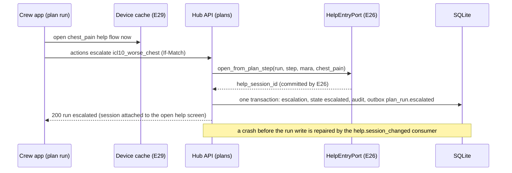

# E28: Onboard plans: no dead ends

Technical design for epic E28. Inputs: the brief (`tdd/E28.md` in the planning package), PRD.md (R47, R50, R56, R57),
USE-CASES.md (UC21, UC22), CONTRACTS.md (sections 4, 5, 9, 11, 18, 19, 21 to 28), `api/openapi.yaml` (tag "Onboard
plans"), the schemas `config-onboard-plans`, `plan-view`, `plan-run`, `event`, `error`, `handoff`,
`requests#/$defs/PlanRunCreate` and `PlanRunAction`, `api/examples/plans/` and `api/examples/config/`,
`tool-catalog.json`, UX-DESIGN.md (3.6, 3.8, 8), VALIDATION.md (V81 to V84, V94, V95, V97, V98, D34, D36, D39, D40),
`backlog.json` (E28-01 to E28-06), `docs/BUILD-CHARTER.md` and the neighbouring designs E12, E26, E27, E30, E31, E32,
E33, and `docs/SYSTEM.md` and `docs/DEPLOYMENT.md`, whose port names, seam decisions (SYSTEM 4.2, 8.1 to 8.6) and
process rules this design follows.

Package paths are relative to `docs/product/`; repository paths to
``. "C22" means CONTRACTS section 22.

## 1. Scope

| Story | What | Requirements | Scenarios |
|---|---|---|---|
| E28-01 | Plan model, PlanView, loader checks 14 and 15, `plan_aboard`, `waits_for_medical_officer`, `PlanColumnsPort` | R47, R56, R57 | V82, D34 |
| E28-02 | Plans for the seven demo conditions and the 20 responder flows, each drafted by one model and checked against its sources by the other (section 5.3) | R47, R56 | V83, D40 |
| E28-03 | A family plan for every other row, and the acceptance gate for each row's form values (ground needs, treatment scope, removal to definitive care) and its second-person check (section 8.3; the values are written by E27's pipeline, R28-17) | R47, R57 | V82 |
| E28-04 | PlanRun engine: start, actions, rechecks, supply uses, guided check completion, escalation, handoff link, events | R47, R57, R61 (run part) | V81, V83, V95, D40 |
| E28-05 | Assessment layout, Can't test here card, The plan aboard card, plan detail, plan run view | R50 | D36, D39, V97, V98 |
| E28-06 | Tool handlers `get_plan`, `choose_plan_step`, `explain_step` | R56, R07 | V84 |

Use cases: UC21, UC22. Invariants owned or co-owned: EI2 (PlanView), EI3, EI4, EI5 (PlanRun), EI6 (plans), EI7, EI11,
EI12 (refusal). EI1 shared: this module holds one of the four GroundLink readers (C26).

Does not deliver: kit map, kit gate and the gap record (E27, E05); supplies, ledger and cover (E32); guided checks and
the skills catalog (E30); SkillRecords, role engine and plan run roles (E31); help sessions (E26); handoffs and their
preview (E16); GroundLink, `{in_time}`, ground log and device cache (E29); ReturnReadiness (E33); environment, mission
mode and overlays (E23); assistant controller and output policy (E12, E13); the "What we observed" and "What might explain
it" cards (E13, E15, placed by E28's layout).

## 2. Dependencies and seams

E28 depends on E10, E26, E27 (epics.json) and at its seams on E01, E02, E15, E16, E23, E29, E30, E31, E32, E33. Every
seam below names the owner's protocol; where the owner's design already fixes a shape, E28 adopts it verbatim.

| Seam | Port, event or endpoint (exact shape in 4.1, 4.2) | Owner | Agreed with |
|---|---|---|---|
| Active release, document bytes by version | `ConfigReleaseReader` | E01 | |
| Release validation plug-in | `ReleaseCheck`: `PlansReleaseCheck` (checks 14, 15) | E01 defines | |
| Unit of work, audit, outbox, idempotency, clock, IDs, settings | E01 kernel, `HubSettings.get` | E01 | E32 uses the same |
| Amount pattern and medicine words | `crew_health.config.domain.text_rules` | E01 | E12 (line 88), E26 (section 4); R28-12 |
| Roster | `RosterPort.crew(at)` | E02 | E31 |
| Mission mode, active environment, overlays, `return_option`, mission time words | `MissionStatePort`, `OverlayPort`, `EnvironmentProfileReader`, `DayLabelPort` | E23 | SYSTEM 4.4 |
| One eligibility rule for clinical guidance | `GuidanceEligibility.evaluate` | E27 (`guidance`) | SYSTEM 8.2, R-SYS-15 |
| Kit at a kit-map version; read snapshot | `KitQueryPort`, `KitMapReleaseSource.at_version`, `ReadSnapshot` | E27 | E27 4.1 |
| Plan columns and `plans_changed` | `PlanColumnsPort` | E27 defines, E28 implements | E27 4.1 verbatim |
| Gap plan | `GapPlanPort.plan_for` | E28 | E27 4.3 |
| Stock, cover after one run, ledger, stock overlay | `StockReader`, `SupplyCoverPort` (R28-20), `SupplyLedgerPort.record_step_uses`, `with_added` | E32 | E32 section 2 verbatim plus R28-20 |
| Plan run context for supplies | `PlanRunReader.context` | E28 provides | E32 section 2 verbatim |
| Skill holders, plan step role proposal, role holders of a run | `SkillHolderPort.holders`, `RoleEnginePort.propose_for_plan_step`, `RoleQueryPort` (R28-21) | E31 | E31 4.2, SYSTEM 4.2 |
| Run state for the role engine | `PlanRunQueryPort.state` | E28 provides | E31 4.2 verbatim |
| Escalation | `HelpEntryPort.open_from_plan_step`, `HelpQueryPort.snapshot`, event `help.session_changed` | E26 | E26 4.2 verbatim plus R28-19 |
| Guided step lookup; completion | `PlanRunReader.guided_step` (E28 provides); domain event `GuidedCheckCompleted(guided_check_id, plan_run_id, step_id, outcome, observation_ids)` handled in E30's transaction; `GuidedCheckReader.get` (R28-22) | E28, E30 | SYSTEM 8.1, E30 X11 |
| Observation references | `ObservationRefReader.get_many` (R28-22) | E01 records | |
| Episode subject and visibility | `EpisodeReader.visible` | E15 | E32 section 2 |
| Handoff link and ground grant | event `handoff.changed` (`Handoff.plan_run_id`); `HandoffGrantReader.ground_grant` (R28-5, R28-24) | E16 | no E16 design yet |
| Ground link and `{in_time}` | `GroundLinkReader.current`, `InTimeWords.render` | E29 | |
| Return candidates | `PlanRunHistory.return_candidates` | E28 provides | E33 X6 verbatim |
| Catch-up inputs | `PlanCatchUpPort.catch_up_inputs` | E28 provides | E16, E26, E29 (proposal) |
| Form quotes, evidence passages, RTDC verifier | `FormTextPort`, `EvidencePassagePort`, `RtdcVerifier.verify` | E10, E33 | E33 X4 |
| Tool handlers | `ToolHandler` (E12) | E12 defines | E12 line 464 |
| Endpoints | `getConditionPlan`, `getPlan`, `listPlanRuns`, `startPlanRun`, `getPlanRun`, `actOnPlanRun` | E28 | |

**Transaction ownership.**

| Interaction | Commits | Order | Recovery |
|---|---|---|---|
| `step_done` supply uses | E28's unit of work; E32 writes inside it | one transaction | all or nothing (EI12) |
| `escalate` | E26 commits the help session (its own unit of work, idempotent by key), then E28's transaction records the escalation | help first | E28's `help.session_changed` consumer appends an escalation for a `plan_step` session whose `ref_id` is the run and that the run lacks (T28-01) |
| Guided check completion | E30's transaction: E30 publishes the domain event `GuidedCheckCompleted`, E28's handler applies it in the same transaction (SYSTEM 8.1) | one transaction | all or nothing; E28's handler never raises for a mismatch (it records nothing and logs), so E30's check always commits |
| Role proposal for skill steps | E28 commits the run, then calls `propose_for_plan_step` (E31's unit of work) | after commit | E31 re-proposes on `plan_run.changed` (E31 4.3); a failure is logged, the run is unaffected |
| Handoff link | E16 commits; E28 consumes `handoff.changed` | after commit | outbox at least once |

Import rules (R28-10, SYSTEM 6.4): `plans.domain` imports only `crew_health.kernel` value types (`Quantity`, `Unit`,
`Actor`, `EnvironmentId`); `plans.application` imports owners' `application.ports` modules, the `guidance` port and
`crew_health.config.domain.text_rules`; nobody imports `plans.adapters`; `kitmap` never imports `plans`; `plans` never
imports `assistant`, `tools` or a model client (SYSTEM `no-model-in-safety`).

Names (SYSTEM 4.2): `PlanQueries` groups the read ports E28 provides (`state`, `return_candidates`,
`catch_up_inputs`), `PlanRunReader` holds `guided_step` and `context`, `PlanAvailability` holds `PlanColumnsPort` and
`GapPlanPort`.

## 3. Domain model

`hub/src/crew_health/plans/domain/`: frozen dataclasses with slots, tuples, no I/O, no imports from other modules'
application layers.

### 3.1 Plan model (parsed from onboard-plans.json at a version)

```python
PlanStageId = Literal["check_another_way", "do_now", "watch", "if_worse", "medical_officer", "return", "ground_log"]
PlanMode = Literal["resolve", "talk_through", "stabilize", "prepare_return"]
Cadence = Literal["continuous", "daily", "every_n_days", "weekly", "monthly", "per_eva", "after_event",
                  "mission_phase", "as_needed"]

@dataclass(frozen=True, slots=True)
class Who: kind: Literal["any_crew", "crew_medical_officer", "skill"]; skill_id: str | None
@dataclass(frozen=True, slots=True)
class SupplyNeed: plan_id: str; step_id: str; supply_id: str; per_use: Quantity | None   # E32's shape
@dataclass(frozen=True, slots=True)
class Needs: instruments: tuple[str, ...]; supplies: tuple[SupplyNeed, ...]; skills: tuple[str, ...]
@dataclass(frozen=True, slots=True)
class Recheck: cadence: Cadence | None; n: int | None; interval_seconds: int | None; to_be_set_by: str | None
@dataclass(frozen=True, slots=True)
class Step:
    step_id: str; stage_id: PlanStageId; ordinal: int; text: str; text_first_time: str | None
    who: Who; needs: Needs; substitute_step_id: str | None; substitute_only: bool
    environments: frozenset[EnvironmentId] | None; body_region: str | None; landmark_id: str | None
    guided_check_skill_id: str | None; cannot_replace_text: str | None; recheck: Recheck | None
    opens_help: bool; opens_flow_id: str | None; medicine_named_as: str | None
    replaces_ground_task: FormQuote | None; source_ids: tuple[str, ...]; basis: str
@dataclass(frozen=True, slots=True)
class Plan:
    plan_id: str; title: str; condition_id: str | None; flow_id: str | None
    written_for: Literal["condition", "family", "flow"]; mode: PlanMode; environments: frozenset[EnvironmentId]
    steps: tuple[Step, ...]; return_stage: ReturnStage | None; ground_log: GroundLogStage
    source_ids: tuple[str, ...]; review_state: Literal["unreviewed", "reviewed"]
    written_by: str | None; checked_by: str | None
```

Parsing rules:

- **Units at the boundary.** `per_use` is joined with the supply's `unit` from the kit-map version pinned with it and
  becomes `Quantity(Decimal, Unit)` by E32's mechanical rule (E32 section 3: a UCUM word is that unit, any other word `w`
  is `{w}`). No bare number crosses a module boundary (AGENTS rule 8).
- **Rejected content.** A plan with `review_state: rejected` is excluded; a rejected step is excluded. Loader check 14c
  then runs on the filtered document, so a substitute, flow or row that pointed at rejected content fails the release
  instead of silently vanishing, and check 15 fails any row whose plan was rejected (T28-17). Rejected plans are never
  served, counted, proposed or started (6.1, 4.6).

### 3.2 Availability (`availability.py`)

```python
@dataclass(frozen=True, slots=True)
class Person: person_id: str; display_name: str; roster_order: int; medical_officer_rank: int | None
@dataclass(frozen=True, slots=True)
class StockLevel: supply_id: str; aboard: bool; quantity_now: Quantity | None; unit: Unit   # E32's shape
@dataclass(frozen=True, slots=True)
class EnvContext:
    environment_id: EnvironmentId; kit: frozenset[str]; stock: Mapping[str, StockLevel]
    available_people: tuple[Person, ...]        # roster order, not asleep, not on EVA
    officers: tuple[Person, ...]                # available, medical_officer_rank set, by rank
    holders: Mapping[str, frozenset[str]]       # skill_id -> person_ids (E31: fresh or due, origin rule)
    subject_person_id: str | None               # None only for the planning answer (6.2)
    cover_after: Mapping[tuple[str, str], int | None]   # (step_id, supply_id), precomputed by the application (E32)
    return_option_present: bool

Availability = Literal["aboard", "not_aboard", "substituted", "needs_skill_holder"]
def assess_step(step: Step, plan: Plan, ctx: EnvContext) -> StepAssessment
def runnable_now(step: Step, plan: Plan, ctx: EnvContext) -> bool
```

`assess_step` implements C22 "What a step needs here" rules 1 to 7 exactly. E28's only additions:

- Supply comparisons are `Quantity` comparisons. A unit mismatch between the pinned need and the live stock raises
  `UnitMismatch`; `assess_step` catches it for that supply only, counts the supply missing (never doable, EI7), sets
  `availability_text` to `designed_states.unknown` instead of the not-aboard words, and the application logs
  `unit_mismatch` with the IDs (fail safe, fail loud). On the action path it is `INTERNAL_ERROR` and nothing is written.
- `supply_cover_after` is read from `ctx.cover_after`; the application obtained it from E32's `SupplyCoverPort` before
  calling the domain (dependencies point inward; E32 owns the formula).
- `runnable_now(step)` is true when the step's own availability is `aboard`, its `who_can` is not empty and the
  shared rule `GuidanceEligibility.evaluate` (SYSTEM 8.2, one `ContentRef` of kind `plan_step` or `prepare_step` with
  the pinned release and the run's `origin_mode`) answers `show`; `not_here`, `not_supported` or an unknown fact make it
  false (fail safe). It is the guard for `step_done` and for `choose_plan_step` (tool catalog: "The step must exist in the active plan and be runnable
  here"). A step's `who_can` is computed from `available_people`, so a skill whose only holder is asleep or on EVA, or a
  medical officer step whose only officer is the subject, is not runnable now even though C22 rule 4 calls it `aboard`
  (C22 rule 5: "An empty list means nobody can do it now").
- `plan_aboard` uses kit and stock only (C22; no people, so the kit map stays free of person data, E27 4.1).

### 3.3 Plan-level rules (`view.py`)

`plan_aboard`, `waits_for_medical_officer`, `return_applies` and the stage list follow C22 "PlanView" exactly.
`waits_for_medical_officer` uses rule 3's holders (fresh or due) so it cannot disagree with availability (R28-6).
`substitute_only` steps are listed with their flag and never count for `plan_aboard` on their own (R28-8).

### 3.4 Rechecks (`recheck.py`)

| Recheck in the step | `due_at` after a done or recheck at `t` | `due_text` |
|---|---|---|
| `to_be_set_by` set, no cadence, no interval | `null` | `plan_lines.recheck_pending` with `{to_be_set_by}` |
| `interval_seconds` set | `t + interval_seconds` | `plan_lines.recheck_at` with `{time}` |
| `cadence` `daily`, `weekly`, `every_n_days` (with `n`), `monthly` | `t` plus the period of C24 "SkillRecords and freshness" (1, 7, `n` days; `monthly` is routine-rules `calendar.month_days` days) | `plan_lines.recheck_at` with `{time}` |
| `cadence` `continuous`, `per_eva`, `after_event`, `mission_phase`, `as_needed` | `null` (event driven) | `cadence_words[cadence]` |

`{time}` is mission time HH:MM from E23's `DayLabelPort` at `due_at`, never a wall clock format (T28-32 uses a mission
epoch at 13:37Z). Loader check 14g rejects a recheck with both a cadence and an interval, or with neither and no
`to_be_set_by` (C22: "`cadence` and `n`, or `interval_seconds` ... or `to_be_set_by` with neither"). Before the first
done, `due_at` is `null` and `due_text` the same words.

### 3.5 PlanRun aggregate (`run.py`)

```python
RunState = Literal["active", "watching", "escalated", "closed"]
StepState = Literal["open", "done", "not_available", "substituted"]

@dataclass(frozen=True, slots=True)
class RunStep:
    step_id: str; stage_id: PlanStageId; substitute_only: bool; principal_step_id: str | None
    state: StepState; by: Actor | None; at: datetime | None; substitute_step_id: str | None
    guided_check_id: str | None; observation_ids: tuple[str, ...]; supply_use_ids: tuple[str, ...]
    runs: int                       # times the step was carried out (1 at done, +1 per recheck)
    recorded_revision: int | None   # run revision at its last done or recheck
@dataclass(frozen=True, slots=True)
class PlanRun:
    plan_run_id: str; revision: int; plan_id: str; pins: Mapping[str, str]; opened_release_id: str
    subject_person_id: str; episode_id: str | None; help_session_id: str | None
    environment_id: EnvironmentId           # where it opened (record); actions use the active environment
    origin_mode: OriginMode                 # mission mode at open
    opened_by: Actor; opened_at: datetime; steps: tuple[RunStep, ...]; rechecks: tuple[RunRecheck, ...]
    escalations: tuple[Escalation, ...]; handoff_id: str | None; link_state_at_open: LinkSnapshot
    close: Closure | None

def apply(run: PlanRun, cmd: RunCommand, ctx: ActionContext) -> tuple[PlanRun, RunEffects]   # pure
```

`ActionContext` holds the pinned `Plan`, the `EnvContext` of the **active** environment at the action time (pinned kit
map version, live stock, people and holders, `subject_person_id` = the run's subject), the validated references (4.4)
and `if_match`. `RunEffects` lists supply needs to debit (with the occurrence number), help to open, the event type.

Commands. Public: `StepDone(step_id, observation_ids, guided_check_id)`, `NotAvailable(step_id, reason)`,
`UseSubstitute(step_id)`, `Escalate(step_id, help_session_id)` (the session E26 returned), `Close(disposition, note)`.
Internal: `GuidedCheckCompleted(step_id, guided_check_id, observation_id)`, `EscalationSeen(step_id, help_session_id)`,
`EscalationClosed(help_session_id)`, `HandoffLinked(handoff_id)`.

**State rule** (C22): closed if `close` is set; escalated if an escalation's session is open; active if an actionable
step in `check_another_way` or `do_now` is `open`; watching otherwise. A `substitute_only` step is actionable only while
its principal is `not_available` or `substituted`.

**Revision rule.** `revision` increases by exactly 1, and exactly one event is published (4.5), when the serialized
PlanRun (without `allowed_actions`) changes; otherwise the command is a merged no-op: 200, the current run, no event.

**Steps that apply now.** A run's steps never change after open (PR-I3), but whether one can be carried out is judged in
the active environment: a step whose plan or `environments` does not cover the active environment, or a `return`
`prepare` step where the active environment's `return_option` is `null`, is not runnable now. Supply uses go to the
active environment's ledger partition (C25: "append-only, in the active environment"). This is how a run opened on the
Moon base stops offering lunar equipment, lunar stock or return preparation after the crew moves to transit (UC rule 4,
T28-08).

**Public action matrix** (guards in this order; the first failing guard decides):

1. Run closed: every public action `409 INVALID_TRANSITION`, `current_state` the run.
2. `step_id` not a step of the run: `422 INVALID_VALUE` `/step_id`.
3. `If-Match` older than the current revision: `escalate` and `close` `409 STALE_VERSION`; the other three are evaluated
   below against the current state (C22: "commute like help ticks").
4. The cell:

| Action | Step `open` | `done` | `not_available` | `substituted` |
|---|---|---|---|---|
| `step_done` | `runnable_now` and references valid (4.4): `done`, `by`, `at`, `runs = 1`, one debit per supply need with `per_use`; else `422 STEP_NOT_AVAILABLE` (step view) or `422 INVALID_VALUE` (reference). A `substitute_only` step that is not actionable: `409 INVALID_TRANSITION`. A principal whose availability is `substituted`: `422 STEP_NOT_AVAILABLE`, the step view naming the substitute (R28-14) | watch step with a recheck: the recheck rule below; otherwise merged no-op | `409 INVALID_TRANSITION` | `409 INVALID_TRANSITION` |
| `not_available` | `not_available`, reason stored (audit and step row only); its substitute becomes actionable | `409 INVALID_TRANSITION` | merged no-op | `409 INVALID_TRANSITION` |
| `use_substitute` (step has `substitute_step_id`, else `422 INVALID_VALUE`) | `substituted`; the substitute stays `open` and becomes actionable; nothing is marked done or debited | `409 INVALID_TRANSITION` | `substituted` | merged no-op |
| `escalate` (`if_worse` step with `opens_help`, else `422 INVALID_VALUE`) | session already in `escalations`: merged no-op; otherwise append `(step_id, help_session_id, at)`; state `escalated` | same | same | same |
| `close` | `close` set, state `closed` | | | |

**Recheck rule** (R28-15). `step_done` on a `done` watch step with a recheck is a new run of that step only when the
request's `If-Match` revision is at least the step's `recorded_revision`; otherwise it is a merged no-op. A retry, a
concurrent second press or a resubmission after the 24 hour idempotency window carries an older revision and so never
creates a fictitious recheck. A new recheck must pass `runnable_now` and reference validation like a first done, debits
supplies again with occurrence `runs + 1`, sets `rechecks[].done_at`, `observation_ids` and `due_at` (3.4), and appends
a history row (bound `plans.max_rechecks_per_step`; beyond it `422 INVALID_VALUE` `/step_id`, nothing written).

**Internal commands** (never refused to the caller; outcomes logged):

| Command | Effect |
|---|---|
| `GuidedCheckCompleted(s, g, outcome, obs)` | `outcome` `agree` or `no_reference`, step `open`, actionable, references valid (4.4): `done` with `guided_check_id = g`, `observation_ids = obs`, one debit per supply need (a below-zero use leaves the step `open`, logged, and E30's check still commits). Outcome `disagree`: nothing, the step stays `open` (C23: "`disagree` writes no value and the check becomes `retry`"; SYSTEM 8.1). Step `done` with the same `g`: no-op. Any other state, or run closed: no-op, logged `guided_check_not_applied` |
| `EscalationSeen(s, h)` | Reconciliation from `help.session_changed`: same as the `escalate` cell; on a closed run a no-op |
| `EscalationClosed(h)` | Marks the session closed; state re-derived. Unknown `h`: no-op. On a closed run the flag is stored and nothing visible changes |
| `HandoffLinked(h)` | `handoff_id` null: set, also on a closed run (C22: "No state waits for it"). Same `h`: no-op. Another handoff already linked: no-op, logged |

### 3.6 Invariants

| ID | Invariant | Test |
|---|---|---|
| EI3 | Every kit map row, in every environment, has a plan with an aboard `any_crew` no-skill step in check_another_way, do_now or watch, and a watch or check_another_way step | T28-20 |
| EI4 | Stages in the fixed order, each at most once; `ground_log` last, `blocking` false | T28-21 |
| EI5 | No run state waits for the ground; no transition reads a handoff status, receipt or reply | T28-11, T28-16 |
| EI6 | Step text from the release only; no amount anywhere; the assistant names runnable step IDs of the active plan only | T28-18, T28-19 |
| EI7 | A step with anything missing is never `aboard`; `step_done` requires `runnable_now` | T28-02, T28-07, T28-22 |
| EI2 | Link up, delayed and down give byte-identical PlanViews except `link_text` and `leaves_at` | T28-24 |
| EI1 | Only `plans/application/ground_log.py` imports `GroundLinkReader` | T28-25 |
| EI11 | A return stage, and runnable `prepare` steps, only where the active environment's `return_option` is not null and the stage lists it | T28-08, T28-26 |
| EI12 | A use below zero refuses the whole action and writes nothing | T28-04 |
| PR-I1 | `state` is only derived by the state rule | T28-11 |
| PR-I2 | Exactly one of `episode_id` or `help_session_id` | T28-11, table CHECK |
| PR-I3 | A run's steps and their order never change after open | T28-09 |
| PR-I4 | Revision rule of 3.5 | T28-10, T28-11 |
| PR-I5 | `link_state_at_open` is read by no rule | T28-25 |
| PR-I6 | Plans never write kit map or gap state (EI8) | T28-05 |
| PR-I7 | A step is `done` only by a person's `step_done` that passed `runnable_now` and reference validation, or by a validated `agree` or `no_reference` guided check; a guided check ID is never recorded without that check | T28-05, T28-06 |
| PR-I8 | Each carrying out of a step debits its supply needs exactly once (key per occurrence) | T28-03, T28-14 |
| PR-I9 | The text, substitutes and availability a run shows come from the same pinned plan version as the actions it executes | T28-09 |

## 4. Application layer

`hub/src/crew_health/plans/application/`.

### 4.1 Ports E28 consumes (exact)

```python
class ConfigReleaseReader(Protocol):          # E01
    def active(self) -> ReleaseRef: ...        # release_id, versions: Mapping[str, str]
    def document_bytes(self, name: str, version: str) -> bytes: ...
class HubSettings(Protocol):                  # E01
    def get(self, key: str) -> int: ...
class RosterPort(Protocol):                   # E02, as E31
    def crew(self, at: datetime) -> Sequence[CrewMember]: ...
class OverlayPort(Protocol):                  # E23, as E31
    def active(self, person_ids: Sequence[str], at: datetime) -> Mapping[str, Sequence[ActiveOverlay]]: ...
class MissionStatePort(Protocol):             # E23 (SYSTEM 4.4)
    def current(self) -> MissionFacts: ...     # mission_id, mission_mode, active_environment_id
class GuidanceEligibility(Protocol):          # E27 guidance module (SYSTEM 8.2)
    def evaluate(self, snapshot: ReadSnapshot, request: GuidanceRequest) -> GuidanceDecision: ...
class EnvironmentProfileReader(Protocol):     # E23
    def return_option(self, environment_id: EnvironmentId) -> ReturnOption | None: ...
class DayLabelPort(Protocol):                 # E23, as E31
    def inline_label_at(self, instant: datetime) -> str: ...
class SkillHolderPort(Protocol):              # E31 4.2
    def holders(self, skill_id: str, at: datetime) -> Sequence[str]: ...
class RoleEnginePort(Protocol):               # E31 4.2
    def propose_for_plan_step(self, plan_run_id: str, step_id: str, skill_id: str,
                              subject_person_id: str, at: datetime) -> RoleAssignment | None: ...
class RoleQueryPort(Protocol):                # E31 (SYSTEM 4.2); method per R28-21
    def plan_run_person_ids(self, plan_run_id: str) -> frozenset[str]: ...   # current assignments
class StockReader(Protocol):                  # E32
    def stock(self, environment_id: EnvironmentId) -> Mapping[str, StockLevel]: ...
class SupplyCoverPort(Protocol):              # E32, R28-20
    def uses_after_one(self, environment_id: EnvironmentId, needs: Sequence[SupplyNeed],
                       stock: Mapping[str, StockLevel]) -> Mapping[tuple[str, str], int | None]: ...
class SupplyLedgerPort(Protocol):             # E32 section 2; occurrence per R28-20
    def record_step_uses(self, uow: UnitOfWork, *, environment_id: EnvironmentId, plan_run_id: str,
                         step_id: str, occurrence: int, pinned_release_id: str, uses: Sequence[SupplyNeed],
                         actor: Actor, at: datetime) -> Sequence[str]: ...   # SupplyBelowZero, UnitMismatch
class HelpEntryPort(Protocol):                # E26 4.2; escalation_seq per R28-19
    def open_from_plan_step(self, plan_run_id: str, step_id: str, subject_person_id: str,
                            flow_id: str | None, actor: Actor, client_time: datetime) -> str: ...
class HelpQueryPort(Protocol):                # E26 4.2
    def snapshot(self, help_session_id: str) -> HelpSessionSnapshot | None: ...
class EpisodeReader(Protocol):                # E15, as E32
    def visible(self, session: SessionContext, episode_id: str) -> EpisodeRef | None: ...
class GuidedCheckReader(Protocol):            # E30, R28-22
    def get(self, guided_check_id: str) -> GuidedCheckRef | None: ...
    # skill_id, plan_run_id, subject_person_id, state, result, observation_id, origin_mode
class ObservationRefReader(Protocol):         # E01 records, R28-22
    def get_many(self, observation_ids: Sequence[str]) -> Mapping[str, ObservationRef]: ...
    # patient_id, episode_id, origin_mode, quality_status, acquisition_method, guided_check_id
class HandoffGrantReader(Protocol):           # E16, R28-24
    def ground_grant(self, session: SessionContext, plan_run_id: str) -> GroundGrant | None: ...
class GroundLinkReader(Protocol): def current(self) -> LinkSnapshot: ...            # E29
class InTimeWords(Protocol): def render(self, now: datetime, until: datetime) -> str: ...   # E29
class FormTextPort(Protocol): def quote_on_page(self, source_id: str, page: int, quote: str) -> bool: ...   # E10
class EvidencePassagePort(Protocol):          # E10
    def passages(self, source_ids: Sequence[str], release_id: str) -> Sequence[Passage]: ...
```

Every call into another module goes through E01's bounded port executor with the deadline `plans.port_deadline_ms`
(section 11). A read that misses its deadline or raises returns `Unavailable` and the view applies the fail safe value
(9.2); an action whose port is unavailable returns `500 INTERNAL_ERROR` (`retryable` true) and writes nothing.

### 4.2 Ports E28 provides (exact)

```python
class PlanColumnsService:   # implements E27's PlanColumnsPort: row_columns(...), plans_changed(...) (E27 4.1)

class GapPlanPort(Protocol):                  # E05, E27 4.3
    def plan_for(self, *, condition_ids: Sequence[str], environment_id: EnvironmentId,
                 subject_person_id: str | None) -> GapPlan | None: ...   # plan_id, check_another_way_step_ids

class PlanRunReaderService:   # one adapter satisfying the two owners' protocols:
    def guided_step(self, plan_run_id: str, skill_id: str) -> GuidedStepRef | None: ...       # E30 4.1
        # plan_run_id, subject_person_id, episode_id, step_id, environment_id (active),
        # skills_catalog_version, ui_copy_version (pins), run_open, step_runnable (runnable_now, step open)
    def context(self, session: SessionContext, plan_run_id: str) -> RunContext | None: ...    # E32 section 2
        # visible, plan_id, environment_id (active), origin_mode, pinned_needs: Mapping[str, tuple[SupplyNeed, ...]]

class PlanRunQueryPort(Protocol):             # E31 4.2
    def state(self, plan_run_id: str) -> PlanRunSnapshot | None: ...
        # plan_run_id, subject_person_id, state, open_skill_steps: tuple[(step_id, skill_id), ...],
        # role_rules_version, skills_catalog_version (pins)

class PlanRunHistory(Protocol):               # E33 X6
    def return_candidates(self, subject_person_id: str, opened_since: datetime, *,
                          limit: int) -> ReturnCandidates: ...

class PlanCatchUpPort(Protocol):              # E16, E26, E29 (proposal; their designs are not written)
    def catch_up_inputs(self, plan_run_id: str) -> PlanCatchUpInputs | None: ...
        # done check_another_way and do_now steps (at, text); non substitute_only watch steps (text, due words);
        # steps with replaces_ground_task (quote); ground_log items; all from the run's pins
```

Until an owner's `application/ports.py` exists, E28 keeps a copy of that protocol in `plans/application/ports.py` with
a comment naming the owner; build step 9 replaces each copy with the owner's import and T28-42 runs against the real
implementation.

### 4.3 Use cases

| Use case | Input | Output | Typed errors | Idempotency |
|---|---|---|---|---|
| `GetConditionPlan` | row ID, environment?, session | PlanView | `RowNotFound`, `RowWithoutPlan`, `PlanNotCovering` | read |
| `GetPlan` | plan ID, environment?, session | PlanView | `PlanNotFound` | read |
| `ListPlanRuns` | session, subject?, cursor, limit | page of runs not closed | `NotVisible` | read |
| `StartPlanRun` | `PlanRunCreate`, session, key, `Config-Release`? | PlanRun 201 | `ConfigMismatch`, `InvalidField`, `PlanNotCovering`, `NotVisible`, `DuplicateCommand` | E01 store, scope `startPlanRun` plus actor |
| `GetPlanRun` | run ID, session | PlanRun | `RunNotFound`, `NotVisible`, `GroundNotGranted` | read |
| `ActOnPlanRun` | run ID, `PlanRunAction`, session, key, `If-Match`, `Config-Release`? | PlanRun 200 | matrix 3.5, `VersionRequired`, `ConfigMismatch`, `ActorNotAllowed`, `SupplyBelowZero`, `PortUnavailable` | key plus `If-Match` |
| `OnGuidedCheckCompleted` | domain event, in E30's transaction | run updated | none (logged) | by `guided_check_id` |
| `OnHelpSessionChanged` | `help.session_changed` | `EscalationSeen` or `EscalationClosed` | none | E01 durable subscriber cursor |
| `OnHandoffChanged` | `handoff.changed` with `plan_run_id` set | `HandoffLinked` | none | E01 durable subscriber cursor |
| `OnReleaseActivated` | `config.release_activated` | swaps the parsed active document | none | idempotent by version |

**`StartPlanRun`**, one unit of work:

1. Session kind crew, crew_medical_officer or station (x-roles). `Config-Release` present and not the active release:
   `409 CONFIG_VERSION_MISMATCH` (C5 header table).
2. Body schema; exactly one of `episode_id` or `help_session_id`.
3. Plan exists and is not rejected in the active onboard-plans (`422 INVALID_VALUE` `/plan_id`); it covers the active
   environment (`422 CONTEXT_INAPPLICABLE`).
4. The episode is visible to the session (E15) and its subject is `subject_person_id`, or the help session exists (E26)
   and its subject is `subject_person_id` (`422 INVALID_VALUE` with the pointer).
5. Scope (section 10): else `403 UNAUTHORIZED_SCOPE`.
6. A run not closed for the same plan, subject and episode or session: `422 INVALID_VALUE` `/plan_id` with that run in
   `current_state` (partial unique index under concurrency).
7. Pins = active versions of onboard-plans, skills-catalog, role-rules, kit-map, ui-copy; `opened_release_id`;
   `environment_id` and `origin_mode` from `MissionStatePort`; `link_state_at_open`; insert; audit; outbox; commit.
8. After commit: `propose_for_plan_step` for each open `skill:` step of `check_another_way` and `do_now` (E31; failure
   logged). Nothing waits for the model, a device or the ground.

**`ActOnPlanRun`**, one unit of work (`BEGIN IMMEDIATE`):

1. Session is a person or station (non-person actors `403 ACTION_NOT_ALLOWED`); allowed to act (section 10), else
   `403 UNAUTHORIZED_SCOPE`. `If-Match` missing: `428 VERSION_REQUIRED`. `Config-Release` present and not the active
   release: `409 CONFIG_VERSION_MISMATCH` (C5; the E28 client omits this optional header on actions because they
   evaluate against the run's pins, R28-13).
2. For `escalate`: **before** the transaction, `open_from_plan_step` (E26 commits the session, idempotent by its key);
   the returned session ID goes into the command. Its failure does not block help: the client already opened the cached
   flow (4.6, H28-4); the response is `500 INTERNAL_ERROR` `retryable` true.
3. Load the run and its pinned plan (5.2). A plan that cannot be loaded, or that the active release rejects or removes,
   restricts the run: only `escalate` and `close` are allowed, others `409 INVALID_TRANSITION` (R28-18).
4. Build the `ActionContext` (3.5) and validate references (4.4). `apply`. In the same unit of work: E32
   `record_step_uses` per debit (`SupplyBelowZero` rolls back everything: `422 SUPPLY_BELOW_ZERO`, `current_state` the
   step view); persist; audit (`reason` and `note` in the audit entry and the step row only); outbox (4.5); commit.
5. `200` with the run, `ETag` the revision. `client_time` is stored in the audit entry; `at` is the hub clock.

### 4.4 Reference validation

`step_done` and `GuidedCheckCompleted` reference clinical records. Client or model IDs are not authorization (C5), so
each is checked against its owner before `apply`; a failure is `422 INVALID_VALUE` with the JSON pointer and writes
nothing.

| Reference | Must hold |
|---|---|
| each `observation_ids[i]` | exists (`ObservationRefReader`); `patient_id` is the run's subject; `origin_mode` equals the run's `origin_mode` (C9: no simulated result enters LIVE); `quality_status` `accepted` (C9: no failed or stale result becomes a normal finding); `episode_id` null or the run's episode; no duplicate in the body; at most `plans.max_observations_per_record`. An ID already on this step is dropped (commuting retry) |
| `guided_check_id` | the step has `guided_check_skill_id`; the check exists (`GuidedCheckReader`), its `plan_run_id` is this run, `subject_person_id` the run's subject, `skill_id` the step's `guided_check_skill_id`, `state` `checked`, `result` `agree` or `no_reference`, `origin_mode` the run's. The step's `observation_ids` become exactly the check's `observation_id`; a body `observation_ids` that differs is `INVALID_VALUE` |
| no `guided_check_id` on a guided step | allowed (E30 down, 9.2): a manual completion with `guided_check_id` null; it never records guided evidence |

`OnGuidedCheckCompleted` applies the same rules (reading the check through `GuidedCheckReader` in the same unit of
work) and ignores outcome `disagree`, and checks whose run, subject or skill do not match (logged with IDs).

### 4.5 Events

Exactly one event per revision change (3.5). `data` is the full PlanRun (`plan-run.schema.json`, as
`event.schema.json` requires).

| Change | Event |
|---|---|
| a step `done`, a recheck, a guided completion | `plan_run.step_done` |
| an escalation appended (action or reconciliation) | `plan_run.escalated` |
| opened, `not_available`, `use_substitute`, state change from a closed session, closed, handoff linked | `plan_run.changed` (R28-4 extends its listed reasons) |

Recipients: each event is one `OutboxEvent` with scope `person` (the subject) for an episode run or `crew` for a help
session run, and `audience` the rule `plans.run_viewers` that E28 registers (SYSTEM 8.3: "the event log delivers an
event only to sessions for which the owning module's audience rule admits the object"). The rule admits exactly the
readers of section 10: subject, current role holders, crew medical officers, station sessions, and every crew session
for a help session run. No other crew session receives an episode run event. `allowed_actions` in `data` is computed
for no particular actor (`[]`); clients take actions from `getPlanRun` after applying an event. Clients apply an event
only when `data.revision` is above the one they hold; they resume with `Last-Event-ID` and reload on `410
CURSOR_EXPIRED` (C18).

Consumed as E01 durable subscribers (after commit, in `seq` order, cursor advanced in the handler's transaction, SYSTEM
5.7): `help.session_changed` (a `plan_step` session
whose `ref_id` is a run: `EscalationSeen`; closed: `EscalationClosed`), `handoff.changed` (only `Handoff.plan_run_id`
set and state `queued` or later: `HandoffLinked`; never matched by episode), `config.release_activated`. A later
`handoff.changed` (sent, receipt, reply) changes nothing (EI5, V95).

### 4.6 Tool handlers (E28-06)

Registered with E12's gateway (`plans/api/tools.py`). The controller injects the authorized patient, the episode or
help session and the active release; E28 reasons pass through as `handler_rejected` (E12 line 220).

| Tool | Rule (reasons in order; any failure is `MODEL_OUTPUT_REJECTED` with the reason, logged without free text) |
|---|---|
| `get_plan` | PlanView for the episode's row or the session's flow, subject the authorized patient; `answer_out_of_scope` for any other row or flow |
| `choose_plan_step` | `plan_not_active` (not the plan `get_plan` returns here, or rejected); `step_not_in_plan`; `step_substitute_only` (not actionable); `step_not_runnable` (`runnable_now` false: not aboard, needs a holder, nobody available, or not applicable in the active environment); `answer_out_of_scope` (`because_answer_id` not an Answer or message of this episode or session); `dose_in_text` (`text_rules.find_amounts` on every string argument) |
| `explain_step` | `plan_not_active`, `step_not_in_plan`; returns the step's `text`, `text_first_time`, `source_ids` and E10's approved passages |

The dose in a model's **text** (V84 "then a step text with a dose") is caught by E12's output policy `dose` with the
same `text_rules` (E12 line 261); T28-19 runs that path through the real gateway. Step text on screen always comes from
the PlanView.

### 4.7 Planning delta (`PlanColumnsService.plans_changed`)

Called by E27 inside its `ReadSnapshot` (E27 4.3 step 4). Pure after its reads; writes nothing, takes no key, sends no
event.

1. Read once, in the snapshot: the active parsed plans (rejected excluded), `stock = StockReader.stock(E)`, roster,
   overlays and holders at `at = clock.now()` read once.
2. Hypothetical inputs: `kit' = base_kit ∪ delta.add_instruments`; `stock' = with_added(stock, delta.add_supplies)`
   (E32, `Quantity` with the supply's unit, R-E32-02); `holders'[k] = holders[k] ∪ person_ids` for each added skill
   (C21: "counted as practiced now"). People and overlays are unchanged.
3. For each plan covering E, in document order: before and after values of `plan_aboard(plan, E, kit, stock)` and
   `waits_for_medical_officer(plan, ctx)` with subject `None` (planning answer). Emit E27's `PlanChange` when either
   differs.

`row_columns` evaluates `plan_aboard` with the base kit and live stock only. T28-27 covers supply only, skill only,
instrument plus supply plus skill together, ordering and the absence of writes.

## 5. Adapters

### 5.1 Storage (SQLite STRICT, WAL)

Migration `plans/adapters/sqlite/migrations/0001_plans.sql`:

| Table | Columns | Constraints |
|---|---|---|
| `plans_run` | `plan_run_id` PK, `revision`, `plan_id`, `subject_person_id`, `episode_id`, `help_session_id`, `environment_id`, `origin_mode`, `opened_release_id`, `state`, `opened_by`, `opened_at`, `handoff_id`, `link_status`, `link_gap_kind`, `link_next_contact_at`, `close_disposition`, `close_note`, `close_by`, `close_at` | `CHECK ((episode_id IS NULL) <> (help_session_id IS NULL))`; `CHECK ((state = 'closed') = (close_at IS NOT NULL))`; state and origin enums; unique partial index `(plan_id, subject_person_id, coalesce(episode_id, help_session_id)) WHERE state <> 'closed'`; index `(subject_person_id, state)` |
| `plans_run_pin` | `plan_run_id`, `name`, `version` | PK `(plan_run_id, name)`; five names |
| `plans_run_step` | `plan_run_id`, `step_id`, `stage_id`, `ordinal`, `substitute_only`, `principal_step_id`, `state`, `by`, `at`, `substitute_step_id`, `guided_check_id`, `not_available_reason`, `runs INTEGER NOT NULL DEFAULT 0`, `recorded_revision INTEGER` | PK `(plan_run_id, step_id)`; state enum; `UNIQUE (guided_check_id)` where set |
| `plans_run_step_observation` | `plan_run_id`, `step_id`, `occurrence`, `observation_id` | PK all four |
| `plans_run_step_supply_use` | `plan_run_id`, `step_id`, `occurrence`, `supply_use_id` | PK all four |
| `plans_run_recheck` | `plan_run_id`, `step_id`, `due_at`, `done_at` | PK `(plan_run_id, step_id)` |
| `plans_run_recheck_entry` | `plan_run_id`, `step_id`, `occurrence`, `at`, `by` | PK `(plan_run_id, step_id, occurrence)`; history, append only |
| `plans_run_escalation` | `plan_run_id`, `step_id`, `help_session_id`, `at`, `session_closed` | PK `(plan_run_id, help_session_id)` |
| `plans_parsed_plan` | `onboard_plans_version`, `plan_id`, `plan_json`, `sha256` | PK `(onboard_plans_version, plan_id)`; content addressed, immutable |
| `plans_ground_snapshot` | `plan_run_id`, `handoff_id`, `revision`, `run_json` | PK `(plan_run_id, handoff_id)`; used only after R28-5 and R28-24 |

Consumers use E01's `events_cursor` (no E28 dedupe table; storage stays constant). Instants are RFC 3339 UTC with milliseconds and `Z`. Rollback:
the tables are new; dropping them loses runs, so a rollback exports them first (E01 export tool).

### 5.2 Configuration adapter

`plans/adapters/config_source.py`. When `PlansReleaseCheck` validates a release, it writes every non-rejected plan of
that onboard-plans version to `plans_parsed_plan` (validated, units resolved, idempotent by version). On activation the
active document is parsed once into memory and swapped atomically. A pinned plan is loaded by `(version, plan_id)`: one
row of bounded size, deserialized, held in an LRU of `plans.parsed_plan_cache_entries`. The request path never parses a
whole document, however many releases open runs pin. A row whose `sha256` does not match restricts the run (4.3 step 3).
Kit map and skills catalog at a pinned version come from E27's `KitMapReleaseSource.at_version` and E01.

### 5.3 Authoring pipeline (E28-02, E28-03), not part of the hub

Authorship (coordinator decision, pending the owner): one model drafts each plan from the package sources and the other
model checks it against those sources. `written_by` and `checked_by` name the models; `review_state` stays `unreviewed`
until a clinician signs off. The document `notice` reads "Not clinically reviewed. Each plan was drafted by one model
from the cited sources and checked against them by another; no clinician has signed off." Every PlanView shows it and
the tag (7); runtime use never waits for sign off.

| Path | Holds |
|---|---|
| `authoring/plans/conditions/plan_icl<n>.json`, `flows/plan_<flow_id>.json` | Plans written for a condition or a flow (`plans[]` item shape) |
| `authoring/plans/families/<family>.json` | Family templates, one per family used by condition-assessments-119.json (format validated by `family-template.schema.json`) |
| `authoring/plans/doc.json` | `version` label, `example: false`, `notice`, `sources` |
| `authoring/plans/assignments.csv` | `plan_id,written_by,checked_by` for written and family template plans |
| `authoring/plans/row_checks.csv` | `condition_id,checked_by,checked_at,result` for every kit map row: the checker compared the expanded plan and the row's form values with the saved form |
| `authoring/plans/build.py`, `check.py`, `family-template.schema.json` | Expansion and merge into `config/onboard-plans.json`; section 8.3 checks |

Family template: the `plans[]` item fields, with steps keyed by `key` and an optional `replaces_ground_need`
(`diagnosis`, `treatment`, `follow_up`). Expansion for row r: `plan_id = "plan_" + lower(r.condition_id)`,
`written_for = "family"`, `step_id = lower(r.condition_id) + "_" + key` (substitutes rewritten the same way),
`replaces_ground_task` = r's `ground_needs` `{quote, source_id, page}` when the step's need is true there, else `null`.
E27's build writes the row's `plan_id` by the same rule; `check.py` asserts both agree.

### 5.4 Printed plan cards (the dissimilar backup)

`hub/src/crew_health/plans/cli.py`, the subcommand `crew-health plans print-cards --environment <id> --out <dir>`
(SYSTEM 4.3: each epic adds its own subcommand module; DEPLOYMENT "plan print view, E28") renders every plan of the active release to static HTML with a print stylesheet: stages in order, step text,
`who`, needs, substitutes, the ground row last, the notice and the release version. It reads only the release's
document bytes from disk through E01's release store, opens no database and needs no running hub. Availability is
computed from the kit and the packed stock quantities and labelled with the packed basis. The crew prints it after each
activation (per DEPLOYMENT.md); T28-33 removes the hub and its database and prints.

## 6. API

### 6.1 Operations

Router `plans/api/router.py`; generated models only. Errors use the package envelope (`error.schema.json`) through
E01's `ProblemError`; the charter's "RFC 9457" wording is reconciled by R28-23.

| operationId | Roles (x-roles) | Notes |
|---|---|---|
| `getConditionPlan` | as listed | Subject 6.2. Unknown row `404 NOT_FOUND`; row without a plan, or plan rejected or not covering the environment, `422 CONTEXT_INAPPLICABLE` |
| `getPlan` | as listed | Unknown or rejected plan `404 NOT_FOUND`. A plan that does not cover the environment returns `200` with only the `ground_log` stage, `plan_aboard` false (C22: "any plan, any environment"; no 422 is listed) |
| `listPlanRuns` | crew, crew_medical_officer, station | Runs not closed the session may list (section 10); cursor pagination, `limit` default 50, at most 200 (C5) |
| `startPlanRun` | crew, crew_medical_officer, station | 4.3 |
| `getPlanRun` | crew, crew_medical_officer, station, ground | Ground: 6.3 |
| `actOnPlanRun` | crew, crew_medical_officer, station | 4.3 |

| Typed error | Code, HTTP | `current_state` |
|---|---|---|
| `RowNotFound`, `PlanNotFound`, `RunNotFound` | `NOT_FOUND` 404 | null |
| `RowWithoutPlan`, `PlanNotCovering` | `CONTEXT_INAPPLICABLE` 422 | null |
| `InvalidField(pointer)` | `INVALID_VALUE` 422, `field_errors` | the open run for a duplicate start, else null |
| `StepNotAvailable` | `STEP_NOT_AVAILABLE` 422 | the step view |
| `SupplyBelowZero` | `SUPPLY_BELOW_ZERO` 422 (R28-3) | the step view |
| `InvalidTransition` | `INVALID_TRANSITION` 409 | the run |
| `StaleVersion` | `STALE_VERSION` 409 | the run |
| `ConfigMismatch` | `CONFIG_VERSION_MISMATCH` 409 (R28-3) | null |
| `DuplicateCommand` | `DUPLICATE_COMMAND` 409 | null |
| `VersionRequired` | `VERSION_REQUIRED` 428 | null |
| `NotVisible` | `UNAUTHORIZED_SCOPE` 403 | null |
| `GroundNotGranted` | `CONSENT_REQUIRED` 403 | null |
| `ActorNotAllowed` | `ACTION_NOT_ALLOWED` 403 | null |
| `PortUnavailable`, `UnitMismatch`, disk full | `INTERNAL_ERROR` 500, `retryable` true (false for `UnitMismatch`) | null |

Malformed body or header 400, unsupported media 415 and 401 come from E01. Every response carries `Config-Release` and
`X-Correlation-Id`; run responses carry `ETag`. T28-29 checks every row against the six operations.

### 6.2 Subject of a PlanView

The two reads take no subject. Interim: a crew session's subject is its own person (a crew session reads only its own
records, C20 roles); any other session gets the planning answer (`subject` `None`: nobody excluded). The planning answer
never drives a runnable control: server guards always use the run's subject, the Assessment's helper line comes from the
role engine (7), and the run view needs R28-1, which adds `subject` and `plan_run_id` parameters (the latter renders text,
substitutes, availability and actions from the run's pins, its subject and the active environment).

### 6.3 Ground reads

`getPlanRun` for a ground session is allowed only with an E16 grant for that run (R28-5, R28-24): the handoff names
the run in `plan_run_id`, its approved field selection includes the run, its consent is current, the session is a
recipient, and the response is the `plans_ground_snapshot` taken at approval, never later revisions. Until both requests
land, ground gets `403 CONSENT_REQUIRED` for every run and reads the catch-up through the ground log (C26), which is the
contract's ground path. `listPlanRuns` is not a ground operation.

### 6.4 `allowed_actions`

Computed per session: `[]` when closed or for a session that may not act; for a restricted run (4.3 step 3) `escalate`
and `close` only; otherwise `close`, `escalate` when the plan has an `if_worse` step with `opens_help`, and
`step_done`, `not_available`, `use_substitute` when at least one step admits it under the matrix.

Examples to match byte for byte apart from IDs and instants: `api/examples/plans/view-icl10-lunar.json`,
`view-icl10-lunar-link-up.json`, `view-eye-injury-{lunar,mars,transit}.json`,
`run-icl10-{opened,watching,escalated,closed}.json`, `runs-list.json`. Known differences: `tag_text` (R28-2) and
`icl10_pulse_at_oximeter` listed as its own step (R28-8).

## 7. User interface

`ui/crew/src/features/plans/`, Vue 3, TypeScript strict, generated client types, E03 design system and router.

| Component | Binds to | Shows and does |
|---|---|---|
| `AssessmentLayout.vue` | the episode (E15) | UX-DESIGN 8 grid; slots `observed`, `explain` (E13, E15); `GapCard`; `PlanCard`. No "Prepare a summary for medical review" action (D36) |
| `GapCard.vue` | `GET /v1/capability-gaps?episode_id=` (E05), E27 `KitCheckLine`, `GET /v1/conditions/{id}/plan`, the episode's open run (`GET /v1/plan-runs?subject=`), `GET /v1/plan-runs/{id}/roles` (E31 `RoleRows`), `guided_check.checked` and `GET /v1/guided-checks/{id}` | Dashed ring, missing words and form link; each `check_another_way` step with `text` and `cannot_replace_text`. **Helper line**: the run's `plan_step_role` assignment, its `reason_text` ("Tomas Lind · Pulse check practiced on flight day 12") and `context_reasons` ("Ilya Brandt, medical officer, is on a surface walk until 11:40"), never PlanView's `who_can`. **Teach {helper}** (primary) and **Not now** (chip). With no open run the pill reads `plan_card_words.teach` without a name; pressing it starts the run (`startPlanRun`, `episode_id`, new key) or reuses the open one, waits for the proposal (`role.proposed`), then shows the named pill. Teach posts `startGuidedCheck` `{skill_id: step.guided_check_skill_id, helper_person_id, subject_person_id, plan_run_id, role_assignment_id}` and opens E30's teach flow. After the check, E30's result component (`result_text`, `what_it_shows`); the ring stays (D39) |
| `PlanCard.vue` (deep green) | PlanView, the open run, `ground_link.changed` | **Start the plan** (primary) or the run's state; **Log for the ground** chip: navigates to E16's handoff preview route with `episode_id` (and `plan_run_id` after R28-5); four numbered stages (`plan_stage_words`), `tag_text`, the `notice`, the ground fine line `link_text` |
| `PlanDetail.vue` | PlanView | Every stage and step; the return stage (E33 cards in slots) or `no_return_text` |
| `PlanRunView.vue` | `getPlanRun`, the run view of R28-1, `plan_run.*` | Step rows with run state and actions from `allowed_actions`; rechecks with `due_text`; the environment the run opened in when it differs from the active one |
| `StepRow.vue` | one step view plus its run step | Text (`text_first_time` on first view), `who_can` (only when the view's subject is the run's subject, 6.2), availability; a step not runnable shows `availability_text` and no Done (EI7); a substitute renders only under its principal once actionable; an `if_worse` step opens the cached help flow at once and sends `escalate` in parallel, attaching the returned session; if the call fails the help screen opens its own session through E26's normal entry |

**Required controls never disappear.** Every action control renders; its label is the R28-2 key when present, otherwise
`designed_states.unknown` with the same accessible name. T28-34 fails while any required control in the act 5 fixture
shows the fallback, so E28-05 cannot be accepted before R28-2 lands.

**Run view and pins.** Until R28-1 is approved, `PlanRunView` is runnable only when the run's onboard-plans, kit-map
and ui-copy pins equal the active versions; otherwise it shows each step's stored state with `designed_states.unknown`
in place of the text, keeps Someone needs help and **Close**, and points to the printed cards (5.4). It never combines
active text with pinned states.

| State | Behavior |
|---|---|
| Loading | Card skeleton; the stage marks stay |
| Empty | No run: Start the plan; no plan for a row cannot happen in LIVE (EI3); otherwise `designed_states.unknown` |
| Error | `error_messages[code]`, else `designed_states.unknown`, with retry; `STEP_NOT_AVAILABLE` and `SUPPLY_BELOW_ZERO` refetch so the step shows Not aboard with its substitute |
| Stale | `STALE_VERSION` refetches and shows `error_messages.STALE_VERSION` |
| Offline or hub stopped | E29 device cache: the active plan's steps and the first help screen with their release version (V97); actions disabled except help |
| LIVE, REPLAY, SIM | Plans are configuration; `example: true` shows `origin_words.SIM` with the notice; the ground line shows the link origin word |
| Unavailable | Model stopped: nothing changes |

Accessibility: ordered lists with stage headings; state is text, never color alone; buttons named from configuration;
help reachable by keyboard from every plan screen; `aria-live="polite"` for a step marked by another person.

No content in client code: E21's scanner over `features/plans/` and the bundle (T28-35); T28-36 edits a step text in
configuration and the same bundle renders it.

## 8. Configuration

### 8.1 Documents read

`config/onboard-plans.json` (owned by E28, all fields); `config/kit-map.json` (E27: `kits`, `instruments`,
`conditions[].plan_id`, `ground_needs`, `supplies[].unit`); `config/skills-catalog.json` (E30: skills, landmarks,
teach text for 14e); `config/role-rules.json` (pinned only); `config/environment-profiles.json` (`return_option`);
`config/responder-flows.json` (flow IDs); `config/routine-rules.json` (`calendar.month_days`); `config/ui-copy.json`
(`plan_lines`, `plan_stage_words`, `plan_mode_words`, `cadence_words`, `origin_words`, `designed_states`,
`error_messages`, `duration_words`).

### 8.2 Loader checks (`PlansReleaseCheck`, C11 checks 14 and 15)

| Check | Rule | Mode |
|---|---|---|
| 14a | Stage order, each at most once, `ground_log` last, `blocking` false | reject |
| 14b | `return` only for covered environments with a `return_option` | reject |
| 14c | Every instrument, supply, skill, landmark, flow and substitute exists after rejected content is excluded; a substitute is a `substitute_only` step of the same plan | reject |
| 14d | `crew_medical_officer` steps only in `medical_officer` or `return`; guided checks only in `check_another_way` with `who` the same skill; only `if_worse` opens help; non-consumable `per_use` null | reject |
| 14e | `medicine` holds `named_as` only; every text field of a step, `prepare` step, criterion and ground log item, and every teach step text, contains no amount (`text_rules.find_amounts`, C11 check 3 units) and, when it names a medicine word, contains "as in the onboard procedure" and the step has `medicine` | reject |
| 14f | Form quotes found on the cited page (`FormTextPort`); `rtdc` by E33's `verify_rtdc` (X4) | reject |
| 14g | Recheck shape (3.4) | reject |
| 14h | Size bounds `plans.max_plans_per_document`, `plans.max_steps_per_plan` | reject |
| 15 | Every kit map row names a non-rejected plan scoped to it, and `plan_aboard` holds in every environment; each failure names row and environment | reject in LIVE; warning in SIM and REPLAY, and the This kit count shows the gap (V82) |

14e has no partial mode. `text_rules` is a static import; if E01 has not shipped it, E28 does not build. At runtime, an
exception inside any check is a finding, so the release is rejected and the last good release stays active (AGENTS 3,
"An invalid document is rejected and the last good version stays active"). The amount units and the medicine words are
the C11 check 3 lists, held in code as a safety check, not configuration (AGENTS rule 1: configuration may not weaken a
safety check).

### 8.3 Authoring acceptance (`authoring/plans/check.py`, CI)

1. `config/onboard-plans.json` equals `build.py` output byte for byte; loader checks 14 and 15 pass against the built
   kit-map.json.
2. Every kit map row has `plan_icl<n>`; the seven demo rows and the 20 flows are `written_for` condition or flow; the
   rest `family`.
3. Every step has `who`, `needs`, `source_ids`, `review_state`; every plan has `written_by` and `checked_by`, different.
4. **E28-03 gate.** For every row: `row_checks.csv` has a row with `checked_by` different from the plan's `written_by`
   and `result` `ok`; `ground_needs`, `treatment_scope` and `rtdc` are non-null with page and a registered source, or the
   row records that its form has no such table (`rtdc` only); every true key of `ground_needs` is covered by a step of
   the row's plan with `replaces_ground_task` equal to the row's quote. Until R27-4 registers the form sources these
   fields are null (E27 8.3 item 3), so E28-03 stays "not done" and the board says so.

### 8.4 Provenance

Plans and steps carry `source_ids`, `basis`, `review_state`, `written_by`, `checked_by`; the notice is on every
rendered plan; `plan_version` is the document's SHA-256. "To be set by" values render the pending words, never a number.

### 8.5 Configuration edit test

T28-36: release B changes `icl10_note_episodes.text`, adds `pulse_oximeter` to `icl10_pulse_at_cameras.needs.instruments`
and removes `transit` from `plan_icl14`. Same build: the new text renders; on Mars the cameras step stays aboard while on
a kit without the oximeter it shows Not aboard with its substitute; check 15 fails on transit for ICL14 (rejected in LIVE,
warning in SIM with "6 of 7" on the example document).

## 9. Deployment and fallbacks

### 9.1 Tiers

| Tier | Plans behavior |
|---|---|
| One laptop and its webcam | Everything: views, runs, actions, escalation, the ground log queued; camera steps use `camera_station` when the kit lists it |
| Crew tablets | Same; the E29 cache renders the active plan and first help screen with the hub stopped (V97) |
| Full | Guided checks with camera reference (E30) and assistant tools |
| Several nodes | A run lives on the hub where it opened; synchronization per DEPLOYMENT.md |

### 9.2 Fault matrix

| Fault | Outcome | Test |
|---|---|---|
| Model stopped | Every plan, run and action unchanged | T28-31 |
| Ground link down for days | Nothing waits; the ground line says when the log leaves; handoff links apply when events arrive | T28-31, T28-32 |
| E32 stock read unavailable | Supplies count missing, `availability_text` `designed_states.unknown`; actions needing a debit `500` retryable, nothing written | T28-32 |
| E31 holders or E23 people unavailable | Skill steps `needs_skill_holder`, `who_can` empty; `any_crew` steps need people: not runnable, shown with `designed_states.unknown`; help and close still work | T28-32 |
| E30 down | `step_done` by a person marks a guided step without guided evidence (4.4) | T28-06 |
| E26 open fails on escalate | The client's cached help flow is already open; the screen opens its own session; `escalate` `500` retryable; reconciliation links a late session | T28-01 |
| Disk full or I/O error in a command | `StorageUnavailable`: transaction rolls back; `500` retryable; nothing acknowledged; the client keeps the command in its journal with its key; earlier accepted records intact (SYSTEM 8.6 item 3) | T28-32 |
| Process killed mid command | Committed or not at all; retry with the same key returns the first result | T28-12 |
| Corrupt active configuration | E01 rejects it; the last good release stays active | T28-32 |
| Corrupt or missing pinned plan row | Run restricted to `escalate` and `close`, loud log, printed cards | T28-32 |
| Clock jumps backward or forward | `at` is the hub clock; an `at` earlier than the run's latest recorded instant is accepted and audited `clock_regressed`; due times are recomputed from stored instants and shown in mission time; nothing is filled in | T28-32 |
| Observation or recheck bound reached | `422 INVALID_VALUE` with the pointer; nothing written | T28-32 |
| Hub laptop lost | Printed cards (5.4), dissimilar to the screen path; tablets read the E29 cache | T28-33, T28-37 |

## 10. Safety, security and privacy

| Hazard | Mitigation | Test |
|---|---|---|
| H28-1 Waiting for the ground | EI1 scan; EI5; ground stage last, non-blocking | T28-16, T28-21, T28-25 |
| H28-2 A step shown or recorded as doable when it is not | Pure availability; `runnable_now` on every `step_done`; active environment check | T28-02, T28-07, T28-08, T28-22 |
| H28-3 A dose appears | 14e fail closed; `dose_in_text`; E12 output policy | T28-18, T28-19 |
| H28-4 Help late or missing | Cached flow opens at once; E26 commits first; reconciliation | T28-01 |
| H28-5 Supply count wrong | Ledger in the action transaction; one debit per occurrence | T28-03, T28-04, T28-14 |
| H28-6 A run shows one plan and executes another | Pinned plan for view and action (PR-I9, R28-1) | T28-09 |
| H28-7 A crewmate's condition leaks | Per-person events; visibility rules | T28-15, T28-30 |
| H28-8 A guided check read as a diagnosis or faked | Ring stays; `disagree` never completes; references validated | T28-05, T28-06, T28-34 |
| H28-9 The assistant marks or reorders steps | Tools read or propose; non-person actors refused | T28-19, T28-30 |
| H28-10 Rejected guidance runs | Excluded at parse; restricted pinned runs | T28-17 |
| H28-11 Ground reads more than was approved | Grant per run and revision; interim 403 | T28-16 |

**Visibility and acting.**

| Session | Read a run (`getPlanRun`, events) | List (`listPlanRuns`) | Start | Act |
|---|---|---|---|---|
| crew, subject | yes | own runs | for itself | yes |
| crew, current role holder of the run (E31) | yes | no | no | yes |
| crew, run on a help session | yes | own runs | for the session's subject | yes |
| crew_medical_officer | every run (C20) | every run | yes | yes |
| station | every run | every run | yes | yes |
| ground | 6.3 | no | no | no |

Others get `403 UNAUTHORIZED_SCOPE` and are filtered from lists. Private data: runs reference episodes and
observations by ID; `reason` and `note` are stored, never logged or evented; logs hold correlation ID, run, plan,
action, step, outcome code and duration only. The assistant may read plans, propose a runnable step and explain a step
with cited passages; it may not start, mark, escalate, close, choose a helper or write text shown as a step.

## 11. Performance and resources

| Operation | Budget (p95, 16 GB laptop, 119 rows, 139 plans, 12 people) |
|---|---|
| PlanView | 30 ms |
| `startPlanRun`, `actOnPlanRun` (with E32 debit) | 50 ms |
| `escalate` including E26's open | 80 ms |
| `row_columns` for 119 rows; `plans_changed` | 20 ms; 40 ms |
| Loader checks 14 and 15 | 2 s per release, at validation only |

Operational settings (E01 `HubSettings`, a hub settings file with `basis: team default` and `to_be_set_by: deployment`;
no clinical meaning, so not a configuration document per AGENTS rule 1; each bound is asserted at startup):

| Key | Value | On reaching it |
|---|---|---|
| `plans.max_plans_per_document`, `plans.max_steps_per_plan` | 300, 40 | loader finding (14h) |
| `plans.max_observations_per_record` | 16 | `422 INVALID_VALUE` |
| `plans.max_rechecks_per_step` | 500 | `422 INVALID_VALUE` |
| `plans.max_escalations_per_run` | 64 | help still opens (E26 first); `422 INVALID_VALUE`, logged |
| `plans.max_text_chars` (reason, note) | 2000 | `422 INVALID_VALUE` |
| `plans.parsed_plan_cache_entries` | 512 | LRU eviction; a miss loads one row |
| `plans.port_deadline_ms` | 100 (reads), 300 (E26 open, E32 debit) | 9.2 fail safe |
| `plans.station_refresh_seconds` | 30 | station refetch |

Lists are cursor paginated (C5). Actions hold the SQLite write lock under 10 ms; views use read snapshots and never block
the help path. The only background work is the four event consumers in E01's bounded dispatcher.

## 12. Test plan

Fixtures load the package example documents through the production loader and the built `config/onboard-plans.json`;
Hypothesis builds plans, kits, stocks and rosters from the schemas. Golden cases whose expected outcome was checked
against the source by hand: the act 5 ICL10 path, the eye injury plans, V82, V83, V94. Markers trace each test.

| ID | Level | What it proves | Traces to |
|---|---|---|---|
| T28-01 | integration (fake, then real E26) | `escalate` on `icl10_worse_chest` opens help on `chest_pain` (`plan_step`, `ref_id` the run) before the run write; a crash between them leaves a session that reconciliation links; repeat while open is a no-op; escalate after the session closed opens a new one (R28-19); closed run `409`; E26 failure returns 500 and the client's own session opens | R47, V81, D40, H28-4 |
| T28-02 | integration | Lunar: a step needing an instrument missing from the kit shows `not_aboard` with its substitute; `step_done` on it, and on a principal whose availability is `substituted`, returns `422 STEP_NOT_AVAILABLE` and writes nothing; `use_substitute` leaves the substitute `open`; the substitute's `step_done` marks only it | V83, EI7, R28-14 |
| T28-03 | integration | Substitute prerequisites: substitute out of stock, needing an absent holder, already done, guided; exactly one debit per carrying out | EI7, PR-I8 |
| T28-04 | integration | `eye_rinse` with stock 0: Not aboard; stock 1 and two concurrent runs: one success, one `SUPPLY_BELOW_ZERO`, nothing written for it | EI12, R58 |
| T28-05 | integration (E30 fake, then real) | In E30's transaction: `agree` and `no_reference` mark `icl10_pulse_by_crewmate` done with the check's Observation; `disagree` and a cancelled check leave it open with no event and no debit; retry then agree completes once; checks of another run, subject or skill are ignored and E30's check still commits; a repeated `finish` changes once; closed run ignored; kit map and gap unchanged | C23, SYSTEM 8.1, EI8, PR-I6, PR-I7 |
| T28-06 | integration | `step_done` references: unknown observation, another patient's, SIM in LIVE, `rejected` and `uncertain` quality, another episode, duplicates, over the bound; `guided_check_id` cancelled, retry, disagree, another run, another skill, on a non-guided step: each `422 INVALID_VALUE` with its pointer; a manual completion records `guided_check_id` null | C5, C9, PR-I7 |
| T28-07 | integration | Performer: incapacitated subject (others can do `any_crew`); medical officer as patient and the only officer (`who_can` empty, `422`); only holder asleep, only holder on EVA, no eligible helper; `choose_plan_step` rejects each with `step_not_runnable` | C22 rule 5, tool catalog |
| T28-08 | integration | Run opened on `lunar_surface`, environment becomes `transit`: return `prepare` and lunar-only steps refuse; a shared step debits the transit partition; `environment_id` stays `lunar_surface`; steps unchanged | UC rule 4, C25, EI11 |
| T28-09 | integration | Several activations change a step's text under the same ID, remove a step and change a substitute; after a hub restart the run view (R28-1) and every action use the pinned version; the interim view never mixes active text with pinned states | PR-I3, PR-I9, C11 |
| T28-10 | unit, table | Every cell of the 3.5 matrix and every internal command, with revision and event expectations | PR-I4 |
| T28-11 | property (stateful) | Random command sequences keep PR-I1, PR-I2, PR-I4; four states only; closed final | EI5, R47 |
| T28-12 | integration | Same key same response; different body `409 DUPLICATE_COMMAND`; kill after commit then retry: one change; restart keeps the run | charter 5 |
| T28-13 | integration | Stale `If-Match` merges the three commuting actions; `escalate` and `close` `409 STALE_VERSION`; missing `428` | C22 |
| T28-14 | integration | Rechecks with the example daily steps (`icl14_mood_daily`, `icl95_band`): `due_at` a day later; pending text for ICL10; event-driven cadence; concurrent submissions record one; exhausted supply refuses a recheck; a resubmission after the idempotency window with the old `If-Match` is a no-op; bound | R47, R28-15, PR-I8 |
| T28-15 | contract plus integration | Every published event validates against `event.schema.json`; through the `plans.run_viewers` audience, episode run events reach subject, role holders, officers and station and no other crew; help session runs reach crew; one event per revision change; reconnect and duplicate delivery | C18, SYSTEM 8.3, H28-7 |
| T28-16 | integration | Handoff linked only by `Handoff.plan_run_id`; two runs on one episode are not linked by episode; a reply after close changes nothing; ground `403 CONSENT_REQUIRED` (interim); after R28-24, excluded field, revoked consent, queued during an outage and a later edit are each honoured | V95, EI5, H28-11 |
| T28-17 | integration plus loader | Rejected plan: 404, check 15 fails its row, start `422`, `plan_not_active`, not counted; a substitute pointing at a rejected step fails 14c; a run pinned before rejection is restricted | H28-10 |
| T28-18 | unit | 14e on step text, `text_first_time`, `cannot_replace_text`, criteria, items and teach text; short and long text; a medicine word without the phrase; an exception in `text_rules` rejects the release and keeps the last good one | EI6, R56 |
| T28-19 | contract (E12 gateway) | `choose_plan_step` outside the plan, not runnable, with a dose argument; then a model text with a dose through the output policy: each rejected and logged, the shown steps and order unchanged | V84, EI6 |
| T28-20 | unit plus loader | `plan_aboard` table; V82 release rejected in LIVE naming `ICL10` and `lunar_surface`; SIM warning, "6 of 7" | EI3, V82 |
| T28-21 | property | Stage permutations fail unless in order; `ground_log` last in every view | EI4 |
| T28-22 | property | Missing implies not `aboard`; `aboard` implies nothing missing; `substituted` implies a substitute with nothing missing; unit mismatch counts the supply missing | EI7, rule 8 |
| T28-23 | unit | `who_can` and `waits_for_medical_officer` tables | R57 |
| T28-24 | integration | ICL10 on lunar at 09:36: `who_can` `[Tomas Lind]`; ground line words; up, delayed and down byte-identical except `link_text`, `leaves_at` | EI2, D34, V81 |
| T28-25 | static | Only `ground_log.py` imports `GroundLinkReader`; `link_state_at_open` read only by the mapper; import-linter layering | EI1, PR-I5, R28-10 |
| T28-26 | integration | `eye_injury` on Mars and transit: no return stage, `no_return_text`; lunar has one | EI11, V94 |
| T28-27 | integration | `plans_changed`: supply only flips `plan_aboard` for the eye plan; a skill for a non-officer flips `waits_for_medical_officer`; instrument, supply and skill together; document order; no write, no event | C21, R59 |
| T28-28 | unit plus static | `Quantity` across the E32 seam; unit mismatch; `plans.domain` imports no other module | rule 8, charter 3.1 |
| T28-29 | contract (Schemathesis plus explicit cases) | Six operations: every typed error's code, HTTP and envelope (`error.schema.json`), `ETag`, `Config-Release`, `X-Correlation-Id`, `409 CONFIG_VERSION_MISMATCH` on start | C5 |
| T28-30 | integration | Section 10 matrix; non-person actors `ACTION_NOT_ALLOWED` | H28-7, H28-9 |
| T28-31 | end to end (hub) | ICL10 path (view, start, guided check, `step_done`, `use_substitute`, escalate into help, close) with the model stopped, no devices and the link down equals the all-up run except link fields | charter 2 |
| T28-32 | integration | Fault matrix 9.2 rows not covered elsewhere; due times rendered with a mission epoch at 13:37Z | AGENTS 4 |
| T28-33 | end to end | Hub stopped and its database deleted: `crew-health plans print-cards` renders ICL10 lunar with the stages, texts and notice of the release | AGENTS 2 |
| T28-34 | UI plus Playwright (act 5, model stopped) | Start the plan, Teach Tomas from the role engine with its reason and context reasons, launch payload, result, ring stays, Log for the ground navigates to the preview, every required control present with its configured label | D36, D39, R50 |
| T28-35 | static | V98 scan of `features/plans` | V98 |
| T28-36 | integration plus UI | 8.5 | AGENTS rule 1 |
| T28-37 | UI (hub stopped) | Cached plan and first help screen with release version | V97 |
| T28-38 | performance | Section 11 budgets | PRD 10 |
| T28-39 | unit | Same inputs, same bytes for PlanView and plan columns | determinism |
| T28-40 | unit | Family expansion: IDs, `written_for`, quotes, determinism | E28-03 |
| T28-41 | content (CI) | 8.3, including the E28-03 gate | E28-02, E28-03 |
| T28-42 | contract (seams) | E28 against the real E26, E27, E30, E31, E32, E33 ports as each lands; fakes are typed against the owners' protocols | section 2 |
| T28-43 | unit | `explain_step` returns release text and approved passages only | EI6 |
| D40 | end to end (eval) | ICL10 run in stage order, ground stage last; its handoff `queued` with `leaves_at` the next contact (needs R28-5); no state waits | D40, R61 |

## 13. File ownership

```
hub/src/crew_health/plans/__init__.py
hub/src/crew_health/plans/cli.py
hub/src/crew_health/plans/domain/{__init__,model,availability,view,recheck,run,release_checks,tool_rules,errors}.py
hub/src/crew_health/plans/application/{__init__,ports,get_plan,plan_runs,act,references,events,consumers,gap_plan,plan_columns,ground_log,catch_up,run_reader,tools}.py
hub/src/crew_health/plans/adapters/{__init__,config_source}.py
hub/src/crew_health/plans/adapters/sqlite/{__init__,repository}.py
hub/src/crew_health/plans/adapters/sqlite/migrations/0001_plans.sql
hub/src/crew_health/plans/api/{__init__,router,mapping,tools}.py
hub/tests/plans/**
config/onboard-plans.json
authoring/plans/**
ui/crew/src/features/plans/**
eval/scenarios/e28/**
```

Reads, never edits: `contracts/**`, the other `config/*.json`, owners' `application/ports.py`, the E01 kernel, the E03
design system. E33 authors return stages as patches through E28 (E33 X1).

## 14. Open questions and requests

Each request goes to `docs/requests/E28.md`; the interim stays inside the current contract.

1. **R28-1 (contract, `getConditionPlan`, `getPlan`).** Add optional `subject` (person ID; authorized like `getPlanRun`)
   and `plan_run_id` (render at the run's pins, subject and active environment). Reason: `who_can` depends on the
   subject, and a run must show the plan it executes (C11 pins; `plan-run.schema.json`: "A run keeps them to its end").
   Prerequisite for the runnable run view. Interim: 6.2 and section 7 "Run view and pins".
2. **R28-2 (ui-copy).** Add `review_state_words` (`unreviewed`: "not clinically reviewed", `reviewed`); change
   `plan_lines.plan_tag` to "Onboard plan {plan_label} · {review_state}"; add `plan_lines.provenance` ("Drafted by
   {written_by}, checked against the sources by {checked_by}"), `plan_lines.run_opened_in` ("Started on {environment}"),
   `plan_lines.run_restricted`; `plan_card_words` (`gap_title`, `plan_title`, `start_plan`, `teach` with and without
   `{helper_name}`, `not_now`, `log_for_ground`, `done`, `not_available`, `use_substitute`, `close`, close dispositions,
   print headings); `error_messages` for `STEP_NOT_AVAILABLE`, `SUPPLY_BELOW_ZERO`, `INVALID_TRANSITION`,
   `CONTEXT_INAPPLICABLE`, `VERSION_REQUIRED`, `CONFIG_VERSION_MISMATCH`; flow title words for `{plan_label}`. Interim:
   `tag_text` is `plan_tag` with the condition or flow ID, the notice carries the review label and provenance (5.3),
   controls use the section 7 fallback.
3. **R28-3 (openapi).** `actOnPlanRun`: add `422 SUPPLY_BELOW_ZERO` (C22, C25) and `409 CONFIG_VERSION_MISMATCH`;
   `startPlanRun`: add `409 CONFIG_VERSION_MISMATCH` (C5 header table). Interim: returned as C5 and C22 define them.
4. **R28-4 (contract, events).** C22 lists `plan_run.changed` for every revision change other than step and escalation
   changes; C18 states that `plan_run.*` reach only the run's readers (as R-SYS-7 does for help). Interim: 4.5 (audience
   rule of SYSTEM 8.3).
5. **R28-5 (contract, `HandoffCreate`).** Add optional `plan_run_id` (the Handoff already has it) and include the run in
   the approved field selection. Interim: no link and no ground read without it; D40's handoff part waits for it.
6. **R28-6 (wording).** `waits_for_medical_officer` "holds fresh": align with rule 3 (fresh or due). Interim: rule 3.
7. **R28-7 (ui-copy).** `designed_states.hub_unreachable` for E29's cache view. Interim: the version line only.
8. **R28-8 (package example).** State in C22 that a `substitute_only` step is listed with its flag and shown only in
   place of its principal. Interim: as stated.
9. **R28-9 (ownership).** E28 claims `authoring/plans/`, `eval/scenarios/e28/`, `ui/crew/src/features/plans/` (with
   `AssessmentLayout.vue` placing E13 and E15 cards through slots).
10. **R28-10 (E01 `.importlinter`).** Contracts of section 2 "Import rules".
11. **R28-11 (coordinator).** Authoring formats (`family-template.schema.json`, `row_checks.csv`) are epic owned, not
    contracts.
12. **R28-12 (E01).** Ship `crew_health.config.domain.text_rules` with `find_amounts(text)` and `medicine_words()` (C11
    check 3 lists), shared by loader checks 3 and 14, E12's output policy and E28's tools; aligns with E12 R-E12-4 and
    E26 Q6. Interim: none; E28's build waits for it (8.2).
13. **R28-13 (wording).** A run records the environment it opened in, judges each action in the active environment
    against its pins, and plan run actions ignore `Config-Release` like help actions. Interim: 3.5; the header is
    enforced as C5 says and the client omits it on actions.
14. **R28-14 (action table).** `step_done` is allowed when the step's own availability is `aboard` and someone can do it
    now; on a principal whose availability is `substituted` it returns `STEP_NOT_AVAILABLE` naming the substitute. The
    current text ("aboard or substituted ... The step becomes done") would mark a step done that did not run. Interim:
    the refusal (writes nothing).
15. **R28-15 (action table).** `step_done` on a `done` watch step with a recheck records a recheck when `If-Match` is
    not older than the step's last record; `due_at` follows 3.4 for calendar cadences. Interim: as stated.
16. **R28-16 (contract).** A step not aboard at open still starts `open`. Interim: as written; the UI offers Not
    available first.
17. **R28-17 (backlog, E27).** E28-03's form values are written into kit-map.json by E27-01's pipeline; E28-03 keeps the
    acceptance gate of 8.3 item 4 and the per-row check. Interim: as stated; E28-03 is not done until R27-4 lands.
18. **R28-18 (C22).** Rejected plans are not served, counted, proposed or started; a run whose plan the active release
    rejects or removes, or whose pinned plan cannot be loaded, allows only `escalate` and `close`. Interim: as stated.
19. **R28-19 (E26).** Add `escalation_seq: int` to `open_from_plan_step` and to its idempotency key, so a step that gets
    worse again after its session closed opens a new session. Interim: E26 returns the closed session; E28 records no
    escalation for it and the client's own help session opens (section 7).
20. **R28-20 (E32).** `SupplyCoverPort.uses_after_one(...)` as in 4.1, and `occurrence` in `record_step_uses` and its
    key (`step:{plan_run_id}:{step_id}:{occurrence}:{supply_id}`) so rechecks debit again. Interim: E28 passes
    occurrence 1 for the first carrying out only and refuses rechecks of steps with supply needs (`422 STEP_NOT_AVAILABLE`).
21. **R28-21 (E31).** `RoleQueryPort.plan_run_person_ids(plan_run_id)`. Interim: role holders cannot read or act on a
    run they are not otherwise allowed to (fail safe).
22. **R28-22 (E01 records, E30).** `ObservationRefReader.get_many` and `GuidedCheckReader.get` as in 4.1. Interim:
    `step_done` with references is refused `422 INVALID_VALUE` until they exist; guided completion comes only from the
    event, whose GuidedCheck carries the fields.
23. **R28-23 (charter, AGENTS, package).** Covered by R-SYS-1 (SYSTEM 13): the wire body is the ErrorEnvelope of C5
    (`error.schema.json` forbids other properties); `Problem` is the RFC 9457 view in logs. Interim: the envelope.
24. **R28-24 (E16).** `HandoffGrantReader.ground_grant(session, plan_run_id) -> GroundGrant(handoff_id, revision,
    fields) | None` honouring recipients, consent and revocation; E28 snapshots the run when the handoff is approved.
    Interim: 6.3.
25. **Q28-1 USER.** Who is authorized to provide clinical review? Interim (coordinator): plans are drafted and checked
    by the two models (5.3), labelled not clinically reviewed with provenance, and runtime use does not wait for sign off.
26. **R28-25 (coordinator, E27, E10).** `GuidanceEligibility`'s review purpose dimension (SYSTEM 8.2) must count the
    cross-model check of 5.3 as the approval of a plan step at its content hash while clinical sign off is pending;
    otherwise every plan step is `not_supported` in LIVE, against the coordinator decision that runtime use never waits
    for sign off. Proposal: the authoring build exports `assignments.csv` as E10 approvals (purpose
    `patient_instruction`, approver the checking model, label not clinically reviewed). Interim: E28 builds against the
    `GuidanceEligibility` fake (R-SYS-15) configured to pass this dimension for checked plans.
27. **Per DEPLOYMENT.md.** Multi-node: a run has one home hub (SYSTEM 13, item for several hubs); the crew prints the
    cards after each activation.
28. **Per SYSTEM.md.** E01's bounded port executor for in-process deadlines (4.1).

Unresolved clinical and equipment assumptions: every plan is a model draft from cited sources, not clinically reviewed;
recheck intervals and return criteria stay "to be set" by clinical review and flight rules; a family template assumes
rows in one family share safe first steps, which a clinician must confirm per family; each instrument step's substitute
is a team choice; no step text says a condition is excluded.

## 15. Build plan

| Step | Work | Done when |
|---|---|---|
| 1 | Domain: model, availability, recheck, view, run matrix (T28-10, T28-11, T28-21 to T28-23, T28-28, T28-39) | 95% branch on domain; mutation clean on `availability.py`, `run.py` |
| 2 | Loader checks with E01's `text_rules` (T28-17, T28-18, T28-20) | Example documents pass; V82 release fails as specified |
| 3 | Views, ground log reader, API reads (T28-24 to T28-26, T28-29 reads) | Responses equal the package examples apart from listed requests |
| 4 | Storage, start, actions, references, consumers with typed fakes (T28-01 to T28-16) | Fault injection green |
| 5 | `PlanColumnsPort`, `GapPlanPort` (T28-27) | E27 T27-10 and T27-16 green with real plans |
| 6 | Authoring: model-drafted and model-checked plans, family templates, build, check (T28-40, T28-41) | 119 rows with a plan; E28-03 gate reports its state honestly |
| 7 | UI after R28-1 and R28-2 are approved (T28-34 to T28-37) | Act 5 Playwright green with the model stopped |
| 8 | Tools with E12 (T28-19, T28-43) | V84 green |
| 9 | Real ports replace copies; print cards; end to end (T28-31 to T28-33, T28-38, T28-42, D40) | All green |

Gate commands (charter section 8):

```
uv run python scripts/validate_contracts.py
uv run mypy --strict hub/src/crew_health/plans authoring/plans
uv run ruff check . && uv run ruff format --check .
uv run lint-imports
uv run pytest -q hub/tests/plans --cov=crew_health.plans --cov-branch --cov-fail-under=95
uv run python authoring/plans/check.py config/onboard-plans.json config/kit-map.json
pnpm -C ui/crew typecheck && pnpm -C ui/crew test -- features/plans
uv run pytest -q eval -m "V81 or V82 or V83 or V84 or V94 or V95 or V97 or V98 or D34 or D36 or D39 or D40"
```

### Sequence: principal success path (act 5)

```mermaid
sequenceDiagram
  participant UI as Crew app (plan card, gap card)
  participant API as Hub API (plans)
  participant RE as Role engine (E31)
  participant GC as Guided check (E30)
  participant HO as Handoff (E16)
  UI->>API: GET /v1/conditions/ICL10/plan
  UI->>API: POST /v1/plan-runs {plan_icl10, mara, episode}
  API-->>UI: 201 run active
  API->>RE: propose_for_plan_step(run, icl10_pulse_by_crewmate, pulse_check_wrist, mara)
  RE-->>UI: role.proposed (Tomas, practiced day 12; Ilya on a walk)
  UI->>GC: POST /v1/guided-checks {skill, tomas, mara, plan_run_id, role_assignment_id}
  GC->>API: GuidedCheckCompleted (agree, observation) in E30's transaction
  API->>API: validated, step done; plan_run.step_done after commit
  UI->>API: actions step_done (do_now steps)
  API-->>UI: 200 run watching
  UI->>HO: Log for the ground (preview, approve, plan_run_id after R28-5)
  HO-->>API: handoff.changed queued
  API->>API: HandoffLinked (no state waits for it)
```

### Sequence: failure path (it gets worse, model stopped, link down)


