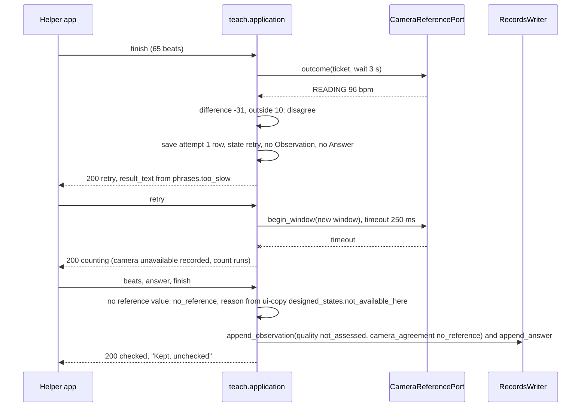

# E30: Teach and check

Technical design for epic E30. Inputs: the brief (`tdd/E30.md` in the planning package), PRD.md (section 4.13, R51, R52),
USE-CASES.md (UC22, UC24, UC09, UC16), CONTRACTS.md (sections 1 to 5, 9, 11, 18 to 20, 22, 23, 24, 28), `api/openapi.yaml`
(tag "Teach and check"), the schemas `guided-check`, `coaching-sample`, `config-skills-catalog` and `requests#GuidedCheck*`,
the examples `api/examples/plans/guided-check-*.json`, `observation-pulse-felt.json`, `help/coaching-cpr.json` and
`config/skills-catalog.example.json`, UX-DESIGN.md (sections 1.6 to 1.11, 7.1 and 9), VALIDATION.md (V85, V86, V87, V96, D38,
section 6 "Teach and check at the venue"), the E30 rows of `backlog.json`, and `docs/BUILD-CHARTER.md`. `docs/SYSTEM.md` and
`docs/DEPLOYMENT.md` are being written in parallel; every point that depends on them is marked "per DEPLOYMENT.md" or
"per SYSTEM.md" and listed in section 14.

Package paths below are relative to ``; repository paths are relative to
``.

## 1. Scope

**Work packages.** E30-01 (skills catalog content), E30-02 (GuidedCheck engine), E30-03 (camera pulse as the reference),
E30-04 (compression rate from the helper's motion, experimental), E30-05 (the "A crewmate checks" screen and landmark lights),
E30-06 (venue study of crewmate counts and the CPR rate).

**Requirements.** R51 (teach a manual check or step on the body), R52 (the cameras check the helper). Contributes to R50
(check it another way: the `crewmate_palpation` Observation) and R55 (drills run the same teach steps and camera checks).

**Validation and demo.** V85, V86, V87 (pulse check agree, disagree, no reference), V96 (CPR rate below band, then hands out
of view), D38 (act 5: beats with hub time, engine result with catalog tolerance, `crewmate_palpation` Observation to the
demo-operator record). Invariants EI8 (a guided check never confirms or excludes a condition; disagreement writes no value)
and EI10 (drill measurements never stored). Use cases UC22 (check it another way) and the camera line of UC09.

**Delivered here.**

1. `config/skills-catalog.json` with five skills (section 8).
2. Module `crew_health.teach`: the GuidedCheck state machine, the count agreement rule, the camera reference window, the
   CoachingSample pipeline, and the five operations `startGuidedCheck`, `getGuidedCheck`, `tapBeat`, `actOnGuidedCheck`,
   `listCoachingSamples`.
3. The compression rate analyzer that runs inside the camera worker (frames never leave the device), behind the E06 worker
   seam (request X8 in section 14).
4. `ui/crew/src/features/teach/`: the "A crewmate checks" screen, the Beat pad, the tap line, the result card and the
   `CoachingLine` component the help card embeds.
5. The venue study protocol, capture and analysis under `eval/studies/teach_and_check/`.

**Not delivered here (and who does).**

| Item | Owner |
|---|---|
| The camera worker, rPPG pulse, best-view selection, two-camera agreement, the camera Observation itself | E06 |
| MeasurementRequest lifecycle, capability registry, kit gate | E05, E27 |
| Observation and Answer storage, units, the error envelope, idempotency store, outbox, SSE | E01 |
| PlanView, PlanRun, marking a guided step done, the "Teach Tomas" helper line | E28 |
| Role proposals (who is the helper), SkillRecord, drills, practice patches | E31 |
| Someone needs help, the help card that hosts the CPR line, the pacer | E26 |
| The body renderer and its landmark light, the app shell and routes | E03 |
| Ignoring `crewmate_palpation` in assessments and capability gaps (EI8 hub check) | E09, E13, E05 (E30 owns the cross-module test) |
| The device cache that renders teach steps with the hub stopped (R62, V97) | E29 (E29-06) |
| Teaching skills with no camera check (bleed, eye rinse, recovery position) as recorded GuidedChecks | Not possible in the current contract (`check_id` is required); interim in section 7, request X2 |

## 2. Dependencies and seams

E30 depends on E06, E07 and E28 (brief) and in practice on E01, E02, E03, E23, E26 and E31. Every seam goes through an
application port or an event; E30 never reads another module's tables.

| Seam | Direction | Mechanism | Owner | Status |
|---|---|---|---|---|
| Configuration documents and versions | E30 consumes | `ConfigReader` port | E01 | Exists in charter |
| Clock (UTC, monotonic within a process) | E30 consumes | `Clock` port | E01 | Monotonic guarantee: request X9 |
| Unit of work, outbox, idempotency store | E30 consumes | `UnitOfWorkFactory`, `EventPublisher` | E01 | Body-less idempotency for ephemeral checks: X9 |
| Template rendering with allowed placeholders | E30 consumes | `TemplateRenderer` port | E01 | CONTRACTS 11 "Templates" |
| Observation and Answer writes, canonical unit | E30 consumes | `RecordsWriter` port | E01 | |
| Person lookup, roles, record routing for LIVE readings in a SIM demo | E30 consumes | `PersonDirectory`, `RecordRouting` ports | E02 | `RecordRouting`: request X10 |
| Active `eva` overlay of a person | E30 consumes | `OverlayReader` port | E23 | |
| Camera reference over a time window | E30 consumes | `CameraReferencePort` | E06 | Request X8 |
| Compression rate samples from the worker | E30 consumes | `CompressionRatePort` | E06 hosts, E30 writes the analyzer | Request X8 |
| Plan run guided step lookup | E30 consumes | `PlanRunReader.guided_step` | E28 | Request X11 |
| Marking the plan step done when the check reaches `checked` | E28 consumes | event `guided_check.checked` | E28 | Request X11 |
| Drill lookup and drill end | E30 consumes | `DrillReader`, event `drill.changed` | E31 | Request X12 |
| `skill.practiced` with `source` `event` | E31 consumes | event `guided_check.checked` | E31 | Request X12 |
| Help session flow and read permission | E30 consumes | `HelpSessionReader`, event `help.session_changed` | E26 | Request X13 |
| CPR line on the help card | E26 consumes | Vue component `CoachingLine` and event `coaching.sample` | E30 | Request X13 |
| Landmark light, figure lock, route registration | E30 consumes | body renderer API and shell route registry | E03 | Request X14 |
| Assistant tool `propose_guided_check` | E12, E28 | Proposes only; a person presses Teach. No write path into E30 | E12 | |

Nothing in E30 reads GroundLink, the assistant, the inference service or the network (EI1). `import-linter` contract
`teach-independence` forbids imports of `crew_health.assistant`, `crew_health.model`, `crew_health.groundlink` and
`crew_health.catchup` from `crew_health.teach` (test T30-28).

## 3. Domain model

Pure code in `hub/src/crew_health/teach/domain/`. No I/O, no framework imports, no wall clock.

### 3.1 Value objects (from the pinned skills-catalog version)

```python
class TeachStepKind(StrEnum): INSTRUCTION = "instruction"; COUNT = "count"; QUESTION = "question"
class HelperAnswer(StrEnum): REGULAR = "regular"; IRREGULAR = "irregular"; NOT_SURE = "not_sure"
class CheckKind(StrEnum): COUNT_AGREEMENT = "count_agreement"; COMPRESSION_RATE = "compression_rate"; HAND_POSITION = "hand_position"

@dataclass(frozen=True, slots=True)
class FlowStepRef:            # from_flow_step
    flow_id: str
    index: int                # into responder-flows.json flows[flow_id].immediate_steps

@dataclass(frozen=True, slots=True)
class TeachStep:
    step_no: int
    kind: TeachStepKind
    actor: Literal["helper", "subject", "both"]
    text: str | None                      # template, exactly one of text or from_flow_step
    from_flow_step: FlowStepRef | None
    text_first_time: str | None           # template
    landmark_id: str | None
    body_region: BodyRegion | None
    environments: frozenset[EnvironmentId] | None
    count_seconds: int | None             # count steps only
    choices: tuple[tuple[HelperAnswer, str], ...]   # question steps only

@dataclass(frozen=True, slots=True)
class Tolerance:
    value: Decimal | None                 # None: to be set; the result can only be no_reference
    unit: str
    basis: Literal["sourced", "team default"]
    to_be_set_by: Literal["clinical review", "the flight surgeon", "flight rules"] | None

@dataclass(frozen=True, slots=True)
class CheckPhrases:
    ok: str | None; too_slow: str | None; too_fast: str | None
    mismatch: str | None; cannot_see: str | None; no_reference: str | None

@dataclass(frozen=True, slots=True)
class CountAgreementCheck:
    check_id: str
    experimental: bool
    reference_capability: str             # reference.capability_code, never null for this kind
    tolerance: Tolerance | None
    phrases: CheckPhrases

@dataclass(frozen=True, slots=True)
class TargetBand:
    min: Decimal; max: Decimal; unit: str; source_ids: tuple[str, ...]

@dataclass(frozen=True, slots=True)
class CompressionRateCheck:
    check_id: str
    experimental: bool
    target: TargetBand
    update_interval_seconds: int
    phrases: CheckPhrases

@dataclass(frozen=True, slots=True)
class SkillDefinition:
    skill_id: str
    who_may: Literal["any_crew", "crew_medical_officer"]
    steps: tuple[TeachStep, ...]          # ordered by step_no, numbered from 1 (loader check 16)
    count_check: CountAgreementCheck | None       # the single count_agreement check, see E30 check C1
    compression_check: CompressionRateCheck | None
    what_it_shows: WhatItShows | None
    catalog_version: str                  # SHA-256 of the document bytes

    def count_step(self) -> TeachStep | None: ...
    def steps_for(self, environment_id: EnvironmentId) -> tuple[TeachStep, ...]: ...  # filters on environments
```

`SkillDefinition` is built by `SkillCatalog.from_document(doc: Mapping[str, object], version: str) -> SkillCatalog`, which
raises `CatalogShapeError` on anything the loader should have rejected (defensive; never reached with a validated release).

### 3.2 The GuidedCheck entity and its state machine

```python
class GuidedCheckState(StrEnum):
    TEACHING = "teaching"; COUNTING = "counting"; CHECKED = "checked"; RETRY = "retry"; CANCELLED = "cancelled"

class AgreementResult(StrEnum): AGREE = "agree"; DISAGREE = "disagree"; NO_REFERENCE = "no_reference"

@dataclass(frozen=True, slots=True)
class CountWindow:
    started_at: datetime        # hub time of start_count
    ends_at: datetime           # started_at + count_seconds
    def accepts(self, t: datetime) -> bool: return self.started_at <= t < self.ends_at
    def ended(self, now: datetime) -> bool: return now >= self.ends_at

@dataclass(frozen=True, slots=True)
class CameraReference:          # maps 1:1 to GuidedCheck.camera_reference
    observation_id: str | None
    value: Decimal | None
    unit: str | None
    no_reading_reason: str | None   # words from the camera module, or ui-copy designed_states.not_available_here
    origin_mode: OriginMode

@dataclass(slots=True)
class GuidedCheck:
    guided_check_id: str
    revision: int
    skill: SkillDefinition          # pinned
    environment_id: EnvironmentId   # at creation; selects steps_for()
    helper_id: str; subject_id: str
    plan_run_id: str | None; drill_id: str | None; episode_id: str | None; role_assignment_id: str | None
    state: GuidedCheckState
    teach_step_no: int
    steps_done: list[tuple[int, datetime]]
    attempt_no: int
    window: CountWindow | None
    counting_session_id: str | None
    beats: dict[int, datetime]      # sequence -> hub receive time, current attempt only
    helper_answer: HelperAnswer | None
    camera_ticket_id: str | None
    camera_reference: CameraReference | None
    outcome: AgreementOutcome | None
    observation_id: str | None; answer_id: str | None
    origin_mode: OriginMode
```

Commands are methods that return a new revision and a list of domain events; they never perform I/O.

| From | Command | Guard (all must hold, otherwise the error in brackets) | To | Effects |
|---|---|---|---|---|
| `teaching` | `step_done(n, now)` | `n == teach_step_no` and that step is `instruction` [INVALID_VALUE] | `teaching` | append `(n, now)`; `teach_step_no` = next applicable step |
| `teaching` | `answer(a, now)` | step on screen is `question` and `a` in its `choices` [INVALID_VALUE] | `teaching` | `helper_answer = a`; append `(n, now)`; advance |
| `teaching` | `start_count(now, session_id)` | step on screen is `count` [INVALID_VALUE]; `count_check` exists [INVALID_TRANSITION] | `counting` | `window = (now, now + count_seconds)`; `counting_session_id = session_id`; emits `CameraWindowRequested` |
| `counting` | `beat(seq, now, session_id)` | `window.accepts(now)` and `session_id == counting_session_id` and `len(beats) < beat_bound` [INVALID_TRANSITION]; repeated `seq` is a no-op returning the current check | `counting` | `beats[seq] = now`; emits `BeatRecorded(beat_count, now, seconds_left)` |
| `counting` | `answer(a, now)` | `window.ended(now)`; step on screen is `question`; `a` in choices [INVALID_TRANSITION or INVALID_VALUE] | `counting` | as in teaching; the count step is recorded done at `window.ends_at` the first time a command observes the window ended |
| `counting` | `finish(now, reference, render)` | `window.ended(now)`; every step after the count step is done [INVALID_TRANSITION]; `beat_count >= 1` and sequences are exactly `1..max` [INVALID_VALUE] | `checked` or `retry` | `outcome = evaluate_count_agreement(...)`; `agree`, `no_reference` → `checked` with `ObservationToWrite`; `disagree` → `retry`, no Observation |
| `retry` | `retry(now, session_id)` | none | `counting` | `attempt_no += 1`; clear beats, answer, reference, outcome; drop `steps_done` from the count step on; new window; emits `CameraWindowRequested` |
| `teaching`, `counting`, `retry` | `cancel(now)` | none | `cancelled` | emits `CameraWindowAbandoned` when a ticket exists; nothing else is written |
| `checked`, `cancelled` | any | always [INVALID_TRANSITION] | unchanged | |

`beat_bound` is a resource bound, not clinical content: `count_seconds * settings.teach.max_beats_per_second` (section 11).
The "step on screen" is derived: while `counting` and `window.ended(now)`, it is the first step after the count step not yet
done. `allowed_actions` is derived from the table for the session's role and the clock (no client inference).

### 3.3 The count agreement rule (CONTRACTS section 23, steps 1 to 5)

```python
@dataclass(frozen=True, slots=True)
class AgreementOutcome:
    result: AgreementResult
    count_per_minute: Fraction
    difference: Fraction | None           # count_per_minute minus camera value; None without a reference
    phrase_key: Literal["ok", "too_slow", "too_fast", "no_reference"]
    phrase_values: Mapping[str, str]      # count, camera, difference, reason (formatted)
    writes_observation: bool              # True for agree and no_reference

def evaluate_count_agreement(
    beat_count: int,
    count_seconds: int,
    reference: CameraReference | None,
    check: CountAgreementCheck,
    fmt: NumberFormat,                    # decimals of the reference code from indicator-catalog.json
    no_camera_reason: str,                # ui-copy designed_states.not_available_here
) -> AgreementOutcome: ...
```

1. `count_per_minute = Fraction(beat_count * 60, count_seconds)` (exact; no float).
2. No reference value (reference is `None`, or its `value` is `None`), or `tolerance` is `None`, or `tolerance.value` is
   `None`: `no_reference`; `{reason}` is the reference's `no_reading_reason`, else `no_camera_reason`, else (tolerance not set)
   ui-copy `designed_states.threshold_pending`.
3. Otherwise `difference` is `count_per_minute` minus the exact reference value; `abs(difference) <= tolerance.value` is `agree`
   (inclusive) with phrase `ok`; `difference < 0` is `disagree` with `too_slow`; `difference > 0` is `disagree` with
   `too_fast`; `{difference}` is the absolute value.
4. Formatting: `{count}`, `{camera}` and `{difference}` use the indicator-catalog `decimals` of `reference_capability`
   (pulse: 0) with `ROUND_HALF_EVEN`. The comparison uses exact values, never the formatted ones.
5. A phrase that is `null` in the catalog for the chosen key renders ui-copy `designed_states.unknown` and logs
   `teach.phrase_missing` (CONTRACTS 11 rule for missing placeholders, applied to a missing phrase).

Test vector (CONTRACTS section 20): 92 beats in 60 s, camera 96 bpm, tolerance 10 gives `count_per_minute` 92, `difference`
-4, `agree`, "Your count 92 · cameras 96 · they agree"; 65 against 96 gives `disagree` and "Your count is 31 lower than the
cameras. Move your fingers a little toward the thumb, and count again." (tests T30-01, T30-02, T30-03).

### 3.4 The Observation a check writes

`ObservationToWrite` is a pure value the application layer hands to `RecordsWriter`:

| Field | Value |
|---|---|
| `code` | `check.reference_capability` (`pulse`) |
| `value` | `count_per_minute` as a decimal string, exact |
| `unit` | `RecordsWriter.canonical_unit(code)`; never typed in E30 |
| `observed_at` | `window.ends_at`; `entered_at` is the finish time |
| `acquisition_method` | `crewmate_palpation` |
| `operator_id` | the helper |
| `patient_id` | the subject, or `RecordRouting.record_for(subject, LIVE)` when the observation is LIVE in a SIM fixture (section 3.6) |
| `origin_mode` | section 3.6 |
| `quality_status` | `accepted` for `agree`; `not_assessed` for `no_reference` (the camera comparison could not run) |
| `quality_rule_version` | `skills-catalog@<catalog_version>#<check_id>` |
| `body_region` | the count step's landmark region (`wrist`) |
| `context` | `guided_check_id`, `count_seconds` (string), `camera_agreement` (`agree` or `no_reference`); the records module adds mission context |
| `episode_id`, `measurement_request_id` | the check's episode; none |

The helper's answer is written as an Answer in the same finish transaction (UX-DESIGN 7.1): question code
`skill:<skill_id>:step:<step_no>`, question version `catalog_version`, presence `present` (regular), `absent` (irregular),
`unknown` (not sure), typed value the enum, actor the helper, subject the observation's patient. Writing it at finish
(not at `answer`) keeps "cancel writes nothing" true. A second finish after `retry` writes a new Answer that supersedes the
first.

### 3.5 Coaching samples (CONTRACTS section 23, "CPR coaching")

```python
@dataclass(frozen=True, slots=True)
class RawRateSample:              # from the worker; no text
    at: datetime                  # hub time (the worker port converts)
    rate_per_min: Decimal | None
    reason: Literal["cannot_see_hands", "quality_gate_failed"] | None

def derive_coaching_sample(raw: RawRateSample, check: CompressionRateCheck, render: PhraseRender) -> CoachingSampleBody: ...
```

- `rate_per_min` not null: `in_band = target.min <= rate <= target.max`; `direction` `too_slow` below, `too_fast` above,
  `null` in band; `text` is `ok`, `too_slow` or `too_fast` with `{rate}` formatted with 0 decimals.
- `rate_per_min` null: `in_band` null, `direction` null, `reason` required; `text` is `cannot_see` (for both reasons in the
  interim, request X6 adds a `quality_gate_failed` phrase). Never a number (schema `allOf`).
- `experimental` is the check's `experimental`.
- Throttle: at most one sample per `update_interval_seconds` per coaching job; a later raw sample in the same interval
  replaces the pending one (latest wins); if no raw sample arrives in an interval, the job emits a null sample with
  `quality_gate_failed`, so a stale rate is never shown as current (charter section 1, rule 4).

### 3.6 Origin and the demo-operator record

`GuidedCheck.origin_mode` is the subject record's origin (`RecordRouting.record_origin(subject)`: SIM for Mara). The
felt-pulse Observation's origin:

- the camera reference exists and its `origin_mode` is LIVE (a reading or a refusal from a real camera): the Observation is
  LIVE and its `patient_id` is `RecordRouting.record_for(subject, LIVE)`, which returns the demo-operator record in a SIM
  fixture and the subject in a LIVE mission (D38, D09, V09, V47);
- otherwise: the check's `origin_mode` and the subject.

A LIVE value is never written to a SIM record and a SIM value never to a LIVE record (invariant I30-13). With no camera at
all in a SIM demo the count goes to the persona as SIM; section 14 item X16 records this choice.

### 3.7 Invariants (each has a test in section 12)

| ID | Invariant |
|---|---|
| I30-01 | `helper_id != subject_id`; the helper is on the roster and not in an active `eva` overlay at creation |
| I30-02 | `outcome` is set only in `checked` or `retry`; `observation_id` only in `checked` |
| I30-03 | `disagree` writes no Observation and no value anywhere outside the check's own attempt record (EI8) |
| I30-04 | `agree` and `no_reference` write exactly one Observation with the fields of 3.4 |
| I30-05 | Every beat time is the hub clock at receipt, inside the window; a sequence counts once per attempt; the client's time is never stored |
| I30-06 | Agreement is computed exactly (rational arithmetic) and is inclusive at the tolerance |
| I30-07 | No tolerance value means no `agree` |
| I30-08 | No E30 code reads the model, the ground link or the network |
| I30-09 | No E30 code writes Episode, CapabilityGap, Assessment, KitCheck or any condition state (EI8) |
| I30-10 | A drill check persists nothing: no row, no Observation, no Answer, no persisted event (EI10) |
| I30-11 | `experimental` equals the pinned catalog's `checks[].experimental` |
| I30-12 | Every text on a GuidedCheck or CoachingSample is a catalog phrase or a ui-copy word rendered with its allowed placeholders |
| I30-13 | LIVE inputs land only on LIVE records; SIM only on SIM |
| I30-14 | A coaching sample with no rate has no `in_band`, no `direction` and a `reason`; at most one per interval per job |
| I30-15 | `finish` never writes a count of zero or a count with missing beat sequences |
| I30-16 | Transitions follow 3.2 only; `checked` and `cancelled` are terminal |
| I30-17 | A check uses one skills-catalog, ui-copy and indicator-catalog version for its whole life |

### 3.8 Decisions the brief asked for

| Decision | Alternatives considered | Selected | Evidence | Failure modes and handling | Migration and rollback |
|---|---|---|---|---|---|
| Count agreement tolerance | Fixed in code; percentage of the reference; absolute bpm from configuration | Absolute value in `checks[].tolerance.value`, unit "beats per minute", `basis` "team default", `to_be_set_by` "clinical review", value 10 | Contract test vector; no published tolerance for palpation against rPPG was found in the package; the venue study (E30-06) reports agreement so clinical review can set it | Tolerance null: result is always `no_reference` (never `agree`) | Changing it is a configuration release; a check pins its version, so running checks keep theirs |
| How beats are timed | Client timestamps; hub receive time; client time corrected by offset | Hub receive time from the injected `Clock` inside the beat command, one sequence per tap, beats accepted only by the session that started the count | Contract ("the client's clock is never used"); a Wi-Fi round trip of tens of milliseconds can lose at most the beat in flight at the window edge, below one beat per minute at 60 s | Lost beats lower the count: detected as sequence gaps at finish (refused, I30-15); a hub clock step mid-count is prevented by the monotonic clock requirement (X9) | None |
| Camera window alignment | Continuous camera stream; one MeasurementRequest; a hub-requested window | At `start_count` the hub calls `CameraReferencePort.begin_window(subject, capability, started_at, ends_at)`; the worker estimates one pulse over the frames whose hub-converted capture times fall inside the window; E06's own coverage rule decides whether that is a reading | MeasurementRequest needs crew acceptance and has no window; the window must equal the count (CONTRACTS 23 "over the same window") | Worker down or slow: `begin_window` times out (250 ms) and the check counts anyway; at finish the outcome is awaited at most 3 s, else `no_reference` with the camera's reason or "Not available here" | Coverage threshold moves into the catalog with request X5 |
| Compression rate quality gate | Rate from any motion; rate with confidence shown; refuse unless gated | Refuse unless every gate passes: hands visible in enough frames, a clear periodic peak, the peak inside a plausible search range, enough frames per second; `cannot_see_hands` when visibility fails, `quality_gate_failed` otherwise; never a number on doubt | Engan 2016 and Meinich-Bache 2018 (RESEARCH-ANNEX: "2.7 compressions per minute" average error on a manikin, Earth gravity), AHA band 100 to 120 | Wrong geometry in weightlessness (Evetts-Russomano hold) or a single laptop webcam: refusals, never numbers; experimental label | Gate parameters move into the catalog with request X5; interim in the worker settings file with `basis` "team default" |
| Live demo reading to the demo-operator record | Write to the persona; refuse LIVE in SIM; route by origin | Route by the camera reference's origin through `RecordRouting` (3.6) | D38, D09, V09, V47; CONTRACTS 1 ("a synthetic character is never the same patient as the live presenter") | No routing port yet: the hub refuses to write a LIVE Observation to a SIM record (records module guard) and the result shows as `no_reference` with the reason "Not available here" until X10 lands | None |
| Experimental label | Per screen flag; per check from configuration | `checks[].experimental` copied into every GuidedCheck and CoachingSample; flipping it to false requires a configuration release that cites the venue study result file | Brief; R52 | Forgotten label: T30-24 asserts the tag renders whenever `experimental` is true | Release rollback restores the label |

## 4. Application layer

`hub/src/crew_health/teach/application/`.

### 4.1 Ports (Python protocols, `ports.py`)

```python
class Clock(Protocol):
    def now(self) -> datetime: ...                      # UTC, tz-aware, non-decreasing within the process (X9)

class ConfigReader(Protocol):
    def active_release_id(self) -> str: ...
    def active_version(self, name: str) -> str: ...
    def document(self, name: str, version: str) -> Mapping[str, object]: ...

class TemplateRenderer(Protocol):
    def render(self, template: str, values: Mapping[str, str], *, field: str, ui_copy_version: str) -> str: ...

class PersonDirectory(Protocol):
    def person(self, person_id: str) -> PersonRef | None: ...          # person_id, display_name, roles
class RecordRouting(Protocol):
    def record_origin(self, person_id: str) -> OriginMode: ...
    def record_for(self, person_id: str, origin: OriginMode) -> str: ...   # raises RoutingUnavailable
class OverlayReader(Protocol):
    def in_active_eva(self, person_id: str, at: datetime) -> bool: ...

@dataclass(frozen=True, slots=True)
class ReferenceWindowRequest:
    guided_check_id: str; attempt_no: int
    subject_person_id: str
    capability_code: str
    window_start: datetime; window_end: datetime
    persist: bool                          # False for drills: value returned, nothing stored (EI10)
    correlation_id: str

@dataclass(frozen=True, slots=True)
class ReferenceTicket:
    ticket_id: str | None                  # None: the camera could not be asked
    unavailable_reason: str | None         # camera module words when ticket_id is None

class ReferenceOutcomeKind(StrEnum): PENDING = "pending"; READING = "reading"; NO_READING = "no_reading"; UNAVAILABLE = "unavailable"

@dataclass(frozen=True, slots=True)
class ReferenceOutcome:
    kind: ReferenceOutcomeKind
    observation_id: str | None             # READING with persist=True
    value: Decimal | None                  # READING only
    unit: str | None
    reason: str | None                     # NO_READING, UNAVAILABLE
    origin_mode: OriginMode | None         # None only for UNAVAILABLE with no camera at all

class CameraReferencePort(Protocol):       # provided by E06 (request X8)
    def begin_window(self, request: ReferenceWindowRequest, *, timeout: timedelta) -> ReferenceTicket: ...
    def outcome(self, ticket_id: str, *, wait: timedelta) -> ReferenceOutcome: ...
    def abandon(self, ticket_id: str) -> None: ...

@dataclass(frozen=True, slots=True)
class CoachingJobSpec:
    job_id: str
    subject_person_id: str | None          # None in a manikin drill
    check_id: str
    update_interval_seconds: int
    gate: CompressionGate                  # parameters, section 8 (interim source: worker settings)

class CompressionRatePort(Protocol):       # E06 hosts the analyzer E30 writes (request X8)
    def start(self, spec: CoachingJobSpec, *, timeout: timedelta) -> bool: ...   # False: no camera can serve it
    def drain(self, job_id: str, *, max_items: int) -> Sequence[RawRateSample]: ...
    def stop(self, job_id: str) -> None: ...

class RecordsWriter(Protocol):
    def canonical_unit(self, code: str) -> str: ...
    def append_observation(self, uow: UnitOfWork, draft: ObservationDraft, *, idempotency_key: str) -> str: ...
    def append_answer(self, uow: UnitOfWork, draft: AnswerDraft, *, idempotency_key: str) -> str: ...

class PlanRunReader(Protocol):             # E28 (request X11)
    def guided_step(self, plan_run_id: str, skill_id: str) -> GuidedStepRef | None: ...
    # GuidedStepRef: plan_run_id, subject_person_id, episode_id, step_id, environment_id,
    #                skills_catalog_version (the run's pin), ui_copy_version (pin), run_open: bool, step_runnable: bool

class DrillReader(Protocol):               # E31 (request X12)
    def running_drill(self, drill_id: str) -> DrillRef | None: ...   # skill_ids, participant_ids, origin_mode

class HelpSessionReader(Protocol):         # E26 (request X13)
    def readable_by(self, session: SessionContext, help_session_id: str) -> bool: ...

class GuidedCheckRepository(Protocol):
    def get(self, uow: UnitOfWork, guided_check_id: str) -> GuidedCheck | None: ...
    def add(self, uow: UnitOfWork, check: GuidedCheck) -> None: ...
    def save(self, uow: UnitOfWork, check: GuidedCheck, *, expected_revision: int) -> None: ...  # raises StaleRevision
    def record_attempt(self, uow: UnitOfWork, attempt: FinishedAttempt) -> None: ...

class CoachingSampleRepository(Protocol):
    def append(self, uow: UnitOfWork, sample: CoachingSample) -> None: ...
    def page(self, help_session_id: str, cursor: str | None, limit: int) -> Page[CoachingSample]: ...

class EventPublisher(Protocol):
    def publish(self, uow: UnitOfWork, event: OutboundEvent) -> None: ...  # outbox; delivered after commit
```

Two repository implementations satisfy `GuidedCheckRepository`: `SqliteGuidedCheckRepository` for plan-run and standalone
checks, `EphemeralGuidedCheckRepository` (in memory, bounded) for drill checks. The use case picks by `drill_id`.

### 4.2 Use cases (`commands.py`, `queries.py`)

| Use case | Input | Output | Errors | Idempotency |
|---|---|---|---|---|
| `StartGuidedCheck` | `GuidedCheckCreate`, session, `Idempotency-Key` | GuidedCheck (201) | INVALID_VALUE (unknown skill, both `plan_run_id` and `drill_id`, unknown person or role assignment), CONTEXT_INAPPLICABLE (skill without a `count_agreement` check; no applicable count step in the environment; plan run closed, its plan has no guided step for this skill, or the step is not runnable; drill not running or skill not in it), ROLE_NOT_ELIGIBLE (helper is subject; helper in `eva`; `who_may` not met), UNAUTHORIZED_SCOPE (section 10) | E01 store keyed by key and body hash; same key and body returns the first 201 |
| `TapBeat` | `GuidedCheckBeat`, session, key | GuidedCheck (200) | NOT_FOUND, INVALID_TRANSITION (not counting, window ended, other session, bound reached), UNAUTHORIZED_SCOPE | Sequence dedupe inside the check, plus the key |
| `ActOnGuidedCheck` | `GuidedCheckAction`, `If-Match`, session, key | GuidedCheck (200) | VERSION_REQUIRED, STALE_VERSION, INVALID_TRANSITION, INVALID_VALUE, ACTION_NOT_ALLOWED (actor kind `assistant` or `adapter`), NOT_FOUND, UNAUTHORIZED_SCOPE | Key; `finish` writes Observation and Answer with keys derived from `guided_check_id:attempt_no` so a retried finish cannot write twice |
| `GetGuidedCheck` | id, session | GuidedCheck with `ETag` | NOT_FOUND, UNAUTHORIZED_SCOPE | n/a |
| `ListCoachingSamples` | help session id, cursor, limit | page of CoachingSample | NOT_FOUND, UNAUTHORIZED_SCOPE | n/a |
| `CoachingCoordinator.on_help_session_changed` | event | starts or stops a coaching job | logged, never raised to the help module | Job id = `coach:<help_session_id>:<check_id>`; a second start is a no-op |
| `CoachingCoordinator.on_drill_changed` | event | starts or stops a drill coaching job | as above | `coach:drill:<drill_id>:<check_id>` |
| `CoachingCoordinator.tick` | clock | drains raw samples, derives, throttles, persists (help session) and publishes | as above | Sample id derived from job id and interval index |

`StartGuidedCheck` steps: authorize; resolve the skills-catalog version (the plan run's pin when `plan_run_id` is set, else
the active version); build `SkillDefinition`; check eligibility and context; resolve `episode_id` from the plan run; resolve
origin; create the check at the first applicable step; commit with the audit event. No event type is defined for creation in
CONTRACTS 18, so none is published (the create response carries the object).

`ActOnGuidedCheck(start_count)` steps: load and authorize; domain `start_count`; **outside any transaction** call
`begin_window(timeout=settings.teach.camera_begin_timeout)`; then one transaction saves the check with `camera_ticket_id` or
the unavailable reason. The count's start time is the command's clock reading, taken before the camera call, so a slow camera
never shortens or shifts the count.

`ActOnGuidedCheck(finish)` steps: load and authorize; **outside any transaction** call
`outcome(ticket, wait=settings.teach.reference_wait)` (a `PENDING` after the wait becomes `NO_READING` with the camera
module's timeout words, or `designed_states.no_reading` when it has none); map to `CameraReference`; one transaction runs the
domain `finish`, writes the attempt row, the Observation and the Answer through `RecordsWriter` (same unit of work), saves
the check and publishes `guided_check.checked`. A crash between the camera call and the commit leaves the check `counting`;
a repeated finish redoes the same work deterministically.

### 4.3 Events (CONTRACTS section 18)

| Event | When | Data | Scope | Persisted |
|---|---|---|---|---|
| `guided_check.beat` | After each accepted beat commits | `{guided_check_id, beat_count, at, seconds_left}`; `seconds_left` is the whole seconds from `at` to `count_ends_at`, rounded up, never below 0 | person: helper and subject (X9 asks for a multi-person scope; until then two events) | Yes for plan-run and standalone checks; never for drill checks (none emitted, the beat response carries the count) |
| `guided_check.checked` | After `finish` commits, every result | GuidedCheck | person: helper and subject; in-process subscribers E28 and E31 | As above; drill checks emit none |
| `coaching.sample` | Each derived sample | CoachingSample | crew | Help session samples yes; drill samples are delivered only to live SSE connections (X9) and never stored |

Consumed: `help.session_changed` (E26), `drill.changed` (E31). E30 consumes no configuration events: a check is pinned.

### 4.4 Sequence diagrams

Principal success path (D38, V85): teach, count, camera agrees, Observation written, plan step done.

```mermaid
sequenceDiagram
    participant H as Helper app (Tomas)
    participant API as teach.api
    participant UC as teach.application
    participant CAM as CameraReferencePort (E06 worker)
    participant REC as RecordsWriter (E01)
    participant PLAN as E28 consumer
    H->>API: POST /v1/guided-checks {skill pulse_check_wrist, helper tomas, subject mara, plan_run_id}
    API->>UC: StartGuidedCheck (pinned catalog from the run)
    UC-->>H: 201 GuidedCheck state teaching, step 1
    loop steps 1 to 3
        H->>API: POST /actions step_done(n), If-Match
        API-->>H: 200 teach_step_no n+1
    end
    H->>API: POST /actions start_count
    UC->>UC: window = hub now .. now + count_seconds
    UC->>CAM: begin_window(subject, pulse, window, persist true), timeout 250 ms
    CAM-->>UC: ticket
    UC-->>H: 200 counting, count_ends_at
    loop each felt beat (92)
        H->>API: POST /beats {sequence, client_time}
        API->>UC: TapBeat (hub time stamped)
        UC-->>H: 200 beat_count; SSE guided_check.beat
    end
    H->>API: POST /actions answer(regular)
    H->>API: POST /actions finish
    UC->>CAM: outcome(ticket, wait 3 s)
    CAM-->>UC: READING 96 bpm (camera Observation id)
    UC->>UC: evaluate_count_agreement: 92 vs 96, tolerance 10, agree
    UC->>REC: append_observation(crewmate_palpation, 92, operator tomas) and append_answer, one transaction
    UC-->>H: 200 checked, result_text from phrases.ok
    UC-)PLAN: guided_check.checked (outbox, after commit)
    PLAN->>PLAN: step done with guided_check_id and observation_ids
```

Failure path (V86, then V87 on the second attempt): the counts disagree, nothing is written, the helper counts again and the
camera then refuses.



## 5. Adapters

### 5.1 Storage (SQLite, STRICT, WAL, foreign keys on; migration `teach/adapters/migrations/0001_teach.sql`)

```sql
CREATE TABLE teach_guided_check (
  guided_check_id TEXT PRIMARY KEY,
  revision INTEGER NOT NULL CHECK (revision >= 1),
  skill_id TEXT NOT NULL,
  check_id TEXT NOT NULL,
  environment_id TEXT NOT NULL,
  helper_person_id TEXT NOT NULL,
  subject_person_id TEXT NOT NULL,
  plan_run_id TEXT,
  episode_id TEXT,
  role_assignment_id TEXT,
  state TEXT NOT NULL CHECK (state IN ('teaching','counting','checked','retry','cancelled')),
  teach_step_no INTEGER NOT NULL CHECK (teach_step_no >= 1),
  attempt_no INTEGER NOT NULL CHECK (attempt_no >= 1),
  count_seconds INTEGER CHECK (count_seconds IS NULL OR count_seconds >= 1),
  count_started_at TEXT,
  count_ends_at TEXT,
  counting_session_id TEXT,
  helper_answer TEXT CHECK (helper_answer IS NULL OR helper_answer IN ('regular','irregular','not_sure')),
  camera_ticket_id TEXT,
  camera_unavailable_reason TEXT,
  camera_reference_json TEXT,
  result TEXT CHECK (result IS NULL OR result IN ('agree','disagree','no_reference')),
  count_per_minute TEXT,
  difference TEXT,
  result_text TEXT,
  observation_id TEXT,
  answer_id TEXT,
  experimental INTEGER NOT NULL CHECK (experimental IN (0,1)),
  origin_mode TEXT NOT NULL CHECK (origin_mode IN ('LIVE','REPLAY','SIM')),
  config_release_id TEXT NOT NULL,
  skills_catalog_version TEXT NOT NULL,
  ui_copy_version TEXT NOT NULL,
  indicator_catalog_version TEXT NOT NULL,
  created_at TEXT NOT NULL,
  created_by_kind TEXT NOT NULL,
  created_by_id TEXT NOT NULL,
  updated_at TEXT NOT NULL,
  CHECK (helper_person_id <> subject_person_id),
  CHECK (result IS NULL OR state IN ('checked','retry')),
  CHECK (observation_id IS NULL OR state = 'checked'),
  CHECK (NOT (result = 'disagree' AND observation_id IS NOT NULL))
) STRICT;
CREATE INDEX teach_gc_subject ON teach_guided_check (subject_person_id, created_at);
CREATE INDEX teach_gc_helper ON teach_guided_check (helper_person_id, created_at);
CREATE INDEX teach_gc_plan_run ON teach_guided_check (plan_run_id) WHERE plan_run_id IS NOT NULL;

CREATE TABLE teach_step_done (
  guided_check_id TEXT NOT NULL REFERENCES teach_guided_check (guided_check_id),
  step_no INTEGER NOT NULL CHECK (step_no >= 1),
  done_at TEXT NOT NULL,
  PRIMARY KEY (guided_check_id, step_no)
) STRICT, WITHOUT ROWID;

CREATE TABLE teach_beat (
  guided_check_id TEXT NOT NULL REFERENCES teach_guided_check (guided_check_id),
  attempt_no INTEGER NOT NULL,
  sequence INTEGER NOT NULL CHECK (sequence >= 1),
  received_at TEXT NOT NULL,
  session_id TEXT NOT NULL,
  PRIMARY KEY (guided_check_id, attempt_no, sequence)
) STRICT, WITHOUT ROWID;

CREATE TABLE teach_attempt (
  guided_check_id TEXT NOT NULL REFERENCES teach_guided_check (guided_check_id),
  attempt_no INTEGER NOT NULL,
  count_started_at TEXT NOT NULL,
  count_ends_at TEXT NOT NULL,
  beat_count INTEGER NOT NULL CHECK (beat_count >= 1),
  count_per_minute TEXT NOT NULL,
  camera_reference_json TEXT,
  result TEXT NOT NULL CHECK (result IN ('agree','disagree','no_reference')),
  difference TEXT,
  helper_answer TEXT,
  finished_at TEXT NOT NULL,
  PRIMARY KEY (guided_check_id, attempt_no)
) STRICT, WITHOUT ROWID;

CREATE TABLE teach_coaching_job (
  job_id TEXT PRIMARY KEY,
  help_session_id TEXT NOT NULL,
  skill_id TEXT NOT NULL,
  check_id TEXT NOT NULL,
  started_at TEXT NOT NULL,
  stopped_at TEXT,
  stop_reason TEXT CHECK (stop_reason IS NULL OR stop_reason IN ('flow_left','session_closed','max_duration','camera_unavailable','hub_restart'))
) STRICT;

CREATE TABLE teach_coaching_sample (
  sample_id TEXT PRIMARY KEY,
  job_id TEXT NOT NULL REFERENCES teach_coaching_job (job_id),
  help_session_id TEXT NOT NULL,
  skill_id TEXT NOT NULL,
  check_id TEXT NOT NULL,
  at TEXT NOT NULL,
  kind TEXT NOT NULL CHECK (kind IN ('compression_rate','hand_position')),
  rate_per_min TEXT,
  reason TEXT CHECK (reason IS NULL OR reason IN ('cannot_see_hands','quality_gate_failed')),
  in_band INTEGER CHECK (in_band IS NULL OR in_band IN (0,1)),
  direction TEXT CHECK (direction IS NULL OR direction IN ('too_slow','too_fast')),
  text TEXT NOT NULL,
  experimental INTEGER NOT NULL CHECK (experimental IN (0,1)),
  config_release_id TEXT NOT NULL,
  CHECK ((rate_per_min IS NULL) = (in_band IS NULL)),
  CHECK (rate_per_min IS NOT NULL OR reason IS NOT NULL)
) STRICT;
CREATE INDEX teach_cs_session ON teach_coaching_sample (help_session_id, at, sample_id);
```

`teach_attempt` holds one row per finished attempt, kept for lineage and the venue study export. There is no `drill_id` column anywhere: a drill check never reaches SQLite (I30-10). Decimals are stored as text and parsed
with `Decimal`. Retention follows the E01 policy for clinical records (CONTRACTS 10); no raw camera data is stored by E30.

`EphemeralGuidedCheckRepository`: a dict guarded by a lock, at most `settings.teach.ephemeral_max_checks` entries; entries
of a drill are dropped on `drill.changed` with state `completed` or `abandoned`, and any entry older than
`settings.teach.ephemeral_ttl` is dropped by the coordinator tick. A hub restart loses them; the client receives 404 and
starts again (drills store nothing by design).

### 5.2 Camera reference client (`adapters/camera_reference.py`)

Wraps the E06 port. `begin_window` timeout `settings.teach.camera_begin_timeout_ms` (250); `outcome` wait
`settings.teach.reference_wait_ms` (3000); no retries inside a command (the person can retry the whole count). Exceptions
from E06 become `ReferenceTicket(None, reason)` or `ReferenceOutcome(UNAVAILABLE, reason=...)`; nothing propagates as a
500. The adapter converts nothing about values: the value, unit, origin and reason words come from E06.

### 5.3 Compression rate analyzer (in the camera worker, `workers/camera/src/crew_camera/analyzers/compression_rate/`)

Runs only while a coaching job is active, on frames of the camera that holds the best view of the treatment area. Frames
never leave the worker process.

1. Pose landmarks for both wrists and the shoulders on each frame (the worker's existing pose model, per E06).
2. Signal: the vertical position of the wrist midpoint relative to the shoulder line, in a sliding window of `window_seconds`.
3. Gate A (visibility): both wrists above `min_landmark_visibility` in at least `min_visible_fraction` of the window's frames,
   else `cannot_see_hands`.
4. Gate B (frame rate): at least `min_fps` frames per second in the window, else `quality_gate_failed`.
5. Detrend and normalize; autocorrelation over lags for rates between `search_min_per_min` and `search_max_per_min`.
6. Gate C (periodicity): the highest normalized autocorrelation peak at least `min_peak_strength`, else `quality_gate_failed`.
7. Rate = 60 / peak lag in seconds; emitted with the window's end time converted to hub time.

All parameters are configuration (section 8). The analyzer has property tests on synthetic sinusoids with noise and
occlusion and a replay test on recorded landmark traces (never raw video) from the venue study.

### 5.4 Gateways to other modules

`records_gateway.py` (E01 `RecordsWriter`), `plans_gateway.py` (E28), `drills_gateway.py` (E31), `help_gateway.py` (E26),
`identity_gateway.py` (E02 `PersonDirectory`, `RecordRouting`), `overlays_gateway.py` (E23). Each is a thin call into the
owning module's application port inside the same process and unit of work; none has network I/O.

## 6. API

Router `hub/src/crew_health/teach/api/router.py`; request and response models are the Pydantic models generated from the
contracts (charter section 3.3); responses are validated against the response schema in tests.

| operationId | Method and path | Request | Success | Error codes (exactly those in openapi.yaml) | Headers |
|---|---|---|---|---|---|
| `startGuidedCheck` | `POST /v1/guided-checks` | `GuidedCheckCreate` | 201 GuidedCheck, `Location` | 400 MALFORMED_REQUEST; 401; 403 UNAUTHORIZED_SCOPE; 409 DUPLICATE_COMMAND; 415; 422 CONTEXT_INAPPLICABLE, INVALID_VALUE, ROLE_NOT_ELIGIBLE | `Idempotency-Key` required; `Config-Release` accepted and ignored (pinned, like help actions) |
| `getGuidedCheck` | `GET /v1/guided-checks/{guided_check_id}` | none | 200 GuidedCheck, `ETag` = revision | 400; 401; 403; 404 | |
| `tapBeat` | `POST /v1/guided-checks/{id}/beats` | `GuidedCheckBeat` | 200 GuidedCheck | 400; 401; 403; 404; 409 DUPLICATE_COMMAND, INVALID_TRANSITION; 415 | `Idempotency-Key` required; no `If-Match` |
| `actOnGuidedCheck` | `POST /v1/guided-checks/{id}/actions` | `GuidedCheckAction` | 200 GuidedCheck | 400; 401; 403 ACTION_NOT_ALLOWED, UNAUTHORIZED_SCOPE; 404; 409 DUPLICATE_COMMAND, INVALID_TRANSITION, STALE_VERSION; 415; 422 INVALID_VALUE; 428 VERSION_REQUIRED | `Idempotency-Key`, `If-Match` required |
| `listCoachingSamples` | `GET /v1/help-sessions/{id}/coaching` | `cursor`, `limit` | 200 `{items, page}` ordered by `at`, then `sample_id` | 400; 401; 403; 404 (help session not visible) | |

Roles (`x-roles`): `crew`, `crew_medical_officer`, `station` on all five; every other role gets 403 UNAUTHORIZED_SCOPE.
Object-level rules are in section 10. `client_time` in requests is validated as an instant and logged for latency analysis;
it is never stored in the GuidedCheck (I30-05).

Response rendering. `result_text` is rendered by the hub with the pinned catalog phrase. `tolerance` and `what_it_shows` are
copied from the pinned catalog. `camera_reference` maps `ReferenceOutcome`: READING to `{observation_id, value, unit, null,
origin}`; NO_READING and UNAVAILABLE to `{null, null, null, reason, origin}` (origin falls back to the check's origin when the
camera reported none). `beats` and `beat_count` are the current attempt's. `difference` and `count_per_minute` are JSON
numbers from the exact values.

Contract gap: the GuidedCheck has no rendered step text, so the screen cannot show "{helper_name}: place the pads..."
without rendering a catalog template itself. Request X1 adds `card_title_text` and `teach_steps[]` (rendered `text`,
`text_first_time`, `kind`, `landmark_id`, `body_region`, `count_seconds`, `choices`) to the GuidedCheck. Interim in section 7.

Example (D38 path, SIM fixture, values from the package examples): `POST /v1/guided-checks` with
`{"skill_id": "pulse_check_wrist", "helper_person_id": "tomas", "subject_person_id": "mara", "plan_run_id":
"prn_icl10_mara_1", "role_assignment_id": "rol_icl10_helper"}` returns `plans/guided-check-teaching.json` shape at step 1;
three `step_done`, one `start_count`, 92 `tapBeat`, one `answer` (`regular`) and one `finish` reproduce
`plans/guided-check-agree.json` and `plans/observation-pulse-felt.json` under the fixture clock (test T30-23).

## 7. User interface

Files under `ui/crew/src/features/teach/`. The screen is the Measurement screen in its "A crewmate checks" form (UX-DESIGN
7.1), reached from the gap card's **Teach {name}** (E28 plan card) and from drill mode (E31).

| Component | Binds to | Shows |
|---|---|---|
| `CrewmateChecksScreen.vue` | `GET /v1/guided-checks/{id}`; SSE `guided_check.beat`, `guided_check.checked` | The stage locked on the step's region, the three cards below |
| `TeachStepCard.vue` | `teach_step_no`, the pinned catalog step, `allowed_actions` | One step at a time; the short text by default, the first-time text after "I've never done this"; "has done this before" switches back. Next step posts `step_done`; question steps show the catalog `choices[].label` as pills and post `answer` |
| `BeatPad.vue` | `start_count`, `tapBeat`, `count_ends_at` | A wide **Beat** pill (`guided_check_words.beat_button`) and the countdown (`guided_check_words.seconds_left`) in tabular figures; Space and Enter tap; disabled outside the window |
| `TapLine.vue` | `beats`, `count_started_at`, `count_seconds` | One tick per tap on a line of the count's length; no classification; `aria-hidden` with the count in text |
| `CheckResultCard.vue` | `camera_reference`, `result`, `result_text`, `what_it_shows`, `tolerance`, `experimental`, origins | The camera status (face glows while `counting`), the engine's `result_text` verbatim, "What this does and does not tell us" from `what_it_shows`, the tolerance line, the Experimental tag, the Live, Replay or Sim swatch on each value |
| `CoachingLine.vue` (exported for E26) | `GET /v1/help-sessions/{id}/coaching` (latest), SSE `coaching.sample` | One static line: the sample's `text`; the Experimental tag. No transition, no animation, no color change |
| `TeachOnlyViewer.vue` | Cached `skills-catalog` and `responder-flows` | Interim for skills without a check and for the hub-stopped case: the steps, one at a time, nothing recorded |
| `useGuidedCheck.ts` | the four guided check operations | Typed client (generated types), If-Match handling, beat sequence numbering, the hub-time offset for the countdown |

The landmark light uses the body renderer's existing light (E03): `focus(body_region)` and the landmark at `landmarks[].offset`
(`null` draws at the region point). Request X14 asks E03 for `lightLandmark(region, offset)` if the renderer lacks it.

**States.**

| State | What the screen shows |
|---|---|
| Loading | The stage and empty card frames; no spinner text |
| Teaching | The step text, its landmark lit, Next step or the answer pills |
| Counting | Beat enabled, countdown from `count_ends_at` corrected by the measured hub offset, tap line growing, the face glow on the stage |
| Count ended, question pending | The question step with its pills; Beat disabled |
| Checked, agree | `result_text`, `guided_check_words.result_agree`, both values with their swatches |
| Checked, no reference | `result_text` and the tag `guided_check_words.unchecked`; the camera line shows `no_reading_reason` |
| Retry | `result_text` (the authored correction), `guided_check_words.result_disagree`; the count-again action |
| Cancelled | The screen closes back to its opener |
| Experimental | `guided_check_words.experimental` whenever `experimental` is true, on the result card and the CPR line |
| Stale (409 STALE_VERSION) | Refetch, then ui-copy `error_messages.STALE_VERSION` |
| Error | ui-copy `error_messages[code]`, never the envelope's `message`; entered steps kept |
| Hub unreachable | `TeachOnlyViewer` from the device cache with its release version (R62, E29-06); Beat hidden; nothing recorded |
| Camera unavailable | The camera line shows `designed_states.not_available_here`; the count runs and is kept unchecked |
| Live, Replay, Sim | ui-copy `origin_words` swatch on the helper's count and on the camera value |
| No WebGL | `no-gl` stage; every step and result is in text |

**Interim rendering of teach steps (until X1).** The client renders `text`, `text_first_time` and `card_title` with exactly
two placeholders, `{helper_name}` and `{subject_name}`, taken from `GuidedCheck.helper.display_name` and
`subject.display_name`, using the shared template renderer from E03 that already applies ui-copy `designed_states.unknown`
for a missing value; `from_flow_step` steps render the cached responder-flows step verbatim. This is the least surprising
behavior inside the contract (the values come from the object being drawn) and disappears when the hub serves rendered steps.

**Missing words.** "Next step", "Start counting", "Count again", "I've never done this", "has done this before", the
tolerance line and "Cameras reading" have no ui-copy key today; request X6 adds them to `guided_check_words`. Until then
the builder adds no literal: those controls render the key's fallback `designed_states.unknown` in tests, and the request
is a blocker for E30-05's done criterion.

**Accessibility.** Beat is at least 44 px tall and full width on tablets; Space and Enter tap it; the countdown is announced
every 10 seconds through a polite live region using `seconds_left`; the focus ring follows UX-DESIGN 1.11; every result is
text; the CPR line uses `aria-live="polite"` and `aria-atomic="true"` with no motion under any setting. Reduced motion stops
the face glow and the tick appearance transition.

**No content in client code.** T30-24 scans `ui/crew/src/features/teach/` for string literals rendered to the DOM (allowed:
vocabulary keys, CSS classes, test ids) and fails on any other (extends V98).

## 8. Configuration

| Document | Fields E30 reads | Why |
|---|---|---|
| `skills-catalog.json` (E30 owns the file) | `version`, `example`, `notice`, `sources`, `landmarks`, `skills[]` all fields | Steps, landmarks, checks, tolerances, phrases, freshness and drills (E31 reads the last two) |
| `ui-copy.json` | `guided_check_words`, `designed_states.not_available_here`, `designed_states.no_reading`, `designed_states.unknown`, `designed_states.threshold_pending`, `origin_words`, `error_messages`, `body_region_labels` | Words around the catalog text |
| `indicator-catalog.json` | `indicators[code=reference capability].decimals` | Formatting `{count}`, `{camera}`, `{difference}` |
| `responder-flows.json` | `flows[flow_id].immediate_steps[index]` | `from_flow_step` steps |
| `role-rules.json` | `flow_roles[]` with `role_id` `lead_helper` and its `skill_id` | Which help flows start CPR coaching |
| `onboard-plans.json` | none directly (E28's `guided_step` port reads it) | |

**E30-01 content (five skills, each `review_state` `unreviewed`, `notice` "Unreviewed draft: needs clinician review").**

| Skill ID | Teach steps (source) | Landmarks | Check | Drill scenario |
|---|---|---|---|---|
| `pulse_check_wrist` | The five steps of the example (SK01, SK02), each with a written `text_first_time` | `wrist_pulse_point` (wrist) | `pulse_count_against_cameras`, `count_agreement`, reference `pulse`, tolerance 10 beats per minute, team default, to be set by clinical review, experimental | `drill_pulse_crewmate` |
| `cpr` | `from_flow_step` `not_breathing` immediate steps 1 to 4 (RS01, RS02, RS04), with `text_first_time` | `center_of_chest` (heart) | `cpr_rate_from_motion`, `compression_rate`, target 100 to 120 compressions per minute (RS01, RS02, SK03), interval 5 s team default, experimental | `drill_cpr_manikin` |
| `bleed_pressure` | `from_flow_step` `severe_bleeding` steps 1, 2 and 4, with `text_first_time` | none; the step's `body_region` is `null` and the screen lights the help session's region | none (interim; X3 asks for the "Is it still soaking through?" question) | `drill_bleed_pressure` on a crewmate, no supplies |
| `eye_rinse` | `from_flow_step` `eye_injury` steps 0, 2 and 3, with `text_first_time` | `eye_rinse_point` (eyes) | none (X4 asks for a timer step for "at least 20 minutes") | `drill_eye_rinse` on a crewmate, no supplies |
| `recovery_position` | `from_flow_step` `unresponsive_breathing` steps 2, 3 and 4, with `text_first_time` | `airway_chin_lift` (head), `side_lying` (lungs) | none | `drill_recovery_position` on a crewmate, no supplies |

`from_flow_step` keeps the help flow and the teaching identical; source IDs are copied from the flow steps. Every landmark has
`offset` `null` until the design team sets it. Freshness for every skill: `monthly`, due after 1, stale after 2, team default,
to be set by the flight surgeon (E31 owns the meaning; E30 writes the values).

**Loader checks.** Loader check 16 (CONTRACTS 11) covers step numbering, `text` xor `from_flow_step`, count and question
fields, landmark regions, tolerance and reference on `count_agreement`, sourced target on `compression_rate`, drill supplies.
E30 adds three cross checks, registered with the E01 loader (X9) and also run in `scripts/validate_contracts.py`:

| ID | Check |
|---|---|
| C1 | A skill has at most one `count_agreement` and at most one `compression_rate` check |
| C2 | In a skill with a `count_agreement` check there is exactly one `count` step in every environment, and every step after it is a `question` step |
| C3 | Every `checks[].phrases` key that the engine can select for its kind is non-null (`count_agreement`: `ok`, `too_slow`, `too_fast`, `no_reference`; `compression_rate`: `ok`, `too_slow`, `too_fast`, `cannot_see`) |

**Provenance.** Every value shown with a check carries its basis: the tolerance line prints `tolerance.value`, `unit`,
`basis` and `to_be_set_by`; the CPR target prints its `source_ids`. `sources[]` holds SK01 to SK03 with quotes or notes.

**Compression gate parameters.** The contract has no field for them (X5). Interim: `workers/camera/settings/compression.json`
(E06 file, E30 section) with `window_seconds`, `min_landmark_visibility`, `min_visible_fraction`, `min_fps`,
`search_min_per_min`, `search_max_per_min`, `min_peak_strength`, each with `basis` "team default" and `to_be_set_by`
"clinical review"; values are frozen with the venue protocol before the manikin run.

**A configuration edit changes behavior with no code change (T30-12).** With the same beats and camera value: tolerance 10 to
3 turns 92 against 96 from `agree` into `disagree`; `count_seconds` 60 to 30 doubles `count_per_minute` for the same beats;
editing `phrases.ok` changes `result_text`; setting `experimental` false removes the tag; narrowing the CPR target from 100 to 120 down to 100 to 110 moves a raw rate of 115
from in band to `too_fast` with the `too_fast` phrase.

## 9. Deployment and fallbacks

The tiers below follow the charter's model; their names and the device inventory are per DEPLOYMENT.md (section 14, X17).

| Tier | Hardware | How teach and check runs |
|---|---|---|
| Minimum: one laptop and its webcam | Hub, crew app and camera worker on the laptop | The subject faces the webcam; the helper sits beside and taps Beat on the laptop (Space key or touchpad) from a `station` or the subject's session. One camera: the reference is a single-camera reading (E06 labels it). CPR: a laptop webcam rarely frames a person on the floor, so the line usually reads "can't see the hands"; the fixed help steps never depend on it |
| Laptop plus crew tablets on the habitat network | Tablets run the crew app in a browser | The helper can tap Beat on a tablet while the laptop camera reads the subject's face; beats are stamped by the hub (section 3.8). Whether a tablet camera can serve as a reference camera is per DEPLOYMENT.md (frames never leave the capturing device) |
| Full kit (camera bar, station screens) | Two or more cameras, a treatment-area camera | Two-camera agreement for the reference (E06); CPR rate from the camera that frames the treatment area or restraint board; placement per DEPLOYMENT.md |
| Rover or small pressurized vehicle | A laptop or tablet, often no usable camera | Manual-only check: the count is kept unchecked (`no_reference`); teach steps from the cached catalog |
| Ground console | Read only | Not involved: no E30 endpoint has the `ground` role; a guided check reaches the ground only as Observation lines in the plan run's catch-up (E29) |

| Missing part | Behavior | Proof |
|---|---|---|
| Language model | Nothing changes: no E30 path calls it; `propose_guided_check` is only a proposal | T30-11, import-linter |
| Camera, camera worker or poor signal | The count runs; `no_reference` with the reason; the count is kept unchecked and never cited as support | T30-04, T30-05 |
| Ground link | Nothing changes; E30 never reads it | T30-11, D43 trace |
| Crew tablets | The laptop is a complete station | T30-26 runs on one browser |
| Hub stopped | Teach steps from the device cache, nothing recorded; restarted hub resumes a counting check | T30-16, V97 (E29) |
| Kit devices (oximeter, cuff, band) | Not used by E30 | |
| Compression analyzer refusing | Null samples with the reason; the help card's fixed steps unchanged | T30-20, T30-22 |

## 10. Safety, security and privacy

**Hazards.**

| ID | Hazard | Cause | Mitigation | Test |
|---|---|---|---|---|
| H1 | A crewmate's count is read as "rhythm normal" | Agreement shown near the rhythm gap | The Observation is a pulse felt by a crewmate; `what_it_shows.does_not` is shown with every result; E30 writes no condition state; the dashed ring and the CapabilityGap stay (EI8) | T30-09 |
| H2 | A guessed camera value | Weak signal | `no_reference` with the camera's reason; no interpolation; values only from E06's gated reading | T30-04 |
| H3 | Values on the wrong person's record | LIVE presenter inside a SIM persona | Origin routing (3.6); records guard refuses cross-origin writes | T30-13 |
| H4 | Undercount from lost taps | Network loss on a tablet; two devices tapping | Hub stamping; one counting session; sequence gaps refuse `finish` | T30-07, T30-18 |
| H5 | A pulse of 0 recorded | No taps | `finish` refuses a zero count; step 3 of the catalog ("press slightly harder") is the remedy shown | T30-18 |
| H6 | A wrong CPR rate drives the helper | Bad geometry, occlusion, weightlessness | Three gates, null on doubt, Experimental label, steps never depend on the line | T30-20 |
| H7 | The CPR line distracts during an emergency | Motion, color, sound | Static text only, no transition, no sound, updates at most every interval | T30-25 |
| H8 | Drill numbers stored or ranked | Shared code path with real checks | Ephemeral repository, no persisted events, no Observation or Answer, no `drill_id` column | T30-10, T30-21 |
| H9 | A helper outside on a walk is assigned | Stale roster | Eligibility check against the `eva` overlay at creation | T30-14 |
| H10 | Teaching text drifts from the help flow | Two copies of a step | `from_flow_step` renders the flow's own step | T30-27 |
| H11 | Beat times corrupted by a clock step | NTP correction | Monotonic hub clock (X9); beats compare only hub readings | T30-07 |
| H12 | The assistant starts, answers or finishes a check | Tool misuse | No tool writes to E30; actor kind `assistant` gets ACTION_NOT_ALLOWED or UNAUTHORIZED_SCOPE | T30-15 |
| H13 | Hub crash loses an accepted result | Crash between camera call and commit | One transaction for attempt, Observation, Answer and check; a repeated `finish` is idempotent | T30-16, T30-17 |

**Authorization (object level, after `x-roles`).**

| Operation | `crew` | `crew_medical_officer` | `station` |
|---|---|---|---|
| Start | Only when the session person is the helper or the subject | Any helper and subject | Any |
| Read, beat, act | Only the helper or the subject of that check | Any | Any check in `teaching`, `counting` or `retry`; a terminal check only within `settings.teach.station_read_window` after it ended |
| Coaching samples | When `HelpSessionReader.readable_by` is true | Same | Same |

A beat is accepted only from the session that started the count. The helper's answer is attributed to the helper; the audit
event records the session that entered it.

**Privacy.** The helper sees the subject's camera and counted pulse: that is the accepted task (PRD section 3 "Assisting
crewmate"). Logs carry `guided_check_id`, state, result kind and timings, never `beat_count`, values or answers. Audit events
store references only (CONTRACTS 2). No journal, participation or streak data is read or shown (D44). The venue study stores
its data in a separate evaluation dataset with consent, outside the hub database (CONTRACTS 10).

**What the assistant may do here.** Propose a guided check for a `check_another_way` step (E12 tool); explain a step with
`text_first_time` (E28 tool). It may not create, act on, finish or cancel a check, and its text never replaces catalog text.

## 11. Performance and resources

| Budget (16 GB laptop, camera worker active) | Target |
|---|---|
| `tapBeat` hub handling, p95 | 30 ms (one row insert, one outbox row) |
| `actOnGuidedCheck` except `finish`, p95 | 50 ms plus the 250 ms camera begin bound on `start_count` |
| `finish`, p95 | 100 ms after the camera outcome is available; worst case bounded by the 3 s wait |
| First teach step painted after Teach is pressed | 300 ms |
| Coaching tick | one per second, under 5 ms each; at most one active job per camera worker |
| Memory | ephemeral store at most 32 checks (setting); beats at most `count_seconds * 5` per attempt |

Operational settings, owned by E01's hub settings (X9), with proposed defaults that are resource bounds, not clinical
values: `teach.camera_begin_timeout_ms` 250, `teach.reference_wait_ms` 3000, `teach.max_beats_per_second` 5,
`teach.ephemeral_max_checks` 32, `teach.ephemeral_ttl_seconds` 3600, `teach.coaching_max_minutes` 60,
`teach.station_read_window_seconds` 600. The coordinator tick runs as an asyncio task that never holds a database
transaction while waiting on the worker and yields after each job.

## 12. Test plan

Fixtures are built from configuration: `teach_catalog_fixture()` loads `config/skills-catalog.json` (and, for contract
reproduction, the package example copied into the contracts folder per SYSTEM.md); people, plan runs and clocks come from
the `demo-mara-fd19` fixture (E21). The camera is `FakeCameraReferencePort` (scripted outcomes, including PENDING and
UNAVAILABLE) and the analyzer runs on synthetic landmark traces. No test types clinical text: expected strings are rendered
from the same configuration the test loads.

| Test ID | Level | What it proves | Traces to |
|---|---|---|---|
| T30-01 | Unit, property | Agreement: inclusive boundary, sign selects `too_slow` or `too_fast`, exact rational arithmetic for any `count_seconds`, no tolerance gives `no_reference` | R52, V85, V86, V87, I30-06, I30-07 |
| T30-02 | Integration | Contract vector 92 against 96: `agree`, phrase, exactly one `crewmate_palpation` Observation with operator, subject, code, unit, `observed_at`, region and context of 3.4; plan step marked done by E28's consumer | V85, D38, I30-04 |
| T30-03 | Integration | 65 against 96: `disagree`, correction phrase, no Observation (records count unchanged), state `retry`, `retry` allowed | V86, EI8, I30-03 |
| T30-04 | Integration | Camera NO_READING "too much movement": `no_reference`, phrase with `{reason}`, Observation kept `not_assessed`, `camera_agreement` `no_reference` | V87, R52 |
| T30-05 | Integration | Camera port raising and timing out at begin and at finish: the count still runs; `no_reference` with "Not available here"; finish returns within 3.2 s | Charter section 5, H2 |
| T30-06 | Property (state machine) | Random command sequences never leave the table of 3.2; result and observation nullness as in I30-02; terminal states stay terminal | I30-02, I30-16 |
| T30-07 | Integration | Injected clock: beats stamped with hub time; a beat after `count_ends_at` returns INVALID_TRANSITION; a repeated sequence is unchanged; an absurd `client_time` is ignored; a second session's beat is refused | D38, I30-05, H4, H11 |
| T30-08 | Integration | One `guided_check.beat` per accepted beat after commit, with `at` equal to the stored beat time and `seconds_left` | D38 |
| T30-09 | Integration (cross-module) | After `agree`: the episode's CapabilityGap stays `open`, KitMapView ICL10 stays `needs_test_not_aboard`, the assessment ignores the Observation, the figure's dashed ring remains | EI8, D39, R50, I30-09 |
| T30-10 | Integration | Drill check end to end: zero rows in teach tables, no Observation, no Answer, no persisted event; storage scan of the database file for the drill's values | EI10, V90, I30-10 |
| T30-11 | Integration | Assistant stopped and GroundLink down: identical GuidedCheck responses (byte compare) to model running and link up | Charter section 1.2, EI1, EI2, I30-08 |
| T30-12 | Integration | The configuration edits of section 8 change results with no code change | Charter section 1.1, V98 |
| T30-13 | Integration | SIM subject with LIVE camera reference writes a LIVE Observation to the demo-operator record and nothing on Mara; SIM camera writes SIM on Mara | D38, V09, V47, I30-13 |
| T30-14 | Integration | Helper equals subject, helper in `eva`, `who_may` not met: ROLE_NOT_ELIGIBLE, nothing written | I30-01, H9 |
| T30-15 | Contract, integration | Role and object rules of section 10; assistant actor refused | Section 10, H12 |
| T30-16 | End to end (subprocess) | Kill the hub during a count after 30 beats; restart; beats intact; finish works; lost ticket gives `no_reference` | Charter section 1.5, H13 |
| T30-17 | Integration | Same key and body returns the first result with one Observation; different body gives DUPLICATE_COMMAND; a retried finish writes once | Charter section 1.5 |
| T30-18 | Integration | Zero beats or a sequence gap: `finish` gives INVALID_VALUE and writes nothing | I30-15, H4, H5 |
| T30-19 | Integration | Retry clears the count, keeps the attempt row, a second `agree` writes one Observation and a superseding Answer | Section 3.4 |
| T30-20 | Unit, property | Coaching: below band `too_slow` phrase; null rate gives `cannot_see`, no number, `in_band` null; one sample per interval; worker silence gives a null sample; experimental copied | V96, R52, I30-14 |
| T30-21 | Integration | Drill coaching: `persisted` false, no rows, delivered only live, dropped at drill end | EI10 |
| T30-22 | Integration | Coaching starts when the session reaches `not_breathing` and stops on leaving or closing; the help session object is byte-equal with and without coaching | V96 |
| T30-23 | Contract | Schemathesis on the five operations; responses validate; the D38 command sequence reproduces `guided-check-agree.json` and `observation-pulse-felt.json` under the fixture clock | Charter section 4, D38 |
| T30-24 | UI unit (Vitest) | One step at a time verbatim; first-time toggle; Beat disabled outside the window; countdown from `count_ends_at`; `result_text` verbatim; Experimental tag whenever `experimental`; no string literals in the feature | R51, V98 |
| T30-25 | UI unit | `CoachingLine` has no transition or animation under any motion setting; text swaps only | V96, H7 |
| T30-26 | End to end (Playwright, one browser) | Act 5 path on the fixture: Teach Tomas, steps, 60 s of beats, answer, result, back to the assessment with the ring still dashed | D38, R51, UC22 |
| T30-27 | Configuration | `config/skills-catalog.json` passes loader check 16 and C1 to C3; five skills present; every step has `text_first_time`; every `from_flow_step` resolves; bad fixtures fail with the named check | E30-01, H10 |
| T30-28 | Static | import-linter `teach-independence`; no display strings in `teach/domain` | I30-08, I30-12 |
| T30-29 | Performance | Budgets of section 11 with 200 beats per minute for 60 s and a simulated worker load | Section 11 |
| T30-30 | Unit | Venue analysis on a synthetic CSV reproduces known agreement proportion, Wilson interval, Bland and Altman bias and limits, refusal rate | E30-06 |
| T30-31 | Unit (worker) | Analyzer gates on synthetic traces: occluded wrists give `cannot_see_hands`; low frame rate and aperiodic motion give `quality_gate_failed`; clean sinusoids at 90, 110 and 130 a minute give rates within the synthetic error | E30-04, V96 |

Scenario markers for the gate: `@pytest.mark.scenario("V85")`, `"V86"`, `"V87"`, `"V96"`, `"D38"` on T30-02, T30-03,
T30-04, T30-22 and T30-26.

## 13. File ownership

Created and owned by E30:

- `config/skills-catalog.json` (E31 proposes changes to `freshness` and `drill_scenarios` through requests).
- `hub/src/crew_health/teach/__init__.py`
- `hub/src/crew_health/teach/domain/{__init__,skills,guided_check,agreement,coaching,origin,errors}.py`
- `hub/src/crew_health/teach/application/{__init__,ports,commands,queries,coaching_coordinator,dto}.py`
- `hub/src/crew_health/teach/adapters/{__init__,sqlite_repository,ephemeral_repository,camera_reference,compression_client,records_gateway,plans_gateway,drills_gateway,help_gateway,identity_gateway,overlays_gateway,catalog_checks}.py`
- `hub/src/crew_health/teach/adapters/migrations/0001_teach.sql`
- `hub/src/crew_health/teach/api/{__init__,router,errors}.py`
- `hub/tests/teach/**` (unit, property, integration, contract, e2e, performance)
- `workers/camera/src/crew_camera/analyzers/compression_rate/**` and `workers/camera/tests/compression_rate/**` (subject to X8)
- `ui/crew/src/features/teach/**`
- `eval/studies/teach_and_check/{PROTOCOL.md,CONSENT.md,capture.py,analyze.py,results/}` (E30-06)
- `eval/scenarios/teach_and_check/**` (subject to X15)

Read only: the package files named in the introduction, `contracts/` (OpenAPI and schemas), `config/ui-copy.json`,
`config/indicator-catalog.json`, `config/responder-flows.json`, `config/role-rules.json`, `config/onboard-plans.json`, the
E01 kernel, the E03 design system. Never touched: `pharmacy/`, `config/pharmacy`, `contracts/pharmacy`,
`docs/ENGINE-SPEC.md`.

## 14. Open questions and requests

Each request also goes to `docs/requests/E30.md` at build time with its interim behavior.

| ID | Target | Proposal (exact) | Reason | Interim |
|---|---|---|---|---|
| X1 | Coordinator (contract) | Add to `guided-check.schema.json`: `card_title_text` (string) and `teach_steps` (array of `{step_no, kind, actor, text, text_first_time, landmark_id, body_region, count_seconds, choices}` with text rendered by the hub, `from_flow_step` resolved); add both to `required` | CONTRACTS 11 says templates needing hub state are rendered by the hub; the object has no step text | Client renders the two name placeholders from the object (section 7) |
| X2 | Coordinator (contract) | Make `GuidedCheck.check_id` nullable; a skill with `checks: []` runs `teaching → checked` when the last step is done, `result` null, nothing written | R51 covers bleed, eye rinse and recovery position, which have no camera check | `TeachOnlyViewer`; in a plan run the step is marked through the plan run's `step_done` |
| X3 | Coordinator (contract) | `teach_steps[].choices[].answer`: add `yes`, `no` beside `regular`, `irregular`, `not_sure`; Answer presence mapping `yes` present, `no` absent | "Is it still soaking through?" (PRD 4.13) | The bleed skill has no question step; the flow text carries the instruction |
| X4 | Coordinator (contract) | `teach_steps[].kind` adds `timer` with `timer_seconds` (integer, `basis`, `source_ids`); a timer step is done when the helper confirms, never automatically | "a timer for the 20 minutes" (PRD 4.13) for the eye rinse | Instruction step without a timer |
| X5 | Coordinator (contract) | `count_agreement` check: `reference_window` `{min_coverage_fraction, basis, to_be_set_by}`; `compression_rate` check: `quality_gate` `{window_seconds, min_landmark_visibility, min_visible_fraction, min_fps, search_min_per_min, search_max_per_min, min_peak_strength, basis, to_be_set_by}` | No-hardcoded-data rule for the camera checks | Coverage per E06's own rule; gate values in the worker settings file with team default basis |
| X6 | Coordinator (contract) | `ui-copy.guided_check_words` adds `next_step`, `start_count`, `count_again`, `first_time`, `done_before`, `cameras_reading`, `tolerance_line` (placeholders `{value}`, `{unit}`, `{basis}`), `beats_incomplete`; skills `phrases` adds `quality_gate_failed` | Screen controls need words | Controls render `designed_states.unknown`; blocks E30-05 done |
| X7 | Coordinator (contract) | Allow action `retry` from `counting` after the window ended when beat sequences have gaps (`counting → counting`, new window) | Recover a broken count without re-teaching | `cancel` and a new check |
| X8 | E06 | Provide `CameraReferencePort` and `CompressionRatePort` exactly as in 4.1, and an analyzer plugin seam in the worker; E30 owns `workers/camera/src/crew_camera/analyzers/compression_rate/` | Frames never leave the worker; the analyzer is E30-04 | None: E30-03 and E30-04 wait for it; E30-02 builds against the fake |
| X9 | E01 | Monotonic UTC clock; idempotency entries without a stored body for ephemeral resources; a multi-person event scope; a live-only SSE channel for non-persisted events; a loader cross-check registry; the hub settings keys of section 11 | Sections 3.8, 4.3, 5, 11 | Two person-scoped events; drill checks emit no events; checks C1 to C3 run in the validator script only |
| X10 | E02 | `RecordRouting.record_origin` and `record_for` as in 4.1, returning the demo-operator record for LIVE readings on a SIM persona | D38, D09 | LIVE results on a SIM subject are refused by the records guard and shown as `no_reference` |
| X11 | E28 | `PlanRunReader.guided_step` as in 4.1; consume `guided_check.checked` (results `agree`, `no_reference`) to set the step `done` with `guided_check_id` and `observation_ids`, idempotent by `guided_check_id`; the gap card's Teach button posts `startGuidedCheck` with the role engine's helper | CONTRACTS 22 PlanRun | None |
| X12 | E31 | `DrillReader.running_drill`; `drill.changed` on completion and abandon; write `skill.practiced` with `source` `event` for the helper on `guided_check.checked` with `agree` or `no_reference` outside drills | CONTRACTS 24 | None |
| X13 | E26 | `HelpSessionReader.readable_by` and the current flow in `help.session_changed`; mount `CoachingLine` on the `not_breathing` step card | CONTRACTS 23 CPR coaching | Coaching starts from the event data alone |
| X14 | E03 | `lightLandmark(region, offset)` on the body renderer; a feature route registry; ui-copy `body_region_labels.wrist` "Wrist" (UX-DESIGN 7.1) | UX-DESIGN 7.1 | Focus on the region only |
| X15 | E21 | E30 owns `eval/scenarios/teach_and_check/` for V85 to V87, V96 and D38 | Charter section 6 asks for epic scenarios in `eval/` | Scenarios live in `hub/tests/teach/e2e/` with scenario markers |
| X16 | Coordinator (decision record) | With no camera at all in a SIM demo, the felt count is SIM on the persona (no live source proves liveness) | Section 3.6 | As stated |
| X17 | SYSTEM.md, DEPLOYMENT.md | Confirm module name `teach`, the tier names of section 9, whether tablets can host a reference camera, treatment-area camera placement for CPR, and whether a rover runs its own hub | Section 9 | Section 9 as written |

Open questions:

1. USER: Does the venue have a CPR manikin and a metronome we can use, and how many consenting adult pairs can we expect for
   the crewmate count study? The protocol needs a target N before the first volunteer.
2. USER: Who signs off the consent wording for the venue study (the Local Lead, or the team lead alone)?
3. Clinical (for clinical review, not the user): should a zero count with a conscious subject open Someone needs help instead
   of the "press slightly harder" step? Interim: `finish` refuses and the catalog step is shown.

## 15. Build plan

| Step | Work | Done when |
|---|---|---|
| 1 | E30-01: write `config/skills-catalog.json` (five skills, first-time texts, sources); checks C1 to C3 in the validator | T30-27 green; `validate_contracts.py` passes |
| 2 | Domain: value objects, state machine, agreement, coaching derivation, origin rule | T30-01, T30-06, T30-20 green; 95% branch on `teach/domain` |
| 3 | Storage and repositories, migration 0001 | Repository tests and the STRICT constraints proven by negative inserts |
| 4 | Application use cases with fake ports; events | T30-02 to T30-19 green against fakes |
| 5 | API router and error mapping | T30-15, T30-17, T30-23 green |
| 6 | Real gateways (E01, E02, E23, E28, E31, E26) as their ports land | T30-09, T30-13, T30-22 green in the integration suite |
| 7 | E30-03: camera reference through E06 | T30-04, T30-05, T30-16 green with the real worker in SIM mode |
| 8 | E30-04: analyzer in the worker and the coaching coordinator | T30-20, T30-21, T30-22, T30-31 green |
| 9 | E30-05: UI | T30-24 to T30-26 green; a first-time helper completes the pulse check from the screen alone in the usability walkthrough |
| 10 | E30-06: freeze protocol and consent, run, publish | Raw CSV and `analyze.py` output committed; T30-30 green; "How we know" panel numbers trace to the files |

Gate commands (charter section 8):

```
uv run python scripts/validate_contracts.py
uv run mypy --strict hub/src/crew_health/teach workers/camera/src/crew_camera/analyzers/compression_rate
uv run ruff check . && uv run ruff format --check .
uv run lint-imports
uv run pytest -q hub/tests/teach workers/camera/tests/compression_rate --cov=crew_health.teach --cov-branch
pnpm -C ui/crew typecheck && pnpm -C ui/crew test features/teach
uv run pytest -q eval -m "scenario_V85 or scenario_V86 or scenario_V87 or scenario_V96 or scenario_D38"
```
