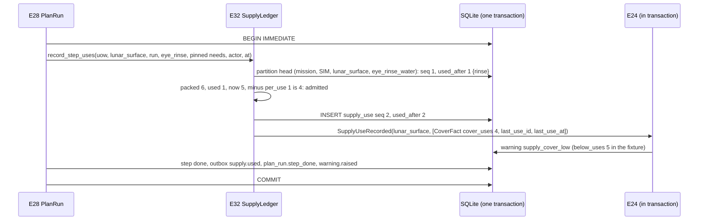

# E32: Treat here: supplies, medicines and planning

Technical design for epic E32. Inputs: the brief (`tdd/E32.md` in the planning package), PRD.md (R57 to R59, sections
4.13, 9 to 11), USE-CASES.md (rules 1 to 7, UC25), CONTRACTS.md (sections 1 to 5, 9, 11, 14, 18 to 22, 24 to 26, 28,
29), `api/openapi.yaml` (tags Supplies and Kit map), `api/schemas`, `api/examples`, `backlog.json` (E32-01 to E32-05),
`docs/BUILD-CHARTER.md`, the E24, E27, E28 and E31 designs at their seams, and for the medicines layer
`docs/ENGINE-SPEC.md` (sections 3.6, 3.9, 11, 12), the public functions of `pharmacy/pipeline.py` and
`pharmacy/types.py`, and `reports/crew-health-medications-2026-11-14/` (DESIGN-BRIEF.md, `research/dosing-safety.md`).
`docs/SYSTEM.md` and `docs/DEPLOYMENT.md` do not exist yet; points that depend on them say so and are in section 14.

Product owner decisions this design implements (coordinator, 2026-11-14): dosing is in E32's scope as real decision
support, not a SIM feature: the engine proposes, the crew medical officer or the designated responder confirms, and
every safety limit is enforced in the domain layer; the package is amended for it (R-E32-10). Potency compensation is on
by default and bounded: it never takes an amount past any per administration, period, cumulative or catastrophic
limit; when it would need to, the proposal caps at the limit and states the shortfall; a `do_not_use` lot is never
compensated for. SIM and REPLAY always compensate; LIVE compensates only for products with a clinical authorization
entry in `medicines.json` (LIVE use is pending an owner decision, Q2), and an unauthorized LIVE proposal gives the label
dose with the estimate and the shortfall shown. The acting medical officer may disposition urgent cases (record the
working diagnosis and request proposals); whether the acting officer may confirm doses is pending (Q3), so until then a
dose is confirmed by the crew medical officer, or by the acting officer only for a product configuration marks
`any_trained_crew` and only at the label dose (section 3.7).

Clinical status of every quantity, per-use amount, threshold, dose rule and potency policy value: unreviewed draft, a
team default with `to_be_set_by` until a named role replaces it.

## 1. Scope

### 1.1 Delivered by this epic

| Story | What E32 delivers | Traces |
|---|---|---|
| E32-01 | The content of `kit-map.json` keys `supplies`, `stock`, `candidate_supplies`, `candidate_skills` (section 8.2) and the supplies release checks and activation guard (section 8.3) | R57, R58 |
| E32-02 | The supplies ledger: SupplyUse (append-only, partitioned by mission and origin mode), SupplyStock, SupplyCoverView, the below-zero refusal, the in-transaction port E28 calls on `step_done`, `getSupplyCover`, `recordSupplyUse` | R57, R58, EI12, V91 |
| E32-03 | The `supply_cover_low` facts: the in-transaction `SupplyUseRecorded` event and the `SupplyCoverFacts` query that E24's rule engine consumes (E24's R-E24-14 shapes); the `low` flag | R58, V91, UC25 |
| E32-04 | The supply half of the planning what-if: E27's `CoverPlanningPort` (`cover_changed`), E28's `StockReader` and the pure stock overlay E28 uses for `plans_changed` | R59, V92 |
| E32-05 | `KitAboardSupplies.vue` (the `supplies` slot of E27's The kit aboard card) and `SupplyUseButton.vue`; the E32-05 acceptance test over the assembled card and Plan here column (E32-T-48) | R57, R59, D32 |
| E32-06 | Medicines: the potency engine run as a background job, the lot ledger, inspections and assays, the structured medication context, working diagnosis, treatment options, dose proposals with bounded potency compensation, confirmation with overrides, administrations, corrections and the FHIR export | R63 (requested in R-E32-10) |

E32-06 is in scope by owner decision and is not yet in the package. Its domain and application layers are built and
tested in full now; its routes, documents and UI mount only when the package amendment and contract changes of
R-E32-10 to R-E32-14 are approved and copied into `contracts/` (build gate, section 15). Nothing in E32-01 to E32-05
depends on E32-06.

Use cases: UC25 in full; the supply parts of UC19 to UC22. Validation and demo: V91, V92 (owned); the supply half of V83
(computed by E28 from E32's stock); V81 and D34 (supplies identical with the link up and down); V98 (no supply text in
client code); D32 for the Plan here list (the result panel portion of D32 is E27's T27-21 over E21's result panel
artifact); CONTRACTS section 20 vector "Supplies, Moon base at 12:10".

### 1.2 Not delivered here

| Not here | Owner |
|---|---|
| `kitMapWhatIf` router, rings, counts, `changed`, The kit aboard card shell, the Plan here column (`ConditionRow.vue`, `plan_summary` via R27-3), the planning toggles (`PlanningCard.vue`) | E27 (consumes `CoverPlanningPort`) |
| The trained hands slot of The kit aboard card | E31 |
| PlanView, availability, `plan_aboard`, `plans_changed`, PlanRun, `step_done` | E28 (reads `StockReader`, calls `SupplyLedgerPort`) |
| Raising, clearing and rendering `supply_cover_low`; `warning-rules.json` | E24 |
| Someone needs help and its offline queue | E11 |
| The log for the ground | E29 (lines requested in R-E32-17) |
| The potency engine (`pharmacy/`, `config/pharmacy/`, `contracts/pharmacy/`, `docs/ENGINE-SPEC.md`) | Potency engine team; read only for E32 |
| Routine items for the next dose and the course end | E25 (R-E32-18) |
| Any assistant tool over supplies or medicines | None (section 10.4) |

## 2. Dependencies and seams

E32 depends on E01, E02, E15, E23, E24, E27, E28, E31 at their ports and is consumed by E11, E24, E27, E28, E29. E32
never imports E27 or E28: it declares the protocols it needs in its own `application/ports.py` and E01 wires them, so
the import graph stays acyclic (import-linter).

| Seam | Direction | Exact form | Owner |
|---|---|---|---|
| Active release | E01 to E32 | `ConfigReleaseReader.active() -> ReleaseHandle` (`release_id`, `document(name)`, `version_of(name)`); inside a `ReadSnapshot` or unit of work it returns the release committed at the snapshot start (R-E32-02) | E01 |
| Release checks | E32 to E01 | `ReleaseCheck` `SuppliesReleaseCheck` (pure, S-L1 to S-L6) and `ActivationGuard.check(uow, candidate) -> list[Finding]` run inside the activation's `BEGIN IMMEDIATE` (R-E32-25) | E01 defines |
| Unit of work, audit, outbox, domain events | E01 to E32 | `UnitOfWorkFactory.begin(immediate=True)`; `uow.emit`, `uow.audit`; `DomainEventBus.publish(uow, event)` runs subscribers inside the publisher's transaction (E24 section 2) | E01 |
| Read snapshot | E01 to E32 | `ReadSnapshot` (one SQLite read transaction) | E01 |
| Clock | E01 to E32 | `Clock.now() -> datetime` (UTC), `Clock.monotonic_ns() -> int`, `Clock.process_epoch() -> str` (R-E32-25, same as E30 X9) | E01 |
| Hub settings | E01 to E32 | `HubSettings.get(key) -> Quantity \| int` for the operational bounds of section 11 | E01 |
| Session | E02 to E32 | `SessionContext(actor, person_id, roles, kind)` | E02 |
| Mission | E23 to E32 | `MissionReader.current() -> MissionRef(mission_id, mission_mode, active_environment_id)` | E23 |
| Sensor series (medicines) | E23 to E32 | `SensorSeriesReader.accepted(channel_id, *, until, limit) -> SeriesSlice(points, truncated)`; points carry `observed_at`, canonical value and unit, `quality_status`, `origin_mode` | E23 |
| Help session context | E11 to E32 | `HelpSessionReader.context(session, help_session_id) -> HelpContext(visible, origin_mode, environment_id \| None)` | E11 |
| Plan run context | E28 to E32 | `PlanRunReader.context(session, plan_run_id) -> RunContext(visible, plan_id, environment_id, origin_mode, pinned_needs(step_id))` | E28 |
| Stock for availability | E32 to E28 | `StockReader.stock(environment_id) -> Mapping[str, StockLevel]` (E28 section 4) | E32 |
| Uses on step done | E28 to E32 | `SupplyLedgerPort.record_step_uses(uow, *, environment_id, plan_run_id, step_id, pinned_release_id, uses: Sequence[SupplyNeed], actor, at) -> Sequence[str]`; `uses` are the needs of the run's pinned `onboard-plans` and `kit-map` (`config_pins`, CONTRACTS 22), `pinned_release_id` is stored on each use | E32 |
| Cover in a what-if | E27 to E32 | `CoverPlanningPort.cover_changed(*, environment_id, add_supplies) -> Sequence[CoverChange]` (E27 section 4.1) | E27 defines, E32 implements |
| Stock overlay for `plans_changed` | E32 to E28 | `supplies.application.ports.with_added(stock, additions) -> Mapping[str, StockLevel]` (pure) | E32 |
| Cover facts | E32 to E24 | Domain event `SupplyUseRecorded` in the use's transaction; query `SupplyCoverFacts.rows(uow, environment_id)` for activation and start-up re-evaluation; both carry E24's `CoverFact` exactly (E24 sections 2 and 4.3, R-E24-14; section 4.5) | E32 |
| Event `supply.used` | E32 to clients | CONTRACTS 18, data SupplyUse, scope `crew` | E32 |
| Pharmacy engine | `pharmacy` to E32 | Called only from `medicines/adapters`: `pharmacy.config.load_bundle`, `pharmacy.pipeline.assess_inventory`, `pharmacy.pipeline.replay`, `pharmacy.types.to_json`, `iso_to_seconds`, `canonical_json_bytes` | Engine team |
| Observations (weight) | E01 to E32 | `ObservationReader.accepted(person_id, code, *, mission_id, origin_mode, limit) -> Sequence[ObservationRef]` (accepted quality only, newest first) | E01 |
| Episode | E15 to E32 | `EpisodeReader.visible(session, episode_id) -> EpisodeRef \| None` | E15 |
| Acting medical officer | E31 to E32 | `MedicalOfficerQuery.acting(subject_person_id, at) -> str \| None` (cascade, subject excluded) | E31 |

## 3. Domain model

Pure code: no I/O, no framework, no wall clock. Every quantity is a `Quantity(value: Decimal, unit: Unit)`; `Unit` is a
parsed UCUM code. Supplies count in UCUM annotation units: a kit-map `unit` word that parses as a UCUM unit is that
unit; any other word `w` (the examples use `rinse`, `dressing`, `towel`, `set`, `shield`, `manikin`) maps to `{w}` at
the boundary (one mechanical rule, no table; two different annotations never compare). Arithmetic or comparison of two different units raises `UnitMismatch`, never
a coercion. JSON numbers parse with `parse_float=Decimal`; the API serializes the same Decimal text. Decimal context:
precision 34, `ROUND_FLOOR` only where a floor is specified.

### 3.1 Design decisions

| # | Decision | Alternatives | Selected and why | Failure mode guarded |
|---|---|---|---|---|
| DD1 | Quantity arithmetic | float; integer micro-units | Decimal from the JSON text, unit in the type | Drift refusing or allowing a last use wrongly; unit mix-ups |
| DD2 | Balance | Mutable balance table; summing every row per request | Each append-only use row stores its partition sequence and the running `used_after`; the balance is the latest row of the partition (one indexed read) | Balance and rows disagreeing after a crash; unbounded summation |
| DD3 | Concurrency | Optimistic retry | `BEGIN IMMEDIATE` around read, check and insert; release activation runs in the same lock | Two uses both passing the check; a use racing an activation |
| DD4 | Ledger partition | One ledger per environment | Partition key `(mission_id, origin_mode, environment_id, supply_id)`: a view in mission M and mode X counts only that partition (CONTRACTS 9 "No simulated patient answer or result enters LIVE mode") | SIM uses lowering a LIVE balance |
| DD5 | `Config-Release` on a use | Ignore it | Enforced (409 `CONFIG_VERSION_MISMATCH`, the `ConfigReleaseIn` rule of openapi) except when `help_session_id` is set: help session actions keep their release (CONTRACTS 5, section 16). A plan run use reads the run's pinned needs | A use admitted against needs the client never saw |
| DD6 | Configuration that contradicts the ledger | Accept and let numbers go negative | Activation guard rejects it; the last good release stays active | Negative or reinterpreted stock |
| DD7 | Step applicability for cover | Ask E28 at read time | Same rule from `onboard-plans.json`, contract test against E28 (E32-T-31) | Import cycle |
| DD8 | What-if consistency | Separate reads per module | Everything inside E27's single `ReadSnapshot`; E28 builds the hypothetical stock only with E32's `with_added` | Mixed releases or ledger states in one answer |
| DD9 | Potency engine placement | In the request path | Background child process, low priority, bounded, coalesced; proposals read the last completed assessment | A long engine run starving Someone needs help |
| DD10 | Potency compensation | Off (research); unbounded on (brief) | On by default (owner decision) and bounded by every remaining limit, capped with the shortfall stated; in LIVE only for products with an authorization entry (section 3.6) | Overdose from compensation; silent underdose |
| DD11 | Lot exclusions | Read only from the latest fresh assessment | Synchronous checks of lot status, adverse inspections, labeled expiry and the latest completed `do_not_use`, independent of assessment age or worker health | A recalled or failed lot reaching the labeled-amount fallback |
| DD12 | Dose rules location | `config/pharmacy/formulary.json` | Hub document `treatments.json` (engine files are never edited by E32) | Editing engine-owned files |
| DD13 | Clock discontinuities | Trust the injected clock | Time floor, monotonic cross-check, restart expiry of open proposals (section 3.8) | A backward jump reviving a proposal; a forward jump satisfying an interval early |
| DD14 | Assistant access | A read tool for proposals | None in this epic | A dose in model context or output |

### 3.2 Supplies: types

```python
# hub/src/crew_health/supplies/domain/model.py
@dataclass(frozen=True, slots=True)
class SupplyDef: supply_id: str; name: str; unit: Unit; consumable: bool
@dataclass(frozen=True, slots=True)
class StockRow: supply_id: str; packed: Quantity | None; basis: Basis; to_be_set_by: str | None; source_ids: tuple[str, ...]
@dataclass(frozen=True, slots=True)
class SupplyNeed: plan_id: str; step_id: str; supply_id: str; per_use: Quantity | None
@dataclass(frozen=True, slots=True)
class PartitionKey: mission_id: str; origin_mode: OriginMode; environment_id: EnvironmentId; supply_id: str
@dataclass(frozen=True, slots=True)
class SupplyUseRecord:
    supply_use_id: str; key: PartitionKey; quantity: Quantity; partition_seq: int; used_after: Quantity
    plan_run_id: str | None; help_session_id: str | None; step_id: str | None; at: datetime; by: Actor
@dataclass(frozen=True, slots=True)
class StockLevel: supply_id: str; aboard: bool; quantity_now: Quantity | None; unit: Unit   # E28's shape
@dataclass(frozen=True, slots=True)
class CoverRow:
    supply: SupplyDef; row: StockRow | None; used: Quantity; quantity_now: Quantity | None
    used_by: tuple[SupplyNeed, ...]; cover_uses: int | None; cover_text_key: CoverTextKey; low: bool
    last_use: tuple[str, datetime] | None                    # supply_use_id, at: evidence for E24
```

### 3.3 Supplies: rules

| Rule | Definition | Invariant |
|---|---|---|
| Applicability | A need applies in E when its plan's `environments` contains E and the step's `environments` is null or contains E; all stages count; rejected plans are left out | INV-S1 |
| used | `used_after` of the latest row of the partition (current mission, mission mode, E, supply); zero with no row | INV-S2 |
| quantity_now | `packed − used` when a row exists and `packed` is not null; null otherwise (CONTRACTS 25) | INV-S3 (never typed, EI12) |
| aboard | A stock row exists and (`quantity_now` null or `> 0`) | INV-S4 |
| Not-aboard row | No stock row: `quantity_packed` null, `quantity_now` null, `basis` "team default", `to_be_set_by` null (as `supplies/cover-lunar.json`) | INV-S5 |
| cover_uses | `floor(quantity_now / max(P))` with P the non-null `per_use` of applicable needs, when consumable, aboard and `quantity_now` and P are set; null otherwise | INV-S6 |
| cover_text_key | First match: not aboard `not_aboard`; not consumable `not_consumable`; no applicable need `not_used`; `cover_uses` null `cover_unknown`; else `cover` | INV-S7 |
| low | `below_uses` of the `supply_cover_low` definition is not null, its `environments` contains E, `cover_uses` not null and `cover_uses < below_uses` | INV-S8 |
| Use admission | Refuse: unknown supply (`NOT_FOUND`); not consumable, both references set, step not in the run's pinned plan, or a step whose pinned need has non-null `per_use` (`INVALID_VALUE`); a referenced run or session whose origin mode differs from the mission mode, or whose environment differs from the active one (`INVALID_VALUE` until R-E32-23 and R-E32-26); no stock row, or `quantity_now − quantity < 0` (`SUPPLY_BELOW_ZERO`). With `quantity_now` null the use is admitted and only `used` grows | INV-S9 (no stored use makes a non-null `quantity_now` negative) |
| Step uses | One use per consumable pinned need with non-null `per_use`, in `supply_id` order; any one below zero writes none and raises `SupplyBelowZero` | INV-S10 (all or nothing) |
| Overlay | `with_added`: a row with packed q becomes `q + a`; a null packed stays null; no row becomes a row with packed `a`, basis "team default"; `used` unchanged | INV-S11 |
| Ledger shape | Append-only, partition sequence contiguous from 1, `used_after = previous used_after + quantity`; triggers abort update and delete | INV-S12 |
| Units | A supply keeps its unit for the life of the mission database (activation guard S-A1) | INV-S13 |
| Pins and physical stock | A step use takes `per_use`, `consumable` and unit from the run's pins; `packed` and `used` always come from the active release and the shared partition, because a run pins what it plans, not what is physically aboard. A pinned need whose supply has no stock row in the active release refuses with `SUPPLY_BELOW_ZERO`; a pinned unit always equals the registered unit (S-A1), so a pin can never reinterpret the ledger | INV-S14 |

`stock[env][].quantity` is the cumulative quantity packed into that environment during the mission: the initial load
plus every resupply. A resupply is a release that raises it. Activation guard, run on every candidate release against
every partition of the current mission (all origin modes):

| ID | Rejects the candidate when |
|---|---|
| S-A1 | A supply that has a registered unit (table `supply_unit`, written at first activation) appears with a different unit, or a supply with uses turns non-consumable |
| S-A2 | A supply with `used > 0` in a partition loses its `supplies` entry or its stock row in that environment (to show none left, set `quantity` to `used`) |
| S-A3 | A stock row's non-null `quantity` is below `used` of any partition for that environment and supply |

A rejected candidate leaves the last good release active and returns `CONFIG_INVALID` with the findings (E01). A
supply without uses may be removed and later reintroduced with its registered unit.

### 3.4 Medicines: entities and state machines (E32-06)

Entities mirror FHIR R5 names and UCUM units on the hub's own schemas (shapes in R-E32-10). Every medicines record
carries `mission_id` and `origin_mode`; every dosing read filters to the current mission and the mission mode, so a
record of another mission or mode is invisible and therefore missing (never substituted).

| Entity | Meaning |
|---|---|
| `LotView` | A lot of the active pharmacy bundle in a zone mapped to the active environment: `lot_status` (lots.json), labeled expiry, `quantity_now` (lots.json quantity minus net movements of the partition), `holds` (adverse inspections), `exclusion` (section 3.5), the latest completed `LotDecisionSummary` and its age |
| `LotDecisionSummary` | The adapter's mapping of one `LotAssessment` (section 5.3) |
| `AssessmentRun` | `queued → running → completed \| failed \| timed_out \| interrupted`, as append-only events |
| `PatientMedicationContext` | Per subject, append-only statements, the latest per part effective: `allergies` (`documented \| none_known \| unknown`, items `{substance_kind: ingredient \| allergy_class, substance_id, reaction_words, certainty: confirmed \| suspected}`), `other_medicines` (`documented \| none`, items `{ingredient_id, since, until \| null}` for medicines not given through the hub), `renal` and `hepatic` (`normal \| impaired \| unknown`), `conditions` (`documented \| none_known \| unknown`, condition IDs) |
| `WorkingDiagnosis` | A person's act: `condition_id`, basis words, certainty words, episode, `supersedes` |
| `TreatmentOption` | An indication line of `treatments.json` with the product's usable lots |
| `DoseProposal` | Immutable engine output, `outcome` `proposal` or `refusal`, with lot, amounts, accounting amounts, alerts, `context_fingerprint`, trace |
| `MedicationAdministration` | A person's confirmed or manual dose, one lot movement |
| `AdministrationCorrection` | `entered_in_error` of one administration, with reason |
| `LotMovement` | `administration`, `return`, `waste` or `count_correction`, each a physical fact recorded by its own command |

DoseProposal: created `proposed` (or terminal `refusal`); then exactly one terminal event: `confirmed` (an
administration exists), `expired` (hub clock reaches `expires_at`, or the process restarted after creation), or
`superseded` (the confirmation recheck failed, or a newer proposal was created for the same subject and ingredients).
A terminal event is never removed, so a clock jump cannot revive a proposal. A refusal is never mutated: when its cause
is fixed (a weight recorded, an allergy list documented) a new proposal is requested.

MedicationAdministration: `completed`; `entered_in_error` only through one correction by the crew medical officer or
the acting medical officer. A corrected administration stops counting toward limits. A correction never moves stock:
whether the medicine physically went back (`return`) or was lost (`waste`) is a separate movement a person records.

### 3.5 Dose computation (deterministic; each step appends `TraceEntry(step, inputs, output, source)`)

1. **Preconditions** (refusal codes, non-overridable): `no_working_diagnosis`; `rule_not_found`;
   `rule_not_reviewed_live` (mission mode LIVE and the rule's `review_state` not `reviewed` or `approved`);
   `formulary_mismatch`; `allergy_list_unknown`; `patient_context_missing` (with the part: `other_medicines` always,
   `renal` or `hepatic` when the rule has organ cautions, `conditions` when it has condition cautions; a part older
   than `context_max_age_seconds` counts as missing); `weight_missing`, `weight_stale`, `weight_implausible`,
   `weight_change_unconfirmed` (weight rules: the latest two accepted `mass` observations of the partition in UCUM
   `kg` differ by more than `max_change_fraction` within `change_window_seconds`; a second measurement that agrees
   resolves it); `unit_incompatible`; `clock_discontinuity` (section 3.8).
2. **Target** D_i per ingredient: fixed `dose`, or `dose_per_kg × weight` capped at `max_per_administration`,
   converted to the strength unit (mass and volume only; arbitrary units never convert).
3. **Interval and course**: `min_interval_not_passed` (last administration of any product containing ingredient i,
   with `next_dose_earliest_at`); `course_ended` (course = subject, rule and working diagnosis lineage; started by its
   first administration; `course_seconds` passed).
4. **Lot**: the person's chosen lot, or the first usable lot in the engine's ordering. A lot is excluded, synchronously
   at proposal and again at confirmation, when: `lot_status` is not `active`; any inspection with a finding other than
   `no_change` exists for it; the hub clock is at or past its labeled expiry; the latest completed assessment of the
   partition that contains it says `do_not_use`, whatever its age; `quantity_now ≤ 0`. A stale or missing assessment
   never lifts an exclusion. No usable lot: `no_usable_lot` with alternative lots and products (from the latest
   decision when present, and the indication's other lines). The manual path (section 4.4) stays available.
5. **Amount** (section 3.6): labeled or compensated, then capped by the remaining allowance of every limit.
6. **Stock**: amount above the lot's `quantity_now`: `insufficient_stock` with the shortfall and alternatives.
7. **Alerts** (section 3.7).
8. **Display** by ISMP rules (no trailing zero, leading zero, space before unit, "mcg", "units", thousands
   separators, drug name then dose), unit words from `treatments.json` `unit_display`.

### 3.6 Amount, potency gate and the compensation bound

Notation per ingredient i: strength S_i; candidate amounts a in A = {k × `deliverable_increment`, k = 1..k_max} where
k_max is the largest k with `a·S_i ≤ max_per_administration_i` for every i (finite); potency fractions from the lot's
fresh assessment: l_i (lower quantile), m_i (median), u_i (upper quantile).

**Accounting amount** (what every limit counts, for proposals and for recorded administrations):
`Acc_i(a) = a·S_i·max(1, u_i)` when a fresh estimate exists for the lot, else `a·S_i`. It is never less than the
labeled amount and never less than the most the estimate says was delivered. Stored per ingredient with each
administration (running cumulative per subject and ingredient, as in DD2).

**Remaining allowance** `R_i = min(max_per_administration_i, catastrophic_i, min over each max_per_period window W of
(limit_W − Σ Acc_i over effective administrations in (now − W, now]), max_cumulative_i − Σ Acc_i over the cumulative
scope)`, with the cumulative scope `course` or `mission` per rule. Other medicines of the context whose ingredient is i
and whose period overlaps a window raise `outside_medicine_overlap` (section 3.7), since their amounts are unknown.

**Gate**, using the lot's latest completed assessment of the partition and `medicines.json` `potency_policy`:

| Lot | Condition | Path |
|---|---|---|
| `in_specification`, or no fresh estimate (none, stale, failed) | lot not excluded | Labeled |
| `adjust` | `potency_policy.mode` `information_only` | The lot is skipped for an in-specification lot; if none, `potency_adjustment_disabled` refusal with alternatives |
| `adjust` | any failed: `adjustment.eligible`; product `potency_adjustment.allowed`; `require_measured_assay` and no assay used; `exclude_narrow_therapeutic_index` and NTI; `exclude_high_alert` and high alert; `require_degradant_profile_reviewed` and not reviewed; `require_measured_storage_history` and any custody zone declared or gapped; `require_validated_engine` and the engine version not listed | `adjustment_not_permitted` refusal listing each failed check, alternatives named |
| `adjust` | all pass, and either the request asks `path: labeled` or the mission mode is LIVE with no `live_compensation_authorizations` entry for the product | Labeled with estimate (`labeled_with_estimate`): the labeled amount, plus the `potency_shortfall` alert computed as below at that amount |
| `adjust` | all pass, no `path: labeled`, and the mission mode is SIM or REPLAY, or LIVE with an authorization entry for the product | Compensated |
| `do_not_use` | none | Excluded at step 4; never reaches this table |

**Labeled path**: `a_x` minimizes `max_i |a·S_i − D_i| / D_i` over A, ties to the smaller a; it must be within
`rounding_tolerance_fraction` for every i, else `no_deliverable_amount`.

**Compensated path**: `a_x` minimizes `max_i |a·S_i·m_i − D_i| / D_i` over A (for a combination product this
minimizes the worst ingredient's relative deviation), ties to the smaller a; outside tolerance: `no_deliverable_amount`.

**Bound, both paths**: if any `D_i > R_i` the target itself is over a limit: refusal with the binding code
(`per_administration_max_exceeded`, `period_max_exceeded`, `cumulative_max_exceeded`, `catastrophic_limit`). Otherwise
F = {a in A : `Acc_i(a) ≤ R_i` for every i}. Labeled path: `a_x` must be in F, else the binding refusal. Compensated
path: the final amount is `min(a_x, max F)`; when it is below `a_x` the proposal carries the `potency_shortfall` alert
naming, per ingredient, the target, the expected delivered amount at the median and at the lower quantile, the
shortfall at the median, whether the lower end is under `min_effective`, the binding limit, and the alternatives.
F can be empty even when every `D_i ≤ R_i` (rounding up, or `u_i > 1` raising the accounting amount): the proposal is
then the binding refusal, never an amount outside F.

Invariants: INV-M1 for every proposal and every ingredient, `Acc_i(final) ≤ R_i` at proposal time and again at
confirmation (property test with rounding and compensation at window edges); INV-M2 no compensation without a fresh
completed assessment whose decision is `adjust` with every gate check passing and, in LIVE, an authorization entry
for the product; INV-M3 an excluded lot (status, inspection, expiry, `do_not_use`) is never in a proposal, whatever the assessment age or worker state; INV-M4 a lot's
`quantity_now` never goes below zero; INV-M5 one administration, one movement; INV-M6 no dose value outside
`treatments.json`, DoseProposal, MedicationAdministration and their views (EI6 as restated in R-E32-10); INV-M7 no
input of another mission or origin mode reaches a proposal; INV-M8 every number in a proposal has a trace entry naming
its document version and JSON pointer, record ID or assessment ID.

### 3.7 Alerts and overrides

Refusal codes (sections 3.5 and 3.6) are a closed vocabulary and are never overridable inside the engine; the person's
route past one is the manual administration, flagged for the ground log. Alerts come from `treatments.json`
`alert_policies[]` (`kind`, `level` `override_required \| acknowledge \| info`, `override_roles`, `reason_codes`):
`allergy_same_ingredient`, `allergy_class`, `cross_sensitivity`, `interaction` (by pair severity), `duplicate_ingredient`,
`duplicate_class`, `organ_caution`, `condition_caution`, `outside_medicine_overlap`, `potency_shortfall`,
`clock_unverified_after_restart`, `spaceflight_caution`, `consult_ground_first` (info, never blocking, rule 7),
`potency_information`. The default policy (team default, `to_be_set_by` clinical review) makes every allergy,
contraindicated interaction, organ caution, condition caution, outside overlap and clock alert `override_required` with
`override_roles` `[crew_medical_officer]` (DESIGN-BRIEF decision 4: "An allergy or interaction hard stop needs the
medical officer's override with a reason, recorded").

Confirmation eligibility and override eligibility are separate checks, both in the domain layer, and configuration can
only narrow them (M-L8 rejects any other role until Q3 is answered):

| Actor (evaluated in the confirming transaction) | May confirm | May override an `override_required` alert |
|---|---|---|
| `crew_medical_officer` session, not the subject | Any proposal | When the alert's `override_roles` lists it, with a `reason_code` from its `reason_codes` |
| The acting medical officer for this subject now (E31 cascade, subject excluded) | Only a product whose `confirm_by` is `any_trained_crew`, and only a `labeled` or `labeled_with_estimate` proposal (never `compensated`) | Never, until Q3 |
| Anyone else, including the subject | Never | Never |

A refused confirmation or override is `ROLE_NOT_ELIGIBLE` and writes nothing. The acting officer facing a compensated
proposal requests a new one with `path: labeled` (section 3.6), which shows the estimate and the shortfall.

### 3.8 Clock rules

| ID | Rule |
|---|---|
| C1 | Every medicines record stores `at` (hub clock), `process_epoch` and the monotonic reading |
| C2 | Backward: the time floor is the latest `at` of any medicines record. `now < floor − clock_backward_tolerance` marks a discontinuity |
| C3 | Forward: inside one process, `(Δ wall − Δ monotonic) > clock_forward_tolerance` between two medicines operations, or at the periodic check, marks a discontinuity |
| C4 | While a discontinuity is marked: proposals are refusals `clock_discontinuity`, confirmations supersede; manual administrations, inspections and assays are accepted and flagged. It clears when a person records a clock correction (E01, CONTRACTS 1) or C2 no longer holds |
| C5 | At process start every open proposal gets `expired`. A proposal whose interval, period or course check depends on time that passed while the hub was down (the last relevant administration has an older `process_epoch` and the window edge falls in the restart gap) carries `clock_unverified_after_restart` |
| C6 | An input timestamp later than `now + future_tolerance` is refused at write (`INVALID_VALUE`); a stored one found later than now marks C2 |
| C7 | Worker timeouts and proposal age use the monotonic clock; mission clock versions do not enter any medicines computation |

## 4. Application layer

### 4.1 Supplies use cases

| Use case | Input | Output | Errors | Idempotency |
|---|---|---|---|---|
| `GetSupplyCover` | session, `environment_id?` | SupplyCoverView (partition of the current mission and mode) | `UNAUTHORIZED_SCOPE` | read |
| `RecordSupplyUse` | session, `supply_id`, body, `Idempotency-Key`, `Config-Release?` | SupplyUse 201 | `NOT_FOUND`, `INVALID_VALUE`, `SUPPLY_BELOW_ZERO`, `CONFIG_VERSION_MISMATCH`, `DUPLICATE_COMMAND`, `UNAUTHORIZED_SCOPE` | `command_key = api:{mission_id}:{key}` plus `request_sha256`, permanent |
| `RecordStepUses` (E28's unit of work) | pinned needs, pinned release, run, step, environment, actor, at | supply_use_ids | `SupplyBelowZero`, `UnitMismatch` | `step:{plan_run_id}:{step_id}:{supply_id}` |
| `CoverChanged` (what-if) | environment, additions | `CoverChange` per addition, request order, listed even when equal | `WhatIfInvalid` (quantity over bounds, cover over 2^53) | none |
| `SupplyCoverFacts.rows` | uow, environment | `CoverFact` per supply of the current mission and mode partition | none | read |

`RecordSupplyUse`, one `BEGIN IMMEDIATE` unit of work: resolve mission, release and environment; if `Config-Release` is
present, differs from the active release and `help_session_id` is absent, 409 `CONFIG_VERSION_MISMATCH`; validate the
body; resolve the supply and the referenced run or session through its port (visibility, origin, environment, pinned
needs); look up `command_key` (same `request_sha256`: return the stored use as 201; different: 409
`DUPLICATE_COMMAND`); read the partition head; admit; insert with `partition_seq` and `used_after`; publish
`SupplyUseRecorded`; emit `supply.used`; audit; commit. On a refusal of a use that names a help session, a second unit
of work writes the audit entry `supply_use_refused` (`help_session_id`, `supply_id`, quantity, code, `command_key`;
unique by `command_key`) so the evidence that a supply was used offline survives for the ground log (HZ14), then the
422 is returned. `at` is the hub clock; `client_time` is stored only.

### 4.2 Sequences



Failure path: the head says used 6 of 6; `SupplyBelowZero(eye_rinse_water, now 0, requested 1)`; E28 rolls back
everything (no use, no step change, no warning, no event) and returns 422 `SUPPLY_BELOW_ZERO`; the PlanView then shows
the step Not aboard with its substitute.

### 4.3 Ports provided

```python
# supplies/application/ports.py
class StockReader(Protocol):
    def stock(self, environment_id: EnvironmentId) -> Mapping[str, StockLevel]: ...
class SupplyLedgerPort(Protocol):
    def record_step_uses(self, uow: UnitOfWork, *, environment_id: EnvironmentId, plan_run_id: str, step_id: str,
                         pinned_release_id: str, uses: Sequence[SupplyNeed], actor: Actor,
                         at: datetime) -> Sequence[str]: ...
class SupplyCoverFacts(Protocol):          # E24 section 4.2 signature (R-E24-14)
    def rows(self, uow: UnitOfWork, environment_id: str) -> tuple[CoverFact, ...]: ...
@dataclass(frozen=True, slots=True)
class CoverFact:                           # E24 section 4.3, field for field
    supply_id: str; supply_name: str; cover_uses: int | None; quantity_text: str; per_use_text: str | None
    last_use_id: str | None; last_use_at: datetime | None
@dataclass(frozen=True, slots=True)
class SupplyUseRecorded:                   # domain event, published in the writer's transaction
    environment_id: str; rows: tuple[CoverFact, ...]   # one row per supply the transaction's uses changed
def with_added(stock: Mapping[str, StockLevel], additions: Sequence[tuple[str, Quantity]]) -> Mapping[str, StockLevel]: ...
# CoverPlanningPort.cover_changed is implemented by supplies.application.whatif.CoverPlanning (E27's protocol)
```

```python
# medicines/application/ports.py (E32-06)
class PotencyEngine(Protocol):
    def assess(self, run: AssessmentRunRef, *, deadline_ns: int) -> AssessmentOutcome: ...
class DoseEngine(Protocol):
    def propose(self, request: DoseRequest, context: DoseContext) -> DoseProposal: ...   # pure
class MedicationRecordReader(Protocol):     # for E11 SubjectSummary: names only, scope checked
    def active_medicine_names(self, session: SessionContext, person_id: str) -> tuple[str, ...]: ...
```

`DoseContext` is assembled in one read transaction: release and treatments version, pharmacy bundle SHA-256, the lot
views and latest summaries of the partition, the subject's effective administrations in the longest window and the
cumulative running totals, the medication context statements, the latest two weight observations, the acting medical
officer, `now`, the clock state. Its canonical hash is the `context_fingerprint`.

### 4.4 Medicines use cases (E32-06)

| Use case | Errors | Idempotency |
|---|---|---|
| `ImportPharmacyBundle` (operator or start-up): read `pharmacy_config_dir`, store every file as an artifact, validate with `load_bundle`, run guard M-A1 (every lot with movements still exists with the same product and unit, and its quantity is at least the net movements), then activate | `CONFIG_INVALID` (last good bundle stays) | bundle SHA-256 |
| `ScheduleAssessment` (interval, inspection, assay, bundle or release activation, operator) | none, coalesced | coalesce key per mission and mode |
| `RunAssessment` (job): build and store the inputs artifact, run the worker, store the result | `failed` (engine code, `input_limit_exceeded`, `artifact_corrupt`, `memory_limit`), `timed_out`, `interrupted` | run ID |
| `RecordInspection`, `RecordAssay` | `NOT_FOUND`, `INVALID_VALUE`, `UNAUTHORIZED_SCOPE` | Idempotency-Key; an adverse inspection excludes the lot at once (step 4) and schedules a run |
| `RecordMedicationContext` | `UNAUTHORIZED_SCOPE`, `INVALID_VALUE` | Idempotency-Key |
| `RecordWorkingDiagnosis`, `ListTreatmentOptions` | `UNAUTHORIZED_SCOPE`, `NOT_FOUND`, `CONFIG_VERSION_MISMATCH` | Idempotency-Key; read |
| `ProposeDose` (working diagnosis, product, optional `lot_id`, optional `path: labeled`): stores the proposal or refusal; supersedes earlier open proposals for the same subject and ingredients | `NOT_FOUND`, `UNAUTHORIZED_SCOPE` | Idempotency-Key |
| `ConfirmDose` | `INVALID_TRANSITION`, `STALE_VERSION`, `ROLE_NOT_ELIGIBLE`, `INVALID_VALUE`, `UNAUTHORIZED_SCOPE` | Idempotency-Key; one terminal event per proposal |
| `RecordManualAdministration` (outside the engine; MO or acting MO; flagged) | `ROLE_NOT_ELIGIBLE`, `SUPPLY_BELOW_ZERO`, `INVALID_VALUE` | Idempotency-Key |
| `CorrectAdministration`, `RecordLotMovement` (`return`, `waste`, `count_correction`) | `ROLE_NOT_ELIGIBLE`, `INVALID_TRANSITION`, `SUPPLY_BELOW_ZERO` | Idempotency-Key |

`ConfirmDose`, one `BEGIN IMMEDIATE` unit of work: (1) the proposal has no terminal event (else 409
`INVALID_TRANSITION` with the proposal); If-Match equals its revision; (2) clock: same `process_epoch`, `now <
expires_at` by both the hub clock and the monotonic age, no discontinuity (else append `expired` or `superseded`, 409);
(3) body `lot_id` equals the proposal's lot (else 422 `INVALID_VALUE` at `/lot_id`: another lot needs a new
proposal); (4) recompute the `context_fingerprint` in this transaction, which re-runs step 4 exclusions, stock, the
latest assessment for the lot, the subject's administration head, context statements, weight, the mission mode and the
active `treatments.json` and `medicines.json` versions (so an authorization entry removed meanwhile counts); any difference
appends `superseded` and returns 409 with the proposal; (5) confirm and override eligibility (section 3.7) and every
`override_required` alert overridden with an allowed reason, every `acknowledge` alert acknowledged; (6) insert the
administration with per-ingredient accounting amounts and running totals, the lot movement, the `confirmed` event,
audit and outbox; commit. Two different proposals for the same subject and ingredient confirmed together serialize on
the lock; the second fails step 4 because the administration head moved.

### 4.5 Events

Published: `supply.used` (CONTRACTS 18); `SupplyUseRecorded` (in-transaction domain event, E24 consumes);
`job.progress` for assessment runs. Requested (R-E32-11): `medicine.assessment_changed` (scope crew, no person data) and
`medication.administered` (scope person, and crew for `crew_medical_officer` sessions only, as `skill.practiced`).
Consumed: `config.release_activated` (rebuild the release index, schedule an assessment), `environment.activated`
(nothing cached). E24 agreement (E24's R-E24-14, adopted as written; R-E32-24): E24 maps `SupplyUseRecorded` to its
`SupplyCoverInput(environment_id, cause="use", rows)` and raises or clears in the use's transaction (producer owns the
transaction, synchronous dispatch), so a rollback removes both and nothing is pending after a crash; on release
activation, environment activation and hub start E24 re-evaluates from `SupplyCoverFacts.rows(uow, ...)`, whose
`last_use_id` and `last_use_at` are the evidence. Rows are always the partition of the current mission mode; E24 takes
`origin_mode` from `MissionStatePort.mission_mode(uow)` in the same transaction, so no mode field is added. Duplicate
delivery cannot occur inside one transaction; E24's one active warning per `(definition, supply_id)` makes a
re-evaluation idempotent. `quantity_text` and `per_use_text` are the Decimal text and the kit-map unit word, for
rendering only; E24 compares only `cover_uses`.

## 5. Adapters

### 5.1 Supplies storage (SQLite STRICT, WAL, foreign keys on; migrations through E01)

```sql
-- supplies/adapters/migrations/0001_supply_use.sql
CREATE TABLE supply_use (
  supply_use_id TEXT PRIMARY KEY, mission_id TEXT NOT NULL,
  origin_mode TEXT NOT NULL CHECK (origin_mode IN ('LIVE','REPLAY','SIM')),
  environment_id TEXT NOT NULL CHECK (environment_id IN ('station_leo','transit','lunar_surface','mars_surface')),
  supply_id TEXT NOT NULL, unit_ucum TEXT NOT NULL,
  quantity_decimal TEXT NOT NULL, partition_seq INTEGER NOT NULL CHECK (partition_seq >= 1),
  used_after_decimal TEXT NOT NULL,
  plan_run_id TEXT, help_session_id TEXT, step_id TEXT,
  at_utc TEXT NOT NULL, client_time_utc TEXT, by_kind TEXT NOT NULL, by_id TEXT NOT NULL, by_display_name TEXT,
  config_release_id TEXT NOT NULL, command_key TEXT NOT NULL UNIQUE, request_sha256 TEXT NOT NULL,
  CHECK (NOT (plan_run_id IS NOT NULL AND help_session_id IS NOT NULL)),
  UNIQUE (mission_id, origin_mode, environment_id, supply_id, partition_seq)
) STRICT;
CREATE TABLE supply_unit (supply_id TEXT PRIMARY KEY, unit_ucum TEXT NOT NULL, first_release_id TEXT NOT NULL) STRICT;
CREATE TRIGGER supply_use_no_update BEFORE UPDATE ON supply_use BEGIN SELECT RAISE(ABORT, 'append-only'); END;
CREATE TRIGGER supply_use_no_delete BEFORE DELETE ON supply_use BEGIN SELECT RAISE(ABORT, 'append-only'); END;
CREATE TRIGGER supply_unit_no_change BEFORE UPDATE ON supply_unit BEGIN SELECT RAISE(ABORT, 'append-only'); END;
```

Decimals are canonical text written and read by the domain codec (SQLite never does arithmetic on them). The partition
head is one read on the unique index. A low-priority start-up verifier walks each partition in batches of
`supplies.verify_batch_rows`, checking contiguity and running totals; a mismatch marks that partition's cover
`cover_unknown` and records a finding; it never edits rows. Migration is forward only; E20's backup runs before it.

### 5.2 Medicines storage (`medicines/adapters/migrations/0001_medicines.sql`)

All tables STRICT and append-only (update and delete triggers abort); every row has `mission_id`, `origin_mode`, `at_utc`,
`process_epoch` and, where a command creates it, `command_key UNIQUE` and `request_sha256`.

| Table | Key columns |
|---|---|
| `med_artifact` | `sha256 PK`, `kind` (`bundle_file`, `bundle_manifest`, `inputs`, `result`), `bytes BLOB`, `size_bytes` |
| `med_bundle` | `bundle_sha256 PK` (hash of the canonical manifest of file SHA-256s), `imported_at_utc`; `med_bundle_activation(seq PK, bundle_sha256)` |
| `med_assessment_run` | `run_id PK`, trigger, `as_of_utc`, `bundle_sha256`, `inputs_sha256`, `engine_version` |
| `med_assessment_event` | `(run_id, seq) PK`, `status`, `error_code`; partial unique index: one terminal status per run |
| `med_assessment_result` | `run_id PK`, `result_sha256` (artifact), `findings_json` |
| `med_inspection`, `med_assay` | as pharmacy `InspectionRecord` and `AssayRecord`, plus `by_id`, origin, mission |
| `med_context_statement` | `statement_id PK`, `subject_person_id`, `part`, `body_json`, `recorded_by` |
| `med_working_diagnosis` | `working_diagnosis_id PK`, episode, subject, `condition_id`, words, `supersedes`, `config_release_id` |
| `med_dose_proposal` | `proposal_id PK`, subject, working diagnosis, product, lot, outcome, `canonical_json`, `sha256`, `assessment_run_id`, `bundle_sha256`, `treatments_version`, `config_release_id`, `context_fingerprint`, `created_at_utc`, `expires_at_utc`, `created_mono_ns`, `revision` |
| `med_proposal_event` | `proposal_id PK` (one terminal event), `kind`, `cause` |
| `med_administration` | `administration_id PK`, `proposal_id UNIQUE NULL`, subject, product, lot, amount decimal and UCUM, `outside_engine`, `override_json`, `confirmed_by`, `subject_seq`, `UNIQUE(mission_id, origin_mode, subject_person_id, subject_seq)` |
| `med_ingredient_dose` | `(administration_id, ingredient_id) PK`, `accounting_decimal`, `unit_ucum`, `cumulative_after_decimal`, index `(subject, ingredient, at_utc)` |
| `med_administration_correction` | `correction_id PK`, `administration_id UNIQUE`, `reason_code`, `by_id` |
| `med_lot_movement` | `movement_id PK`, `lot_id`, `kind`, signed `quantity_decimal`, `lot_seq`, `net_after_decimal`, `administration_id NULL`, `UNIQUE(mission_id, origin_mode, lot_id, lot_seq)`, `UNIQUE(administration_id, kind)` |

Effective state is a projection: an assessment run's status is its last event; a proposal's state is its terminal event
or `proposed`; an administration counts unless a correction exists. At start-up every run whose last event is `queued`
or `running` gets `interrupted` and one run is scheduled; every open proposal gets `expired` (C5). Every read is scope
checked; audit entries store IDs only, never amounts or diagnoses (CONTRACTS 2).

Artifact integrity and retention: an artifact's bytes are re-hashed on every read and a mismatch fails the run
`artifact_corrupt`. The bundle, inputs and result artifacts of every run that a proposal or administration references
are kept for the mission's life. Unreferenced runs keep their result; their inputs artifact is pruned once more than
`medicines.retained_unreferenced_runs` newer runs exist. Pruning is the only delete on `med_artifact`: its delete
trigger aborts unless the same transaction inserted the hash into `med_artifact_prune(sha256, run_id, at_utc)`, and the
pruning job refuses any hash a proposal references. A pruned run says `replay_unavailable`, never a recomputed answer.

### 5.3 Potency worker and engine adapter

The worker runs `assess_inventory` in a `spawn` child process, one run at a time: the child sets its nice level before
importing numpy, loads the bundle from the stored artifacts (written to a private temporary directory and re-hashed),
reads the stored inputs artifact, and returns canonical JSON. The parent kills the child at the monotonic deadline
(`timed_out`) or when its resident memory, sampled every `medicines.memory_sample_ms`, exceeds
`medicines.worker_memory_limit_bytes` (`memory_limit`). A failure keeps the previous completed assessment for
compensation while fresh; exclusions never depend on it (DD11).

Inputs (`EngineInputsDoc`, stored as an artifact before the run starts):

| Field | Source and rule |
|---|---|
| `schema` | The constant the pharmacy inputs schema requires, read from that schema |
| `as_of_utc` | Hub clock at scheduling, `YYYY-MM-DDTHH:MM:SS.ffffffZ` |
| `sensor_series` | One series per `medicines.json` `channel_bindings` entry whose channel's origin equals the mission mode; points with `quality_status` accepted and `observed_at ≤ as_of` (rejected readings are never evaluated, CONTRACTS 13); value converted by the binding (`identity`, `celsius_to_kelvin`, `scale`) in Decimal then `float`; `t_utc` as above and `t_s = pharmacy.types.iso_to_seconds(t_utc)`; equal timestamps with equal values keep one point; equal timestamps with different values exclude the series and record `series_conflict` (the zone then shows a gap, never an average); more than `medicines.max_points_per_series` points fails the run with `input_limit_exceeded` (no point is dropped) |
| `assays`, `inspections` | The partition's records, `*_at_s` by `iso_to_seconds` |

Output mapping, per `LotAssessment` in engine order (the order is the lot ordering of ENGINE-SPEC 11.5):

| Summary field | Source |
|---|---|
| `lot_id`, `product_id`, `state`, `as_of`, `rank` | `decision.lot_id`, `.product_id`, `.state`, `.as_of_utc`, index in `assessments` |
| `reasons` | `decision.reasons` (code, severity, ingredient), engine order |
| `eligible`, `checks`, `estimate_bases`, `assay_ids_used`, `degradant_profile_reviewed` | `decision.adjustment` |
| per ingredient `l`, `m`, `u` | `estimates[]` joined on `ingredient_id`; the `quantiles` entry whose probability equals the bundle's `decision.lower_quantile.value`, 0.5 and `decision.upper_quantile.value`; `Decimal(repr(value)) / 100`; a missing probability marks the lot `unmapped` (treated as no estimate) |
| per ingredient `flags`, `coverage` | `estimates[].flags`; `estimates[].exposure.coverage` (`QuantityCoverage`: `zone_id`, `quantity`, `measured_s`, `held_s`, `declared_s`, `gap_s`, `longest_gap_s`, `coverage_fraction`) |
| `crossing_utc` | earliest `forecasts[].crossing_utc` for the ingredient, null when none |
| `alternative_lot_ids`, `alternative_product_ids`, `past_labeled_expiry` | `decision` (expiry is display only; step 4 recomputes it at use time) |

Declared zones (`kind: declared`, for example ground storage before launch) have declared coverage and no gaps (ENGINE-
SPEC 3.9), so they do not cause `coverage_low`. Sensed zones without readings are all gap, which the engine reports as
`coverage_low` and treats as not eligible (ENGINE-SPEC 11.2). E32 never edits an engine result; the optional
`require_measured_storage_history` switch reads `coverage` to forbid compensation over declared or gapped custody.
`pharmacy.pipeline.replay` over the stored bundle and inputs artifacts reproduces any run (E32-T-64).

## 6. API

### 6.1 Supplies

`getSupplyCover` `GET /v1/supplies?environment_id=`: the seven openapi roles; 200 SupplyCoverView of the current
mission and mode partition, one entry per `kit-map.json` supply in document order, `used_by` in plan then step order,
`as_of` the hub clock; byte identical with the link up, delayed and down at the same clock (EI2). Errors 400, 401, 403.

`recordSupplyUse` `POST /v1/supplies/{supply_id}/uses`: crew, crew_medical_officer, station; `Idempotency-Key`
required; `Config-Release` per DD5; 201 SupplyUse with `Location` (R-E32-07). Errors: 400 `MALFORMED_REQUEST`; 401; 403
`UNAUTHORIZED_SCOPE`; 404 `NOT_FOUND`; 409 `DUPLICATE_COMMAND`, `CONFIG_VERSION_MISMATCH` (the `ConfigReleaseIn` rule;
R-E32-23 lists it on the operation); 422 `INVALID_VALUE`, `SUPPLY_BELOW_ZERO` (`field_errors[0].field` `/quantity`,
`current_state` null). A quantity with more than `supplies.max_quantity_scale` decimal places or above
`supplies.max_quantity` is `INVALID_VALUE`.

`kitMapWhatIf` is E27's; E32 contributes `cover_changed` (section 4.1).

Errors are typed per module and mapped by E01's `ProblemError` to the package envelope (`error.schema.json`), as E10
and E28 do; the package wins over the charter's RFC 9457 wording (AGENTS "Where truth lives"), so no wire change is
requested.

| Typed error | Code, HTTP |
|---|---|
| `SupplyNotFound` | `NOT_FOUND` 404 |
| `UseInvalid(field_errors)`, `WhatIfInvalid`, `UnitMismatch` at the API | `INVALID_VALUE` 422 |
| `SupplyBelowZero` | `SUPPLY_BELOW_ZERO` 422 |
| `ReleaseMismatch` | `CONFIG_VERSION_MISMATCH` 409 |
| `ReferenceNotVisible` | `UNAUTHORIZED_SCOPE` 403 |
| `LedgerBusy` (lock wait over `supplies.db_lock_wait_ms`), `StorageFull` | `INTERNAL_ERROR` 500, `retryable` true, nothing written |
| Medicines: `ProposalNotOpen`, `ProposalSuperseded` | `INVALID_TRANSITION` 409 |
| Medicines: `NotEligible`, `OverrideNotEligible` | `ROLE_NOT_ELIGIBLE` 422 |
| Medicines: `NotVisible` (another person's record, a revoked acting role) | `NOT_FOUND` 404 |
| Medicines: `LotShort` | `SUPPLY_BELOW_ZERO` 422 |

### 6.2 Medicines (E32-06)

The operations, bodies and schemas are R-E32-10; they mount only when approved and generated from `contracts/`.

## 7. User interface

E32 owns `ui/crew/src/features/supplies/` only (E27 owns the card shell, the Plan here column and the planning toggles;
E31 the trained hands slot; R-E32-28 records the split). Visual system of `docs/product/design/interaction-prototype.html` through E03's
components. Medicines UI files are `ui/crew/src/features/medicines/`, built after R-E32-10.

| Component | Mounted by | Loads | Acts |
|---|---|---|---|
| `KitAboardSupplies.vue` (slot `supplies` of E27's `KitAboardCard.vue`) | E27 | `GET /v1/supplies`, `GET /v1/mission` (origin word) | none |
| `SupplyUseButton.vue` | E11 help steps that name a supply | none | `POST /v1/supplies/{supply_id}/uses` with a client-generated Idempotency-Key kept with the queued use |

Rendering: supply name `stock.name`; quantity the hub number with `stock.unit` (until R-E32-06 `stock_text`); cover
`cover_text`; basis words from ui-copy `basis_words` (R-E32-08). The card is a `<table>` with header cells; cover is
text, never color only; keyboard reachable; contrast from E03 tokens.

Freshness (no stale cover shown as current): the component holds `generation` and `applied_seq`. An event
`supply.used`, `config.release_activated` or `environment.activated` with `seq > applied_seq` increments
`generation` and starts a fetch tagged with it; a response whose tag differs from the current `generation` on arrival
is discarded (events during a fetch, out-of-order responses). On stream loss the numbers are replaced by
`designed_states.unknown` until the stream resumes with `Last-Event-ID` and a fetch tagged after the resume completes;
on `410 CURSOR_EXPIRED` the view is dropped, refetched and the stream resubscribed without a cursor (CONTRACTS 18).
States: loading (E03 skeleton), empty (`designed_states.unknown`), error (`error_messages[code]`, fallback
`INTERNAL_ERROR`), offline or hub stopped (no number, designed state), LIVE, REPLAY, SIM (ui-copy `origin_words` of the
mission mode, and of the view's `origin_mode` after R-E32-06), not aboard rows keep their row.

No content in client code: E32-T-40 scans `features/supplies/**` and `features/medicines/**` for string literals other
than keys, classes and route names, and renders each component against `api/examples` with a ui-copy fixture whose
values are their keys. Medicines UI (after R-E32-10): lots board, medication context, treatment options, proposal card
(amount, lot, potency interval, compensation and any shortfall, every alert with its override field and reason codes,
the document `notice`), confirm. None is reachable from an assistant panel.

## 8. Configuration

### 8.1 Documents read

| Document | Fields E32 reads | File owner |
|---|---|---|
| `kit-map.json` | `version`, `example`, `supplies`, `stock`, `candidate_supplies`, `candidate_skills` | E27; E32 owns the four keys' content (R-E32-01) |
| `onboard-plans.json` | plans, `environments`, `review_state`, steps and `return.prepare`: `step_id`, `environments`, `needs.supplies` | E28 |
| `warning-rules.json` | the `supply_cover_low` definition | E24 |
| `ui-copy.json` | `supply_words`, `basis_words`, `error_messages`, `designed_states`, `origin_words` | per SYSTEM.md |
| `skills-catalog.json` | `skills[].skill_id`, `drill_scenarios[].needs_supplies` | E31 |
| `medicines.json`, `treatments.json` | section 8.4 | E32 (R-E32-12, R-E32-13) |
| `config/pharmacy/*` | through `ImportPharmacyBundle` only | Engine team |
| Hub settings | the keys of section 11 | E01 |

### 8.2 E32-01 content rules

Listing is inclusive: `supplies` holds every item the sources or the team name, each with its basis (backlog E32-01).
Reference completeness is a minimum, not a filter: every supply a plan need, a drill or `candidate_supplies` names must
be listed (S-L5), and items without a current plan use stay listed (the package example lists `towels` and
`dressings` with "no plan uses it", `supplies/cover-lunar.json`). Each stock row has `basis`, `to_be_set_by` and,
after R-E32-03, `source_ids`; no packed quantity has a source today, so every row is "team default", `to_be_set_by` "the
flight surgeon", and an unknown quantity is `null`, never a guess. Medicine packs are not supplies: they live in the
pharmacy lots.

### 8.3 Release checks (pure, `SuppliesReleaseCheck`) and the activation guard

| ID | Check |
|---|---|
| S-L1 | Every `stock[env][].supply_id` exists in `supplies`; at most one row per supply per environment |
| S-L2 | Every `candidate_supplies` entry exists in `supplies`; every `candidate_skills` entry exists in `skills-catalog.json` |
| S-L3 | A null `quantity` or a "team default" row has non-null `to_be_set_by` |
| S-L4 | A "sourced" row is rejected until R-E32-03 adds `source_ids` |
| S-L5 | Every supply a plan need, drill or candidate names exists in `supplies` |
| S-L6 | The `supply_cover_low` definition exists exactly once; `below_uses` is null or an integer ≥ 0, as its schema allows (0 raises nothing because cover is never below 0) |
| S-L7 | Every `supplies[].unit` maps to a valid UCUM annotation unit |
| S-A1 to S-A3 | Activation guard, section 3.3 |
| M-L1 to M-L8, M-A1 | Medicines, section 8.4 and 4.4 |

### 8.4 New documents (E32-06; complete shapes in R-E32-12 and R-E32-13)

`medicines.json` (clinical policy only; operational bounds are hub settings): `version`, `example`, `notice`,
`review_state`, `environment_zones`, `channel_bindings[]`, `assessment_interval_seconds`, `max_assessment_age_seconds`,
`proposal_ttl_seconds`, `potency_policy` (`mode` `compensate` by owner decision; switches `require_measured_assay`,
`exclude_narrow_therapeutic_index`, `exclude_high_alert`, `require_degradant_profile_reviewed`,
`require_measured_storage_history`, `require_validated_engine` all `false`; `validated_engine_versions` empty; each with
`basis`, `to_be_set_by` "clinical review", `source_ids`), and `live_compensation_authorizations[]` (empty by default:
one entry per product cleared for compensation in LIVE, `{product_id, authorized_by_role, authorized_at, basis,
source_ids, note}`; consulted only in LIVE, section 3.6).

`treatments.json`: `version`, `example`, `notice`, `review_state`, `indications[]`, `dose_rules[]`, `products[]`,
`weight`, `catastrophic_limits[]`, `allergy_classes[]`, `cross_sensitivity_groups[]`, `interactions[]`,
`alert_policies[]`, `context_max_age_seconds`, `unit_display`.

Checks: M-L1 every product and ingredient exists in the active pharmacy bundle with the same strength unit; M-L2 every
UCUM unit parses and every dose and strength pair converts; M-L3 every bound channel exists and is not REPLAY; M-L4 every
zone exists and belongs to the environment's pharmacy profile; M-L5 every interval and limit is positive,
`min_effective ≤ max_per_administration ≤ catastrophic` per ingredient; M-L6 a document with `example: true` cannot be
activated while the mission mode is LIVE (as CONTRACTS 11 for the kit map); unreviewed rules may be present and refuse
with `rule_not_reviewed_live` in LIVE; M-L7 `rule.no_dose` holds everywhere except `treatments.json`; M-L8 every
`condition_id` exists in the kit map and every alert kind of section 3.7 has exactly one policy; every
`override_roles` is a subset of `[crew_medical_officer]` and every product `confirm_by` is `crew_medical_officer` or
`any_trained_crew` (the role table of section 3.7, until Q3); M-L9 every `live_compensation_authorizations` product
exists in `treatments.json` with `potency_adjustment` allowed, at most one entry per product, with non-empty
`authorized_by_role` and `basis`.

### 8.5 Configuration edits change behavior with no code change (E32-T-30)

From the example documents with one edit each: Moon base eye rinse stock 6 to 2 (cover 5 to 1 after one use); `per_use`
1 to 2 (cover 5 to 2); `supply_words.cover` text; `below_uses` null to 6 (`low` true, E24 raises); a step's
`environments` narrowed (`not_used`); `potency_policy.mode` to `information_only` (no compensated proposal); a
`max_per_period` lowered (capped amount with `potency_shortfall`, or `period_max_exceeded`); an alert policy's
`override_roles` narrowed to none (no override possible, so the proposal cannot be confirmed); a product's `confirm_by`
changed to `any_trained_crew` (the acting officer may confirm its labeled proposals); a LIVE authorization entry added
(the LIVE proposal turns compensated). Provenance: SupplyStock carries `basis`, `to_be_set_by` and (after
R-E32-03) `source_ids`; every proposal trace entry carries the document name, SHA-256 version and JSON pointer.

## 9. Deployment and fallbacks

| Tier | Supplies | Medicines |
|---|---|---|
| Minimum: one laptop and its webcam | Complete and local | The engine runs on the laptop in the low-priority child. Mission storage zones are sensed zones with no readings, so their estimates are `coverage_low`: no compensation; lots below specification become `do_not_use` (engine rule) and are excluded; in-specification lots and lots without a fresh estimate use labeled amounts. Weight is a manually entered `mass` observation |
| Laptop and crew tablets | Tablets read and record through the hub | Same; the medical officer may confirm on a tablet |
| Several hubs | One hub is the ledger for an environment until DEPLOYMENT.md decides (R-E32-20); the below-zero check holds only there | Per DEPLOYMENT.md |
| Ground console | Reads through the delivered log; never writes | Reads medicine lines at the next contact (R-E32-17) |

| Missing part | E32 behavior | Proof |
|---|---|---|
| Language model | Nothing changes; no E32 path calls it | E32-T-13 |
| Camera and devices | Nothing changes for supplies; dosing reads a manually entered weight | E32-T-13 |
| Habitat sensor feed | Sensed zones gap, `coverage_low`, no compensation; exclusions and labeled amounts work | E32-T-55 |
| Ground link | Nothing changes; `consult_ground_first` is info only | E32-T-12, E32-T-14 |
| Potency engine failing, timing out or killed | Compensation uses the last completed assessment while fresh, then none; exclusions unaffected | E32-T-56, E32-T-69 |
| Hub stopped | Tablets show no current cover; help steps never wait for a use (E11); queued uses keep their Idempotency-Key | E32-T-41, E32-T-19 |

## 10. Safety, security and privacy

### 10.1 Hazards

| ID | Hazard | Mitigation | Test |
|---|---|---|---|
| HZ1 | A step shown runnable after its supply ran out | Cover from the ledger; below-zero refusal; E28 not aboard | E32-T-01, -05 |
| HZ2 | Negative stock from concurrency or configuration | `BEGIN IMMEDIATE`; activation guard | E32-T-02, -17 |
| HZ3 | A retried command counts twice | Permanent `command_key` with request hash | E32-T-03, -19 |
| HZ4 | A planning toggle changes stock | Query-only path in E27's read snapshot | E32-T-20 |
| HZ5 | SIM or replayed data presented or counted as live | Mission and mode partitions; REPLAY channels never bound; inputs of another mode invisible | E32-T-16, -57 |
| HZ6 | Underdose from compensation capped or refused | Shortfall stated with alternatives; the person decides | E32-T-74 |
| HZ7 | Overdose from compensation or rounding | Accounting amount ≥ labeled; every remaining limit enforced on the final amount, again at confirmation | E32-T-50, -74 |
| HZ8 | Dose for one lot given from another | Lot fixed in the proposal; another lot needs a new proposal | E32-T-58 |
| HZ9 | A recalled, inspected-bad, expired or `do_not_use` lot proposed | Synchronous exclusions independent of the worker | E32-T-69 |
| HZ10 | A dose in a plan, flow or model | No tool; `rule.no_dose` outside `treatments.json` | E32-T-59 |
| HZ11 | Unreviewed rule on a live mission | M-L6, `rule_not_reviewed_live` | E32-T-60 |
| HZ12 | Ineligible confirmation or override | Separate confirm and override eligibility, server side | E32-T-61, -62 |
| HZ13 | Allergy, interaction or organ caution missed | Structured context; missing part refuses | E32-T-62, -73 |
| HZ14 | An offline help-session use lost after a refusal | `supply_use_refused` audit entry, ground log line | E32-T-42 |
| HZ15 | Clock jump revives a proposal or satisfies an interval early | Section 3.8 | E32-T-70 |
| HZ16 | The engine or medicines writes starve help, warnings or record entry | Child process, nice, one run, memory cap, bounded inputs | E32-T-63 |
| HZ17 | Model-driven compensation used on a live crew before clinical clearance | LIVE compensates only products with an authorization entry; otherwise the label dose with the estimate and shortfall | E32-T-78 |

### 10.2 Authorization (server side, from the session; another person's record is `NOT_FOUND`)

| Operation | Who | Subject rule |
|---|---|---|
| `getSupplyCover` | the seven openapi roles | no person data |
| `recordSupplyUse` | crew, crew_medical_officer, station | referenced run or session visible to the session |
| Lots board, assessments | crew_medical_officer, acting MO, operator (read and schedule) | no person data |
| Inspections | crew, crew_medical_officer | none |
| Assays | crew_medical_officer, acting MO | none |
| Medication context, working diagnosis, treatment options, proposals (create and read) | crew_medical_officer, acting MO for that subject (owner decision: the acting officer may disposition urgent cases); the subject reads own context and proposals | acting status evaluated at each request; lost when the cascade moves |
| Confirm, override | the role table of section 3.7 | evaluated in the confirming transaction |
| Manual administration, correction, lot movement | crew_medical_officer, acting MO | correction never by the subject |
| Administrations list and FHIR export | the subject (own), crew_medical_officer, acting MO; never a station session | the ground only through the approved log and consent rules (E29) |
| Events | `medication.administered` to the subject and crew_medical_officer sessions; `medicine.assessment_changed` crew, no person data | E01 scope filter |

### 10.3 Private data

Supply uses carry no health value. Medicines records are clinical: not in participation, the assistant context, search
indexes or logs; audit entries carry IDs only; no log prints a dose.

### 10.4 The assistant

It may read a PlanView with `supply_cover_after` (E28's `get_plan`). It may not record a use, read cover, read lots,
read or propose a dose. No tool maps to an E32 operation (E32-T-59 against `tool-catalog.json`).

## 11. Performance and resources

Budgets on the 16 GB laptop, measured on the built artifact: `GET /v1/supplies` p95 ≤ 50 ms (200 supplies, 2,000 steps,
any number of uses: the balance is one indexed read per supply); `POST .../uses` p95 ≤ 30 ms; `cover_changed` ≤ 20 ms;
a proposal p95 ≤ 200 ms (never runs the engine); confirm p95 ≤ 50 ms. Engine runs (ENGINE-SPEC 12.5) are background
only. Help first screen, warnings and record entry keep their PRD 11 targets while an assessment and medicines writes
run (E32-T-63).

Operational bounds are E01 hub settings (R-E32-25) with these proposed defaults; exceeding one fails loud and drops no
fact: `supplies.max_quantity` 1,000,000, `supplies.max_quantity_scale` 6, `supplies.db_lock_wait_ms` 2,000,
`supplies.verify_batch_rows` 1,000; `medicines.assessment_timeout_seconds` 600, `medicines.worker_nice` 10,
`medicines.worker_memory_limit_bytes` 4 GiB, `medicines.memory_sample_ms` 1,000, `medicines.max_series` 64,
`medicines.max_points_per_series` 500,000, `medicines.max_observations` 10,000, `medicines.max_inputs_bytes` 128 MiB,
`medicines.max_window_rows` 10,000 (more administrations in one limit window than this refuses with
`history_too_large`), `medicines.clock_backward_tolerance_seconds` 5, `medicines.clock_forward_tolerance_seconds` 5,
`medicines.future_tolerance_seconds` 60, `medicines.clock_check_seconds` 60, `medicines.retained_unreferenced_runs` 20
(so artifact storage is bounded by about 20 × `max_inputs_bytes` plus referenced runs). The release index is built once per
activation and bounded by E01's `config.max_document_bytes`. One engine run at a time; the queue coalesces to one.

## 12. Test plan

Fixtures are built by `hub/tests/supplies/fixtures.py` and `hub/tests/medicines/fixtures.py` from `api/examples` and
`config/` documents (loaded, never retyped) with JSON patches named in each test; medicine fixtures load
`config/pharmacy` and `fixtures/pharmacy/demo-moon-base.json` unchanged. Markers `@pytest.mark.trace(...)`.

| ID | Level | What it proves | Traces |
|---|---|---|---|
| E32-T-01 | integration | Below zero: 422, no row, no event, no audit, no warning | EI12, V91, INV-S9 |
| E32-T-02 | integration, threads | Two uses with 1 left: one 201, one 422; final 0 | HZ2 |
| E32-T-03 | integration | Same key and body twice: one row, same 201; different body: 409; crash after commit then retry: one row | CONTRACTS 5 |
| E32-T-04 | property | Random packed, per-use and sequences: `quantity_now ≥ 0`, running totals equal exact sums, cover formula exact | INV-S2, -S6, -S9, -S12 |
| E32-T-05 | contract | Section 20 vector; response equals `supplies/cover-lunar.json` `value` | R58 |
| E32-T-06 | unit | `cover_text_key` over all 16 combinations | INV-S7 |
| E32-T-07 | integration | Step with two consumables, second short: nothing written | INV-S10 |
| E32-T-08 | integration with real E24 | E24's handler registered for `SupplyUseRecorded`; E32's types pass E24's producer contract file (T-E24-113); a use to cover 4 with `below_uses` 5 raises one warning in the same commit with the use as evidence; a rolled back step leaves no warning; cover back above clears; restart and release activation re-evaluate from `rows` once (no duplicate warning) | R58, V91, UC25, R-E24-14 |
| E32-T-09 | e2e | V91 through the API | V91 |
| E32-T-10 | contract (Schemathesis) | Both operations against `contracts/openapi.yaml` | CONTRACTS 5 |
| E32-T-11 | static | No write path accepts `quantity_now`, `cover_uses`, `used`, `quantity_packed` | EI12 |
| E32-T-12 | integration | Cover byte identical with the link up, delayed, down; no GroundLink import | EI1, EI2, V81, D34 |
| E32-T-13 | integration | Model stopped, devices absent: same results | charter 1.2 |
| E32-T-14 | static | No E32 path waits on the link | EI1, EI5 |
| E32-T-15 | integration | Mismatched `Config-Release`: 409 on a direct use, ignored with `help_session_id`; an open run across releases that change its supply's `per_use` and add a supply records the pinned `per_use`; a use and a concurrent activation serialize; a supply removed while pinned refuses with `SUPPLY_BELOW_ZERO` | DD5, CONTRACTS 22 |
| E32-T-16 | integration | SIM uses never change a LIVE balance; a mode change SIM to LIVE mid-mission shows the LIVE partition at packed and the LIVE origin word; a new mission starts at packed; the same Idempotency-Key in two missions makes two uses; a run of another origin or environment is refused | DD4, CONTRACTS 9 |
| E32-T-17 | integration | Guard: packed below used, unit change, consumable turned off, used supply removed: each rejected with the last good release active; a restock raising packed is accepted; an unused supply removed and reintroduced keeps its unit | S-A1 to S-A3 |
| E32-T-18 | property | Mixed units raise `UnitMismatch`; the API shape stays number plus unit | INV-S13, rule 1.8 |
| E32-T-19 | fault | Kill during the write transaction (no partial row, audit or outbox); disk full (500 retryable, nothing written); retry of a queued use after the 24 h idempotency window (one row via `command_key`); failed activation keeps the last good release | charter 6 |
| E32-T-20 | integration | What-if: database SHA-256, `PRAGMA data_version`, last event seq unchanged | R59, V92, HZ4 |
| E32-T-21 | contract | Station what-if example: `cover_changed` `eye_shield` null to 2 | R59, V92 |
| E32-T-22 | unit | Quantity bounds and cover over 2^53: field errors | V92 |
| E32-T-23 | property | `with_added` never changes `used`, never lowers, keeps null | INV-S11 |
| E32-T-24 | e2e | V92 through E27's endpoint | V92 |
| E32-T-25 | integration with real E27 and E28 | A plan runnable only when an instrument, a supply and a skill are added together shows in `plans_changed`; a use and a release activation committed during the what-if do not change its answer | R59, DD8 |
| E32-T-30 | integration | Each edit of section 8.5 | charter 1.1, V75 |
| E32-T-31 | contract with E28 | `used_by` equals E28's step needs per plan and environment | INV-S1 |
| E32-T-32 | unit | S-L1 to S-L7 fail on crafted documents, pass on examples; `below_uses` 0 passes | E32-01 |
| E32-T-33 | integration | Every named supply listed with unit, consumable, rows with basis and `to_be_set_by`; `towels` and `dressings` retained | R57, E32-01 |
| E32-T-40 | static and Vitest | No content in client code | V75, V98 |
| E32-T-41 | Vitest | Hub unreachable: no cover number shown | charter 1.4 |
| E32-T-42 | integration with E11 | Offline help-session use replayed against zero: help step stays done; one `supply_use_refused` audit entry, also after a retry; after R-E32-17, one ground log line after a link outage | HZ14, charter 6 |
| E32-T-43 | e2e (Playwright) | The supplies slot numbers equal `GET /v1/supplies` | R57 |
| E32-T-44 | a11y (axe) | Supplies slot: no violations, keyboard path | PRD 11 |
| E32-T-45 | mutation | `supplies/domain` mutants killed | charter 4 |
| E32-T-46 | Vitest over E27's `PlanningCard.vue` | An authored `candidate_supplies` quantity (R-E32-09) changes the posted `add_supplies[].quantity` with no code change | rule 1 |
| E32-T-47 | Vitest | Events during a fetch, out-of-order responses, reconnect, `410 CURSOR_EXPIRED`: no stale cover shown as current | CONTRACTS 18 |
| E32-T-48 | e2e, acceptance of E32-05 | A plain crew session sees trained hands as counts (E31 slot, R-E32-04); each Plan here row shows its plan summary and what the ground was for (E27, R27-3); counts equal the API | E32-05, D32 |
| E32-T-50 | property | Final amount satisfies `Acc_i ≤ R_i` for every ingredient, including rounding or compensation that passes the single-dose limit but would exceed a remaining period or cumulative allowance | INV-M1, HZ7 |
| E32-T-51 | unit | Every row of the gate table, each switch | INV-M2 |
| E32-T-52 | golden | Hand-checked proposals for each demo formulary product, labeled and compensated | INV-M8 |
| E32-T-53 | unit | Each refusal code from its minimal input only | dosing-safety 1.4 |
| E32-T-54 | integration and fault | Same key twice: one administration and movement; two different proposals for one subject and ingredient confirmed concurrently: one 201, one 409 superseded; process killed inside the confirm transaction: no administration, movement, event, audit or outbox row, and the retry succeeds once | INV-M4, INV-M5, charter 6 |
| E32-T-55 | integration | Declared zone: no `coverage_low`, the engine decision is used; sensed zone without readings: `coverage_low`, no compensation; `require_measured_storage_history` forbids compensation over declared custody | ENGINE-SPEC 3.6, 3.9 |
| E32-T-56 | integration | Engine raises, then times out: last completed assessment used while fresh, then labeled amounts | DD9 |
| E32-T-57 | unit | Inputs of another mission or mode are invisible (weight, context, assays, inspections, administrations, series); REPLAY binding fails M-L3 | INV-M7 |
| E32-T-58 | integration | Confirm naming another lot: 422; a new proposal for that lot supersedes the first and recomputes the amount | HZ8 |
| E32-T-59 | static | No tool or assistant import reaches medicines; `rule.no_dose` passes except `treatments.json` | INV-M6 |
| E32-T-60 | integration | LIVE with a draft rule: `rule_not_reviewed_live`; `example: true` cannot activate in LIVE | HZ11 |
| E32-T-61 | integration | Section 3.7 table: CMO confirms any proposal; acting MO confirms an `any_trained_crew` labeled proposal, gets `ROLE_NOT_ELIGIBLE` on a compensated one or a `crew_medical_officer` product, never overrides; subject and other crew refused; acting status revoked when the cascade moves; nothing written on any refusal | HZ12, owner decisions |
| E32-T-62 | unit and integration | Allergy unknown: refusal; same ingredient: `override_required`; the acting officer, allowed to confirm an `any_trained_crew` labeled proposal, cannot override its allergy alert (`ROLE_NOT_ELIGIBLE`, nothing written); CMO override with a reason recorded; an override without an allowed reason code refused | HZ12, HZ13 |
| E32-T-63 | load | Help first screen ≤ 500 ms, warning raise and record entry p95 within PRD 11 while an assessment, 10 medicines writes and 10 supply uses per second run | HZ16, 11 |
| E32-T-64 | integration | Replay from stored artifacts reproduces a run bit for bit after the bundle on disk is replaced, late readings arrive and the hub restarts | DESIGN-BRIEF 12 |
| E32-T-65, -66 | property | ISMP display; UCUM conversions exact, arbitrary units refused | dosing-safety 1.1 |
| E32-T-67 | mutation | Dose evaluator, gate and compensation bound mutants killed | charter 4 |
| E32-T-68 | unit | FHIR export validates as R5 MedicationStatement and MedicationAdministration | charter 2 |
| E32-T-69 | integration | Recalled lot, adverse inspection, expiry crossed between proposal and confirm, worker failing, stale `do_not_use`: each excluded at proposal and at confirmation | INV-M3, HZ9 |
| E32-T-70 | integration | Clock backward and forward jumps, a future-dated assay, restart expiry, the restart-gap alert, a mission clock version change: section 3.8 holds | HZ15, PRD 11 |
| E32-T-71 | integration | Assessment events and `interrupted` after a kill; repeated correction attempts (second refused); a correction moves no stock; `return` and `waste` move stock | 3.4, 5.2 |
| E32-T-72 | integration with the real pipeline | Adapter mapping on the demo fixture: quantiles, fractions, ordering, alternatives; rejected readings filtered; duplicate timestamps kept or excluded; `t_s` agreement | ENGINE-SPEC 12.1 |
| E32-T-73 | unit | Each missing context part refuses only for rules that need it; outside medicine overlap alert; weight change needs a second agreeing measurement | dosing-safety 1.1.5 to 1.1.10 |
| E32-T-74 | property | Compensation capped at the remaining allowance with the shortfall stated; combination products minimize the worst ingredient's deviation; a `do_not_use` lot never compensated | owner decision, HZ6 |
| E32-T-75 | integration, adversarial | Another person's IDs (404), a station session, a revoked acting MO, event delivery to another person: no leak | 10.2 |
| E32-T-76 | fault | Oversize inputs fail the run with `input_limit_exceeded`; lock wait over the bound returns 500 retryable; nothing partial | 11 |
| E32-T-77 | integration | Bundle import guard: a lot quantity below its net movements is rejected and the last good bundle stays | M-A1 |
| E32-T-78 | integration | An `adjust` lot: SIM and REPLAY compensate without an entry; LIVE without an entry gives the labeled amount with the estimate and shortfall; LIVE with an entry compensates; an entry removed between proposal and confirmation supersedes | HZ17, owner decision |
| E32-T-79 | unit | Artifact retention: a referenced run is never pruned; an unreferenced run past the bound loses only its inputs and reports `replay_unavailable`; a direct delete aborts | 5.2 |

## 13. File ownership

```
hub/src/crew_health/supplies/__init__.py
hub/src/crew_health/supplies/domain/{model.py,quantity.py,cover.py,ledger.py,applicability.py,overlay.py,guard.py,config_checks.py,errors.py}
hub/src/crew_health/supplies/application/{ports.py,use_cases.py,whatif.py,events.py,release_index.py}
hub/src/crew_health/supplies/adapters/{sqlite_ledger.py,config_reader.py,verifier.py}
hub/src/crew_health/supplies/adapters/migrations/0001_supply_use.sql
hub/src/crew_health/supplies/api/{router.py,errors.py}
hub/src/crew_health/medicines/** (domain: model, dose, amount, gate, alerts, clock, ucum, ismp, context, config_checks, errors;
  application: ports, use_cases, confirm, assessment_scheduler; adapters: potency_worker, engine_inputs, anticorruption,
  artifacts, sqlite_repos, fhir, migrations/0001_medicines.sql; api: router, errors)
hub/tests/supplies/**, hub/tests/medicines/**
ui/crew/src/features/supplies/{KitAboardSupplies.vue,SupplyUseButton.vue,freshness.ts,api.ts,index.ts,__tests__/**}
ui/crew/src/features/medicines/** (after R-E32-10)
config/medicines.json, config/treatments.json (after R-E32-12, R-E32-13)
kit-map.json keys supplies, stock, candidate_supplies, candidate_skills (content, delivered as a patch to E27, R-E32-01)
docs/tdd/E32.md, docs/requests/E32.md
```

Read only: `pharmacy/**`, `config/pharmacy/**`, `contracts/**`, other `config/*.json`, and the ports of E01, E02, E11,
E15, E23, E24, E27, E28, E31. V91 and V92 scenario files are E21's (R-E32-21).

## 14. Open questions and requests

1. **USER, Q1: cover threshold in the demo release.** `below_uses` is "to be set by the flight surgeon" and raises
   nothing while null; V91 uses a fixture value. Should the demo release carry a labeled team default (for example 2
   uses) or stay null? Interim: null.
2. **USER, Q2: potency compensation in LIVE.** Compensation is on by default; SIM and REPLAY always compensate. Should
   LIVE compensate a product once a clinician records its `live_compensation_authorizations` entry (section 8.4), and
   which role may author that entry? Interim: no entries ship, so LIVE proposals give the label dose with the estimate
   and the shortfall (E32-T-78).
3. **USER, Q3: acting medical officer and doses.** The acting officer may disposition urgent cases (decided). May the
   acting officer confirm doses beyond `any_trained_crew` products at the label dose, confirm compensated amounts, or
   override allergy and interaction alerts? Interim: section 3.7 table (no to all three), enforced by the domain and M-L8.
4. **R-E32-01 (E27).** E32 owns the content of the four kit-map keys; edits reviewed by both. Interim: patch to E27.
5. **R-E32-02 (E01, E27, E28).** (a) `ConfigReleaseReader.active()` inside a `ReadSnapshot` returns the release
   committed at the snapshot start; (b) E28's `plans_changed` builds the hypothetical stock only with E32's
   `with_added` from `StockReader` read in the same snapshot, with E27's added instruments and skills, at one `at`
   fixed by E27; (c) `SupplyAddition.quantity` becomes `Quantity` (Decimal plus the supply's unit), not `float`.
   Interim: E32 implements its side; E32-T-25 runs when E27 and E28 are wired.
6. **R-E32-03 (contract `config-kit-map.schema.json`, CONTRACTS 25).** Add `source_ids` (default empty, required
   non-empty for "sourced") to `supplies[]` items and stock rows; add to section 25: "`quantity` is the cumulative
   quantity packed into the environment during the mission; a resupply raises it; a release may not set it below what
   has been used, change a supply's unit or remove a supply that has uses. Uses and cover are counted per mission and
   origin mode. A plan run's step use takes `per_use` from the run's pins and stock from the active release." Interim: S-L4 rejects "sourced"; the guard enforces the rest.
7. **R-E32-04 (E31, contract).** `GET /v1/crew/readiness/summary`, roles crew, crew_medical_officer, station, ground,
   response `{environment_id, skills: [{skill_id, name, fresh_count, text}], as_of}`, no holders. Reason: E32-05 shows
   trained hands as counts to every crew member; `getCrewReadiness` is medical officer only. Build gate for E32-05.
8. **R27-3 (E27, already filed)** is a build gate for E32-05 (plan summary and what the ground was for).
9. **R-E32-06 (contract `supply-cover-view.schema.json`).** Add `stock_text` (ui-copy `supply_words.stock` with
   `{name}`, `{quantity}`) and top-level `origin_mode` (the partition's mode). Interim: separate hub fields; the
   origin word from `GET /v1/mission`.
10. **R-E32-07 (openapi).** Add `GET /v1/supplies/{supply_id}/uses/{supply_use_id}` (roles of `getSupplyCover`) or drop
   `Location` from `recordSupplyUse`. Interim: Location sent; the path returns 404.
11. **R-E32-08 (ui-copy).** Add `basis_words` for the `basis` vocabulary and `error_messages` for `SUPPLY_BELOW_ZERO`
   and `CONFIG_VERSION_MISMATCH`. Interim: `designed_states.unknown` where a word is missing.
12. **R-E32-09 (contract `config-kit-map.schema.json`, and E27).** `candidate_supplies` items become `{supply_id,
    quantity, basis, to_be_set_by}`. Interim for E27's `PlanningCard.vue`: a supply toggle asks the person for the
    quantity (empty number field, no default) and is not sent until one is entered; no quantity lives in code.
13. **R-E32-10 (package amendment, coordinator; owner decision of 2026-11-14).** Exact additions:
    - PRD section 10 table, new row: `| R63 | Medicines aboard and dose decision support | Lots, inspections and assays
      are recorded and the potency engine assesses every lot in the background; after a person records a working
      diagnosis, treatment options come only from the reviewed formulary of the active release; the dose engine proposes
      one amount per proposal with a trace for every number, with potency compensation on by default and never past a
      per administration, period, cumulative or catastrophic limit (capped at the limit with the shortfall stated, never
      for a do_not_use lot), in LIVE only for products with a clinical authorization entry and otherwise the label dose
      with the estimate and shortfall shown; the crew medical officer confirms, or the acting medical officer for
      products configuration allows any trained crew member to give, at the label dose; every safety limit is enforced
      by the hub, never by a person or the model; the lot is decremented exactly once; nothing waits for the ground;
      the assistant never authors, changes or reads a dose |`.
    - PRD section 9, replace "No medication dosing beyond what a reviewed procedure contains" with "No medication dosing
      except proposals the dose engine computes from reviewed formulary rules, each confirmed by an eligible person
      (R63)".
    - EI6 (PRD and CONTRACTS 28): "Step text, medicine mentions and thresholds come from the active release; plans,
      flows, steps and model input and output carry no dose; doses exist only in `treatments.json` rules and in
      engine-computed DoseProposal and MedicationAdministration records; the assistant can only name step IDs of the
      active plan". Loader checks 3 and 14 and `rule.no_dose` exclude `treatments.json`.
    - `backlog.json`: `{"story_id": "E32-06", "epic_id": "E32", "epic": "Treat here: supplies, medicines and
      planning", "owner_stream": "A", "stage": "S3", "release": "Hackathon full system", "dependencies": "E32-02",
      "requirements": "R63", "work": "Assess medicine lots and propose, confirm and record doses", "acceptance": "Lots,
      inspections and assays are recorded; assessments run in the background and never delay help; a working diagnosis
      by a person unlocks options from the reviewed formulary; every proposal traces each number, excludes recalled,
      inspected, expired and do_not_use lots, enforces every limit on the final amount and caps compensation with the
      shortfall stated; LIVE compensates only authorized products; only the crew medical officer, or the acting officer
      for an any-trained-crew product at the label dose, confirms; only the crew medical officer overrides; one
      administration decrements its lot once (V99 to V104)", "status": "Planned", "clinical_dependency": "Reviewed formulary and dose rules before LIVE use;
      unreviewed rules refuse in LIVE"}`.
    - VALIDATION.md: V99 proposal to administration with full trace, one decrement on retry; V100 compensation capped
      at the remaining period allowance with the shortfall stated, and a do_not_use lot never proposed; V101 a recalled
      lot and an adversely inspected lot excluded with the engine stopped; V102 a crewmate's allergy override refused
      and the medical officer's override recorded with its reason; V103 model stopped and link down: the whole flow
      works and no dose reaches the assistant; V104 the same adjust lot compensated in SIM, given at the label dose with
      the estimate and shortfall in LIVE without an authorization entry, and compensated in LIVE with one.
    - CONTRACTS section 30 "Medicines aboard" (sections 3.4 to 3.8 of this design) and these operations, all with the
      standard envelope, `Idempotency-Key` on mutations and If-Match on proposal actions: `listMedicineLots` GET
      `/v1/medicines/lots`; `recordMedicineInspection` POST `/v1/medicines/inspections`; `recordMedicineAssay` POST
      `/v1/medicines/assays`; `scheduleMedicineAssessment` POST `/v1/medicines/assessments` (Job);
      `recordMedicationContext` POST and `getMedicationContext` GET `/v1/people/{person_id}/medication-context`;
      `recordWorkingDiagnosis` POST `/v1/episodes/{episode_id}/working-diagnoses`; `listTreatmentOptions` GET
      `/v1/working-diagnoses/{id}/treatment-options`; `createDoseProposal` POST `/v1/dose-proposals` (a refusal is a
      201 with `outcome` `refusal`); `getDoseProposal` GET `/v1/dose-proposals/{id}`; `confirmDoseProposal` POST
      `/v1/dose-proposals/{id}/confirm`; `recordManualAdministration` POST `/v1/medication-administrations`;
      `listMedicationAdministrations` GET `/v1/medication-administrations?subject=`;
      `correctMedicationAdministration` POST `/v1/medication-administrations/{id}/corrections`; `recordLotMovement`
      POST `/v1/medicines/lots/{lot_id}/movements`; `exportMedicationAdministration` GET
      `/v1/medication-administrations/{id}/fhir`. Roles and errors as sections 4.4, 6.1 and 10.2.
    - Schemas (every field required unless marked `?`; `| null` is nullable; IDs are `common.schema.json` ids):

```
DoseProposal { proposal_id, revision: int>=1, outcome: proposal|refusal, state: proposed|confirmed|expired|superseded|refusal,
  subject_person_id, working_diagnosis_id, product_id, lot_id: id|null, amount: {value, ucum}|null, amount_text: string|null,
  ingredients: [{ingredient_id, target: {value, ucum}, accounting: {value, ucum}, expected_median: {value, ucum}|null,
  expected_low: {value, ucum}|null, remaining_allowance: {value, ucum}}], potency: {path: labeled|labeled_with_estimate|compensated,
  live_authorization: {product_id, authorized_at}|null,
  status: estimated|stale|none, assessment_run_id: id|null, intervals: [{ingredient_id, low, median, high}]},
  refusal: {code, detail_text, alternatives: {lot_ids: [id], product_ids: [id]}}|null,
  alerts: [{alert_id, kind, level: override_required|acknowledge|info, text, reason_codes: [config_id], override_roles: [role]}],
  trace: [{step, source: {document, version, pointer}|{record_id}|{assessment_run_id}, value_text}],
  created_at, expires_at, origin_mode, notice }
DoseProposalCreate { working_diagnosis_id, product_id, lot_id?: id, path?: labeled, client_time }
DoseConfirm { lot_id, overrides: [{alert_id, reason_code, note?}], acknowledged_alert_ids: [id], client_time }
MedicationAdministration { administration_id, revision, proposal_id: id|null, outside_engine: bool, subject_person_id,
  product_id, lot_id, amount: {value, ucum}, ingredients: [{ingredient_id, accounting: {value, ucum}}], administered_at,
  confirmed_by: person_ref, overrides: [{alert_id, kind, reason_code, by}], status: completed|entered_in_error,
  next_dose_earliest_at: instant|null, origin_mode }
MedicationContext { subject_person_id, parts: {allergies, other_medicines, renal, hepatic, conditions} each
  {state, items?, recorded_by, recorded_at, statement_id}|null, as_of }
LotsView { environment_id, assessment: {run_id, as_of, status, origin_mode}|null, lots: [{lot_id, product_id, name,
  quantity_now: {value, ucum}, lot_status: active|recalled|consumed, excluded_by: [code], state: in_specification|adjust|do_not_use|null,
  potency: [{ingredient_id, low, median, high}], crossing_utc: instant|null, labeled_expiry}] }
```

14. **R-E32-11 (CONTRACTS 18).** Events `medicine.assessment_changed` (crew; `{run_id, as_of, status, origin_mode}`)
    and `medication.administered` (person, and crew for crew_medical_officer sessions; MedicationAdministration).
    Interim: not mounted.
15. **R-E32-12 (new document `medicines.json`, schema `config-medicines.schema.json`).** Fields of section 8.4:
    `version`, `example: bool`, `notice`, `review_state`, `environment_zones: {environment_id: [zone_id]}`,
    `channel_bindings: [{sensor_id, channel_id, quantity, conversion: identity|celsius_to_kelvin|scale, factor?:
    number, basis, source_ids}]`, three positive integer seconds, `potency_policy: {mode: compensate|information_only,
    six booleans, validated_engine_versions: [string], basis, to_be_set_by, source_ids}`,
    `live_compensation_authorizations: [{product_id, authorized_by_role, authorized_at, basis, source_ids, note}]`
    (default empty). Owner E32; checks M-L3, M-L4, M-L6, M-L9. Interim: not activated.
16. **R-E32-13 (new document `treatments.json`, schema `config-treatments.schema.json`; ConfigRelease documents 18 to
    20).** `indications: [{condition_id|flow_id, lines: [{line: first_choice|alternative, product_id, rule_id}]}]`;
    `dose_rules: [{rule_id, review_state, source_ids, to_be_set_by, ingredients: [{ingredient_id, dose|dose_per_kg:
    {value, ucum}, max_per_administration, max_per_period: [{period_seconds, limit}], max_cumulative: quantity|null,
    cumulative_scope: course|mission, min_interval_seconds, min_effective, course_seconds|null}], as_needed_reason|null,
    organ_cautions: [renal|hepatic], condition_cautions: [condition_id]}]`; `products: [{product_id,
    deliverable_increment, measuring_device|null, rounding_tolerance_fraction, high_alert, narrow_therapeutic_index,
    confirm_by: crew_medical_officer|any_trained_crew, consult_ground_first, therapeutic_classes, spaceflight_cautions}]`; `weight: {observation_code,
    plausible_min_kg, plausible_max_kg, max_age_seconds, max_change_fraction, change_window_seconds}`;
    `catastrophic_limits: [{ingredient_id, per_administration}]`; `allergy_classes`, `cross_sensitivity_groups`,
    `interactions: [{pair, severity, management_text}]`; `alert_policies: [{kind, level, override_roles, reason_codes}]`;
    `context_max_age_seconds`; `unit_display`. Checks M-L1, M-L2, M-L5 to M-L8. Interim: not activated.
17. **R-E32-14 (coordinator, E01 profile).** E32's medicines module owns the structured medication context (allergies,
    other medicines, organ function, conditions); E01's profile names stay display text and are shown beside it for
    reconciliation, never used by a check. Reason: name matching misses allergies (dosing-safety 1.1.7).
18. **R-E32-15 (E01).** Confirm the observation code for body mass is the input dictionary's `mass` (kg) in
    `indicator-catalog.json`. Interim: `weight.observation_code` `mass`.
19. **R-E32-16 (E15).** Confirm `WorkingDiagnosis` lives in medicines and references an episode through `EpisodeReader`.
20. **R-E32-17 (E29, contract `catch_up`).** Lines for administrations, outside-engine administrations, corrections,
    lots excluded, and `supply_use_refused` audit entries; never blocking. Interim: not in the ground log.
21. **R-E32-18 (E25).** Routine items for the next dose and the course end. Interim: `next_dose_earliest_at` shown.
22. **R-E32-19 (E06, optional).** Lot label scan from the webcam. Interim: pick from the list.
23. **R-E32-20 (DEPLOYMENT.md).** Which hub is the ledger per environment; location-level stock (NASA-STD-3001 Vol 2
    [V2 7059]); where the engine runs; how the ground console receives state. Interim: one hub, environment stock,
    engine on the hub laptop.
24. **R-E32-21 (E21).** V91, V92 and, after R-E32-10, V99 to V104 scenario entries calling E32's test bodies.
25. **R-E32-22 (E20, E01).** The hub workspace depends on the repository's `pharmacy` package and its runtime
    libraries, imported only by `medicines/adapters` (import-linter contract).
26. **R-E32-23 (openapi `recordSupplyUse`).** List `CONFIG_VERSION_MISMATCH` under 409 with "ignored when
    `help_session_id` is set", and `ORIGIN_MISMATCH` under 422 for a referenced run or session of another origin mode.
    Interim: 409 as the `ConfigReleaseIn` parameter already states; origin mismatch returns `INVALID_VALUE`.
27. **R-E32-24 (E24).** E32 adopts R-E24-14 as written: the `SupplyUseRecorded` domain event, `rows(uow,
    environment_id)` and E24's `CoverFact` with `last_use_id` and `last_use_at`; producer-owned transaction,
    synchronous dispatch; rows always of the current mission mode (E24 reads the mode from `MissionStatePort`). One
    addition for E24: re-evaluate from `rows` when the mission mode changes outside a release activation, since that
    switches the ledger partition. Interim: E32 publishes this shape; E32-T-08 runs against E24's registered handler
    and its producer contract file.
28. **R-E32-25 (E01).** `ActivationGuard` run in the activation transaction; hub settings keys of section 11;
    `Clock.monotonic_ns` and `process_epoch` (as E30 X9); `DomainEventBus`. Build gate for E32-02 and E32-06.
29. **R-E32-26 (contract CONTRACTS 25, E11).** A use that names a plan run or help session is recorded in that run's or
    session's environment, and E11 exposes the help session's environment at open. Interim: refused with
    `INVALID_VALUE` when it differs from the active environment, with the refusal audited (HZ14).
30. **R-E32-27 (contract `common.schema.json`).** Extend the source ID pattern to `^(EV|RT|RS|SK|S|C|N|L)\d{2}$|^MD[DPS]\d{2}$`
    and register the MDD, MDP and MDS sources of the medicines research. Interim: medicines documents not activated.
31. **R-E32-28 (coordinator).** UI split: E27 owns The kit aboard card shell, the Plan here column and the planning
    toggles; E31 the trained hands slot; E32 the supplies slot and the use button. E32-05 completes on E32-T-48.
32. Unresolved clinical and equipment assumptions: every supply quantity and per-use amount, the cover threshold, every
    dose rule, limit and alert policy, the potency policy switches, the engine's validation state, whether a rover
    carries a separate kit, the measuring devices aboard.

## 15. Build plan

| Step | Work | Done when |
|---|---|---|
| 1 | Supplies domain: quantity, applicability, cover, admission, overlay, guard rules, release checks | E32-T-04, -06, -18, -23, -32 green; 95% branch |
| 2 | Ledger adapter, migration, verifier, `RecordSupplyUse`, `GetSupplyCover`, router | E32-T-01 to -03, -05, -10, -11, -15, -16, -19 green; R-E32-25 approved and E01's guard hook live, then E32-T-17 green |
| 3 | Ports for E28 and E24 | E32-T-07, -31 green with real E28; R-E32-24 agreed and E32-T-08 green with real E24 |
| 4 | `CoverPlanningPort`, `with_added` | E32-T-20 to -22 green; R-E32-02 agreed; E32-T-24, -25 green with E27 and E28 |
| 5 | E32-01 content patch | E32-T-33 green; release validates |
| 6 | Supplies UI | E32-T-40, -41, -43, -44, -47 green |
| 7 | Independence, configuration edits, V91 | E32-T-09, -12, -13, -14, -30, -42 green; E32-T-45 |
| 8 | E32-05 acceptance | R-E32-04, R27-3, R-E32-09 approved and built; E32-T-46, -48 green |
| 9 | Medicines domain (dose, amount, gate, alerts, clock, UCUM, ISMP, context) | E32-T-50 to -53, -62, -65 to -67, -73, -74 green |
| 10 | Worker, artifacts, adapter, repositories, bundle import | E32-T-55 to -57, -63, -64, -71, -72, -76, -77, -79 green |
| 11 | Medicines application, routes and UI | Gate: R-E32-10 to -14, -27 approved and copied into `contracts/` with the SHA-256 guard; then E32-T-54, -58 to -61, -68 to -70, -75, -78 green; Q2 and Q3 answers applied (until then the interim rules of section 3.7 and 3.6 ship) |

Gate commands (charter section 8):

```
uv run python scripts/validate_contracts.py
uv run mypy --strict hub/src/crew_health/supplies hub/src/crew_health/medicines
uv run ruff check . && uv run ruff format --check .
uv run lint-imports
uv run pytest -q hub/tests/supplies hub/tests/medicines --cov=crew_health.supplies --cov=crew_health.medicines --cov-branch
pnpm -C ui/crew typecheck && pnpm -C ui/crew test
uv run pytest -q eval -m "e32"
```
